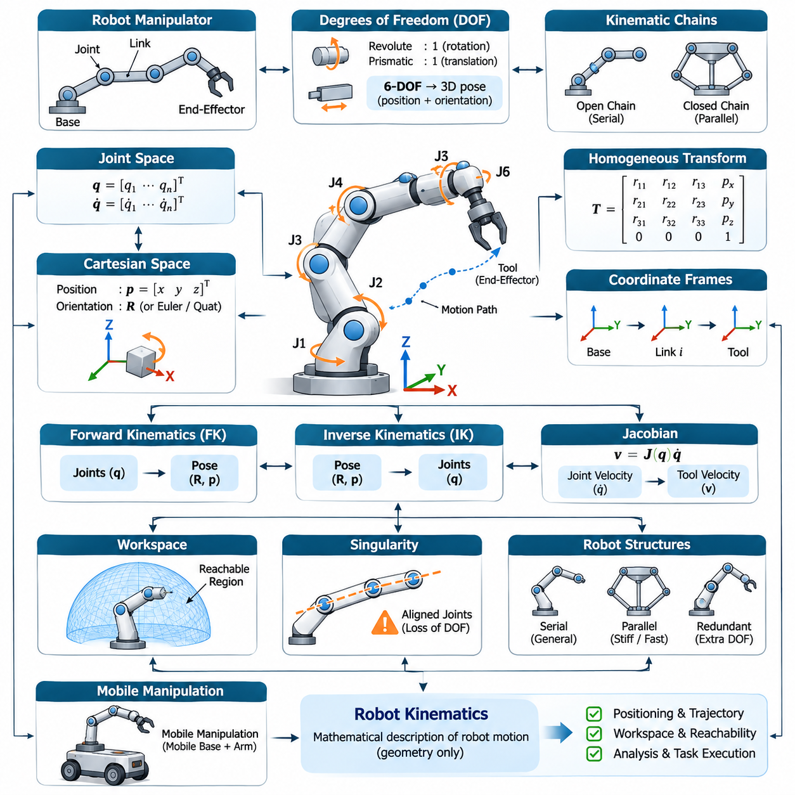
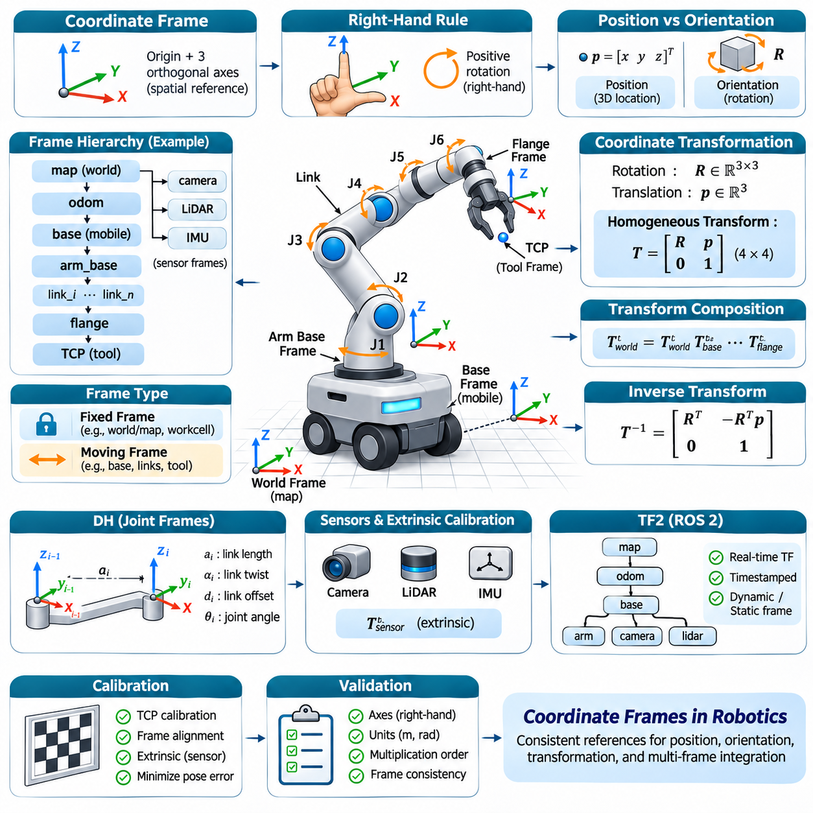
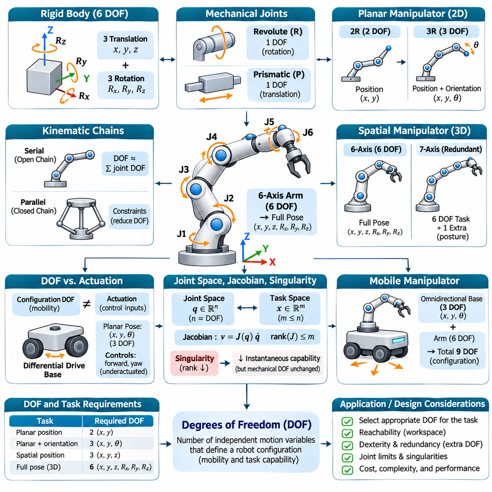
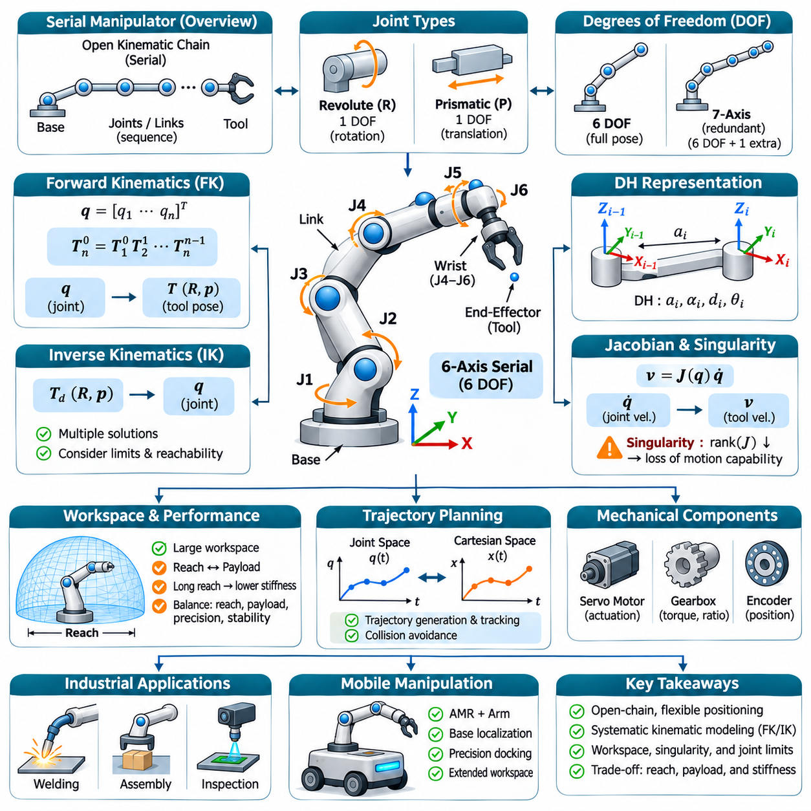
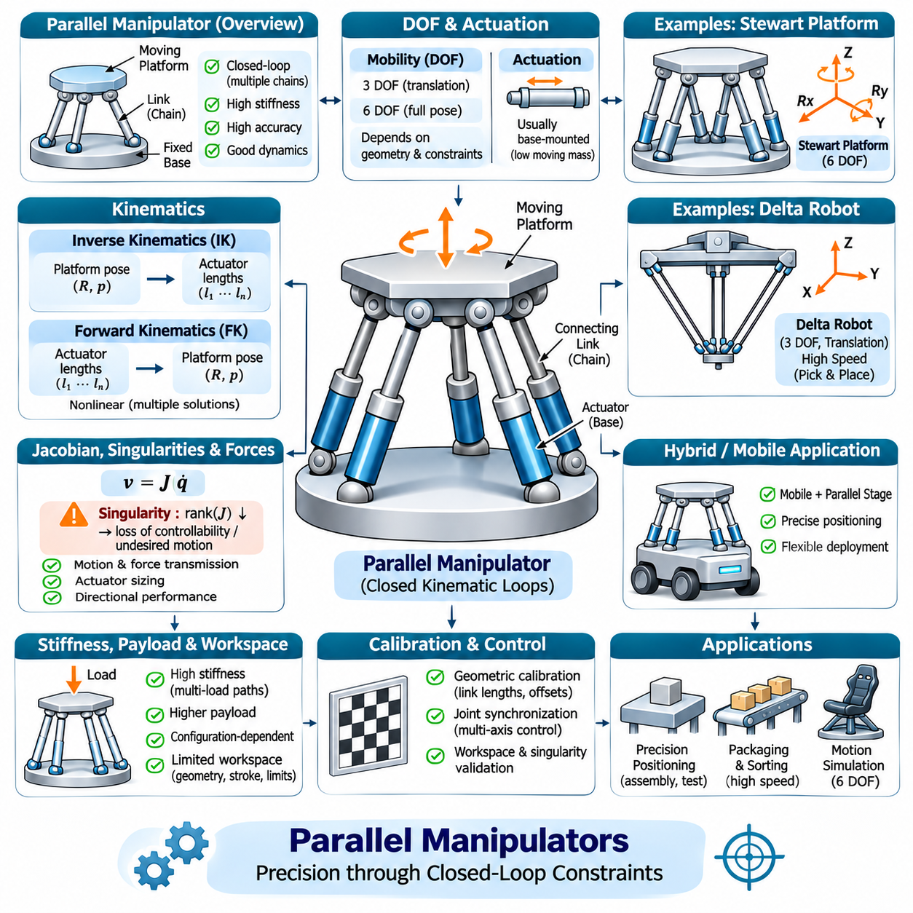
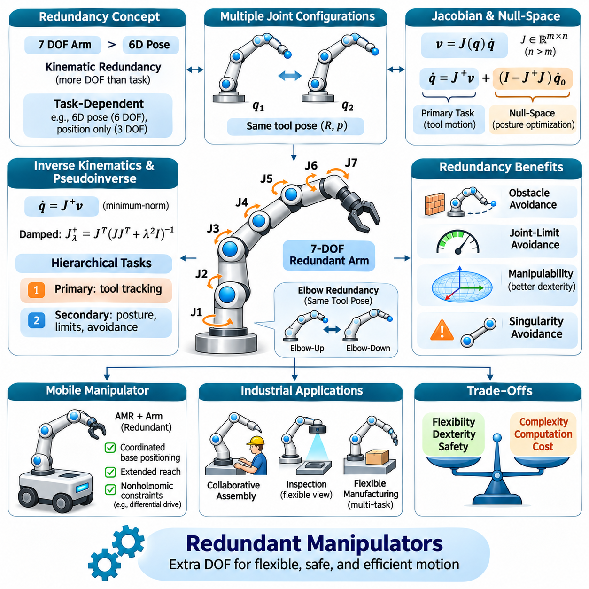
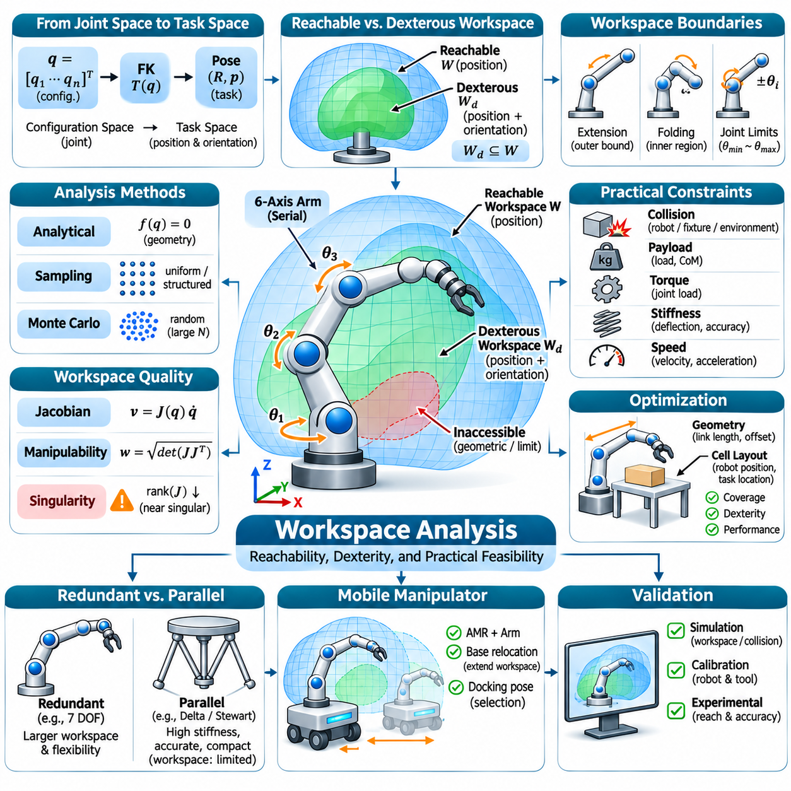
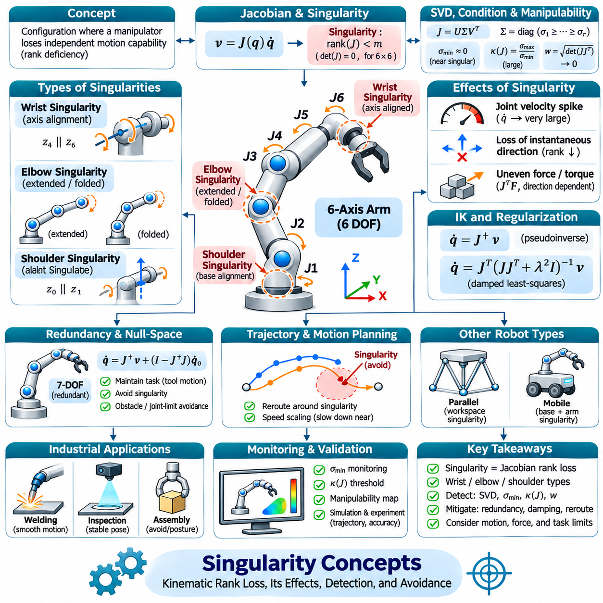
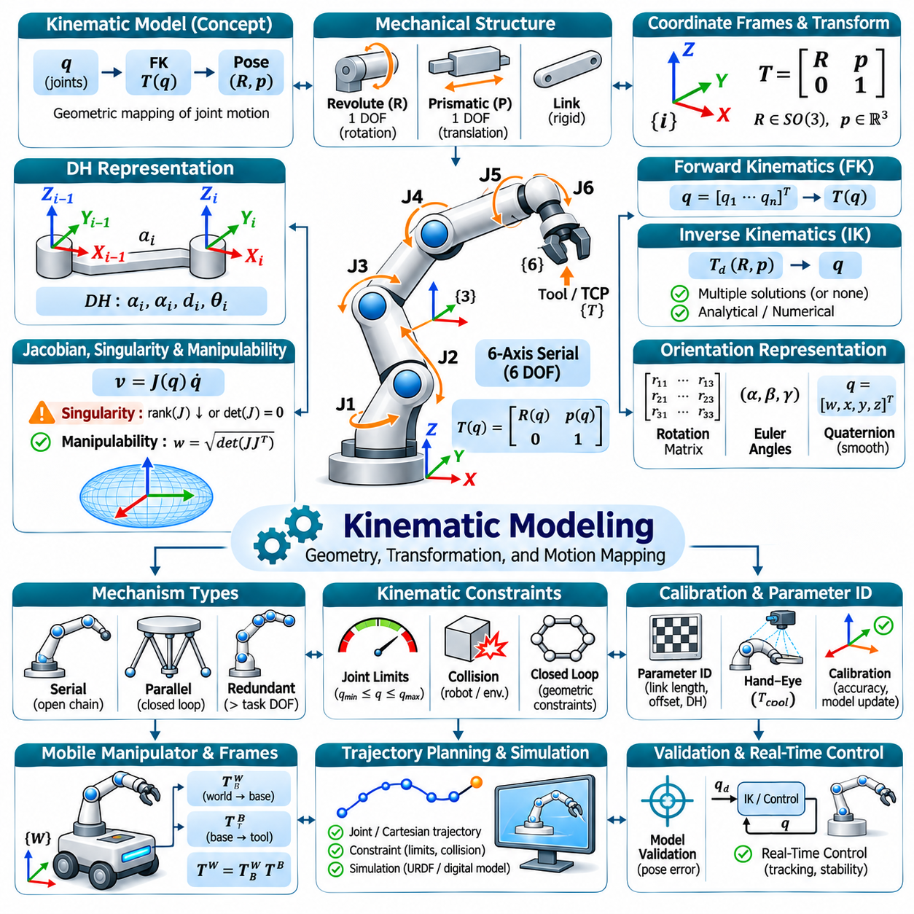
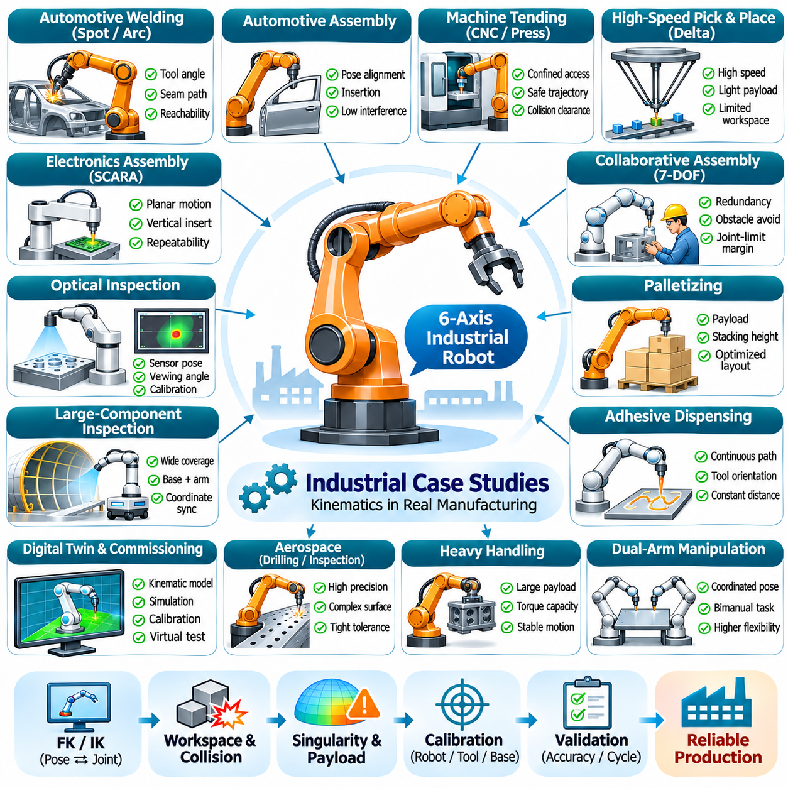

**Volume 02. Manipulator Mechanics and Control**


# Chapter 01. Robot Arm Kinematics

##  

## 01 Kinematics Fundamentals

{width="7.268055555555556in" height="7.268055555555556in"}

Robot arm kinematics provides the mathematical foundation for describing and predicting the motion of robotic manipulators. It establishes relationships between joint configurations and the position and orientation of a robot\'s end effector. Unlike dynamics, which considers forces, torques, and inertia, kinematics focuses exclusively on geometric motion. This distinction enables engineers to analyze robot movement independently of actuator characteristics and external loads.

A robotic manipulator consists of rigid links connected through mechanical joints that permit controlled relative motion. Each joint introduces specific motion constraints, while the arrangement of links determines the overall geometric structure. Kinematic analysis describes how individual joint movements combine to produce coordinated motion of the complete mechanism. This mathematical representation is essential for positioning, trajectory generation, workspace evaluation, and robotic task execution.

The fundamental variables of robot kinematics are joint positions, joint velocities, and joint accelerations. Joint positions define the instantaneous configuration of the manipulator, while velocities describe how that configuration changes over time. Accelerations characterize the rate of change of joint velocities. These variables can be represented as vectors, allowing mathematical operations to describe the collective behavior of multiple interconnected joints.

Robot motion is commonly described in two complementary spaces known as joint space and Cartesian space. Joint space represents the configuration of individual joints through angular or linear displacement variables. Cartesian space describes the position and orientation of the end effector relative to a selected reference frame. Transforming information between these spaces allows robotic controllers to convert geometric task requirements into executable joint movements.

The distinction between position and orientation is fundamental to manipulator kinematics. Position specifies the location of a point in three-dimensional space using coordinates along three independent axes. Orientation describes the rotational alignment of an object or tool relative to a reference coordinate system. Together, position and orientation define a rigid-body pose, which provides the information required to position an end effector accurately during manipulation.

Coordinate frames establish consistent references for describing the geometry of robotic systems. A frame typically contains an origin and three mutually perpendicular axes that define its spatial orientation. Frames may be attached to the robot base, individual links, joints, tools, or surrounding environment. By expressing geometric relationships between these frames, engineers can describe complex robot structures through organized mathematical transformations.

Rigid-body transformations combine translation and rotation into a unified mathematical representation. Translation describes displacement between coordinate frame origins, while rotation represents differences in axis orientation. Homogeneous transformation matrices provide a convenient mechanism for expressing both operations within a single matrix. Successive transformations can be multiplied to describe the accumulated geometric relationship between the robot base and end effector.

The degrees of freedom of a manipulator determine the number of independent variables required to describe its configuration. A revolute joint generally contributes one rotational degree of freedom, while a prismatic joint contributes one translational degree of freedom. A conventional six-axis industrial manipulator often provides sufficient independent motion to control an end-effector pose in three-dimensional space, subject to reachability and configuration constraints.

Kinematic chains represent the structural relationships between connected robot links and joints. An open kinematic chain contains a sequence of links extending from a fixed base toward an end effector without forming a closed mechanical loop. This configuration is common in industrial serial manipulators. Closed kinematic chains introduce additional geometric constraints because multiple mechanical paths connect parts of the mechanism.

Serial manipulators calculate end-effector motion through the sequential combination of joint transformations. Each joint contributes a relative transformation that depends on its displacement variable and mechanical geometry. The overall transformation is obtained by multiplying these individual relationships in their proper order. Consequently, changes in upstream joints influence the positions and orientations of downstream links throughout the manipulator.

Parallel manipulators employ multiple kinematic chains connecting a common base to a moving platform. Their mechanical structure introduces geometric constraints that distinguish their behavior from serial mechanisms. Parallel configurations may provide high structural stiffness and favorable load distribution, although their kinematic relationships can become mathematically complex. Understanding these differences helps engineers select suitable architectures for precision positioning and manipulation.

Forward kinematics determines the end-effector pose from a known set of joint variables. The calculation begins with the robot\'s mechanical geometry and applies the transformations associated with each joint. Its output provides the predicted position and orientation of the tool relative to a reference frame. Forward kinematics is essential for visualization, state estimation, collision checking, and verification of commanded robot configurations.

Inverse kinematics addresses the complementary problem of determining joint configurations that produce a desired end-effector pose. Depending on the manipulator geometry, a target pose may correspond to multiple valid configurations, a unique solution, or no feasible solution. Joint limits, workspace boundaries, and mechanical constraints further influence solution feasibility. Reliable inverse kinematics is therefore necessary for translating task-space objectives into robot commands.

Differential kinematics describes the relationship between joint velocities and instantaneous end-effector motion. The Jacobian matrix represents this relationship through local derivatives of the forward kinematic equations. Multiplying the Jacobian by the joint velocity vector produces the corresponding end-effector velocity representation. This formulation supports velocity control, motion planning, and the analysis of how joint movements influence tool motion.

The Jacobian also provides important information about manipulator dexterity and singular configurations. A singularity occurs when the manipulator loses the ability to generate certain instantaneous Cartesian motions independently. Near singular configurations, achieving a desired end-effector velocity may require unusually large joint velocities. Identifying these conditions is essential for maintaining stable motion and avoiding excessive actuator demands during robotic operation.

Workspace analysis evaluates the spatial region that a manipulator can reach under its geometric and mechanical constraints. The reachable workspace contains positions attainable by at least one valid joint configuration, while the dexterous workspace considers positions where specified orientation capabilities are available. These regions depend on link dimensions, joint arrangements, mechanical limits, and obstacles. Workspace evaluation supports manipulator selection and task layout optimization.

Redundant manipulators possess more independent joint variables than are strictly required for a specified end-effector task. This additional freedom allows multiple joint configurations to achieve the same tool pose. Redundancy can be exploited to avoid obstacles, maintain favorable joint configurations, reduce proximity to singularities, or improve motion efficiency. However, additional degrees of freedom also introduce the need for systematic redundancy resolution strategies.

Kinematic modeling requires accurate knowledge of the manipulator\'s physical dimensions and joint relationships. Link lengths, joint-axis directions, mechanical offsets, and tool mounting geometry directly influence predicted end-effector positions. Small modeling errors can accumulate across interconnected links and reduce positioning accuracy. Consequently, geometric calibration is an important process for aligning mathematical models with the physical characteristics of manufactured robotic systems.

The Denavit--Hartenberg convention provides a systematic approach for describing serial manipulator geometry using parameters associated with neighboring coordinate frames. These parameters characterize relative rotations, translations, and link relationships. The resulting transformation matrices can be combined to construct a complete kinematic model. Alternative formulations, including the product-of-exponentials method, offer additional representations suitable for different analytical and computational requirements.

Practical robotic systems must account for joint limits, encoder measurements, calibration offsets, and mechanical tolerances when applying kinematic equations. Although ideal models assume rigid links and precisely defined joint axes, real mechanisms may exhibit backlash, structural deflection, and manufacturing variation. These effects can produce differences between predicted and measured tool positions. Accurate operation therefore requires model verification and appropriate compensation procedures.

In mobile manipulation, robot arm kinematics must be integrated with the motion of the mobile platform. The arm base is no longer necessarily fixed relative to the environment, because platform translation and rotation change the global position of the manipulator. Coordinate transformations connect the mobile base, arm mounting frame, and end effector. This relationship enables the system to determine tool poses consistently while accounting for changes in platform position and orientation.

Mobile manipulators also introduce combined reachability considerations involving platform placement and arm configuration. A target that lies outside the arm\'s workspace from one platform position may become reachable after repositioning the mobile base. Coordinated planning can therefore optimize both platform location and manipulator posture. This capability is particularly valuable in warehouse picking, industrial inspection, material handling, and service robotics applications.

Kinematic calculations are fundamental components of modern robotic software architectures. Robot descriptions define joint relationships, link geometry, and coordinate frames, while transformation libraries maintain spatial relationships between system components. Motion planning frameworks use these representations to evaluate reachable poses and generate feasible trajectories. Consistent kinematic models allow perception, planning, and control modules to exchange geometric information reliably.

Validation of a kinematic model involves comparing predicted geometric behavior with measured or simulated robot configurations. Engineers may examine reference poses, joint motion directions, transformation consistency, and end-effector positioning errors. Testing across different configurations helps reveal incorrect coordinate assignments, parameter errors, and unexpected mechanical constraints. Reliable validation establishes confidence before the model is integrated into higher-level motion planning and control systems.

Robot arm kinematics ultimately connects mechanical structure with computational motion representation. It provides the mathematical language needed to describe configurations, predict tool poses, analyze movement capabilities, and identify geometric limitations. These principles form the foundation for forward and inverse kinematics, differential motion analysis, workspace optimization, and advanced manipulator control. Their accurate implementation is essential for dependable robotic manipulation in industrial and mobile environments.

로봇 팔 운동학(Robot Arm Kinematics)은 로봇 매니퓰레이터(Robotic Manipulator)의 움직임을 설명하고 예측하기 위한 수학적 기초를 제공한다. 운동학(Kinematics)은 관절 구성(Joint Configuration)과 말단효과기(End Effector)의 위치(Position) 및 자세(Orientation) 사이의 관계를 정의한다. 힘(Force), 토크(Torque), 관성(Inertia)을 고려하는 동역학(Dynamics)과 달리 운동학은 기하학적 움직임(Geometric Motion)에 집중한다. 이러한 구분을 통해 구동기(Actuator)의 특성과 외부 하중(External Load)을 고려하지 않고도 로봇의 움직임을 분석할 수 있다.

로봇 매니퓰레이터(Robotic Manipulator)는 기계적 관절(Mechanical Joint)로 연결된 강체 링크(Rigid Link)로 구성되며, 각 관절은 제어 가능한 상대 운동(Relative Motion)을 허용한다. 관절마다 특정한 운동 제약(Motion Constraint)이 존재하고 링크의 배열은 전체 기하학적 구조(Geometric Structure)를 결정한다. 운동학 분석(Kinematic Analysis)은 개별 관절의 움직임이 결합되어 전체 기구(Mechanism)의 협조 운동(Coordinated Motion)을 형성하는 과정을 설명한다. 이러한 수학적 표현은 위치 결정(Positioning), 궤적 생성(Trajectory Generation), 작업공간 평가(Workspace Evaluation), 로봇 작업 수행(Task Execution)에 필수적이다.

로봇 운동학의 기본 변수는 관절 위치(Joint Position), 관절 속도(Joint Velocity), 관절 가속도(Joint Acceleration)이다. 관절 위치는 매니퓰레이터의 순간적인 구성(Configuration)을 정의하며, 관절 속도는 해당 구성이 시간에 따라 변화하는 정도를 나타낸다. 관절 가속도는 관절 속도의 변화율을 의미한다. 이러한 변수들은 벡터(Vector)로 표현할 수 있으며, 이를 통해 여러 관절이 상호 연결된 시스템의 전체적인 운동 특성을 수학적으로 기술할 수 있다.

로봇의 움직임은 일반적으로 관절공간(Joint Space)과 데카르트공간(Cartesian Space)이라는 두 가지 상호 보완적인 공간에서 설명된다. 관절공간은 개별 관절의 각변위(Angular Displacement) 또는 선형변위(Linear Displacement)를 통해 로봇의 구성을 표현한다. 데카르트공간은 선택된 기준좌표계(Reference Frame)에 대한 말단효과기의 위치와 자세를 나타낸다. 두 공간 사이의 정보 변환을 통해 로봇 제어기(Robot Controller)는 기하학적 작업 요구사항을 실제 실행 가능한 관절 움직임으로 변환할 수 있다.

위치(Position)와 자세(Orientation)의 구분은 매니퓰레이터 운동학의 핵심 개념이다. 위치는 3차원 공간(Three-Dimensional Space)에서 서로 독립적인 세 축을 기준으로 한 점의 좌표를 나타낸다. 자세는 기준좌표계에 대한 물체 또는 도구의 회전 정렬(Rotational Alignment)을 설명한다. 위치와 자세를 결합하면 강체 포즈(Rigid-Body Pose)가 정의되며, 이는 로봇이 조작 작업(Manipulation Task)을 수행할 때 말단효과기를 정확하게 배치하는 데 필요한 정보를 제공한다.

좌표계(Coordinate Frame)는 로봇 시스템의 기하학적 구조를 일관되게 설명하기 위한 기준을 설정한다. 일반적인 좌표계는 원점(Origin)과 서로 직교하는 세 개의 축으로 구성되며, 이를 통해 공간적 방향(Spatial Orientation)을 정의한다. 좌표계는 로봇 베이스(Robot Base), 개별 링크(Link), 관절(Joint), 도구(Tool), 주변 환경(Environment)에 부착될 수 있다. 이러한 좌표계 사이의 기하학적 관계를 표현하면 복잡한 로봇 구조를 체계적인 수학적 변환(Mathematical Transformation)으로 설명할 수 있다.

강체 변환(Rigid-Body Transformation)은 병진이동(Translation)과 회전(Rotation)을 하나의 수학적 표현으로 결합한다. 병진이동은 좌표계 원점 사이의 위치 변화를 나타내며, 회전은 좌표축의 방향 차이를 설명한다. 동차변환행렬(Homogeneous Transformation Matrix)은 두 연산을 단일 행렬(Matrix)로 표현하는 편리한 방법을 제공한다. 연속적인 변환행렬을 곱하면 로봇 베이스에서 말단효과기까지 누적되는 기하학적 관계를 계산할 수 있다.

매니퓰레이터의 자유도(Degrees of Freedom, DOF)는 로봇의 구성을 설명하는 데 필요한 독립 변수의 수를 결정한다. 회전관절(Revolute Joint)은 일반적으로 하나의 회전 자유도를 제공하며, 직동관절(Prismatic Joint)은 하나의 병진 자유도를 제공한다. 일반적인 6축 산업용 매니퓰레이터(Six-Axis Industrial Manipulator)는 도달 가능성과 기구 구성의 제약조건을 만족하는 범위에서 3차원 공간의 말단효과기 포즈를 제어할 수 있는 충분한 독립 운동을 제공한다.

운동학적 체인(Kinematic Chain)은 연결된 로봇 링크와 관절 사이의 구조적 관계를 표현한다. 개방형 운동학적 체인(Open Kinematic Chain)은 고정 베이스(Fixed Base)에서 말단효과기까지 이어지는 링크의 연속적인 배열로 구성되며, 폐쇄된 기계적 루프(Mechanical Loop)를 형성하지 않는다. 이러한 구조는 산업용 직렬 매니퓰레이터(Serial Manipulator)에서 일반적으로 사용된다. 반면 폐쇄형 운동학적 체인(Closed Kinematic Chain)은 여러 기계적 경로가 기구의 일부를 연결하기 때문에 추가적인 기하학적 제약조건을 갖는다.

직렬 매니퓰레이터(Serial Manipulator)는 관절 변환(Joint Transformation)을 순차적으로 결합하여 말단효과기의 움직임을 계산한다. 각 관절은 자신의 변위 변수(Displacement Variable)와 기계적 형상(Mechanical Geometry)에 따라 상대 변환(Relative Transformation)을 생성한다. 전체 변환은 이러한 개별 관계를 올바른 순서로 곱하여 구한다. 따라서 상위 관절(Upstream Joint)의 움직임은 운동학적 체인 전체에서 하위 링크(Downstream Link)의 위치와 자세에 영향을 미친다.

병렬 매니퓰레이터(Parallel Manipulator)는 공통 베이스(Common Base)와 이동 플랫폼(Moving Platform)을 연결하는 여러 운동학적 체인을 사용한다. 이러한 기계적 구조는 직렬 기구와 구별되는 기하학적 제약조건을 형성한다. 병렬 구조는 높은 구조적 강성(Structural Stiffness)과 유리한 하중 분산(Load Distribution)을 제공할 수 있지만, 운동학적 관계가 수학적으로 복잡해질 수 있다. 이러한 차이를 이해하면 정밀 위치 결정(Precision Positioning)과 조작 작업에 적합한 기구 구조를 선택할 수 있다.

순기구학(Forward Kinematics)은 알려진 관절 변수(Joint Variable)로부터 말단효과기의 포즈를 계산한다. 계산은 로봇의 기계적 형상에서 시작하여 각 관절에 해당하는 변환을 적용하는 방식으로 진행된다. 계산 결과는 기준좌표계에 대한 도구의 예측 위치와 자세를 제공한다. 순기구학은 시각화(Visualization), 상태 추정(State Estimation), 충돌 검사(Collision Checking), 명령된 로봇 구성의 검증(Configuration Verification)에 필수적인 역할을 수행한다.

역기구학(Inverse Kinematics)은 원하는 말단효과기 포즈를 생성하는 관절 구성을 결정하는 반대 문제를 다룬다. 매니퓰레이터의 기하학적 구조에 따라 하나의 목표 포즈에 여러 개의 유효한 관절 구성이 존재하거나, 유일한 해(Solution)가 존재하거나, 실행 가능한 해가 없을 수도 있다. 관절 한계(Joint Limit), 작업공간 경계(Workspace Boundary), 기계적 제약조건(Mechanical Constraint)은 해의 실현 가능성에 추가적인 영향을 준다. 따라서 신뢰성 있는 역기구학 계산은 작업공간 목표를 실제 로봇 명령으로 변환하는 데 필요하다.

미분운동학(Differential Kinematics)은 관절 속도와 순간적인 말단효과기 움직임 사이의 관계를 설명한다. 자코비안 행렬(Jacobian Matrix)은 순기구학 방정식의 국소 미분(Local Derivative)을 통해 이러한 관계를 표현한다. 자코비안 행렬에 관절 속도 벡터(Joint Velocity Vector)를 곱하면 해당 말단효과기의 속도 표현을 얻을 수 있다. 이러한 수학적 구성은 속도 제어(Velocity Control), 운동 계획(Motion Planning), 관절 움직임이 도구 운동에 미치는 영향 분석에 활용된다.

자코비안 행렬(Jacobian Matrix)은 매니퓰레이터의 조작성(Dexterity)과 특이 구성(Singular Configuration)에 관한 중요한 정보도 제공한다. 특이점(Singularity)은 매니퓰레이터가 특정 방향의 순간적인 데카르트 운동(Cartesian Motion)을 독립적으로 생성할 수 있는 능력을 상실하는 상태를 의미한다. 특이점 근처에서는 원하는 말단효과기 속도를 생성하기 위해 비정상적으로 큰 관절 속도가 필요할 수 있다. 이러한 조건을 식별하는 것은 안정적인 움직임을 유지하고 로봇 작동 중 과도한 구동기 요구를 방지하는 데 중요하다.

작업공간 분석(Workspace Analysis)은 기하학적 제약조건과 기계적 제약조건 아래에서 매니퓰레이터가 도달할 수 있는 공간 영역을 평가한다. 도달 작업공간(Reachable Workspace)은 하나 이상의 유효한 관절 구성으로 접근할 수 있는 위치를 포함하며, 조작성 작업공간(Dexterous Workspace)은 지정된 자세 구현 능력까지 고려한다. 이러한 영역은 링크 치수(Link Dimension), 관절 배열(Joint Arrangement), 기계적 한계(Mechanical Limit), 장애물(Obstacle)에 따라 달라진다. 작업공간 평가는 매니퓰레이터 선정과 작업 배치 최적화(Task Layout Optimization)를 지원한다.

여유자유도 매니퓰레이터(Redundant Manipulator)는 특정 말단효과기 작업을 수행하는 데 필요한 자유도보다 더 많은 독립 관절 변수를 갖는다. 이러한 추가 자유도를 통해 동일한 도구 포즈를 구현하는 여러 관절 구성을 선택할 수 있다. 여유자유도(Redundancy)는 장애물 회피(Obstacle Avoidance), 유리한 관절 구성 유지, 특이점 접근 최소화, 운동 효율 향상에 활용할 수 있다. 그러나 자유도가 증가하면 체계적인 여유자유도 해소 전략(Redundancy Resolution Strategy)이 추가로 필요하다.

운동학 모델링(Kinematic Modeling)은 매니퓰레이터의 물리적 치수와 관절 관계에 대한 정확한 정보를 요구한다. 링크 길이(Link Length), 관절축 방향(Joint-Axis Direction), 기계적 오프셋(Mechanical Offset), 도구 장착 형상(Tool Mounting Geometry)은 예측된 말단효과기 위치에 직접적인 영향을 미친다. 작은 모델링 오차(Modeling Error)도 연결된 링크를 따라 누적되어 위치 정확도(Positioning Accuracy)를 저하시킬 수 있다. 따라서 기하학적 보정(Geometric Calibration)은 수학적 모델을 실제 제작된 로봇의 물리적 특성과 일치시키는 중요한 과정이다.

데나빗-하텐버그 규약(Denavit--Hartenberg Convention)은 인접 좌표계와 관련된 매개변수를 사용하여 직렬 매니퓰레이터의 기하학적 구조를 체계적으로 표현하는 방법이다. 이러한 매개변수(Parameter)는 상대 회전(Relative Rotation), 병진이동, 링크 관계(Link Relationship)를 정의한다. 생성된 변환행렬을 결합하면 완전한 운동학 모델(Kinematic Model)을 구성할 수 있다. 지수곱 방법(Product-of-Exponentials Method)을 포함한 대안적 수식화도 다양한 해석 및 계산 요구사항에 적합한 표현 방법을 제공한다.

실제 로봇 시스템에서는 운동학 방정식을 적용할 때 관절 한계(Joint Limit), 엔코더 측정값(Encoder Measurement), 보정 오프셋(Calibration Offset), 기계적 공차(Mechanical Tolerance)를 고려해야 한다. 이상적인 모델은 강체 링크와 정확하게 정의된 관절축을 가정하지만, 실제 기구에서는 백래시(Backlash), 구조적 변형(Structural Deflection), 제조 편차(Manufacturing Variation)가 발생할 수 있다. 이러한 영향은 예측된 도구 위치와 측정된 위치 사이에 차이를 만든다. 따라서 정확한 작동을 위해서는 모델 검증(Model Verification)과 적절한 보정 절차(Compensation Procedure)가 필요하다.

모바일 매니퓰레이션(Mobile Manipulation)에서는 로봇 팔 운동학을 이동 플랫폼(Mobile Platform)의 움직임과 통합해야 한다. 플랫폼의 병진이동과 회전이 매니퓰레이터의 전역 위치(Global Position)를 변화시키기 때문에 로봇 팔 베이스는 환경에 대해 항상 고정되어 있지 않다. 좌표 변환(Coordinate Transformation)은 이동 베이스(Mobile Base), 로봇 팔 장착 좌표계(Arm Mounting Frame), 말단효과기를 연결한다. 이러한 관계를 통해 시스템은 플랫폼의 위치와 자세 변화를 고려하면서 도구 포즈를 일관되게 계산할 수 있다.

모바일 매니퓰레이터(Mobile Manipulator)는 플랫폼 배치(Platform Placement)와 로봇 팔 구성(Arm Configuration)을 함께 고려하는 통합 도달 가능성(Combined Reachability) 문제도 갖는다. 특정 플랫폼 위치에서 로봇 팔의 작업공간 밖에 있는 목표라도 이동 베이스를 재배치하면 도달할 수 있다. 따라서 협조 계획(Coordinated Planning)을 통해 플랫폼 위치와 매니퓰레이터 자세를 동시에 최적화할 수 있다. 이러한 능력은 창고 피킹(Warehouse Picking), 산업 검사(Industrial Inspection), 자재 취급(Material Handling), 서비스 로보틱스(Service Robotics) 분야에서 특히 유용하다.

운동학 계산(Kinematic Calculation)은 현대 로봇 소프트웨어 아키텍처(Robotic Software Architecture)의 핵심 구성요소이다. 로봇 기술 모델(Robot Description Model)은 관절 관계, 링크 형상, 좌표계를 정의하며, 변환 라이브러리(Transformation Library)는 시스템 구성요소 사이의 공간적 관계를 관리한다. 운동 계획 프레임워크(Motion Planning Framework)는 이러한 표현을 활용하여 도달 가능한 포즈를 평가하고 실행 가능한 궤적을 생성한다. 일관된 운동학 모델은 인지(Perception), 계획(Planning), 제어(Control) 모듈 사이에서 기하학적 정보를 신뢰성 있게 교환하도록 지원한다.

운동학 모델의 검증(Kinematic Model Validation)은 예측된 기하학적 움직임을 실제 측정값 또는 시뮬레이션된 로봇 구성과 비교하는 과정이다. 엔지니어는 기준 포즈(Reference Pose), 관절 운동 방향(Joint Motion Direction), 변환 일관성(Transformation Consistency), 말단효과기 위치 오차(End-Effector Positioning Error)를 평가할 수 있다. 다양한 구성에서 시험하면 잘못된 좌표계 할당(Coordinate Assignment), 매개변수 오류(Parameter Error), 예상하지 못한 기계적 제약조건을 발견할 수 있다. 신뢰성 있는 검증은 모델을 상위 수준의 운동 계획 및 제어 시스템에 통합하기 전에 충분한 신뢰도를 확보하는 기반이 된다.

로봇 팔 운동학(Robot Arm Kinematics)은 궁극적으로 기계적 구조(Mechanical Structure)와 계산 기반 운동 표현(Computational Motion Representation)을 연결한다. 운동학은 로봇 구성을 설명하고 도구 포즈를 예측하며 운동 능력을 분석하고 기하학적 한계를 식별하는 데 필요한 수학적 언어를 제공한다. 이러한 원리는 순기구학(Forward Kinematics), 역기구학(Inverse Kinematics), 미분 운동 분석(Differential Motion Analysis), 작업공간 최적화(Workspace Optimization), 고급 매니퓰레이터 제어(Advanced Manipulator Control)의 기초를 형성한다. 정확한 운동학 구현은 산업 환경과 이동 환경에서 신뢰성 있는 로봇 조작을 실현하기 위한 필수 조건이다.

##  

## 02 Coordinate Frames

{width="7.268055555555556in" height="7.268055555555556in"}

Coordinate frames provide the fundamental reference structure for describing positions, orientations, and motion in robotic manipulators. A coordinate frame consists of an origin and three mutually perpendicular axes that establish a local spatial reference. By assigning frames to mechanical components, engineers can express geometric relationships consistently and calculate how individual joint movements influence the overall configuration of a robotic system.

In three-dimensional robotics, coordinate frames are commonly represented using Cartesian coordinate systems with X, Y, and Z axes. These axes define three independent directions for measuring spatial displacement. Most robotic applications employ right-handed coordinate systems, where the orientation of the axes follows the right-hand rule. Consistent axis conventions are essential for preventing sign errors and maintaining compatibility between mathematical models and physical mechanisms.

The origin of a coordinate frame establishes the reference point from which positions are measured. Its orientation determines how vectors and geometric quantities are expressed relative to the associated axes. A point may have different numerical coordinates when represented in different frames, even though its physical location remains unchanged. This distinction between physical geometry and coordinate representation is central to understanding robotic transformations.

A robot base frame provides the primary reference for describing the manipulator\'s mechanical structure. It is typically attached to the fixed mounting surface or base assembly of the robot arm. Joint positions, link transformations, and end-effector poses are frequently calculated relative to this frame. In stationary industrial manipulators, the base frame normally remains fixed, while mobile manipulators require additional transformations to account for platform movement.

Joint coordinate frames are assigned to individual joints to describe their relative motion and geometric relationships. For revolute joints, the associated transformation depends on the joint rotation angle. For prismatic joints, it depends on linear displacement along the permitted motion axis. Properly defined joint frames simplify the mathematical representation of mechanical constraints and enable systematic construction of complete manipulator kinematic models.

Link coordinate frames describe the spatial relationships between rigid mechanical segments. Each frame is attached to a corresponding link and moves with that link during robot operation. The relative transformation between neighboring link frames represents the geometry and motion introduced by their connecting joint. Combining these transformations produces a mathematical description of the entire kinematic chain from the robot base to the terminal link.

The end-effector frame represents the position and orientation of the robot\'s terminal mechanical interface. It may be attached to a mounting flange, gripper, welding torch, inspection sensor, or other manipulation device. Because different tools have different geometries, the end-effector frame does not always coincide with the actual working point. Additional tool frames are therefore introduced to represent task-specific locations and orientations.

A tool center point, commonly abbreviated as TCP, defines a reference point associated with the functional tip or operational center of a robotic tool. For a welding robot, the TCP may correspond to the welding tip, while a gripping system may define it at the center of the grasping region. Accurate TCP calibration is essential because positioning errors in the tool frame directly affect the precision of manipulation and industrial processing tasks.

A world coordinate frame establishes a common spatial reference for the robot and its surrounding environment. Unlike frames attached to moving mechanical components, the world frame is generally treated as stationary within the selected operating environment. It enables robot positions, workstations, obstacles, and target objects to be represented consistently. World frames are particularly important when multiple robots or external sensing systems share spatial information.

Coordinate transformations describe how positions and orientations expressed in one frame can be represented in another. A transformation contains rotational and translational components that define the relative relationship between two frames. Rotation changes the coordinate-axis representation, while translation accounts for displacement between frame origins. Together, these operations allow geometric information to move consistently across different reference systems.

Rotation matrices provide a mathematical representation of relative orientation between coordinate frames. A three-dimensional rotation matrix contains nine elements arranged in a three-by-three structure. Its columns can represent the axes of one frame expressed in another frame, depending on the adopted convention. Valid rotation matrices are orthogonal and have a determinant of positive one, ensuring that rigid-body orientation is preserved without scaling or reflection.

Homogeneous transformation matrices combine rotation and translation into a single four-by-four matrix. The upper-left three-by-three block represents orientation, while the upper-right three-element column describes translation. The final row provides the mathematical structure required for homogeneous coordinates. This representation allows multiple transformations to be composed through matrix multiplication, simplifying calculations across complex robotic mechanisms.

Transformation composition enables engineers to determine relationships between coordinate frames that are not directly connected. For example, the pose of a tool relative to the world frame can be obtained by combining transformations from the world to the robot base, through successive links, and finally to the tool. Matrix multiplication order is critical because spatial transformations are generally noncommutative. Reversing their order can produce physically incorrect results.

Inverse transformations convert geometric information from one reference direction to the opposite direction. If a transformation describes the pose of frame B relative to frame A, its inverse provides the pose of frame A relative to frame B. The inverse rotation is obtained through matrix transposition, while the inverse translation must account for the reversed orientation. These operations are essential when exchanging coordinates between sensors, robots, and environmental references.

The Denavit--Hartenberg convention provides a systematic method for assigning coordinate frames to serial robotic manipulators. It describes relationships between neighboring frames using four geometric parameters associated with joint axes and link geometry. Standardized frame assignment reduces modeling ambiguity and supports repeatable kinematic calculations. However, frame placement must follow the selected convention consistently to avoid incorrect transformation equations.

Coordinate frames are also essential for representing sensor measurements within robotic systems. Cameras, LiDAR sensors, force sensors, and inertial measurement units typically produce data relative to their own local reference frames. To combine these measurements with robot geometry, the corresponding sensor-to-robot transformations must be known. Accurate extrinsic calibration ensures that detected objects and environmental features are represented in consistent spatial coordinates.

Mobile manipulators require additional coordinate frames because the robotic arm is mounted on a moving platform. A typical system includes world, odometry, mobile base, arm base, joint, and tool frames. The mobile platform changes its pose relative to the environment, while the arm moves relative to the platform. Maintaining these relationships enables coordinated navigation and manipulation without losing consistency between global target positions and local arm configurations.

In mobile robotics, the odometry frame provides a locally continuous reference for estimating platform movement over time. A map frame may provide a globally corrected reference based on localization and environmental observations. The transformation between these frames can change when localization estimates are updated. Separating these references allows motion controllers to maintain continuous local behavior while incorporating corrections from mapping and localization systems.

Coordinate frame hierarchies organize spatial relationships into connected transformation structures. Each frame has a defined relationship to another frame, forming a tree of transformations that can be evaluated to obtain relative poses. This organization is widely used in robotic software because it separates mechanical geometry from real-time motion updates. A consistent hierarchy also simplifies integration between navigation, perception, manipulation, and control components.

In ROS 2 systems, the TF2 framework manages coordinate transformations between robot components and environmental references. It maintains time-stamped transformation relationships and allows software modules to request geometric information between connected frames. Robot descriptions commonly define fixed mechanical relationships, while joint states and localization modules provide dynamic transformations. This architecture supports modular development and synchronized spatial reasoning.

Time synchronization is particularly important when coordinate frames are associated with moving components. A sensor measurement captured at one instant must be transformed using the robot configuration corresponding to that measurement time. Applying a transformation from an incorrect timestamp can introduce spatial errors, especially during rapid movement. Reliable robotic systems therefore maintain time-aware transformation histories and coordinate sensor data with motion estimates.

Frame calibration determines the actual geometric relationships between physical components and their mathematical representations. Common calibration procedures estimate tool offsets, sensor mounting transformations, and robot-to-workstation alignment. Calibration errors can propagate through transformation chains and reduce overall positioning accuracy. Repeated measurements, geometric constraints, and reference targets help establish reliable coordinate relationships for precision robotic applications.

Incorrect coordinate frame definitions can cause unexpected motion, inaccurate object localization, and failures in trajectory execution. Common problems include reversed axis directions, inconsistent rotation conventions, incorrect transformation order, and mismatched measurement units. Engineers should validate frame orientations and transformation relationships using known reference poses. Systematic verification is especially important when integrating hardware and software developed by different suppliers.

Coordinate frames ultimately establish the geometric foundation connecting robot mechanics, sensing, planning, and control. They enable consistent representation of positions and orientations across interconnected mechanical and computational components. Accurate frame assignment, transformation composition, calibration, and synchronization are essential for reliable forward kinematics, inverse kinematics, and coordinated robotic motion. Their importance becomes even greater in mobile manipulation systems where both the platform and robotic arm move within a shared environment.

좌표계(Coordinate Frame)는 로봇 매니퓰레이터(Robotic Manipulator)의 위치(Position), 자세(Orientation), 움직임(Motion)을 설명하기 위한 기본적인 기준 구조(Reference Structure)를 제공한다. 좌표계는 원점(Origin)과 서로 직교하는 세 개의 축(Axis)으로 구성되며, 국소적인 공간 기준(Local Spatial Reference)을 설정한다. 기계적 구성요소(Mechanical Component)에 좌표계를 할당하면 기하학적 관계(Geometric Relationship)를 일관되게 표현하고 개별 관절의 움직임이 전체 로봇 시스템의 구성에 미치는 영향을 계산할 수 있다.

3차원 로봇공학(Three-Dimensional Robotics)에서 좌표계는 일반적으로 X, Y, Z축을 사용하는 데카르트 좌표계(Cartesian Coordinate System)로 표현된다. 이러한 축은 공간 변위(Spatial Displacement)를 측정하기 위한 세 개의 독립적인 방향을 정의한다. 대부분의 로봇 응용 분야에서는 오른손 법칙(Right-Hand Rule)을 따르는 오른손 좌표계(Right-Handed Coordinate System)를 사용한다. 일관된 축 규약(Axis Convention)은 부호 오류(Sign Error)를 방지하고 수학적 모델과 실제 기계 구조 사이의 호환성을 유지하는 데 필수적이다.

좌표계의 원점(Origin)은 위치를 측정하는 기준점(Reference Point)을 설정한다. 좌표계의 자세는 관련 축을 기준으로 벡터(Vector)와 기하학적 물리량(Geometric Quantity)을 표현하는 방법을 결정한다. 동일한 점이라도 서로 다른 좌표계에서 표현하면 수치적 좌표(Numerical Coordinate)가 달라질 수 있지만 실제 물리적 위치는 변하지 않는다. 물리적 기하학(Physical Geometry)과 좌표 표현(Coordinate Representation)의 이러한 차이를 이해하는 것은 로봇 좌표 변환(Robotic Transformation)의 핵심이다.

로봇 베이스 좌표계(Robot Base Frame)는 매니퓰레이터의 기계적 구조를 설명하기 위한 주요 기준을 제공한다. 일반적으로 로봇 팔의 고정 장착면(Fixed Mounting Surface) 또는 베이스 조립체(Base Assembly)에 부착된다. 관절 위치(Joint Position), 링크 변환(Link Transformation), 말단효과기 포즈(End-Effector Pose)는 이 좌표계를 기준으로 계산되는 경우가 많다. 고정형 산업용 매니퓰레이터에서는 베이스 좌표계가 일반적으로 고정되어 있지만, 모바일 매니퓰레이터에서는 플랫폼 이동을 고려하기 위한 추가적인 좌표 변환이 필요하다.

관절 좌표계(Joint Coordinate Frame)는 개별 관절에 할당되어 상대 운동(Relative Motion)과 기하학적 관계를 설명한다. 회전관절(Revolute Joint)의 경우 관련 변환은 관절 회전각(Joint Rotation Angle)에 따라 달라진다. 직동관절(Prismatic Joint)의 경우 허용된 운동축(Motion Axis)을 따라 발생하는 선형변위(Linear Displacement)에 의해 결정된다. 올바르게 정의된 관절 좌표계는 기계적 제약조건(Mechanical Constraint)의 수학적 표현을 단순화하고 전체 매니퓰레이터 운동학 모델(Kinematic Model)을 체계적으로 구성할 수 있도록 한다.

링크 좌표계(Link Coordinate Frame)는 강체 기계 요소(Rigid Mechanical Segment) 사이의 공간적 관계(Spatial Relationship)를 설명한다. 각 좌표계는 해당 링크에 부착되며 로봇이 작동하는 동안 링크와 함께 움직인다. 인접한 링크 좌표계 사이의 상대 변환(Relative Transformation)은 연결 관절에 의해 발생하는 기하학적 구조와 움직임을 나타낸다. 이러한 변환을 결합하면 로봇 베이스에서 마지막 링크까지 이어지는 전체 운동학적 체인(Kinematic Chain)을 수학적으로 표현할 수 있다.

말단효과기 좌표계(End-Effector Frame)는 로봇의 최종 기계적 인터페이스(Terminal Mechanical Interface)의 위치와 자세를 나타낸다. 이 좌표계는 장착 플랜지(Mounting Flange), 그리퍼(Gripper), 용접 토치(Welding Torch), 검사 센서(Inspection Sensor) 또는 기타 조작 장치(Manipulation Device)에 부착될 수 있다. 도구마다 기하학적 구조가 다르므로 말단효과기 좌표계가 실제 작업점(Working Point)과 항상 일치하는 것은 아니다. 따라서 작업별 위치와 자세를 표현하기 위해 추가적인 도구 좌표계(Tool Frame)를 도입한다.

도구 중심점(Tool Center Point, TCP)은 로봇 도구의 기능적 끝단(Functional Tip) 또는 작업 중심(Operational Center)과 관련된 기준점을 정의한다. 용접 로봇(Welding Robot)의 경우 TCP는 용접 팁(Welding Tip)에 해당할 수 있으며, 파지 시스템(Gripping System)에서는 파지 영역(Grasping Region)의 중심으로 정의할 수 있다. 도구 좌표계의 위치 오차(Positioning Error)는 조작 및 산업 공정 작업의 정밀도에 직접적인 영향을 미치므로 정확한 TCP 보정(TCP Calibration)이 필수적이다.

월드 좌표계(World Coordinate Frame)는 로봇과 주변 환경에 대한 공통 공간 기준(Common Spatial Reference)을 설정한다. 움직이는 기계적 구성요소에 부착된 좌표계와 달리 월드 좌표계는 일반적으로 선택된 작업 환경에서 고정된 것으로 간주된다. 이를 통해 로봇 위치, 작업장(Workstation), 장애물(Obstacle), 목표 물체(Target Object)를 일관되게 표현할 수 있다. 월드 좌표계는 여러 로봇 또는 외부 센싱 시스템(External Sensing System)이 공간 정보를 공유할 때 특히 중요하다.

좌표 변환(Coordinate Transformation)은 한 좌표계에서 표현된 위치와 자세를 다른 좌표계에서 표현하는 방법을 설명한다. 변환에는 두 좌표계 사이의 상대적 관계를 정의하는 회전 성분(Rotational Component)과 병진 성분(Translational Component)이 포함된다. 회전(Rotation)은 좌표축의 표현을 변경하고 병진이동(Translation)은 좌표계 원점 사이의 변위를 반영한다. 두 연산을 결합하면 서로 다른 기준좌표계 사이에서 기하학적 정보를 일관되게 변환할 수 있다.

회전행렬(Rotation Matrix)은 좌표계 사이의 상대 자세(Relative Orientation)를 수학적으로 표현한다. 3차원 회전행렬은 3×3 구조로 배열된 아홉 개의 원소(Element)로 구성된다. 채택한 규약(Convention)에 따라 각 열(Column)은 다른 좌표계에서 표현된 특정 좌표계의 축을 나타낼 수 있다. 유효한 회전행렬은 직교성(Orthogonality)을 만족하고 행렬식(Determinant)이 양의 1이며, 이를 통해 크기 변환(Scaling)이나 반사(Reflection) 없이 강체의 자세를 유지한다.

동차변환행렬(Homogeneous Transformation Matrix)은 회전과 병진이동을 하나의 4×4 행렬로 결합한다. 좌측 상단의 3×3 블록(Block)은 자세를 나타내며, 우측 상단의 세 원소로 구성된 열(Column)은 병진이동을 설명한다. 마지막 행(Row)은 동차좌표(Homogeneous Coordinate)에 필요한 수학적 구조를 제공한다. 이러한 표현을 사용하면 여러 변환을 행렬 곱셈(Matrix Multiplication)으로 결합할 수 있어 복잡한 로봇 기구의 계산을 단순화할 수 있다.

변환 합성(Transformation Composition)을 사용하면 직접 연결되지 않은 좌표계 사이의 관계를 계산할 수 있다. 예를 들어 월드 좌표계에 대한 도구의 포즈는 월드 좌표계에서 로봇 베이스로 이어지는 변환과 연속된 링크 및 도구까지의 변환을 결합하여 구할 수 있다. 공간 변환(Spatial Transformation)은 일반적으로 교환법칙(Commutative Property)이 성립하지 않으므로 행렬 곱셈 순서가 매우 중요하다. 변환 순서를 반대로 적용하면 물리적으로 잘못된 결과가 발생할 수 있다.

역변환(Inverse Transformation)은 한 방향으로 정의된 좌표 관계를 반대 방향으로 변환한다. 어떤 변환이 좌표계 A에 대한 좌표계 B의 포즈를 설명한다면, 역변환은 좌표계 B에 대한 좌표계 A의 포즈를 제공한다. 역회전(Inverse Rotation)은 회전행렬의 전치(Transpose)를 통해 구할 수 있으며, 역병진(Inverse Translation)은 반전된 자세를 고려해야 한다. 이러한 연산은 센서, 로봇, 환경 기준좌표계 사이에서 좌표 정보를 교환할 때 필수적이다.

데나빗-하텐버그 규약(Denavit--Hartenberg Convention)은 직렬 로봇 매니퓰레이터(Serial Robotic Manipulator)에 좌표계를 체계적으로 할당하는 방법을 제공한다. 이 방법은 관절축(Joint Axis)과 링크 기하학(Link Geometry)에 관련된 네 개의 기하학적 매개변수(Geometric Parameter)를 사용하여 인접 좌표계 사이의 관계를 설명한다. 표준화된 좌표계 할당(Standardized Frame Assignment)은 모델링의 모호성(Modeling Ambiguity)을 줄이고 반복 가능한 운동학 계산을 지원한다. 다만 잘못된 변환 방정식을 방지하려면 선택한 규약에 따라 좌표계를 일관되게 배치해야 한다.

좌표계는 로봇 시스템에서 센서 측정값(Sensor Measurement)을 표현하는 데에도 필수적이다. 카메라(Camera), 라이다(LiDAR), 힘 센서(Force Sensor), 관성측정장치(Inertial Measurement Unit, IMU)는 일반적으로 자체적인 국소 기준좌표계(Local Reference Frame)를 기준으로 데이터를 생성한다. 이러한 측정값을 로봇 기하학과 결합하려면 센서와 로봇 사이의 변환(Sensor-to-Robot Transformation)을 알아야 한다. 정확한 외부 보정(Extrinsic Calibration)은 검출된 물체와 환경 특징(Environmental Feature)이 일관된 공간 좌표로 표현되도록 보장한다.

모바일 매니퓰레이터(Mobile Manipulator)는 로봇 팔이 이동 플랫폼(Mobile Platform)에 장착되어 있으므로 추가적인 좌표계가 필요하다. 일반적인 시스템에는 월드 좌표계(World Frame), 오도메트리 좌표계(Odometry Frame), 이동 베이스 좌표계(Mobile Base Frame), 로봇 팔 베이스 좌표계(Arm Base Frame), 관절 좌표계(Joint Frame), 도구 좌표계(Tool Frame)가 포함된다. 이동 플랫폼은 환경에 대한 포즈를 변경하고 로봇 팔은 플랫폼을 기준으로 움직인다. 이러한 관계를 유지하면 전역 목표 위치(Global Target Position)와 국소 로봇 팔 구성(Local Arm Configuration) 사이의 일관성을 잃지 않고 내비게이션(Navigation)과 조작(Manipulation)을 협조적으로 수행할 수 있다.

이동 로봇공학(Mobile Robotics)에서 오도메트리 좌표계(Odometry Frame)는 시간에 따른 플랫폼 움직임을 추정하기 위한 국소적으로 연속적인 기준(Local Continuous Reference)을 제공한다. 맵 좌표계(Map Frame)는 위치 추정(Localization)과 환경 관측(Environmental Observation)을 기반으로 전역적으로 보정된 기준(Global Corrected Reference)을 제공할 수 있다. 위치 추정 결과가 갱신되면 두 좌표계 사이의 변환도 변경될 수 있다. 이러한 기준을 분리하면 운동 제어기(Motion Controller)가 맵핑(Mapping)과 위치 추정 시스템의 보정 결과를 반영하면서도 연속적인 국소 제어 동작을 유지할 수 있다.

좌표계 계층구조(Coordinate Frame Hierarchy)는 공간적 관계를 연결된 변환 구조(Transformation Structure)로 구성한다. 각 좌표계는 다른 좌표계와 정의된 관계를 가지며, 상대 포즈(Relative Pose)를 계산할 수 있는 변환 트리(Transformation Tree)를 형성한다. 이러한 구조는 기계적 형상(Mechanical Geometry)과 실시간 운동 갱신(Real-Time Motion Update)을 분리하므로 로봇 소프트웨어에서 널리 사용된다. 일관된 계층구조는 내비게이션, 인지(Perception), 조작, 제어 구성요소 사이의 통합도 단순화한다.

ROS 2 시스템에서 TF2 프레임워크(TF2 Framework)는 로봇 구성요소와 환경 기준좌표계 사이의 좌표 변환을 관리한다. TF2는 시간 정보가 포함된 변환 관계(Time-Stamped Transformation Relationship)를 유지하고 소프트웨어 모듈이 연결된 좌표계 사이의 기하학적 정보를 요청할 수 있도록 한다. 로봇 기술 모델(Robot Description)은 일반적으로 고정된 기계적 관계를 정의하며, 관절 상태(Joint State)와 위치 추정 모듈(Localization Module)은 동적 변환(Dynamic Transformation)을 제공한다. 이러한 아키텍처는 모듈형 개발(Modular Development)과 동기화된 공간 추론(Synchronized Spatial Reasoning)을 지원한다.

시간 동기화(Time Synchronization)는 움직이는 구성요소와 연결된 좌표계를 사용할 때 특히 중요하다. 특정 시점에 획득한 센서 측정값은 해당 측정 시점의 로봇 구성(Robot Configuration)을 사용하여 변환해야 한다. 잘못된 타임스탬프(Timestamp)의 변환을 적용하면 공간 오차(Spatial Error)가 발생할 수 있으며, 특히 빠른 움직임 중에는 이러한 영향이 커진다. 따라서 신뢰성 있는 로봇 시스템은 시간 정보를 고려한 변환 이력(Time-Aware Transformation History)을 유지하고 센서 데이터와 운동 추정값(Motion Estimate)을 동기화한다.

좌표계 보정(Frame Calibration)은 물리적 구성요소와 수학적 표현 사이의 실제 기하학적 관계를 결정한다. 일반적인 보정 절차(Calibration Procedure)는 도구 오프셋(Tool Offset), 센서 장착 변환(Sensor Mounting Transformation), 로봇과 작업장 사이의 정렬(Robot-to-Workstation Alignment)을 추정한다. 보정 오차(Calibration Error)는 변환 체인(Transformation Chain)을 따라 전파되어 전체 위치 정확도를 저하시킬 수 있다. 반복 측정(Repeated Measurement), 기하학적 제약조건(Geometric Constraint), 기준 목표물(Reference Target)은 정밀 로봇 응용 분야에서 신뢰성 있는 좌표 관계를 설정하는 데 도움이 된다.

잘못된 좌표계 정의(Coordinate Frame Definition)는 예상하지 못한 움직임, 부정확한 물체 위치 추정(Object Localization), 궤적 실행(Trajectory Execution) 실패를 초래할 수 있다. 일반적인 문제에는 반전된 축 방향(Reversed Axis Direction), 일관되지 않은 회전 규약(Rotation Convention), 잘못된 변환 순서(Transformation Order), 측정 단위 불일치(Measurement Unit Mismatch)가 포함된다. 엔지니어는 알려진 기준 포즈(Reference Pose)를 사용하여 좌표축 방향과 변환 관계를 검증해야 한다. 체계적인 검증(Systematic Verification)은 서로 다른 공급업체가 개발한 하드웨어와 소프트웨어를 통합할 때 특히 중요하다.

좌표계(Coordinate Frame)는 궁극적으로 로봇 기구학(Robot Mechanics), 센싱(Sensing), 계획(Planning), 제어(Control)를 연결하는 기하학적 기반(Geometric Foundation)을 형성한다. 좌표계는 상호 연결된 기계적 구성요소와 계산 구성요소 사이에서 위치와 자세를 일관되게 표현할 수 있도록 한다. 정확한 좌표계 할당(Frame Assignment), 변환 합성(Transformation Composition), 보정(Calibration), 동기화(Synchronization)는 신뢰성 있는 순기구학(Forward Kinematics), 역기구학(Inverse Kinematics), 협조 로봇 운동(Coordinated Robotic Motion)에 필수적이다. 플랫폼과 로봇 팔이 공통 환경에서 함께 움직이는 모바일 매니퓰레이션(Mobile Manipulation) 시스템에서는 이러한 중요성이 더욱 커진다.

##  

## 03 Degrees of Freedom

{width="7.268055555555556in" height="7.268055555555556in"}

Degrees of freedom (DOF) describe the number of independent variables required to define the configuration of a robotic mechanism. Each independent variable represents a motion capability that can change without being completely determined by other variables. In robotic manipulators, DOF provides a fundamental measure of mechanical mobility and determines how flexibly the robot can position and orient its end effector within the available workspace.

A rigid body moving freely in three-dimensional space possesses six degrees of freedom. Three correspond to translational motion along the X, Y, and Z axes, while the remaining three describe rotational motion about independent axes. Together, these motions define the complete spatial pose of an object. Robotic manipulators use combinations of mechanical joints to achieve some or all of these independent motions under geometric and structural constraints.

Mechanical joints determine the motion capabilities of a manipulator by restricting relative movement between connected links. A revolute joint permits rotation about a defined axis and normally contributes one degree of freedom. A prismatic joint allows linear displacement along a specified direction and also contributes one degree of freedom. More complex joints may permit multiple independent motions, depending on their mechanical design and constraint structure.

The total number of joints does not always equal the number of independent degrees of freedom. Mechanical coupling, closed-loop constraints, and transmission arrangements can reduce the number of independently configurable variables. Conversely, a single mechanical assembly may provide multiple degrees of freedom through compound joint structures. Accurate mobility analysis therefore requires examining independent motion constraints rather than simply counting physical joints.

Serial manipulators commonly obtain their mobility through a sequence of revolute or prismatic joints. In an open kinematic chain with independent single-degree-of-freedom joints, the total mobility generally equals the number of joints. A six-axis industrial robot typically uses six revolute joints to provide spatial positioning and orientation capabilities. However, actual motion feasibility remains dependent on joint limits, geometry, and singular configurations.

The relationship between manipulator degrees of freedom and task requirements is central to robotic system design. A task involving only planar positioning may require two independent translational coordinates, while planar positioning with tool orientation requires an additional rotational coordinate. Full spatial manipulation generally involves three positional and three orientational coordinates. Selecting an appropriate DOF configuration avoids unnecessary mechanical complexity while preserving essential task capabilities.

Planar manipulators operate within a two-dimensional motion environment and provide a simplified example of mobility analysis. A two-link planar arm with two revolute joints can position its endpoint within a reachable planar region. Adding a third independent revolute joint can provide control over endpoint orientation as well as position. These mechanisms illustrate how additional degrees of freedom expand the set of controllable task variables.

Spatial manipulators operate in three-dimensional environments and require more complex joint arrangements. A three-degree-of-freedom arm may position its endpoint in three-dimensional space but generally cannot independently control all three orientation variables. Six independent degrees of freedom are commonly sufficient for local control of a general spatial pose when the manipulator Jacobian has full rank. This capability is essential for assembly, welding, inspection, and precision handling.

Degrees of freedom must be distinguished from degrees of actuation. Mobility describes the number of independent configuration variables, while actuation describes the number of independently controlled inputs available to drive the mechanism. An underactuated robot has fewer independent control inputs than mechanical degrees of freedom. Such systems require specialized control strategies because not every configuration variable can be commanded independently through direct actuation.

Redundant manipulators possess more degrees of freedom than are required for a specified operational task. A seven-axis robotic arm performing general six-dimensional pose control typically has one additional degree of kinematic redundancy. This extra freedom allows alternative joint configurations while maintaining the same end-effector pose. Redundancy can improve obstacle avoidance, joint-limit management, dexterity, and flexibility in constrained industrial environments.

Kinematic redundancy introduces additional complexity into inverse kinematics and motion planning. Multiple joint configurations may satisfy the same task-space objective, requiring a method for selecting an appropriate solution. Optimization criteria may include minimizing joint displacement, avoiding singularities, reducing energy consumption, or maintaining clearance from obstacles. Null-space motion enables secondary objectives to be pursued without changing the commanded end-effector motion locally.

The Jacobian matrix provides a mathematical connection between joint degrees of freedom and instantaneous task-space motion. Its columns describe how individual joint velocities contribute to end-effector velocity. The rank of the Jacobian determines the number of independent instantaneous task-space velocity directions available at a particular configuration. This rank can decrease near singularities, temporarily reducing effective motion capability despite unchanged mechanical mobility.

A singular configuration occurs when the manipulator loses independent control over certain instantaneous Cartesian motion directions. For example, alignment of particular joint axes may cause normally independent motion contributions to become linearly dependent. Although the mechanical number of degrees of freedom remains unchanged, the effective task-space mobility is reduced. Singularity analysis is therefore essential when evaluating the practical usefulness of a robot\'s joint configuration.

Workspace characteristics are strongly influenced by the number and arrangement of degrees of freedom. Increasing DOF may expand reachable configurations or improve orientation flexibility, but additional joints do not automatically increase the maximum physical reach. Link lengths, joint-axis geometry, and mechanical limits remain important determinants of workspace boundaries. Effective manipulator design balances mobility, reachability, dexterity, and mechanical complexity.

Parallel manipulators require special consideration because their closed kinematic chains introduce additional motion constraints. Their mobility cannot generally be determined by counting actuated joints alone. Constraint equations and mechanism mobility formulas are used to identify independent configuration variables. Some parallel mechanisms provide fewer than six degrees of freedom while achieving high stiffness and precision for specialized positioning tasks.

The Grübler--Kutzbach mobility criterion offers a general approach for estimating mechanism degrees of freedom from links, joints, and imposed constraints. For spatial mechanisms, the calculation considers six potential rigid-body motions and subtracts independent joint constraints. However, special geometries, dependent constraints, and overconstrained mechanisms can invalidate simple counting assumptions. Detailed constraint analysis is necessary when evaluating complex robotic architectures.

Joint limits restrict the usable configuration range without necessarily changing the nominal mechanical degrees of freedom. A revolute joint may be mechanically limited to a particular angular interval, while a prismatic joint operates within a defined linear stroke. These restrictions influence reachable poses and feasible trajectories. Near joint boundaries, available motion directions may become constrained even when the manipulator remains nonsingular.

Degrees of freedom also influence the computational complexity of robotic control systems. Additional joints increase the dimension of configuration space and often enlarge the search space for inverse kinematics and trajectory planning. Collision checking, optimization, and coordinated motion generation may consequently require greater computational resources. Efficient algorithms exploit kinematic structure and task constraints to manage these challenges in real-time robotic applications.

In mobile manipulators, the mobility of the robotic arm is combined with the motion capabilities of the mobile platform. A planar omnidirectional mobile base may contribute three configuration degrees of freedom, representing planar position and heading. When combined with a six-axis arm, the system can have nine configuration degrees of freedom. However, wheel constraints and nonholonomic behavior may restrict the independently achievable instantaneous platform velocities.

A differential-drive mobile platform illustrates the distinction between configuration freedom and instantaneous controllability. Its planar pose is described by three coordinates, but its wheels normally provide only forward velocity and rotational velocity as independent instantaneous motion inputs. Lateral motion cannot be generated directly without changing orientation. This distinction becomes important when coordinating mobile base movement with robotic arm manipulation.

Coordinated mobile manipulation uses the combined degrees of freedom of the platform and arm to satisfy task objectives. The platform can reposition the manipulator to improve reachability, while arm joints provide precise local positioning and orientation. Redundant system configurations may support obstacle avoidance, improved dexterity, and reduced joint stress. Effective coordination requires a unified kinematic representation of both subsystems.

Degrees of freedom influence mechanical cost, actuator requirements, sensor integration, and maintenance complexity. Additional joints typically introduce motors, transmissions, encoders, structural components, and control interfaces. Although increased mobility can improve task flexibility, it may also increase mass, energy consumption, and potential failure points. Engineering decisions should therefore relate DOF selection directly to operational requirements and measurable performance benefits.

Industrial robot selection often begins by identifying the independent motions required by the intended application. Simple material transfer may be performed using a limited-DOF mechanism, while complex assembly and inspection frequently demand greater orientation flexibility. Collaborative manipulation and operation in cluttered environments may benefit from redundant configurations. Evaluating task geometry and motion constraints helps determine an appropriate balance between capability and system complexity.

Degrees of freedom ultimately connect mechanical architecture with the functional capabilities of robotic manipulators. They determine the dimensionality of configuration space, influence workspace and dexterity, and establish fundamental requirements for kinematic modeling and control. Understanding mobility, redundancy, actuation, and instantaneous motion constraints is essential for designing reliable robotic arms and coordinated mobile manipulation systems.

자유도(Degrees of Freedom, DOF)는 로봇 기구(Robotic Mechanism)의 구성(Configuration)을 정의하는 데 필요한 독립 변수(Independent Variable)의 수를 나타낸다. 각 독립 변수는 다른 변수에 의해 완전히 결정되지 않고 변화할 수 있는 운동 능력(Motion Capability)을 의미한다. 로봇 매니퓰레이터(Robotic Manipulator)에서 자유도는 기계적 이동성(Mechanical Mobility)을 평가하는 기본적인 척도이며, 로봇이 주어진 작업공간(Workspace) 내에서 말단효과기(End Effector)의 위치와 자세를 얼마나 유연하게 제어할 수 있는지를 결정한다.

3차원 공간(Three-Dimensional Space)에서 자유롭게 움직이는 강체(Rigid Body)는 여섯 개의 자유도를 갖는다. 이 중 세 개는 X, Y, Z축을 따른 병진운동(Translational Motion)에 해당하며, 나머지 세 개는 독립적인 축을 중심으로 하는 회전운동(Rotational Motion)을 나타낸다. 이러한 움직임을 결합하면 물체의 완전한 공간 포즈(Spatial Pose)를 정의할 수 있다. 로봇 매니퓰레이터는 기계적 관절(Mechanical Joint)의 조합을 사용하여 기하학적 제약조건(Geometric Constraint)과 구조적 제약조건(Structural Constraint) 내에서 이러한 독립 운동의 일부 또는 전체를 구현한다.

기계적 관절(Mechanical Joint)은 연결된 링크(Link) 사이의 상대 운동(Relative Motion)을 제한함으로써 매니퓰레이터의 운동 능력을 결정한다. 회전관절(Revolute Joint)은 정의된 축을 중심으로 회전을 허용하며 일반적으로 하나의 자유도를 제공한다. 직동관절(Prismatic Joint)은 지정된 방향을 따른 선형변위(Linear Displacement)를 허용하며 역시 하나의 자유도를 제공한다. 보다 복잡한 관절은 기계적 설계(Mechanical Design)와 제약조건 구조(Constraint Structure)에 따라 여러 개의 독립적인 움직임을 허용할 수 있다.

전체 관절 수(Total Number of Joints)가 항상 독립 자유도(Independent Degrees of Freedom)의 수와 일치하는 것은 아니다. 기계적 결합(Mechanical Coupling), 폐루프 제약조건(Closed-Loop Constraint), 동력전달 구조(Transmission Arrangement)는 독립적으로 설정할 수 있는 변수의 수를 감소시킬 수 있다. 반대로 하나의 기계적 조립체(Mechanical Assembly)가 복합 관절 구조(Compound Joint Structure)를 통해 여러 자유도를 제공할 수도 있다. 따라서 정확한 이동성 분석(Mobility Analysis)을 위해서는 단순히 물리적 관절의 개수를 세는 것이 아니라 독립적인 운동 제약조건을 검토해야 한다.

직렬 매니퓰레이터(Serial Manipulator)는 일반적으로 회전관절 또는 직동관절이 연속적으로 연결된 구조를 통해 이동성(Mobility)을 확보한다. 독립적인 단일 자유도 관절(Single-Degree-of-Freedom Joint)로 구성된 개방형 운동학적 체인(Open Kinematic Chain)에서는 전체 이동성이 일반적으로 관절 수와 일치한다. 6축 산업용 로봇(Six-Axis Industrial Robot)은 보통 여섯 개의 회전관절을 사용하여 공간적 위치 결정(Spatial Positioning)과 자세 제어(Orientation Control)를 수행한다. 그러나 실제 운동 가능성은 관절 한계(Joint Limit), 기하학적 구조(Geometry), 특이 구성(Singular Configuration)에 따라 달라진다.

매니퓰레이터 자유도와 작업 요구사항(Task Requirement) 사이의 관계는 로봇 시스템 설계(Robotic System Design)의 핵심이다. 평면 위치 결정(Planar Positioning)만 필요한 작업은 두 개의 독립적인 병진 좌표(Translational Coordinate)로 수행할 수 있지만, 도구의 자세까지 제어하려면 추가적인 회전 좌표(Rotational Coordinate)가 필요하다. 완전한 공간 조작(Spatial Manipulation)은 일반적으로 세 개의 위치 좌표와 세 개의 자세 좌표를 포함한다. 적절한 자유도 구성을 선택하면 필수적인 작업 능력을 유지하면서 불필요한 기계적 복잡성(Mechanical Complexity)을 줄일 수 있다.

평면 매니퓰레이터(Planar Manipulator)는 2차원 운동 환경(Two-Dimensional Motion Environment)에서 작동하며 이동성 분석의 단순한 예를 제공한다. 두 개의 회전관절로 구성된 2링크 평면 로봇 팔(Two-Link Planar Arm)은 도달 가능한 평면 영역(Reachable Planar Region) 내에서 끝점(Endpoint)의 위치를 결정할 수 있다. 세 번째 독립 회전관절을 추가하면 끝점의 위치뿐 아니라 자세도 제어할 수 있다. 이러한 기구는 자유도가 증가함에 따라 제어 가능한 작업 변수(Task Variable)의 범위가 확장되는 과정을 보여준다.

공간 매니퓰레이터(Spatial Manipulator)는 3차원 환경에서 작동하며 보다 복잡한 관절 배열(Joint Arrangement)을 필요로 한다. 3자유도 로봇 팔(Three-Degree-of-Freedom Arm)은 3차원 공간에서 끝점의 위치를 결정할 수 있지만, 일반적으로 세 개의 자세 변수를 모두 독립적으로 제어할 수는 없다. 매니퓰레이터 자코비안(Jacobian)이 최대 계수(Full Rank)를 갖는 경우 여섯 개의 독립 자유도는 일반적인 공간 포즈의 국소 제어(Local Control)에 충분하다. 이러한 능력은 조립(Assembly), 용접(Welding), 검사(Inspection), 정밀 취급(Precision Handling)에 필수적이다.

자유도(Degrees of Freedom)는 구동 자유도(Degrees of Actuation)와 구별해야 한다. 이동성(Mobility)은 독립적인 구성 변수(Configuration Variable)의 수를 의미하며, 구동(Actuation)은 기구를 움직이기 위해 사용할 수 있는 독립 제어 입력(Independent Control Input)의 수를 나타낸다. 부족구동 로봇(Underactuated Robot)은 기계적 자유도보다 독립 제어 입력이 적다. 이러한 시스템에서는 모든 구성 변수를 직접 구동하여 독립적으로 명령할 수 없으므로 특수한 제어 전략(Control Strategy)이 필요하다.

여유자유도 매니퓰레이터(Redundant Manipulator)는 특정 작업을 수행하는 데 필요한 자유도보다 더 많은 자유도를 갖는다. 일반적인 6차원 포즈 제어(Six-Dimensional Pose Control)를 수행하는 7축 로봇 팔(Seven-Axis Robotic Arm)은 보통 하나의 추가적인 운동학적 여유자유도(Kinematic Redundancy)를 갖는다. 이러한 추가 자유도를 통해 동일한 말단효과기 포즈를 유지하면서 다른 관절 구성을 선택할 수 있다. 여유자유도는 장애물 회피(Obstacle Avoidance), 관절 한계 관리(Joint-Limit Management), 조작성(Dexterity), 제약된 산업 환경에서의 유연성을 향상시킬 수 있다.

운동학적 여유자유도(Kinematic Redundancy)는 역기구학(Inverse Kinematics)과 운동 계획(Motion Planning)의 복잡성을 증가시킨다. 여러 관절 구성이 동일한 작업공간 목표(Task-Space Objective)를 만족할 수 있으므로 적절한 해(Solution)를 선택하는 방법이 필요하다. 최적화 기준(Optimization Criteria)에는 관절 변위 최소화(Minimizing Joint Displacement), 특이점 회피(Singularity Avoidance), 에너지 소비 감소(Energy Consumption Reduction), 장애물과의 이격거리(Clearance) 유지 등이 포함될 수 있다. 영공간 운동(Null-Space Motion)은 국소적으로 명령된 말단효과기 운동을 변경하지 않으면서 부차적 목표(Secondary Objective)를 수행할 수 있도록 한다.

자코비안 행렬(Jacobian Matrix)은 관절 자유도와 순간적인 작업공간 운동(Instantaneous Task-Space Motion)을 연결하는 수학적 관계를 제공한다. 자코비안의 각 열(Column)은 개별 관절 속도(Joint Velocity)가 말단효과기 속도(End-Effector Velocity)에 어떻게 기여하는지를 설명한다. 자코비안의 계수(Rank)는 특정 구성에서 사용할 수 있는 독립적인 순간 작업공간 속도 방향의 수를 결정한다. 이 계수는 특이점 근처에서 감소할 수 있으며, 기계적 이동성이 변하지 않더라도 유효 운동 능력(Effective Motion Capability)이 일시적으로 감소할 수 있다.

특이 구성(Singular Configuration)은 매니퓰레이터가 특정 순간적인 데카르트 운동 방향(Cartesian Motion Direction)에 대한 독립 제어 능력을 상실하는 상태를 의미한다. 예를 들어 특정 관절축(Joint Axis)이 정렬되면 원래 독립적이던 운동 기여(Motion Contribution)가 선형 종속(Linearly Dependent) 관계가 될 수 있다. 기계적 자유도의 수는 변하지 않지만 유효 작업공간 이동성(Effective Task-Space Mobility)은 감소한다. 따라서 특이점 분석(Singularity Analysis)은 로봇 관절 구성의 실제 활용 가능성을 평가하는 데 필수적이다.

작업공간 특성(Workspace Characteristic)은 자유도의 수와 배열에 큰 영향을 받는다. 자유도가 증가하면 도달 가능한 구성(Reachable Configuration)이 확장되거나 자세 유연성(Orientation Flexibility)이 향상될 수 있지만, 관절을 추가한다고 해서 최대 물리적 도달거리(Physical Reach)가 자동으로 증가하는 것은 아니다. 링크 길이(Link Length), 관절축 기하학(Joint-Axis Geometry), 기계적 한계(Mechanical Limit)는 여전히 작업공간 경계(Workspace Boundary)를 결정하는 중요한 요소이다. 효과적인 매니퓰레이터 설계는 이동성, 도달 가능성(Reachability), 조작성, 기계적 복잡성 사이의 균형을 고려해야 한다.

병렬 매니퓰레이터(Parallel Manipulator)는 폐쇄형 운동학적 체인(Closed Kinematic Chain)이 추가적인 운동 제약조건(Motion Constraint)을 생성하므로 특별한 고려가 필요하다. 이러한 기구의 이동성은 구동 관절(Actuated Joint)의 수를 세는 것만으로는 일반적으로 결정할 수 없다. 제약 방정식(Constraint Equation)과 기구 이동성 공식(Mechanism Mobility Formula)을 사용하여 독립적인 구성 변수를 식별한다. 일부 병렬 기구(Parallel Mechanism)는 여섯 개 미만의 자유도를 제공하면서도 특정 위치 결정 작업에서 높은 강성(Stiffness)과 정밀도(Precision)를 구현한다.

그뤼블러-쿠츠바흐 이동성 기준(Grübler--Kutzbach Mobility Criterion)은 링크, 관절, 부과된 제약조건을 기반으로 기구의 자유도를 추정하는 일반적인 방법을 제공한다. 공간 기구(Spatial Mechanism)의 경우 여섯 개의 잠재적인 강체 운동(Potential Rigid-Body Motion)을 고려하고 독립적인 관절 제약조건을 차감하여 계산한다. 그러나 특수한 기하학적 구조(Special Geometry), 종속 제약조건(Dependent Constraint), 과구속 기구(Overconstrained Mechanism)에서는 단순한 계산 가정이 성립하지 않을 수 있다. 복잡한 로봇 구조를 평가할 때는 상세한 제약조건 분석(Constraint Analysis)이 필요하다.

관절 한계(Joint Limit)는 명목상 기계적 자유도(Nominal Mechanical Degrees of Freedom)를 반드시 변경하지는 않지만 사용 가능한 구성 범위(Configuration Range)를 제한한다. 회전관절은 특정 각도 범위(Angular Interval)로 기계적으로 제한될 수 있으며, 직동관절은 정의된 직선 이동거리(Linear Stroke) 내에서 작동한다. 이러한 제한은 도달 가능한 포즈(Reachable Pose)와 실행 가능한 궤적(Feasible Trajectory)에 영향을 미친다. 관절 경계(Joint Boundary) 근처에서는 매니퓰레이터가 특이 상태가 아니더라도 사용 가능한 운동 방향이 제한될 수 있다.

자유도는 로봇 제어 시스템(Robotic Control System)의 계산 복잡성(Computational Complexity)에도 영향을 미친다. 관절이 추가되면 구성공간(Configuration Space)의 차원이 증가하고 역기구학 및 궤적 계획(Trajectory Planning)의 탐색공간(Search Space)이 확장되는 경우가 많다. 이에 따라 충돌 검사(Collision Checking), 최적화(Optimization), 협조 운동 생성(Coordinated Motion Generation)에 더 많은 계산 자원(Computational Resource)이 필요할 수 있다. 효율적인 알고리즘(Algorithm)은 운동학적 구조와 작업 제약조건을 활용하여 실시간 로봇 응용 분야에서 이러한 문제를 관리한다.

모바일 매니퓰레이터(Mobile Manipulator)에서는 로봇 팔의 이동성(Mobility)과 이동 플랫폼(Mobile Platform)의 운동 능력이 결합된다. 평면 전방향 이동 베이스(Planar Omnidirectional Mobile Base)는 평면 위치와 진행 방향(Heading)을 나타내는 세 개의 구성 자유도(Configuration Degrees of Freedom)를 제공할 수 있다. 이를 6축 로봇 팔과 결합하면 시스템은 아홉 개의 구성 자유도를 가질 수 있다. 그러나 바퀴 제약조건(Wheel Constraint)과 비홀로노믹 특성(Nonholonomic Behavior)은 플랫폼이 독립적으로 구현할 수 있는 순간 속도(Instantaneous Velocity)를 제한할 수 있다.

차동구동 이동 플랫폼(Differential-Drive Mobile Platform)은 구성 자유도(Configuration Freedom)와 순간 제어 가능성(Instantaneous Controllability)의 차이를 보여준다. 플랫폼의 평면 포즈(Planar Pose)는 세 개의 좌표로 설명되지만, 바퀴는 일반적으로 전진 속도(Forward Velocity)와 회전 속도(Rotational Velocity)라는 두 개의 독립적인 순간 운동 입력을 제공한다. 방향을 변경하지 않고는 측면 운동(Lateral Motion)을 직접 생성할 수 없다. 이러한 차이는 이동 베이스의 움직임과 로봇 팔 조작을 협조적으로 제어할 때 중요하다.

협조 모바일 매니퓰레이션(Coordinated Mobile Manipulation)은 플랫폼과 로봇 팔의 결합 자유도(Combined Degrees of Freedom)를 활용하여 작업 목표(Task Objective)를 달성한다. 플랫폼은 매니퓰레이터의 위치를 변경하여 도달 가능성을 개선하고, 로봇 팔 관절은 정밀한 국소 위치 결정(Local Positioning)과 자세 제어를 제공한다. 여유자유도를 갖는 시스템 구성(Redundant System Configuration)은 장애물 회피, 조작성 향상, 관절 응력(Joint Stress) 감소를 지원할 수 있다. 효과적인 협조 제어를 위해서는 두 하위 시스템(Subsystem)을 통합한 운동학적 표현(Unified Kinematic Representation)이 필요하다.

자유도는 기계적 비용(Mechanical Cost), 구동기 요구사항(Actuator Requirement), 센서 통합(Sensor Integration), 유지보수 복잡성(Maintenance Complexity)에 영향을 미친다. 관절이 추가되면 일반적으로 모터(Motor), 동력전달장치(Transmission), 엔코더(Encoder), 구조 부품(Structural Component), 제어 인터페이스(Control Interface)가 증가한다. 이동성이 향상되면 작업 유연성(Task Flexibility)이 높아질 수 있지만 질량(Mass), 에너지 소비(Energy Consumption), 잠재적인 고장 지점(Potential Failure Point)도 증가할 수 있다. 따라서 엔지니어링 의사결정은 자유도 선택을 실제 운영 요구사항(Operational Requirement)과 측정 가능한 성능 이점(Measurable Performance Benefit)에 직접 연결해야 한다.

산업용 로봇 선정(Industrial Robot Selection)은 일반적으로 대상 응용 분야에서 요구하는 독립 운동(Independent Motion)을 식별하는 과정에서 시작된다. 단순 자재 이송(Simple Material Transfer)은 제한된 자유도의 기구(Limited-DOF Mechanism)로 수행할 수 있지만, 복잡한 조립과 검사는 높은 자세 유연성(Orientation Flexibility)을 요구하는 경우가 많다. 협동 조작(Collaborative Manipulation)과 장애물이 많은 환경(Cluttered Environment)에서의 작업은 여유자유도 구성(Redundant Configuration)의 이점을 얻을 수 있다. 작업 기하학(Task Geometry)과 운동 제약조건(Motion Constraint)을 평가하면 기능과 시스템 복잡성 사이의 적절한 균형을 결정할 수 있다.

자유도(Degrees of Freedom)는 궁극적으로 기계적 아키텍처(Mechanical Architecture)와 로봇 매니퓰레이터의 기능적 능력(Functional Capability)을 연결한다. 자유도는 구성공간(Configuration Space)의 차원을 결정하고 작업공간과 조작성에 영향을 미치며 운동학 모델링(Kinematic Modeling)과 제어(Control)의 기본 요구사항을 설정한다. 이동성(Mobility), 여유자유도(Redundancy), 구동(Actuation), 순간 운동 제약조건(Instantaneous Motion Constraint)을 이해하는 것은 신뢰성 있는 로봇 팔과 협조 모바일 매니퓰레이션 시스템(Coordinated Mobile Manipulation System)을 설계하는 데 필수적이다.

##  

## 04 Serial Manipulators

{width="7.268055555555556in" height="7.268055555555556in"}

Serial manipulators are robotic mechanisms composed of rigid links connected sequentially through mechanical joints, forming an open kinematic chain. One end of the chain is attached to a base, while the opposite end supports an end effector for interacting with the environment. This architecture is widely used in industrial robotics because it provides flexible positioning, relatively straightforward mechanical construction, and systematic mathematical modeling of joint motion.

The fundamental structure of a serial manipulator consists of links, joints, actuators, and an end-effector interface. Each joint permits controlled relative motion between neighboring links, while actuators generate the movement required to achieve desired configurations. Revolute joints provide angular displacement, whereas prismatic joints generate linear displacement. The arrangement of these components determines the manipulator\'s mobility, workspace, and mechanical performance.

An open kinematic chain distinguishes serial manipulators from mechanisms containing closed mechanical loops. Motion propagates through successive links, and the position of each downstream component depends on the configurations of preceding joints. Consequently, movement near the base can influence a large portion of the robot structure. This dependency makes joint sequencing and transformation composition fundamental to accurate kinematic analysis.

Serial manipulators commonly employ revolute joints because rotational actuators provide compact and controllable motion. Industrial six-axis arms typically combine shoulder, elbow, and wrist joints to achieve spatial positioning and orientation. The first joints primarily influence the location of the wrist, while later joints contribute strongly to tool orientation. However, the precise functional separation depends on the manipulator geometry and arrangement of joint axes.

The degrees of freedom of a serial manipulator determine its independent configuration variables and available motion capabilities. A conventional six-axis robot generally provides sufficient mobility for controlling a complete spatial end-effector pose within reachable, nonsingular configurations. Manipulators with fewer joints may be suitable for constrained tasks, while redundant systems introduce additional configuration flexibility. Joint limits and mechanical geometry ultimately determine usable motion.

Forward kinematics establishes the relationship between joint coordinates and the resulting end-effector pose. Each joint contributes a transformation describing its relative position and orientation with respect to the preceding link. These transformations are multiplied in sequence to calculate the overall pose relative to the robot base. This mathematical process enables robot visualization, geometric verification, trajectory evaluation, and coordination with external equipment.

The Denavit--Hartenberg convention provides a structured method for representing serial manipulator geometry. It assigns coordinate frames to neighboring links and describes their relationships through geometric parameters. These parameters are used to construct homogeneous transformation matrices for individual joints. Multiplying the matrices produces the complete forward kinematic model, allowing engineers to analyze complex manipulators through a consistent mathematical framework.

Inverse kinematics determines the joint configurations required to achieve a desired end-effector position and orientation. Serial manipulators may have multiple solutions because different joint arrangements can produce the same tool pose. Some target poses may be unreachable due to link geometry, joint limits, or workspace boundaries. Analytical and numerical methods are therefore used to identify feasible configurations while considering operational constraints.

Differential kinematics describes how joint velocities contribute to instantaneous end-effector motion. The Jacobian matrix maps joint velocity vectors into Cartesian velocity representations. Its structure depends on the manipulator configuration and joint-axis geometry. Jacobian analysis supports velocity control, trajectory tracking, singularity detection, and evaluation of the relationship between joint motion and tool movement.

Singularities represent configurations where a serial manipulator loses the ability to generate certain independent instantaneous Cartesian motions. These conditions can arise when joint axes become aligned or when the arm reaches particular geometric arrangements. Near singularities, achieving a desired tool velocity may require excessive joint velocities. Motion planners and controllers must therefore identify and manage singular configurations to maintain stable operation.

The workspace of a serial manipulator is determined by link lengths, joint arrangements, and mechanical motion limits. Reachable workspace describes the positions that the end effector can attain, while dexterous workspace considers the ability to achieve required orientations. Workspace boundaries may contain regions with limited maneuverability or poor kinematic conditioning. Understanding these characteristics is essential for selecting robot geometry and positioning workstations.

Serial manipulators offer a large operational workspace relative to their mechanical footprint, particularly when long links and multiple rotational joints are employed. Their open-chain structure allows tools to approach objects from different directions and operate around surrounding equipment. However, extended configurations can increase structural deflection and reduce positioning stiffness. Practical designs must balance reach, payload capacity, precision, and mechanical stability.

Mechanical stiffness is an important consideration because loads applied at the end effector propagate through the entire serial chain. Small elastic deformations in individual links or joints can accumulate and produce noticeable tool displacement. Gearbox compliance, bearing flexibility, and structural bending contribute to positioning errors under load. High-precision applications therefore require appropriate structural design, calibration, and compensation strategies.

Payload capacity depends on actuator torque, transmission characteristics, link geometry, and structural strength. A payload generates gravitational and dynamic loads that vary with manipulator configuration. Extended arm postures may require greater joint torque than compact configurations carrying the same object. Consequently, payload ratings must be evaluated together with reach, operating speed, acceleration, and allowable wrist loading conditions.

Serial manipulators commonly use electric servo motors combined with reduction gearboxes and position feedback sensors. Harmonic drives, planetary gearboxes, and other transmission mechanisms provide torque amplification and controlled joint motion. Encoders measure joint positions, while motor controllers regulate velocity and torque. These components operate together to achieve accurate positioning and coordinated multi-joint movement.

Trajectory planning determines how a serial manipulator moves between configurations while satisfying geometric and operational constraints. Joint-space trajectories specify coordinated joint motion, whereas Cartesian trajectories define desired tool paths in physical space. Planning algorithms must consider velocity limits, acceleration limits, collision avoidance, and singularities. Smooth trajectories reduce mechanical stress and improve repeatability during industrial operations.

Collision avoidance is particularly important because multiple links occupy different regions of space during movement. A valid end-effector trajectory does not necessarily guarantee that intermediate links remain clear of obstacles. Collision checking must therefore evaluate the geometry of the complete manipulator throughout the planned motion. Self-collision constraints and environmental obstacles influence feasible configurations and trajectory selection.

Redundant serial manipulators contain more independent joints than required for a specified task. Seven-axis arms are common examples when performing six-dimensional end-effector pose control. Their additional freedom enables alternative elbow positions and joint configurations without changing the desired tool pose. This capability supports obstacle avoidance, improved dexterity, joint-limit avoidance, and operation in confined environments.

Serial manipulators are widely applied in welding, assembly, material handling, painting, inspection, and machine tending. Different applications impose distinct requirements on reach, speed, repeatability, payload, and orientation flexibility. Welding robots prioritize continuous tool-path control, while assembly robots may emphasize positioning accuracy and controlled contact. Selecting an appropriate manipulator requires matching its kinematic and mechanical characteristics to the intended process.

In mobile manipulation systems, a serial robotic arm is mounted on an autonomous or manually operated mobile platform. The arm provides precise local manipulation, while the platform extends the effective operating region by repositioning the entire mechanism. Coordinate transformations connect the mobile base, arm mounting frame, and end effector. This integration enables flexible operations across multiple workstations without permanently installing a robot at each location.

Mobile platforms introduce additional challenges because platform positioning errors influence the global pose of the serial manipulator. Small errors in base translation or orientation can propagate into tool positioning inaccuracies. Localization, docking, calibration, and visual correction methods help establish reliable spatial relationships. Coordinated control must account for both platform uncertainty and arm kinematic accuracy when executing precision tasks.

The combined mobility of a mobile platform and serial manipulator can provide substantial kinematic redundancy. Platform repositioning may improve arm reachability, avoid unfavorable joint configurations, and reduce proximity to singularities. However, optimizing the complete system requires consideration of navigation constraints, obstacle clearance, platform stability, and manipulation accuracy. Unified planning coordinates the movement capabilities of both subsystems.

Serial manipulators remain fundamental to modern robotic automation because their mechanical structure supports flexible motion and well-established mathematical analysis. Their performance depends on coordinated consideration of kinematics, dynamics, stiffness, actuation, sensing, and control. Understanding these relationships enables engineers to design reliable robotic arms, optimize industrial workspaces, and integrate manipulators into advanced mobile robotic systems.

직렬 매니퓰레이터(Serial Manipulator)는 기계적 관절(Mechanical Joint)을 통해 강체 링크(Rigid Link)가 순차적으로 연결되어 개방형 운동학적 체인(Open Kinematic Chain)을 형성하는 로봇 기구(Robotic Mechanism)이다. 체인의 한쪽 끝은 베이스(Base)에 연결되고 반대쪽 끝에는 주변 환경과 상호작용하는 말단효과기(End Effector)가 장착된다. 이러한 구조는 유연한 위치 결정(Flexible Positioning), 비교적 단순한 기계적 구성(Mechanical Construction), 관절 운동(Joint Motion)에 대한 체계적인 수학적 모델링(Mathematical Modeling)을 제공하므로 산업용 로봇공학(Industrial Robotics)에서 널리 사용된다.

직렬 매니퓰레이터의 기본 구조는 링크(Link), 관절(Joint), 구동기(Actuator), 말단효과기 인터페이스(End-Effector Interface)로 구성된다. 각 관절은 인접한 링크 사이에서 제어 가능한 상대 운동(Relative Motion)을 허용하며, 구동기는 원하는 관절 구성(Configuration)을 구현하는 데 필요한 움직임을 생성한다. 회전관절(Revolute Joint)은 각변위(Angular Displacement)를 제공하고 직동관절(Prismatic Joint)은 선형변위(Linear Displacement)를 생성한다. 이러한 구성요소의 배열은 매니퓰레이터의 이동성(Mobility), 작업공간(Workspace), 기계적 성능(Mechanical Performance)을 결정한다.

개방형 운동학적 체인(Open Kinematic Chain)은 폐쇄된 기계적 루프(Closed Mechanical Loop)를 포함하는 기구와 직렬 매니퓰레이터를 구별하는 특징이다. 움직임은 연속된 링크를 통해 전달되며, 각 하위 구성요소(Downstream Component)의 위치는 앞선 관절의 구성에 따라 달라진다. 따라서 베이스 근처의 움직임은 로봇 구조의 상당 부분에 영향을 미칠 수 있다. 이러한 종속성(Dependency)으로 인해 관절 순서(Joint Sequencing)와 변환 합성(Transformation Composition)은 정확한 운동학 분석(Kinematic Analysis)의 기본 요소가 된다.

직렬 매니퓰레이터는 회전 구동기(Rotational Actuator)가 소형 구조에서 제어 가능한 움직임을 제공하므로 일반적으로 회전관절(Revolute Joint)을 사용한다. 산업용 6축 로봇 팔(Six-Axis Robot Arm)은 일반적으로 어깨 관절(Shoulder Joint), 팔꿈치 관절(Elbow Joint), 손목 관절(Wrist Joint)을 조합하여 공간적 위치 결정(Spatial Positioning)과 자세 제어(Orientation Control)를 수행한다. 앞쪽 관절은 주로 손목의 위치에 영향을 미치고 뒤쪽 관절은 도구 자세에 큰 영향을 준다. 다만 정확한 기능적 구분은 매니퓰레이터의 기하학적 구조와 관절축 배열에 따라 달라진다.

직렬 매니퓰레이터의 자유도(Degrees of Freedom, DOF)는 독립적인 구성 변수(Independent Configuration Variable)와 사용 가능한 운동 능력(Motion Capability)을 결정한다. 일반적인 6축 로봇은 도달 가능하고 특이점이 아닌 구성(Reachable Nonsingular Configuration)에서 완전한 공간 말단효과기 포즈(Spatial End-Effector Pose)를 제어하기에 충분한 이동성을 제공한다. 관절 수가 적은 매니퓰레이터는 제약된 작업에 적합할 수 있으며, 여유자유도 시스템(Redundant System)은 추가적인 구성 유연성(Configuration Flexibility)을 제공한다. 실제 사용 가능한 움직임은 관절 한계(Joint Limit)와 기계적 형상(Mechanical Geometry)에 의해 결정된다.

순기구학(Forward Kinematics)은 관절 좌표(Joint Coordinate)와 그 결과로 생성되는 말단효과기 포즈 사이의 관계를 정의한다. 각 관절은 이전 링크에 대한 상대 위치와 자세를 설명하는 변환(Transformation)을 제공한다. 이러한 변환을 순서대로 곱하면 로봇 베이스를 기준으로 전체 포즈를 계산할 수 있다. 이 수학적 과정은 로봇 시각화(Robot Visualization), 기하학적 검증(Geometric Verification), 궤적 평가(Trajectory Evaluation), 외부 장비와의 협조 제어(Coordination)를 가능하게 한다.

데나빗-하텐버그 규약(Denavit--Hartenberg Convention)은 직렬 매니퓰레이터의 기하학적 구조를 표현하기 위한 체계적인 방법을 제공한다. 인접한 링크에 좌표계(Coordinate Frame)를 할당하고 기하학적 매개변수(Geometric Parameter)를 통해 링크 사이의 관계를 설명한다. 이러한 매개변수는 개별 관절의 동차변환행렬(Homogeneous Transformation Matrix)을 구성하는 데 사용된다. 행렬을 순차적으로 곱하면 완전한 순기구학 모델(Forward Kinematic Model)을 얻을 수 있으며, 일관된 수학적 체계로 복잡한 매니퓰레이터를 분석할 수 있다.

역기구학(Inverse Kinematics)은 원하는 말단효과기의 위치와 자세를 구현하는 데 필요한 관절 구성(Joint Configuration)을 결정한다. 직렬 매니퓰레이터에서는 서로 다른 관절 배열이 동일한 도구 포즈(Tool Pose)를 생성할 수 있으므로 여러 해(Solution)가 존재할 수 있다. 일부 목표 포즈는 링크 형상(Link Geometry), 관절 한계, 작업공간 경계(Workspace Boundary) 때문에 도달할 수 없다. 따라서 해석적 방법(Analytical Method)과 수치적 방법(Numerical Method)을 사용하여 운영 제약조건(Operational Constraint)을 고려한 실행 가능한 구성을 식별한다.

미분운동학(Differential Kinematics)은 관절 속도(Joint Velocity)가 순간적인 말단효과기 움직임(Instantaneous End-Effector Motion)에 어떻게 기여하는지를 설명한다. 자코비안 행렬(Jacobian Matrix)은 관절 속도 벡터(Joint Velocity Vector)를 데카르트 속도 표현(Cartesian Velocity Representation)으로 변환한다. 자코비안의 구조는 매니퓰레이터 구성과 관절축 기하학(Joint-Axis Geometry)에 따라 달라진다. 자코비안 분석(Jacobian Analysis)은 속도 제어(Velocity Control), 궤적 추종(Trajectory Tracking), 특이점 검출(Singularity Detection), 관절 운동과 도구 움직임 사이의 관계 평가를 지원한다.

특이점(Singularity)은 직렬 매니퓰레이터가 특정한 독립적인 순간 데카르트 운동(Instantaneous Cartesian Motion)을 생성할 수 있는 능력을 상실하는 구성을 의미한다. 이러한 상태는 관절축이 정렬되거나 로봇 팔이 특정 기하학적 배열(Geometric Arrangement)에 도달할 때 발생할 수 있다. 특이점 근처에서는 원하는 도구 속도를 구현하기 위해 과도한 관절 속도가 필요할 수 있다. 따라서 운동 계획기(Motion Planner)와 제어기(Controller)는 안정적인 작동을 유지하기 위해 특이 구성을 식별하고 관리해야 한다.

직렬 매니퓰레이터의 작업공간(Workspace)은 링크 길이(Link Length), 관절 배열(Joint Arrangement), 기계적 운동 한계(Mechanical Motion Limit)에 의해 결정된다. 도달 작업공간(Reachable Workspace)은 말단효과기가 도달할 수 있는 위치를 나타내며, 조작성 작업공간(Dexterous Workspace)은 필요한 자세를 구현할 수 있는 능력까지 고려한다. 작업공간 경계에는 기동성(Maneuverability)이 제한되거나 운동학적 조건(Kinematic Conditioning)이 불리한 영역이 존재할 수 있다. 이러한 특성을 이해하는 것은 로봇 형상 선정과 작업장 배치(Workstation Positioning)에 필수적이다.

직렬 매니퓰레이터는 특히 긴 링크와 여러 회전관절을 사용할 때 기계적 설치 면적(Mechanical Footprint)에 비해 넓은 작업공간(Operational Workspace)을 제공한다. 개방형 체인 구조(Open-Chain Structure)는 도구가 여러 방향에서 물체에 접근하고 주변 장비를 피해 작업할 수 있도록 한다. 그러나 로봇 팔이 길게 펼쳐진 구성(Extended Configuration)에서는 구조적 처짐(Structural Deflection)이 증가하고 위치 결정 강성(Positioning Stiffness)이 감소할 수 있다. 실제 설계에서는 도달거리(Reach), 가반하중(Payload Capacity), 정밀도(Precision), 기계적 안정성(Mechanical Stability)의 균형을 고려해야 한다.

기계적 강성(Mechanical Stiffness)은 말단효과기에 작용하는 하중(Load)이 전체 직렬 체인(Serial Chain)을 통해 전달되기 때문에 중요한 설계 요소이다. 개별 링크나 관절에서 발생하는 작은 탄성 변형(Elastic Deformation)이 누적되면 도구의 위치에 상당한 변위가 발생할 수 있다. 감속기 유연성(Gearbox Compliance), 베어링 변형(Bearing Flexibility), 구조적 굽힘(Structural Bending)은 하중 조건에서 위치 오차(Positioning Error)를 발생시키는 요인이다. 따라서 고정밀 응용 분야에서는 적절한 구조 설계(Structural Design), 보정(Calibration), 오차 보상 전략(Compensation Strategy)이 필요하다.

가반하중(Payload Capacity)은 구동기 토크(Actuator Torque), 동력전달 특성(Transmission Characteristic), 링크 형상(Link Geometry), 구조적 강도(Structural Strength)에 따라 달라진다. 가반하중은 매니퓰레이터 구성에 따라 변화하는 중력 하중(Gravitational Load)과 동적 하중(Dynamic Load)을 발생시킨다. 로봇 팔이 길게 펼쳐진 자세에서는 동일한 물체를 운반하더라도 접힌 자세보다 더 큰 관절 토크(Joint Torque)가 필요할 수 있다. 따라서 가반하중 정격(Payload Rating)은 도달거리, 작동 속도(Operating Speed), 가속도(Acceleration), 허용 손목 하중(Allowable Wrist Loading Condition)을 함께 고려하여 평가해야 한다.

직렬 매니퓰레이터는 일반적으로 감속기(Reduction Gearbox)와 위치 피드백 센서(Position Feedback Sensor)가 결합된 전기 서보모터(Electric Servo Motor)를 사용한다. 하모닉 드라이브(Harmonic Drive), 유성감속기(Planetary Gearbox), 기타 동력전달 기구(Transmission Mechanism)는 토크 증폭(Torque Amplification)과 제어 가능한 관절 움직임을 제공한다. 엔코더(Encoder)는 관절 위치를 측정하고 모터 제어기(Motor Controller)는 속도와 토크를 조절한다. 이러한 구성요소는 정확한 위치 결정과 여러 관절의 협조 운동(Coordinated Multi-Joint Movement)을 구현하기 위해 함께 작동한다.

궤적 계획(Trajectory Planning)은 기하학적 제약조건과 운영 제약조건을 만족하면서 직렬 매니퓰레이터가 서로 다른 구성 사이를 이동하는 방법을 결정한다. 관절공간 궤적(Joint-Space Trajectory)은 관절의 협조 운동을 지정하고, 데카르트 궤적(Cartesian Trajectory)은 물리적 공간에서 원하는 도구 경로(Tool Path)를 정의한다. 계획 알고리즘(Planning Algorithm)은 속도 한계(Velocity Limit), 가속도 한계(Acceleration Limit), 충돌 회피(Collision Avoidance), 특이점을 고려해야 한다. 부드러운 궤적(Smooth Trajectory)은 기계적 응력(Mechanical Stress)을 줄이고 산업 작업의 반복정밀도(Repeatability)를 향상시킨다.

충돌 회피(Collision Avoidance)는 움직이는 동안 여러 링크가 서로 다른 공간 영역을 차지하므로 특히 중요하다. 말단효과기의 궤적이 유효하더라도 중간 링크(Intermediate Link)가 장애물과 충돌하지 않는다는 보장은 없다. 따라서 충돌 검사(Collision Checking)는 계획된 전체 움직임에 걸쳐 매니퓰레이터의 모든 기하학적 구조를 평가해야 한다. 자기충돌 제약조건(Self-Collision Constraint)과 환경 장애물(Environmental Obstacle)은 실행 가능한 관절 구성과 궤적 선택(Trajectory Selection)에 영향을 미친다.

여유자유도 직렬 매니퓰레이터(Redundant Serial Manipulator)는 특정 작업에 필요한 자유도보다 더 많은 독립 관절을 포함한다. 6차원 말단효과기 포즈 제어(Six-Dimensional End-Effector Pose Control)를 수행하는 7축 로봇 팔(Seven-Axis Robot Arm)이 대표적인 예이다. 추가 자유도는 원하는 도구 포즈를 변경하지 않으면서 다른 팔꿈치 위치(Elbow Position)와 관절 구성을 선택할 수 있도록 한다. 이러한 능력은 장애물 회피, 조작성(Dexterity) 향상, 관절 한계 회피(Joint-Limit Avoidance), 협소한 환경(Confined Environment)에서의 작업을 지원한다.

직렬 매니퓰레이터는 용접(Welding), 조립(Assembly), 자재 취급(Material Handling), 도장(Painting), 검사(Inspection), 공작기계 작업 지원(Machine Tending) 등에 널리 적용된다. 각 응용 분야는 도달거리, 속도, 반복정밀도, 가반하중, 자세 유연성(Orientation Flexibility)에 대해 서로 다른 요구사항을 갖는다. 용접 로봇은 연속적인 도구 경로 제어(Continuous Tool-Path Control)를 중요하게 고려하는 반면, 조립 로봇은 위치 정확도(Positioning Accuracy)와 제어된 접촉(Controlled Contact)을 강조할 수 있다. 적절한 매니퓰레이터를 선정하려면 운동학적 특성(Kinematic Characteristic)과 기계적 특성(Mechanical Characteristic)을 대상 공정의 요구사항에 맞춰야 한다.

모바일 매니퓰레이션 시스템(Mobile Manipulation System)에서는 직렬 로봇 팔(Serial Robotic Arm)이 자율 이동 플랫폼(Autonomous Mobile Platform) 또는 수동 운용 이동 플랫폼(Manually Operated Mobile Platform)에 장착된다. 로봇 팔은 정밀한 국소 조작(Local Manipulation)을 제공하고 플랫폼은 전체 기구의 위치를 변경하여 유효 작업 영역(Effective Operating Region)을 확장한다. 좌표 변환(Coordinate Transformation)은 이동 베이스(Mobile Base), 로봇 팔 장착 좌표계(Arm Mounting Frame), 말단효과기를 연결한다. 이러한 통합을 통해 각 작업장에 로봇을 영구 설치하지 않고도 여러 작업장에서 유연한 작업을 수행할 수 있다.

이동 플랫폼(Mobile Platform)은 플랫폼 위치 결정 오차(Platform Positioning Error)가 직렬 매니퓰레이터의 전역 포즈(Global Pose)에 영향을 미치므로 추가적인 문제를 발생시킨다. 베이스의 병진이동(Translation)이나 자세(Orientation)에 작은 오차가 발생해도 도구 위치 정확도(Tool Positioning Accuracy)에 영향을 줄 수 있다. 위치 추정(Localization), 도킹(Docking), 보정(Calibration), 시각적 보정(Visual Correction) 방법은 신뢰성 있는 공간적 관계(Spatial Relationship)를 설정하는 데 도움이 된다. 정밀 작업을 수행할 때 협조 제어(Coordinated Control)는 플랫폼의 불확실성(Platform Uncertainty)과 로봇 팔의 운동학적 정확도(Kinematic Accuracy)를 모두 고려해야 한다.

이동 플랫폼과 직렬 매니퓰레이터의 결합 이동성(Combined Mobility)은 상당한 운동학적 여유자유도(Kinematic Redundancy)를 제공할 수 있다. 플랫폼 재배치(Platform Repositioning)는 로봇 팔의 도달 가능성(Reachability)을 개선하고 불리한 관절 구성을 피하며 특이점 접근을 줄이는 데 도움이 된다. 그러나 전체 시스템 최적화(System Optimization)를 위해서는 내비게이션 제약조건(Navigation Constraint), 장애물 이격거리(Obstacle Clearance), 플랫폼 안정성(Platform Stability), 조작 정확도(Manipulation Accuracy)를 고려해야 한다. 통합 계획(Unified Planning)은 두 하위 시스템(Subsystem)의 운동 능력을 협조적으로 활용한다.

직렬 매니퓰레이터(Serial Manipulator)는 유연한 움직임을 지원하는 기계적 구조와 잘 확립된 수학적 분석 방법을 제공하므로 현대 로봇 자동화(Robotic Automation)의 핵심 요소로 남아 있다. 성능은 운동학(Kinematics), 동역학(Dynamics), 강성(Stiffness), 구동(Actuation), 센싱(Sensing), 제어(Control)를 종합적으로 고려하는 데 달려 있다. 이러한 관계를 이해하면 엔지니어는 신뢰성 있는 로봇 팔을 설계하고 산업용 작업공간(Industrial Workspace)을 최적화하며 매니퓰레이터를 고급 모바일 로봇 시스템(Advanced Mobile Robotic System)에 통합할 수 있다.

##  

## 05 Parallel Manipulators

{width="7.268055555555556in" height="7.268055555555556in"}

Parallel manipulators are robotic mechanisms in which multiple kinematic chains connect a fixed base to a common moving platform. Unlike serial manipulators, their links form closed mechanical loops that impose geometric constraints on platform motion. This architecture distributes forces through several structural paths and can provide high stiffness, positioning accuracy, and dynamic performance for specialized robotic applications.

The fundamental structure of a parallel manipulator consists of a base, moving platform, connecting links, and multiple joint assemblies. Each kinematic chain contributes to supporting and positioning the platform, while mechanical constraints coordinate the motion of the entire mechanism. Actuators may be located near the base to reduce moving mass. The resulting arrangement strongly influences mobility, workspace, load capacity, and control complexity.

Closed-loop kinematics distinguishes parallel manipulators from conventional open-chain robotic arms. Because several chains connect the same platform, their joint configurations must satisfy simultaneous geometric relationships. Motion in one chain influences the feasible configurations of the others. These coupled constraints require coordinated calculations and make the mathematical behavior of parallel mechanisms fundamentally different from that of serial manipulators.

The degrees of freedom of a parallel manipulator depend on its link geometry, joint types, and independent mechanical constraints. Although multiple joints may exist throughout the mechanism, only a subset of their motions may be independently controlled. Some parallel robots provide three translational degrees of freedom, while others support complete six-dimensional positioning and orientation. Mobility analysis must account for closed-loop constraints rather than simply counting joints.

Forward and inverse kinematics have different computational characteristics in parallel mechanisms. Inverse kinematics often determines actuator coordinates from a specified platform pose by solving the geometry of individual chains. Forward kinematics may require solving coupled nonlinear equations to recover platform pose from actuator positions. Multiple mathematical solutions can exist, making numerical initialization, solution selection, and physical feasibility checks important.

The Stewart platform is a representative six-degree-of-freedom parallel manipulator consisting of two platforms connected by six independently controlled extensible legs. Coordinated changes in leg lengths generate platform translation and rotation. Its mechanical arrangement can provide high stiffness and substantial load-bearing capability relative to its dimensions. Stewart platforms are used in motion simulation, precision positioning, testing, and specialized manufacturing equipment.

Delta robots represent another important category of parallel manipulators, particularly in high-speed industrial automation. Their architecture typically uses three parallel kinematic chains to control the translation of a moving platform while maintaining its orientation. Lightweight moving components and base-mounted actuators support rapid acceleration. These characteristics make Delta robots suitable for sorting, packaging, food handling, and repetitive pick-and-place operations.

Mechanical stiffness is a major advantage of many parallel manipulators because external loads can be distributed across several supporting chains. The closed-loop structure can reduce deflection compared with an equivalent long serial chain. However, stiffness varies with configuration, link geometry, and actuator characteristics. Accurate stiffness analysis must consider both individual component compliance and the combined constraint structure of the complete mechanism.

Payload capacity depends on the geometry of supporting chains, actuator force limits, structural strength, and platform configuration. Multiple load paths can improve force distribution, but unfavorable postures may produce high internal forces in particular links. Payload capability therefore varies throughout the workspace. Engineering evaluation must consider static loads, dynamic acceleration, joint reactions, and structural safety margins under representative operating conditions.

The workspace of a parallel manipulator is often more restricted than that of a serial robot with comparable overall dimensions. Closed-loop constraints, limited actuator strokes, joint-angle restrictions, and interference between links define reachable configurations. Some regions permit favorable motion and force transmission, while others approach mechanical limits. Workspace analysis is essential for selecting dimensions and ensuring that required tasks remain feasible.

Singularities are particularly important in parallel manipulators because they can affect motion controllability and structural constraint effectiveness. Certain configurations may cause the mechanism to lose control authority over specific platform motions or require excessive actuator velocities. Other singular conditions can permit unintended instantaneous platform motion despite constrained actuators. Avoiding these configurations is critical for precision, stability, and safe operation.

The Jacobian formulation for parallel manipulators relates actuator velocities to platform motion while incorporating closed-loop constraints. Unlike simple serial-chain mappings, parallel mechanisms often require separate matrices describing actuator contributions and platform constraints. Their conditioning indicates how effectively motion and forces are transmitted. Jacobian analysis supports singularity detection, actuator sizing, velocity planning, and evaluation of directional mechanical performance.

Actuation strategies strongly influence parallel manipulator performance. Electric servo motors, linear actuators, hydraulic cylinders, and pneumatic mechanisms may be selected according to speed, precision, and load requirements. Locating heavy actuators near the fixed base can reduce moving inertia and improve dynamic response. However, transmissions, joint friction, backlash, and actuator synchronization must be carefully managed to preserve positioning accuracy.

Dynamic modeling of parallel manipulators must account for coupled motion among multiple chains and the shared moving platform. Accelerating the platform produces inertial forces that propagate through connecting links and actuators. Constraint forces maintain the closed-loop geometry throughout motion. Accurate dynamic models support feedforward compensation, actuator torque prediction, vibration reduction, and high-speed trajectory tracking in demanding industrial applications.

Calibration is essential because small geometric errors can produce significant platform positioning inaccuracies. Link lengths, joint-center locations, actuator offsets, and mounting geometry must be represented accurately. Closed-loop structures may make direct measurement of some parameters difficult, requiring specialized identification procedures. Calibration typically combines reference measurements with optimization methods to estimate model parameters and improve absolute positioning performance.

Control architectures for parallel manipulators coordinate multiple actuators while maintaining geometric consistency across all kinematic chains. Joint-level controllers regulate actuator position, velocity, or force, while higher-level controllers generate platform motion commands. Feedback from encoders and external sensors can improve accuracy. High-performance applications may employ model-based control to compensate for nonlinear dynamics, disturbances, and configuration-dependent behavior.

Trajectory planning must ensure that commanded platform motion remains within the feasible workspace and respects actuator limitations. Smooth paths reduce abrupt acceleration and excessive internal loading. Planning algorithms must also avoid singularities, mechanical interference, and configurations with poor force transmission. For high-speed operations, trajectory optimization balances cycle time, tracking accuracy, energy consumption, and structural vibration.

Parallel manipulators are used in precision manufacturing, semiconductor equipment, optical alignment, motion simulation, and automated handling. Applications requiring rapid repetitive motion may favor lightweight Delta configurations, while precision positioning and multi-axis loading may favor Stewart-type platforms. The appropriate architecture depends on required mobility, workspace dimensions, stiffness, payload, and environmental constraints.

In mobile manipulation, parallel mechanisms can serve as precision positioning stages or stabilization platforms mounted between a mobile base and a robotic tool. They may compensate for limited platform positioning errors or adjust tool alignment within a constrained workspace. However, they cannot automatically eliminate localization uncertainty or mechanical vibration. Successful integration requires accurate sensing, calibration, and coordinated control between the mobile platform and parallel mechanism.

Hybrid robotic architectures combine serial and parallel mechanisms to exploit complementary advantages. A serial arm may provide extended reach and orientation flexibility, while a parallel stage supplies localized stiffness or high-speed positioning. Such combinations introduce additional coordinate transformations and coupled motion constraints. Their design requires careful allocation of task requirements between mechanisms to avoid unnecessary complexity and control conflicts.

Parallel manipulators offer valuable performance advantages but also introduce engineering challenges. Restricted workspaces, nonlinear forward kinematics, singularities, internal constraint forces, and calibration sensitivity can complicate development. Their suitability must therefore be evaluated against the requirements of each application rather than assuming universal superiority over serial mechanisms. Detailed simulation and experimental validation are essential before deployment.

The design process begins by defining required degrees of freedom, motion ranges, payloads, accuracy, and operating speeds. Engineers then select a suitable kinematic architecture and optimize link dimensions, actuator placement, and joint arrangements. Kinematic, structural, and dynamic analyses are combined to evaluate performance across the intended workspace. Prototype testing verifies whether theoretical advantages translate into reliable physical operation.

Parallel manipulators ultimately demonstrate how mechanical constraints can be used to achieve precise and efficient robotic motion. Their closed-loop architecture enables coordinated movement through multiple supporting chains, offering advantages in stiffness, load distribution, and dynamic response. Understanding their kinematics, singularities, workspace limitations, and control requirements is essential for integrating these mechanisms into advanced industrial and mobile robotic systems.

병렬 매니퓰레이터(Parallel Manipulator)는 여러 개의 운동학적 체인(Kinematic Chain)이 고정 베이스(Fixed Base)와 공통 이동 플랫폼(Moving Platform)을 연결하는 로봇 기구(Robotic Mechanism)이다. 직렬 매니퓰레이터(Serial Manipulator)와 달리 링크(Link)가 폐쇄된 기계적 루프(Closed Mechanical Loop)를 형성하여 플랫폼 움직임에 기하학적 제약조건(Geometric Constraint)을 부여한다. 이러한 구조는 여러 구조적 경로(Structural Path)를 통해 힘을 분산시키며, 특수한 로봇 응용 분야에서 높은 강성(Stiffness), 위치 정확도(Positioning Accuracy), 동적 성능(Dynamic Performance)을 제공할 수 있다.

병렬 매니퓰레이터의 기본 구조는 베이스(Base), 이동 플랫폼(Moving Platform), 연결 링크(Connecting Link), 여러 관절 조립체(Joint Assembly)로 구성된다. 각 운동학적 체인은 플랫폼을 지지하고 위치를 결정하는 데 기여하며, 기계적 제약조건(Mechanical Constraint)은 전체 기구의 움직임을 협조적으로 조정한다. 이동 질량(Moving Mass)을 줄이기 위해 구동기(Actuator)를 베이스 근처에 배치할 수 있다. 이러한 구성은 이동성(Mobility), 작업공간(Workspace), 하중 용량(Load Capacity), 제어 복잡성(Control Complexity)에 큰 영향을 미친다.

폐루프 운동학(Closed-Loop Kinematics)은 병렬 매니퓰레이터를 일반적인 개방형 체인 로봇 팔(Open-Chain Robot Arm)과 구별하는 특징이다. 여러 체인이 동일한 플랫폼에 연결되어 있으므로 각 체인의 관절 구성(Joint Configuration)은 동시에 기하학적 관계(Geometric Relationship)를 만족해야 한다. 하나의 체인에서 발생하는 움직임은 다른 체인의 실행 가능한 구성(Feasible Configuration)에 영향을 미친다. 이러한 결합 제약조건(Coupled Constraint)은 협조적인 계산을 요구하며, 병렬 기구의 수학적 동작을 직렬 매니퓰레이터와 근본적으로 다르게 만든다.

병렬 매니퓰레이터의 자유도(Degrees of Freedom, DOF)는 링크 형상(Link Geometry), 관절 유형(Joint Type), 독립적인 기계적 제약조건(Independent Mechanical Constraint)에 따라 결정된다. 기구 전체에 여러 관절이 존재하더라도 그중 일부 움직임만 독립적으로 제어할 수 있다. 일부 병렬 로봇은 세 개의 병진 자유도(Translational Degrees of Freedom)를 제공하며, 다른 로봇은 완전한 6차원 위치 및 자세 제어(Six-Dimensional Positioning and Orientation)를 지원한다. 이동성 분석(Mobility Analysis)에서는 단순히 관절 수를 계산하는 것이 아니라 폐루프 제약조건을 고려해야 한다.

순기구학(Forward Kinematics)과 역기구학(Inverse Kinematics)은 병렬 기구에서 서로 다른 계산 특성(Computational Characteristic)을 갖는다. 역기구학은 일반적으로 지정된 플랫폼 포즈(Platform Pose)에서 개별 체인의 기하학적 관계를 계산하여 구동기 좌표(Actuator Coordinate)를 결정한다. 순기구학은 구동기 위치로부터 플랫폼 포즈를 복원하기 위해 결합된 비선형 방정식(Coupled Nonlinear Equation)을 풀어야 할 수 있다. 여러 수학적 해(Mathematical Solution)가 존재할 수 있으므로 수치적 초기화(Numerical Initialization), 해 선택(Solution Selection), 물리적 실현 가능성 검사(Physical Feasibility Check)가 중요하다.

스튜어트 플랫폼(Stewart Platform)은 두 개의 플랫폼을 여섯 개의 독립적으로 제어되는 길이 가변 다리(Extensible Leg)로 연결한 대표적인 6자유도 병렬 매니퓰레이터이다. 다리 길이(Leg Length)를 협조적으로 변경하면 플랫폼의 병진이동(Translation)과 회전(Rotation)이 생성된다. 이러한 기계적 배열은 크기에 비해 높은 강성과 상당한 하중 지지 능력(Load-Bearing Capability)을 제공할 수 있다. 스튜어트 플랫폼은 운동 시뮬레이션(Motion Simulation), 정밀 위치 결정(Precision Positioning), 시험(Testing), 특수 제조 장비(Specialized Manufacturing Equipment)에 사용된다.

델타 로봇(Delta Robot)은 특히 고속 산업 자동화(High-Speed Industrial Automation)에서 중요한 또 다른 병렬 매니퓰레이터 유형이다. 일반적인 구조는 세 개의 병렬 운동학적 체인을 사용하여 이동 플랫폼의 자세를 유지하면서 병진이동을 제어한다. 가벼운 이동 구성요소(Lightweight Moving Component)와 베이스 장착 구동기(Base-Mounted Actuator)는 빠른 가속도(Rapid Acceleration)를 지원한다. 이러한 특성으로 인해 델타 로봇은 분류(Sorting), 포장(Packaging), 식품 취급(Food Handling), 반복적인 픽앤플레이스(Pick-and-Place) 작업에 적합하다.

기계적 강성(Mechanical Stiffness)은 외부 하중(External Load)이 여러 지지 체인(Supporting Chain)에 분산될 수 있기 때문에 많은 병렬 매니퓰레이터의 주요 장점이다. 폐루프 구조(Closed-Loop Structure)는 동등한 긴 직렬 체인(Long Serial Chain)에 비해 변형(Deflection)을 줄일 수 있다. 그러나 강성은 기구 구성(Configuration), 링크 형상(Link Geometry), 구동기 특성(Actuator Characteristic)에 따라 달라진다. 정확한 강성 분석(Stiffness Analysis)을 위해서는 개별 구성요소의 유연성(Component Compliance)과 전체 기구의 결합 제약조건 구조(Combined Constraint Structure)를 함께 고려해야 한다.

가반하중(Payload Capacity)은 지지 체인의 기하학적 구조, 구동기 힘 한계(Actuator Force Limit), 구조적 강도(Structural Strength), 플랫폼 구성(Platform Configuration)에 따라 달라진다. 여러 하중 전달 경로(Load Path)는 힘 분산(Force Distribution)을 개선할 수 있지만, 불리한 자세(Unfavorable Posture)에서는 특정 링크에 높은 내부 힘(Internal Force)이 발생할 수 있다. 따라서 가반하중 능력은 작업공간 전체에서 일정하지 않을 수 있다. 엔지니어링 평가에서는 대표적인 작동 조건에서 정적 하중(Static Load), 동적 가속도(Dynamic Acceleration), 관절 반력(Joint Reaction), 구조적 안전 여유(Structural Safety Margin)를 고려해야 한다.

병렬 매니퓰레이터의 작업공간(Workspace)은 전체 크기가 비슷한 직렬 로봇에 비해 제한적인 경우가 많다. 폐루프 제약조건(Closed-Loop Constraint), 제한된 구동기 이동거리(Actuator Stroke), 관절 각도 제한(Joint-Angle Restriction), 링크 간 간섭(Link Interference)이 도달 가능한 구성(Reachable Configuration)을 결정한다. 일부 영역에서는 운동과 힘 전달(Motion and Force Transmission)이 유리하지만, 다른 영역에서는 기계적 한계(Mechanical Limit)에 접근한다. 작업공간 분석(Workspace Analysis)은 기구 치수를 선정하고 필요한 작업의 실현 가능성을 보장하는 데 필수적이다.

특이점(Singularity)은 병렬 매니퓰레이터에서 특히 중요하며, 운동 제어 가능성(Motion Controllability)과 구조적 제약조건의 유효성(Structural Constraint Effectiveness)에 영향을 미칠 수 있다. 특정 구성에서는 기구가 플랫폼 운동에 대한 제어 권한(Control Authority)을 상실하거나 과도한 구동기 속도(Actuator Velocity)가 필요할 수 있다. 다른 특이 조건에서는 구동기가 구속된 상태에서도 의도하지 않은 순간적인 플랫폼 움직임이 발생할 수 있다. 이러한 구성을 회피하는 것은 정밀도(Precision), 안정성(Stability), 안전한 작동(Safe Operation)을 유지하는 데 중요하다.

병렬 매니퓰레이터의 자코비안 수식화(Jacobian Formulation)는 폐루프 제약조건을 고려하면서 구동기 속도와 플랫폼 운동 사이의 관계를 나타낸다. 단순한 직렬 체인 매핑(Serial-Chain Mapping)과 달리 병렬 기구는 구동기 기여(Actuator Contribution)와 플랫폼 제약조건(Platform Constraint)을 설명하는 별도의 행렬(Matrix)이 필요한 경우가 많다. 이러한 행렬의 조건 특성(Conditioning)은 운동과 힘이 얼마나 효과적으로 전달되는지를 나타낸다. 자코비안 분석(Jacobian Analysis)은 특이점 검출(Singularity Detection), 구동기 용량 산정(Actuator Sizing), 속도 계획(Velocity Planning), 방향별 기계적 성능(Directional Mechanical Performance) 평가를 지원한다.

구동 전략(Actuation Strategy)은 병렬 매니퓰레이터의 성능에 큰 영향을 미친다. 전기 서보모터(Electric Servo Motor), 선형 구동기(Linear Actuator), 유압 실린더(Hydraulic Cylinder), 공압 기구(Pneumatic Mechanism)는 속도, 정밀도, 하중 요구사항에 따라 선택할 수 있다. 무거운 구동기를 고정 베이스 근처에 배치하면 이동 관성(Moving Inertia)을 줄이고 동적 응답(Dynamic Response)을 개선할 수 있다. 그러나 위치 정확도를 유지하려면 동력전달장치(Transmission), 관절 마찰(Joint Friction), 백래시(Backlash), 구동기 동기화(Actuator Synchronization)를 신중하게 관리해야 한다.

병렬 매니퓰레이터의 동역학 모델링(Dynamic Modeling)은 여러 체인과 공통 이동 플랫폼 사이의 결합 운동(Coupled Motion)을 고려해야 한다. 플랫폼이 가속되면 관성력(Inertial Force)이 연결 링크와 구동기를 통해 전달된다. 구속력(Constraint Force)은 움직임 전체에서 폐루프 기하학(Closed-Loop Geometry)을 유지한다. 정확한 동역학 모델(Dynamic Model)은 피드포워드 보상(Feedforward Compensation), 구동기 토크 예측(Actuator Torque Prediction), 진동 감소(Vibration Reduction), 고속 궤적 추종(High-Speed Trajectory Tracking)을 지원한다.

보정(Calibration)은 작은 기하학적 오차(Geometric Error)가 플랫폼 위치 정확도에 상당한 영향을 미칠 수 있으므로 필수적이다. 링크 길이(Link Length), 관절 중심 위치(Joint-Center Location), 구동기 오프셋(Actuator Offset), 장착 형상(Mounting Geometry)을 정확하게 표현해야 한다. 폐루프 구조에서는 일부 매개변수(Parameter)를 직접 측정하기 어려울 수 있으므로 특수한 식별 절차(Identification Procedure)가 필요하다. 보정은 일반적으로 기준 측정값(Reference Measurement)과 최적화 방법(Optimization Method)을 결합하여 모델 매개변수를 추정하고 절대 위치 정확도(Absolute Positioning Performance)를 개선한다.

병렬 매니퓰레이터의 제어 아키텍처(Control Architecture)는 모든 운동학적 체인에서 기하학적 일관성(Geometric Consistency)을 유지하면서 여러 구동기를 협조적으로 제어한다. 관절 수준 제어기(Joint-Level Controller)는 구동기 위치, 속도 또는 힘을 조절하고, 상위 수준 제어기(Higher-Level Controller)는 플랫폼 운동 명령(Platform Motion Command)을 생성한다. 엔코더(Encoder)와 외부 센서(External Sensor)의 피드백(Feedback)은 정확도를 향상시킬 수 있다. 고성능 응용 분야에서는 비선형 동역학(Nonlinear Dynamics), 외란(Disturbance), 구성 의존적 동작(Configuration-Dependent Behavior)을 보상하기 위해 모델 기반 제어(Model-Based Control)를 사용할 수 있다.

궤적 계획(Trajectory Planning)은 명령된 플랫폼 움직임이 실행 가능한 작업공간(Feasible Workspace) 내에 유지되고 구동기 한계(Actuator Limitation)를 준수하도록 해야 한다. 부드러운 경로(Smooth Path)는 급격한 가속도와 과도한 내부 하중(Internal Loading)을 줄인다. 계획 알고리즘(Planning Algorithm)은 특이점, 기계적 간섭(Mechanical Interference), 불리한 힘 전달(Poor Force Transmission)이 발생하는 구성을 회피해야 한다. 고속 작업에서는 궤적 최적화(Trajectory Optimization)를 통해 사이클 시간(Cycle Time), 추종 정확도(Tracking Accuracy), 에너지 소비(Energy Consumption), 구조적 진동(Structural Vibration) 사이의 균형을 맞춘다.

병렬 매니퓰레이터는 정밀 제조(Precision Manufacturing), 반도체 장비(Semiconductor Equipment), 광학 정렬(Optical Alignment), 운동 시뮬레이션(Motion Simulation), 자동화 취급(Automated Handling) 분야에 사용된다. 빠르고 반복적인 움직임이 필요한 응용 분야에서는 경량 델타 구조(Lightweight Delta Configuration)가 유리할 수 있으며, 정밀 위치 결정과 다축 하중(Multi-Axis Loading)이 필요한 경우에는 스튜어트형 플랫폼(Stewart-Type Platform)이 적합할 수 있다. 적절한 구조는 요구 자유도, 작업공간 크기, 강성, 가반하중, 환경 제약조건(Environmental Constraint)에 따라 결정된다.

모바일 매니퓰레이션(Mobile Manipulation)에서 병렬 기구는 이동 베이스(Mobile Base)와 로봇 도구(Robotic Tool) 사이에 장착되는 정밀 위치 결정 스테이지(Precision Positioning Stage) 또는 안정화 플랫폼(Stabilization Platform)으로 활용될 수 있다. 이러한 기구는 제한된 범위에서 플랫폼 위치 결정 오차(Platform Positioning Error)를 보상하거나 도구 정렬(Tool Alignment)을 조정할 수 있다. 그러나 위치 추정 불확실성(Localization Uncertainty)이나 기계적 진동(Mechanical Vibration)을 자동으로 제거할 수 있는 것은 아니다. 성공적인 통합을 위해서는 정확한 센싱(Sensing), 보정(Calibration), 이동 플랫폼과 병렬 기구 사이의 협조 제어(Coordinated Control)가 필요하다.

하이브리드 로봇 아키텍처(Hybrid Robotic Architecture)는 직렬 기구(Serial Mechanism)와 병렬 기구(Parallel Mechanism)를 결합하여 상호 보완적인 장점을 활용한다. 직렬 로봇 팔은 확장된 도달거리(Extended Reach)와 자세 유연성(Orientation Flexibility)을 제공하고, 병렬 스테이지(Parallel Stage)는 국소적인 강성(Localized Stiffness)이나 고속 위치 결정(High-Speed Positioning)을 제공할 수 있다. 이러한 조합은 추가적인 좌표 변환(Coordinate Transformation)과 결합 운동 제약조건(Coupled Motion Constraint)을 발생시킨다. 설계 과정에서는 불필요한 복잡성과 제어 충돌(Control Conflict)을 방지하기 위해 기구 사이에 작업 요구사항을 신중하게 배분해야 한다.

병렬 매니퓰레이터는 유용한 성능상의 장점을 제공하지만 엔지니어링 측면의 과제도 수반한다. 제한된 작업공간(Restricted Workspace), 비선형 순기구학(Nonlinear Forward Kinematics), 특이점(Singularity), 내부 구속력(Internal Constraint Force), 보정 민감도(Calibration Sensitivity)는 개발을 복잡하게 만들 수 있다. 따라서 병렬 기구가 직렬 기구보다 항상 우수하다고 가정하기보다는 각 응용 분야의 요구사항에 따라 적합성을 평가해야 한다. 배치(Deployment) 전에 상세한 시뮬레이션(Simulation)과 실험적 검증(Experimental Validation)을 수행하는 것이 필수적이다.

설계 과정(Design Process)은 필요한 자유도(Degrees of Freedom), 운동 범위(Motion Range), 가반하중(Payload), 정확도(Accuracy), 작동 속도(Operating Speed)를 정의하는 것에서 시작된다. 이후 엔지니어는 적절한 운동학적 구조(Kinematic Architecture)를 선택하고 링크 치수(Link Dimension), 구동기 배치(Actuator Placement), 관절 배열(Joint Arrangement)을 최적화한다. 운동학 분석(Kinematic Analysis), 구조 해석(Structural Analysis), 동역학 분석(Dynamic Analysis)을 결합하여 목표 작업공간 전체에서 성능을 평가한다. 시제품 시험(Prototype Testing)은 이론적인 장점이 실제 물리적 작동에서 신뢰성 있게 구현되는지를 검증한다.

병렬 매니퓰레이터(Parallel Manipulator)는 궁극적으로 기계적 제약조건(Mechanical Constraint)을 활용하여 정밀하고 효율적인 로봇 운동을 구현하는 방법을 보여준다. 폐루프 아키텍처(Closed-Loop Architecture)는 여러 지지 체인을 통한 협조 운동(Coordinated Motion)을 가능하게 하며, 강성(Stiffness), 하중 분산(Load Distribution), 동적 응답(Dynamic Response) 측면에서 장점을 제공한다. 병렬 매니퓰레이터의 운동학(Kinematics), 특이점(Singularity), 작업공간 한계(Workspace Limitation), 제어 요구사항(Control Requirement)을 이해하는 것은 이러한 기구를 고급 산업용 및 모바일 로봇 시스템(Advanced Industrial and Mobile Robotic System)에 통합하는 데 필수적이다.

##  

## 06 Redundant Manipulators

{width="7.268055555555556in" height="7.268055555555556in"}

Redundant manipulators are robotic mechanisms possessing more independent degrees of freedom than are required to perform a specified task. A conventional spatial manipulation task generally requires six coordinates to control position and orientation, while a seven-axis robotic arm provides an additional degree of freedom. This extra mobility allows multiple joint configurations to achieve the same end-effector pose, improving flexibility in complex environments.

Kinematic redundancy is defined relative to the dimensionality of the task rather than the total number of mechanical joints alone. A manipulator may be redundant for a positioning task but not for a more demanding task involving additional constraints. For example, a six-axis arm controlling only three-dimensional position has unused configuration freedom. Redundancy must therefore be evaluated according to the independent variables required by the operational objective.

The configuration space of a redundant manipulator contains more dimensions than its task space. Consequently, a single desired end-effector pose may correspond to a continuous family of feasible joint configurations. These alternative solutions provide opportunities to optimize robot posture without changing the primary task result. However, joint limits, collisions, and mechanical constraints can restrict the available configuration family.

Seven-degree-of-freedom robotic arms are common examples of redundant serial manipulators. Their structure often resembles the human arm, allowing elbow repositioning while maintaining the same hand pose. This additional flexibility is valuable when operating near obstacles or inside confined workspaces. The redundancy also enables the robot to select postures that improve mechanical leverage, reduce joint loading, or maintain favorable motion conditions.

Inverse kinematics becomes more complex when a manipulator contains redundant degrees of freedom. The relationship between desired end-effector pose and joint coordinates is no longer uniquely determined. Numerical methods must select one solution from potentially many valid configurations. Selection criteria may consider joint displacement, obstacle clearance, actuator effort, manipulability, or proximity to mechanical limits.

The Jacobian matrix describes the instantaneous relationship between joint velocities and task-space velocities. For a redundant manipulator, the Jacobian generally contains more columns than independent task-space dimensions. This structure creates a nontrivial null space when the Jacobian has sufficient rank. Joint velocity components within this null space produce no instantaneous change in the controlled end-effector task variables.

Null-space motion is a fundamental mechanism for exploiting kinematic redundancy. It allows the robot to modify its internal joint configuration while maintaining the commanded end-effector motion locally. For example, the elbow may move around an obstacle while the tool remains at the same position and orientation. Such behavior enables secondary optimization objectives to operate alongside the primary manipulation task.

The pseudoinverse of the Jacobian provides a common approach for calculating joint velocities in redundant systems. It can generate a minimum-norm solution that satisfies the desired task-space velocity when the command is feasible. Additional null-space components can then be introduced to optimize posture or avoid constraints. Damped pseudoinverse methods improve numerical behavior near singular configurations, although they may introduce tracking errors.

Redundancy resolution determines how the available extra degrees of freedom are allocated during movement. A controller may prioritize accurate end-effector tracking while using remaining freedom for collision avoidance or joint-limit management. Hierarchical optimization methods establish explicit priorities between objectives. Lower-priority tasks must not interfere with higher-priority requirements when strict task hierarchy is maintained.

Obstacle avoidance is one of the most important benefits of redundant manipulators. Additional joints allow intermediate links to move around obstacles without necessarily changing the desired tool pose. Distance measurements and collision gradients can guide the selection of safer configurations. However, redundancy does not guarantee collision-free motion, and complete trajectory planning remains necessary to avoid local minima and inaccessible configurations.

Joint-limit avoidance uses redundant motion to maintain sufficient distance from mechanical boundaries. As a joint approaches its allowable range, the controller can redistribute movement across other joints while preserving the primary task. This approach reduces the likelihood of motion interruption and improves operational flexibility. Optimization functions often penalize configurations near joint limits to encourage balanced use of available mobility.

Manipulability describes how effectively a robot can generate motion in different Cartesian directions from a particular configuration. Redundant manipulators can adjust their internal posture to improve manipulability while maintaining the same end-effector pose. Jacobian-based measures help identify configurations with favorable velocity transmission. Such optimization can reduce sensitivity to singularities and improve motion performance during demanding tasks.

Singularity avoidance is particularly relevant because redundant manipulators have additional configuration choices. When one posture approaches a singularity, another posture may provide better Jacobian conditioning for the same tool pose. Controllers can use redundancy to steer the robot toward more favorable configurations. Nevertheless, some singularities may remain unavoidable because of task geometry, workspace boundaries, or mechanical constraints.

Dynamic redundancy extends optimization beyond geometric motion to include forces, torques, and energy consumption. Different joint configurations can produce the same end-effector motion while requiring different actuator efforts. Dynamic models can guide posture selection to reduce torque demand or improve load distribution. This capability is useful in applications involving heavy tools, repeated movements, or energy-sensitive robotic platforms.

Redundant manipulators can also improve fault tolerance under certain conditions. If an actuator becomes unavailable, remaining joints may preserve part of the required task capability when the mechanism and control architecture permit. However, redundancy alone does not guarantee continued operation after a failure. Fault detection, mechanical safety, actuator isolation, and reconfiguration strategies are required to establish reliable fault-tolerant behavior.

Trajectory planning for redundant manipulators involves selecting both the desired end-effector path and the corresponding evolution of internal joint configurations. A continuous tool trajectory may admit many possible joint-space trajectories with different performance characteristics. Planners must consider smoothness, collision constraints, joint limits, and dynamic feasibility. Optimization-based methods can coordinate these requirements over an entire movement.

Task-priority control provides a systematic framework for managing multiple objectives. The primary task may define end-effector positioning, while secondary tasks address obstacle avoidance, posture optimization, or joint-limit protection. Null-space projections can separate compatible objectives at the velocity level. When tasks conflict, the controller must preserve critical safety constraints and apply an appropriate priority structure.

Redundancy is especially valuable in collaborative robotics, where robots operate near people and frequently encounter changing environmental constraints. Additional mobility enables alternative arm postures that maintain tool access while improving separation from nearby objects. However, collision avoidance and compliant behavior require dedicated sensing and safety control. Mechanical redundancy should be viewed as an enabling capability rather than a substitute for safety engineering.

In mobile manipulation, redundancy can arise from combining a robotic arm with a mobile platform. A six-axis arm mounted on a movable base may possess additional system-level configuration freedom for reaching the same target. Platform repositioning changes the arm\'s operating geometry and can improve reachability or dexterity. The combined system requires coordinated kinematic modeling to exploit these additional configuration possibilities.

Mobile manipulation introduces both instantaneous and noninstantaneous forms of motion flexibility. An omnidirectional platform can contribute independent planar velocity components, while a differential-drive platform is subject to nonholonomic constraints. Consequently, the total number of configuration variables does not directly indicate the number of independently controllable instantaneous velocities. Redundancy resolution must respect the actual mobility constraints of the platform.

Coordinated planning can use mobile-base movement to reduce unfavorable arm configurations before precision manipulation begins. The platform may approach a workstation from a direction that improves tool reachability and avoids joint limits. Once positioned, the arm can perform local manipulation while maintaining suitable posture. Such strategies are particularly valuable in industrial inspection, assembly, and flexible manufacturing environments.

The benefits of redundancy are accompanied by increased computational and mechanical complexity. Additional joints require actuators, sensors, transmission components, and control resources. Inverse kinematics and trajectory optimization become more demanding because the solution space expands. Effective system design must therefore balance improved flexibility against cost, mass, energy consumption, maintenance, and real-time computational requirements.

Redundant manipulators demonstrate how additional degrees of freedom can transform robotic motion from simple pose achievement into constrained optimization. Their extra mobility supports obstacle avoidance, singularity management, improved manipulability, and efficient posture selection. Understanding null-space behavior, Jacobian methods, task priorities, and dynamic constraints is essential for designing advanced robotic arms and coordinated mobile manipulation systems.

여유자유도 매니퓰레이터(Redundant Manipulator)는 특정 작업을 수행하는 데 필요한 자유도(Degrees of Freedom)보다 더 많은 독립 자유도를 갖는 로봇 기구(Robotic Mechanism)이다. 일반적인 공간 조작 작업(Spatial Manipulation Task)에서는 위치와 자세를 제어하기 위해 여섯 개의 좌표가 필요하지만, 7축 로봇 팔(Seven-Axis Robotic Arm)은 하나의 추가 자유도를 제공한다. 이러한 추가 이동성(Additional Mobility)은 여러 관절 구성(Joint Configuration)이 동일한 말단효과기 포즈(End-Effector Pose)를 구현할 수 있도록 하여 복잡한 환경에서 유연성(Flexibility)을 향상시킨다.

운동학적 여유자유도(Kinematic Redundancy)는 단순히 전체 기계적 관절(Mechanical Joint)의 수가 아니라 작업 차원(Task Dimensionality)을 기준으로 정의된다. 매니퓰레이터는 위치 결정 작업(Positioning Task)에서는 여유자유도를 가질 수 있지만, 추가 제약조건(Additional Constraint)이 포함된 더 복잡한 작업에서는 그렇지 않을 수 있다. 예를 들어 3차원 위치(Three-Dimensional Position)만 제어하는 6축 로봇 팔은 사용되지 않는 구성 자유도(Configuration Freedom)를 갖는다. 따라서 여유자유도는 운영 목표(Operational Objective)에 필요한 독립 변수(Independent Variable)를 기준으로 평가해야 한다.

여유자유도 매니퓰레이터의 구성공간(Configuration Space)은 작업공간(Task Space)보다 더 많은 차원을 포함한다. 따라서 하나의 원하는 말단효과기 포즈에 대해 연속적인 실행 가능 관절 구성(Feasible Joint Configuration)의 집합이 존재할 수 있다. 이러한 대체 해(Alternative Solution)는 기본 작업 결과(Primary Task Result)를 변경하지 않으면서 로봇 자세(Robot Posture)를 최적화할 기회를 제공한다. 그러나 관절 한계(Joint Limit), 충돌(Collision), 기계적 제약조건(Mechanical Constraint)은 사용 가능한 구성 집합을 제한할 수 있다.

7자유도 로봇 팔(Seven-Degree-of-Freedom Robotic Arm)은 여유자유도 직렬 매니퓰레이터(Redundant Serial Manipulator)의 대표적인 예이다. 이러한 구조는 종종 인간의 팔(Human Arm)과 유사하여 손의 포즈(Hand Pose)를 유지하면서 팔꿈치 위치(Elbow Position)를 변경할 수 있다. 이러한 추가 유연성은 장애물 근처나 제한된 작업공간(Confined Workspace)에서 작업할 때 유용하다. 또한 여유자유도를 활용하면 기계적 지렛대 효과(Mechanical Leverage)를 개선하고 관절 하중(Joint Loading)을 줄이며 유리한 운동 조건(Motion Condition)을 유지하는 자세를 선택할 수 있다.

매니퓰레이터에 여유자유도가 존재하면 역기구학(Inverse Kinematics)은 더욱 복잡해진다. 원하는 말단효과기 포즈와 관절 좌표(Joint Coordinate) 사이의 관계가 더 이상 유일하게 결정되지 않기 때문이다. 수치적 방법(Numerical Method)은 잠재적으로 많은 유효한 구성 중 하나의 해(Solution)를 선택해야 한다. 선택 기준(Selection Criteria)에는 관절 변위(Joint Displacement), 장애물 이격거리(Obstacle Clearance), 구동기 작용력(Actuator Effort), 조작성(Manipulability), 기계적 한계(Mechanical Limit)에 대한 근접성이 포함될 수 있다.

자코비안 행렬(Jacobian Matrix)은 관절 속도(Joint Velocity)와 작업공간 속도(Task-Space Velocity) 사이의 순간적인 관계를 설명한다. 여유자유도 매니퓰레이터의 자코비안은 일반적으로 독립적인 작업공간 차원보다 더 많은 열(Column)을 포함한다. 이러한 구조는 자코비안이 충분한 계수(Rank)를 가질 때 비자명한 영공간(Nontrivial Null Space)을 생성한다. 이 영공간에 속하는 관절 속도 성분(Joint Velocity Component)은 제어 대상인 말단효과기의 작업 변수(Task Variable)에 순간적인 변화를 발생시키지 않는다.

영공간 운동(Null-Space Motion)은 운동학적 여유자유도를 활용하는 기본적인 메커니즘이다. 이를 통해 로봇은 명령된 말단효과기 움직임(End-Effector Motion)을 국소적으로 유지하면서 내부 관절 구성(Internal Joint Configuration)을 변경할 수 있다. 예를 들어 도구의 위치와 자세를 유지하면서 팔꿈치를 장애물 주변으로 이동시킬 수 있다. 이러한 동작은 기본 조작 작업(Primary Manipulation Task)과 함께 보조 최적화 목표(Secondary Optimization Objective)를 수행할 수 있도록 한다.

자코비안의 의사역행렬(Pseudoinverse)은 여유자유도 시스템에서 관절 속도를 계산하는 일반적인 방법을 제공한다. 명령된 작업공간 속도가 실현 가능한 경우, 의사역행렬은 이를 만족하는 최소 노름 해(Minimum-Norm Solution)를 생성할 수 있다. 이후 추가적인 영공간 성분(Null-Space Component)을 도입하여 자세를 최적화하거나 제약조건을 회피할 수 있다. 감쇠 의사역행렬(Damped Pseudoinverse) 방법은 특이 구성(Singular Configuration) 근처에서 수치적 안정성(Numerical Behavior)을 개선하지만 추종 오차(Tracking Error)를 발생시킬 수 있다.

여유자유도 해소(Redundancy Resolution)는 이동 중 추가 자유도를 어떻게 배분할 것인지를 결정한다. 제어기(Controller)는 정확한 말단효과기 추종(End-Effector Tracking)을 우선하면서 남은 자유도를 장애물 회피(Obstacle Avoidance)나 관절 한계 관리(Joint-Limit Management)에 사용할 수 있다. 계층적 최적화 방법(Hierarchical Optimization Method)은 목표 사이에 명시적인 우선순위(Priority)를 설정한다. 엄격한 작업 계층 구조(Strict Task Hierarchy)가 유지되는 경우 낮은 우선순위 작업은 높은 우선순위 요구사항을 방해해서는 안 된다.

장애물 회피(Obstacle Avoidance)는 여유자유도 매니퓰레이터의 가장 중요한 장점 중 하나이다. 추가 관절은 원하는 도구 포즈를 반드시 변경하지 않으면서 중간 링크(Intermediate Link)가 장애물 주변으로 이동할 수 있도록 한다. 거리 측정값(Distance Measurement)과 충돌 기울기(Collision Gradient)는 더 안전한 구성을 선택하도록 안내할 수 있다. 그러나 여유자유도가 충돌 없는 움직임(Collision-Free Motion)을 보장하는 것은 아니며, 국소 최솟값(Local Minimum)과 접근 불가능한 구성(Inaccessible Configuration)을 회피하기 위해 완전한 궤적 계획(Trajectory Planning)이 여전히 필요하다.

관절 한계 회피(Joint-Limit Avoidance)는 여유자유도 운동을 활용하여 기계적 경계(Mechanical Boundary)로부터 충분한 거리를 유지한다. 관절이 허용 범위(Allowable Range)에 접근하면 제어기는 기본 작업(Primary Task)을 유지하면서 움직임을 다른 관절로 재분배할 수 있다. 이러한 접근 방식은 운동 중단(Motion Interruption)의 가능성을 줄이고 운영 유연성(Operational Flexibility)을 향상시킨다. 최적화 함수(Optimization Function)는 사용 가능한 이동성(Mobility)을 균형 있게 활용하도록 관절 한계 근처의 구성에 불이익(Penalty)을 부여하는 경우가 많다.

조작성(Manipulability)은 특정 구성에서 로봇이 서로 다른 데카르트 방향(Cartesian Direction)으로 얼마나 효과적으로 움직임을 생성할 수 있는지를 나타낸다. 여유자유도 매니퓰레이터는 동일한 말단효과기 포즈를 유지하면서 내부 자세(Internal Posture)를 조정하여 조작성을 개선할 수 있다. 자코비안 기반 지표(Jacobian-Based Measure)는 유리한 속도 전달(Velocity Transmission) 특성을 갖는 구성을 식별하는 데 도움이 된다. 이러한 최적화는 특이점(Singularity)에 대한 민감도를 줄이고 까다로운 작업에서 운동 성능(Motion Performance)을 향상시킬 수 있다.

특이점 회피(Singularity Avoidance)는 여유자유도 매니퓰레이터가 추가적인 구성 선택지(Configuration Choice)를 갖기 때문에 특히 중요하다. 하나의 자세가 특이점에 접근할 때 다른 자세는 동일한 도구 포즈에 대해 더 나은 자코비안 조건(Jacobian Conditioning)을 제공할 수 있다. 제어기는 여유자유도를 활용하여 로봇을 더 유리한 구성으로 유도할 수 있다. 그러나 작업 기하학(Task Geometry), 작업공간 경계(Workspace Boundary), 기계적 제약조건에 따라 일부 특이점은 회피할 수 없을 수도 있다.

동적 여유자유도(Dynamic Redundancy)는 기하학적 운동(Geometric Motion)을 넘어 힘(Force), 토크(Torque), 에너지 소비(Energy Consumption)까지 최적화 범위를 확장한다. 서로 다른 관절 구성은 동일한 말단효과기 움직임을 생성하면서도 서로 다른 구동기 작용력(Actuator Effort)을 요구할 수 있다. 동역학 모델(Dynamic Model)은 토크 요구량(Torque Demand)을 줄이거나 하중 분산(Load Distribution)을 개선하는 자세 선택을 지원한다. 이러한 능력은 무거운 도구(Heavy Tool), 반복적인 움직임(Repetitive Movement), 에너지 제약이 있는 로봇 플랫폼(Energy-Sensitive Robotic Platform)을 사용하는 응용 분야에서 유용하다.

여유자유도 매니퓰레이터는 특정 조건에서 고장 허용성(Fault Tolerance)을 향상시킬 수도 있다. 구동기(Actuator) 하나를 사용할 수 없게 되더라도 기구와 제어 아키텍처(Control Architecture)가 허용한다면 나머지 관절을 통해 필요한 작업 능력(Task Capability)의 일부를 유지할 수 있다. 그러나 여유자유도만으로 고장 이후의 지속적인 작동(Continued Operation)이 보장되지는 않는다. 신뢰성 있는 고장 허용 동작(Fault-Tolerant Behavior)을 구현하려면 고장 검출(Fault Detection), 기계적 안전(Mechanical Safety), 구동기 격리(Actuator Isolation), 재구성 전략(Reconfiguration Strategy)이 필요하다.

여유자유도 매니퓰레이터의 궤적 계획(Trajectory Planning)은 원하는 말단효과기 경로(End-Effector Path)와 이에 대응하는 내부 관절 구성의 변화(Evolution of Internal Joint Configuration)를 함께 선택하는 과정이다. 연속적인 도구 궤적(Continuous Tool Trajectory)에 대해 서로 다른 성능 특성(Performance Characteristic)을 갖는 여러 관절공간 궤적(Joint-Space Trajectory)이 존재할 수 있다. 계획기(Planner)는 부드러움(Smoothness), 충돌 제약조건(Collision Constraint), 관절 한계, 동역학적 실현 가능성(Dynamic Feasibility)을 고려해야 한다. 최적화 기반 방법(Optimization-Based Method)은 전체 움직임에 걸쳐 이러한 요구사항을 조정할 수 있다.

작업 우선순위 제어(Task-Priority Control)는 여러 목표를 관리하기 위한 체계적인 프레임워크(Framework)를 제공한다. 기본 작업(Primary Task)은 말단효과기 위치 결정을 정의하고, 보조 작업(Secondary Task)은 장애물 회피, 자세 최적화(Posture Optimization), 관절 한계 보호(Joint-Limit Protection)를 담당할 수 있다. 영공간 투영(Null-Space Projection)은 속도 수준(Velocity Level)에서 양립 가능한 목표를 분리할 수 있다. 작업 사이에 충돌이 발생하면 제어기는 중요한 안전 제약조건(Safety Constraint)을 유지하고 적절한 우선순위 구조(Priority Structure)를 적용해야 한다.

여유자유도는 로봇이 사람 가까이에서 작동하고 변화하는 환경 제약조건(Environmental Constraint)에 자주 직면하는 협동 로봇공학(Collaborative Robotics)에서 특히 유용하다. 추가 이동성은 주변 물체와의 이격거리(Separation Distance)를 개선하면서 도구 접근성(Tool Accessibility)을 유지하는 대체 로봇 팔 자세(Alternative Arm Posture)를 가능하게 한다. 그러나 충돌 회피와 유연한 동작(Compliant Behavior)을 위해서는 전용 센싱(Dedicated Sensing)과 안전 제어(Safety Control)가 필요하다. 기계적 여유자유도(Mechanical Redundancy)는 안전 엔지니어링(Safety Engineering)을 대체하는 수단이 아니라 이를 지원하는 능력으로 이해해야 한다.

모바일 매니퓰레이션(Mobile Manipulation)에서는 로봇 팔(Robotic Arm)과 이동 플랫폼(Mobile Platform)을 결합함으로써 여유자유도가 발생할 수 있다. 이동 가능한 베이스(Movable Base)에 장착된 6축 로봇 팔은 동일한 목표에 도달하기 위한 추가적인 시스템 수준 구성 자유도(System-Level Configuration Freedom)를 가질 수 있다. 플랫폼 재배치(Platform Repositioning)는 로봇 팔의 작동 기하학(Operating Geometry)을 변경하여 도달 가능성(Reachability)이나 조작성(Dexterity)을 개선할 수 있다. 결합 시스템(Combined System)은 이러한 추가 구성 가능성을 활용하기 위해 협조적인 운동학 모델링(Coordinated Kinematic Modeling)이 필요하다.

모바일 매니퓰레이션은 순간적인 운동 유연성(Instantaneous Motion Flexibility)과 비순간적인 운동 유연성(Noninstantaneous Motion Flexibility)을 모두 제공한다. 전방향 이동 플랫폼(Omnidirectional Platform)은 독립적인 평면 속도 성분(Planar Velocity Component)을 제공할 수 있지만, 차동구동 플랫폼(Differential-Drive Platform)은 비홀로노믹 제약조건(Nonholonomic Constraint)의 영향을 받는다. 따라서 전체 구성 변수(Configuration Variable)의 수가 독립적으로 제어 가능한 순간 속도(Instantaneous Velocity)의 수를 직접 나타내지는 않는다. 여유자유도 해소(Redundancy Resolution)는 플랫폼의 실제 이동성 제약조건(Mobility Constraint)을 준수해야 한다.

협조 계획(Coordinated Planning)은 정밀 조작(Precision Manipulation)을 시작하기 전에 이동 베이스의 움직임을 활용하여 불리한 로봇 팔 구성을 줄일 수 있다. 플랫폼은 도구의 도달 가능성을 개선하고 관절 한계를 회피할 수 있는 방향에서 작업장(Workstation)에 접근할 수 있다. 위치가 결정되면 로봇 팔은 적절한 자세를 유지하면서 국소 조작(Local Manipulation)을 수행할 수 있다. 이러한 전략은 산업 검사(Industrial Inspection), 조립(Assembly), 유연 제조 환경(Flexible Manufacturing Environment)에서 특히 유용하다.

여유자유도의 장점에는 계산 복잡성(Computational Complexity)과 기계적 복잡성(Mechanical Complexity)의 증가가 수반된다. 추가 관절은 구동기(Actuator), 센서(Sensor), 동력전달 구성요소(Transmission Component), 제어 자원(Control Resource)을 필요로 한다. 역기구학과 궤적 최적화(Trajectory Optimization)는 해 공간(Solution Space)이 확장되므로 계산 요구량이 증가한다. 따라서 효과적인 시스템 설계(System Design)는 향상된 유연성과 비용(Cost), 질량(Mass), 에너지 소비, 유지보수(Maintenance), 실시간 계산 요구사항(Real-Time Computational Requirement) 사이의 균형을 고려해야 한다.

여유자유도 매니퓰레이터(Redundant Manipulator)는 추가 자유도가 로봇 운동을 단순한 포즈 달성(Pose Achievement)에서 제약조건을 고려한 최적화(Constrained Optimization)로 확장할 수 있음을 보여준다. 추가 이동성은 장애물 회피, 특이점 관리(Singularity Management), 조작성 향상(Improved Manipulability), 효율적인 자세 선택(Efficient Posture Selection)을 지원한다. 영공간 동작(Null-Space Behavior), 자코비안 방법(Jacobian Method), 작업 우선순위(Task Priority), 동역학적 제약조건(Dynamic Constraint)을 이해하는 것은 고급 로봇 팔(Advanced Robotic Arm)과 협조 모바일 매니퓰레이션 시스템(Coordinated Mobile Manipulation System)을 설계하는 데 필수적이다.

##  

## 07 Workspace Analysis

{width="7.268055555555556in" height="7.268055555555556in"}

Workspace analysis examines the set of positions and orientations that a robotic manipulator can achieve within its mechanical and kinematic constraints. It establishes the relationship between joint configurations and accessible task-space regions. Understanding workspace characteristics is essential for robot selection, mechanical design, workstation layout, and motion planning. A suitable workspace must support required operations without violating joint or environmental limitations.

The workspace of a manipulator is generated by mapping its configuration space through the forward kinematic model. Each valid combination of joint coordinates produces a corresponding end-effector pose. The complete collection of these poses defines the attainable task-space set. Joint limits, link dimensions, mechanical interference, and structural constraints determine which configurations are physically feasible and therefore influence the resulting workspace.

Reachable workspace describes the set of end-effector positions that can be attained with at least one valid joint configuration. It does not require every possible tool orientation to be achievable at those positions. For a spatial manipulator, reachable workspace is commonly represented as a three-dimensional region. Its boundaries depend on link geometry, joint travel limits, and the mechanical arrangement of the manipulator.

Dexterous workspace represents the region where the end effector can achieve all orientations within a specified orientation set. It is generally smaller than or equal to the reachable workspace because orientation requirements introduce additional constraints. A position may be reachable with one tool orientation but inaccessible with another. Dexterous workspace analysis is especially important for assembly, welding, inspection, and operations requiring flexible tool approach directions.

The configuration space of a robotic arm contains all joint-coordinate combinations permitted by its mechanical structure. For a manipulator with several revolute joints, each configuration corresponds to a point in a multidimensional angular space. Forward kinematics maps these points into task space. This mapping is generally nonlinear, and different joint configurations may produce identical end-effector poses, particularly in redundant manipulators.

Workspace boundaries arise when the manipulator reaches mechanical limits or loses access to additional positions through its kinematic structure. Fully extended configurations often define outer boundaries, while folded configurations may create internal inaccessible regions. Joint-angle restrictions can produce irregular workspace shapes. Consequently, workspace geometry cannot always be approximated accurately using simple spheres, cylinders, or rectangular volumes.

Analytical workspace analysis derives reachable regions directly from geometric relationships and joint constraints. Simple planar manipulators often permit closed-form expressions for workspace boundaries. More complex spatial manipulators may require nonlinear equations and numerical evaluation. Analytical methods provide useful insight into how link lengths and joint arrangements influence reachability, but exact boundary determination can become computationally difficult.

Numerical workspace analysis evaluates many valid joint configurations and calculates their corresponding end-effector poses. Uniform sampling, random sampling, and structured search methods can approximate reachable regions. The resulting point cloud provides a practical representation of workspace geometry. However, sampling density affects accuracy, and sparse sampling may overlook narrow reachable regions or incorrectly suggest gaps in the workspace.

Monte Carlo methods are commonly used to estimate complex manipulator workspaces. Random joint configurations are generated within allowable limits and transformed into Cartesian positions using forward kinematics. Statistical coverage increases as more samples are evaluated. Although this approach is straightforward and applicable to many robot architectures, it does not guarantee complete coverage or precise identification of workspace boundaries.

Workspace analysis must distinguish geometric reachability from practical task feasibility. A tool position may be mathematically reachable but unsuitable because of poor orientation, excessive joint torque, collision risk, or proximity to singularities. Practical workspace evaluation therefore incorporates additional constraints beyond kinematic accessibility. This distinction is essential when determining whether a robot can reliably perform a complete industrial operation.

Singularities influence workspace quality because they can reduce the manipulator\'s instantaneous motion capabilities. Near singular configurations, small Cartesian movements may require large joint velocities or produce unfavorable force transmission. Although singular positions may remain geometrically reachable, motion performance can deteriorate. Workspace analysis should therefore evaluate Jacobian conditioning and identify regions where control becomes difficult.

Manipulability provides a quantitative measure of the robot\'s ability to generate motion in different Cartesian directions. Jacobian-based indices can characterize local velocity transmission and sensitivity to singularities. Mapping these values throughout the workspace reveals regions with favorable or unfavorable kinematic performance. Such information helps engineers select workstation locations and operating postures that support accurate and efficient manipulation.

Collision constraints significantly modify the usable workspace of a manipulator. Links may collide with surrounding equipment, fixtures, workpieces, or other parts of the robot even when the end effector reaches a valid position. Collision-aware workspace analysis excludes configurations that violate geometric clearance requirements. The resulting collision-free workspace depends on both robot geometry and the arrangement of the operating environment.

Payload and dynamic constraints further restrict practical workspace utilization. Extended arm configurations can increase gravitational torque and structural deflection, reducing the allowable payload or positioning accuracy. High-speed motion may introduce additional actuator demands and vibration. Therefore, the effective workspace for a specific payload and motion profile may be smaller than the purely geometric workspace predicted by forward kinematics.

Workspace optimization seeks to improve reachable volume, dexterity, or task-specific accessibility through mechanical and operational design choices. Link lengths, joint-axis orientations, actuator placement, and joint limits influence workspace characteristics. Optimization methods evaluate candidate designs against performance objectives and engineering constraints. The preferred configuration balances accessibility with stiffness, payload, cost, and mechanical complexity.

Redundant manipulators can improve workspace usability by providing alternative joint configurations for the same end-effector pose. These alternatives may avoid obstacles, joint limits, or unfavorable singular configurations. However, redundancy does not necessarily increase maximum reach. Its principal advantage is often the ability to maintain task feasibility and favorable posture across a larger portion of the reachable workspace.

Parallel manipulators exhibit workspace characteristics that differ significantly from those of serial robots. Closed-loop constraints, actuator stroke limits, and possible link interference often produce compact or irregular reachable regions. Some configurations provide excellent stiffness and precision but limited orientation capability. Workspace analysis for parallel mechanisms must also consider assembly modes, constraint singularities, and mechanical feasibility throughout the intended operating region.

Mobile manipulators extend workspace analysis by combining the reachable region of a robotic arm with the positioning capabilities of a mobile base. Platform movement allows the arm to access locations beyond its fixed-base reach. The combined workspace depends on navigation constraints, docking positions, obstacle clearance, and arm kinematics. Coordinated planning determines suitable base poses that make manipulation targets reachable.

Base placement optimization is particularly important in mobile manipulation. A target may be reachable from several platform positions, but only some provide favorable arm configurations and sufficient collision clearance. Candidate base poses can be evaluated using reachability, manipulability, joint-limit margins, and localization uncertainty. Selecting an appropriate docking position improves precision and reduces the need for corrective movements during manipulation.

Workspace analysis also supports industrial cell layout and production planning. Engineers can position robots, conveyors, fixtures, and workpieces to maximize task accessibility while minimizing interference. Reachability maps help identify locations that require repositioning or additional robotic equipment. Digital simulation can evaluate alternative layouts before installation, reducing integration risk and improving operational efficiency.

Experimental workspace validation compares theoretical predictions with actual robot performance. Calibration errors, structural compliance, actuator limitations, and environmental conditions can cause deviations from modeled reachability. Representative target poses should be tested across critical workspace regions. Measurements of positioning accuracy, repeatability, and motion stability help establish the practical operating envelope of the manipulator.

Workspace analysis is therefore more than a geometric calculation of maximum robot reach. It integrates kinematics, joint constraints, singularity behavior, collision avoidance, payload limitations, and task requirements into a unified evaluation. Effective workspace modeling supports reliable robot selection, optimized mechanical design, and robust motion planning. These principles are fundamental to industrial robotic arms and coordinated mobile manipulation systems.

작업공간 분석(Workspace Analysis)은 로봇 매니퓰레이터(Robotic Manipulator)가 기계적 및 운동학적 제약조건(Mechanical and Kinematic Constraints) 내에서 구현할 수 있는 위치(Position)와 자세(Orientation)의 집합을 조사하는 과정이다. 이를 통해 관절 구성(Joint Configuration)과 접근 가능한 작업공간 영역(Accessible Task-Space Region) 사이의 관계를 정의한다. 작업공간의 특성을 이해하는 것은 로봇 선정(Robot Selection), 기계 설계(Mechanical Design), 작업장 배치(Workstation Layout), 운동 계획(Motion Planning)에 필수적이다. 적절한 작업공간은 관절 또는 환경적 한계를 위반하지 않으면서 필요한 작업을 지원해야 한다.

매니퓰레이터의 작업공간(Workspace)은 구성공간(Configuration Space)을 순기구학 모델(Forward Kinematic Model)을 통해 매핑(Mapping)하여 생성된다. 유효한 관절 좌표(Joint Coordinate)의 각 조합은 해당하는 말단효과기 포즈(End-Effector Pose)를 생성한다. 이러한 포즈의 전체 집합은 도달 가능한 작업공간 집합(Attainable Task-Space Set)을 정의한다. 관절 한계(Joint Limit), 링크 치수(Link Dimension), 기계적 간섭(Mechanical Interference), 구조적 제약조건(Structural Constraint)은 물리적으로 실현 가능한 구성을 결정하며, 결과적으로 형성되는 작업공간에 영향을 미친다.

도달 작업공간(Reachable Workspace)은 하나 이상의 유효한 관절 구성을 통해 말단효과기(End Effector)가 도달할 수 있는 위치의 집합을 의미한다. 이러한 위치에서 가능한 모든 도구 자세(Tool Orientation)를 구현할 수 있어야 하는 것은 아니다. 공간 매니퓰레이터(Spatial Manipulator)의 경우 도달 작업공간은 일반적으로 3차원 영역(Three-Dimensional Region)으로 표현된다. 그 경계는 링크 형상(Link Geometry), 관절 이동 한계(Joint Travel Limit), 매니퓰레이터의 기계적 배열(Mechanical Arrangement)에 따라 결정된다.

조작성 작업공간(Dexterous Workspace)은 지정된 자세 집합(Orientation Set)에 포함된 모든 자세를 말단효과기가 구현할 수 있는 영역을 나타낸다. 자세 요구사항(Orientation Requirement)이 추가적인 제약조건을 도입하므로 일반적으로 도달 작업공간보다 작거나 같다. 특정 위치는 하나의 도구 자세로는 도달할 수 있지만 다른 자세로는 접근할 수 없을 수 있다. 조작성 작업공간 분석(Dexterous Workspace Analysis)은 조립(Assembly), 용접(Welding), 검사(Inspection), 유연한 도구 접근 방향(Flexible Tool Approach Direction)이 필요한 작업에서 특히 중요하다.

로봇 팔(Robotic Arm)의 구성공간(Configuration Space)은 기계적 구조(Mechanical Structure)가 허용하는 모든 관절 좌표 조합을 포함한다. 여러 회전관절(Revolute Joint)을 갖는 매니퓰레이터에서 각 구성은 다차원 각도 공간(Multidimensional Angular Space)의 한 점에 해당한다. 순기구학(Forward Kinematics)은 이러한 점을 작업공간(Task Space)으로 매핑한다. 이 매핑은 일반적으로 비선형(Nonlinear)이며, 특히 여유자유도 매니퓰레이터(Redundant Manipulator)에서는 서로 다른 관절 구성이 동일한 말단효과기 포즈를 생성할 수 있다.

작업공간 경계(Workspace Boundary)는 매니퓰레이터가 기계적 한계(Mechanical Limit)에 도달하거나 운동학적 구조(Kinematic Structure)로 인해 추가 위치에 접근할 수 없을 때 형성된다. 완전히 펼쳐진 구성(Fully Extended Configuration)은 종종 외부 경계(Outer Boundary)를 정의하며, 접힌 구성(Folded Configuration)은 내부의 접근 불가능한 영역(Inaccessible Region)을 생성할 수 있다. 관절 각도 제한(Joint-Angle Restriction)은 불규칙한 작업공간 형상(Irregular Workspace Shape)을 형성할 수 있다. 따라서 작업공간의 기하학적 구조를 단순한 구(Sphere), 원통(Cylinder), 직육면체(Rectangular Volume)로 항상 정확하게 근사할 수 있는 것은 아니다.

해석적 작업공간 분석(Analytical Workspace Analysis)은 기하학적 관계(Geometric Relationship)와 관절 제약조건(Joint Constraint)으로부터 도달 가능한 영역을 직접 도출한다. 단순한 평면 매니퓰레이터(Planar Manipulator)는 작업공간 경계에 대한 폐형식 표현(Closed-Form Expression)을 구할 수 있는 경우가 많다. 보다 복잡한 공간 매니퓰레이터(Spatial Manipulator)는 비선형 방정식(Nonlinear Equation)과 수치적 평가(Numerical Evaluation)가 필요할 수 있다. 해석적 방법(Analytical Method)은 링크 길이와 관절 배열이 도달 가능성(Reachability)에 미치는 영향을 이해하는 데 유용하지만, 정확한 경계 결정은 계산적으로 어려워질 수 있다.

수치적 작업공간 분석(Numerical Workspace Analysis)은 다수의 유효한 관절 구성을 평가하고 해당하는 말단효과기 포즈를 계산한다. 균일 샘플링(Uniform Sampling), 무작위 샘플링(Random Sampling), 구조화된 탐색 방법(Structured Search Method)을 사용하여 도달 가능한 영역을 근사할 수 있다. 결과로 생성된 점군(Point Cloud)은 작업공간의 기하학적 구조를 실용적으로 표현한다. 그러나 샘플링 밀도(Sampling Density)는 정확도에 영향을 미치며, 희소한 샘플링(Sparse Sampling)은 좁은 도달 가능 영역을 놓치거나 작업공간에 존재하지 않는 빈 영역이 있는 것처럼 나타낼 수 있다.

몬테카를로 방법(Monte Carlo Method)은 복잡한 매니퓰레이터의 작업공간을 추정하는 데 일반적으로 사용된다. 허용된 한계 내에서 무작위 관절 구성(Random Joint Configuration)을 생성하고 순기구학을 사용하여 데카르트 위치(Cartesian Position)로 변환한다. 더 많은 샘플을 평가할수록 통계적 포괄 범위(Statistical Coverage)가 증가한다. 이러한 접근 방식은 간단하고 다양한 로봇 구조(Robot Architecture)에 적용할 수 있지만, 완전한 영역 포괄(Complete Coverage)이나 작업공간 경계의 정확한 식별을 보장하지는 않는다.

작업공간 분석에서는 기하학적 도달 가능성(Geometric Reachability)과 실제 작업 실현 가능성(Practical Task Feasibility)을 구별해야 한다. 도구 위치가 수학적으로 도달 가능하더라도 불리한 자세(Poor Orientation), 과도한 관절 토크(Excessive Joint Torque), 충돌 위험(Collision Risk), 특이점 근접성(Proximity to Singularity) 때문에 작업에 적합하지 않을 수 있다. 따라서 실제 작업공간 평가(Practical Workspace Evaluation)는 운동학적 접근 가능성(Kinematic Accessibility)을 넘어 추가적인 제약조건을 포함한다. 이러한 구분은 로봇이 전체 산업 작업(Industrial Operation)을 안정적으로 수행할 수 있는지를 판단하는 데 필수적이다.

특이점(Singularity)은 매니퓰레이터의 순간적인 운동 능력(Instantaneous Motion Capability)을 감소시킬 수 있으므로 작업공간의 품질(Workspace Quality)에 영향을 미친다. 특이 구성(Singular Configuration) 근처에서는 작은 데카르트 운동(Cartesian Motion)을 구현하기 위해 큰 관절 속도(Joint Velocity)가 필요하거나 불리한 힘 전달(Force Transmission)이 발생할 수 있다. 특이 위치(Singular Position)는 기하학적으로 여전히 도달 가능할 수 있지만 운동 성능(Motion Performance)은 저하될 수 있다. 따라서 작업공간 분석에서는 자코비안 조건(Jacobian Conditioning)을 평가하고 제어가 어려워지는 영역을 식별해야 한다.

조작성(Manipulability)은 로봇이 서로 다른 데카르트 방향(Cartesian Direction)으로 움직임을 생성할 수 있는 능력을 정량적으로 나타낸다. 자코비안 기반 지표(Jacobian-Based Index)는 국소적인 속도 전달(Local Velocity Transmission)과 특이점 민감도(Singularity Sensitivity)를 특성화할 수 있다. 이러한 값을 작업공간 전체에 매핑하면 운동학적 성능(Kinematic Performance)이 유리하거나 불리한 영역을 확인할 수 있다. 이 정보는 엔지니어가 정확하고 효율적인 조작을 지원하는 작업장 위치(Workstation Location)와 작동 자세(Operating Posture)를 선택하는 데 도움이 된다.

충돌 제약조건(Collision Constraint)은 매니퓰레이터의 사용 가능한 작업공간(Usable Workspace)을 크게 변화시킨다. 말단효과기가 유효한 위치에 도달하더라도 링크가 주변 장비(Surrounding Equipment), 고정구(Fixture), 작업물(Workpiece), 로봇의 다른 부분과 충돌할 수 있다. 충돌을 고려한 작업공간 분석(Collision-Aware Workspace Analysis)은 기하학적 이격거리 요구사항(Geometric Clearance Requirement)을 위반하는 구성을 제외한다. 그 결과 생성되는 충돌 없는 작업공간(Collision-Free Workspace)은 로봇 형상과 작동 환경(Operating Environment)의 배치에 따라 달라진다.

가반하중(Payload)과 동역학적 제약조건(Dynamic Constraint)은 실제 작업공간의 활용 범위를 추가로 제한한다. 로봇 팔이 길게 펼쳐진 구성(Extended Arm Configuration)에서는 중력 토크(Gravitational Torque)와 구조적 처짐(Structural Deflection)이 증가하여 허용 가반하중(Allowable Payload)이나 위치 정확도(Positioning Accuracy)가 감소할 수 있다. 고속 운동(High-Speed Motion)은 추가적인 구동기 요구량(Actuator Demand)과 진동(Vibration)을 발생시킬 수 있다. 따라서 특정 가반하중과 운동 프로파일(Motion Profile)에 대한 유효 작업공간(Effective Workspace)은 순기구학으로 예측한 순수 기하학적 작업공간보다 작을 수 있다.

작업공간 최적화(Workspace Optimization)는 기계적 및 운영적 설계 선택(Mechanical and Operational Design Choice)을 통해 도달 가능 체적(Reachable Volume), 조작성(Dexterity), 작업별 접근 가능성(Task-Specific Accessibility)을 개선하는 것을 목표로 한다. 링크 길이(Link Length), 관절축 방향(Joint-Axis Orientation), 구동기 배치(Actuator Placement), 관절 한계(Joint Limit)는 작업공간 특성에 영향을 미친다. 최적화 방법(Optimization Method)은 성능 목표(Performance Objective)와 엔지니어링 제약조건(Engineering Constraint)에 따라 후보 설계(Candidate Design)를 평가한다. 선호되는 구성은 접근 가능성과 강성(Stiffness), 가반하중, 비용(Cost), 기계적 복잡성(Mechanical Complexity) 사이의 균형을 유지한다.

여유자유도 매니퓰레이터(Redundant Manipulator)는 동일한 말단효과기 포즈에 대해 대체 관절 구성(Alternative Joint Configuration)을 제공함으로써 작업공간의 활용성(Workspace Usability)을 개선할 수 있다. 이러한 대체 구성은 장애물(Obstacle), 관절 한계, 불리한 특이 구성(Unfavorable Singular Configuration)을 회피하는 데 도움이 될 수 있다. 그러나 여유자유도(Redundancy)가 반드시 최대 도달거리(Maximum Reach)를 증가시키는 것은 아니다. 주요 장점은 도달 작업공간의 더 넓은 영역에서 작업 실현 가능성(Task Feasibility)과 유리한 자세(Favorable Posture)를 유지할 수 있다는 점이다.

병렬 매니퓰레이터(Parallel Manipulator)는 직렬 로봇(Serial Robot)과 상당히 다른 작업공간 특성(Workspace Characteristic)을 나타낸다. 폐루프 제약조건(Closed-Loop Constraint), 구동기 이동거리 한계(Actuator Stroke Limit), 링크 간 간섭(Link Interference)은 종종 작거나 불규칙한 도달 가능 영역(Reachable Region)을 형성한다. 일부 구성은 우수한 강성(Stiffness)과 정밀도(Precision)를 제공하지만 자세 제어 능력(Orientation Capability)은 제한적일 수 있다. 병렬 기구(Parallel Mechanism)의 작업공간 분석에서는 조립 모드(Assembly Mode), 구속 특이점(Constraint Singularity), 목표 작동 영역 전체에서의 기계적 실현 가능성(Mechanical Feasibility)도 고려해야 한다.

모바일 매니퓰레이터(Mobile Manipulator)는 로봇 팔의 도달 가능 영역(Reachable Region)과 이동 베이스(Mobile Base)의 위치 결정 능력(Positioning Capability)을 결합하여 작업공간 분석을 확장한다. 플랫폼 이동(Platform Movement)을 통해 로봇 팔은 고정 베이스의 도달 범위를 벗어난 위치에도 접근할 수 있다. 결합 작업공간(Combined Workspace)은 내비게이션 제약조건(Navigation Constraint), 도킹 위치(Docking Position), 장애물 이격거리(Obstacle Clearance), 로봇 팔 운동학(Arm Kinematics)에 따라 달라진다. 협조 계획(Coordinated Planning)은 조작 목표(Manipulation Target)에 도달할 수 있는 적절한 베이스 포즈(Base Pose)를 결정한다.

베이스 배치 최적화(Base Placement Optimization)는 모바일 매니퓰레이션(Mobile Manipulation)에서 특히 중요하다. 하나의 목표 위치에 여러 플랫폼 위치(Platform Position)에서 도달할 수 있지만, 그중 일부만 유리한 로봇 팔 구성(Arm Configuration)과 충분한 충돌 이격거리(Collision Clearance)를 제공한다. 후보 베이스 포즈(Candidate Base Pose)는 도달 가능성(Reachability), 조작성(Manipulability), 관절 한계 여유(Joint-Limit Margin), 위치 추정 불확실성(Localization Uncertainty)을 기준으로 평가할 수 있다. 적절한 도킹 위치를 선택하면 정밀도(Precision)가 향상되고 조작 중 보정 움직임(Corrective Movement)의 필요성이 감소한다.

작업공간 분석은 산업용 로봇 셀 배치(Industrial Cell Layout)와 생산 계획(Production Planning)도 지원한다. 엔지니어는 작업 접근성(Task Accessibility)을 극대화하고 간섭(Interference)을 최소화하도록 로봇, 컨베이어(Conveyor), 고정구(Fixture), 작업물(Workpiece)을 배치할 수 있다. 도달 가능성 지도(Reachability Map)는 재배치(Repositioning)나 추가 로봇 장비(Additional Robotic Equipment)가 필요한 위치를 식별하는 데 도움이 된다. 디지털 시뮬레이션(Digital Simulation)을 사용하면 설치 전에 대체 배치안(Alternative Layout)을 평가하여 통합 위험(Integration Risk)을 줄이고 운영 효율성(Operational Efficiency)을 향상시킬 수 있다.

실험적 작업공간 검증(Experimental Workspace Validation)은 이론적 예측(Theoretical Prediction)과 실제 로봇 성능(Actual Robot Performance)을 비교한다. 보정 오차(Calibration Error), 구조적 유연성(Structural Compliance), 구동기 한계(Actuator Limitation), 환경 조건(Environmental Condition)은 모델링된 도달 가능성(Modelled Reachability)과 실제 결과 사이에 차이를 발생시킬 수 있다. 중요한 작업공간 영역(Critical Workspace Region)에 걸쳐 대표적인 목표 포즈(Representative Target Pose)를 시험해야 한다. 위치 정확도(Positioning Accuracy), 반복정밀도(Repeatability), 운동 안정성(Motion Stability)의 측정은 매니퓰레이터의 실제 작동 범위(Practical Operating Envelope)를 설정하는 데 도움이 된다.

따라서 작업공간 분석(Workspace Analysis)은 단순히 로봇의 최대 도달거리(Maximum Robot Reach)를 계산하는 기하학적 작업(Geometric Calculation) 이상의 의미를 갖는다. 운동학(Kinematics), 관절 제약조건(Joint Constraint), 특이점 특성(Singularity Behavior), 충돌 회피(Collision Avoidance), 가반하중 한계(Payload Limitation), 작업 요구사항(Task Requirement)을 통합하여 평가한다. 효과적인 작업공간 모델링(Workspace Modeling)은 신뢰성 있는 로봇 선정(Robot Selection), 최적화된 기계 설계(Optimized Mechanical Design), 강건한 운동 계획(Robust Motion Planning)을 지원한다. 이러한 원리는 산업용 로봇 팔(Industrial Robotic Arm)과 협조 모바일 매니퓰레이션 시스템(Coordinated Mobile Manipulation System)의 기본 요소이다.

##  

## 08 Singularity Concepts

{width="7.268055555555556in" height="7.268055555555556in"}

Singularities are robotic configurations in which a manipulator loses the ability to generate or independently control certain instantaneous motions. They arise from geometric relationships among joints and links that cause the kinematic mapping to lose rank. Although the mechanical degrees of freedom remain unchanged, the effective motion capabilities become restricted. Understanding singularities is essential for reliable trajectory planning, precision control, and robotic safety.

The Jacobian matrix provides the mathematical foundation for singularity analysis. It relates joint velocities to the linear and angular velocities of the end effector. A singularity occurs when the Jacobian loses rank relative to its maximum attainable rank, indicating that some task-space velocity directions cannot be independently generated. This condition depends on joint configuration and mechanism geometry rather than actuator failure or software limitations.

For a nonredundant six-axis manipulator controlling a six-dimensional pose, the Jacobian is typically a square matrix. When its determinant becomes zero, the matrix is singular and cannot be inverted uniquely. Near such configurations, the inverse Jacobian may produce very large joint velocity commands. This behavior creates practical difficulties in maintaining smooth Cartesian motion and can increase mechanical stress and tracking error.

Geometric singularities frequently occur when joint axes become aligned or when links reach special configurations. In a planar two-link manipulator, a fully extended or folded arm loses instantaneous positioning capability in one Cartesian direction. Similar effects arise in spatial manipulators when shoulder, elbow, or wrist arrangements become geometrically dependent. These examples illustrate how mechanical geometry determines the availability of independent motion directions.

Wrist singularities are common in industrial manipulators equipped with three rotational wrist joints. When two wrist axes become aligned, the wrist loses one independent instantaneous rotational direction. Maintaining a commanded orientation trajectory may then require rapid compensating rotations in neighboring joints. Controllers often manage these conditions through trajectory modification, joint reconfiguration, or temporary relaxation of orientation requirements.

Elbow singularities generally occur when the arm approaches fully extended or folded configurations. In these postures, certain combinations of joint motion produce dependent Cartesian velocity components. The manipulator may remain capable of reaching the target position but cannot move freely in every instantaneous direction. Such configurations often appear near workspace boundaries, where reachability and motion flexibility become strongly constrained.

Shoulder singularities can occur when the wrist center approaches particular alignments with the base or shoulder joint axes. Under these conditions, different joint motions may produce equivalent instantaneous effects, reducing independent positioning capability. The exact singular configurations depend on robot geometry and joint-axis arrangement. Therefore, singularity analysis must use the actual kinematic model rather than relying solely on generic robot classifications.

Singularities should be distinguished from joint limits and collision constraints. A joint limit restricts allowable mechanical motion, while a collision constraint excludes configurations that would cause physical interference. A singularity instead represents a local loss of rank in the velocity mapping. These conditions may occur together, but they arise from different mechanisms and require different planning and control strategies.

The singular value decomposition of the Jacobian provides a practical method for detecting proximity to singular configurations. It separates the mapping into orthogonal motion directions and associated singular values. A small singular value indicates poor velocity transmission in a corresponding task-space direction. Monitoring the minimum singular value helps identify configurations where the robot approaches a loss of independent motion capability.

The Jacobian condition number measures the ratio between its largest and smallest nonzero singular values, with appropriate attention to rank and units. A large condition number indicates that motion transmission is highly uneven across different directions. Near singularities, numerical errors and small Cartesian commands may be strongly amplified in joint-space calculations. Properly scaled condition measures are therefore useful for evaluating local kinematic performance.

Manipulability indices provide additional information about the quality of robot motion near singularities. A common measure uses the product of relevant Jacobian singular values to characterize the volume of attainable velocity directions. This measure approaches zero when the Jacobian loses the required rank. However, manipulability depends on coordinate scaling and task definition, so comparisons must use consistent representations.

Singularities also influence force and torque transmission. The Jacobian transpose maps an end-effector wrench into corresponding joint torques under static conditions. Near singular configurations, force capabilities can become strongly direction dependent, while velocity capabilities deteriorate in particular directions. These effects complicate force control, contact operations, and actuator sizing. Dynamic and structural limits must also be considered when evaluating actual force capability.

Inverse kinematics algorithms must handle singularities carefully because direct Jacobian inversion becomes unstable or impossible. The Moore--Penrose pseudoinverse provides a generalized solution for rectangular or rank-deficient mappings. However, its numerical behavior can become sensitive near small singular values. Damped least-squares methods regularize the inverse calculation, limiting excessive joint velocities at the expense of some task-space tracking accuracy.

Damped least-squares control introduces a regularization parameter that reduces sensitivity to poorly conditioned Jacobians. Larger damping values improve numerical stability but increase deviation from the requested Cartesian motion. Adaptive damping strategies adjust this parameter according to singular values or other conditioning measures. Such methods help maintain bounded control commands while navigating regions with reduced kinematic dexterity.

Redundant manipulators can exploit additional degrees of freedom to avoid some singular configurations. Null-space motion allows internal joint postures to change without altering the primary end-effector task instantaneously. Optimization objectives may maximize manipulability or increase the minimum singular value. Nevertheless, redundancy does not eliminate all singularities, especially when geometric constraints or task requirements restrict available alternative configurations.

Trajectory planning should identify singular regions before executing Cartesian paths. A geometrically reachable path may still require infeasible joint velocities near singular configurations. Planners can modify tool orientation, select alternative inverse kinematic branches, or adjust the path to improve conditioning. Joint-space planning may traverse certain singular configurations safely, but Cartesian tracking requirements must be evaluated separately.

Velocity scaling is another practical strategy for singularity management. As the manipulator approaches a poorly conditioned configuration, the controller can reduce commanded Cartesian speed to keep joint velocities within allowable limits. This approach preserves mechanical safety and reduces tracking instability, although task execution time may increase. Appropriate scaling must account for the desired motion direction rather than relying only on a global singularity indicator.

Parallel manipulators exhibit singularities with characteristics that differ from conventional serial robots. Depending on the constraint Jacobians, a parallel mechanism may lose platform mobility in certain directions or gain uncontrolled instantaneous motion despite fixed actuators. Some configurations produce unfavorable internal forces or reduced structural constraint effectiveness. Parallel singularity analysis therefore requires explicit treatment of both actuator and platform constraint relationships.

In mobile manipulation, singularity behavior must be evaluated across the combined mobile base and robotic arm. Platform repositioning can change arm geometry and move the manipulator away from unfavorable configurations. However, mobile-base motion constraints and localization uncertainty influence the available corrective actions. Coordinated planning can select docking positions and arm postures that provide favorable Jacobian conditioning during precision operations.

Singularity-aware control is particularly important in welding, inspection, assembly, and continuous-path applications. Abrupt joint motion near singular configurations can degrade tool-path accuracy, disturb contact forces, or interrupt production. Offline simulation can identify problematic trajectories before deployment. During execution, online monitoring of joint velocities, Jacobian conditioning, and tracking errors supports corrective control decisions.

Experimental validation is necessary because real manipulators exhibit actuator limits, structural compliance, friction, and modeling errors. A theoretical singularity model predicts geometric limitations, but practical instability may appear before the exact singular configuration is reached. Testing should evaluate representative paths near critical regions while enforcing conservative velocity and torque limits. Results help establish operational margins and reliable controller behavior.

Singularity analysis ultimately connects manipulator geometry with achievable motion, force transmission, and control stability. The Jacobian rank identifies fundamental losses of instantaneous capability, while singular values and conditioning measures characterize proximity to problematic configurations. Effective robotic systems combine kinematic modeling, trajectory planning, numerical regularization, and experimental validation to manage singularities and maintain reliable operation.

특이점(Singularity)은 매니퓰레이터(Manipulator)가 특정한 순간 운동(Instantaneous Motion)을 생성하거나 독립적으로 제어하는 능력을 상실하는 로봇 구성(Robotic Configuration)을 의미한다. 특이점은 관절(Joint)과 링크(Link) 사이의 기하학적 관계(Geometric Relationship)로 인해 운동학적 매핑(Kinematic Mapping)의 계수(Rank)가 감소할 때 발생한다. 기계적 자유도(Mechanical Degrees of Freedom)는 변하지 않지만 유효 운동 능력(Effective Motion Capability)은 제한된다. 특이점을 이해하는 것은 신뢰성 있는 궤적 계획(Trajectory Planning), 정밀 제어(Precision Control), 로봇 안전(Robotic Safety)에 필수적이다.

자코비안 행렬(Jacobian Matrix)은 특이점 분석(Singularity Analysis)의 수학적 기초를 제공한다. 자코비안은 관절 속도(Joint Velocity)와 말단효과기(End Effector)의 선속도(Linear Velocity) 및 각속도(Angular Velocity) 사이의 관계를 나타낸다. 특이점은 자코비안의 계수가 도달 가능한 최대 계수(Maximum Attainable Rank)보다 감소할 때 발생하며, 이는 일부 작업공간 속도 방향(Task-Space Velocity Direction)을 독립적으로 생성할 수 없음을 의미한다. 이러한 상태는 구동기 고장(Actuator Failure)이나 소프트웨어 한계(Software Limitation)가 아니라 관절 구성과 기구의 기하학적 구조(Mechanism Geometry)에 따라 결정된다.

6차원 포즈(Six-Dimensional Pose)를 제어하는 비여유자유도 6축 매니퓰레이터(Nonredundant Six-Axis Manipulator)의 자코비안은 일반적으로 정방행렬(Square Matrix)이다. 행렬식(Determinant)이 0이 되면 자코비안은 특이행렬(Singular Matrix)이 되어 유일한 역행렬(Inverse Matrix)을 구할 수 없다. 이러한 구성 근처에서는 역자코비안(Inverse Jacobian)이 매우 큰 관절 속도 명령(Joint Velocity Command)을 생성할 수 있다. 이러한 현상은 부드러운 데카르트 운동(Cartesian Motion)을 유지하기 어렵게 만들고 기계적 응력(Mechanical Stress)과 추종 오차(Tracking Error)를 증가시킬 수 있다.

기하학적 특이점(Geometric Singularity)은 관절축(Joint Axis)이 정렬되거나 링크가 특정한 구성에 도달할 때 자주 발생한다. 평면 2링크 매니퓰레이터(Planar Two-Link Manipulator)에서는 로봇 팔이 완전히 펼쳐지거나 접히면 특정 데카르트 방향(Cartesian Direction)에 대한 순간적인 위치 결정 능력(Instantaneous Positioning Capability)을 상실한다. 공간 매니퓰레이터(Spatial Manipulator)에서도 어깨(Shoulder), 팔꿈치(Elbow), 손목(Wrist)의 배열이 기하학적으로 종속될 때 유사한 현상이 발생한다. 이러한 사례는 기계적 형상이 독립적인 운동 방향(Independent Motion Direction)의 가용성을 결정한다는 사실을 보여준다.

손목 특이점(Wrist Singularity)은 세 개의 회전 손목 관절(Rotational Wrist Joint)을 갖는 산업용 매니퓰레이터(Industrial Manipulator)에서 흔히 발생한다. 두 손목축(Wrist Axis)이 정렬되면 손목은 하나의 독립적인 순간 회전 방향(Instantaneous Rotational Direction)을 상실한다. 이 상태에서 명령된 자세 궤적(Orientation Trajectory)을 유지하려면 인접한 관절에서 빠른 보상 회전(Compensating Rotation)이 필요할 수 있다. 제어기(Controller)는 일반적으로 궤적 수정(Trajectory Modification), 관절 재구성(Joint Reconfiguration), 자세 요구사항(Orientation Requirement)의 일시적인 완화를 통해 이러한 상태를 관리한다.

팔꿈치 특이점(Elbow Singularity)은 일반적으로 로봇 팔이 완전히 펼쳐지거나 접힌 구성에 접근할 때 발생한다. 이러한 자세에서는 특정 관절 운동의 조합이 서로 종속적인 데카르트 속도 성분(Cartesian Velocity Component)을 생성한다. 매니퓰레이터는 여전히 목표 위치(Target Position)에 도달할 수 있지만 모든 순간 방향으로 자유롭게 움직일 수는 없다. 이러한 구성은 도달 가능성(Reachability)과 운동 유연성(Motion Flexibility)이 강하게 제한되는 작업공간 경계(Workspace Boundary) 근처에서 자주 나타난다.

어깨 특이점(Shoulder Singularity)은 손목 중심(Wrist Center)이 베이스 또는 어깨 관절축(Base or Shoulder Joint Axis)과 특정한 정렬 상태에 접근할 때 발생할 수 있다. 이러한 조건에서는 서로 다른 관절 운동이 동일한 순간 효과(Instantaneous Effect)를 생성하여 독립적인 위치 결정 능력(Independent Positioning Capability)이 감소할 수 있다. 정확한 특이 구성(Singular Configuration)은 로봇의 기하학적 구조와 관절축 배열(Joint-Axis Arrangement)에 따라 달라진다. 따라서 특이점 분석에서는 일반적인 로봇 분류(Generic Robot Classification)에만 의존하지 않고 실제 운동학 모델(Kinematic Model)을 사용해야 한다.

특이점(Singularity)은 관절 한계(Joint Limit) 및 충돌 제약조건(Collision Constraint)과 구별해야 한다. 관절 한계는 허용 가능한 기계적 운동(Allowable Mechanical Motion)을 제한하며, 충돌 제약조건은 물리적 간섭(Physical Interference)을 발생시키는 구성을 제외한다. 반면 특이점은 속도 매핑(Velocity Mapping)의 국소적인 계수 손실(Local Rank Loss)을 나타낸다. 이러한 조건은 동시에 발생할 수 있지만 서로 다른 메커니즘에서 비롯되므로 서로 다른 계획 및 제어 전략(Planning and Control Strategy)이 필요하다.

자코비안의 특이값 분해(Singular Value Decomposition, SVD)는 특이 구성에 대한 근접성(Proximity to Singular Configuration)을 검출하는 실용적인 방법을 제공한다. 특이값 분해는 매핑을 직교 운동 방향(Orthogonal Motion Direction)과 이에 대응하는 특이값(Singular Value)으로 분리한다. 작은 특이값은 해당 작업공간 방향(Task-Space Direction)에서 속도 전달(Velocity Transmission)이 불리하다는 것을 의미한다. 최소 특이값(Minimum Singular Value)을 감시하면 로봇이 독립적인 운동 능력(Independent Motion Capability)을 상실하는 구성에 접근하는 시점을 식별할 수 있다.

자코비안 조건수(Jacobian Condition Number)는 가장 큰 특이값과 가장 작은 0이 아닌 특이값 사이의 비율을 측정하며, 계수(Rank)와 단위(Unit)에 대한 적절한 고려가 필요하다. 조건수가 크다는 것은 서로 다른 방향에서 운동 전달(Motion Transmission)이 매우 불균일하다는 것을 의미한다. 특이점 근처에서는 수치 오차(Numerical Error)와 작은 데카르트 명령(Cartesian Command)이 관절공간 계산(Joint-Space Calculation)에서 크게 증폭될 수 있다. 따라서 적절하게 스케일링된 조건 지표(Scaled Condition Measure)는 국소 운동학적 성능(Local Kinematic Performance)을 평가하는 데 유용하다.

조작성 지표(Manipulability Index)는 특이점 근처에서 로봇 운동의 품질(Motion Quality)에 대한 추가적인 정보를 제공한다. 일반적인 지표는 관련 자코비안 특이값의 곱(Product of Singular Values)을 사용하여 구현 가능한 속도 방향(Attainable Velocity Direction)의 체적을 특성화한다. 이 지표는 자코비안이 필요한 계수를 상실하면 0에 접근한다. 그러나 조작성(Manipulability)은 좌표 스케일링(Coordinate Scaling)과 작업 정의(Task Definition)에 영향을 받으므로 비교할 때는 일관된 표현(Consistent Representation)을 사용해야 한다.

특이점은 힘과 토크 전달(Force and Torque Transmission)에도 영향을 미친다. 자코비안 전치행렬(Jacobian Transpose)은 정적 조건(Static Condition)에서 말단효과기 렌치(End-Effector Wrench)를 대응하는 관절 토크(Joint Torque)로 매핑한다. 특이 구성 근처에서는 특정 방향의 속도 능력(Velocity Capability)이 저하되는 반면 힘 전달 능력(Force Capability)은 방향에 따라 크게 달라질 수 있다. 이러한 영향은 힘 제어(Force Control), 접촉 작업(Contact Operation), 구동기 용량 산정(Actuator Sizing)을 복잡하게 만든다. 실제 힘 전달 능력을 평가할 때는 동역학적 한계(Dynamic Limit)와 구조적 한계(Structural Limit)도 고려해야 한다.

역기구학 알고리즘(Inverse Kinematics Algorithm)은 특이점에서 직접적인 자코비안 역행렬 계산(Direct Jacobian Inversion)이 불안정하거나 불가능해지므로 이를 신중하게 처리해야 한다. 무어-펜로즈 의사역행렬(Moore--Penrose Pseudoinverse)은 직사각 행렬(Rectangular Matrix)이나 계수가 부족한 매핑(Rank-Deficient Mapping)에 대한 일반화된 해(Generalized Solution)를 제공한다. 그러나 작은 특이값 근처에서는 수치적 동작(Numerical Behavior)이 민감해질 수 있다. 감쇠 최소제곱법(Damped Least-Squares Method)은 역행렬 계산을 정규화(Regularization)하여 과도한 관절 속도를 제한하지만 일부 작업공간 추종 정확도(Task-Space Tracking Accuracy)를 희생할 수 있다.

감쇠 최소제곱 제어(Damped Least-Squares Control)는 조건이 불량한 자코비안(Poorly Conditioned Jacobian)에 대한 민감도를 줄이기 위해 정규화 매개변수(Regularization Parameter)를 도입한다. 감쇠값(Damping Value)이 커지면 수치적 안정성(Numerical Stability)은 향상되지만 요청된 데카르트 운동과의 편차(Deviation)가 증가한다. 적응형 감쇠 전략(Adaptive Damping Strategy)은 특이값이나 기타 조건 지표(Conditioning Measure)에 따라 이 매개변수를 조정한다. 이러한 방법은 운동학적 조작성(Kinematic Dexterity)이 감소하는 영역을 통과할 때 제어 명령(Control Command)을 허용 범위 내로 유지하는 데 도움이 된다.

여유자유도 매니퓰레이터(Redundant Manipulator)는 추가 자유도(Additional Degrees of Freedom)를 활용하여 일부 특이 구성을 회피할 수 있다. 영공간 운동(Null-Space Motion)은 기본 말단효과기 작업(Primary End-Effector Task)을 순간적으로 변경하지 않으면서 내부 관절 자세(Internal Joint Posture)를 변화시킬 수 있다. 최적화 목표(Optimization Objective)는 조작성(Manipulability)을 최대화하거나 최소 특이값(Minimum Singular Value)을 증가시키도록 설정할 수 있다. 그러나 기하학적 제약조건(Geometric Constraint)이나 작업 요구사항(Task Requirement)이 대체 구성(Alternative Configuration)을 제한하는 경우 여유자유도만으로 모든 특이점을 제거할 수는 없다.

궤적 계획(Trajectory Planning)은 데카르트 경로(Cartesian Path)를 실행하기 전에 특이 영역(Singular Region)을 식별해야 한다. 기하학적으로 도달 가능한 경로(Geometrically Reachable Path)라도 특이 구성 근처에서는 실현 불가능한 관절 속도(Infeasible Joint Velocity)가 필요할 수 있다. 계획기(Planner)는 도구 자세(Tool Orientation)를 수정하거나 다른 역기구학 해 분기(Inverse Kinematic Branch)를 선택하거나 경로를 조정하여 조건 특성(Conditioning)을 개선할 수 있다. 관절공간 계획(Joint-Space Planning)은 특정 특이 구성을 안전하게 통과할 수 있지만 데카르트 추종 요구사항(Cartesian Tracking Requirement)은 별도로 평가해야 한다.

속도 스케일링(Velocity Scaling)은 특이점 관리(Singularity Management)를 위한 또 다른 실용적인 전략이다. 매니퓰레이터가 조건이 불량한 구성(Poorly Conditioned Configuration)에 접근하면 제어기는 명령된 데카르트 속도(Commanded Cartesian Speed)를 줄여 관절 속도를 허용 한계(Allowable Limit) 내로 유지할 수 있다. 이러한 접근 방식은 기계적 안전(Mechanical Safety)을 유지하고 추종 불안정성(Tracking Instability)을 줄이지만 작업 실행 시간(Task Execution Time)은 증가할 수 있다. 적절한 속도 스케일링은 전체적인 특이점 지표(Global Singularity Indicator)에만 의존하지 않고 원하는 운동 방향(Desired Motion Direction)을 고려해야 한다.

병렬 매니퓰레이터(Parallel Manipulator)는 일반적인 직렬 로봇(Serial Robot)과 다른 특성을 갖는 특이점을 나타낸다. 제약조건 자코비안(Constraint Jacobian)에 따라 병렬 기구는 특정 방향에서 플랫폼 이동성(Platform Mobility)을 상실하거나 구동기가 고정되어 있음에도 제어되지 않는 순간 운동(Uncontrolled Instantaneous Motion)이 발생할 수 있다. 일부 구성에서는 불리한 내부 힘(Internal Force)이 발생하거나 구조적 제약조건의 유효성(Structural Constraint Effectiveness)이 감소한다. 따라서 병렬 특이점 분석(Parallel Singularity Analysis)은 구동기 관계(Actuator Relationship)와 플랫폼 제약조건 관계(Platform Constraint Relationship)를 모두 명시적으로 다루어야 한다.

모바일 매니퓰레이션(Mobile Manipulation)에서는 이동 베이스(Mobile Base)와 로봇 팔(Robotic Arm)을 결합한 전체 시스템에서 특이점 특성(Singularity Behavior)을 평가해야 한다. 플랫폼 재배치(Platform Repositioning)는 로봇 팔의 기하학적 구성을 변경하여 불리한 구성에서 벗어나도록 할 수 있다. 그러나 이동 베이스의 운동 제약조건(Motion Constraint)과 위치 추정 불확실성(Localization Uncertainty)은 사용 가능한 보정 동작(Corrective Action)에 영향을 미친다. 협조 계획(Coordinated Planning)은 정밀 작업(Precision Operation) 중 유리한 자코비안 조건(Jacobian Conditioning)을 제공하는 도킹 위치(Docking Position)와 로봇 팔 자세(Arm Posture)를 선택할 수 있다.

특이점을 고려한 제어(Singularity-Aware Control)는 용접(Welding), 검사(Inspection), 조립(Assembly), 연속 경로 작업(Continuous-Path Application)에서 특히 중요하다. 특이 구성 근처에서 발생하는 급격한 관절 운동(Abrupt Joint Motion)은 도구 경로 정확도(Tool-Path Accuracy)를 저하시키고 접촉력(Contact Force)을 교란하거나 생산을 중단시킬 수 있다. 오프라인 시뮬레이션(Offline Simulation)은 실제 배치(Deployment) 전에 문제가 있는 궤적을 식별할 수 있다. 실행 중에는 관절 속도, 자코비안 조건, 추종 오차를 온라인 감시(Online Monitoring)하여 보정 제어 결정(Corrective Control Decision)을 지원한다.

실험적 검증(Experimental Validation)은 실제 매니퓰레이터에 구동기 한계(Actuator Limit), 구조적 유연성(Structural Compliance), 마찰(Friction), 모델링 오차(Modeling Error)가 존재하기 때문에 필요하다. 이론적 특이점 모델(Theoretical Singularity Model)은 기하학적 한계(Geometric Limitation)를 예측하지만 실제 불안정성(Practical Instability)은 정확한 특이 구성에 도달하기 전에 나타날 수 있다. 시험에서는 보수적인 속도 및 토크 한계(Conservative Velocity and Torque Limit)를 적용하면서 주요 영역(Critical Region) 근처의 대표적인 경로(Representative Path)를 평가해야 한다. 시험 결과는 운영 여유(Operational Margin)와 신뢰성 있는 제어기 동작(Reliable Controller Behavior)을 설정하는 데 도움이 된다.

특이점 분석(Singularity Analysis)은 궁극적으로 매니퓰레이터의 기하학적 구조(Manipulator Geometry)를 구현 가능한 운동(Achievable Motion), 힘 전달(Force Transmission), 제어 안정성(Control Stability)과 연결한다. 자코비안 계수(Jacobian Rank)는 순간 운동 능력(Instantaneous Capability)의 근본적인 손실을 식별하며, 특이값(Singular Value)과 조건 지표(Conditioning Measure)는 문제가 되는 구성에 대한 근접성을 나타낸다. 효과적인 로봇 시스템(Effective Robotic System)은 운동학 모델링(Kinematic Modeling), 궤적 계획(Trajectory Planning), 수치적 정규화(Numerical Regularization), 실험적 검증을 결합하여 특이점을 관리하고 신뢰성 있는 작동(Reliable Operation)을 유지한다.

##  

## 09 Kinematic Modeling

{width="7.268055555555556in" height="7.268055555555556in"}

Kinematic modeling describes the geometric relationships between robot joint variables and the position and orientation of its links and end effector. It provides a mathematical representation of how mechanical motion propagates through a manipulator. Unlike dynamic modeling, which considers forces and torques, kinematic modeling focuses on motion geometry. Accurate models are fundamental to robot control, trajectory planning, simulation, calibration, and workspace analysis.

A kinematic model begins with a description of the robot\'s mechanical structure. Links are treated as rigid bodies connected through joints that permit specific relative motions. Revolute joints introduce angular displacement, while prismatic joints produce linear displacement. The arrangement of these elements determines the manipulator\'s degrees of freedom and motion capabilities. Modeling assumptions must reflect the actual mechanical architecture and operating constraints.

Coordinate frames establish the reference systems used to describe robot motion. A base frame represents the manipulator\'s reference location, while link frames describe individual rigid-body configurations. A tool frame defines the operational reference attached to the end effector. Transformations between these frames express relative position and orientation. Consistent frame definitions are essential for combining sensor measurements, robot commands, and geometric calculations.

Homogeneous transformation matrices provide a unified representation of rigid-body translation and rotation. Each transformation describes the pose of one coordinate frame relative to another using a four-by-four matrix. Matrix multiplication combines consecutive transformations along a kinematic chain. This representation simplifies the calculation of end-effector poses and supports systematic integration of robot geometry with external reference frames.

The Denavit--Hartenberg convention provides a structured method for assigning coordinate frames to serial manipulators. Each joint relationship is represented using parameters describing link length, link twist, joint offset, and joint angle. Standard and modified conventions use different transformation orders and must not be mixed without conversion. Proper parameter assignment produces a compact model that can be evaluated efficiently during forward kinematic calculations.

Forward kinematics determines the end-effector pose from known joint coordinates. The model combines individual joint transformations according to the robot\'s mechanical chain. For a serial manipulator, successive transformations map the base frame to the final tool frame. The resulting pose contains both Cartesian position and orientation. Forward kinematics is deterministic for a specified robot configuration and calibrated geometric model.

Inverse kinematics determines joint coordinates that achieve a desired end-effector pose. Unlike forward kinematics, inverse kinematics may have multiple solutions, no feasible solution, or infinitely many solutions in redundant systems. Analytical methods exploit geometric structure to derive closed-form expressions when possible. Numerical methods iteratively reduce pose error and can accommodate complex robot geometries, joint constraints, and optimization objectives.

Rotation representations are important because orientation cannot be treated as ordinary three-dimensional position. Rotation matrices provide direct geometric transformations, while Euler angles offer compact but convention-dependent descriptions. Quaternions support smooth interpolation and avoid representation singularities associated with Euler-angle parameterizations. A kinematic model must use consistent orientation conventions to prevent errors during transformation and control.

The Jacobian matrix extends position-level kinematic modeling to instantaneous velocity relationships. It maps joint velocities into end-effector linear and angular velocities. Jacobian calculations support differential inverse kinematics, velocity control, manipulability evaluation, and singularity detection. For redundant manipulators, null-space methods allow secondary posture objectives to be considered without changing the primary instantaneous task motion.

Kinematic constraints determine which robot configurations and motions are physically admissible. Joint limits restrict individual coordinates, while closed-loop mechanisms introduce relationships among multiple joints. Mechanical couplings may reduce the number of independent variables. Constraint equations must be incorporated into the model to avoid predicting impossible movements. Their treatment is particularly important in parallel manipulators and mechanically coupled robotic systems.

Serial manipulator modeling follows an open-chain structure in which transformations are accumulated from the base toward the end effector. Each joint contributes a motion-dependent transformation. This approach is computationally efficient and supports modular implementation. However, model accuracy depends on correct link dimensions, axis directions, and frame placement. Small geometric errors can accumulate and produce significant tool-position deviations.

Parallel manipulator modeling requires additional treatment of closed kinematic loops. Multiple mechanical chains connect a fixed base to a common moving platform, producing geometric constraints that must be satisfied simultaneously. Forward kinematics may require solving nonlinear equations with multiple assembly modes. Inverse kinematics can be simpler for certain architectures. Accurate constraint modeling is essential for determining platform motion and detecting singular configurations.

Redundant manipulator models contain more independent joint variables than the task requires. Consequently, inverse kinematic solutions form families of configurations rather than a single isolated solution. Additional criteria are needed to select suitable postures. Optimization may consider joint-limit avoidance, collision clearance, manipulability, or actuator effort. These objectives can be integrated through constrained optimization or hierarchical task-control methods.

Model calibration improves agreement between theoretical geometry and actual robot behavior. Manufacturing tolerances, assembly errors, joint offsets, and tool installation differences can introduce systematic positioning errors. Calibration procedures measure reference poses and estimate corrections to model parameters. The corrected model improves absolute positioning accuracy, although repeatability and mechanical compliance must be evaluated separately.

Parameter identification determines unknown or uncertain kinematic quantities from experimental measurements. Observed end-effector positions and orientations are compared with model predictions to estimate link dimensions, joint offsets, or frame transformations. Numerical optimization minimizes residual errors across multiple configurations. Measurement quality, parameter observability, and calibration pose selection strongly influence the reliability of identified parameters.

Kinematic modeling must also account for the relationship between robot geometry and external sensing systems. Cameras, depth sensors, and tracking devices operate in coordinate frames that differ from the robot base frame. Extrinsic calibration establishes transformations between these reference systems. Hand--eye calibration is particularly important when a sensor is mounted on a moving robot link. Accurate frame alignment enables consistent perception-guided manipulation.

In mobile manipulation, the kinematic model combines mobile-base pose with robotic-arm configuration. The overall tool pose depends on both platform position and arm joint coordinates. Transformations connect the world frame, mobile-base frame, arm-base frame, and tool frame. Platform localization uncertainty can propagate into end-effector positioning error. Coordinated modeling is therefore necessary for reliable manipulation from mobile platforms.

Mobile-base motion constraints must be represented correctly within the combined kinematic model. Omnidirectional platforms can generate independent planar velocity components, while differential-drive systems obey nonholonomic constraints. These restrictions affect feasible instantaneous motions even when additional configuration variables are available. A coordinated controller must respect platform mobility while allocating motion between the base and manipulator.

Kinematic models support trajectory planning by converting desired tool paths into feasible joint-space movements. Interpolation methods generate intermediate poses or joint configurations, while inverse kinematics determines corresponding actuator commands. Planning must consider continuity, joint limits, collision avoidance, and singularity proximity. Geometrically valid trajectories also require subsequent verification against velocity, acceleration, and dynamic constraints.

Simulation environments use kinematic models to reproduce robot motion before physical deployment. Digital robot descriptions encode links, joints, frame relationships, and mechanical limits. Formats such as URDF provide standardized representations for many robotic software frameworks. Simulation can evaluate reachability, collision conditions, and candidate trajectories. However, simulated accuracy depends on the fidelity of geometric parameters and environmental models.

Model validation compares calculated robot poses with independent measurements or trusted reference configurations. Tests should cover different joint positions, workspace regions, and tool orientations. Residual errors reveal incorrect frame assignments, parameter inaccuracies, or implementation mistakes. Automated consistency checks can verify transformation composition and Jacobian calculations. Validation establishes confidence before integrating the model into real-time control.

Real-time kinematic computation requires efficient numerical implementation and predictable execution. Transformation updates, Jacobian evaluation, and inverse kinematic calculations may run repeatedly within high-frequency control loops. Numerical stability becomes important near singular configurations or poorly conditioned transformations. Software implementations should enforce joint constraints, monitor solver convergence, and provide safe responses when feasible solutions cannot be found.

Kinematic modeling ultimately connects mechanical design with robotic perception, planning, and control. A reliable model represents joint geometry, coordinate transformations, motion constraints, and task-space relationships consistently. Calibration and validation ensure that mathematical predictions correspond to physical behavior. These principles provide the foundation for accurate industrial manipulators, redundant robotic arms, and coordinated mobile manipulation systems.

운동학 모델링(Kinematic Modeling)은 로봇의 관절 변수(Joint Variable)와 링크(Link) 및 말단효과기(End Effector)의 위치(Position)와 자세(Orientation) 사이의 기하학적 관계(Geometric Relationship)를 설명한다. 이는 기계적 운동(Mechanical Motion)이 매니퓰레이터(Manipulator)를 통해 어떻게 전달되는지를 수학적으로 표현한다. 힘(Force)과 토크(Torque)를 고려하는 동역학 모델링(Dynamic Modeling)과 달리 운동학 모델링은 운동의 기하학적 특성(Motion Geometry)에 초점을 맞춘다. 정확한 모델은 로봇 제어(Robot Control), 궤적 계획(Trajectory Planning), 시뮬레이션(Simulation), 보정(Calibration), 작업공간 분석(Workspace Analysis)의 기본 요소이다.

운동학 모델(Kinematic Model)은 로봇의 기계적 구조(Mechanical Structure)를 설명하는 것에서 시작한다. 링크는 특정한 상대 운동(Relative Motion)을 허용하는 관절(Joint)로 연결된 강체(Rigid Body)로 취급된다. 회전관절(Revolute Joint)은 각변위(Angular Displacement)를 발생시키며, 직동관절(Prismatic Joint)은 선형 변위(Linear Displacement)를 생성한다. 이러한 요소의 배열은 매니퓰레이터의 자유도(Degrees of Freedom)와 운동 능력(Motion Capability)을 결정한다. 모델링 가정(Modeling Assumption)은 실제 기계적 아키텍처(Mechanical Architecture)와 작동 제약조건(Operating Constraint)을 반영해야 한다.

좌표계(Coordinate Frame)는 로봇 운동을 설명하는 데 사용되는 기준 시스템(Reference System)을 설정한다. 베이스 좌표계(Base Frame)는 매니퓰레이터의 기준 위치(Reference Location)를 나타내며, 링크 좌표계(Link Frame)는 개별 강체의 구성을 설명한다. 도구 좌표계(Tool Frame)는 말단효과기에 부착된 작업 기준(Operational Reference)을 정의한다. 이러한 좌표계 사이의 변환(Transformation)은 상대 위치(Relative Position)와 자세를 표현한다. 일관된 좌표계 정의(Frame Definition)는 센서 측정값(Sensor Measurement), 로봇 명령(Robot Command), 기하학적 계산(Geometric Calculation)을 결합하는 데 필수적이다.

동차변환행렬(Homogeneous Transformation Matrix)은 강체의 병진 이동(Rigid-Body Translation)과 회전(Rotation)을 통합하여 표현한다. 각 변환은 4×4 행렬(Four-by-Four Matrix)을 사용하여 하나의 좌표계가 다른 좌표계에 대해 갖는 포즈(Pose)를 설명한다. 행렬 곱셈(Matrix Multiplication)은 운동학적 체인(Kinematic Chain)을 따라 연속적인 변환을 결합한다. 이러한 표현은 말단효과기 포즈 계산을 단순화하고 로봇 기하학(Robot Geometry)과 외부 기준 좌표계(External Reference Frame)의 체계적인 통합을 지원한다.

데나비트-하텐버그 규약(Denavit--Hartenberg Convention)은 직렬 매니퓰레이터(Serial Manipulator)에 좌표계를 할당하는 구조화된 방법을 제공한다. 각 관절 관계(Joint Relationship)는 링크 길이(Link Length), 링크 비틀림(Link Twist), 관절 오프셋(Joint Offset), 관절 각도(Joint Angle)를 나타내는 매개변수(Parameter)를 사용하여 표현된다. 표준 규약(Standard Convention)과 수정 규약(Modified Convention)은 서로 다른 변환 순서(Transformation Order)를 사용하므로 변환 없이 혼용해서는 안 된다. 올바른 매개변수 할당(Parameter Assignment)은 순기구학 계산(Forward Kinematic Calculation) 중 효율적으로 평가할 수 있는 간결한 모델을 생성한다.

순기구학(Forward Kinematics)은 알려진 관절 좌표(Joint Coordinate)로부터 말단효과기 포즈(End-Effector Pose)를 결정한다. 모델은 로봇의 기계적 체인(Mechanical Chain)에 따라 개별 관절 변환(Joint Transformation)을 결합한다. 직렬 매니퓰레이터에서는 연속적인 변환이 베이스 좌표계를 최종 도구 좌표계(Final Tool Frame)로 매핑한다. 결과로 생성되는 포즈에는 데카르트 위치(Cartesian Position)와 자세가 모두 포함된다. 순기구학은 지정된 로봇 구성(Robot Configuration)과 보정된 기하학 모델(Calibrated Geometric Model)에 대해 결정론적(Deterministic)이다.

역기구학(Inverse Kinematics)은 원하는 말단효과기 포즈를 구현하는 관절 좌표를 결정한다. 순기구학과 달리 역기구학은 여러 해(Multiple Solution), 실행 가능한 해가 없는 경우(No Feasible Solution), 또는 여유자유도 시스템(Redundant System)에서 무한히 많은 해(Infinite Solutions)를 가질 수 있다. 해석적 방법(Analytical Method)은 기하학적 구조(Geometric Structure)를 활용하여 가능한 경우 폐형식 표현(Closed-Form Expression)을 도출한다. 수치적 방법(Numerical Method)은 포즈 오차(Pose Error)를 반복적으로 줄이며 복잡한 로봇 형상(Robot Geometry), 관절 제약조건(Joint Constraint), 최적화 목표(Optimization Objective)를 처리할 수 있다.

회전 표현(Rotation Representation)은 자세를 일반적인 3차원 위치(Three-Dimensional Position)와 동일하게 취급할 수 없기 때문에 중요하다. 회전행렬(Rotation Matrix)은 직접적인 기하학적 변환(Geometric Transformation)을 제공하며, 오일러 각(Euler Angle)은 간결하지만 규약에 따라 달라지는 표현을 제공한다. 쿼터니언(Quaternion)은 부드러운 보간(Smooth Interpolation)을 지원하고 오일러 각 매개변수화(Euler-Angle Parameterization)에서 발생하는 표현 특이점(Representation Singularity)을 회피한다. 운동학 모델은 변환과 제어 과정에서 오류를 방지하기 위해 일관된 자세 규약(Orientation Convention)을 사용해야 한다.

자코비안 행렬(Jacobian Matrix)은 위치 수준의 운동학 모델링(Position-Level Kinematic Modeling)을 순간 속도 관계(Instantaneous Velocity Relationship)로 확장한다. 자코비안은 관절 속도(Joint Velocity)를 말단효과기의 선속도(Linear Velocity)와 각속도(Angular Velocity)로 매핑한다. 자코비안 계산(Jacobian Calculation)은 미분 역기구학(Differential Inverse Kinematics), 속도 제어(Velocity Control), 조작성 평가(Manipulability Evaluation), 특이점 검출(Singularity Detection)을 지원한다. 여유자유도 매니퓰레이터(Redundant Manipulator)에서는 영공간 방법(Null-Space Method)을 통해 기본적인 순간 작업 운동(Primary Instantaneous Task Motion)을 변경하지 않으면서 보조 자세 목표(Secondary Posture Objective)를 고려할 수 있다.

운동학적 제약조건(Kinematic Constraint)은 물리적으로 허용 가능한 로봇 구성(Robot Configuration)과 운동(Motion)을 결정한다. 관절 한계(Joint Limit)는 개별 좌표를 제한하며, 폐루프 기구(Closed-Loop Mechanism)는 여러 관절 사이에 관계를 도입한다. 기계적 결합(Mechanical Coupling)은 독립 변수(Independent Variable)의 수를 감소시킬 수 있다. 불가능한 움직임(Impossible Movement)을 예측하지 않도록 제약 방정식(Constraint Equation)을 모델에 포함해야 한다. 이러한 처리는 병렬 매니퓰레이터(Parallel Manipulator)와 기계적으로 결합된 로봇 시스템(Mechanically Coupled Robotic System)에서 특히 중요하다.

직렬 매니퓰레이터 모델링(Serial Manipulator Modeling)은 베이스에서 말단효과기 방향으로 변환을 누적하는 개방형 체인 구조(Open-Chain Structure)를 따른다. 각 관절은 운동에 따라 달라지는 변환(Motion-Dependent Transformation)에 기여한다. 이러한 접근 방식은 계산 효율성(Computational Efficiency)이 높고 모듈식 구현(Modular Implementation)을 지원한다. 그러나 모델 정확도(Model Accuracy)는 올바른 링크 치수(Link Dimension), 축 방향(Axis Direction), 좌표계 배치(Frame Placement)에 따라 달라진다. 작은 기하학적 오차(Geometric Error)가 누적되면 상당한 도구 위치 편차(Tool-Position Deviation)가 발생할 수 있다.

병렬 매니퓰레이터 모델링(Parallel Manipulator Modeling)은 폐쇄형 운동학 루프(Closed Kinematic Loop)에 대한 추가적인 처리가 필요하다. 여러 기계적 체인(Mechanical Chain)이 고정 베이스(Fixed Base)와 공통 이동 플랫폼(Moving Platform)을 연결하여 동시에 만족해야 하는 기하학적 제약조건(Geometric Constraint)을 생성한다. 순기구학은 여러 조립 모드(Assembly Mode)를 갖는 비선형 방정식(Nonlinear Equation)을 풀어야 할 수 있다. 특정 아키텍처(Architecture)에서는 역기구학이 더 단순할 수 있다. 정확한 제약조건 모델링(Constraint Modeling)은 플랫폼 운동(Platform Motion)을 결정하고 특이 구성(Singular Configuration)을 검출하는 데 필수적이다.

여유자유도 매니퓰레이터 모델(Redundant Manipulator Model)은 작업에 필요한 수보다 많은 독립 관절 변수(Independent Joint Variable)를 포함한다. 따라서 역기구학 해(Inverse Kinematic Solution)는 하나의 고립된 해(Isolated Solution)가 아니라 여러 구성으로 이루어진 해 집합(Solution Family)을 형성한다. 적절한 자세(Posture)를 선택하려면 추가적인 기준(Criterion)이 필요하다. 최적화(Optimization)는 관절 한계 회피(Joint-Limit Avoidance), 충돌 이격거리(Collision Clearance), 조작성(Manipulability), 구동기 작용력(Actuator Effort)을 고려할 수 있다. 이러한 목표는 제약 최적화(Constrained Optimization) 또는 계층적 작업 제어 방법(Hierarchical Task-Control Method)을 통해 통합할 수 있다.

모델 보정(Model Calibration)은 이론적 기하학(Theoretical Geometry)과 실제 로봇 동작(Actual Robot Behavior) 사이의 일치도를 향상시킨다. 제조 공차(Manufacturing Tolerance), 조립 오차(Assembly Error), 관절 오프셋(Joint Offset), 도구 설치 차이(Tool Installation Difference)는 체계적인 위치 결정 오차(Systematic Positioning Error)를 발생시킬 수 있다. 보정 절차(Calibration Procedure)는 기준 포즈(Reference Pose)를 측정하고 모델 매개변수(Model Parameter)에 대한 보정값(Correction)을 추정한다. 보정된 모델은 절대 위치 정확도(Absolute Positioning Accuracy)를 향상시키지만 반복정밀도(Repeatability)와 기계적 유연성(Mechanical Compliance)은 별도로 평가해야 한다.

매개변수 식별(Parameter Identification)은 실험 측정값(Experimental Measurement)으로부터 알려지지 않았거나 불확실한 운동학적 수량(Kinematic Quantity)을 결정한다. 관측된 말단효과기 위치와 자세를 모델 예측값(Model Prediction)과 비교하여 링크 치수(Link Dimension), 관절 오프셋(Joint Offset), 좌표계 변환(Frame Transformation)을 추정한다. 수치 최적화(Numerical Optimization)는 여러 구성에서 발생하는 잔차 오차(Residual Error)를 최소화한다. 측정 품질(Measurement Quality), 매개변수 관측 가능성(Parameter Observability), 보정 포즈 선택(Calibration Pose Selection)은 식별된 매개변수의 신뢰성(Reliability)에 큰 영향을 미친다.

운동학 모델링은 로봇 기하학(Robot Geometry)과 외부 센싱 시스템(External Sensing System) 사이의 관계도 고려해야 한다. 카메라(Camera), 깊이 센서(Depth Sensor), 추적 장치(Tracking Device)는 로봇 베이스 좌표계(Robot Base Frame)와 다른 좌표계에서 작동한다. 외부 파라미터 보정(Extrinsic Calibration)은 이러한 기준 시스템 사이의 변환을 설정한다. 손-눈 보정(Hand--Eye Calibration)은 센서가 움직이는 로봇 링크(Moving Robot Link)에 장착된 경우 특히 중요하다. 정확한 좌표계 정렬(Frame Alignment)은 일관된 인식 기반 조작(Perception-Guided Manipulation)을 가능하게 한다.

모바일 매니퓰레이션(Mobile Manipulation)에서는 운동학 모델이 이동 베이스 포즈(Mobile-Base Pose)와 로봇 팔 구성(Robotic-Arm Configuration)을 결합한다. 전체 도구 포즈(Overall Tool Pose)는 플랫폼 위치(Platform Position)와 로봇 팔 관절 좌표(Arm Joint Coordinate)에 모두 영향을 받는다. 좌표 변환(Transformation)은 월드 좌표계(World Frame), 이동 베이스 좌표계(Mobile-Base Frame), 로봇 팔 베이스 좌표계(Arm-Base Frame), 도구 좌표계(Tool Frame)를 연결한다. 플랫폼 위치 추정 불확실성(Platform Localization Uncertainty)은 말단효과기 위치 결정 오차(End-Effector Positioning Error)로 전파될 수 있다. 따라서 이동 플랫폼에서 신뢰성 있는 조작을 수행하려면 협조 모델링(Coordinated Modeling)이 필요하다.

이동 베이스의 운동 제약조건(Mobile-Base Motion Constraint)은 결합 운동학 모델(Combined Kinematic Model)에 정확하게 표현되어야 한다. 전방향 이동 플랫폼(Omnidirectional Platform)은 독립적인 평면 속도 성분(Planar Velocity Component)을 생성할 수 있지만, 차동구동 시스템(Differential-Drive System)은 비홀로노믹 제약조건(Nonholonomic Constraint)을 따른다. 이러한 제한은 추가 구성 변수(Additional Configuration Variable)가 존재하더라도 실행 가능한 순간 운동(Feasible Instantaneous Motion)에 영향을 미친다. 협조 제어기(Coordinated Controller)는 베이스와 매니퓰레이터 사이에 운동을 배분하면서 플랫폼 이동성(Platform Mobility)을 준수해야 한다.

운동학 모델은 원하는 도구 경로(Tool Path)를 실행 가능한 관절공간 운동(Joint-Space Movement)으로 변환하여 궤적 계획(Trajectory Planning)을 지원한다. 보간 방법(Interpolation Method)은 중간 포즈(Intermediate Pose) 또는 관절 구성(Joint Configuration)을 생성하며, 역기구학은 이에 대응하는 구동기 명령(Actuator Command)을 결정한다. 계획 과정에서는 연속성(Continuity), 관절 한계(Joint Limit), 충돌 회피(Collision Avoidance), 특이점 근접성(Singularity Proximity)을 고려해야 한다. 기하학적으로 유효한 궤적(Geometrically Valid Trajectory)도 속도(Velocity), 가속도(Acceleration), 동역학적 제약조건(Dynamic Constraint)에 대한 후속 검증이 필요하다.

시뮬레이션 환경(Simulation Environment)은 운동학 모델을 사용하여 실제 배치(Physical Deployment) 전에 로봇 운동을 재현한다. 디지털 로봇 기술(Digital Robot Description)은 링크, 관절, 좌표계 관계(Frame Relationship), 기계적 한계(Mechanical Limit)를 정의한다. URDF(Unified Robot Description Format)와 같은 형식은 다양한 로봇 소프트웨어 프레임워크(Robotic Software Framework)에 표준화된 표현(Standardized Representation)을 제공한다. 시뮬레이션은 도달 가능성(Reachability), 충돌 조건(Collision Condition), 후보 궤적(Candidate Trajectory)을 평가할 수 있다. 그러나 시뮬레이션 정확도(Simulation Accuracy)는 기하학적 매개변수(Geometric Parameter)와 환경 모델(Environmental Model)의 충실도(Fidelity)에 따라 달라진다.

모델 검증(Model Validation)은 계산된 로봇 포즈(Calculated Robot Pose)를 독립적인 측정값(Independent Measurement) 또는 신뢰할 수 있는 기준 구성(Trusted Reference Configuration)과 비교한다. 시험은 다양한 관절 위치(Joint Position), 작업공간 영역(Workspace Region), 도구 자세(Tool Orientation)를 포함해야 한다. 잔차 오차(Residual Error)는 잘못된 좌표계 할당(Frame Assignment), 부정확한 매개변수(Parameter Inaccuracy), 구현 오류(Implementation Mistake)를 드러낸다. 자동화된 일관성 검사(Automated Consistency Check)는 변환 합성(Transformation Composition)과 자코비안 계산(Jacobian Calculation)을 검증할 수 있다. 이러한 검증은 모델을 실시간 제어(Real-Time Control)에 통합하기 전에 신뢰성을 확보한다.

실시간 운동학 계산(Real-Time Kinematic Computation)은 효율적인 수치 구현(Numerical Implementation)과 예측 가능한 실행(Predictable Execution)을 요구한다. 변환 갱신(Transformation Update), 자코비안 평가(Jacobian Evaluation), 역기구학 계산(Inverse Kinematic Calculation)은 고주파 제어 루프(High-Frequency Control Loop) 내에서 반복적으로 실행될 수 있다. 특이 구성(Singular Configuration)이나 조건이 불량한 변환(Poorly Conditioned Transformation) 근처에서는 수치적 안정성(Numerical Stability)이 중요해진다. 소프트웨어 구현(Software Implementation)은 관절 제약조건을 적용하고 해법 수렴(Solver Convergence)을 감시하며 실행 가능한 해를 찾지 못할 때 안전한 대응(Safe Response)을 제공해야 한다.

운동학 모델링(Kinematic Modeling)은 궁극적으로 기계 설계(Mechanical Design)를 로봇 인식(Robotic Perception), 계획(Planning), 제어(Control)와 연결한다. 신뢰성 있는 모델(Reliable Model)은 관절 기하학(Joint Geometry), 좌표 변환(Coordinate Transformation), 운동 제약조건(Motion Constraint), 작업공간 관계(Task-Space Relationship)를 일관되게 표현한다. 보정(Calibration)과 검증(Validation)은 수학적 예측(Mathematical Prediction)이 실제 물리적 동작(Physical Behavior)과 일치하도록 보장한다. 이러한 원리는 정확한 산업용 매니퓰레이터(Industrial Manipulator), 여유자유도 로봇 팔(Redundant Robotic Arm), 협조 모바일 매니퓰레이션 시스템(Coordinated Mobile Manipulation System)의 기반을 제공한다.

##  

## 10 Industrial Case Studies

{width="7.268055555555556in" height="7.268055555555556in"}

Industrial case studies demonstrate how robot arm kinematics influences equipment selection, workstation design, and production reliability. Theoretical concepts such as forward kinematics, inverse kinematics, workspace analysis, and singularity avoidance become practical engineering requirements. Examining representative manufacturing applications reveals how geometric constraints affect tool accessibility, cycle time, positioning accuracy, and overall automation performance.

Automotive body welding provides a typical example of six-axis industrial robot deployment. A welding robot must position its tool at numerous joints while maintaining prescribed approach angles. Forward kinematics determines actual tool poses, while inverse kinematics generates suitable joint configurations. Engineers evaluate reachability and wrist orientation to ensure that welding points remain accessible without collisions or excessive joint movement.

In robotic arc welding, the tool must follow a continuous seam while maintaining a suitable torch angle and stand-off distance. Cartesian trajectory planning defines the desired welding path, and inverse kinematics converts it into coordinated joint motion. Singularities can cause rapid wrist rotations or unstable tracking. Appropriate robot placement and trajectory optimization help maintain smooth movement, consistent welding geometry, and reliable process quality.

Automotive assembly illustrates the importance of orientation constraints and accurate coordinate transformations. Robots insert components, tighten fasteners, and position mechanical parts within restricted spaces. The end-effector pose must align with assembly features rather than merely reach a target position. Tool calibration, fixture coordinates, and workpiece reference frames must remain consistent to prevent insertion errors and mechanical interference.

Machine tending applications require robots to load and unload CNC machines, presses, and machining centers. The manipulator must enter confined openings while avoiding doors, fixtures, and machine structures. Workspace analysis identifies feasible approach directions and safe joint configurations. Inverse kinematics supports transitions between pickup, loading, and unloading poses, while collision-aware planning reduces the risk of equipment damage.

High-speed pick-and-place operations demonstrate the relationship between manipulator architecture and workspace performance. Delta robots use parallel kinematic chains to achieve rapid movement of lightweight products within a constrained operating region. Their geometry provides favorable moving-mass characteristics but introduces workspace and orientation limitations. Kinematic analysis helps determine conveyor placement, reachable pickup zones, and suitable operating trajectories.

Electronics manufacturing requires precise manipulation of small components and densely arranged assemblies. SCARA robots are frequently used for planar positioning and vertical insertion tasks because their mechanical structure supports efficient horizontal motion. Their workspace is governed by link lengths and joint limits. Accurate coordinate calibration and repeatable joint motion are essential for reliable component placement and assembly alignment.

Robotic inspection systems demonstrate the importance of maintaining sensor orientation and measurement distance. Cameras and optical sensors must observe specified surfaces from suitable viewing angles. Kinematic planning determines inspection poses while accounting for robot reachability and possible occlusions. Calibration between sensor and robot coordinate frames enables measurement results to be associated with consistent positions in the inspected product.

Large-component inspection introduces additional challenges because a fixed robotic arm may not cover the entire workpiece. Multiple inspection stations or mobile manipulation platforms can extend the accessible measurement region. The system must coordinate platform positioning with local arm kinematics. Accurate base localization, tool calibration, and coordinate transformation are necessary to maintain consistent inspection geometry across different locations.

Collaborative assembly applications often use seven-axis redundant manipulators to operate around fixtures and nearby equipment. The additional degree of freedom allows alternative elbow configurations while maintaining the same tool pose. Null-space optimization can improve obstacle clearance and joint-limit margins. However, redundancy increases inverse kinematic complexity and requires careful coordination between task execution and safety constraints.

Industrial palletizing emphasizes the relationship between workspace geometry, payload, and robot placement. A palletizing robot must reach different stacking heights and horizontal positions while maintaining suitable gripper orientation. Extended configurations can increase joint torque requirements and reduce allowable operating performance. Workspace analysis helps establish pallet locations, stacking patterns, and motion sequences that satisfy mechanical limitations.

Robotic adhesive dispensing requires continuous tool movement along complex three-dimensional surfaces. The dispensing nozzle must maintain controlled orientation, distance, and travel speed to achieve consistent material application. Kinematic modeling converts surface-following paths into coordinated joint trajectories. Singularities, joint limits, and abrupt orientation changes must be considered to prevent process interruptions and uneven deposition.

Aerospace manufacturing presents demanding applications involving large structures, complex surfaces, and strict geometric tolerances. Robotic drilling and inspection require accurate positioning relative to curved components. External measurement systems may be integrated to compensate for installation and calibration errors. Kinematic models connect robot, tool, fixture, and workpiece frames, supporting consistent positioning across extensive manufacturing workspaces.

Heavy industrial handling illustrates how kinematic feasibility must be combined with mechanical loading constraints. A robot may geometrically reach a target while lacking sufficient torque capacity in the required configuration. Link extension, payload mass, and tool offset influence actuator loading. Engineers therefore evaluate reachable poses together with joint torque limits, structural deflection, and allowable motion profiles.

Dual-arm manipulation introduces coordinated kinematic relationships between two robotic manipulators. Each arm has an independent joint configuration, but shared-object handling imposes relative pose constraints. Coordinated inverse kinematics maintains compatible gripper positions during movement. Collision avoidance must consider interactions between both arms, the handled object, and surrounding equipment throughout the operation.

Industrial mobile manipulators combine autonomous navigation with robotic arm manipulation. The mobile platform transports the arm between workstations, while the manipulator performs local handling, assembly, or inspection. The combined kinematic chain includes platform pose and arm joint coordinates. Base placement optimization improves reachability and reduces unfavorable arm configurations before precision operations begin.

Precision docking is important when mobile manipulators interact with fixed industrial equipment. Small platform positioning errors can propagate into tool alignment errors, particularly when the arm operates near its reach limits. Local sensing and coordinate correction can compensate for residual docking uncertainty. A coordinated kinematic model connects the mobile base, robot arm, tool, and workstation reference frames.

Digital twins support industrial kinematic verification before physical installation. Virtual models reproduce robot geometry, joint limits, and workstation layouts to evaluate candidate trajectories. Engineers can identify unreachable poses, collision risks, and singular regions during offline programming. Although simulation reduces integration risk, physical calibration and validation remain necessary because real systems contain geometric and mechanical deviations.

Industrial commissioning demonstrates the importance of validating theoretical kinematic models against actual robot behavior. Joint offsets, tool mounting errors, and fixture misalignment can cause deviations between programmed and measured poses. Calibration procedures estimate geometric corrections using reference measurements. Verification across representative workspace locations helps establish reliable positioning performance before production operation.

Cycle-time optimization requires balancing geometric path length against joint motion limits and process constraints. A shorter Cartesian path does not necessarily produce faster execution if it requires large joint rotations or passes near singularities. Alternative joint configurations and approach directions can reduce motion time. Optimization must preserve collision clearance, tool orientation requirements, and acceptable acceleration profiles.

Industrial reliability depends on recognizing the difference between mathematical reachability and operational feasibility. A target may have a valid inverse kinematic solution but remain unsuitable because of collision risk, poor manipulability, excessive loading, or limited positioning accuracy. Practical engineering therefore combines kinematic analysis with dynamic evaluation, safety requirements, and process-specific performance criteria.

These representative industrial applications demonstrate that kinematic modeling is a foundation for effective robotic system integration. Serial, parallel, redundant, and mobile manipulators offer different advantages depending on workspace geometry and task requirements. Successful deployment requires coordinated consideration of reachability, orientation, singularities, calibration, and motion constraints. These principles enable reliable robotic automation across diverse manufacturing environments.

산업용 사례 연구(Industrial Case Study)는 로봇 팔 운동학(Robot Arm Kinematics)이 장비 선정(Equipment Selection), 작업장 설계(Workstation Design), 생산 신뢰성(Production Reliability)에 어떻게 영향을 미치는지 보여준다. 순기구학(Forward Kinematics), 역기구학(Inverse Kinematics), 작업공간 분석(Workspace Analysis), 특이점 회피(Singularity Avoidance)와 같은 이론적 개념은 실제 엔지니어링 요구사항으로 구체화된다. 대표적인 제조 응용 사례를 살펴보면 기하학적 제약조건(Geometric Constraint)이 도구 접근성(Tool Accessibility), 사이클 시간(Cycle Time), 위치 정확도(Positioning Accuracy), 전체 자동화 성능(Automation Performance)에 어떤 영향을 미치는지 이해할 수 있다.

자동차 차체 용접(Automotive Body Welding)은 6축 산업용 로봇(Industrial Robot)이 적용되는 대표적인 사례이다. 용접 로봇은 규정된 접근 각도(Approach Angle)를 유지하면서 수많은 접합 지점에 용접 도구를 위치시켜야 한다. 순기구학은 실제 도구 포즈(Actual Tool Pose)를 결정하고, 역기구학은 적절한 관절 구성(Joint Configuration)을 생성한다. 엔지니어는 충돌이나 과도한 관절 움직임 없이 용접 지점에 접근할 수 있도록 도달 가능성(Reachability)과 손목 방향(Wrist Orientation)을 평가한다.

로봇 아크 용접(Robotic Arc Welding)에서는 적절한 토치 각도(Torch Angle)와 이격 거리(Stand-off Distance)를 유지하면서 연속적인 용접선을 따라 도구가 이동해야 한다. 데카르트 궤적 계획(Cartesian Trajectory Planning)은 원하는 용접 경로(Welding Path)를 정의하고, 역기구학은 이를 협조적인 관절 운동(Coordinated Joint Motion)으로 변환한다. 특이점(Singularity)은 급격한 손목 회전이나 불안정한 추종을 유발할 수 있다. 적절한 로봇 배치와 궤적 최적화(Trajectory Optimization)는 부드러운 움직임, 일관된 용접 형상, 안정적인 공정 품질(Process Quality)을 유지하는 데 도움이 된다.

자동차 조립(Automotive Assembly)은 자세 제약조건(Orientation Constraint)과 정확한 좌표 변환(Coordinate Transformation)의 중요성을 보여준다. 로봇은 제한된 공간에서 부품을 삽입하고, 체결 작업을 수행하며, 기계 부품을 배치한다. 말단효과기 포즈(End-Effector Pose)는 단순히 목표 위치에 도달하는 것뿐만 아니라 조립 형상(Assembly Feature)과 정렬되어야 한다. 삽입 오류와 기계적 간섭(Mechanical Interference)을 방지하려면 도구 보정(Tool Calibration), 고정구 좌표(Fixture Coordinate), 작업물 기준 좌표계(Workpiece Reference Frame)가 일관되게 유지되어야 한다.

머신 텐딩(Machine Tending) 작업에서는 로봇이 CNC 공작기계(CNC Machine), 프레스(Press), 가공 센터(Machining Center)에 소재를 공급하고 완성품을 꺼낸다. 매니퓰레이터는 도어, 고정구, 기계 구조물과 충돌하지 않으면서 제한된 개구부로 진입해야 한다. 작업공간 분석(Workspace Analysis)은 실행 가능한 접근 방향과 안전한 관절 구성을 식별한다. 역기구학은 픽업(Pickup), 로딩(Loading), 언로딩(Unloading) 포즈 사이의 이동을 지원하며, 충돌 인식 궤적 계획(Collision-Aware Planning)은 장비 손상 위험을 줄인다.

고속 픽앤플레이스(High-Speed Pick-and-Place) 작업은 매니퓰레이터 구조와 작업공간 성능 사이의 관계를 보여준다. 델타 로봇(Delta Robot)은 병렬 운동학 체인(Parallel Kinematic Chain)을 사용하여 제한된 작업 영역에서 경량 제품을 빠르게 이동시킨다. 이러한 기하학적 구조는 이동 질량(Moving Mass) 측면에서 유리한 특성을 제공하지만 작업공간과 자세 제어에 한계가 있다. 운동학 분석(Kinematic Analysis)은 컨베이어 배치(Conveyor Placement), 도달 가능한 픽업 영역(Reachable Pickup Zone), 적절한 작동 궤적(Operating Trajectory)을 결정하는 데 도움이 된다.

전자제품 제조(Electronics Manufacturing)는 소형 부품과 밀집된 조립품을 정밀하게 다루어야 한다. SCARA 로봇(SCARA Robot)은 기계적 구조가 효율적인 수평 운동(Horizontal Motion)을 지원하기 때문에 평면 위치 결정(Planar Positioning)과 수직 삽입(Vertical Insertion) 작업에 자주 사용된다. 작업공간은 링크 길이와 관절 한계에 의해 결정된다. 신뢰성 있는 부품 배치와 조립 정렬을 위해서는 정확한 좌표 보정(Coordinate Calibration)과 반복 가능한 관절 운동(Repeatable Joint Motion)이 필수적이다.

로봇 검사 시스템(Robotic Inspection System)은 센서 방향과 측정 거리(Sensor Orientation and Measurement Distance)를 유지하는 것이 중요하다는 점을 보여준다. 카메라와 광학 센서(Optical Sensor)는 적절한 관측 각도(Viewing Angle)에서 지정된 표면을 검사해야 한다. 운동학 계획(Kinematic Planning)은 로봇의 도달 가능성과 가림 현상(Occlusion)을 고려하여 검사 포즈(Inspection Pose)를 결정한다. 센서와 로봇 좌표계 사이의 보정은 검사 제품의 일관된 위치에 측정 결과를 연결할 수 있도록 한다.

대형 부품 검사(Large-Component Inspection)는 고정형 로봇 팔(Fixed Robotic Arm)이 전체 작업물을 검사하지 못할 수 있기 때문에 추가적인 과제를 발생시킨다. 여러 검사 스테이션(Inspection Station)이나 모바일 매니퓰레이션 플랫폼(Mobile Manipulation Platform)을 사용하면 접근 가능한 측정 영역을 확장할 수 있다. 시스템은 플랫폼 위치 결정(Platform Positioning)과 로봇 팔의 국소 운동학(Local Arm Kinematics)을 협조적으로 제어해야 한다. 서로 다른 위치에서 일관된 검사 기하학(Inspection Geometry)을 유지하려면 정확한 베이스 위치 추정(Base Localization), 도구 보정(Tool Calibration), 좌표 변환(Coordinate Transformation)이 필요하다.

협동 조립(Collaborative Assembly) 응용 분야에서는 고정구와 주변 장비 사이에서 작업하기 위해 7축 여유자유도 매니퓰레이터(Seven-Axis Redundant Manipulator)를 사용하는 경우가 많다. 추가 자유도(Additional Degree of Freedom)를 통해 동일한 도구 포즈를 유지하면서 대체 팔꿈치 구성(Alternative Elbow Configuration)을 선택할 수 있다. 영공간 최적화(Null-Space Optimization)는 장애물 이격거리와 관절 한계 여유(Joint-Limit Margin)를 개선할 수 있다. 그러나 여유자유도는 역기구학 복잡성을 증가시키므로 작업 수행과 안전 제약조건(Safety Constraint) 사이의 신중한 협조가 필요하다.

산업용 팔레타이징(Industrial Palletizing)은 작업공간 형상(Workspace Geometry), 가반하중(Payload), 로봇 배치(Robot Placement) 사이의 관계를 강조한다. 팔레타이징 로봇은 적절한 그리퍼 방향(Gripper Orientation)을 유지하면서 서로 다른 적재 높이와 수평 위치에 도달해야 한다. 팔이 길게 펼쳐진 구성(Extended Configuration)은 관절 토크 요구량(Joint Torque Requirement)을 증가시키고 허용 작동 성능(Allowable Operating Performance)을 저하시킬 수 있다. 작업공간 분석은 기계적 한계를 만족하는 팔레트 위치, 적재 패턴(Stacking Pattern), 운동 순서를 설정하는 데 도움이 된다.

로봇 접착제 도포(Robotic Adhesive Dispensing)는 복잡한 3차원 표면을 따라 연속적으로 도구를 이동해야 한다. 도포 노즐(Dispensing Nozzle)은 일관된 재료 도포(Material Application)를 위해 제어된 방향, 거리, 이동 속도를 유지해야 한다. 운동학 모델링(Kinematic Modeling)은 표면 추종 경로(Surface-Following Path)를 협조적인 관절 궤적(Coordinated Joint Trajectory)으로 변환한다. 특이점, 관절 한계, 급격한 자세 변화(Abrupt Orientation Change)를 고려해야 공정 중단(Process Interruption)과 불균일한 도포를 방지할 수 있다.

항공우주 제조(Aerospace Manufacturing)는 대형 구조물, 복잡한 표면, 엄격한 기하학적 공차(Geometric Tolerance)를 포함하는 까다로운 응용 분야이다. 로봇 드릴링(Robotic Drilling)과 검사는 곡면 부품(Curved Component)을 기준으로 정확한 위치 결정을 요구한다. 설치 및 보정 오차(Installation and Calibration Error)를 보상하기 위해 외부 측정 시스템(External Measurement System)을 통합할 수 있다. 운동학 모델(Kinematic Model)은 로봇, 도구, 고정구, 작업물 좌표계를 연결하여 광범위한 제조 작업공간에서 일관된 위치 결정을 지원한다.

중공업 자재 취급(Heavy Industrial Handling)은 운동학적 실현 가능성(Kinematic Feasibility)을 기계적 하중 제약조건(Mechanical Loading Constraint)과 함께 고려해야 한다는 점을 보여준다. 로봇이 기하학적으로 목표에 도달할 수 있더라도 해당 구성에서 충분한 토크 용량(Torque Capacity)을 확보하지 못할 수 있다. 링크의 확장 길이, 가반하중 질량, 도구 오프셋(Tool Offset)은 구동기 부하(Actuator Loading)에 영향을 미친다. 따라서 엔지니어는 도달 가능한 포즈와 함께 관절 토크 한계, 구조적 처짐(Structural Deflection), 허용 운동 프로파일(Allowable Motion Profile)을 평가한다.

양팔 로봇 조작(Dual-Arm Manipulation)은 두 로봇 매니퓰레이터 사이의 협조적인 운동학적 관계(Coordinated Kinematic Relationship)를 도입한다. 각 팔은 독립적인 관절 구성을 갖지만, 공통 물체를 취급할 때는 상대 포즈 제약조건(Relative Pose Constraint)이 발생한다. 협조 역기구학(Coordinated Inverse Kinematics)은 이동 중 두 그리퍼 위치가 서로 일치하도록 유지한다. 충돌 회피(Collision Avoidance)는 작업 전체 과정에서 두 팔 사이의 상호작용, 취급 물체, 주변 장비를 모두 고려해야 한다.

산업용 모바일 매니퓰레이터(Industrial Mobile Manipulator)는 자율 주행(Autonomous Navigation)과 로봇 팔 조작(Robotic Arm Manipulation)을 결합한다. 이동 플랫폼(Mobile Platform)은 로봇 팔을 작업장 사이로 운반하고, 매니퓰레이터는 현장에서 자재 취급, 조립, 검사를 수행한다. 전체 운동학 체인(Combined Kinematic Chain)은 플랫폼 포즈와 로봇 팔 관절 좌표를 포함한다. 베이스 배치 최적화(Base Placement Optimization)는 도달 가능성을 향상시키고 정밀 작업을 시작하기 전에 불리한 로봇 팔 구성을 줄인다.

정밀 도킹(Precision Docking)은 모바일 매니퓰레이터가 고정형 산업 장비와 상호작용할 때 중요하다. 작은 플랫폼 위치 결정 오차(Platform Positioning Error)도 특히 로봇 팔이 도달 한계에 가까운 위치에서 작동할 경우 도구 정렬 오차(Tool Alignment Error)로 전파될 수 있다. 국소 센싱(Local Sensing)과 좌표 보정(Coordinate Correction)은 잔여 도킹 불확실성(Residual Docking Uncertainty)을 보상할 수 있다. 협조적인 운동학 모델(Coordinated Kinematic Model)은 이동 베이스, 로봇 팔, 도구, 작업장 기준 좌표계를 연결한다.

디지털 트윈(Digital Twin)은 실제 설치 전에 산업용 운동학 검증(Industrial Kinematic Verification)을 지원한다. 가상 모델(Virtual Model)은 로봇 형상, 관절 한계, 작업장 배치를 재현하여 후보 궤적(Candidate Trajectory)을 평가한다. 엔지니어는 오프라인 프로그래밍(Offline Programming) 과정에서 도달 불가능한 포즈, 충돌 위험, 특이 영역을 식별할 수 있다. 시뮬레이션은 통합 위험(Integration Risk)을 줄이지만 실제 시스템에는 기하학적 및 기계적 편차가 존재하므로 물리적 보정과 검증이 여전히 필요하다.

산업용 시운전(Industrial Commissioning)은 이론적 운동학 모델을 실제 로봇 동작과 비교하여 검증하는 것이 중요하다는 점을 보여준다. 관절 오프셋(Joint Offset), 도구 장착 오차(Tool Mounting Error), 고정구 정렬 불량(Fixture Misalignment)은 프로그램된 포즈와 측정된 포즈 사이에 편차를 발생시킬 수 있다. 보정 절차(Calibration Procedure)는 기준 측정값(Reference Measurement)을 사용하여 기하학적 보정값(Geometric Correction)을 추정한다. 대표적인 작업공간 위치에서 검증하면 생산 작업 전에 신뢰성 있는 위치 결정 성능(Positioning Performance)을 확보할 수 있다.

사이클 시간 최적화(Cycle-Time Optimization)는 기하학적 경로 길이(Geometric Path Length)와 관절 운동 한계(Joint Motion Limit), 공정 제약조건(Process Constraint) 사이의 균형을 요구한다. 더 짧은 데카르트 경로(Cartesian Path)가 큰 관절 회전을 요구하거나 특이점 근처를 통과한다면 반드시 더 빠른 실행으로 이어지는 것은 아니다. 대체 관절 구성과 접근 방향(Approach Direction)을 선택하면 이동 시간을 줄일 수 있다. 최적화 과정에서는 충돌 이격거리, 도구 방향 요구사항, 허용 가속도 프로파일(Acceleration Profile)을 유지해야 한다.

산업용 로봇의 신뢰성(Industrial Reliability)은 수학적 도달 가능성(Mathematical Reachability)과 실제 작업 실현 가능성(Operational Feasibility)의 차이를 인식하는 데 달려 있다. 목표 위치에 유효한 역기구학 해(Inverse Kinematic Solution)가 존재하더라도 충돌 위험, 낮은 조작성(Poor Manipulability), 과도한 하중, 제한된 위치 정확도 때문에 실제 작업에는 적합하지 않을 수 있다. 따라서 실제 엔지니어링에서는 운동학 분석을 동역학 평가(Dynamic Evaluation), 안전 요구사항(Safety Requirement), 공정별 성능 기준(Process-Specific Performance Criteria)과 결합해야 한다.

이러한 대표적인 산업 응용 사례(Industrial Application)는 운동학 모델링(Kinematic Modeling)이 효과적인 로봇 시스템 통합(Robotic System Integration)의 기반임을 보여준다. 직렬(Serial), 병렬(Parallel), 여유자유도(Redundant), 모바일(Mobile) 매니퓰레이터는 작업공간 형상과 작업 요구사항에 따라 서로 다른 장점을 제공한다. 성공적인 현장 적용을 위해서는 도달 가능성, 자세, 특이점, 보정, 운동 제약조건을 종합적으로 고려해야 한다. 이러한 원리는 다양한 제조 환경에서 신뢰성 있는 로봇 자동화(Robotic Automation)를 구현할 수 있도록 한다.
