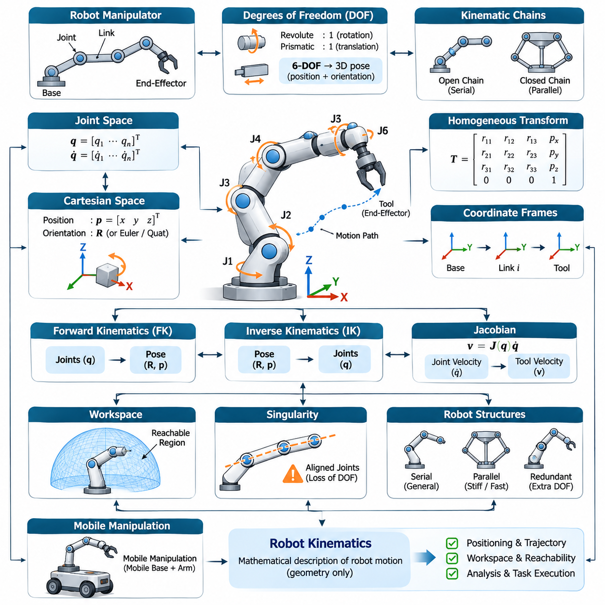
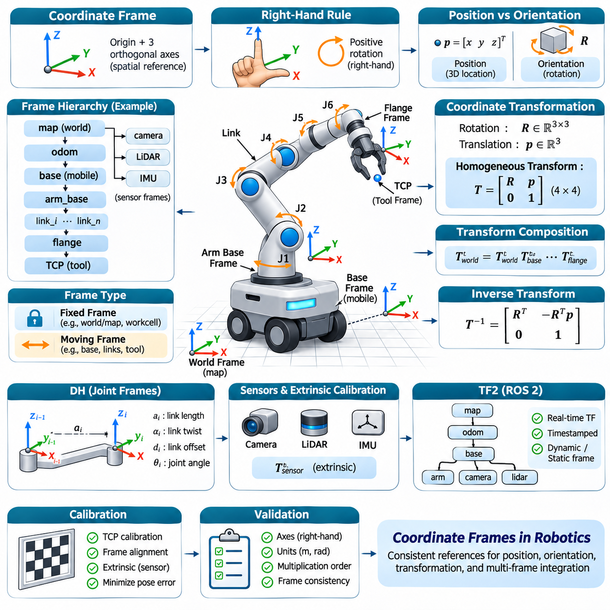
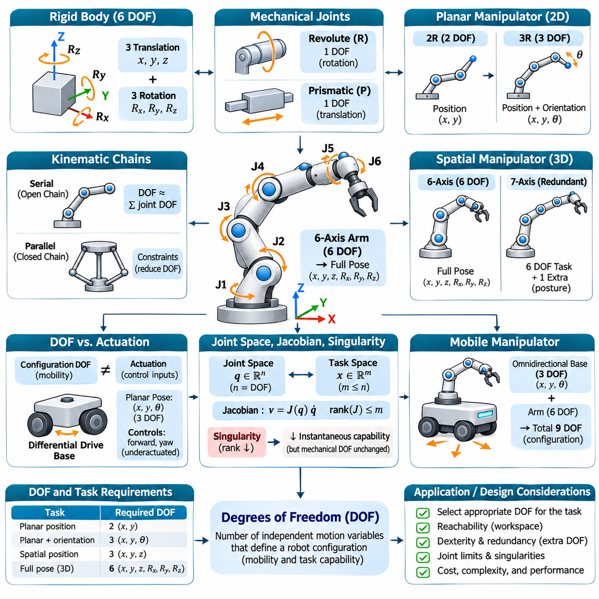
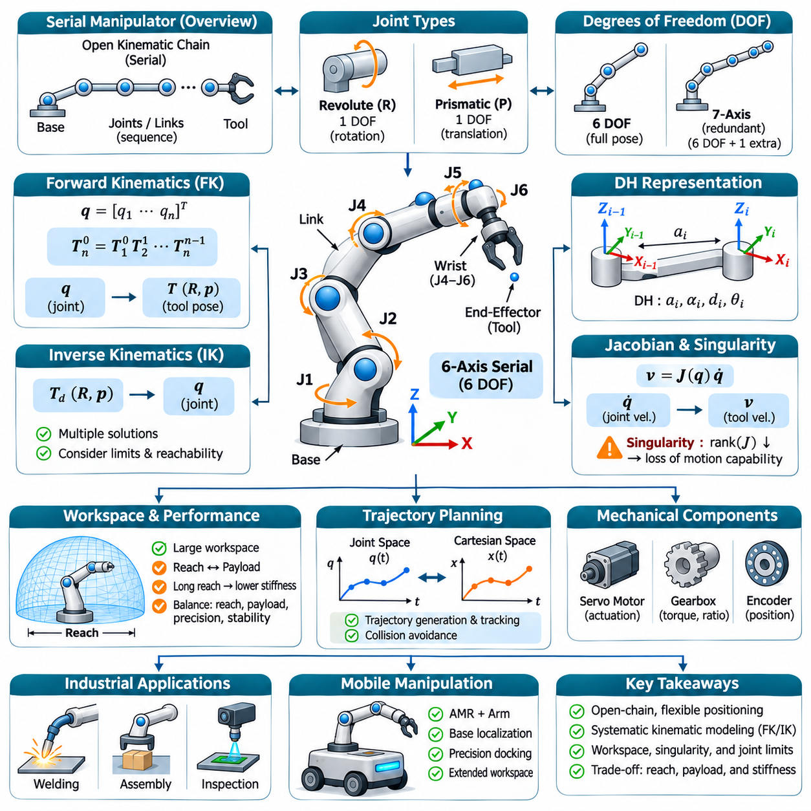
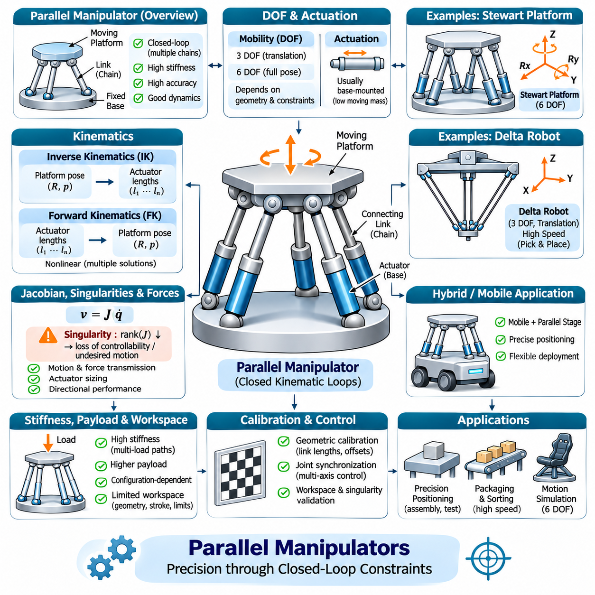
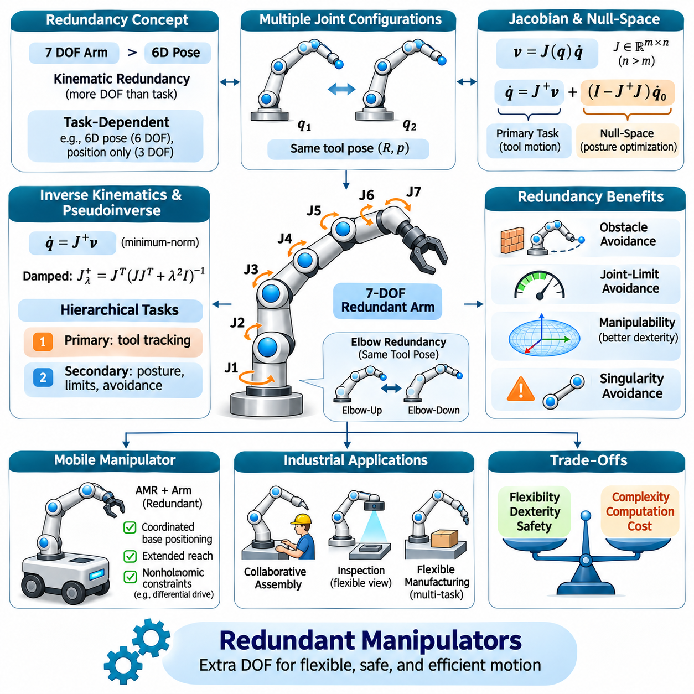
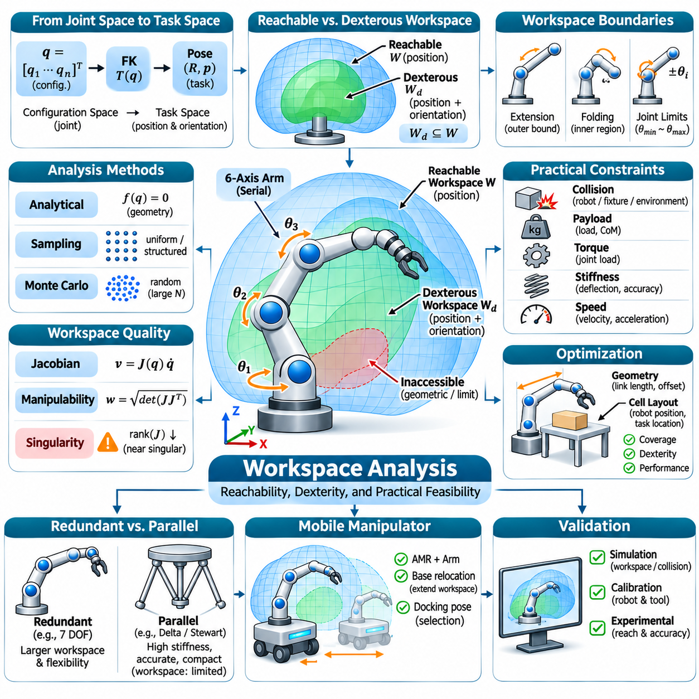
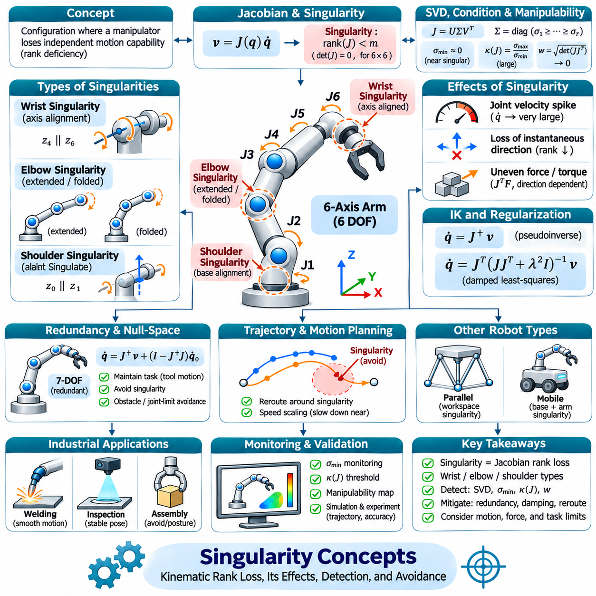
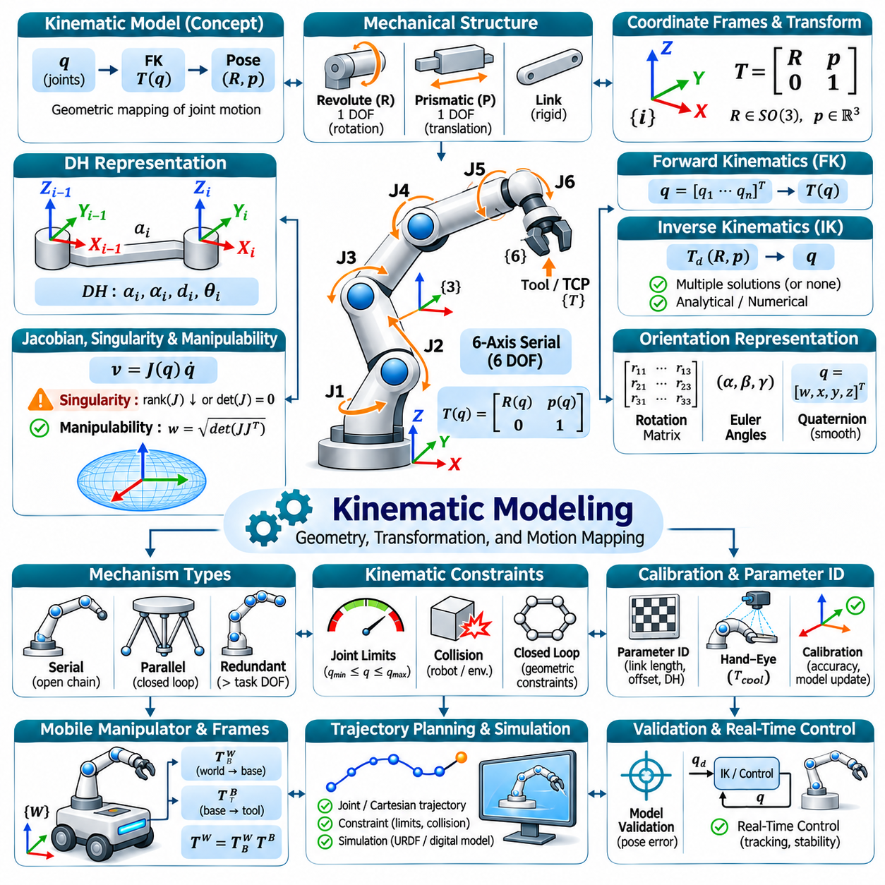
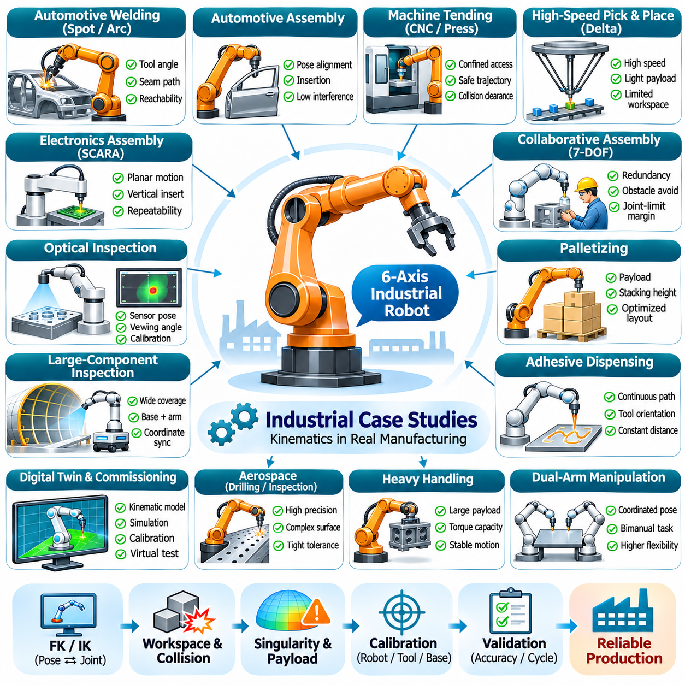

**Volume 02. Manipulator Mechanics and Control**

# Chapter 01. Robot Arm Kinematics

## 01 Kinematics Fundamentals

{width="7.268055555555556in" height="7.268055555555556in"}

Robot arm kinematics provides the mathematical foundation for describing and predicting the motion of robotic manipulators. It establishes relationships between joint configurations and the position and orientation of a robot\'s end effector. Unlike dynamics, which considers forces, torques, and inertia, kinematics focuses exclusively on geometric motion. This distinction enables engineers to analyze robot movement independently of actuator characteristics and external loads.

A robotic manipulator consists of rigid links connected through mechanical joints that permit controlled relative motion. Each joint introduces specific motion constraints, while the arrangement of links determines the overall geometric structure. Kinematic analysis describes how individual joint movements combine to produce coordinated motion of the complete mechanism. This mathematical representation is essential for positioning, trajectory generation, workspace evaluation, and robotic task execution.

The fundamental variables of robot kinematics are joint positions, joint velocities, and joint accelerations. Joint positions define the instantaneous configuration of the manipulator, while velocities describe how that configuration changes over time. Accelerations characterize the rate of change of joint velocities. These variables can be represented as vectors, allowing mathematical operations to describe the collective behavior of multiple interconnected joints.

Robot motion is commonly described in two complementary spaces known as joint space and Cartesian space. Joint space represents the configuration of individual joints through angular or linear displacement variables. Cartesian space describes the position and orientation of the end effector relative to a selected reference frame. Transforming information between these spaces allows robotic controllers to convert geometric task requirements into executable joint movements.

The distinction between position and orientation is fundamental to manipulator kinematics. Position specifies the location of a point in three-dimensional space using coordinates along three independent axes. Orientation describes the rotational alignment of an object or tool relative to a reference coordinate system. Together, position and orientation define a rigid-body pose, which provides the information required to position an end effector accurately during manipulation.

Coordinate frames establish consistent references for describing the geometry of robotic systems. A frame typically contains an origin and three mutually perpendicular axes that define its spatial orientation. Frames may be attached to the robot base, individual links, joints, tools, or surrounding environment. By expressing geometric relationships between these frames, engineers can describe complex robot structures through organized mathematical transformations.

Rigid-body transformations combine translation and rotation into a unified mathematical representation. Translation describes displacement between coordinate frame origins, while rotation represents differences in axis orientation. Homogeneous transformation matrices provide a convenient mechanism for expressing both operations within a single matrix. Successive transformations can be multiplied to describe the accumulated geometric relationship between the robot base and end effector.

The degrees of freedom of a manipulator determine the number of independent variables required to describe its configuration. A revolute joint generally contributes one rotational degree of freedom, while a prismatic joint contributes one translational degree of freedom. A conventional six-axis industrial manipulator often provides sufficient independent motion to control an end-effector pose in three-dimensional space, subject to reachability and configuration constraints.

Kinematic chains represent the structural relationships between connected robot links and joints. An open kinematic chain contains a sequence of links extending from a fixed base toward an end effector without forming a closed mechanical loop. This configuration is common in industrial serial manipulators. Closed kinematic chains introduce additional geometric constraints because multiple mechanical paths connect parts of the mechanism.

Serial manipulators calculate end-effector motion through the sequential combination of joint transformations. Each joint contributes a relative transformation that depends on its displacement variable and mechanical geometry. The overall transformation is obtained by multiplying these individual relationships in their proper order. Consequently, changes in upstream joints influence the positions and orientations of downstream links throughout the manipulator.

Parallel manipulators employ multiple kinematic chains connecting a common base to a moving platform. Their mechanical structure introduces geometric constraints that distinguish their behavior from serial mechanisms. Parallel configurations may provide high structural stiffness and favorable load distribution, although their kinematic relationships can become mathematically complex. Understanding these differences helps engineers select suitable architectures for precision positioning and manipulation.

Forward kinematics determines the end-effector pose from a known set of joint variables. The calculation begins with the robot\'s mechanical geometry and applies the transformations associated with each joint. Its output provides the predicted position and orientation of the tool relative to a reference frame. Forward kinematics is essential for visualization, state estimation, collision checking, and verification of commanded robot configurations.

Inverse kinematics addresses the complementary problem of determining joint configurations that produce a desired end-effector pose. Depending on the manipulator geometry, a target pose may correspond to multiple valid configurations, a unique solution, or no feasible solution. Joint limits, workspace boundaries, and mechanical constraints further influence solution feasibility. Reliable inverse kinematics is therefore necessary for translating task-space objectives into robot commands.

Differential kinematics describes the relationship between joint velocities and instantaneous end-effector motion. The Jacobian matrix represents this relationship through local derivatives of the forward kinematic equations. Multiplying the Jacobian by the joint velocity vector produces the corresponding end-effector velocity representation. This formulation supports velocity control, motion planning, and the analysis of how joint movements influence tool motion.

The Jacobian also provides important information about manipulator dexterity and singular configurations. A singularity occurs when the manipulator loses the ability to generate certain instantaneous Cartesian motions independently. Near singular configurations, achieving a desired end-effector velocity may require unusually large joint velocities. Identifying these conditions is essential for maintaining stable motion and avoiding excessive actuator demands during robotic operation.

Workspace analysis evaluates the spatial region that a manipulator can reach under its geometric and mechanical constraints. The reachable workspace contains positions attainable by at least one valid joint configuration, while the dexterous workspace considers positions where specified orientation capabilities are available. These regions depend on link dimensions, joint arrangements, mechanical limits, and obstacles. Workspace evaluation supports manipulator selection and task layout optimization.

Redundant manipulators possess more independent joint variables than are strictly required for a specified end-effector task. This additional freedom allows multiple joint configurations to achieve the same tool pose. Redundancy can be exploited to avoid obstacles, maintain favorable joint configurations, reduce proximity to singularities, or improve motion efficiency. However, additional degrees of freedom also introduce the need for systematic redundancy resolution strategies.

Kinematic modeling requires accurate knowledge of the manipulator\'s physical dimensions and joint relationships. Link lengths, joint-axis directions, mechanical offsets, and tool mounting geometry directly influence predicted end-effector positions. Small modeling errors can accumulate across interconnected links and reduce positioning accuracy. Consequently, geometric calibration is an important process for aligning mathematical models with the physical characteristics of manufactured robotic systems.

The Denavit--Hartenberg convention provides a systematic approach for describing serial manipulator geometry using parameters associated with neighboring coordinate frames. These parameters characterize relative rotations, translations, and link relationships. The resulting transformation matrices can be combined to construct a complete kinematic model. Alternative formulations, including the product-of-exponentials method, offer additional representations suitable for different analytical and computational requirements.

Practical robotic systems must account for joint limits, encoder measurements, calibration offsets, and mechanical tolerances when applying kinematic equations. Although ideal models assume rigid links and precisely defined joint axes, real mechanisms may exhibit backlash, structural deflection, and manufacturing variation. These effects can produce differences between predicted and measured tool positions. Accurate operation therefore requires model verification and appropriate compensation procedures.

In mobile manipulation, robot arm kinematics must be integrated with the motion of the mobile platform. The arm base is no longer necessarily fixed relative to the environment, because platform translation and rotation change the global position of the manipulator. Coordinate transformations connect the mobile base, arm mounting frame, and end effector. This relationship enables the system to determine tool poses consistently while accounting for changes in platform position and orientation.

Mobile manipulators also introduce combined reachability considerations involving platform placement and arm configuration. A target that lies outside the arm\'s workspace from one platform position may become reachable after repositioning the mobile base. Coordinated planning can therefore optimize both platform location and manipulator posture. This capability is particularly valuable in warehouse picking, industrial inspection, material handling, and service robotics applications.

Kinematic calculations are fundamental components of modern robotic software architectures. Robot descriptions define joint relationships, link geometry, and coordinate frames, while transformation libraries maintain spatial relationships between system components. Motion planning frameworks use these representations to evaluate reachable poses and generate feasible trajectories. Consistent kinematic models allow perception, planning, and control modules to exchange geometric information reliably.

Validation of a kinematic model involves comparing predicted geometric behavior with measured or simulated robot configurations. Engineers may examine reference poses, joint motion directions, transformation consistency, and end-effector positioning errors. Testing across different configurations helps reveal incorrect coordinate assignments, parameter errors, and unexpected mechanical constraints. Reliable validation establishes confidence before the model is integrated into higher-level motion planning and control systems.

Robot arm kinematics ultimately connects mechanical structure with computational motion representation. It provides the mathematical language needed to describe configurations, predict tool poses, analyze movement capabilities, and identify geometric limitations. These principles form the foundation for forward and inverse kinematics, differential motion analysis, workspace optimization, and advanced manipulator control. Their accurate implementation is essential for dependable robotic manipulation in industrial and mobile environments.

## 02 Coordinate Frames

{width="7.268055555555556in" height="7.268055555555556in"}

Coordinate frames provide the fundamental reference structure for describing positions, orientations, and motion in robotic manipulators. A coordinate frame consists of an origin and three mutually perpendicular axes that establish a local spatial reference. By assigning frames to mechanical components, engineers can express geometric relationships consistently and calculate how individual joint movements influence the overall configuration of a robotic system.

In three-dimensional robotics, coordinate frames are commonly represented using Cartesian coordinate systems with X, Y, and Z axes. These axes define three independent directions for measuring spatial displacement. Most robotic applications employ right-handed coordinate systems, where the orientation of the axes follows the right-hand rule. Consistent axis conventions are essential for preventing sign errors and maintaining compatibility between mathematical models and physical mechanisms.

The origin of a coordinate frame establishes the reference point from which positions are measured. Its orientation determines how vectors and geometric quantities are expressed relative to the associated axes. A point may have different numerical coordinates when represented in different frames, even though its physical location remains unchanged. This distinction between physical geometry and coordinate representation is central to understanding robotic transformations.

A robot base frame provides the primary reference for describing the manipulator\'s mechanical structure. It is typically attached to the fixed mounting surface or base assembly of the robot arm. Joint positions, link transformations, and end-effector poses are frequently calculated relative to this frame. In stationary industrial manipulators, the base frame normally remains fixed, while mobile manipulators require additional transformations to account for platform movement.

Joint coordinate frames are assigned to individual joints to describe their relative motion and geometric relationships. For revolute joints, the associated transformation depends on the joint rotation angle. For prismatic joints, it depends on linear displacement along the permitted motion axis. Properly defined joint frames simplify the mathematical representation of mechanical constraints and enable systematic construction of complete manipulator kinematic models.

Link coordinate frames describe the spatial relationships between rigid mechanical segments. Each frame is attached to a corresponding link and moves with that link during robot operation. The relative transformation between neighboring link frames represents the geometry and motion introduced by their connecting joint. Combining these transformations produces a mathematical description of the entire kinematic chain from the robot base to the terminal link.

The end-effector frame represents the position and orientation of the robot\'s terminal mechanical interface. It may be attached to a mounting flange, gripper, welding torch, inspection sensor, or other manipulation device. Because different tools have different geometries, the end-effector frame does not always coincide with the actual working point. Additional tool frames are therefore introduced to represent task-specific locations and orientations.

A tool center point, commonly abbreviated as TCP, defines a reference point associated with the functional tip or operational center of a robotic tool. For a welding robot, the TCP may correspond to the welding tip, while a gripping system may define it at the center of the grasping region. Accurate TCP calibration is essential because positioning errors in the tool frame directly affect the precision of manipulation and industrial processing tasks.

A world coordinate frame establishes a common spatial reference for the robot and its surrounding environment. Unlike frames attached to moving mechanical components, the world frame is generally treated as stationary within the selected operating environment. It enables robot positions, workstations, obstacles, and target objects to be represented consistently. World frames are particularly important when multiple robots or external sensing systems share spatial information.

Coordinate transformations describe how positions and orientations expressed in one frame can be represented in another. A transformation contains rotational and translational components that define the relative relationship between two frames. Rotation changes the coordinate-axis representation, while translation accounts for displacement between frame origins. Together, these operations allow geometric information to move consistently across different reference systems.

Rotation matrices provide a mathematical representation of relative orientation between coordinate frames. A three-dimensional rotation matrix contains nine elements arranged in a three-by-three structure. Its columns can represent the axes of one frame expressed in another frame, depending on the adopted convention. Valid rotation matrices are orthogonal and have a determinant of positive one, ensuring that rigid-body orientation is preserved without scaling or reflection.

Homogeneous transformation matrices combine rotation and translation into a single four-by-four matrix. The upper-left three-by-three block represents orientation, while the upper-right three-element column describes translation. The final row provides the mathematical structure required for homogeneous coordinates. This representation allows multiple transformations to be composed through matrix multiplication, simplifying calculations across complex robotic mechanisms.

Transformation composition enables engineers to determine relationships between coordinate frames that are not directly connected. For example, the pose of a tool relative to the world frame can be obtained by combining transformations from the world to the robot base, through successive links, and finally to the tool. Matrix multiplication order is critical because spatial transformations are generally noncommutative. Reversing their order can produce physically incorrect results.

Inverse transformations convert geometric information from one reference direction to the opposite direction. If a transformation describes the pose of frame B relative to frame A, its inverse provides the pose of frame A relative to frame B. The inverse rotation is obtained through matrix transposition, while the inverse translation must account for the reversed orientation. These operations are essential when exchanging coordinates between sensors, robots, and environmental references.

The Denavit--Hartenberg convention provides a systematic method for assigning coordinate frames to serial robotic manipulators. It describes relationships between neighboring frames using four geometric parameters associated with joint axes and link geometry. Standardized frame assignment reduces modeling ambiguity and supports repeatable kinematic calculations. However, frame placement must follow the selected convention consistently to avoid incorrect transformation equations.

Coordinate frames are also essential for representing sensor measurements within robotic systems. Cameras, LiDAR sensors, force sensors, and inertial measurement units typically produce data relative to their own local reference frames. To combine these measurements with robot geometry, the corresponding sensor-to-robot transformations must be known. Accurate extrinsic calibration ensures that detected objects and environmental features are represented in consistent spatial coordinates.

Mobile manipulators require additional coordinate frames because the robotic arm is mounted on a moving platform. A typical system includes world, odometry, mobile base, arm base, joint, and tool frames. The mobile platform changes its pose relative to the environment, while the arm moves relative to the platform. Maintaining these relationships enables coordinated navigation and manipulation without losing consistency between global target positions and local arm configurations.

In mobile robotics, the odometry frame provides a locally continuous reference for estimating platform movement over time. A map frame may provide a globally corrected reference based on localization and environmental observations. The transformation between these frames can change when localization estimates are updated. Separating these references allows motion controllers to maintain continuous local behavior while incorporating corrections from mapping and localization systems.

Coordinate frame hierarchies organize spatial relationships into connected transformation structures. Each frame has a defined relationship to another frame, forming a tree of transformations that can be evaluated to obtain relative poses. This organization is widely used in robotic software because it separates mechanical geometry from real-time motion updates. A consistent hierarchy also simplifies integration between navigation, perception, manipulation, and control components.

In ROS 2 systems, the TF2 framework manages coordinate transformations between robot components and environmental references. It maintains time-stamped transformation relationships and allows software modules to request geometric information between connected frames. Robot descriptions commonly define fixed mechanical relationships, while joint states and localization modules provide dynamic transformations. This architecture supports modular development and synchronized spatial reasoning.

Time synchronization is particularly important when coordinate frames are associated with moving components. A sensor measurement captured at one instant must be transformed using the robot configuration corresponding to that measurement time. Applying a transformation from an incorrect timestamp can introduce spatial errors, especially during rapid movement. Reliable robotic systems therefore maintain time-aware transformation histories and coordinate sensor data with motion estimates.

Frame calibration determines the actual geometric relationships between physical components and their mathematical representations. Common calibration procedures estimate tool offsets, sensor mounting transformations, and robot-to-workstation alignment. Calibration errors can propagate through transformation chains and reduce overall positioning accuracy. Repeated measurements, geometric constraints, and reference targets help establish reliable coordinate relationships for precision robotic applications.

Incorrect coordinate frame definitions can cause unexpected motion, inaccurate object localization, and failures in trajectory execution. Common problems include reversed axis directions, inconsistent rotation conventions, incorrect transformation order, and mismatched measurement units. Engineers should validate frame orientations and transformation relationships using known reference poses. Systematic verification is especially important when integrating hardware and software developed by different suppliers.

Coordinate frames ultimately establish the geometric foundation connecting robot mechanics, sensing, planning, and control. They enable consistent representation of positions and orientations across interconnected mechanical and computational components. Accurate frame assignment, transformation composition, calibration, and synchronization are essential for reliable forward kinematics, inverse kinematics, and coordinated robotic motion. Their importance becomes even greater in mobile manipulation systems where both the platform and robotic arm move within a shared environment.

## 03 Degrees of Freedom

{width="7.268055555555556in" height="7.268055555555556in"}

Degrees of freedom (DOF) describe the number of independent variables required to define the configuration of a robotic mechanism. Each independent variable represents a motion capability that can change without being completely determined by other variables. In robotic manipulators, DOF provides a fundamental measure of mechanical mobility and determines how flexibly the robot can position and orient its end effector within the available workspace.

A rigid body moving freely in three-dimensional space possesses six degrees of freedom. Three correspond to translational motion along the X, Y, and Z axes, while the remaining three describe rotational motion about independent axes. Together, these motions define the complete spatial pose of an object. Robotic manipulators use combinations of mechanical joints to achieve some or all of these independent motions under geometric and structural constraints.

Mechanical joints determine the motion capabilities of a manipulator by restricting relative movement between connected links. A revolute joint permits rotation about a defined axis and normally contributes one degree of freedom. A prismatic joint allows linear displacement along a specified direction and also contributes one degree of freedom. More complex joints may permit multiple independent motions, depending on their mechanical design and constraint structure.

The total number of joints does not always equal the number of independent degrees of freedom. Mechanical coupling, closed-loop constraints, and transmission arrangements can reduce the number of independently configurable variables. Conversely, a single mechanical assembly may provide multiple degrees of freedom through compound joint structures. Accurate mobility analysis therefore requires examining independent motion constraints rather than simply counting physical joints.

Serial manipulators commonly obtain their mobility through a sequence of revolute or prismatic joints. In an open kinematic chain with independent single-degree-of-freedom joints, the total mobility generally equals the number of joints. A six-axis industrial robot typically uses six revolute joints to provide spatial positioning and orientation capabilities. However, actual motion feasibility remains dependent on joint limits, geometry, and singular configurations.

The relationship between manipulator degrees of freedom and task requirements is central to robotic system design. A task involving only planar positioning may require two independent translational coordinates, while planar positioning with tool orientation requires an additional rotational coordinate. Full spatial manipulation generally involves three positional and three orientational coordinates. Selecting an appropriate DOF configuration avoids unnecessary mechanical complexity while preserving essential task capabilities.

Planar manipulators operate within a two-dimensional motion environment and provide a simplified example of mobility analysis. A two-link planar arm with two revolute joints can position its endpoint within a reachable planar region. Adding a third independent revolute joint can provide control over endpoint orientation as well as position. These mechanisms illustrate how additional degrees of freedom expand the set of controllable task variables.

Spatial manipulators operate in three-dimensional environments and require more complex joint arrangements. A three-degree-of-freedom arm may position its endpoint in three-dimensional space but generally cannot independently control all three orientation variables. Six independent degrees of freedom are commonly sufficient for local control of a general spatial pose when the manipulator Jacobian has full rank. This capability is essential for assembly, welding, inspection, and precision handling.

Degrees of freedom must be distinguished from degrees of actuation. Mobility describes the number of independent configuration variables, while actuation describes the number of independently controlled inputs available to drive the mechanism. An underactuated robot has fewer independent control inputs than mechanical degrees of freedom. Such systems require specialized control strategies because not every configuration variable can be commanded independently through direct actuation.

Redundant manipulators possess more degrees of freedom than are required for a specified operational task. A seven-axis robotic arm performing general six-dimensional pose control typically has one additional degree of kinematic redundancy. This extra freedom allows alternative joint configurations while maintaining the same end-effector pose. Redundancy can improve obstacle avoidance, joint-limit management, dexterity, and flexibility in constrained industrial environments.

Kinematic redundancy introduces additional complexity into inverse kinematics and motion planning. Multiple joint configurations may satisfy the same task-space objective, requiring a method for selecting an appropriate solution. Optimization criteria may include minimizing joint displacement, avoiding singularities, reducing energy consumption, or maintaining clearance from obstacles. Null-space motion enables secondary objectives to be pursued without changing the commanded end-effector motion locally.

The Jacobian matrix provides a mathematical connection between joint degrees of freedom and instantaneous task-space motion. Its columns describe how individual joint velocities contribute to end-effector velocity. The rank of the Jacobian determines the number of independent instantaneous task-space velocity directions available at a particular configuration. This rank can decrease near singularities, temporarily reducing effective motion capability despite unchanged mechanical mobility.

A singular configuration occurs when the manipulator loses independent control over certain instantaneous Cartesian motion directions. For example, alignment of particular joint axes may cause normally independent motion contributions to become linearly dependent. Although the mechanical number of degrees of freedom remains unchanged, the effective task-space mobility is reduced. Singularity analysis is therefore essential when evaluating the practical usefulness of a robot\'s joint configuration.

Workspace characteristics are strongly influenced by the number and arrangement of degrees of freedom. Increasing DOF may expand reachable configurations or improve orientation flexibility, but additional joints do not automatically increase the maximum physical reach. Link lengths, joint-axis geometry, and mechanical limits remain important determinants of workspace boundaries. Effective manipulator design balances mobility, reachability, dexterity, and mechanical complexity.

Parallel manipulators require special consideration because their closed kinematic chains introduce additional motion constraints. Their mobility cannot generally be determined by counting actuated joints alone. Constraint equations and mechanism mobility formulas are used to identify independent configuration variables. Some parallel mechanisms provide fewer than six degrees of freedom while achieving high stiffness and precision for specialized positioning tasks.

The Grübler--Kutzbach mobility criterion offers a general approach for estimating mechanism degrees of freedom from links, joints, and imposed constraints. For spatial mechanisms, the calculation considers six potential rigid-body motions and subtracts independent joint constraints. However, special geometries, dependent constraints, and overconstrained mechanisms can invalidate simple counting assumptions. Detailed constraint analysis is necessary when evaluating complex robotic architectures.

Joint limits restrict the usable configuration range without necessarily changing the nominal mechanical degrees of freedom. A revolute joint may be mechanically limited to a particular angular interval, while a prismatic joint operates within a defined linear stroke. These restrictions influence reachable poses and feasible trajectories. Near joint boundaries, available motion directions may become constrained even when the manipulator remains nonsingular.

Degrees of freedom also influence the computational complexity of robotic control systems. Additional joints increase the dimension of configuration space and often enlarge the search space for inverse kinematics and trajectory planning. Collision checking, optimization, and coordinated motion generation may consequently require greater computational resources. Efficient algorithms exploit kinematic structure and task constraints to manage these challenges in real-time robotic applications.

In mobile manipulators, the mobility of the robotic arm is combined with the motion capabilities of the mobile platform. A planar omnidirectional mobile base may contribute three configuration degrees of freedom, representing planar position and heading. When combined with a six-axis arm, the system can have nine configuration degrees of freedom. However, wheel constraints and nonholonomic behavior may restrict the independently achievable instantaneous platform velocities.

A differential-drive mobile platform illustrates the distinction between configuration freedom and instantaneous controllability. Its planar pose is described by three coordinates, but its wheels normally provide only forward velocity and rotational velocity as independent instantaneous motion inputs. Lateral motion cannot be generated directly without changing orientation. This distinction becomes important when coordinating mobile base movement with robotic arm manipulation.

Coordinated mobile manipulation uses the combined degrees of freedom of the platform and arm to satisfy task objectives. The platform can reposition the manipulator to improve reachability, while arm joints provide precise local positioning and orientation. Redundant system configurations may support obstacle avoidance, improved dexterity, and reduced joint stress. Effective coordination requires a unified kinematic representation of both subsystems.

Degrees of freedom influence mechanical cost, actuator requirements, sensor integration, and maintenance complexity. Additional joints typically introduce motors, transmissions, encoders, structural components, and control interfaces. Although increased mobility can improve task flexibility, it may also increase mass, energy consumption, and potential failure points. Engineering decisions should therefore relate DOF selection directly to operational requirements and measurable performance benefits.

Industrial robot selection often begins by identifying the independent motions required by the intended application. Simple material transfer may be performed using a limited-DOF mechanism, while complex assembly and inspection frequently demand greater orientation flexibility. Collaborative manipulation and operation in cluttered environments may benefit from redundant configurations. Evaluating task geometry and motion constraints helps determine an appropriate balance between capability and system complexity.

Degrees of freedom ultimately connect mechanical architecture with the functional capabilities of robotic manipulators. They determine the dimensionality of configuration space, influence workspace and dexterity, and establish fundamental requirements for kinematic modeling and control. Understanding mobility, redundancy, actuation, and instantaneous motion constraints is essential for designing reliable robotic arms and coordinated mobile manipulation systems.

## 04 Serial Manipulators

{width="7.268055555555556in" height="7.268055555555556in"}

Serial manipulators are robotic mechanisms composed of rigid links connected sequentially through mechanical joints, forming an open kinematic chain. One end of the chain is attached to a base, while the opposite end supports an end effector for interacting with the environment. This architecture is widely used in industrial robotics because it provides flexible positioning, relatively straightforward mechanical construction, and systematic mathematical modeling of joint motion.

The fundamental structure of a serial manipulator consists of links, joints, actuators, and an end-effector interface. Each joint permits controlled relative motion between neighboring links, while actuators generate the movement required to achieve desired configurations. Revolute joints provide angular displacement, whereas prismatic joints generate linear displacement. The arrangement of these components determines the manipulator\'s mobility, workspace, and mechanical performance.

An open kinematic chain distinguishes serial manipulators from mechanisms containing closed mechanical loops. Motion propagates through successive links, and the position of each downstream component depends on the configurations of preceding joints. Consequently, movement near the base can influence a large portion of the robot structure. This dependency makes joint sequencing and transformation composition fundamental to accurate kinematic analysis.

Serial manipulators commonly employ revolute joints because rotational actuators provide compact and controllable motion. Industrial six-axis arms typically combine shoulder, elbow, and wrist joints to achieve spatial positioning and orientation. The first joints primarily influence the location of the wrist, while later joints contribute strongly to tool orientation. However, the precise functional separation depends on the manipulator geometry and arrangement of joint axes.

The degrees of freedom of a serial manipulator determine its independent configuration variables and available motion capabilities. A conventional six-axis robot generally provides sufficient mobility for controlling a complete spatial end-effector pose within reachable, nonsingular configurations. Manipulators with fewer joints may be suitable for constrained tasks, while redundant systems introduce additional configuration flexibility. Joint limits and mechanical geometry ultimately determine usable motion.

Forward kinematics establishes the relationship between joint coordinates and the resulting end-effector pose. Each joint contributes a transformation describing its relative position and orientation with respect to the preceding link. These transformations are multiplied in sequence to calculate the overall pose relative to the robot base. This mathematical process enables robot visualization, geometric verification, trajectory evaluation, and coordination with external equipment.

The Denavit--Hartenberg convention provides a structured method for representing serial manipulator geometry. It assigns coordinate frames to neighboring links and describes their relationships through geometric parameters. These parameters are used to construct homogeneous transformation matrices for individual joints. Multiplying the matrices produces the complete forward kinematic model, allowing engineers to analyze complex manipulators through a consistent mathematical framework.

Inverse kinematics determines the joint configurations required to achieve a desired end-effector position and orientation. Serial manipulators may have multiple solutions because different joint arrangements can produce the same tool pose. Some target poses may be unreachable due to link geometry, joint limits, or workspace boundaries. Analytical and numerical methods are therefore used to identify feasible configurations while considering operational constraints.

Differential kinematics describes how joint velocities contribute to instantaneous end-effector motion. The Jacobian matrix maps joint velocity vectors into Cartesian velocity representations. Its structure depends on the manipulator configuration and joint-axis geometry. Jacobian analysis supports velocity control, trajectory tracking, singularity detection, and evaluation of the relationship between joint motion and tool movement.

Singularities represent configurations where a serial manipulator loses the ability to generate certain independent instantaneous Cartesian motions. These conditions can arise when joint axes become aligned or when the arm reaches particular geometric arrangements. Near singularities, achieving a desired tool velocity may require excessive joint velocities. Motion planners and controllers must therefore identify and manage singular configurations to maintain stable operation.

The workspace of a serial manipulator is determined by link lengths, joint arrangements, and mechanical motion limits. Reachable workspace describes the positions that the end effector can attain, while dexterous workspace considers the ability to achieve required orientations. Workspace boundaries may contain regions with limited maneuverability or poor kinematic conditioning. Understanding these characteristics is essential for selecting robot geometry and positioning workstations.

Serial manipulators offer a large operational workspace relative to their mechanical footprint, particularly when long links and multiple rotational joints are employed. Their open-chain structure allows tools to approach objects from different directions and operate around surrounding equipment. However, extended configurations can increase structural deflection and reduce positioning stiffness. Practical designs must balance reach, payload capacity, precision, and mechanical stability.

Mechanical stiffness is an important consideration because loads applied at the end effector propagate through the entire serial chain. Small elastic deformations in individual links or joints can accumulate and produce noticeable tool displacement. Gearbox compliance, bearing flexibility, and structural bending contribute to positioning errors under load. High-precision applications therefore require appropriate structural design, calibration, and compensation strategies.

Payload capacity depends on actuator torque, transmission characteristics, link geometry, and structural strength. A payload generates gravitational and dynamic loads that vary with manipulator configuration. Extended arm postures may require greater joint torque than compact configurations carrying the same object. Consequently, payload ratings must be evaluated together with reach, operating speed, acceleration, and allowable wrist loading conditions.

Serial manipulators commonly use electric servo motors combined with reduction gearboxes and position feedback sensors. Harmonic drives, planetary gearboxes, and other transmission mechanisms provide torque amplification and controlled joint motion. Encoders measure joint positions, while motor controllers regulate velocity and torque. These components operate together to achieve accurate positioning and coordinated multi-joint movement.

Trajectory planning determines how a serial manipulator moves between configurations while satisfying geometric and operational constraints. Joint-space trajectories specify coordinated joint motion, whereas Cartesian trajectories define desired tool paths in physical space. Planning algorithms must consider velocity limits, acceleration limits, collision avoidance, and singularities. Smooth trajectories reduce mechanical stress and improve repeatability during industrial operations.

Collision avoidance is particularly important because multiple links occupy different regions of space during movement. A valid end-effector trajectory does not necessarily guarantee that intermediate links remain clear of obstacles. Collision checking must therefore evaluate the geometry of the complete manipulator throughout the planned motion. Self-collision constraints and environmental obstacles influence feasible configurations and trajectory selection.

Redundant serial manipulators contain more independent joints than required for a specified task. Seven-axis arms are common examples when performing six-dimensional end-effector pose control. Their additional freedom enables alternative elbow positions and joint configurations without changing the desired tool pose. This capability supports obstacle avoidance, improved dexterity, joint-limit avoidance, and operation in confined environments.

Serial manipulators are widely applied in welding, assembly, material handling, painting, inspection, and machine tending. Different applications impose distinct requirements on reach, speed, repeatability, payload, and orientation flexibility. Welding robots prioritize continuous tool-path control, while assembly robots may emphasize positioning accuracy and controlled contact. Selecting an appropriate manipulator requires matching its kinematic and mechanical characteristics to the intended process.

In mobile manipulation systems, a serial robotic arm is mounted on an autonomous or manually operated mobile platform. The arm provides precise local manipulation, while the platform extends the effective operating region by repositioning the entire mechanism. Coordinate transformations connect the mobile base, arm mounting frame, and end effector. This integration enables flexible operations across multiple workstations without permanently installing a robot at each location.

Mobile platforms introduce additional challenges because platform positioning errors influence the global pose of the serial manipulator. Small errors in base translation or orientation can propagate into tool positioning inaccuracies. Localization, docking, calibration, and visual correction methods help establish reliable spatial relationships. Coordinated control must account for both platform uncertainty and arm kinematic accuracy when executing precision tasks.

The combined mobility of a mobile platform and serial manipulator can provide substantial kinematic redundancy. Platform repositioning may improve arm reachability, avoid unfavorable joint configurations, and reduce proximity to singularities. However, optimizing the complete system requires consideration of navigation constraints, obstacle clearance, platform stability, and manipulation accuracy. Unified planning coordinates the movement capabilities of both subsystems.

Serial manipulators remain fundamental to modern robotic automation because their mechanical structure supports flexible motion and well-established mathematical analysis. Their performance depends on coordinated consideration of kinematics, dynamics, stiffness, actuation, sensing, and control. Understanding these relationships enables engineers to design reliable robotic arms, optimize industrial workspaces, and integrate manipulators into advanced mobile robotic systems.

## 05 Parallel Manipulators

{width="7.268055555555556in" height="7.268055555555556in"}

Parallel manipulators are robotic mechanisms in which multiple kinematic chains connect a fixed base to a common moving platform. Unlike serial manipulators, their links form closed mechanical loops that impose geometric constraints on platform motion. This architecture distributes forces through several structural paths and can provide high stiffness, positioning accuracy, and dynamic performance for specialized robotic applications.

The fundamental structure of a parallel manipulator consists of a base, moving platform, connecting links, and multiple joint assemblies. Each kinematic chain contributes to supporting and positioning the platform, while mechanical constraints coordinate the motion of the entire mechanism. Actuators may be located near the base to reduce moving mass. The resulting arrangement strongly influences mobility, workspace, load capacity, and control complexity.

Closed-loop kinematics distinguishes parallel manipulators from conventional open-chain robotic arms. Because several chains connect the same platform, their joint configurations must satisfy simultaneous geometric relationships. Motion in one chain influences the feasible configurations of the others. These coupled constraints require coordinated calculations and make the mathematical behavior of parallel mechanisms fundamentally different from that of serial manipulators.

The degrees of freedom of a parallel manipulator depend on its link geometry, joint types, and independent mechanical constraints. Although multiple joints may exist throughout the mechanism, only a subset of their motions may be independently controlled. Some parallel robots provide three translational degrees of freedom, while others support complete six-dimensional positioning and orientation. Mobility analysis must account for closed-loop constraints rather than simply counting joints.

Forward and inverse kinematics have different computational characteristics in parallel mechanisms. Inverse kinematics often determines actuator coordinates from a specified platform pose by solving the geometry of individual chains. Forward kinematics may require solving coupled nonlinear equations to recover platform pose from actuator positions. Multiple mathematical solutions can exist, making numerical initialization, solution selection, and physical feasibility checks important.

The Stewart platform is a representative six-degree-of-freedom parallel manipulator consisting of two platforms connected by six independently controlled extensible legs. Coordinated changes in leg lengths generate platform translation and rotation. Its mechanical arrangement can provide high stiffness and substantial load-bearing capability relative to its dimensions. Stewart platforms are used in motion simulation, precision positioning, testing, and specialized manufacturing equipment.

Delta robots represent another important category of parallel manipulators, particularly in high-speed industrial automation. Their architecture typically uses three parallel kinematic chains to control the translation of a moving platform while maintaining its orientation. Lightweight moving components and base-mounted actuators support rapid acceleration. These characteristics make Delta robots suitable for sorting, packaging, food handling, and repetitive pick-and-place operations.

Mechanical stiffness is a major advantage of many parallel manipulators because external loads can be distributed across several supporting chains. The closed-loop structure can reduce deflection compared with an equivalent long serial chain. However, stiffness varies with configuration, link geometry, and actuator characteristics. Accurate stiffness analysis must consider both individual component compliance and the combined constraint structure of the complete mechanism.

Payload capacity depends on the geometry of supporting chains, actuator force limits, structural strength, and platform configuration. Multiple load paths can improve force distribution, but unfavorable postures may produce high internal forces in particular links. Payload capability therefore varies throughout the workspace. Engineering evaluation must consider static loads, dynamic acceleration, joint reactions, and structural safety margins under representative operating conditions.

The workspace of a parallel manipulator is often more restricted than that of a serial robot with comparable overall dimensions. Closed-loop constraints, limited actuator strokes, joint-angle restrictions, and interference between links define reachable configurations. Some regions permit favorable motion and force transmission, while others approach mechanical limits. Workspace analysis is essential for selecting dimensions and ensuring that required tasks remain feasible.

Singularities are particularly important in parallel manipulators because they can affect motion controllability and structural constraint effectiveness. Certain configurations may cause the mechanism to lose control authority over specific platform motions or require excessive actuator velocities. Other singular conditions can permit unintended instantaneous platform motion despite constrained actuators. Avoiding these configurations is critical for precision, stability, and safe operation.

The Jacobian formulation for parallel manipulators relates actuator velocities to platform motion while incorporating closed-loop constraints. Unlike simple serial-chain mappings, parallel mechanisms often require separate matrices describing actuator contributions and platform constraints. Their conditioning indicates how effectively motion and forces are transmitted. Jacobian analysis supports singularity detection, actuator sizing, velocity planning, and evaluation of directional mechanical performance.

Actuation strategies strongly influence parallel manipulator performance. Electric servo motors, linear actuators, hydraulic cylinders, and pneumatic mechanisms may be selected according to speed, precision, and load requirements. Locating heavy actuators near the fixed base can reduce moving inertia and improve dynamic response. However, transmissions, joint friction, backlash, and actuator synchronization must be carefully managed to preserve positioning accuracy.

Dynamic modeling of parallel manipulators must account for coupled motion among multiple chains and the shared moving platform. Accelerating the platform produces inertial forces that propagate through connecting links and actuators. Constraint forces maintain the closed-loop geometry throughout motion. Accurate dynamic models support feedforward compensation, actuator torque prediction, vibration reduction, and high-speed trajectory tracking in demanding industrial applications.

Calibration is essential because small geometric errors can produce significant platform positioning inaccuracies. Link lengths, joint-center locations, actuator offsets, and mounting geometry must be represented accurately. Closed-loop structures may make direct measurement of some parameters difficult, requiring specialized identification procedures. Calibration typically combines reference measurements with optimization methods to estimate model parameters and improve absolute positioning performance.

Control architectures for parallel manipulators coordinate multiple actuators while maintaining geometric consistency across all kinematic chains. Joint-level controllers regulate actuator position, velocity, or force, while higher-level controllers generate platform motion commands. Feedback from encoders and external sensors can improve accuracy. High-performance applications may employ model-based control to compensate for nonlinear dynamics, disturbances, and configuration-dependent behavior.

Trajectory planning must ensure that commanded platform motion remains within the feasible workspace and respects actuator limitations. Smooth paths reduce abrupt acceleration and excessive internal loading. Planning algorithms must also avoid singularities, mechanical interference, and configurations with poor force transmission. For high-speed operations, trajectory optimization balances cycle time, tracking accuracy, energy consumption, and structural vibration.

Parallel manipulators are used in precision manufacturing, semiconductor equipment, optical alignment, motion simulation, and automated handling. Applications requiring rapid repetitive motion may favor lightweight Delta configurations, while precision positioning and multi-axis loading may favor Stewart-type platforms. The appropriate architecture depends on required mobility, workspace dimensions, stiffness, payload, and environmental constraints.

In mobile manipulation, parallel mechanisms can serve as precision positioning stages or stabilization platforms mounted between a mobile base and a robotic tool. They may compensate for limited platform positioning errors or adjust tool alignment within a constrained workspace. However, they cannot automatically eliminate localization uncertainty or mechanical vibration. Successful integration requires accurate sensing, calibration, and coordinated control between the mobile platform and parallel mechanism.

Hybrid robotic architectures combine serial and parallel mechanisms to exploit complementary advantages. A serial arm may provide extended reach and orientation flexibility, while a parallel stage supplies localized stiffness or high-speed positioning. Such combinations introduce additional coordinate transformations and coupled motion constraints. Their design requires careful allocation of task requirements between mechanisms to avoid unnecessary complexity and control conflicts.

Parallel manipulators offer valuable performance advantages but also introduce engineering challenges. Restricted workspaces, nonlinear forward kinematics, singularities, internal constraint forces, and calibration sensitivity can complicate development. Their suitability must therefore be evaluated against the requirements of each application rather than assuming universal superiority over serial mechanisms. Detailed simulation and experimental validation are essential before deployment.

The design process begins by defining required degrees of freedom, motion ranges, payloads, accuracy, and operating speeds. Engineers then select a suitable kinematic architecture and optimize link dimensions, actuator placement, and joint arrangements. Kinematic, structural, and dynamic analyses are combined to evaluate performance across the intended workspace. Prototype testing verifies whether theoretical advantages translate into reliable physical operation.

Parallel manipulators ultimately demonstrate how mechanical constraints can be used to achieve precise and efficient robotic motion. Their closed-loop architecture enables coordinated movement through multiple supporting chains, offering advantages in stiffness, load distribution, and dynamic response. Understanding their kinematics, singularities, workspace limitations, and control requirements is essential for integrating these mechanisms into advanced industrial and mobile robotic systems.

## 06 Redundant Manipulators

{width="7.268055555555556in" height="7.268055555555556in"}

Redundant manipulators are robotic mechanisms possessing more independent degrees of freedom than are required to perform a specified task. A conventional spatial manipulation task generally requires six coordinates to control position and orientation, while a seven-axis robotic arm provides an additional degree of freedom. This extra mobility allows multiple joint configurations to achieve the same end-effector pose, improving flexibility in complex environments.

Kinematic redundancy is defined relative to the dimensionality of the task rather than the total number of mechanical joints alone. A manipulator may be redundant for a positioning task but not for a more demanding task involving additional constraints. For example, a six-axis arm controlling only three-dimensional position has unused configuration freedom. Redundancy must therefore be evaluated according to the independent variables required by the operational objective.

The configuration space of a redundant manipulator contains more dimensions than its task space. Consequently, a single desired end-effector pose may correspond to a continuous family of feasible joint configurations. These alternative solutions provide opportunities to optimize robot posture without changing the primary task result. However, joint limits, collisions, and mechanical constraints can restrict the available configuration family.

Seven-degree-of-freedom robotic arms are common examples of redundant serial manipulators. Their structure often resembles the human arm, allowing elbow repositioning while maintaining the same hand pose. This additional flexibility is valuable when operating near obstacles or inside confined workspaces. The redundancy also enables the robot to select postures that improve mechanical leverage, reduce joint loading, or maintain favorable motion conditions.

Inverse kinematics becomes more complex when a manipulator contains redundant degrees of freedom. The relationship between desired end-effector pose and joint coordinates is no longer uniquely determined. Numerical methods must select one solution from potentially many valid configurations. Selection criteria may consider joint displacement, obstacle clearance, actuator effort, manipulability, or proximity to mechanical limits.

The Jacobian matrix describes the instantaneous relationship between joint velocities and task-space velocities. For a redundant manipulator, the Jacobian generally contains more columns than independent task-space dimensions. This structure creates a nontrivial null space when the Jacobian has sufficient rank. Joint velocity components within this null space produce no instantaneous change in the controlled end-effector task variables.

Null-space motion is a fundamental mechanism for exploiting kinematic redundancy. It allows the robot to modify its internal joint configuration while maintaining the commanded end-effector motion locally. For example, the elbow may move around an obstacle while the tool remains at the same position and orientation. Such behavior enables secondary optimization objectives to operate alongside the primary manipulation task.

The pseudoinverse of the Jacobian provides a common approach for calculating joint velocities in redundant systems. It can generate a minimum-norm solution that satisfies the desired task-space velocity when the command is feasible. Additional null-space components can then be introduced to optimize posture or avoid constraints. Damped pseudoinverse methods improve numerical behavior near singular configurations, although they may introduce tracking errors.

Redundancy resolution determines how the available extra degrees of freedom are allocated during movement. A controller may prioritize accurate end-effector tracking while using remaining freedom for collision avoidance or joint-limit management. Hierarchical optimization methods establish explicit priorities between objectives. Lower-priority tasks must not interfere with higher-priority requirements when strict task hierarchy is maintained.

Obstacle avoidance is one of the most important benefits of redundant manipulators. Additional joints allow intermediate links to move around obstacles without necessarily changing the desired tool pose. Distance measurements and collision gradients can guide the selection of safer configurations. However, redundancy does not guarantee collision-free motion, and complete trajectory planning remains necessary to avoid local minima and inaccessible configurations.

Joint-limit avoidance uses redundant motion to maintain sufficient distance from mechanical boundaries. As a joint approaches its allowable range, the controller can redistribute movement across other joints while preserving the primary task. This approach reduces the likelihood of motion interruption and improves operational flexibility. Optimization functions often penalize configurations near joint limits to encourage balanced use of available mobility.

Manipulability describes how effectively a robot can generate motion in different Cartesian directions from a particular configuration. Redundant manipulators can adjust their internal posture to improve manipulability while maintaining the same end-effector pose. Jacobian-based measures help identify configurations with favorable velocity transmission. Such optimization can reduce sensitivity to singularities and improve motion performance during demanding tasks.

Singularity avoidance is particularly relevant because redundant manipulators have additional configuration choices. When one posture approaches a singularity, another posture may provide better Jacobian conditioning for the same tool pose. Controllers can use redundancy to steer the robot toward more favorable configurations. Nevertheless, some singularities may remain unavoidable because of task geometry, workspace boundaries, or mechanical constraints.

Dynamic redundancy extends optimization beyond geometric motion to include forces, torques, and energy consumption. Different joint configurations can produce the same end-effector motion while requiring different actuator efforts. Dynamic models can guide posture selection to reduce torque demand or improve load distribution. This capability is useful in applications involving heavy tools, repeated movements, or energy-sensitive robotic platforms.

Redundant manipulators can also improve fault tolerance under certain conditions. If an actuator becomes unavailable, remaining joints may preserve part of the required task capability when the mechanism and control architecture permit. However, redundancy alone does not guarantee continued operation after a failure. Fault detection, mechanical safety, actuator isolation, and reconfiguration strategies are required to establish reliable fault-tolerant behavior.

Trajectory planning for redundant manipulators involves selecting both the desired end-effector path and the corresponding evolution of internal joint configurations. A continuous tool trajectory may admit many possible joint-space trajectories with different performance characteristics. Planners must consider smoothness, collision constraints, joint limits, and dynamic feasibility. Optimization-based methods can coordinate these requirements over an entire movement.

Task-priority control provides a systematic framework for managing multiple objectives. The primary task may define end-effector positioning, while secondary tasks address obstacle avoidance, posture optimization, or joint-limit protection. Null-space projections can separate compatible objectives at the velocity level. When tasks conflict, the controller must preserve critical safety constraints and apply an appropriate priority structure.

Redundancy is especially valuable in collaborative robotics, where robots operate near people and frequently encounter changing environmental constraints. Additional mobility enables alternative arm postures that maintain tool access while improving separation from nearby objects. However, collision avoidance and compliant behavior require dedicated sensing and safety control. Mechanical redundancy should be viewed as an enabling capability rather than a substitute for safety engineering.

In mobile manipulation, redundancy can arise from combining a robotic arm with a mobile platform. A six-axis arm mounted on a movable base may possess additional system-level configuration freedom for reaching the same target. Platform repositioning changes the arm\'s operating geometry and can improve reachability or dexterity. The combined system requires coordinated kinematic modeling to exploit these additional configuration possibilities.

Mobile manipulation introduces both instantaneous and noninstantaneous forms of motion flexibility. An omnidirectional platform can contribute independent planar velocity components, while a differential-drive platform is subject to nonholonomic constraints. Consequently, the total number of configuration variables does not directly indicate the number of independently controllable instantaneous velocities. Redundancy resolution must respect the actual mobility constraints of the platform.

Coordinated planning can use mobile-base movement to reduce unfavorable arm configurations before precision manipulation begins. The platform may approach a workstation from a direction that improves tool reachability and avoids joint limits. Once positioned, the arm can perform local manipulation while maintaining suitable posture. Such strategies are particularly valuable in industrial inspection, assembly, and flexible manufacturing environments.

The benefits of redundancy are accompanied by increased computational and mechanical complexity. Additional joints require actuators, sensors, transmission components, and control resources. Inverse kinematics and trajectory optimization become more demanding because the solution space expands. Effective system design must therefore balance improved flexibility against cost, mass, energy consumption, maintenance, and real-time computational requirements.

Redundant manipulators demonstrate how additional degrees of freedom can transform robotic motion from simple pose achievement into constrained optimization. Their extra mobility supports obstacle avoidance, singularity management, improved manipulability, and efficient posture selection. Understanding null-space behavior, Jacobian methods, task priorities, and dynamic constraints is essential for designing advanced robotic arms and coordinated mobile manipulation systems.

## 07 Workspace Analysis

{width="7.268055555555556in" height="7.268055555555556in"}

Workspace analysis examines the set of positions and orientations that a robotic manipulator can achieve within its mechanical and kinematic constraints. It establishes the relationship between joint configurations and accessible task-space regions. Understanding workspace characteristics is essential for robot selection, mechanical design, workstation layout, and motion planning. A suitable workspace must support required operations without violating joint or environmental limitations.

The workspace of a manipulator is generated by mapping its configuration space through the forward kinematic model. Each valid combination of joint coordinates produces a corresponding end-effector pose. The complete collection of these poses defines the attainable task-space set. Joint limits, link dimensions, mechanical interference, and structural constraints determine which configurations are physically feasible and therefore influence the resulting workspace.

Reachable workspace describes the set of end-effector positions that can be attained with at least one valid joint configuration. It does not require every possible tool orientation to be achievable at those positions. For a spatial manipulator, reachable workspace is commonly represented as a three-dimensional region. Its boundaries depend on link geometry, joint travel limits, and the mechanical arrangement of the manipulator.

Dexterous workspace represents the region where the end effector can achieve all orientations within a specified orientation set. It is generally smaller than or equal to the reachable workspace because orientation requirements introduce additional constraints. A position may be reachable with one tool orientation but inaccessible with another. Dexterous workspace analysis is especially important for assembly, welding, inspection, and operations requiring flexible tool approach directions.

The configuration space of a robotic arm contains all joint-coordinate combinations permitted by its mechanical structure. For a manipulator with several revolute joints, each configuration corresponds to a point in a multidimensional angular space. Forward kinematics maps these points into task space. This mapping is generally nonlinear, and different joint configurations may produce identical end-effector poses, particularly in redundant manipulators.

Workspace boundaries arise when the manipulator reaches mechanical limits or loses access to additional positions through its kinematic structure. Fully extended configurations often define outer boundaries, while folded configurations may create internal inaccessible regions. Joint-angle restrictions can produce irregular workspace shapes. Consequently, workspace geometry cannot always be approximated accurately using simple spheres, cylinders, or rectangular volumes.

Analytical workspace analysis derives reachable regions directly from geometric relationships and joint constraints. Simple planar manipulators often permit closed-form expressions for workspace boundaries. More complex spatial manipulators may require nonlinear equations and numerical evaluation. Analytical methods provide useful insight into how link lengths and joint arrangements influence reachability, but exact boundary determination can become computationally difficult.

Numerical workspace analysis evaluates many valid joint configurations and calculates their corresponding end-effector poses. Uniform sampling, random sampling, and structured search methods can approximate reachable regions. The resulting point cloud provides a practical representation of workspace geometry. However, sampling density affects accuracy, and sparse sampling may overlook narrow reachable regions or incorrectly suggest gaps in the workspace.

Monte Carlo methods are commonly used to estimate complex manipulator workspaces. Random joint configurations are generated within allowable limits and transformed into Cartesian positions using forward kinematics. Statistical coverage increases as more samples are evaluated. Although this approach is straightforward and applicable to many robot architectures, it does not guarantee complete coverage or precise identification of workspace boundaries.

Workspace analysis must distinguish geometric reachability from practical task feasibility. A tool position may be mathematically reachable but unsuitable because of poor orientation, excessive joint torque, collision risk, or proximity to singularities. Practical workspace evaluation therefore incorporates additional constraints beyond kinematic accessibility. This distinction is essential when determining whether a robot can reliably perform a complete industrial operation.

Singularities influence workspace quality because they can reduce the manipulator\'s instantaneous motion capabilities. Near singular configurations, small Cartesian movements may require large joint velocities or produce unfavorable force transmission. Although singular positions may remain geometrically reachable, motion performance can deteriorate. Workspace analysis should therefore evaluate Jacobian conditioning and identify regions where control becomes difficult.

Manipulability provides a quantitative measure of the robot\'s ability to generate motion in different Cartesian directions. Jacobian-based indices can characterize local velocity transmission and sensitivity to singularities. Mapping these values throughout the workspace reveals regions with favorable or unfavorable kinematic performance. Such information helps engineers select workstation locations and operating postures that support accurate and efficient manipulation.

Collision constraints significantly modify the usable workspace of a manipulator. Links may collide with surrounding equipment, fixtures, workpieces, or other parts of the robot even when the end effector reaches a valid position. Collision-aware workspace analysis excludes configurations that violate geometric clearance requirements. The resulting collision-free workspace depends on both robot geometry and the arrangement of the operating environment.

Payload and dynamic constraints further restrict practical workspace utilization. Extended arm configurations can increase gravitational torque and structural deflection, reducing the allowable payload or positioning accuracy. High-speed motion may introduce additional actuator demands and vibration. Therefore, the effective workspace for a specific payload and motion profile may be smaller than the purely geometric workspace predicted by forward kinematics.

Workspace optimization seeks to improve reachable volume, dexterity, or task-specific accessibility through mechanical and operational design choices. Link lengths, joint-axis orientations, actuator placement, and joint limits influence workspace characteristics. Optimization methods evaluate candidate designs against performance objectives and engineering constraints. The preferred configuration balances accessibility with stiffness, payload, cost, and mechanical complexity.

Redundant manipulators can improve workspace usability by providing alternative joint configurations for the same end-effector pose. These alternatives may avoid obstacles, joint limits, or unfavorable singular configurations. However, redundancy does not necessarily increase maximum reach. Its principal advantage is often the ability to maintain task feasibility and favorable posture across a larger portion of the reachable workspace.

Parallel manipulators exhibit workspace characteristics that differ significantly from those of serial robots. Closed-loop constraints, actuator stroke limits, and possible link interference often produce compact or irregular reachable regions. Some configurations provide excellent stiffness and precision but limited orientation capability. Workspace analysis for parallel mechanisms must also consider assembly modes, constraint singularities, and mechanical feasibility throughout the intended operating region.

Mobile manipulators extend workspace analysis by combining the reachable region of a robotic arm with the positioning capabilities of a mobile base. Platform movement allows the arm to access locations beyond its fixed-base reach. The combined workspace depends on navigation constraints, docking positions, obstacle clearance, and arm kinematics. Coordinated planning determines suitable base poses that make manipulation targets reachable.

Base placement optimization is particularly important in mobile manipulation. A target may be reachable from several platform positions, but only some provide favorable arm configurations and sufficient collision clearance. Candidate base poses can be evaluated using reachability, manipulability, joint-limit margins, and localization uncertainty. Selecting an appropriate docking position improves precision and reduces the need for corrective movements during manipulation.

Workspace analysis also supports industrial cell layout and production planning. Engineers can position robots, conveyors, fixtures, and workpieces to maximize task accessibility while minimizing interference. Reachability maps help identify locations that require repositioning or additional robotic equipment. Digital simulation can evaluate alternative layouts before installation, reducing integration risk and improving operational efficiency.

Experimental workspace validation compares theoretical predictions with actual robot performance. Calibration errors, structural compliance, actuator limitations, and environmental conditions can cause deviations from modeled reachability. Representative target poses should be tested across critical workspace regions. Measurements of positioning accuracy, repeatability, and motion stability help establish the practical operating envelope of the manipulator.

Workspace analysis is therefore more than a geometric calculation of maximum robot reach. It integrates kinematics, joint constraints, singularity behavior, collision avoidance, payload limitations, and task requirements into a unified evaluation. Effective workspace modeling supports reliable robot selection, optimized mechanical design, and robust motion planning. These principles are fundamental to industrial robotic arms and coordinated mobile manipulation systems.

## 08 Singularity Concepts

{width="7.268055555555556in" height="7.268055555555556in"}

Singularities are robotic configurations in which a manipulator loses the ability to generate or independently control certain instantaneous motions. They arise from geometric relationships among joints and links that cause the kinematic mapping to lose rank. Although the mechanical degrees of freedom remain unchanged, the effective motion capabilities become restricted. Understanding singularities is essential for reliable trajectory planning, precision control, and robotic safety.

The Jacobian matrix provides the mathematical foundation for singularity analysis. It relates joint velocities to the linear and angular velocities of the end effector. A singularity occurs when the Jacobian loses rank relative to its maximum attainable rank, indicating that some task-space velocity directions cannot be independently generated. This condition depends on joint configuration and mechanism geometry rather than actuator failure or software limitations.

For a nonredundant six-axis manipulator controlling a six-dimensional pose, the Jacobian is typically a square matrix. When its determinant becomes zero, the matrix is singular and cannot be inverted uniquely. Near such configurations, the inverse Jacobian may produce very large joint velocity commands. This behavior creates practical difficulties in maintaining smooth Cartesian motion and can increase mechanical stress and tracking error.

Geometric singularities frequently occur when joint axes become aligned or when links reach special configurations. In a planar two-link manipulator, a fully extended or folded arm loses instantaneous positioning capability in one Cartesian direction. Similar effects arise in spatial manipulators when shoulder, elbow, or wrist arrangements become geometrically dependent. These examples illustrate how mechanical geometry determines the availability of independent motion directions.

Wrist singularities are common in industrial manipulators equipped with three rotational wrist joints. When two wrist axes become aligned, the wrist loses one independent instantaneous rotational direction. Maintaining a commanded orientation trajectory may then require rapid compensating rotations in neighboring joints. Controllers often manage these conditions through trajectory modification, joint reconfiguration, or temporary relaxation of orientation requirements.

Elbow singularities generally occur when the arm approaches fully extended or folded configurations. In these postures, certain combinations of joint motion produce dependent Cartesian velocity components. The manipulator may remain capable of reaching the target position but cannot move freely in every instantaneous direction. Such configurations often appear near workspace boundaries, where reachability and motion flexibility become strongly constrained.

Shoulder singularities can occur when the wrist center approaches particular alignments with the base or shoulder joint axes. Under these conditions, different joint motions may produce equivalent instantaneous effects, reducing independent positioning capability. The exact singular configurations depend on robot geometry and joint-axis arrangement. Therefore, singularity analysis must use the actual kinematic model rather than relying solely on generic robot classifications.

Singularities should be distinguished from joint limits and collision constraints. A joint limit restricts allowable mechanical motion, while a collision constraint excludes configurations that would cause physical interference. A singularity instead represents a local loss of rank in the velocity mapping. These conditions may occur together, but they arise from different mechanisms and require different planning and control strategies.

The singular value decomposition of the Jacobian provides a practical method for detecting proximity to singular configurations. It separates the mapping into orthogonal motion directions and associated singular values. A small singular value indicates poor velocity transmission in a corresponding task-space direction. Monitoring the minimum singular value helps identify configurations where the robot approaches a loss of independent motion capability.

The Jacobian condition number measures the ratio between its largest and smallest nonzero singular values, with appropriate attention to rank and units. A large condition number indicates that motion transmission is highly uneven across different directions. Near singularities, numerical errors and small Cartesian commands may be strongly amplified in joint-space calculations. Properly scaled condition measures are therefore useful for evaluating local kinematic performance.

Manipulability indices provide additional information about the quality of robot motion near singularities. A common measure uses the product of relevant Jacobian singular values to characterize the volume of attainable velocity directions. This measure approaches zero when the Jacobian loses the required rank. However, manipulability depends on coordinate scaling and task definition, so comparisons must use consistent representations.

Singularities also influence force and torque transmission. The Jacobian transpose maps an end-effector wrench into corresponding joint torques under static conditions. Near singular configurations, force capabilities can become strongly direction dependent, while velocity capabilities deteriorate in particular directions. These effects complicate force control, contact operations, and actuator sizing. Dynamic and structural limits must also be considered when evaluating actual force capability.

Inverse kinematics algorithms must handle singularities carefully because direct Jacobian inversion becomes unstable or impossible. The Moore--Penrose pseudoinverse provides a generalized solution for rectangular or rank-deficient mappings. However, its numerical behavior can become sensitive near small singular values. Damped least-squares methods regularize the inverse calculation, limiting excessive joint velocities at the expense of some task-space tracking accuracy.

Damped least-squares control introduces a regularization parameter that reduces sensitivity to poorly conditioned Jacobians. Larger damping values improve numerical stability but increase deviation from the requested Cartesian motion. Adaptive damping strategies adjust this parameter according to singular values or other conditioning measures. Such methods help maintain bounded control commands while navigating regions with reduced kinematic dexterity.

Redundant manipulators can exploit additional degrees of freedom to avoid some singular configurations. Null-space motion allows internal joint postures to change without altering the primary end-effector task instantaneously. Optimization objectives may maximize manipulability or increase the minimum singular value. Nevertheless, redundancy does not eliminate all singularities, especially when geometric constraints or task requirements restrict available alternative configurations.

Trajectory planning should identify singular regions before executing Cartesian paths. A geometrically reachable path may still require infeasible joint velocities near singular configurations. Planners can modify tool orientation, select alternative inverse kinematic branches, or adjust the path to improve conditioning. Joint-space planning may traverse certain singular configurations safely, but Cartesian tracking requirements must be evaluated separately.

Velocity scaling is another practical strategy for singularity management. As the manipulator approaches a poorly conditioned configuration, the controller can reduce commanded Cartesian speed to keep joint velocities within allowable limits. This approach preserves mechanical safety and reduces tracking instability, although task execution time may increase. Appropriate scaling must account for the desired motion direction rather than relying only on a global singularity indicator.

Parallel manipulators exhibit singularities with characteristics that differ from conventional serial robots. Depending on the constraint Jacobians, a parallel mechanism may lose platform mobility in certain directions or gain uncontrolled instantaneous motion despite fixed actuators. Some configurations produce unfavorable internal forces or reduced structural constraint effectiveness. Parallel singularity analysis therefore requires explicit treatment of both actuator and platform constraint relationships.

In mobile manipulation, singularity behavior must be evaluated across the combined mobile base and robotic arm. Platform repositioning can change arm geometry and move the manipulator away from unfavorable configurations. However, mobile-base motion constraints and localization uncertainty influence the available corrective actions. Coordinated planning can select docking positions and arm postures that provide favorable Jacobian conditioning during precision operations.

Singularity-aware control is particularly important in welding, inspection, assembly, and continuous-path applications. Abrupt joint motion near singular configurations can degrade tool-path accuracy, disturb contact forces, or interrupt production. Offline simulation can identify problematic trajectories before deployment. During execution, online monitoring of joint velocities, Jacobian conditioning, and tracking errors supports corrective control decisions.

Experimental validation is necessary because real manipulators exhibit actuator limits, structural compliance, friction, and modeling errors. A theoretical singularity model predicts geometric limitations, but practical instability may appear before the exact singular configuration is reached. Testing should evaluate representative paths near critical regions while enforcing conservative velocity and torque limits. Results help establish operational margins and reliable controller behavior.

Singularity analysis ultimately connects manipulator geometry with achievable motion, force transmission, and control stability. The Jacobian rank identifies fundamental losses of instantaneous capability, while singular values and conditioning measures characterize proximity to problematic configurations. Effective robotic systems combine kinematic modeling, trajectory planning, numerical regularization, and experimental validation to manage singularities and maintain reliable operation.

## 09 Kinematic Modeling

{width="7.268055555555556in" height="7.268055555555556in"}

Kinematic modeling describes the geometric relationships between robot joint variables and the position and orientation of its links and end effector. It provides a mathematical representation of how mechanical motion propagates through a manipulator. Unlike dynamic modeling, which considers forces and torques, kinematic modeling focuses on motion geometry. Accurate models are fundamental to robot control, trajectory planning, simulation, calibration, and workspace analysis.

A kinematic model begins with a description of the robot\'s mechanical structure. Links are treated as rigid bodies connected through joints that permit specific relative motions. Revolute joints introduce angular displacement, while prismatic joints produce linear displacement. The arrangement of these elements determines the manipulator\'s degrees of freedom and motion capabilities. Modeling assumptions must reflect the actual mechanical architecture and operating constraints.

Coordinate frames establish the reference systems used to describe robot motion. A base frame represents the manipulator\'s reference location, while link frames describe individual rigid-body configurations. A tool frame defines the operational reference attached to the end effector. Transformations between these frames express relative position and orientation. Consistent frame definitions are essential for combining sensor measurements, robot commands, and geometric calculations.

Homogeneous transformation matrices provide a unified representation of rigid-body translation and rotation. Each transformation describes the pose of one coordinate frame relative to another using a four-by-four matrix. Matrix multiplication combines consecutive transformations along a kinematic chain. This representation simplifies the calculation of end-effector poses and supports systematic integration of robot geometry with external reference frames.

The Denavit--Hartenberg convention provides a structured method for assigning coordinate frames to serial manipulators. Each joint relationship is represented using parameters describing link length, link twist, joint offset, and joint angle. Standard and modified conventions use different transformation orders and must not be mixed without conversion. Proper parameter assignment produces a compact model that can be evaluated efficiently during forward kinematic calculations.

Forward kinematics determines the end-effector pose from known joint coordinates. The model combines individual joint transformations according to the robot\'s mechanical chain. For a serial manipulator, successive transformations map the base frame to the final tool frame. The resulting pose contains both Cartesian position and orientation. Forward kinematics is deterministic for a specified robot configuration and calibrated geometric model.

Inverse kinematics determines joint coordinates that achieve a desired end-effector pose. Unlike forward kinematics, inverse kinematics may have multiple solutions, no feasible solution, or infinitely many solutions in redundant systems. Analytical methods exploit geometric structure to derive closed-form expressions when possible. Numerical methods iteratively reduce pose error and can accommodate complex robot geometries, joint constraints, and optimization objectives.

Rotation representations are important because orientation cannot be treated as ordinary three-dimensional position. Rotation matrices provide direct geometric transformations, while Euler angles offer compact but convention-dependent descriptions. Quaternions support smooth interpolation and avoid representation singularities associated with Euler-angle parameterizations. A kinematic model must use consistent orientation conventions to prevent errors during transformation and control.

The Jacobian matrix extends position-level kinematic modeling to instantaneous velocity relationships. It maps joint velocities into end-effector linear and angular velocities. Jacobian calculations support differential inverse kinematics, velocity control, manipulability evaluation, and singularity detection. For redundant manipulators, null-space methods allow secondary posture objectives to be considered without changing the primary instantaneous task motion.

Kinematic constraints determine which robot configurations and motions are physically admissible. Joint limits restrict individual coordinates, while closed-loop mechanisms introduce relationships among multiple joints. Mechanical couplings may reduce the number of independent variables. Constraint equations must be incorporated into the model to avoid predicting impossible movements. Their treatment is particularly important in parallel manipulators and mechanically coupled robotic systems.

Serial manipulator modeling follows an open-chain structure in which transformations are accumulated from the base toward the end effector. Each joint contributes a motion-dependent transformation. This approach is computationally efficient and supports modular implementation. However, model accuracy depends on correct link dimensions, axis directions, and frame placement. Small geometric errors can accumulate and produce significant tool-position deviations.

Parallel manipulator modeling requires additional treatment of closed kinematic loops. Multiple mechanical chains connect a fixed base to a common moving platform, producing geometric constraints that must be satisfied simultaneously. Forward kinematics may require solving nonlinear equations with multiple assembly modes. Inverse kinematics can be simpler for certain architectures. Accurate constraint modeling is essential for determining platform motion and detecting singular configurations.

Redundant manipulator models contain more independent joint variables than the task requires. Consequently, inverse kinematic solutions form families of configurations rather than a single isolated solution. Additional criteria are needed to select suitable postures. Optimization may consider joint-limit avoidance, collision clearance, manipulability, or actuator effort. These objectives can be integrated through constrained optimization or hierarchical task-control methods.

Model calibration improves agreement between theoretical geometry and actual robot behavior. Manufacturing tolerances, assembly errors, joint offsets, and tool installation differences can introduce systematic positioning errors. Calibration procedures measure reference poses and estimate corrections to model parameters. The corrected model improves absolute positioning accuracy, although repeatability and mechanical compliance must be evaluated separately.

Parameter identification determines unknown or uncertain kinematic quantities from experimental measurements. Observed end-effector positions and orientations are compared with model predictions to estimate link dimensions, joint offsets, or frame transformations. Numerical optimization minimizes residual errors across multiple configurations. Measurement quality, parameter observability, and calibration pose selection strongly influence the reliability of identified parameters.

Kinematic modeling must also account for the relationship between robot geometry and external sensing systems. Cameras, depth sensors, and tracking devices operate in coordinate frames that differ from the robot base frame. Extrinsic calibration establishes transformations between these reference systems. Hand--eye calibration is particularly important when a sensor is mounted on a moving robot link. Accurate frame alignment enables consistent perception-guided manipulation.

In mobile manipulation, the kinematic model combines mobile-base pose with robotic-arm configuration. The overall tool pose depends on both platform position and arm joint coordinates. Transformations connect the world frame, mobile-base frame, arm-base frame, and tool frame. Platform localization uncertainty can propagate into end-effector positioning error. Coordinated modeling is therefore necessary for reliable manipulation from mobile platforms.

Mobile-base motion constraints must be represented correctly within the combined kinematic model. Omnidirectional platforms can generate independent planar velocity components, while differential-drive systems obey nonholonomic constraints. These restrictions affect feasible instantaneous motions even when additional configuration variables are available. A coordinated controller must respect platform mobility while allocating motion between the base and manipulator.

Kinematic models support trajectory planning by converting desired tool paths into feasible joint-space movements. Interpolation methods generate intermediate poses or joint configurations, while inverse kinematics determines corresponding actuator commands. Planning must consider continuity, joint limits, collision avoidance, and singularity proximity. Geometrically valid trajectories also require subsequent verification against velocity, acceleration, and dynamic constraints.

Simulation environments use kinematic models to reproduce robot motion before physical deployment. Digital robot descriptions encode links, joints, frame relationships, and mechanical limits. Formats such as URDF provide standardized representations for many robotic software frameworks. Simulation can evaluate reachability, collision conditions, and candidate trajectories. However, simulated accuracy depends on the fidelity of geometric parameters and environmental models.

Model validation compares calculated robot poses with independent measurements or trusted reference configurations. Tests should cover different joint positions, workspace regions, and tool orientations. Residual errors reveal incorrect frame assignments, parameter inaccuracies, or implementation mistakes. Automated consistency checks can verify transformation composition and Jacobian calculations. Validation establishes confidence before integrating the model into real-time control.

Real-time kinematic computation requires efficient numerical implementation and predictable execution. Transformation updates, Jacobian evaluation, and inverse kinematic calculations may run repeatedly within high-frequency control loops. Numerical stability becomes important near singular configurations or poorly conditioned transformations. Software implementations should enforce joint constraints, monitor solver convergence, and provide safe responses when feasible solutions cannot be found.

Kinematic modeling ultimately connects mechanical design with robotic perception, planning, and control. A reliable model represents joint geometry, coordinate transformations, motion constraints, and task-space relationships consistently. Calibration and validation ensure that mathematical predictions correspond to physical behavior. These principles provide the foundation for accurate industrial manipulators, redundant robotic arms, and coordinated mobile manipulation systems.

## 10 Industrial Case Studies

{width="7.268055555555556in" height="7.268055555555556in"}

Industrial case studies demonstrate how robot arm kinematics influences equipment selection, workstation design, and production reliability. Theoretical concepts such as forward kinematics, inverse kinematics, workspace analysis, and singularity avoidance become practical engineering requirements. Examining representative manufacturing applications reveals how geometric constraints affect tool accessibility, cycle time, positioning accuracy, and overall automation performance.

Automotive body welding provides a typical example of six-axis industrial robot deployment. A welding robot must position its tool at numerous joints while maintaining prescribed approach angles. Forward kinematics determines actual tool poses, while inverse kinematics generates suitable joint configurations. Engineers evaluate reachability and wrist orientation to ensure that welding points remain accessible without collisions or excessive joint movement.

In robotic arc welding, the tool must follow a continuous seam while maintaining a suitable torch angle and stand-off distance. Cartesian trajectory planning defines the desired welding path, and inverse kinematics converts it into coordinated joint motion. Singularities can cause rapid wrist rotations or unstable tracking. Appropriate robot placement and trajectory optimization help maintain smooth movement, consistent welding geometry, and reliable process quality.

Automotive assembly illustrates the importance of orientation constraints and accurate coordinate transformations. Robots insert components, tighten fasteners, and position mechanical parts within restricted spaces. The end-effector pose must align with assembly features rather than merely reach a target position. Tool calibration, fixture coordinates, and workpiece reference frames must remain consistent to prevent insertion errors and mechanical interference.

Machine tending applications require robots to load and unload CNC machines, presses, and machining centers. The manipulator must enter confined openings while avoiding doors, fixtures, and machine structures. Workspace analysis identifies feasible approach directions and safe joint configurations. Inverse kinematics supports transitions between pickup, loading, and unloading poses, while collision-aware planning reduces the risk of equipment damage.

High-speed pick-and-place operations demonstrate the relationship between manipulator architecture and workspace performance. Delta robots use parallel kinematic chains to achieve rapid movement of lightweight products within a constrained operating region. Their geometry provides favorable moving-mass characteristics but introduces workspace and orientation limitations. Kinematic analysis helps determine conveyor placement, reachable pickup zones, and suitable operating trajectories.

Electronics manufacturing requires precise manipulation of small components and densely arranged assemblies. SCARA robots are frequently used for planar positioning and vertical insertion tasks because their mechanical structure supports efficient horizontal motion. Their workspace is governed by link lengths and joint limits. Accurate coordinate calibration and repeatable joint motion are essential for reliable component placement and assembly alignment.

Robotic inspection systems demonstrate the importance of maintaining sensor orientation and measurement distance. Cameras and optical sensors must observe specified surfaces from suitable viewing angles. Kinematic planning determines inspection poses while accounting for robot reachability and possible occlusions. Calibration between sensor and robot coordinate frames enables measurement results to be associated with consistent positions in the inspected product.

Large-component inspection introduces additional challenges because a fixed robotic arm may not cover the entire workpiece. Multiple inspection stations or mobile manipulation platforms can extend the accessible measurement region. The system must coordinate platform positioning with local arm kinematics. Accurate base localization, tool calibration, and coordinate transformation are necessary to maintain consistent inspection geometry across different locations.

Collaborative assembly applications often use seven-axis redundant manipulators to operate around fixtures and nearby equipment. The additional degree of freedom allows alternative elbow configurations while maintaining the same tool pose. Null-space optimization can improve obstacle clearance and joint-limit margins. However, redundancy increases inverse kinematic complexity and requires careful coordination between task execution and safety constraints.

Industrial palletizing emphasizes the relationship between workspace geometry, payload, and robot placement. A palletizing robot must reach different stacking heights and horizontal positions while maintaining suitable gripper orientation. Extended configurations can increase joint torque requirements and reduce allowable operating performance. Workspace analysis helps establish pallet locations, stacking patterns, and motion sequences that satisfy mechanical limitations.

Robotic adhesive dispensing requires continuous tool movement along complex three-dimensional surfaces. The dispensing nozzle must maintain controlled orientation, distance, and travel speed to achieve consistent material application. Kinematic modeling converts surface-following paths into coordinated joint trajectories. Singularities, joint limits, and abrupt orientation changes must be considered to prevent process interruptions and uneven deposition.

Aerospace manufacturing presents demanding applications involving large structures, complex surfaces, and strict geometric tolerances. Robotic drilling and inspection require accurate positioning relative to curved components. External measurement systems may be integrated to compensate for installation and calibration errors. Kinematic models connect robot, tool, fixture, and workpiece frames, supporting consistent positioning across extensive manufacturing workspaces.

Heavy industrial handling illustrates how kinematic feasibility must be combined with mechanical loading constraints. A robot may geometrically reach a target while lacking sufficient torque capacity in the required configuration. Link extension, payload mass, and tool offset influence actuator loading. Engineers therefore evaluate reachable poses together with joint torque limits, structural deflection, and allowable motion profiles.

Dual-arm manipulation introduces coordinated kinematic relationships between two robotic manipulators. Each arm has an independent joint configuration, but shared-object handling imposes relative pose constraints. Coordinated inverse kinematics maintains compatible gripper positions during movement. Collision avoidance must consider interactions between both arms, the handled object, and surrounding equipment throughout the operation.

Industrial mobile manipulators combine autonomous navigation with robotic arm manipulation. The mobile platform transports the arm between workstations, while the manipulator performs local handling, assembly, or inspection. The combined kinematic chain includes platform pose and arm joint coordinates. Base placement optimization improves reachability and reduces unfavorable arm configurations before precision operations begin.

Precision docking is important when mobile manipulators interact with fixed industrial equipment. Small platform positioning errors can propagate into tool alignment errors, particularly when the arm operates near its reach limits. Local sensing and coordinate correction can compensate for residual docking uncertainty. A coordinated kinematic model connects the mobile base, robot arm, tool, and workstation reference frames.

Digital twins support industrial kinematic verification before physical installation. Virtual models reproduce robot geometry, joint limits, and workstation layouts to evaluate candidate trajectories. Engineers can identify unreachable poses, collision risks, and singular regions during offline programming. Although simulation reduces integration risk, physical calibration and validation remain necessary because real systems contain geometric and mechanical deviations.

Industrial commissioning demonstrates the importance of validating theoretical kinematic models against actual robot behavior. Joint offsets, tool mounting errors, and fixture misalignment can cause deviations between programmed and measured poses. Calibration procedures estimate geometric corrections using reference measurements. Verification across representative workspace locations helps establish reliable positioning performance before production operation.

Cycle-time optimization requires balancing geometric path length against joint motion limits and process constraints. A shorter Cartesian path does not necessarily produce faster execution if it requires large joint rotations or passes near singularities. Alternative joint configurations and approach directions can reduce motion time. Optimization must preserve collision clearance, tool orientation requirements, and acceptable acceleration profiles.

Industrial reliability depends on recognizing the difference between mathematical reachability and operational feasibility. A target may have a valid inverse kinematic solution but remain unsuitable because of collision risk, poor manipulability, excessive loading, or limited positioning accuracy. Practical engineering therefore combines kinematic analysis with dynamic evaluation, safety requirements, and process-specific performance criteria.

These representative industrial applications demonstrate that kinematic modeling is a foundation for effective robotic system integration. Serial, parallel, redundant, and mobile manipulators offer different advantages depending on workspace geometry and task requirements. Successful deployment requires coordinated consideration of reachability, orientation, singularities, calibration, and motion constraints. These principles enable reliable robotic automation across diverse manufacturing environments.
