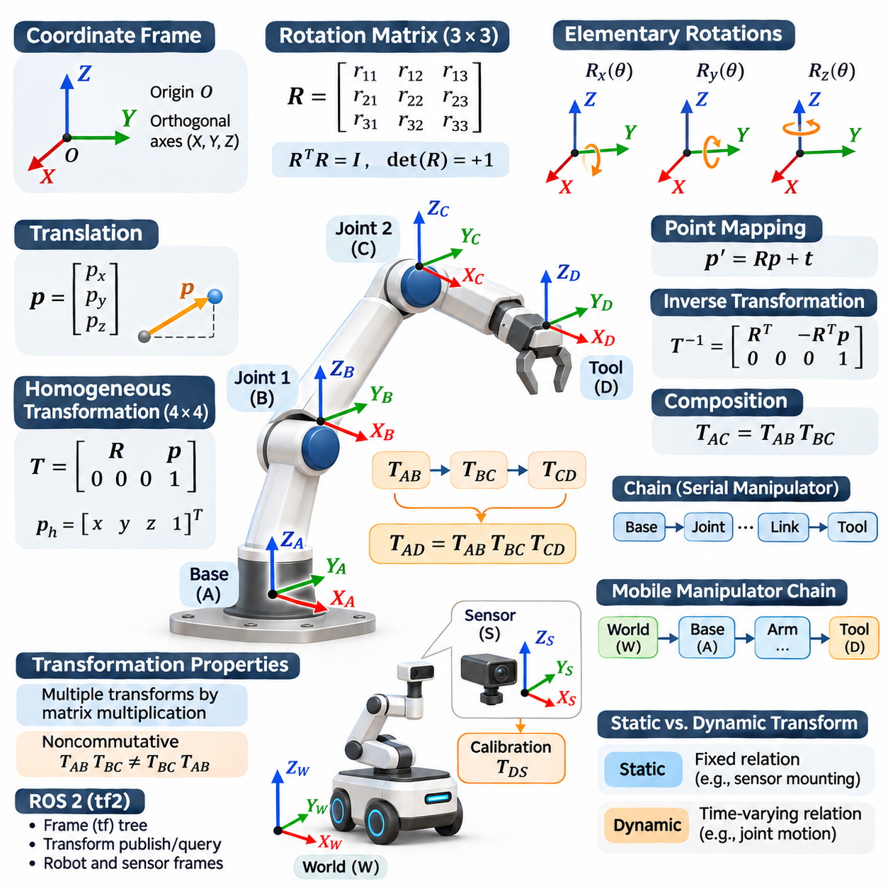
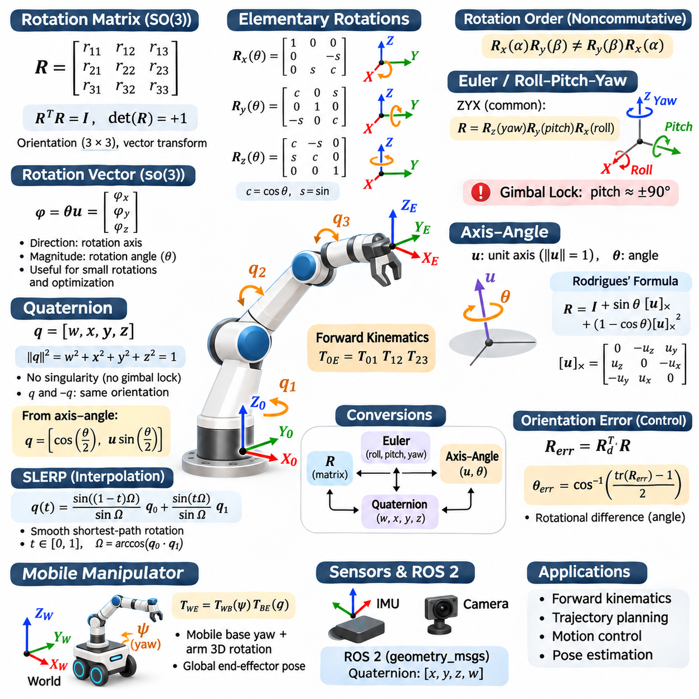
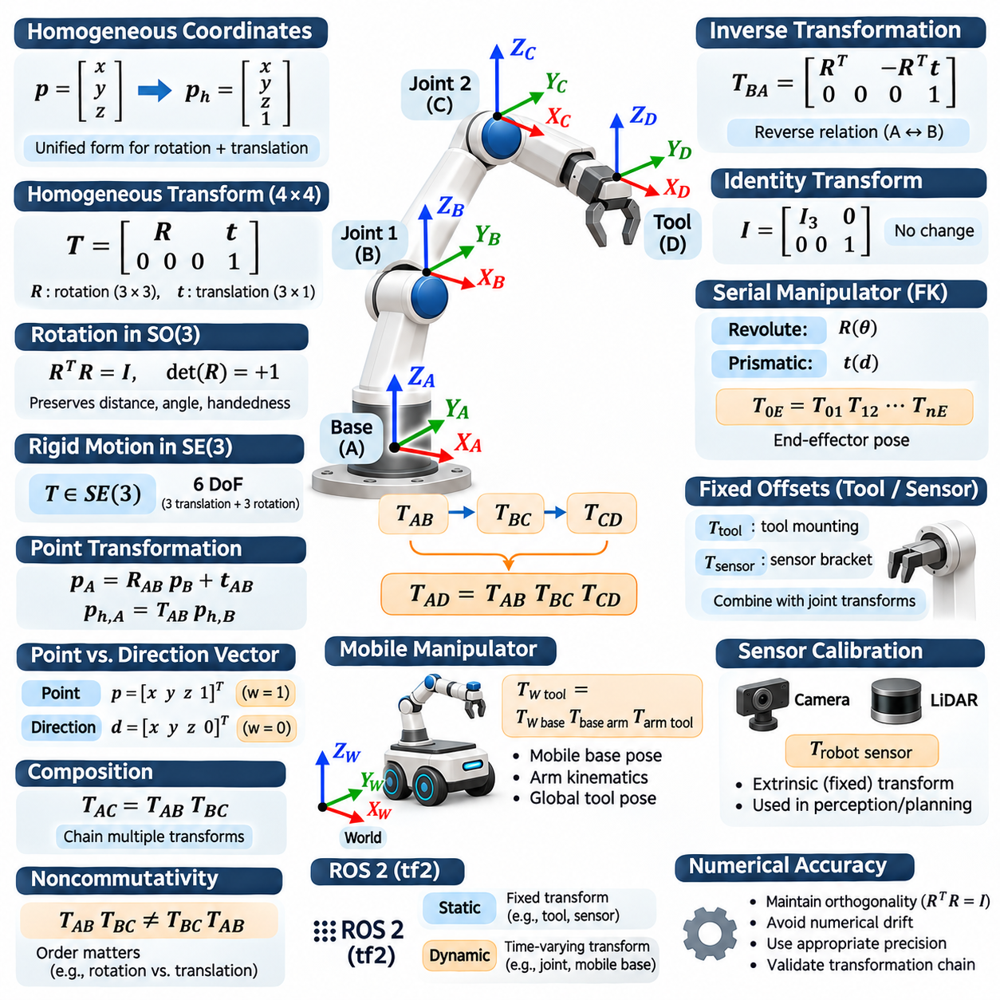
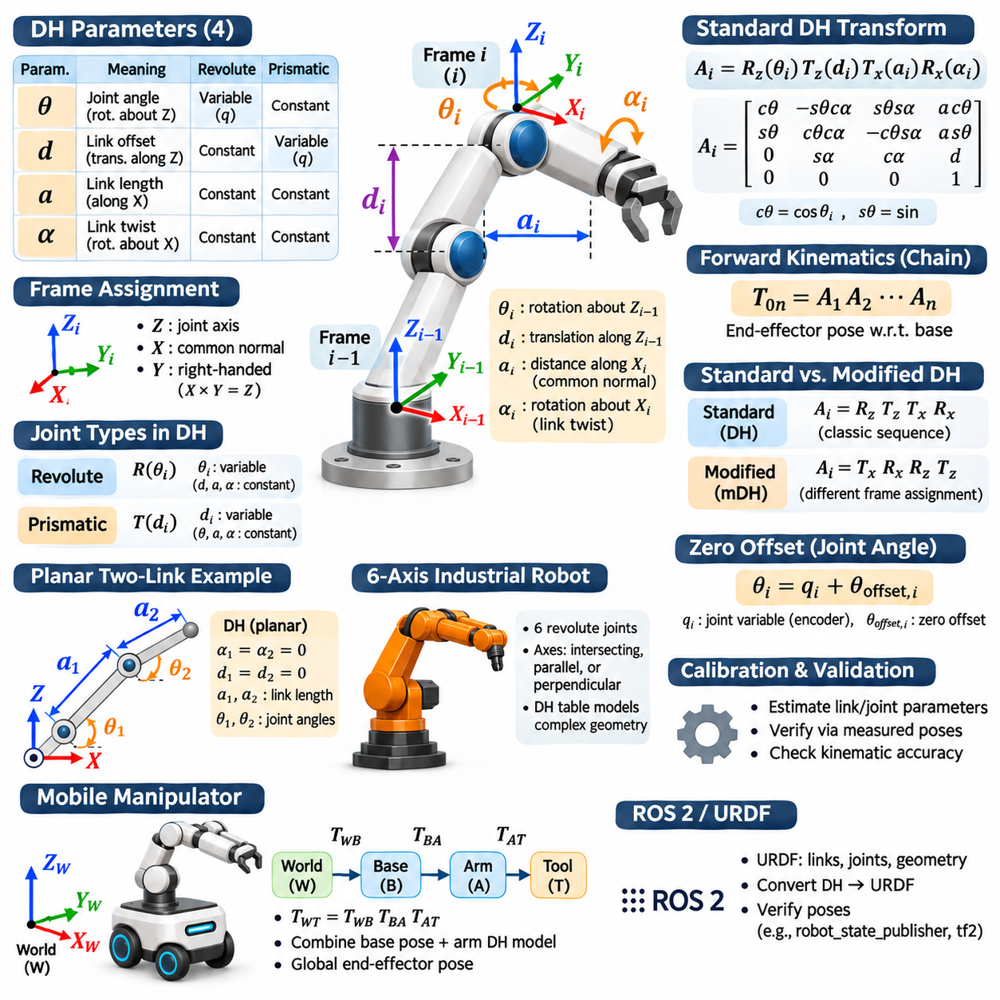
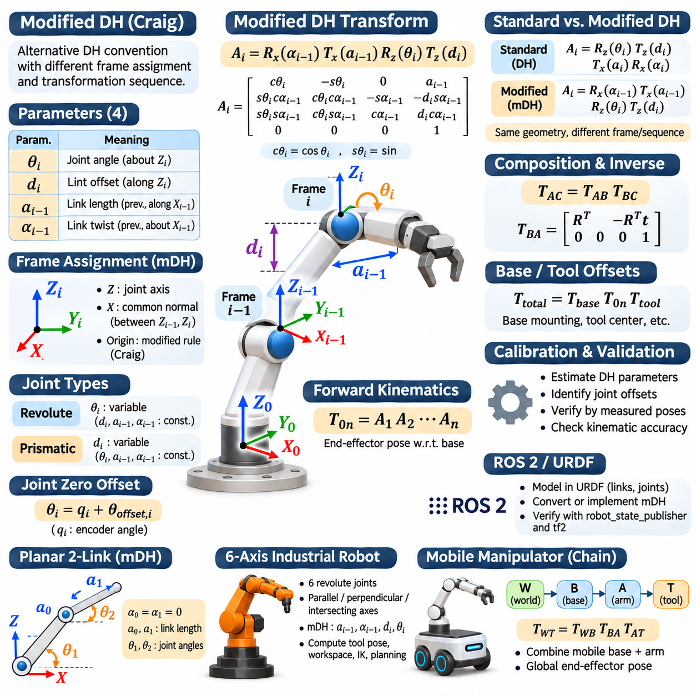
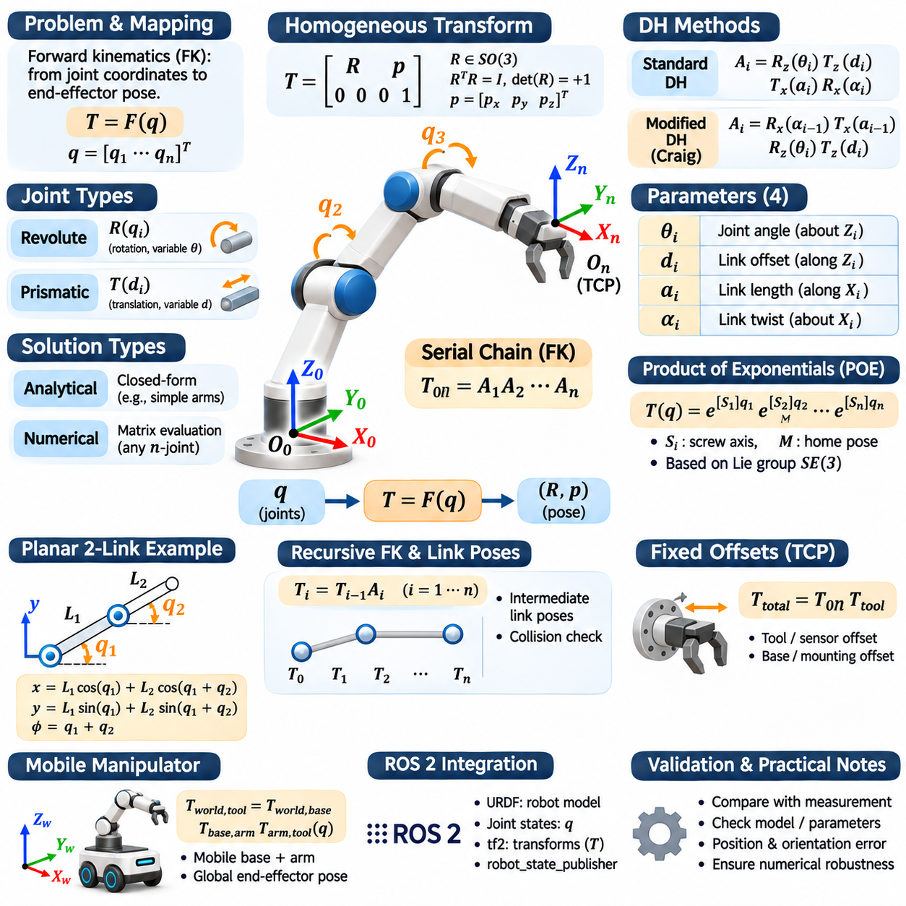
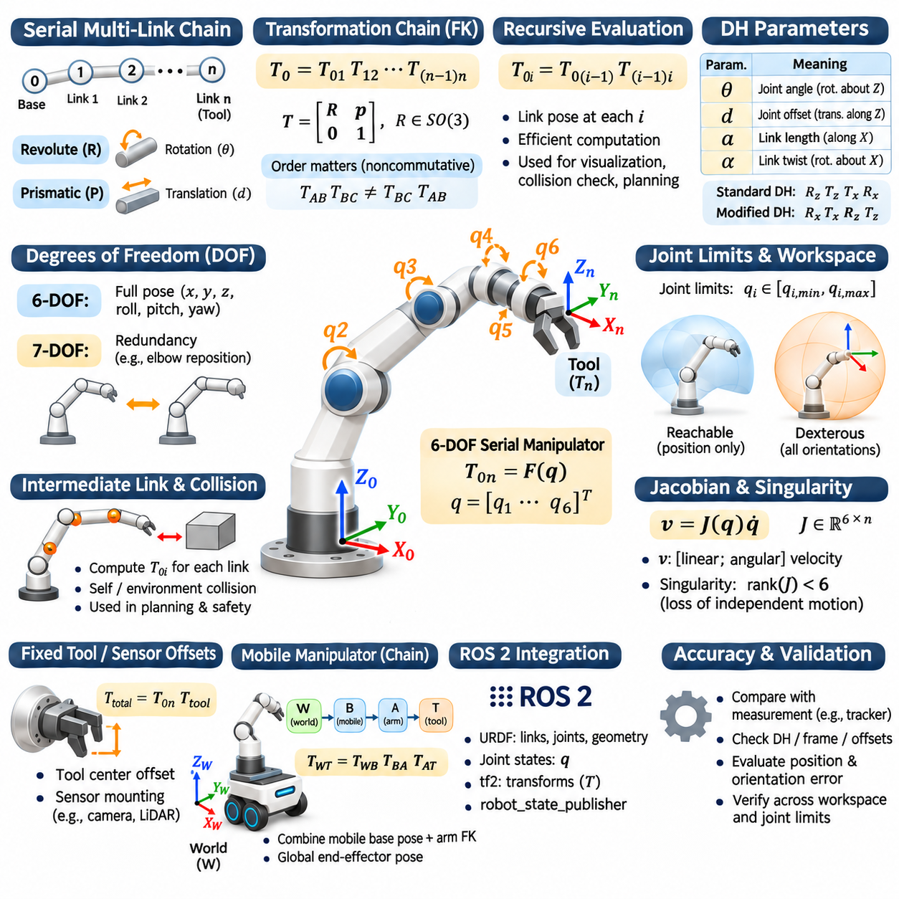
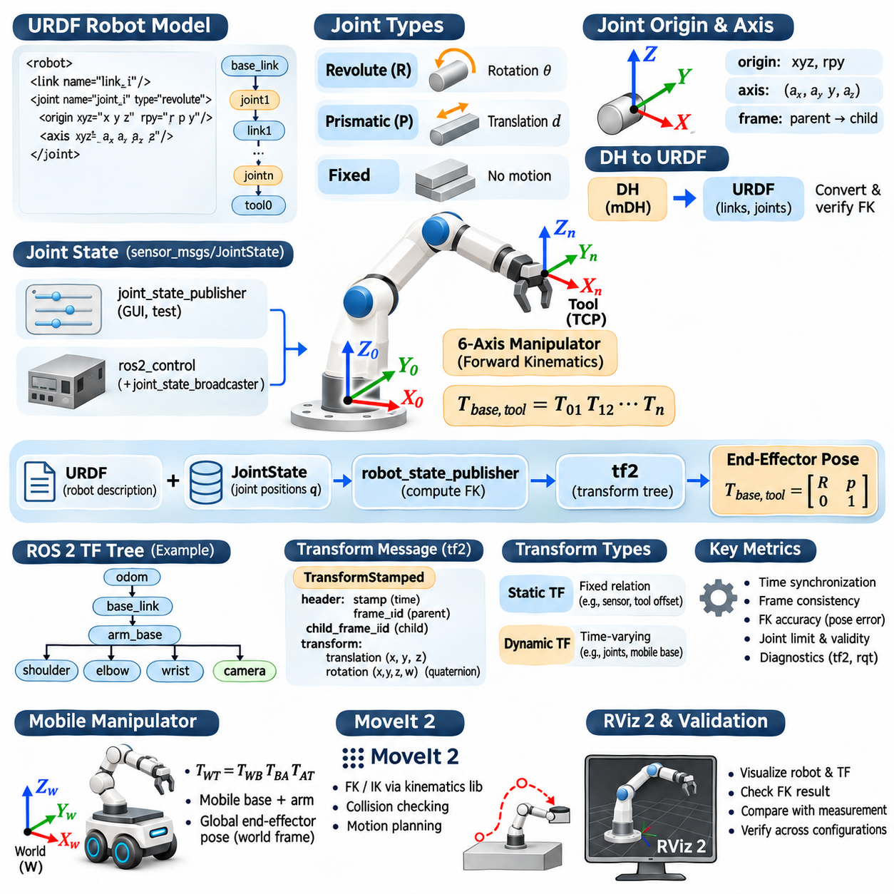
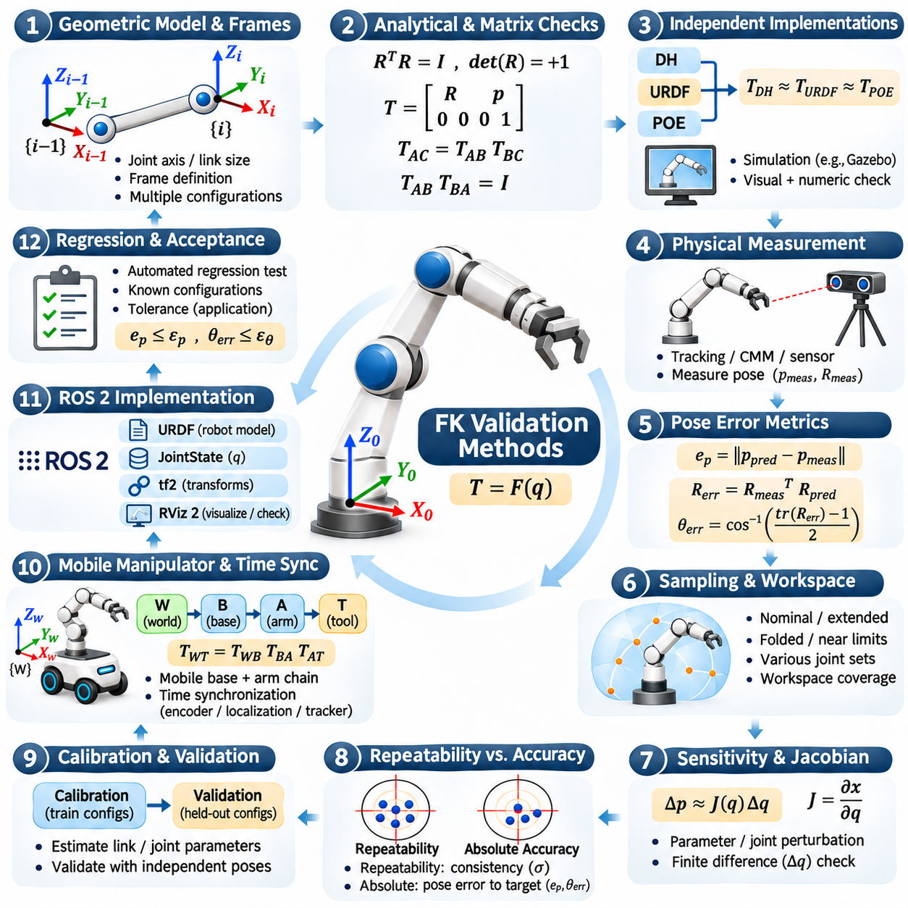

**Volume 02. Manipulator Mechanics and Control**


# Chapter 02. Forward Kinematics

##  

## 01 Transformation Matrices

{width="7.268055555555556in" height="7.268055555555556in"}

Transformation matrices provide the mathematical foundation for describing the position and orientation of robot components within a common spatial reference system. In robotic manipulators, every joint and link introduces a geometric relationship between adjacent coordinate frames. These relationships are expressed through matrices that systematically convert points, vectors, and coordinate descriptions from one reference frame to another.

A coordinate frame consists of an origin and three mutually perpendicular axes defining a local spatial reference. Robot bases, joints, links, sensors, and end effectors commonly have their own coordinate frames. Transformation matrices establish the relationships among these frames, allowing geometric information measured in one coordinate system to be interpreted consistently in another without changing the underlying physical configuration.

The mathematical representation of a spatial transformation combines rotational and translational relationships. Rotation describes how the axes of one coordinate frame are oriented relative to another, while translation describes the displacement between their origins. Together, these operations determine the complete rigid-body pose of a robot component and provide the geometric basis for calculating manipulator configurations.

A three-dimensional rotation matrix is represented by a 3 × 3 matrix whose columns describe the axes of a rotated coordinate frame expressed in a reference frame. The matrix must satisfy the orthogonality condition RᵀR = I and the determinant condition det(R) = +1. These properties preserve distances, angles, and handedness, ensuring that the transformation represents a physically valid rigid-body rotation.

Rotation matrices can describe elementary rotations around the X, Y, and Z axes. A rotation around the X axis changes the orientation of the Y and Z axes while preserving the X direction. Similarly, rotations around the Y and Z axes affect their corresponding perpendicular planes. These elementary operations provide the building blocks for representing complex orientations encountered in multi-joint robotic manipulators.

The order of rotational operations is essential because three-dimensional rotations generally do not commute. Applying a rotation around the X axis followed by a rotation around the Z axis usually produces a different orientation from performing the same rotations in reverse order. Consequently, robotic software must maintain explicit conventions for rotation sequences, coordinate-frame definitions, and multiplication order.

Translation represents the displacement between coordinate-frame origins and is commonly expressed as a three-dimensional vector p = [px, py, pz]ᵀ. Unlike rotation, translation alone does not change the orientation of a rigid body. However, combining translations and rotations through ordinary matrix operations requires an extended representation that accommodates both operations within a unified mathematical structure.

Homogeneous coordinates provide this unified representation by extending a three-dimensional position vector into four dimensions. A point p = [x, y, z]ᵀ becomes pₕ = [x, y, z, 1]ᵀ. The additional coordinate enables translation and rotation to be performed through a single matrix multiplication, simplifying the composition of multiple geometric transformations across a robotic kinematic chain.

A homogeneous transformation matrix is a 4 × 4 matrix composed of a 3 × 3 rotation matrix R, a 3 × 1 translation vector p, and a final row [0, 0, 0, 1]. Its standard structure is T = [R p; 0 0 0 1]. This compact representation describes the pose of one coordinate frame relative to another and is fundamental to forward kinematics.

When a homogeneous transformation is applied to a point, the resulting coordinates are obtained through p\' = Rp + t, where R represents rotation and t represents translation. This operation first expresses the point through the specified rotational relationship and then applies the displacement. The result depends on the adopted coordinate convention, making frame notation essential for correct interpretation.

Transformation matrices are particularly useful because multiple transformations can be combined through matrix multiplication. If frame B is defined relative to frame A and frame C is defined relative to frame B, the transformation from C to A is obtained as T_AC = T_AB T_BC. This composition principle allows complex robot geometries to be represented as sequences of relatively simple relationships.

In a serial robotic manipulator, each joint establishes a transformation between neighboring link frames. Revolute joints introduce angle-dependent rotations, while prismatic joints introduce displacement-dependent translations. Multiplying the transformations from the base to the final link produces the end-effector pose. This process is the central mathematical operation of forward kinematics and supports robotic motion planning.

The multiplication order of transformation matrices must follow the physical and mathematical structure of the coordinate-frame chain. Matrix multiplication is generally noncommutative, meaning T_AB T_BC cannot be arbitrarily reordered. Incorrect multiplication sequences may generate plausible numerical results while producing physically incorrect poses, making transformation ordering a critical implementation consideration.

Inverse transformations describe the reverse relationship between two coordinate frames. For a rigid-body transformation containing rotation R and translation p, the inverse transformation contains Rᵀ and the translation −Rᵀp. This relationship follows from the orthogonality of rotation matrices and provides an efficient method for converting positions and orientations between reference frames without general-purpose matrix inversion.

Transformation matrices also distinguish between points and direction vectors. A position is represented using a homogeneous coordinate of one, allowing translation to affect its transformed value. A direction vector uses a homogeneous coordinate of zero, so only rotation influences its result. This distinction is important when transforming surface normals, motion directions, tool axes, and other geometric quantities.

For robotic manipulation, transformation matrices establish the relationship between the robot base, wrist, tool flange, and tool center point. A tool offset can be represented as an additional fixed transformation attached to the final robot link. Consequently, the actual working position of a gripper, welding torch, or inspection sensor can be calculated accurately even when its functional point differs from the mechanical mounting interface.

Mobile manipulators introduce additional transformation relationships because the robotic arm is mounted on a moving platform. The global end-effector pose depends on the mobile base pose, arm mounting configuration, and internal joint transformations. A typical relationship is T_world_tool = T_world_base T_base_arm T_arm_tool, where each matrix represents a specific geometric connection within the integrated robotic system.

Coordinate transformations are also essential for integrating perception systems with robotic manipulators. Cameras, LiDAR sensors, and depth sensors report measurements in their own coordinate frames. To use these measurements for grasping or inspection, the robot must transform detected object positions into the appropriate planning or control frame. Accurate sensor extrinsic calibration therefore directly influences manipulation accuracy.

Transformation matrices support both static and dynamic geometric relationships. Static transformations describe fixed connections, such as the mounting offset between a robot base and a sensor. Dynamic transformations describe relationships that change with joint motion or mobile-platform movement. Maintaining these distinctions allows robotic software to update changing poses efficiently while preserving fixed mechanical calibration parameters.

Numerical precision is important when transformations are repeatedly multiplied across long kinematic chains. Floating-point errors may gradually cause a computed rotation matrix to deviate from exact orthogonality. Validation procedures can examine RᵀR and det(R), while suitable orthonormalization methods can restore valid rotation properties when necessary. These precautions improve numerical reliability in repeated geometric calculations.

Transformation conventions must be documented consistently across mechanical design, simulation, and control software. Engineers should specify whether matrices represent active or passive transformations, whether vectors are expressed as columns or rows, and which coordinate frames define each transformation. Inconsistent conventions can introduce orientation errors, incorrect tool offsets, and unexpected motion during system integration.

In ROS 2 robotic systems, transformation relationships are commonly managed through the tf2 framework. Robot descriptions define structural relationships among links, while joint-state information supplies changing configurations. Transformation data allows perception, navigation, and manipulation components to interpret spatial information within connected coordinate frames, supporting modular integration across distributed robotic software components.

Transformation matrices also provide a foundation for calibration and validation procedures. Known geometric reference points can be measured and transformed between coordinate systems to evaluate positional consistency. Differences between predicted and measured coordinates reveal potential errors in frame definitions, mechanical dimensions, joint offsets, or sensor mounting parameters, helping engineers identify systematic inaccuracies.

Industrial applications require transformation models that remain consistent under practical operating conditions. Mechanical deflection, thermal expansion, mounting tolerances, and calibration drift can cause differences between ideal mathematical models and physical robot behavior. Although rigid transformation matrices do not directly represent structural deformation, they provide the nominal geometric reference against which these deviations can be evaluated.

Efficient transformation computation is especially important in real-time robotic control. Forward kinematics may be evaluated repeatedly for trajectory tracking, collision checking, tool positioning, and sensor alignment. Implementations can improve computational efficiency by exploiting rigid-transform structure, caching fixed transformations, and updating only those matrix relationships affected by changing joint positions.

Ultimately, transformation matrices connect abstract geometric models with the physical behavior of robotic manipulators. They provide a consistent framework for representing spatial relationships, composing joint motions, integrating sensors, and calculating tool poses. A rigorous understanding of these matrices is essential for developing accurate forward kinematics, reliable motion control, and coordinated mobile manipulation systems.

변환 행렬(Transformation Matrix)은 로봇 구성 요소의 위치(Position)와 방향(Orientation)을 공통 공간 기준계(Spatial Reference System)에서 표현하기 위한 수학적 기반을 제공한다. 로봇 매니퓰레이터(Robotic Manipulator)에서는 각 관절(Joint)과 링크(Link)가 인접한 좌표계(Coordinate Frame) 사이에 기하학적 관계를 형성한다. 이러한 관계는 하나의 기준 좌표계에서 다른 기준 좌표계로 점(Point), 벡터(Vector), 좌표 표현(Coordinate Representation)을 체계적으로 변환하는 행렬로 나타낼 수 있다.

좌표계(Coordinate Frame)는 원점(Origin)과 서로 직교하는 세 개의 축(Axis)으로 구성되며, 국소적인 공간 기준(Local Spatial Reference)을 정의한다. 로봇 베이스(Robot Base), 관절(Joint), 링크(Link), 센서(Sensor), 말단장치(End Effector)는 일반적으로 각각의 좌표계를 가진다. 변환 행렬(Transformation Matrix)은 이러한 좌표계 사이의 관계를 설정하여, 한 좌표계에서 측정한 기하학적 정보를 실제 물리적 구성을 변경하지 않고 다른 좌표계에서 일관되게 해석할 수 있도록 한다.

공간 변환(Spatial Transformation)의 수학적 표현은 회전 관계(Rotational Relationship)와 병진 관계(Translational Relationship)를 결합한다. 회전(Rotation)은 한 좌표계의 축이 다른 좌표계에 대해 어떤 방향으로 배치되는지를 나타내며, 병진 이동(Translation)은 두 좌표계 원점 사이의 변위를 나타낸다. 이 두 연산은 로봇 구성 요소의 완전한 강체 자세(Rigid-Body Pose)를 결정하며, 매니퓰레이터 구성(Manipulator Configuration)을 계산하기 위한 기하학적 기반을 제공한다.

3차원 회전 행렬(Three-Dimensional Rotation Matrix)은 3 × 3 행렬로 표현되며, 각 열(Column)은 기준 좌표계에서 표현한 회전된 좌표계의 축 방향을 나타낸다. 회전 행렬은 직교 조건(Orthogonality Condition) RᵀR = I와 행렬식 조건(Determinant Condition) det(R) = +1을 만족해야 한다. 이러한 특성은 거리(Distance), 각도(Angle), 좌표계의 오른손 방향성(Handedness)을 보존하여 변환이 물리적으로 유효한 강체 회전(Rigid-Body Rotation)을 나타내도록 보장한다.

회전 행렬(Rotation Matrix)은 X축, Y축, Z축을 중심으로 하는 기본 회전(Elementary Rotation)을 표현할 수 있다. X축 중심 회전은 X축 방향을 유지하면서 Y축과 Z축의 방향을 변경한다. 마찬가지로 Y축과 Z축 중심 회전은 각각 해당 축에 수직인 평면에서 방향을 변화시킨다. 이러한 기본 회전 연산은 다관절 로봇 매니퓰레이터(Multi-Joint Robotic Manipulator)에서 발생하는 복잡한 방향을 표현하기 위한 기본 구성 요소가 된다.

3차원 회전(Three-Dimensional Rotation)은 일반적으로 교환법칙(Commutative Property)이 성립하지 않으므로 회전 연산의 순서가 매우 중요하다. X축을 중심으로 회전한 후 Z축을 중심으로 회전한 결과는 동일한 회전을 반대 순서로 수행한 결과와 일반적으로 다르다. 따라서 로봇 소프트웨어(Robotic Software)는 회전 순서(Rotation Sequence), 좌표계 정의(Coordinate Frame Definition), 행렬 곱셈 순서(Matrix Multiplication Order)에 대한 명확한 규약을 유지해야 한다.

병진 이동(Translation)은 좌표계 원점 사이의 변위를 나타내며, 일반적으로 3차원 벡터(Three-Dimensional Vector) p = [px, py, pz]ᵀ로 표현된다. 회전과 달리 병진 이동만으로는 강체(Rigid Body)의 방향이 변경되지 않는다. 그러나 일반적인 행렬 연산을 통해 병진 이동과 회전을 결합하려면 두 연산을 통합된 수학적 구조에서 처리할 수 있는 확장 표현(Extended Representation)이 필요하다.

동차 좌표(Homogeneous Coordinates)는 3차원 위치 벡터(Position Vector)를 4차원으로 확장하여 이러한 통합 표현을 제공한다. 점 p = [x, y, z]ᵀ는 pₕ = [x, y, z, 1]ᵀ로 표현된다. 추가된 좌표 성분은 병진 이동과 회전을 하나의 행렬 곱셈(Matrix Multiplication)으로 수행할 수 있게 하며, 로봇 운동학 체인(Robotic Kinematic Chain)에서 여러 기하학적 변환을 결합하는 과정을 단순화한다.

동차 변환 행렬(Homogeneous Transformation Matrix)은 3 × 3 회전 행렬(Rotation Matrix) R, 3 × 1 병진 벡터(Translation Vector) p, 마지막 행 [0, 0, 0, 1]로 구성되는 4 × 4 행렬이다. 표준 구조는 T = [R p; 0 0 0 1]로 표현된다. 이 간결한 표현은 하나의 좌표계가 다른 좌표계에 대해 가지는 자세(Pose)를 나타내며, 순기구학(Forward Kinematics)의 핵심적인 수학적 기반이 된다.

동차 변환(Homogeneous Transformation)을 점에 적용하면 결과 좌표는 p\' = Rp + t로 계산되며, 여기서 R은 회전(Rotation), t는 병진 이동(Translation)을 나타낸다. 이 연산은 지정된 회전 관계를 통해 점의 방향을 변환한 다음 변위를 적용한다. 계산 결과는 채택한 좌표계 규약(Coordinate Convention)에 따라 달라지므로, 정확한 해석을 위해 좌표계 표기(Frame Notation)를 명확하게 정의해야 한다.

변환 행렬(Transformation Matrix)은 여러 변환을 행렬 곱셈(Matrix Multiplication)으로 결합할 수 있다는 점에서 특히 유용하다. 좌표계 B가 좌표계 A에 대해 정의되고, 좌표계 C가 좌표계 B에 대해 정의되었다면, C에서 A로의 변환은 T_AC = T_AB T_BC로 계산된다. 이러한 변환 합성(Transformation Composition) 원리를 통해 복잡한 로봇 기하학적 구조를 비교적 단순한 관계들의 연속으로 표현할 수 있다.

직렬 로봇 매니퓰레이터(Serial Robotic Manipulator)에서는 각 관절(Joint)이 인접한 링크 좌표계(Link Frame) 사이의 변환을 정의한다. 회전 관절(Revolute Joint)은 관절 각도에 따른 회전을 발생시키며, 직동 관절(Prismatic Joint)은 변위에 따른 병진 이동을 발생시킨다. 베이스(Base)에서 마지막 링크(Final Link)까지의 변환 행렬을 순서대로 곱하면 말단장치 자세(End-Effector Pose)를 얻을 수 있으며, 이 과정은 순기구학(Forward Kinematics)의 핵심 연산이다.

변환 행렬(Transformation Matrix)의 곱셈 순서는 좌표계 체인(Coordinate Frame Chain)의 물리적 구조와 수학적 구조를 따라야 한다. 행렬 곱셈(Matrix Multiplication)은 일반적으로 비가환적(Noncommutative)이므로 T_AB T_BC의 순서를 임의로 변경할 수 없다. 잘못된 곱셈 순서는 수치적으로 그럴듯한 결과를 생성하더라도 물리적으로 잘못된 자세(Pose)를 계산할 수 있으므로, 변환 순서(Transformation Order)는 구현 과정에서 중요한 검토 사항이다.

역변환(Inverse Transformation)은 두 좌표계 사이의 관계를 반대 방향으로 표현한다. 회전 행렬(Rotation Matrix) R과 병진 벡터(Translation Vector) p를 포함하는 강체 변환(Rigid-Body Transformation)의 역변환은 Rᵀ와 −Rᵀp로 구성된다. 이 관계는 회전 행렬의 직교성(Orthogonality)에서 유도되며, 일반적인 행렬 역연산(General Matrix Inversion)을 수행하지 않고도 좌표계 사이의 위치와 방향을 효율적으로 변환할 수 있게 한다.

변환 행렬(Transformation Matrix)은 점(Point)과 방향 벡터(Direction Vector)를 구분하여 처리한다. 위치(Position)는 동차 좌표(Homogeneous Coordinate)의 마지막 성분을 1로 설정하므로 병진 이동의 영향을 받는다. 반면 방향 벡터는 마지막 성분을 0으로 설정하므로 회전만 적용된다. 이러한 구분은 표면 법선 벡터(Surface Normal Vector), 이동 방향(Motion Direction), 도구 축(Tool Axis) 등의 기하학적 정보를 변환할 때 중요하다.

로봇 조작(Robotic Manipulation)에서 변환 행렬은 로봇 베이스(Robot Base), 손목(Wrist), 도구 플랜지(Tool Flange), 도구 중심점(Tool Center Point) 사이의 관계를 정의한다. 도구 오프셋(Tool Offset)은 마지막 로봇 링크에 부착된 추가적인 고정 변환(Fixed Transformation)으로 표현할 수 있다. 따라서 그리퍼(Gripper), 용접 토치(Welding Torch), 검사 센서(Inspection Sensor)의 실제 작업 위치가 기계적 장착 인터페이스와 다르더라도 정확하게 계산할 수 있다.

모바일 매니퓰레이터(Mobile Manipulator)는 로봇 팔(Robot Arm)이 이동 플랫폼(Mobile Platform)에 장착되어 있으므로 추가적인 변환 관계가 필요하다. 전역 좌표계(Global Coordinate Frame)에서 말단장치 자세(End-Effector Pose)는 모바일 베이스 자세(Mobile Base Pose), 로봇 팔 장착 구성(Arm Mounting Configuration), 내부 관절 변환(Internal Joint Transformation)에 의해 결정된다. 대표적인 관계는 T_world_tool = T_world_base T_base_arm T_arm_tool로 표현되며, 각 행렬은 통합 로봇 시스템의 특정 기하학적 연결을 나타낸다.

좌표 변환(Coordinate Transformation)은 인식 시스템(Perception System)과 로봇 매니퓰레이터를 통합하는 데에도 필수적이다. 카메라(Camera), 라이다(LiDAR), 깊이 센서(Depth Sensor)는 각각의 센서 좌표계(Sensor Coordinate Frame)에서 측정 결과를 제공한다. 이러한 측정값을 파지(Grasping)나 검사(Inspection)에 활용하려면 검출된 물체 위치를 적절한 계획 또는 제어 좌표계로 변환해야 하며, 센서 외부 보정(Sensor Extrinsic Calibration)의 정확도는 조작 정밀도에 직접적인 영향을 미친다.

변환 행렬(Transformation Matrix)은 정적 기하학적 관계(Static Geometric Relationship)와 동적 기하학적 관계(Dynamic Geometric Relationship)를 모두 표현할 수 있다. 정적 변환(Static Transformation)은 로봇 베이스와 센서 사이의 장착 오프셋처럼 고정된 연결을 나타낸다. 동적 변환(Dynamic Transformation)은 관절 운동이나 모바일 플랫폼 이동에 따라 변화하는 관계를 나타내며, 이러한 구분은 고정된 기계적 보정 값을 유지하면서 변화하는 자세를 효율적으로 갱신할 수 있게 한다.

긴 운동학 체인(Kinematic Chain)에서 변환 행렬을 반복적으로 곱할 때는 수치 정밀도(Numerical Precision)가 중요하다. 부동소수점 오차(Floating-Point Error)가 누적되면 계산된 회전 행렬이 정확한 직교성(Orthogonality)에서 벗어날 수 있다. 검증 과정에서는 RᵀR과 det(R)을 검사할 수 있으며, 필요한 경우 적절한 직교 정규화(Orthonormalization) 방법을 적용하여 유효한 회전 특성을 복원함으로써 반복적인 기하학적 계산의 수치적 신뢰성을 높일 수 있다.

변환 규약(Transformation Convention)은 기계 설계(Mechanical Design), 시뮬레이션(Simulation), 제어 소프트웨어(Control Software) 전반에서 일관되게 문서화되어야 한다. 엔지니어는 행렬이 능동 변환(Active Transformation)인지 수동 변환(Passive Transformation)인지, 벡터가 열 벡터(Column Vector)인지 행 벡터(Row Vector)인지, 각 변환이 어떤 좌표계를 기준으로 정의되는지를 명확히 해야 한다. 규약의 불일치는 방향 오차, 잘못된 도구 오프셋, 시스템 통합 과정의 예상치 못한 움직임을 유발할 수 있다.

ROS 2 로봇 시스템(Robotic System)에서는 좌표 변환 관계를 일반적으로 tf2 프레임워크(tf2 Framework)를 통해 관리한다. 로봇 기술 모델(Robot Description)은 링크 사이의 구조적 관계를 정의하며, 관절 상태 정보(Joint State Information)는 변화하는 로봇 구성을 제공한다. 변환 데이터(Transformation Data)는 인식(Perception), 내비게이션(Navigation), 조작(Manipulation) 구성 요소가 연결된 좌표계 내에서 공간 정보를 해석하도록 지원하여 분산 로봇 소프트웨어의 모듈식 통합(Modular Integration)을 가능하게 한다.

변환 행렬(Transformation Matrix)은 보정(Calibration)과 검증(Validation) 절차의 기반도 제공한다. 알려진 기하학적 기준점(Geometric Reference Point)을 측정하고 좌표계 사이에서 변환하여 위치 일관성(Positional Consistency)을 평가할 수 있다. 예측 좌표(Predicted Coordinates)와 측정 좌표(Measured Coordinates)의 차이는 좌표계 정의, 기계적 치수, 관절 오프셋, 센서 장착 매개변수의 잠재적인 오류를 드러내며, 엔지니어가 체계적인 정확도 문제를 식별하도록 돕는다.

산업용 응용(Industrial Application)에서는 실제 운용 조건에서도 일관성을 유지하는 변환 모델(Transformation Model)이 필요하다. 기계적 처짐(Mechanical Deflection), 열팽창(Thermal Expansion), 장착 공차(Mounting Tolerance), 보정 드리프트(Calibration Drift)는 이상적인 수학적 모델과 실제 로봇 동작 사이에 차이를 발생시킬 수 있다. 강체 변환 행렬(Rigid Transformation Matrix)은 구조적 변형을 직접 표현하지는 않지만, 이러한 편차를 평가하기 위한 공칭 기하학적 기준(Nominal Geometric Reference)을 제공한다.

효율적인 변환 계산(Transformation Computation)은 실시간 로봇 제어(Real-Time Robotic Control)에서 특히 중요하다. 순기구학(Forward Kinematics)은 궤적 추종(Trajectory Tracking), 충돌 검사(Collision Checking), 도구 위치 결정(Tool Positioning), 센서 정렬(Sensor Alignment)을 위해 반복적으로 계산될 수 있다. 구현 과정에서는 강체 변환의 수학적 구조를 활용하고, 고정 변환을 캐싱(Caching)하며, 관절 위치 변화의 영향을 받는 행렬 관계만 갱신함으로써 계산 효율성을 높일 수 있다.

궁극적으로 변환 행렬(Transformation Matrix)은 추상적인 기하학적 모델(Abstract Geometric Model)과 로봇 매니퓰레이터의 실제 물리적 동작(Physical Behavior)을 연결한다. 변환 행렬은 공간 관계 표현, 관절 운동 합성, 센서 통합, 도구 자세 계산을 위한 일관된 수학적 프레임워크(Mathematical Framework)를 제공한다. 이러한 행렬에 대한 엄밀한 이해는 정확한 순기구학(Forward Kinematics), 신뢰성 있는 운동 제어(Motion Control), 협조적인 모바일 매니퓰레이션(Coordinated Mobile Manipulation) 시스템을 개발하는 데 필수적이다.

##  

## 02 Rotation Representations

{width="7.268055555555556in" height="7.268055555555556in"}

Rotation representations provide the mathematical framework for describing the orientation of rigid bodies in three-dimensional space. In robotic manipulators, orientation determines how links, joints, tools, and sensors are aligned relative to reference coordinate frames. Accurate rotational modeling is essential for forward kinematics, trajectory planning, motion control, and the spatial coordination of robotic components.

Unlike position, which can be represented directly by three Cartesian coordinates, orientation requires a mathematical description of rotational relationships. Several representations are used in robotics, including rotation matrices, Euler angles, roll-pitch-yaw angles, axis-angle parameters, and quaternions. Each representation provides different advantages regarding numerical stability, computational efficiency, interpretability, and mathematical complexity.

A rotation matrix represents orientation through a 3 × 3 orthogonal matrix belonging to the special orthogonal group SO(3). Its columns describe the directions of the rotated coordinate axes expressed in a reference frame. A valid rotation matrix satisfies RᵀR = I and det(R) = +1, ensuring that rotations preserve distances, angles, and coordinate-system handedness without introducing scaling or reflection.

Rotation matrices are particularly useful for transforming vectors between coordinate frames. If a vector is expressed in a local frame, multiplication by the appropriate rotation matrix expresses that vector in the reference frame. Multiple rotations can be composed through matrix multiplication, making this representation especially suitable for serial manipulators, where joint rotations must be combined along a kinematic chain.

Elementary rotation matrices describe rotations around the principal coordinate axes. Rotations about the X, Y, and Z axes are commonly denoted Rx(θ), Ry(θ), and Rz(θ). Each matrix contains sine and cosine functions of the rotation angle. By multiplying elementary rotation matrices in a specified order, complex three-dimensional orientations can be constructed from simple rotational operations.

The order of rotation operations is critical because three-dimensional rotations are generally noncommutative. A rotation around the X axis followed by a rotation around the Y axis usually produces a different final orientation from the reverse sequence. Consequently, every orientation representation must specify its axis convention, multiplication order, and reference-frame interpretation to avoid ambiguity during implementation.

Euler angles describe orientation using three successive rotations about specified axes. Depending on the selected convention, rotations may occur around fixed reference axes or moving body axes. Common sequences include ZYX and ZXZ, although many alternatives exist. Euler angles are intuitive for describing orientation but require careful handling of axis definitions and rotation sequences.

Roll-pitch-yaw angles are widely used in mobile robotics and robotic manipulation because they provide an understandable description of orientation. Roll commonly represents rotation about the X axis, pitch about the Y axis, and yaw about the Z axis. Under a common fixed-axis convention, the resulting rotation matrix is R = Rz(yaw) Ry(pitch) Rx(roll), although other conventions are possible.

Despite their intuitive interpretation, Euler-angle representations contain singular configurations known as gimbal lock. In a ZYX convention, this occurs when pitch reaches approximately +90 or −90 degrees. At these configurations, two rotational degrees of freedom become locally indistinguishable in the parameterization, making orientation recovery and angular-rate calculations numerically problematic.

Gimbal lock does not indicate that the physical robot has lost a mechanical degree of freedom. Instead, it is a mathematical limitation of the selected orientation coordinates. The robot may still rotate freely, but the Euler-angle representation becomes locally singular. This distinction is important when designing controllers, interpreting sensor measurements, and converting between orientation representations.

The axis-angle representation describes a rotation through a unit vector defining the rotation axis and a scalar angle defining the rotation magnitude. According to Euler\'s rotation theorem, every proper three-dimensional rotation can be represented as a single rotation about an appropriate axis. This formulation provides a geometrically meaningful description of orientation changes between rigid-body configurations.

Rodrigues\' rotation formula converts an axis-angle representation into a rotation matrix. For a unit axis vector u and rotation angle θ, the matrix is R = I + sin(θ)[u]× + (1 − cos(θ))[u]ײ, where [u]× is the skew-symmetric cross-product matrix. This relationship is useful for rotational interpolation, geometric optimization, and exponential-coordinate formulations.

Rotation vectors combine the axis and angle into a three-dimensional vector whose direction specifies the rotation axis and whose magnitude specifies the rotation angle. This compact representation is closely related to the Lie algebra so(3). It is useful for expressing small orientation corrections, calculating rotational errors, and developing numerical optimization algorithms for robotic estimation and control.

Quaternions represent three-dimensional orientation using four parameters consisting of one scalar component and three vector components. A quaternion may be written as q = [w, x, y, z], where w is the scalar component. Unit quaternions satisfy w² + x² + y² + z² = 1 and represent valid spatial rotations without the local singularities associated with Euler-angle parameterizations.

A unit quaternion corresponding to an axis-angle rotation can be expressed as q = [cos(θ/2), ux sin(θ/2), uy sin(θ/2), uz sin(θ/2)]. This formulation encodes rotation using trigonometric relationships involving half the rotation angle. Quaternions provide a compact and computationally convenient representation for orientation estimation, motion interpolation, and robotic control.

Quaternion multiplication allows successive rotations to be combined without constructing intermediate rotation matrices. However, multiplication order remains important because quaternion products are generally noncommutative. Quaternion conventions must also be defined carefully, including component ordering, active versus passive rotation interpretation, and the relationship between quaternion multiplication and coordinate-frame transformations.

An important characteristic of unit quaternions is that q and −q represent the same physical orientation. This double-cover property must be considered when interpolating rotations or comparing orientation measurements. Algorithms that ignore quaternion sign equivalence may introduce discontinuities, unnecessarily long interpolation paths, or abrupt changes in commanded orientation trajectories.

Spherical linear interpolation, commonly called SLERP, provides smooth interpolation between two unit quaternions along a constant-angular-speed path on the unit quaternion sphere. It is widely used for orientation trajectory generation because it avoids many limitations of direct Euler-angle interpolation. Appropriate quaternion sign selection helps ensure interpolation follows the shorter rotational path.

Rotation representations also differ in their numerical constraints. Rotation matrices contain nine elements constrained by orthogonality, while unit quaternions contain four elements constrained by unit magnitude. Euler angles use three parameters but exhibit coordinate singularities. Axis-angle and rotation-vector formulations are compact but require special numerical treatment near zero rotation and certain angular boundaries.

Converting between representations is a common requirement in robotic software. Rotation matrices may be converted into Euler angles for visualization, quaternions for interpolation, or rotation vectors for optimization. These conversions must account for numerical tolerances, angle wrapping, normalization, and singular configurations to maintain consistency across planning, estimation, and control components.

In forward kinematics, joint rotations are commonly represented internally through rotation matrices or homogeneous transformations. The final end-effector orientation is obtained by composing the rotational contributions of individual joints. This orientation may subsequently be converted into Euler angles or quaternions for communication with motion planners, user interfaces, or external robotic systems.

Mobile manipulators require consistent orientation representations across the mobile platform and robotic arm. The platform heading may be represented by yaw, while the arm orientation generally requires full three-dimensional rotation. Combining these relationships allows the end-effector orientation to be calculated relative to the world frame, even when the mobile base changes its heading or spatial attitude.

Sensor integration introduces additional requirements for rotational consistency. Inertial measurement units commonly estimate orientation using quaternions or rotation matrices, while cameras and localization systems may provide poses using different conventions. Transforming these measurements into a common reference frame requires explicit axis definitions, correct rotation composition, and careful handling of coordinate-system conventions.

In ROS 2, orientation is commonly exchanged using quaternion fields within pose and transformation messages. The standard geometry message convention stores quaternion components as x, y, z, and w. Developers must therefore distinguish this storage order from mathematical notation that places the scalar component first. Incorrect component ordering can produce severe orientation errors despite otherwise valid numerical values.

For real-time control, orientation errors should be represented in a form suitable for continuous feedback calculations. Rotation matrices, quaternion error formulations, and logarithmic maps on SO(3) are commonly used to describe rotational differences. These approaches can avoid the local singularities of Euler-angle feedback, although each requires careful treatment of conventions and numerical edge cases.

Ultimately, no single rotation representation is optimal for every robotic application. Rotation matrices provide direct geometric transformations, Euler angles offer intuitive interpretation, axis-angle parameters describe meaningful rotational geometry, and quaternions support efficient interpolation and orientation tracking. Selecting and combining these representations appropriately is essential for accurate forward kinematics and reliable mobile manipulator control.

회전 표현(Rotation Representation)은 3차원 공간(Three-Dimensional Space)에서 강체(Rigid Body)의 방향(Orientation)을 기술하기 위한 수학적 프레임워크(Mathematical Framework)를 제공한다. 로봇 매니퓰레이터(Robotic Manipulator)에서 방향은 링크(Link), 관절(Joint), 도구(Tool), 센서(Sensor)가 기준 좌표계(Reference Coordinate Frame)에 대해 어떻게 정렬되는지를 결정한다. 정확한 회전 모델링(Rotational Modeling)은 순기구학(Forward Kinematics), 궤적 계획(Trajectory Planning), 운동 제어(Motion Control), 로봇 구성 요소의 공간적 협조(Spatial Coordination)에 필수적이다.

세 개의 직교 좌표(Cartesian Coordinates)로 직접 표현할 수 있는 위치(Position)와 달리, 방향(Orientation)은 회전 관계(Rotational Relationship)에 대한 수학적 기술이 필요하다. 로봇공학(Robotics)에서는 회전 행렬(Rotation Matrix), 오일러 각(Euler Angles), 롤-피치-요 각(Roll-Pitch-Yaw Angles), 축-각 매개변수(Axis-Angle Parameters), 쿼터니언(Quaternion) 등 여러 표현 방법을 사용한다. 각 표현은 수치 안정성(Numerical Stability), 계산 효율성(Computational Efficiency), 해석 용이성(Interpretability), 수학적 복잡성(Mathematical Complexity) 측면에서 서로 다른 장점을 제공한다.

회전 행렬(Rotation Matrix)은 특수 직교군(Special Orthogonal Group) SO(3)에 속하는 3 × 3 직교 행렬(Orthogonal Matrix)을 통해 방향을 표현한다. 각 열(Column)은 기준 좌표계에서 표현된 회전 좌표축(Rotated Coordinate Axis)의 방향을 나타낸다. 유효한 회전 행렬은 RᵀR = I와 det(R) = +1을 만족해야 하며, 이를 통해 크기 변화(Scaling)나 반사(Reflection)를 발생시키지 않고 거리(Distance), 각도(Angle), 좌표계의 오른손 방향성(Handedness)을 보존한다.

회전 행렬(Rotation Matrix)은 좌표계 사이에서 벡터(Vector)를 변환할 때 특히 유용하다. 국소 좌표계(Local Frame)에서 표현된 벡터에 적절한 회전 행렬을 곱하면 해당 벡터를 기준 좌표계(Reference Frame)에서 표현할 수 있다. 여러 회전은 행렬 곱셈(Matrix Multiplication)을 통해 합성할 수 있으므로, 관절 회전을 운동학 체인(Kinematic Chain)을 따라 결합해야 하는 직렬 매니퓰레이터(Serial Manipulator)에 적합하다.

기본 회전 행렬(Elementary Rotation Matrix)은 주요 좌표축(Principal Coordinate Axis)을 중심으로 하는 회전을 나타낸다. X축, Y축, Z축에 대한 회전은 일반적으로 Rx(θ), Ry(θ), Rz(θ)로 표기한다. 각 행렬은 회전각(Rotation Angle)에 대한 사인 함수(Sine Function)와 코사인 함수(Cosine Function)를 포함한다. 기본 회전 행렬을 지정된 순서로 곱하면 단순한 회전 연산으로부터 복잡한 3차원 방향을 구성할 수 있다.

3차원 회전(Three-Dimensional Rotation)은 일반적으로 비가환적(Noncommutative)이므로 회전 연산의 순서가 매우 중요하다. X축을 중심으로 회전한 다음 Y축을 중심으로 회전하면, 반대 순서로 수행했을 때와 일반적으로 다른 최종 방향(Final Orientation)이 생성된다. 따라서 모든 방향 표현(Orientation Representation)은 구현 과정에서 모호성을 방지하기 위해 축 규약(Axis Convention), 곱셈 순서(Multiplication Order), 기준 좌표계 해석(Reference-Frame Interpretation)을 명확하게 정의해야 한다.

오일러 각(Euler Angles)은 지정된 축을 중심으로 수행하는 세 번의 연속 회전(Successive Rotation)을 통해 방향을 표현한다. 선택한 규약(Convention)에 따라 회전은 고정 기준축(Fixed Reference Axis) 또는 움직이는 물체축(Moving Body Axis)을 중심으로 수행될 수 있다. 일반적인 회전 순서에는 ZYX와 ZXZ가 있으며, 이외에도 여러 조합이 존재한다. 오일러 각은 방향을 직관적으로 설명할 수 있지만 축 정의(Axis Definition)와 회전 순서(Rotation Sequence)를 신중하게 처리해야 한다.

롤-피치-요 각(Roll-Pitch-Yaw Angles)은 방향을 이해하기 쉬운 형태로 제공하므로 모바일 로봇공학(Mobile Robotics)과 로봇 조작(Robotic Manipulation)에서 널리 사용된다. 롤(Roll)은 일반적으로 X축 회전, 피치(Pitch)는 Y축 회전, 요(Yaw)는 Z축 회전을 의미한다. 일반적인 고정축 규약(Fixed-Axis Convention)에서 최종 회전 행렬은 R = Rz(yaw) Ry(pitch) Rx(roll)로 표현되지만, 다른 규약도 사용할 수 있다.

오일러 각(Euler Angles)은 직관적인 해석이 가능하지만 짐벌 락(Gimbal Lock)이라는 특이 구성(Singular Configuration)을 포함한다. ZYX 규약에서는 피치(Pitch)가 약 +90도 또는 −90도에 도달할 때 이러한 현상이 발생한다. 이 구성에서는 두 회전 자유도(Rotational Degrees of Freedom)가 매개변수 표현상 국소적으로 구별되지 않아 방향 복원(Orientation Recovery)과 각속도 계산(Angular-Rate Calculation)에 수치적 문제가 발생할 수 있다.

짐벌 락(Gimbal Lock)은 실제 로봇이 기계적 자유도(Mechanical Degree of Freedom)를 잃었다는 의미가 아니다. 이는 선택한 방향 좌표(Orientation Coordinates)가 가지는 수학적 한계(Mathematical Limitation)이다. 로봇은 여전히 자유롭게 회전할 수 있지만 오일러 각 표현(Euler-Angle Representation)이 국소적으로 특이해진다. 이러한 차이를 이해하는 것은 제어기(Controller) 설계, 센서 측정값(Sensor Measurement) 해석, 방향 표현 간 변환에서 중요하다.

축-각 표현(Axis-Angle Representation)은 회전축(Rotation Axis)을 정의하는 단위 벡터(Unit Vector)와 회전 크기(Rotation Magnitude)를 정의하는 스칼라 각도(Scalar Angle)를 사용하여 회전을 기술한다. 오일러 회전 정리(Euler\'s Rotation Theorem)에 따르면 모든 올바른 3차원 회전(Proper Three-Dimensional Rotation)은 적절한 축을 중심으로 하는 단일 회전으로 표현할 수 있다. 이 방식은 강체 구성(Rigid-Body Configuration) 사이의 방향 변화를 기하학적으로 의미 있게 설명한다.

로드리게스 회전 공식(Rodrigues\' Rotation Formula)은 축-각 표현(Axis-Angle Representation)을 회전 행렬(Rotation Matrix)로 변환한다. 단위 회전축 벡터(Unit Axis Vector) u와 회전각 θ에 대해 R = I + sin(θ)[u]× + (1 − cos(θ))[u]ײ로 표현되며, 여기서 [u]×는 반대칭 외적 행렬(Skew-Symmetric Cross-Product Matrix)이다. 이 관계는 회전 보간(Rotational Interpolation), 기하학적 최적화(Geometric Optimization), 지수 좌표 표현(Exponential-Coordinate Formulation)에 유용하다.

회전 벡터(Rotation Vector)는 회전축과 회전각을 하나의 3차원 벡터로 결합하며, 벡터의 방향은 회전축을, 크기는 회전각을 나타낸다. 이러한 간결한 표현은 리 대수(Lie Algebra) so(3)와 밀접한 관련이 있다. 회전 벡터는 작은 방향 보정(Small Orientation Correction), 회전 오차(Rotational Error) 계산, 로봇 상태 추정(Robotic Estimation) 및 제어를 위한 수치 최적화 알고리즘(Numerical Optimization Algorithm) 개발에 유용하다.

쿼터니언(Quaternion)은 하나의 스칼라 성분(Scalar Component)과 세 개의 벡터 성분(Vector Components)으로 구성된 네 개의 매개변수를 사용하여 3차원 방향을 표현한다. 쿼터니언은 q = [w, x, y, z]로 나타낼 수 있으며, 여기서 w는 스칼라 성분이다. 단위 쿼터니언(Unit Quaternion)은 w² + x² + y² + z² = 1을 만족하며, 오일러 각 매개변수화(Euler-Angle Parameterization)에서 발생하는 국소 특이점(Local Singularity) 없이 유효한 공간 회전(Spatial Rotation)을 표현한다.

축-각 회전(Axis-Angle Rotation)에 대응하는 단위 쿼터니언(Unit Quaternion)은 q = [cos(θ/2), ux sin(θ/2), uy sin(θ/2), uz sin(θ/2)]로 표현할 수 있다. 이 공식은 회전각의 절반(Half Rotation Angle)을 사용하는 삼각함수 관계(Trigonometric Relationship)를 통해 회전을 인코딩(Encoding)한다. 쿼터니언은 방향 추정(Orientation Estimation), 운동 보간(Motion Interpolation), 로봇 제어(Robotic Control)에 적합한 간결하고 계산 효율적인 표현을 제공한다.

쿼터니언 곱셈(Quaternion Multiplication)을 사용하면 중간 회전 행렬(Intermediate Rotation Matrix)을 구성하지 않고도 연속적인 회전을 결합할 수 있다. 그러나 쿼터니언 곱은 일반적으로 비가환적(Noncommutative)이므로 곱셈 순서가 중요하다. 또한 성분 배열 순서(Component Ordering), 능동 회전(Active Rotation)과 수동 회전(Passive Rotation)의 해석, 쿼터니언 곱셈과 좌표 변환(Coordinate-Frame Transformation)의 관계를 명확하게 정의해야 한다.

단위 쿼터니언(Unit Quaternion)의 중요한 특징은 q와 −q가 동일한 물리적 방향(Physical Orientation)을 나타낸다는 것이다. 이러한 이중 피복 특성(Double-Cover Property)은 회전 보간(Rotational Interpolation)이나 방향 측정값(Orientation Measurement)을 비교할 때 고려해야 한다. 쿼터니언 부호 동등성(Quaternion Sign Equivalence)을 무시하는 알고리즘은 불연속성(Discontinuity), 불필요하게 긴 보간 경로(Interpolation Path), 명령된 방향 궤적(Orientation Trajectory)의 급격한 변화를 유발할 수 있다.

구면 선형 보간(Spherical Linear Interpolation), 일반적으로 SLERP라고 하는 방법은 단위 쿼터니언 구(Unit Quaternion Sphere) 위에서 일정한 각속도(Constant Angular Speed)를 유지하는 경로를 따라 두 단위 쿼터니언 사이를 부드럽게 보간한다. 이 방법은 오일러 각 직접 보간(Direct Euler-Angle Interpolation)의 여러 한계를 피할 수 있으므로 방향 궤적 생성(Orientation Trajectory Generation)에 널리 사용된다. 적절한 쿼터니언 부호 선택(Quaternion Sign Selection)은 더 짧은 회전 경로를 따라 보간하도록 돕는다.

회전 표현(Rotation Representation)은 수치적 제약 조건(Numerical Constraint)에서도 차이가 있다. 회전 행렬(Rotation Matrix)은 직교성(Orthogonality)으로 제약되는 아홉 개의 원소를 포함하며, 단위 쿼터니언(Unit Quaternion)은 단위 크기(Unit Magnitude) 조건을 만족하는 네 개의 원소를 포함한다. 오일러 각(Euler Angles)은 세 개의 매개변수를 사용하지만 좌표 특이점(Coordinate Singularity)이 존재한다. 축-각 표현과 회전 벡터는 간결하지만 영 회전(Zero Rotation) 부근과 특정 각도 경계(Angular Boundary)에서 특별한 수치 처리가 필요하다.

표현 간 변환(Representation Conversion)은 로봇 소프트웨어(Robotic Software)에서 일반적으로 요구되는 기능이다. 회전 행렬(Rotation Matrix)은 시각화(Visualization)를 위해 오일러 각(Euler Angles)으로, 보간(Interpolation)을 위해 쿼터니언(Quaternion)으로, 최적화(Optimization)를 위해 회전 벡터(Rotation Vector)로 변환될 수 있다. 이러한 변환에서는 수치 허용오차(Numerical Tolerance), 각도 래핑(Angle Wrapping), 정규화(Normalization), 특이 구성(Singular Configuration)을 고려하여 계획, 추정, 제어 구성 요소 사이의 일관성을 유지해야 한다.

순기구학(Forward Kinematics)에서 관절 회전(Joint Rotation)은 일반적으로 회전 행렬(Rotation Matrix)이나 동차 변환(Homogeneous Transformation)을 통해 내부적으로 표현된다. 최종 말단장치 방향(End-Effector Orientation)은 개별 관절의 회전 기여(Rotational Contribution)를 합성하여 계산한다. 이후 이 방향은 운동 계획기(Motion Planner), 사용자 인터페이스(User Interface), 외부 로봇 시스템(External Robotic System)과 통신하기 위해 오일러 각이나 쿼터니언으로 변환할 수 있다.

모바일 매니퓰레이터(Mobile Manipulator)는 모바일 플랫폼(Mobile Platform)과 로봇 팔(Robot Arm) 사이에서 일관된 방향 표현(Orientation Representation)을 요구한다. 플랫폼의 진행 방향(Platform Heading)은 요(Yaw)로 표현할 수 있지만, 로봇 팔의 방향은 일반적으로 완전한 3차원 회전(Full Three-Dimensional Rotation)이 필요하다. 이러한 관계를 결합하면 모바일 베이스(Mobile Base)의 진행 방향이나 공간 자세(Spatial Attitude)가 변경되더라도 세계 좌표계(World Frame)에 대한 말단장치 방향을 계산할 수 있다.

센서 통합(Sensor Integration)은 회전 일관성(Rotational Consistency)에 대한 추가적인 요구사항을 발생시킨다. 관성 측정 장치(Inertial Measurement Unit)는 일반적으로 쿼터니언(Quaternion)이나 회전 행렬(Rotation Matrix)을 사용하여 방향을 추정하며, 카메라(Camera)와 위치 추정 시스템(Localization System)은 서로 다른 규약으로 자세(Pose)를 제공할 수 있다. 이러한 측정값을 공통 기준 좌표계(Common Reference Frame)로 변환하려면 명확한 축 정의(Axis Definition), 올바른 회전 합성(Rotation Composition), 좌표계 규약(Coordinate-System Convention)에 대한 신중한 처리가 필요하다.

ROS 2에서는 방향(Orientation)을 일반적으로 자세 및 변환 메시지(Pose and Transformation Message)의 쿼터니언 필드(Quaternion Field)를 통해 교환한다. 표준 기하학 메시지 규약(Standard Geometry Message Convention)은 쿼터니언 성분을 x, y, z, w 순서로 저장한다. 따라서 개발자는 스칼라 성분(Scalar Component)을 먼저 배치하는 수학적 표기법(Mathematical Notation)과 실제 저장 순서(Storage Order)를 구분해야 한다. 잘못된 성분 배열은 수치적으로 유효한 값이라도 심각한 방향 오차(Orientation Error)를 발생시킬 수 있다.

실시간 제어(Real-Time Control)에서는 방향 오차(Orientation Error)를 연속적인 피드백 계산(Continuous Feedback Calculation)에 적합한 형태로 표현해야 한다. 회전 행렬(Rotation Matrix), 쿼터니언 오차 표현(Quaternion Error Formulation), SO(3)의 로그 사상(Logarithmic Map)은 회전 차이(Rotational Difference)를 기술하는 데 일반적으로 사용된다. 이러한 접근법은 오일러 각 피드백(Euler-Angle Feedback)의 국소 특이점을 피할 수 있지만, 각각 규약과 수치적 경계 조건(Numerical Edge Case)을 신중하게 처리해야 한다.

궁극적으로 모든 로봇 응용(Robotic Application)에 최적인 단일 회전 표현(Single Rotation Representation)은 존재하지 않는다. 회전 행렬(Rotation Matrix)은 직접적인 기하학적 변환(Geometric Transformation)을 제공하고, 오일러 각(Euler Angles)은 직관적인 해석을 지원하며, 축-각 매개변수(Axis-Angle Parameter)는 의미 있는 회전 기하학(Rotational Geometry)을 설명한다. 쿼터니언(Quaternion)은 효율적인 보간(Interpolation)과 방향 추적(Orientation Tracking)을 지원하며, 이러한 표현을 적절히 선택하고 결합하는 것은 정확한 순기구학(Forward Kinematics)과 신뢰성 있는 모바일 매니퓰레이터 제어(Mobile Manipulator Control)에 필수적이다.

##  

## 03 Homogeneous Transforms

{width="7.268055555555556in" height="7.268055555555556in"}

Homogeneous transformations provide a unified mathematical framework for representing the position and orientation of rigid bodies in three-dimensional space. In robotic manipulators, they describe spatial relationships between coordinate frames attached to joints, links, tools, and sensors. By combining rotation and translation into a single matrix, homogeneous transformations simplify forward kinematics and enable systematic geometric calculations across complex robotic mechanisms.

A rigid-body transformation describes how a point or coordinate frame is positioned and oriented relative to another reference frame. Rotation determines the relative orientation of coordinate axes, while translation specifies the displacement between frame origins. These operations must be combined consistently because the position of a transformed point depends on both its original coordinates and the orientation of the reference system.

Homogeneous coordinates extend ordinary three-dimensional Cartesian coordinates by introducing an additional coordinate component. A point represented as p = [x, y, z]ᵀ becomes pₕ = [x, y, z, 1]ᵀ. This extension allows rotation and translation to be expressed through matrix multiplication, eliminating the need to handle them as separate operations during repeated coordinate transformations.

A homogeneous transformation matrix is represented by a 4 × 4 matrix containing a 3 × 3 rotation matrix R and a 3 × 1 translation vector t. Its standard structure is T = [R t; 0 0 0 1]. The upper-left block determines orientation, the upper-right column determines position, and the final row preserves the homogeneous coordinate structure required for rigid-body transformations.

The rotation component belongs to the special orthogonal group SO(3), satisfying RᵀR = I and det(R) = +1. These conditions ensure that the transformation preserves distances, angles, and the handedness of coordinate systems. The translation component is an unrestricted three-dimensional vector, allowing the transformed coordinate frame to occupy any position within the reference space.

Homogeneous transformations belong to the special Euclidean group SE(3), which describes rigid-body motions in three-dimensional space. This mathematical structure combines rotational and translational degrees of freedom into a single representation. Although the transformation matrix contains sixteen numerical entries, a rigid-body pose has only six independent degrees of freedom: three translational and three rotational.

Applying a homogeneous transformation to a point produces its coordinates in another reference frame. For a transformation T_AB that maps coordinates from frame B into frame A, the relationship is p_A = R_AB p_B + t_AB. In homogeneous form, this becomes pₕ,A = T_AB pₕ,B, allowing the complete transformation to be performed through one matrix multiplication.

Homogeneous transformations distinguish between position vectors and direction vectors through the fourth coordinate component. A position vector uses a homogeneous coordinate of one, allowing translation to affect its transformed value. A direction vector uses zero, eliminating the translational contribution. This distinction is essential when transforming tool directions, velocity vectors, geometric axes, and other quantities that do not represent physical locations.

Transformation composition allows multiple coordinate relationships to be combined into a single matrix. If frame B is defined relative to frame A and frame C is defined relative to frame B, the combined transformation is T_AC = T_AB T_BC. This operation forms the mathematical foundation of serial manipulator forward kinematics, where individual joint transformations are multiplied to obtain the final end-effector pose.

Matrix multiplication order must follow the defined coordinate-frame relationships because rigid-body transformations generally do not commute. Applying a rotation before a translation can produce a different result from applying the translation first. Incorrect ordering may generate mathematically valid matrices that describe physically incorrect configurations, making consistent frame notation and multiplication conventions essential.

The inverse of a homogeneous transformation describes the reverse relationship between two coordinate frames. If T_AB contains rotation R and translation t, its inverse is T_BA = [Rᵀ −Rᵀt; 0 0 0 1]. This expression exploits the orthogonality of rotation matrices and provides an efficient method for reversing coordinate transformations without performing a general-purpose matrix inversion.

The identity transformation represents two coincident coordinate frames with identical origins and orientations. It contains a 3 × 3 identity rotation matrix, a zero translation vector, and the standard homogeneous final row. Multiplying any valid homogeneous transformation by the identity leaves it unchanged, making the identity useful for initialization, reference configurations, and transformation-chain validation.

In a serial robotic manipulator, each joint contributes a transformation between adjacent link coordinate frames. Revolute joints introduce angle-dependent rotational relationships, while prismatic joints introduce displacement-dependent translations. The complete forward kinematic model is obtained by multiplying these transformations in sequence, producing the end-effector pose as a function of the robot\'s joint variables.

Homogeneous transformations also support the representation of fixed mechanical offsets. Tool mounting positions, sensor brackets, and joint-axis displacements can be modeled as constant transformations between connected components. These fixed relationships can be combined with variable joint transformations, allowing robotic software to distinguish permanent mechanical geometry from configuration-dependent motion.

For mobile manipulators, the transformation chain extends beyond the robotic arm to include the moving platform. The global tool pose may be expressed as T_world_tool = T_world_base T_base_arm T_arm_tool. This relationship combines platform localization, arm mounting geometry, and manipulator kinematics, allowing the tool position and orientation to be calculated consistently as the mobile base moves.

Sensor integration relies heavily on homogeneous transformations because perception measurements are usually expressed in sensor-specific coordinate frames. Camera detections, LiDAR point clouds, and depth measurements must be transformed into robot or world coordinates before they can support manipulation tasks. Accurate extrinsic calibration establishes the fixed transformations required to connect these sensing systems with the robot\'s kinematic model.

In ROS 2, coordinate transformations are commonly managed through the tf2 framework. Static transforms describe fixed mechanical relationships, while dynamic transforms represent changing robot poses and joint configurations. Although transformations are often transmitted using translation vectors and quaternions, they can be converted into homogeneous matrices for geometric computation, planning, and kinematic analysis.

Numerical accuracy is important when homogeneous transformations are repeatedly composed across long kinematic chains. Floating-point errors can gradually affect the orthogonality of the rotation component. Implementations should verify rotational validity, maintain consistent numerical precision, and apply suitable normalization or orthonormalization procedures when necessary to prevent accumulated geometric inconsistencies.

Homogeneous transformations provide an essential connection between mathematical kinematic models and physical robotic systems. They enable consistent pose calculations, coordinate conversion, sensor alignment, and geometric reasoning across stationary and mobile manipulators. Their systematic application forms the foundation for reliable forward kinematics, motion planning, calibration, and integrated robotic control.

동차 변환(Homogeneous Transformation)은 3차원 공간(Three-Dimensional Space)에서 강체(Rigid Body)의 위치(Position)와 방향(Orientation)을 표현하기 위한 통합된 수학적 프레임워크(Mathematical Framework)를 제공한다. 로봇 매니퓰레이터(Robotic Manipulator)에서는 관절(Joint), 링크(Link), 도구(Tool), 센서(Sensor)에 부착된 좌표계(Coordinate Frame) 사이의 공간적 관계를 기술한다. 회전(Rotation)과 병진 이동(Translation)을 하나의 행렬로 결합함으로써 순기구학(Forward Kinematics)을 단순화하고 복잡한 로봇 기구에서 체계적인 기하학적 계산(Geometric Calculation)을 가능하게 한다.

강체 변환(Rigid-Body Transformation)은 하나의 점(Point)이나 좌표계(Coordinate Frame)가 다른 기준 좌표계(Reference Frame)에 대해 어떤 위치와 방향을 가지는지를 설명한다. 회전(Rotation)은 좌표축(Coordinate Axis) 사이의 상대적인 방향을 결정하며, 병진 이동(Translation)은 좌표계 원점(Frame Origin) 사이의 변위를 지정한다. 변환된 점의 위치는 원래 좌표와 기준 좌표계의 방향에 모두 의존하므로, 이러한 연산은 일관된 방식으로 결합되어야 한다.

동차 좌표(Homogeneous Coordinates)는 일반적인 3차원 직교 좌표(Three-Dimensional Cartesian Coordinates)에 추가적인 좌표 성분(Coordinate Component)을 도입하여 확장한 표현이다. p = [x, y, z]ᵀ로 표현되는 점은 pₕ = [x, y, z, 1]ᵀ로 변환된다. 이러한 확장을 통해 회전(Rotation)과 병진 이동(Translation)을 행렬 곱셈(Matrix Multiplication)으로 표현할 수 있으며, 반복적인 좌표 변환(Coordinate Transformation) 과정에서 두 연산을 별도로 처리할 필요가 없어진다.

동차 변환 행렬(Homogeneous Transformation Matrix)은 3 × 3 회전 행렬(Rotation Matrix) R과 3 × 1 병진 벡터(Translation Vector) t를 포함하는 4 × 4 행렬로 표현된다. 표준 구조는 T = [R t; 0 0 0 1]이다. 왼쪽 위 블록(Upper-Left Block)은 방향(Orientation)을 결정하고, 오른쪽 위 열(Upper-Right Column)은 위치(Position)를 결정하며, 마지막 행(Final Row)은 강체 변환에 필요한 동차 좌표 구조(Homogeneous Coordinate Structure)를 유지한다.

회전 성분(Rotation Component)은 특수 직교군(Special Orthogonal Group) SO(3)에 속하며, RᵀR = I와 det(R) = +1을 만족한다. 이러한 조건은 변환이 거리(Distance), 각도(Angle), 좌표계의 오른손 방향성(Handedness)을 보존하도록 보장한다. 병진 성분(Translation Component)은 제한되지 않은 3차원 벡터(Three-Dimensional Vector)로 표현되므로, 변환된 좌표계가 기준 공간(Reference Space) 내의 임의의 위치를 차지할 수 있다.

동차 변환(Homogeneous Transformation)은 3차원 공간에서 강체 운동(Rigid-Body Motion)을 기술하는 특수 유클리드군(Special Euclidean Group) SE(3)에 속한다. 이러한 수학적 구조는 회전 자유도(Rotational Degrees of Freedom)와 병진 자유도(Translational Degrees of Freedom)를 하나의 표현으로 결합한다. 변환 행렬에는 16개의 수치 원소(Numerical Entries)가 포함되지만, 강체 자세(Rigid-Body Pose)는 세 개의 병진 자유도와 세 개의 회전 자유도로 구성되는 여섯 개의 독립적인 자유도(Independent Degrees of Freedom)만 가진다.

동차 변환(Homogeneous Transformation)을 점(Point)에 적용하면 다른 기준 좌표계(Reference Frame)에서 해당 점의 좌표를 얻을 수 있다. 좌표계 B에서 표현된 좌표를 좌표계 A로 변환하는 T_AB에 대해 관계식은 p_A = R_AB p_B + t_AB로 표현된다. 동차 좌표 형식(Homogeneous Coordinate Form)에서는 pₕ,A = T_AB pₕ,B가 되며, 이를 통해 하나의 행렬 곱셈(Matrix Multiplication)으로 전체 변환을 수행할 수 있다.

동차 변환(Homogeneous Transformation)은 네 번째 좌표 성분(Fourth Coordinate Component)을 사용하여 위치 벡터(Position Vector)와 방향 벡터(Direction Vector)를 구분한다. 위치 벡터는 동차 좌표(Homogeneous Coordinate)의 마지막 성분을 1로 설정하므로 병진 이동의 영향을 받는다. 반면 방향 벡터는 마지막 성분을 0으로 설정하여 병진 성분을 제거한다. 이러한 구분은 도구 방향(Tool Direction), 속도 벡터(Velocity Vector), 기하학적 축(Geometric Axis) 등 물리적 위치를 나타내지 않는 양을 변환할 때 필수적이다.

변환 합성(Transformation Composition)을 사용하면 여러 좌표계 관계(Coordinate Relationship)를 하나의 행렬로 결합할 수 있다. 좌표계 B가 좌표계 A에 대해 정의되고 좌표계 C가 좌표계 B에 대해 정의되어 있다면, 결합된 변환은 T_AC = T_AB T_BC로 표현된다. 이러한 연산은 개별 관절 변환(Joint Transformation)을 순서대로 곱하여 최종 말단장치 자세(End-Effector Pose)를 계산하는 직렬 매니퓰레이터 순기구학(Serial Manipulator Forward Kinematics)의 수학적 기반을 형성한다.

강체 변환(Rigid-Body Transformation)은 일반적으로 교환법칙(Commutative Property)이 성립하지 않으므로 행렬 곱셈 순서(Matrix Multiplication Order)는 정의된 좌표계 관계를 따라야 한다. 회전(Rotation)을 병진 이동(Translation)보다 먼저 적용하면 반대 순서로 적용했을 때와 다른 결과가 생성될 수 있다. 잘못된 연산 순서는 수학적으로 유효하지만 물리적으로 잘못된 구성을 나타내는 행렬을 생성할 수 있으므로, 일관된 좌표계 표기(Frame Notation)와 곱셈 규약(Multiplication Convention)이 필수적이다.

동차 변환(Homogeneous Transformation)의 역변환(Inverse Transformation)은 두 좌표계 사이의 관계를 반대 방향으로 표현한다. T_AB가 회전 행렬(Rotation Matrix) R과 병진 벡터(Translation Vector) t를 포함한다면, 역변환은 T_BA = [Rᵀ −Rᵀt; 0 0 0 1]로 표현된다. 이 식은 회전 행렬의 직교성(Orthogonality)을 활용하며, 일반적인 행렬 역연산(General-Purpose Matrix Inversion)을 수행하지 않고도 좌표 변환을 효율적으로 반전시킬 수 있는 방법을 제공한다.

항등 변환(Identity Transformation)은 원점(Origin)과 방향(Orientation)이 동일한 두 좌표계를 나타낸다. 항등 변환은 3 × 3 단위 회전 행렬(Identity Rotation Matrix), 영 병진 벡터(Zero Translation Vector), 표준 동차 좌표 마지막 행(Standard Homogeneous Final Row)으로 구성된다. 유효한 동차 변환에 항등 변환을 곱해도 결과는 변하지 않으므로, 초기화(Initialization), 기준 구성(Reference Configuration), 변환 체인 검증(Transformation-Chain Validation)에 유용하다.

직렬 로봇 매니퓰레이터(Serial Robotic Manipulator)에서는 각 관절(Joint)이 인접한 링크 좌표계(Link Coordinate Frame) 사이의 변환을 제공한다. 회전 관절(Revolute Joint)은 관절 각도에 따라 변화하는 회전 관계를 생성하고, 직동 관절(Prismatic Joint)은 변위에 따라 변화하는 병진 이동을 생성한다. 이러한 변환을 순서대로 곱하면 완전한 순기구학 모델(Forward Kinematic Model)을 얻을 수 있으며, 로봇 관절 변수(Joint Variable)의 함수로 말단장치 자세(End-Effector Pose)를 계산할 수 있다.

동차 변환(Homogeneous Transformation)은 고정된 기계적 오프셋(Fixed Mechanical Offset)을 표현하는 데에도 사용된다. 도구 장착 위치(Tool Mounting Position), 센서 브래킷(Sensor Bracket), 관절축 변위(Joint-Axis Displacement)는 연결된 구성 요소 사이의 일정한 변환(Constant Transformation)으로 모델링할 수 있다. 이러한 고정 관계는 가변 관절 변환(Variable Joint Transformation)과 결합할 수 있으므로, 로봇 소프트웨어는 영구적인 기계적 형상(Permanent Mechanical Geometry)과 구성에 따라 변화하는 운동(Configuration-Dependent Motion)을 구분할 수 있다.

모바일 매니퓰레이터(Mobile Manipulator)에서는 변환 체인(Transformation Chain)이 로봇 팔(Robot Arm)을 넘어 이동 플랫폼(Moving Platform)까지 확장된다. 전역 도구 자세(Global Tool Pose)는 T_world_tool = T_world_base T_base_arm T_arm_tool로 표현할 수 있다. 이 관계는 플랫폼 위치 추정(Platform Localization), 로봇 팔 장착 형상(Arm Mounting Geometry), 매니퓰레이터 운동학(Manipulator Kinematics)을 결합하며, 모바일 베이스(Mobile Base)가 이동하는 동안에도 도구의 위치와 방향을 일관되게 계산할 수 있도록 한다.

센서 통합(Sensor Integration)은 인식 측정값(Perception Measurement)이 일반적으로 센서별 좌표계(Sensor-Specific Coordinate Frame)에서 표현되므로 동차 변환에 크게 의존한다. 카메라 검출(Camera Detection), 라이다 포인트 클라우드(LiDAR Point Cloud), 깊이 측정값(Depth Measurement)은 조작 작업(Manipulation Task)에 사용되기 전에 로봇 좌표계(Robot Coordinates)나 세계 좌표계(World Coordinates)로 변환되어야 한다. 정확한 외부 보정(Extrinsic Calibration)은 이러한 센서 시스템을 로봇 운동학 모델(Robot Kinematic Model)에 연결하는 데 필요한 고정 변환(Fixed Transformation)을 설정한다.

ROS 2에서는 좌표 변환(Coordinate Transformation)을 일반적으로 tf2 프레임워크(tf2 Framework)를 통해 관리한다. 정적 변환(Static Transform)은 고정된 기계적 관계(Fixed Mechanical Relationship)를 나타내며, 동적 변환(Dynamic Transform)은 변화하는 로봇 자세(Robot Pose)와 관절 구성(Joint Configuration)을 표현한다. 변환 정보는 일반적으로 병진 벡터(Translation Vector)와 쿼터니언(Quaternion)을 사용하여 전달되지만, 기하학적 계산(Geometric Computation), 계획(Planning), 운동학 분석(Kinematic Analysis)을 위해 동차 행렬(Homogeneous Matrix)로 변환할 수 있다.

긴 운동학 체인(Kinematic Chain)에서 동차 변환을 반복적으로 합성할 때는 수치 정확도(Numerical Accuracy)가 중요하다. 부동소수점 오차(Floating-Point Error)는 회전 성분(Rotation Component)의 직교성(Orthogonality)에 점진적인 영향을 줄 수 있다. 구현 과정에서는 회전 유효성(Rotational Validity)을 검증하고 일관된 수치 정밀도(Numerical Precision)를 유지해야 하며, 필요한 경우 적절한 정규화(Normalization) 또는 직교 정규화(Orthonormalization) 절차를 적용하여 누적된 기하학적 불일치(Geometric Inconsistency)를 방지해야 한다.

동차 변환(Homogeneous Transformation)은 수학적 운동학 모델(Mathematical Kinematic Model)과 실제 로봇 시스템(Physical Robotic System)을 연결하는 필수적인 기반을 제공한다. 이를 통해 고정형 및 이동형 매니퓰레이터(Stationary and Mobile Manipulator) 전반에서 일관된 자세 계산(Pose Calculation), 좌표 변환(Coordinate Conversion), 센서 정렬(Sensor Alignment), 기하학적 추론(Geometric Reasoning)이 가능해진다. 동차 변환의 체계적인 적용은 신뢰성 있는 순기구학(Forward Kinematics), 운동 계획(Motion Planning), 보정(Calibration), 통합 로봇 제어(Integrated Robotic Control)의 기반을 형성한다.

##  

## 04 DH Parameters

{width="7.268055555555556in" height="7.268055555555556in"}

Denavit-Hartenberg parameters provide a systematic mathematical method for describing the geometric relationships between consecutive links in a robotic manipulator. The DH convention reduces each joint-to-joint transformation to four parameters representing relative rotation and translation. This standardized approach simplifies forward kinematics, supports consistent coordinate-frame assignment, and enables efficient modeling of serial robotic mechanisms.

The fundamental principle of DH modeling is to attach coordinate frames to individual robot links according to defined geometric rules. Each frame is positioned relative to neighboring joint axes, allowing the spatial relationship between consecutive links to be described through a compact parameter set. Proper frame assignment is essential because inconsistent axis definitions can produce incorrect transformations even when physical link dimensions are accurate.

The four standard DH parameters are joint angle θ, link offset d, link length a, and link twist α. Together, these parameters describe the relative position and orientation of adjacent coordinate frames. Two parameters represent rotational relationships, while the other two represent translational relationships. Their combined transformation captures the essential geometry required for serial manipulator forward kinematics.

The joint angle θ describes rotation about the local Z axis and determines the angular relationship between consecutive X axes. In a revolute joint, θ is normally the variable parameter controlled by the actuator. For a prismatic joint, θ remains constant because the joint produces linear displacement rather than rotation. Joint-angle conventions must account for mechanical zero positions and encoder offsets.

The link offset d represents displacement along the joint Z axis between the origins associated with consecutive link frames. For revolute joints, this parameter is generally constant and describes a fixed geometric separation. For prismatic joints, d becomes the variable joint coordinate, representing the linear extension or retraction of the mechanism along its designated motion axis.

The link length a describes the distance between consecutive joint axes measured along their common normal. It represents the geometric separation between neighboring Z axes and is often associated with the physical length of a robot link. However, the DH link length is a geometric parameter rather than necessarily the complete physical dimension of a mechanical component.

The link twist α represents the angular relationship between consecutive joint axes, measured as a rotation about the common-normal X axis. It determines how the orientation of one joint axis differs from the next. Typical industrial manipulators contain link twists of zero, positive ninety degrees, or negative ninety degrees, although arbitrary angles are possible depending on mechanical architecture.

In the standard DH convention, the transformation from frame i−1 to frame i is constructed as A_i = Rz(θ_i) Tz(d_i) Tx(a_i) Rx(α_i). This sequence applies rotation around Z, translation along Z, translation along X, and rotation around X. The multiplication order is essential because rigid-body transformations are generally noncommutative, meaning rearranging the operations changes the resulting pose.

The resulting homogeneous transformation matrix combines the four DH parameters into a 4 × 4 representation. Its rotation component contains trigonometric functions of θ and α, while its translation component depends on a and d. This compact matrix describes the pose of one link frame relative to its predecessor and provides the fundamental building block for serial-chain kinematic calculations.

Forward kinematics is obtained by multiplying the individual DH transformation matrices in the physical order of the robot joints. For an n-joint serial manipulator, the overall transformation is T_0n = A_1 A_2 \... A_n. The resulting matrix contains the end-effector position and orientation relative to the base frame, expressed as functions of the joint variables and fixed geometric parameters.

Coordinate-frame assignment begins by identifying the motion axis of each joint. The Z axis is aligned with the corresponding revolute or prismatic joint axis, while the X axis is selected along the common normal between neighboring Z axes. The Y axis completes the right-handed coordinate system. These rules establish a consistent geometric relationship between adjacent frames.

Special care is required when neighboring joint axes intersect or are parallel. Intersecting axes have zero common-normal distance, while parallel axes may permit multiple valid common-normal choices. Additional frame-placement conventions are therefore necessary to remove ambiguity. Different valid assignments may produce different parameter tables while describing the same physical robotic mechanism.

A revolute joint changes the angular relationship between adjacent links while preserving their fixed geometric dimensions. Consequently, θ varies with joint motion, while d, a, and α normally remain constant. In contrast, a prismatic joint changes the relative displacement along its motion axis, making d variable while θ, a, and α remain fixed under the standard DH convention.

A simple planar two-link manipulator illustrates the practical interpretation of DH parameters. When both revolute joint axes are parallel and perpendicular to the motion plane, the link twists are zero. The link lengths represent the distances between successive joint axes, while the joint angles determine the planar configuration. Matrix multiplication then produces the end-effector position from the two joint variables.

Industrial six-axis manipulators require more complex DH models because their joint axes may be parallel, perpendicular, intersecting, or spatially offset. Each joint contributes a transformation describing its local geometry. Combining these transformations provides a complete kinematic model suitable for calculating tool poses, analyzing workspace boundaries, and supporting inverse kinematics and trajectory planning.

DH parameters must be distinguished from actual mechanical dimensions and assembly drawings. The parameter values depend on coordinate-frame placement rather than solely on visible link geometry. A robot may contain structural offsets, angled brackets, or complex housings that do not directly correspond to individual DH parameters. Accurate modeling therefore requires careful interpretation of joint-axis geometry.

Joint zero offsets are particularly important when connecting theoretical DH models to physical robots. Encoder readings may not correspond directly to the mathematical zero angles assumed by the kinematic model. An offset relationship such as θ_i = q_i + θ_offset,i can align measured joint coordinates with the DH convention. Incorrect offsets may cause systematic end-effector positioning errors.

DH modeling also supports parameter identification and geometric calibration. Nominal link lengths, offsets, and twists can be refined using measured end-effector poses collected across multiple joint configurations. Optimization methods estimate parameter corrections that reduce differences between predicted and observed positions. This process improves kinematic accuracy when manufacturing tolerances or assembly variations affect the robot geometry.

The standard DH method should not be confused with the modified DH convention. Both use four geometric parameters, but their coordinate-frame assignments and transformation sequences differ. A parameter table developed for one convention cannot be transferred directly to the other without appropriate conversion. Maintaining explicit documentation of the selected convention prevents integration errors.

For mobile manipulators, DH parameters describe the internal geometry of the robotic arm, while additional transformations connect the arm to the mobile platform and world coordinate frame. The complete tool pose combines mobile-base localization, arm mounting geometry, and the DH-based forward kinematic chain. This separation supports modular modeling of the mobile platform and manipulation subsystem.

In ROS 2 environments, robot geometry is commonly described through URDF models containing joint origins, axes, and link relationships. DH parameters can be converted into equivalent fixed and variable transformations for comparison with URDF-based kinematics. However, the two representations use different modeling conventions, so frame definitions and joint-axis orientations must be verified carefully.

Numerical validation is essential after constructing a DH model. Predicted end-effector poses should be compared with known configurations, simulation results, and physical measurements. Tests should include zero positions, representative joint configurations, and configurations near workspace boundaries. These comparisons help detect incorrect signs, parameter indexing errors, and inconsistent coordinate-frame assignments.

The DH convention offers substantial advantages through compact parameterization, systematic transformation construction, and straightforward analytical implementation. However, its reliance on specific frame-assignment rules can become inconvenient for unusual mechanisms or complex branching structures. Alternative approaches, including product-of-exponentials formulations, may provide greater flexibility for certain robotic architectures.

Ultimately, DH parameters establish a practical bridge between mechanical geometry and mathematical forward kinematics. By describing each joint relationship through four standardized quantities, engineers can construct consistent serial manipulator models, calculate end-effector poses, and support calibration and control development. Correct parameter assignment and convention management are essential for reliable robotic manipulation.

데나비트-하텐버그 매개변수(Denavit-Hartenberg Parameters)는 로봇 매니퓰레이터(Robotic Manipulator)에서 연속된 링크(Link) 사이의 기하학적 관계(Geometric Relationship)를 기술하기 위한 체계적인 수학적 방법을 제공한다. DH 규약(DH Convention)은 각 관절 사이의 변환(Joint-to-Joint Transformation)을 상대적인 회전(Rotation)과 병진 이동(Translation)을 나타내는 네 개의 매개변수로 단순화한다. 이러한 표준화된 접근법은 순기구학(Forward Kinematics)을 단순화하고 일관된 좌표계 할당(Coordinate-Frame Assignment)을 지원하며 직렬 로봇 기구(Serial Robotic Mechanism)의 효율적인 모델링을 가능하게 한다.

DH 모델링(DH Modeling)의 기본 원리는 정의된 기하학적 규칙(Geometric Rules)에 따라 개별 로봇 링크에 좌표계(Coordinate Frame)를 부착하는 것이다. 각 좌표계는 인접한 관절축(Joint Axis)을 기준으로 배치되며, 이를 통해 연속된 링크 사이의 공간적 관계(Spatial Relationship)를 간결한 매개변수 집합(Parameter Set)으로 기술할 수 있다. 좌표축 정의(Axis Definition)가 일관되지 않으면 실제 링크 치수(Link Dimension)가 정확하더라도 잘못된 변환이 생성될 수 있으므로 올바른 좌표계 할당이 필수적이다.

네 개의 표준 DH 매개변수(Standard DH Parameters)는 관절각(Joint Angle) θ, 링크 오프셋(Link Offset) d, 링크 길이(Link Length) a, 링크 비틀림각(Link Twist) α이다. 이러한 매개변수는 인접한 좌표계 사이의 상대적인 위치(Position)와 방향(Orientation)을 함께 기술한다. 두 매개변수는 회전 관계(Rotational Relationship)를 나타내고 나머지 두 매개변수는 병진 관계(Translational Relationship)를 나타낸다. 이들을 결합한 변환은 직렬 매니퓰레이터 순기구학(Serial Manipulator Forward Kinematics)에 필요한 핵심 기하학적 구조를 표현한다.

관절각(Joint Angle) θ는 국소 Z축(Local Z Axis)을 중심으로 하는 회전을 나타내며 연속된 X축 사이의 각도 관계(Angular Relationship)를 결정한다. 회전 관절(Revolute Joint)에서는 일반적으로 θ가 액추에이터(Actuator)에 의해 제어되는 가변 매개변수(Variable Parameter)가 된다. 직동 관절(Prismatic Joint)에서는 관절이 회전 대신 선형 변위(Linear Displacement)를 생성하므로 θ가 일정하게 유지된다. 관절각 규약(Joint-Angle Convention)은 기계적 영점(Mechanical Zero Position)과 엔코더 오프셋(Encoder Offset)을 고려해야 한다.

링크 오프셋(Link Offset) d는 연속된 링크 좌표계(Link Frame)의 원점 사이에서 관절 Z축(Joint Z Axis)을 따라 측정되는 변위를 나타낸다. 회전 관절(Revolute Joint)에서는 일반적으로 이 매개변수가 일정하며 고정된 기하학적 간격(Fixed Geometric Separation)을 기술한다. 직동 관절(Prismatic Joint)에서는 d가 가변 관절 좌표(Variable Joint Coordinate)가 되어 지정된 운동축(Motion Axis)을 따라 기구가 선형으로 신장(Extension)하거나 수축(Retraction)하는 거리를 나타낸다.

링크 길이(Link Length) a는 연속된 관절축 사이의 공통 법선(Common Normal)을 따라 측정한 거리를 나타낸다. 이는 인접한 Z축 사이의 기하학적 간격(Geometric Separation)을 의미하며 로봇 링크의 물리적 길이(Physical Length)와 연관되는 경우가 많다. 그러나 DH 링크 길이는 기하학적 매개변수(Geometric Parameter)이므로 반드시 기계적 구성 요소(Mechanical Component)의 전체 물리적 치수와 일치하는 것은 아니다.

링크 비틀림각(Link Twist) α는 연속된 관절축 사이의 각도 관계(Angular Relationship)를 나타내며 공통 법선 X축(Common-Normal X Axis)을 중심으로 하는 회전으로 측정된다. 이 매개변수는 한 관절축의 방향이 다음 관절축과 어떻게 다른지를 결정한다. 일반적인 산업용 매니퓰레이터(Industrial Manipulator)에서는 링크 비틀림각이 0도, +90도 또는 −90도인 경우가 많지만 기계적 구조(Mechanical Architecture)에 따라 임의의 각도도 가능하다.

표준 DH 규약(Standard DH Convention)에서 좌표계 i−1에서 좌표계 i로의 변환은 A_i = Rz(θ_i) Tz(d_i) Tx(a_i) Rx(α_i)로 구성된다. 이 순서는 Z축 중심 회전(Rotation about Z), Z축 방향 병진 이동(Translation along Z), X축 방향 병진 이동(Translation along X), X축 중심 회전(Rotation about X)을 적용한다. 강체 변환(Rigid-Body Transformation)은 일반적으로 비가환적(Noncommutative)이므로 연산 순서를 변경하면 최종 자세(Pose)가 달라진다.

결과적으로 생성되는 동차 변환 행렬(Homogeneous Transformation Matrix)은 네 개의 DH 매개변수를 하나의 4 × 4 행렬로 결합한다. 회전 성분(Rotation Component)은 θ와 α의 삼각함수(Trigonometric Function)를 포함하며 병진 성분(Translation Component)은 a와 d에 의존한다. 이 간결한 행렬은 이전 링크 좌표계(Predecessor Link Frame)에 대한 현재 링크 좌표계의 자세(Pose)를 나타내며 직렬 체인 운동학 계산(Serial-Chain Kinematic Calculation)의 기본 구성 요소가 된다.

순기구학(Forward Kinematics)은 로봇 관절의 물리적 순서에 따라 개별 DH 변환 행렬(DH Transformation Matrix)을 곱하여 계산한다. n개의 관절을 가진 직렬 매니퓰레이터(Serial Manipulator)의 전체 변환은 T_0n = A_1 A_2 \... A_n으로 표현된다. 결과 행렬에는 베이스 좌표계(Base Frame)에 대한 말단장치 위치(End-Effector Position)와 방향(Orientation)이 포함되며, 이는 관절 변수(Joint Variable)와 고정 기하학적 매개변수(Fixed Geometric Parameter)의 함수로 표현된다.

좌표계 할당(Coordinate-Frame Assignment)은 각 관절의 운동축(Motion Axis)을 식별하는 것에서 시작한다. Z축은 해당 회전 관절(Revolute Joint) 또는 직동 관절(Prismatic Joint)의 축과 일치하도록 설정하며, X축은 인접한 Z축 사이의 공통 법선(Common Normal)을 따라 선택한다. Y축은 오른손 좌표계(Right-Handed Coordinate System)를 완성하도록 정의한다. 이러한 규칙은 인접한 좌표계 사이의 일관된 기하학적 관계를 설정한다.

인접한 관절축(Joint Axis)이 서로 교차(Intersect)하거나 평행(Parallel)한 경우에는 특별한 주의가 필요하다. 교차하는 축은 공통 법선 거리(Common-Normal Distance)가 0이며, 평행한 축은 여러 개의 유효한 공통 법선 선택이 가능할 수 있다. 따라서 모호성을 제거하기 위한 추가적인 좌표계 배치 규약(Frame-Placement Convention)이 필요하다. 서로 다른 유효한 좌표계 할당은 동일한 물리적 로봇 기구를 설명하면서도 서로 다른 매개변수 표(Parameter Table)를 생성할 수 있다.

회전 관절(Revolute Joint)은 고정된 기하학적 치수(Fixed Geometric Dimension)를 유지하면서 인접한 링크 사이의 각도 관계(Angular Relationship)를 변경한다. 따라서 관절 운동에 따라 θ가 변화하고 d, a, α는 일반적으로 일정하게 유지된다. 반면 직동 관절(Prismatic Joint)은 운동축을 따라 상대적인 변위(Relative Displacement)를 변경하므로 표준 DH 규약에서는 d가 가변 매개변수가 되고 θ, a, α는 고정된다.

간단한 평면 2링크 매니퓰레이터(Planar Two-Link Manipulator)는 DH 매개변수의 실제 의미를 보여준다. 두 회전 관절축(Revolute Joint Axis)이 서로 평행하고 운동 평면(Motion Plane)에 수직이면 링크 비틀림각(Link Twist)은 0이 된다. 링크 길이(Link Length)는 연속된 관절축 사이의 거리를 나타내며 관절각(Joint Angle)은 평면 구성(Planar Configuration)을 결정한다. 이후 행렬 곱셈(Matrix Multiplication)을 통해 두 관절 변수로부터 말단장치 위치(End-Effector Position)를 계산할 수 있다.

산업용 6축 매니퓰레이터(Industrial Six-Axis Manipulator)는 관절축이 평행하거나 수직이거나 교차하거나 공간적으로 오프셋(Spatially Offset)될 수 있으므로 더욱 복잡한 DH 모델(DH Model)이 필요하다. 각 관절은 국소 기하학적 구조(Local Geometry)를 나타내는 변환을 제공한다. 이러한 변환을 결합하면 도구 자세(Tool Pose) 계산, 작업공간 경계(Workspace Boundary) 분석, 역기구학(Inverse Kinematics), 궤적 계획(Trajectory Planning)을 지원하는 완전한 운동학 모델(Kinematic Model)을 구성할 수 있다.

DH 매개변수(DH Parameters)는 실제 기계적 치수(Mechanical Dimension) 및 조립 도면(Assembly Drawing)과 구분해야 한다. 매개변수 값은 눈에 보이는 링크 형상(Visible Link Geometry)뿐만 아니라 좌표계 배치(Coordinate-Frame Placement)에 따라 결정된다. 로봇에는 개별 DH 매개변수와 직접 대응하지 않는 구조적 오프셋(Structural Offset), 경사진 브래킷(Angled Bracket), 복잡한 하우징(Complex Housing)이 포함될 수 있다. 따라서 정확한 모델링을 위해서는 관절축 기하학(Joint-Axis Geometry)을 신중하게 해석해야 한다.

관절 영점 오프셋(Joint Zero Offset)은 이론적인 DH 모델(Theoretical DH Model)을 실제 로봇(Physical Robot)에 연결할 때 특히 중요하다. 엔코더 측정값(Encoder Reading)은 운동학 모델에서 가정한 수학적 영점 각도(Mathematical Zero Angle)와 직접 일치하지 않을 수 있다. θ_i = q_i + θ_offset,i와 같은 오프셋 관계(Offset Relationship)를 사용하면 측정된 관절 좌표(Measured Joint Coordinate)를 DH 규약과 일치시킬 수 있다. 잘못된 오프셋은 체계적인 말단장치 위치 오차(End-Effector Positioning Error)를 유발할 수 있다.

DH 모델링(DH Modeling)은 매개변수 식별(Parameter Identification)과 기하학적 보정(Geometric Calibration)도 지원한다. 공칭 링크 길이(Nominal Link Length), 오프셋(Offset), 비틀림각(Twist)은 여러 관절 구성(Joint Configuration)에서 수집한 말단장치 자세 측정값(Measured End-Effector Pose)을 사용하여 보정할 수 있다. 최적화 방법(Optimization Method)은 예측 위치(Predicted Position)와 관측 위치(Observed Position)의 차이를 줄이는 매개변수 보정값(Parameter Correction)을 추정한다. 이 과정은 제조 공차(Manufacturing Tolerance)나 조립 편차(Assembly Variation)가 로봇 기하학에 영향을 줄 때 운동학 정확도(Kinematic Accuracy)를 향상시킨다.

표준 DH 방법(Standard DH Method)은 수정 DH 규약(Modified DH Convention)과 구분해야 한다. 두 방법 모두 네 개의 기하학적 매개변수(Geometric Parameter)를 사용하지만 좌표계 할당(Coordinate-Frame Assignment)과 변환 순서(Transformation Sequence)가 다르다. 한 규약에서 작성된 매개변수 표(Parameter Table)는 적절한 변환 없이 다른 규약에 직접 적용할 수 없다. 선택한 규약을 명확하게 문서화하면 시스템 통합 오류(Integration Error)를 방지할 수 있다.

모바일 매니퓰레이터(Mobile Manipulator)에서 DH 매개변수는 로봇 팔(Robot Arm)의 내부 기하학적 구조(Internal Geometry)를 설명하며, 추가적인 변환은 로봇 팔을 모바일 플랫폼(Mobile Platform) 및 세계 좌표계(World Coordinate Frame)에 연결한다. 완전한 도구 자세(Complete Tool Pose)는 모바일 베이스 위치 추정(Mobile-Base Localization), 로봇 팔 장착 형상(Arm Mounting Geometry), DH 기반 순기구학 체인(DH-Based Forward Kinematic Chain)을 결합하여 계산한다. 이러한 분리는 모바일 플랫폼과 조작 하위 시스템(Manipulation Subsystem)의 모듈식 모델링(Modular Modeling)을 지원한다.

ROS 2 환경에서는 로봇 기하학(Robot Geometry)을 일반적으로 관절 원점(Joint Origin), 관절축(Joint Axis), 링크 관계(Link Relationship)를 포함하는 URDF 모델(URDF Model)로 기술한다. DH 매개변수는 URDF 기반 운동학(URDF-Based Kinematics)과 비교할 수 있도록 동등한 고정 변환(Fixed Transformation) 및 가변 변환(Variable Transformation)으로 변환할 수 있다. 그러나 두 표현은 서로 다른 모델링 규약(Modeling Convention)을 사용하므로 좌표계 정의(Frame Definition)와 관절축 방향(Joint-Axis Orientation)을 신중하게 검증해야 한다.

DH 모델(DH Model)을 구성한 후에는 수치 검증(Numerical Validation)이 필수적이다. 예측된 말단장치 자세(Predicted End-Effector Pose)는 알려진 구성(Known Configuration), 시뮬레이션 결과(Simulation Result), 실제 측정값(Physical Measurement)과 비교해야 한다. 검증에는 영점 위치(Zero Position), 대표적인 관절 구성(Representative Joint Configuration), 작업공간 경계(Workspace Boundary) 근처의 구성이 포함되어야 한다. 이러한 비교는 잘못된 부호(Incorrect Sign), 매개변수 인덱싱 오류(Parameter Indexing Error), 일관되지 않은 좌표계 할당을 식별하는 데 도움이 된다.

DH 규약(DH Convention)은 간결한 매개변수화(Compact Parameterization), 체계적인 변환 구성(Systematic Transformation Construction), 간단한 해석적 구현(Analytical Implementation)이라는 중요한 장점을 제공한다. 그러나 특정 좌표계 할당 규칙(Frame-Assignment Rule)에 의존하므로 특수한 기구(Unusual Mechanism)나 복잡한 분기 구조(Complex Branching Structure)에서는 적용이 불편할 수 있다. 지수 곱 공식(Product-of-Exponentials Formulation)을 포함한 대안적 접근법(Alternative Approach)은 특정 로봇 구조에서 더 높은 유연성을 제공할 수 있다.

궁극적으로 DH 매개변수(DH Parameters)는 기계적 기하학(Mechanical Geometry)과 수학적 순기구학(Mathematical Forward Kinematics)을 연결하는 실용적인 기반을 제공한다. 각 관절 관계(Joint Relationship)를 네 개의 표준화된 값(Standardized Quantity)으로 기술함으로써 엔지니어는 일관된 직렬 매니퓰레이터 모델(Serial Manipulator Model)을 구성하고 말단장치 자세(End-Effector Pose)를 계산하며 보정(Calibration)과 제어 개발(Control Development)을 지원할 수 있다. 정확한 매개변수 할당(Parameter Assignment)과 규약 관리(Convention Management)는 신뢰성 있는 로봇 조작(Robotic Manipulation)을 구현하는 데 필수적이다.

##  

## 05 Modified DH Method

{width="7.268055555555556in" height="7.268055555555556in"}

The Modified Denavit-Hartenberg method provides a systematic framework for representing the geometric relationships between consecutive links of a robotic manipulator. Like the standard DH convention, it uses four parameters to describe relative rotation and translation. However, the modified method adopts a different coordinate-frame assignment and transformation sequence, offering an alternative approach to constructing forward kinematic models.

The Modified DH method is commonly associated with Craig\'s formulation of robotic kinematics. Its primary distinction lies in how coordinate frames are attached to links and how transformations are distributed between neighboring joints. This arrangement can simplify certain manipulator models by associating geometric parameters more directly with preceding link frames and joint transformations.

The four Modified DH parameters are joint angle θ, joint offset d, link length a, and link twist α. These quantities retain their fundamental geometric meanings from the standard DH method, but their indexing and frame associations differ. Consequently, identical numerical parameter tables cannot generally be exchanged between standard and modified conventions without reconstructing the corresponding coordinate transformations.

In the Modified DH convention, the Z axis is aligned with the corresponding joint motion axis, while the X axis follows the common normal between neighboring joint axes. The coordinate-frame origins are positioned according to the modified assignment rules. These choices establish the geometric relationships required to describe each joint transformation consistently across the manipulator.

A commonly used Modified DH transformation is expressed as A_i = Rx(α\\_) Tx(a\\_) Rz(θ_i) Tz(d_i). This sequence first applies the preceding link twist and length, followed by the current joint rotation and displacement. The expression assumes a consistent column-vector convention, and its multiplication order must be preserved to obtain the intended transformation.

The link length a\\_ represents the distance between neighboring joint axes measured along their common normal. The link twist α\\_ describes the relative angular orientation of those axes around the associated X direction. Both parameters normally remain constant for rigid links, providing a geometric description of the mechanical structure independent of joint motion.

The joint angle θ_i represents rotation about the current joint axis and becomes the variable coordinate for a revolute joint. The joint offset d_i represents translation along that axis and becomes variable for a prismatic joint. This distinction allows the same transformation structure to describe different joint types while preserving a consistent mathematical relationship between joint motion and link geometry.

The resulting homogeneous transformation matrix combines the four parameters into a single 4 × 4 representation. Its rotational block determines the orientation of the succeeding frame, while its translational block specifies the relative displacement. The matrix belongs to the special Euclidean group SE(3), ensuring that the transformation represents a valid rigid-body motion.

Forward kinematics is calculated by multiplying the Modified DH transformations in the physical order of the manipulator joints. For an n-joint serial mechanism, the complete transformation is T_0n = A_1 A_2 \... A_n, assuming compatible base and terminal frame definitions. The resulting matrix expresses the final tool or link pose relative to the selected reference frame.

The modified convention differs from standard DH primarily in transformation ordering and parameter association. Standard DH commonly uses Rz(θ_i) Tz(d_i) Tx(a_i) Rx(α_i), whereas Modified DH uses preceding-link transformations before current-joint transformations. Both methods describe the same physical geometry when frames and parameters are assigned consistently.

Coordinate-frame assignment requires particular attention when adjacent joint axes are parallel, intersecting, or coincident. Parallel axes may admit multiple valid common normals, while intersecting axes produce zero common-normal distance. These geometric conditions can create alternative valid frame assignments, making explicit documentation necessary for reproducible kinematic modeling.

For a planar two-link manipulator, the Modified DH method produces a compact representation because parallel revolute axes generally have zero link twist. The link lengths describe the distances between joint axes, and the joint angles determine the planar configuration. Appropriate multiplication of the resulting transformations reproduces the familiar trigonometric expressions for end-effector position.

Industrial six-axis manipulators often contain combinations of parallel, perpendicular, and intersecting joint axes. Modified DH parameters describe these relationships through link lengths, twists, offsets, and joint angles. The resulting model supports tool-pose computation, workspace evaluation, inverse kinematics, and trajectory planning without requiring detailed representations of external mechanical housings.

Joint zero offsets must be incorporated when mathematical joint coordinates differ from physical encoder readings. For a revolute joint, the effective angle may be expressed as θ_i = q_i + θ_offset,i. Similar offset relationships can be applied to prismatic joints. Correctly identifying these offsets is essential for matching the Modified DH model to the actual mechanical configuration.

Base and tool transformations are frequently required in addition to the Modified DH chain. The manipulator base frame may differ from the mounting interface, while the final modeled frame may not coincide with the tool center point. Fixed transformations can account for these differences, ensuring that the calculated pose corresponds to the physical working location of the end effector.

For mobile manipulators, the Modified DH chain describes the internal geometry of the robotic arm, while additional transformations connect it to the mobile platform. The global tool pose combines mobile-base localization, arm mounting geometry, joint transformations, and tool offsets. This modular structure allows platform navigation and arm manipulation to share a consistent spatial representation.

The Modified DH method can be implemented efficiently using numerical computing libraries and robotic software frameworks. Each transformation is evaluated from its parameter values and current joint coordinate, then multiplied into the cumulative kinematic chain. Fixed trigonometric terms may be precomputed, while variable terms are updated as joint positions change during robot operation.

In ROS 2, manipulator geometry is commonly represented through URDF joint origins, joint axes, and link connections. Modified DH models can be converted into equivalent transformation chains for comparison with URDF-based forward kinematics. Because the conventions differ, correct conversion requires careful handling of joint-axis definitions, frame placement, and fixed geometric offsets.

Geometric calibration can improve the accuracy of Modified DH models by estimating corrections to nominal link parameters and joint offsets. Measurements collected from multiple robot configurations are compared with predicted tool poses. Optimization algorithms then adjust selected parameters to reduce systematic errors caused by manufacturing tolerances, assembly variations, or imperfect initial measurements.

Numerical validation should include zero configurations, representative operating poses, and configurations near joint limits. Predicted transformations can be compared with simulation models, independent kinematic implementations, and measured robot positions. These tests help identify incorrect parameter signs, indexing mistakes, missing fixed transformations, and inconsistencies between coordinate-frame conventions.

Although Modified DH provides a compact and structured representation, it is not universally superior to standard DH. The preferred convention depends on mechanical geometry, software architecture, and engineering requirements. Complex branching mechanisms, closed-chain robots, and unusual joint arrangements may benefit from alternative formulations such as the product-of-exponentials method.

The Modified DH method remains an important tool for connecting mechanical geometry with mathematical robot models. Its consistent treatment of link relationships and joint transformations supports forward kinematics, calibration, simulation, and control development. Accurate frame assignment, parameter indexing, and convention management are essential for reliable implementation in industrial and mobile manipulators.

수정 데나비트-하텐버그 방법(Modified Denavit-Hartenberg Method)은 로봇 매니퓰레이터(Robotic Manipulator)의 연속된 링크(Link) 사이의 기하학적 관계(Geometric Relationship)를 표현하기 위한 체계적인 프레임워크(Systematic Framework)를 제공한다. 표준 DH 규약(Standard DH Convention)과 마찬가지로 네 개의 매개변수를 사용하여 상대적인 회전(Rotation)과 병진 이동(Translation)을 기술한다. 그러나 수정 DH 방법은 서로 다른 좌표계 할당(Coordinate-Frame Assignment)과 변환 순서(Transformation Sequence)를 채택하여 순기구학 모델(Forward Kinematic Model)을 구성하는 대안적인 접근법을 제공한다.

수정 DH 방법(Modified DH Method)은 일반적으로 크레이그(Craig)의 로봇 운동학(Robotic Kinematics) 정식화와 연관된다. 이 방법의 주요 차이점은 좌표계(Coordinate Frame)를 링크에 부착하는 방식과 인접한 관절 사이에 변환을 배분하는 방식에 있다. 이러한 구성은 기하학적 매개변수(Geometric Parameter)를 이전 링크 좌표계(Preceding Link Frame) 및 관절 변환(Joint Transformation)과 더욱 직접적으로 연관시켜 특정 매니퓰레이터 모델(Manipulator Model)을 단순화할 수 있다.

네 개의 수정 DH 매개변수(Modified DH Parameters)는 관절각(Joint Angle) θ, 관절 오프셋(Joint Offset) d, 링크 길이(Link Length) a, 링크 비틀림각(Link Twist) α이다. 이러한 값은 표준 DH 방법(Standard DH Method)에서와 동일한 기본적인 기하학적 의미를 유지하지만, 인덱싱(Indexing)과 좌표계 연관 관계(Frame Association)가 다르다. 따라서 대응하는 좌표 변환(Coordinate Transformation)을 다시 구성하지 않고는 동일한 수치의 매개변수 표(Parameter Table)를 표준 규약과 수정 규약 사이에서 일반적으로 교환할 수 없다.

수정 DH 규약(Modified DH Convention)에서는 Z축을 해당 관절의 운동축(Joint Motion Axis)과 일치시키고, X축을 인접한 관절축(Joint Axis) 사이의 공통 법선(Common Normal)을 따라 설정한다. 좌표계 원점(Coordinate-Frame Origin)은 수정된 할당 규칙(Modified Assignment Rule)에 따라 배치된다. 이러한 선택은 매니퓰레이터 전체에서 각 관절 변환(Joint Transformation)을 일관되게 기술하는 데 필요한 기하학적 관계(Geometric Relationship)를 설정한다.

일반적으로 사용되는 수정 DH 변환(Modified DH Transformation)은 A_i = Rx(α\\_) Tx(a\\_) Rz(θ_i) Tz(d_i)로 표현된다. 이 순서는 먼저 이전 링크의 비틀림각(Link Twist)과 길이(Link Length)를 적용한 다음 현재 관절의 회전(Joint Rotation)과 변위(Joint Displacement)를 적용한다. 이 표현은 일관된 열 벡터 규약(Column-Vector Convention)을 전제로 하며, 의도한 변환을 얻기 위해서는 행렬 곱셈 순서(Matrix Multiplication Order)를 반드시 유지해야 한다.

링크 길이(Link Length) a_은 공통 법선(Common Normal)을 따라 측정한 인접한 관절축 사이의 거리를 나타낸다. 링크 비틀림각(Link Twist) α_은 관련된 X축을 중심으로 측정한 관절축 사이의 상대적인 각도 방향(Relative Angular Orientation)을 기술한다. 두 매개변수는 강체 링크(Rigid Link)에서 일반적으로 일정하게 유지되며, 관절 운동(Joint Motion)과 독립적인 기계적 구조(Mechanical Structure)의 기하학적 표현을 제공한다.

관절각(Joint Angle) θ_i는 현재 관절축(Current Joint Axis)을 중심으로 하는 회전을 나타내며, 회전 관절(Revolute Joint)의 가변 좌표(Variable Coordinate)가 된다. 관절 오프셋(Joint Offset) d_i는 해당 축을 따라 발생하는 병진 이동(Translation)을 나타내며, 직동 관절(Prismatic Joint)의 가변 매개변수가 된다. 이러한 구분을 통해 동일한 변환 구조(Transformation Structure)로 서로 다른 관절 유형(Joint Type)을 기술하면서 관절 운동과 링크 기하학(Link Geometry) 사이의 일관된 수학적 관계를 유지할 수 있다.

결과적으로 생성되는 동차 변환 행렬(Homogeneous Transformation Matrix)은 네 개의 매개변수를 하나의 4 × 4 표현으로 결합한다. 회전 블록(Rotational Block)은 다음 좌표계(Succeeding Frame)의 방향(Orientation)을 결정하고, 병진 블록(Translational Block)은 상대적인 변위(Relative Displacement)를 지정한다. 이 행렬은 특수 유클리드군(Special Euclidean Group) SE(3)에 속하며, 변환이 유효한 강체 운동(Rigid-Body Motion)을 나타내도록 보장한다.

순기구학(Forward Kinematics)은 매니퓰레이터 관절의 물리적 순서(Physical Joint Order)에 따라 수정 DH 변환(Modified DH Transformation)을 곱하여 계산한다. n개의 관절을 가진 직렬 기구(Serial Mechanism)의 전체 변환은 베이스 및 말단 좌표계 정의(Base and Terminal Frame Definition)가 서로 일치한다는 전제에서 T_0n = A_1 A_2 \... A_n으로 표현된다. 결과 행렬은 선택한 기준 좌표계(Reference Frame)에 대한 최종 도구 또는 링크 자세(Tool or Link Pose)를 나타낸다.

수정 DH 규약(Modified DH Convention)은 주로 변환 순서(Transformation Ordering)와 매개변수 연관 관계(Parameter Association)에서 표준 DH 규약(Standard DH Convention)과 차이가 있다. 표준 DH 방법은 일반적으로 Rz(θ_i) Tz(d_i) Tx(a_i) Rx(α_i)를 사용하는 반면, 수정 DH 방법은 현재 관절 변환(Current-Joint Transformation)보다 이전 링크 변환(Preceding-Link Transformation)을 먼저 적용한다. 두 방법 모두 좌표계와 매개변수를 일관되게 할당하면 동일한 물리적 기하학(Physical Geometry)을 기술할 수 있다.

좌표계 할당(Coordinate-Frame Assignment)은 인접한 관절축(Joint Axis)이 평행(Parallel), 교차(Intersecting) 또는 일치(Coincident)하는 경우 특별한 주의가 필요하다. 평행한 축은 여러 개의 유효한 공통 법선(Common Normal)을 허용할 수 있으며, 교차하는 축은 공통 법선 거리(Common-Normal Distance)가 0이 된다. 이러한 기하학적 조건은 서로 다른 유효한 좌표계 할당을 가능하게 하므로, 재현 가능한 운동학 모델링(Reproducible Kinematic Modeling)을 위해 명확한 문서화가 필요하다.

평면 2링크 매니퓰레이터(Planar Two-Link Manipulator)에서는 평행한 회전 관절축(Revolute Joint Axis)의 링크 비틀림각(Link Twist)이 일반적으로 0이므로 수정 DH 방법을 통해 간결한 표현을 얻을 수 있다. 링크 길이(Link Length)는 관절축 사이의 거리를 나타내고, 관절각(Joint Angle)은 평면 구성(Planar Configuration)을 결정한다. 결과 변환을 적절히 곱하면 말단장치 위치(End-Effector Position)에 대한 익숙한 삼각함수 표현(Trigonometric Expression)을 재현할 수 있다.

산업용 6축 매니퓰레이터(Industrial Six-Axis Manipulator)는 평행(Parallel), 수직(Perpendicular), 교차(Intersecting)하는 관절축의 조합으로 구성되는 경우가 많다. 수정 DH 매개변수(Modified DH Parameters)는 링크 길이(Link Length), 비틀림각(Twist), 오프셋(Offset), 관절각(Joint Angle)을 통해 이러한 관계를 기술한다. 결과 모델은 외부 기계적 하우징(External Mechanical Housing)의 상세 형상을 표현하지 않고도 도구 자세 계산(Tool-Pose Computation), 작업공간 평가(Workspace Evaluation), 역기구학(Inverse Kinematics), 궤적 계획(Trajectory Planning)을 지원한다.

수학적 관절 좌표(Mathematical Joint Coordinate)가 실제 엔코더 측정값(Physical Encoder Reading)과 다를 경우 관절 영점 오프셋(Joint Zero Offset)을 반영해야 한다. 회전 관절(Revolute Joint)의 유효 각도(Effective Angle)는 θ_i = q_i + θ_offset,i로 표현할 수 있다. 직동 관절(Prismatic Joint)에도 유사한 오프셋 관계(Offset Relationship)를 적용할 수 있다. 이러한 오프셋을 정확하게 식별하는 것은 수정 DH 모델(Modified DH Model)을 실제 기계적 구성(Actual Mechanical Configuration)과 일치시키는 데 필수적이다.

수정 DH 체인(Modified DH Chain) 외에도 베이스 변환(Base Transformation)과 도구 변환(Tool Transformation)이 필요한 경우가 많다. 매니퓰레이터 베이스 좌표계(Manipulator Base Frame)는 장착 인터페이스(Mounting Interface)와 다를 수 있으며, 최종 모델링 좌표계(Final Modeled Frame)는 도구 중심점(Tool Center Point)과 일치하지 않을 수 있다. 고정 변환(Fixed Transformation)을 사용하면 이러한 차이를 반영하여 계산된 자세(Pose)가 말단장치(End Effector)의 실제 작업 위치(Physical Working Location)에 대응하도록 할 수 있다.

모바일 매니퓰레이터(Mobile Manipulator)에서는 수정 DH 체인(Modified DH Chain)이 로봇 팔(Robot Arm)의 내부 기하학적 구조(Internal Geometry)를 기술하며, 추가적인 변환은 이를 모바일 플랫폼(Mobile Platform)에 연결한다. 전역 도구 자세(Global Tool Pose)는 모바일 베이스 위치 추정(Mobile-Base Localization), 로봇 팔 장착 형상(Arm Mounting Geometry), 관절 변환(Joint Transformation), 도구 오프셋(Tool Offset)을 결합하여 계산한다. 이러한 모듈식 구조(Modular Structure)를 통해 플랫폼 내비게이션(Platform Navigation)과 로봇 팔 조작(Arm Manipulation)이 일관된 공간 표현(Spatial Representation)을 공유할 수 있다.

수정 DH 방법(Modified DH Method)은 수치 계산 라이브러리(Numerical Computing Library)와 로봇 소프트웨어 프레임워크(Robotic Software Framework)를 사용하여 효율적으로 구현할 수 있다. 각 변환은 매개변수 값(Parameter Value)과 현재 관절 좌표(Current Joint Coordinate)를 기반으로 계산된 다음 누적 운동학 체인(Cumulative Kinematic Chain)에 곱해진다. 고정된 삼각함수 항(Fixed Trigonometric Term)은 미리 계산할 수 있으며, 가변 항(Variable Term)은 로봇 운용 중 관절 위치가 변경될 때 갱신된다.

ROS 2에서는 매니퓰레이터 기하학(Manipulator Geometry)을 일반적으로 URDF의 관절 원점(Joint Origin), 관절축(Joint Axis), 링크 연결(Link Connection)을 통해 표현한다. 수정 DH 모델(Modified DH Model)은 URDF 기반 순기구학(URDF-Based Forward Kinematics)과 비교할 수 있도록 동등한 변환 체인(Equivalent Transformation Chain)으로 변환할 수 있다. 두 규약은 서로 다르므로 올바른 변환을 위해서는 관절축 정의(Joint-Axis Definition), 좌표계 배치(Frame Placement), 고정 기하학적 오프셋(Fixed Geometric Offset)을 신중하게 처리해야 한다.

기하학적 보정(Geometric Calibration)은 공칭 링크 매개변수(Nominal Link Parameter)와 관절 오프셋(Joint Offset)의 보정값을 추정하여 수정 DH 모델(Modified DH Model)의 정확도를 향상시킬 수 있다. 여러 로봇 구성(Robot Configuration)에서 수집한 측정값을 예측 도구 자세(Predicted Tool Pose)와 비교한다. 이후 최적화 알고리즘(Optimization Algorithm)은 선택된 매개변수를 조정하여 제조 공차(Manufacturing Tolerance), 조립 편차(Assembly Variation), 부정확한 초기 측정값(Imperfect Initial Measurement)으로 발생하는 체계적인 오차(Systematic Error)를 줄인다.

수치 검증(Numerical Validation)에는 영점 구성(Zero Configuration), 대표적인 운용 자세(Representative Operating Pose), 관절 한계(Joint Limit) 근처의 구성이 포함되어야 한다. 예측 변환(Predicted Transformation)은 시뮬레이션 모델(Simulation Model), 독립적인 운동학 구현(Independent Kinematic Implementation), 실제 로봇 위치 측정값(Measured Robot Position)과 비교할 수 있다. 이러한 검증은 잘못된 매개변수 부호(Incorrect Parameter Sign), 인덱싱 오류(Indexing Mistake), 누락된 고정 변환(Missing Fixed Transformation), 좌표계 규약 사이의 불일치(Inconsistency)를 식별하는 데 도움이 된다.

수정 DH 방법(Modified DH Method)은 간결하고 체계적인 표현(Compact and Structured Representation)을 제공하지만 모든 경우에 표준 DH 방법(Standard DH Method)보다 우수한 것은 아니다. 선호되는 규약은 기계적 기하학(Mechanical Geometry), 소프트웨어 아키텍처(Software Architecture), 엔지니어링 요구사항(Engineering Requirements)에 따라 달라진다. 복잡한 분기 기구(Complex Branching Mechanism), 폐쇄 체인 로봇(Closed-Chain Robot), 특수한 관절 배열(Unusual Joint Arrangement)에서는 지수 곱 방법(Product-of-Exponentials Method)과 같은 대안적 정식화(Alternative Formulation)가 유리할 수 있다.

수정 DH 방법(Modified DH Method)은 기계적 기하학(Mechanical Geometry)과 수학적 로봇 모델(Mathematical Robot Model)을 연결하는 중요한 도구로 활용된다. 링크 관계(Link Relationship)와 관절 변환(Joint Transformation)을 일관되게 처리함으로써 순기구학(Forward Kinematics), 보정(Calibration), 시뮬레이션(Simulation), 제어 개발(Control Development)을 지원한다. 정확한 좌표계 할당(Frame Assignment), 매개변수 인덱싱(Parameter Indexing), 규약 관리(Convention Management)는 산업용 및 모바일 매니퓰레이터(Industrial and Mobile Manipulator)에서 신뢰성 있는 구현을 위한 필수 조건이다.

##  

## 06 Forward Kinematics Solutions

{width="7.268055555555556in" height="7.268055555555556in"}

Forward kinematics solutions determine the position and orientation of a robotic manipulator\'s end effector from known joint coordinates and geometric parameters. The process establishes a mathematical mapping between joint space and Cartesian space, allowing robot configurations to be translated into physical tool poses. Accurate forward kinematics is fundamental to motion planning, simulation, calibration, workspace analysis, and coordinated manipulation.

The forward kinematics problem begins with a defined robot structure, including joint types, link dimensions, and coordinate-frame relationships. Revolute joints contribute angular variables, while prismatic joints contribute linear displacement variables. By combining these variables with fixed mechanical geometry, the kinematic model predicts the spatial configuration of the robot without requiring direct measurement of the end-effector pose.

A general forward kinematic mapping can be expressed as T = F(q), where q represents the vector of joint coordinates and T is the resulting homogeneous transformation matrix. The transformation contains a rotation matrix describing orientation and a translation vector describing position. For a serial manipulator with n joints, the mapping depends on the ordered composition of transformations associated with each joint and link.

Analytical forward kinematics derives explicit mathematical expressions for the end-effector pose using the robot\'s geometric structure. Trigonometric relationships, transformation matrices, and symbolic algebra can produce closed-form expressions for position and orientation. These solutions provide insight into how individual joint movements influence the final pose and are particularly useful for understanding relatively simple manipulator architectures.

Numerical forward kinematics evaluates transformation matrices using specific joint values rather than deriving fully expanded symbolic expressions. Each joint transformation is calculated from its current coordinate and fixed parameters, then multiplied into the cumulative transformation. This approach is straightforward to implement and scales effectively to manipulators with many joints or complicated geometric relationships.

Homogeneous transformation matrices provide the most common representation for forward kinematic calculations. Each matrix combines rotation and translation into a single rigid-body transformation. Multiplying consecutive matrices produces the overall relationship between the base frame and the end-effector frame, preserving the spatial effects of every intermediate joint and link.

The Denavit-Hartenberg convention simplifies forward kinematics by describing consecutive link relationships through four geometric parameters. Each parameter set generates a transformation matrix associated with a joint or link. The complete solution is obtained by multiplying these matrices in sequence, allowing a compact parameter table to define the kinematic structure of a serial manipulator.

Modified Denavit-Hartenberg formulations provide an alternative arrangement of coordinate frames and transformation operations. Although their parameter indexing and multiplication sequences differ from standard DH models, both approaches can represent the same physical mechanism. Correct forward kinematics requires maintaining a consistent convention throughout parameter assignment, transformation construction, and matrix composition.

A planar two-link manipulator provides a simple analytical example. With link lengths L1 and L2 and revolute joint angles q1 and q2, the end-effector position is x = L1 cos(q1) + L2 cos(q1 + q2) and y = L1 sin(q1) + L2 sin(q1 + q2). The end-effector orientation in the plane is q1 + q2, demonstrating how individual joint angles combine to determine the final pose.

Three-dimensional manipulators require additional transformations because their joints may rotate around different spatial axes. Each rotation changes the orientation of subsequent joint axes, making transformation order essential. The final pose depends not only on individual joint values but also on the geometric arrangement of the entire kinematic chain, including fixed offsets and link twists.

Forward kinematics solutions are deterministic for a fully specified robot configuration and geometric model. A given set of joint coordinates produces one predicted end-effector pose under the assumed rigid-body model. This differs from inverse kinematics, where a desired end-effector pose may correspond to multiple joint configurations, a single configuration, or no physically reachable configuration.

The product-of-exponentials formulation provides another systematic method for computing forward kinematics. It represents joint motions through matrix exponentials associated with screw axes. A typical expression is T(q) = exp([S1]q1) exp([S2]q2) \... exp([Sn]qn) M, where M describes the home configuration and each screw axis defines a joint\'s spatial motion.

The product-of-exponentials method is closely connected to rigid-body motion theory and the Lie group SE(3). Its screw-axis representation avoids some coordinate-frame assignment difficulties associated with DH conventions. This approach is useful for modern robot modeling, geometric control, and analytical derivation, particularly when transformations must be expressed consistently across different reference frames.

Forward kinematics can also be evaluated recursively by propagating transformations from the robot base toward the end effector. At each joint, the current transformation is combined with the preceding cumulative transformation. Recursive evaluation allows intermediate link poses to be obtained efficiently, supporting collision checking, visualization, sensor placement analysis, and dynamic model development.

Intermediate link transformations are especially important for manipulators operating in constrained environments. Although the final tool pose may satisfy a task requirement, intermediate links can collide with surrounding equipment or exceed workspace boundaries. Computing the complete sequence of link poses enables geometric collision detection and helps motion planners evaluate the feasibility of candidate joint configurations.

Tool center point offsets must be included when the physical working point differs from the terminal link frame. A fixed transformation connects the modeled end-effector frame to the actual tool center point. This additional transformation ensures that calculated positions correspond to gripper contact locations, welding tips, inspection sensors, or other application-specific working points.

For mobile manipulators, forward kinematics must account for both mobile-base motion and robotic-arm configuration. The global tool transformation can be expressed as T_world_tool = T_world_base T_base_arm T_arm_tool(q). This relationship combines platform localization, fixed arm mounting geometry, and joint-dependent arm kinematics into a unified spatial model.

Mobile-base localization uncertainty can influence the accuracy of the global forward kinematic solution. Even when joint encoders provide precise measurements, errors in platform position or orientation propagate into the estimated tool pose. Accurate manipulation therefore requires coordinated consideration of localization quality, mechanical calibration, sensor alignment, and joint measurement precision.

Forward kinematics is frequently implemented in robot software through transformation trees and kinematic libraries. In ROS 2, URDF models define link and joint relationships, while joint states provide current configuration values. The tf2 framework distributes coordinate transformations, allowing perception, planning, and control components to access consistent representations of robot geometry.

Computational efficiency becomes important when forward kinematics is evaluated repeatedly inside real-time control loops. Matrix operations should avoid unnecessary allocations, and constant transformations can be precomputed. Efficient numerical libraries, optimized trigonometric evaluation, and suitable data structures reduce computational overhead while preserving sufficient accuracy for robotic control.

Validation of forward kinematic solutions requires comparison with independent calculations, simulation models, and physical measurements. Representative tests should include zero configurations, joint-limit positions, and intermediate operating poses. Discrepancies may reveal incorrect axis definitions, missing offsets, inconsistent rotation conventions, or errors in transformation multiplication order.

Numerical robustness must also be considered when transformations are repeatedly composed. Floating-point errors can affect rotation-matrix orthogonality and introduce small pose inconsistencies. Appropriate precision, normalization procedures, and geometric consistency checks help maintain reliable results, particularly in long kinematic chains and high-accuracy manipulation applications.

Forward kinematics solutions form the computational foundation of robotic manipulation by converting joint coordinates into meaningful spatial information. Analytical, numerical, DH-based, and screw-theoretic approaches provide complementary methods for constructing these solutions. Their correct implementation enables reliable pose estimation, motion planning, collision analysis, calibration, and integrated mobile manipulator control.

순기구학 해법(Forward Kinematics Solutions)은 알려진 관절 좌표(Joint Coordinates)와 기하학적 매개변수(Geometric Parameters)를 기반으로 로봇 매니퓰레이터(Robotic Manipulator)의 말단장치(End Effector) 위치(Position)와 방향(Orientation)을 결정한다. 이 과정은 관절 공간(Joint Space)과 직교 좌표 공간(Cartesian Space) 사이의 수학적 매핑(Mathematical Mapping)을 설정하여 로봇 구성(Robot Configuration)을 실제 도구 자세(Physical Tool Pose)로 변환할 수 있도록 한다. 정확한 순기구학(Forward Kinematics)은 운동 계획(Motion Planning), 시뮬레이션(Simulation), 보정(Calibration), 작업공간 분석(Workspace Analysis), 협조 조작(Coordinated Manipulation)의 기본 요소이다.

순기구학 문제(Forward Kinematics Problem)는 관절 유형(Joint Type), 링크 치수(Link Dimension), 좌표계 관계(Coordinate-Frame Relationship)를 포함하여 정의된 로봇 구조(Robot Structure)에서 시작한다. 회전 관절(Revolute Joint)은 각도 변수(Angular Variable)를 제공하고, 직동 관절(Prismatic Joint)은 선형 변위 변수(Linear Displacement Variable)를 제공한다. 이러한 변수와 고정된 기계적 기하학(Fixed Mechanical Geometry)을 결합하면 말단장치 자세(End-Effector Pose)를 직접 측정하지 않고도 로봇의 공간적 구성(Spatial Configuration)을 예측할 수 있다.

일반적인 순기구학 매핑(Forward Kinematic Mapping)은 T = F(q)로 표현할 수 있으며, 여기서 q는 관절 좌표 벡터(Vector of Joint Coordinates)를 나타내고 T는 결과 동차 변환 행렬(Homogeneous Transformation Matrix)을 의미한다. 이 변환에는 방향(Orientation)을 나타내는 회전 행렬(Rotation Matrix)과 위치(Position)를 나타내는 병진 벡터(Translation Vector)가 포함된다. n개의 관절을 가진 직렬 매니퓰레이터(Serial Manipulator)에서 이러한 매핑은 각 관절과 링크에 연결된 변환의 순차적인 합성(Ordered Composition)에 따라 결정된다.

해석적 순기구학(Analytical Forward Kinematics)은 로봇의 기하학적 구조(Geometric Structure)를 사용하여 말단장치 자세(End-Effector Pose)에 대한 명시적인 수학적 표현(Mathematical Expression)을 도출한다. 삼각함수 관계(Trigonometric Relationship), 변환 행렬(Transformation Matrix), 기호 대수(Symbolic Algebra)를 통해 위치와 방향에 대한 폐형식 표현(Closed-Form Expression)을 얻을 수 있다. 이러한 해법은 개별 관절 운동(Joint Movement)이 최종 자세(Final Pose)에 미치는 영향을 이해하는 데 도움이 되며, 비교적 단순한 매니퓰레이터 구조(Manipulator Architecture)를 분석할 때 특히 유용하다.

수치적 순기구학(Numerical Forward Kinematics)은 완전히 전개된 기호 표현(Symbolic Expression)을 도출하는 대신 특정 관절값(Joint Value)을 사용하여 변환 행렬(Transformation Matrix)을 계산한다. 각 관절 변환(Joint Transformation)은 현재 관절 좌표(Current Joint Coordinate)와 고정 매개변수(Fixed Parameter)를 기반으로 계산된 후 누적 변환(Cumulative Transformation)에 곱해진다. 이러한 접근법은 구현이 간단하며 관절 수가 많거나 복잡한 기하학적 관계를 가진 매니퓰레이터에도 효과적으로 확장할 수 있다.

동차 변환 행렬(Homogeneous Transformation Matrix)은 순기구학 계산(Forward Kinematic Calculation)에서 가장 일반적으로 사용되는 표현 방식이다. 각 행렬은 회전(Rotation)과 병진 이동(Translation)을 하나의 강체 변환(Rigid-Body Transformation)으로 결합한다. 연속된 행렬을 곱하면 베이스 좌표계(Base Frame)와 말단장치 좌표계(End-Effector Frame) 사이의 전체 관계를 얻을 수 있으며, 모든 중간 관절과 링크의 공간적 영향(Spatial Effect)이 보존된다.

데나비트-하텐버그 규약(Denavit-Hartenberg Convention)은 연속된 링크 관계(Link Relationship)를 네 개의 기하학적 매개변수(Geometric Parameter)로 기술하여 순기구학(Forward Kinematics)을 단순화한다. 각 매개변수 집합(Parameter Set)은 관절 또는 링크에 연결된 변환 행렬(Transformation Matrix)을 생성한다. 이러한 행렬을 순서대로 곱하면 완전한 해법을 얻을 수 있으며, 간결한 매개변수 표(Parameter Table)만으로 직렬 매니퓰레이터(Serial Manipulator)의 운동학적 구조(Kinematic Structure)를 정의할 수 있다.

수정 데나비트-하텐버그 정식화(Modified Denavit-Hartenberg Formulation)는 좌표계(Coordinate Frame)와 변환 연산(Transformation Operation)을 배치하는 대안적인 방법을 제공한다. 매개변수 인덱싱(Parameter Indexing)과 행렬 곱셈 순서(Matrix Multiplication Sequence)는 표준 DH 모델(Standard DH Model)과 다르지만, 두 접근법 모두 동일한 물리적 기구(Physical Mechanism)를 표현할 수 있다. 올바른 순기구학 계산을 위해서는 매개변수 할당(Parameter Assignment), 변환 구성(Transformation Construction), 행렬 합성(Matrix Composition) 전반에서 일관된 규약(Convention)을 유지해야 한다.

평면 2링크 매니퓰레이터(Planar Two-Link Manipulator)는 간단한 해석적 예제(Analytical Example)를 제공한다. 링크 길이(Link Length)가 L1과 L2이고 회전 관절각(Revolute Joint Angle)이 q1과 q2일 때 말단장치 위치(End-Effector Position)는 x = L1 cos(q1) + L2 cos(q1 + q2), y = L1 sin(q1) + L2 sin(q1 + q2)로 표현된다. 평면에서 말단장치 방향(End-Effector Orientation)은 q1 + q2이며, 이는 개별 관절각이 결합하여 최종 자세(Final Pose)를 결정하는 방식을 보여준다.

3차원 매니퓰레이터(Three-Dimensional Manipulator)는 관절이 서로 다른 공간축(Spatial Axis)을 중심으로 회전할 수 있으므로 추가적인 변환이 필요하다. 각 회전(Rotation)은 이후 관절축의 방향(Orientation)을 변경하므로 변환 순서(Transformation Order)가 매우 중요하다. 최종 자세(Final Pose)는 개별 관절값(Joint Value)뿐만 아니라 고정 오프셋(Fixed Offset)과 링크 비틀림각(Link Twist)을 포함한 전체 운동학 체인(Kinematic Chain)의 기하학적 배열(Geometric Arrangement)에 따라 결정된다.

순기구학 해법(Forward Kinematics Solution)은 로봇 구성(Robot Configuration)과 기하학적 모델(Geometric Model)이 완전히 지정된 경우 결정론적(Deterministic)이다. 주어진 관절 좌표 집합(Joint Coordinate Set)은 가정된 강체 모델(Rigid-Body Model)에서 하나의 예측된 말단장치 자세(Predicted End-Effector Pose)를 생성한다. 이는 원하는 말단장치 자세(Desired End-Effector Pose)에 대해 여러 관절 구성, 하나의 구성 또는 물리적으로 도달 가능한 구성이 전혀 존재하지 않을 수 있는 역기구학(Inverse Kinematics)과 구별된다.

지수 곱 정식화(Product-of-Exponentials Formulation)는 순기구학(Forward Kinematics)을 계산하기 위한 또 다른 체계적인 방법을 제공한다. 이 방법은 나사축(Screw Axis)과 연결된 행렬 지수(Matrix Exponential)를 통해 관절 운동(Joint Motion)을 표현한다. 일반적인 식은 T(q) = exp([S1]q1) exp([S2]q2) \... exp([Sn]qn) M이며, 여기서 M은 홈 구성(Home Configuration)을 나타내고 각 나사축은 관절의 공간 운동(Spatial Motion)을 정의한다.

지수 곱 방법(Product-of-Exponentials Method)은 강체 운동 이론(Rigid-Body Motion Theory) 및 리 군(Lie Group) SE(3)과 밀접하게 연결된다. 나사축 표현(Screw-Axis Representation)은 DH 규약(DH Convention)과 관련된 일부 좌표계 할당 문제(Coordinate-Frame Assignment Difficulty)를 피할 수 있도록 한다. 이 접근법은 현대 로봇 모델링(Modern Robot Modeling), 기하학적 제어(Geometric Control), 해석적 유도(Analytical Derivation)에 유용하며, 특히 서로 다른 기준 좌표계(Reference Frame)에서 변환을 일관되게 표현해야 하는 경우 효과적이다.

순기구학(Forward Kinematics)은 로봇 베이스(Robot Base)에서 말단장치(End Effector) 방향으로 변환을 전파(Transformation Propagation)하는 재귀적 방법(Recursive Method)으로도 계산할 수 있다. 각 관절에서 현재 변환(Current Transformation)을 이전 누적 변환(Preceding Cumulative Transformation)과 결합한다. 재귀적 계산(Recursive Evaluation)을 사용하면 중간 링크 자세(Intermediate Link Pose)를 효율적으로 얻을 수 있으며, 충돌 검사(Collision Checking), 시각화(Visualization), 센서 배치 분석(Sensor Placement Analysis), 동역학 모델 개발(Dynamic Model Development)을 지원한다.

중간 링크 변환(Intermediate Link Transformation)은 제한된 환경(Constrained Environment)에서 작동하는 매니퓰레이터에 특히 중요하다. 최종 도구 자세(Final Tool Pose)가 작업 요구사항(Task Requirement)을 만족하더라도 중간 링크는 주변 장비와 충돌하거나 작업공간 경계(Workspace Boundary)를 벗어날 수 있다. 전체 링크 자세 시퀀스(Link Pose Sequence)를 계산하면 기하학적 충돌 감지(Geometric Collision Detection)가 가능해지고, 운동 계획기(Motion Planner)가 후보 관절 구성(Candidate Joint Configuration)의 실현 가능성(Feasibility)을 평가하는 데 도움이 된다.

도구 중심점 오프셋(Tool Center Point Offset)은 실제 작업점(Physical Working Point)이 마지막 링크 좌표계(Terminal Link Frame)와 다른 경우 반드시 포함해야 한다. 고정 변환(Fixed Transformation)은 모델링된 말단장치 좌표계(Modeled End-Effector Frame)를 실제 도구 중심점(Tool Center Point)에 연결한다. 이러한 추가 변환은 계산된 위치가 그리퍼 접촉 위치(Gripper Contact Location), 용접 팁(Welding Tip), 검사 센서(Inspection Sensor) 또는 기타 응용 분야별 작업점(Application-Specific Working Point)에 대응하도록 보장한다.

모바일 매니퓰레이터(Mobile Manipulator)에서는 순기구학(Forward Kinematics)이 모바일 베이스 운동(Mobile-Base Motion)과 로봇 팔 구성(Robotic-Arm Configuration)을 모두 고려해야 한다. 전역 도구 변환(Global Tool Transformation)은 T_world_tool = T_world_base T_base_arm T_arm_tool(q)로 표현할 수 있다. 이 관계는 플랫폼 위치 추정(Platform Localization), 고정된 로봇 팔 장착 형상(Fixed Arm Mounting Geometry), 관절에 따라 변화하는 로봇 팔 운동학(Joint-Dependent Arm Kinematics)을 하나의 통합된 공간 모델(Unified Spatial Model)로 결합한다.

모바일 베이스 위치 추정 불확실성(Mobile-Base Localization Uncertainty)은 전역 순기구학 해법(Global Forward Kinematic Solution)의 정확도에 영향을 줄 수 있다. 관절 엔코더(Joint Encoder)가 정밀한 측정값을 제공하더라도 플랫폼 위치(Position) 또는 방향(Orientation)의 오차는 추정된 도구 자세(Estimated Tool Pose)로 전파된다. 따라서 정확한 조작(Accurate Manipulation)을 위해서는 위치 추정 품질(Localization Quality), 기계적 보정(Mechanical Calibration), 센서 정렬(Sensor Alignment), 관절 측정 정밀도(Joint Measurement Precision)를 종합적으로 고려해야 한다.

순기구학(Forward Kinematics)은 로봇 소프트웨어(Robot Software)에서 변환 트리(Transformation Tree)와 운동학 라이브러리(Kinematic Library)를 통해 구현되는 경우가 많다. ROS 2에서는 URDF 모델(URDF Model)이 링크 및 관절 관계(Link and Joint Relationship)를 정의하고, 관절 상태(Joint State)가 현재 구성값(Current Configuration Value)을 제공한다. tf2 프레임워크(tf2 Framework)는 좌표 변환(Coordinate Transformation)을 배포하여 인식(Perception), 계획(Planning), 제어(Control) 구성 요소가 일관된 로봇 기하학 표현(Robot Geometry Representation)에 접근할 수 있도록 한다.

실시간 제어 루프(Real-Time Control Loop)에서 순기구학(Forward Kinematics)을 반복적으로 계산할 때는 계산 효율성(Computational Efficiency)이 중요해진다. 행렬 연산(Matrix Operation)은 불필요한 메모리 할당(Memory Allocation)을 피해야 하며, 일정한 변환(Constant Transformation)은 미리 계산할 수 있다. 효율적인 수치 계산 라이브러리(Numerical Library), 최적화된 삼각함수 계산(Optimized Trigonometric Evaluation), 적절한 자료구조(Data Structure)는 로봇 제어에 필요한 충분한 정확도를 유지하면서 계산 부하(Computational Overhead)를 줄인다.

순기구학 해법(Forward Kinematic Solution)의 검증(Validation)은 독립적인 계산(Independent Calculation), 시뮬레이션 모델(Simulation Model), 실제 측정값(Physical Measurement)과의 비교가 필요하다. 대표적인 검증에는 영점 구성(Zero Configuration), 관절 한계 위치(Joint-Limit Position), 중간 운용 자세(Intermediate Operating Pose)가 포함되어야 한다. 불일치(Discrepancy)는 잘못된 축 정의(Incorrect Axis Definition), 누락된 오프셋(Missing Offset), 일관되지 않은 회전 규약(Inconsistent Rotation Convention), 변환 행렬 곱셈 순서(Transformation Multiplication Order)의 오류를 나타낼 수 있다.

변환을 반복적으로 합성할 때는 수치적 강건성(Numerical Robustness)도 고려해야 한다. 부동소수점 오차(Floating-Point Error)는 회전 행렬의 직교성(Rotation-Matrix Orthogonality)에 영향을 주고 작은 자세 불일치(Pose Inconsistency)를 발생시킬 수 있다. 적절한 수치 정밀도(Numerical Precision), 정규화 절차(Normalization Procedure), 기하학적 일관성 검사(Geometric Consistency Check)는 특히 긴 운동학 체인(Long Kinematic Chain)과 고정밀 조작(High-Accuracy Manipulation) 응용 분야에서 신뢰성 있는 결과를 유지하는 데 도움이 된다.

순기구학 해법(Forward Kinematics Solution)은 관절 좌표(Joint Coordinate)를 의미 있는 공간 정보(Spatial Information)로 변환함으로써 로봇 조작(Robotic Manipulation)의 계산적 기반(Computational Foundation)을 형성한다. 해석적 방법(Analytical Method), 수치적 방법(Numerical Method), DH 기반 방법(DH-Based Method), 나사 이론 기반 방법(Screw-Theoretic Method)은 이러한 해법을 구성하기 위한 상호 보완적인 접근법을 제공한다. 올바른 구현은 신뢰성 있는 자세 추정(Pose Estimation), 운동 계획(Motion Planning), 충돌 분석(Collision Analysis), 보정(Calibration), 통합 모바일 매니퓰레이터 제어(Integrated Mobile Manipulator Control)를 가능하게 한다.

##  

## 07 Multi Link Chains

{width="7.268055555555556in" height="7.268055555555556in"}

Multi-link chains form the fundamental mechanical structure of serial robotic manipulators by connecting multiple rigid links through movable joints. Each joint introduces a controlled degree of freedom, while each link establishes a geometric relationship between adjacent coordinate frames. The complete chain determines how individual joint motions combine to produce the position and orientation of the end effector within the robot\'s workspace.

A serial kinematic chain consists of links connected sequentially from a fixed or moving base to a terminal tool frame. Revolute joints introduce rotational motion, while prismatic joints provide linear displacement. The arrangement of these joints determines the manipulator\'s mobility, reachable workspace, and possible configurations. Accurate modeling requires identifying joint axes, link dimensions, and the relative placement of all coordinate frames.

The mathematical representation of a multi-link chain relies on consecutive rigid-body transformations. Each transformation describes the position and orientation of one link frame relative to its predecessor. By multiplying these transformations in the correct order, the complete forward kinematic relationship is obtained. This process converts a collection of local geometric relationships into a unified description of the manipulator\'s global configuration.

For an n-joint serial manipulator, the overall transformation can be expressed as T_0n = T_01 T_12 \... T\\_(n−1)n. Each matrix represents the relative pose between neighboring coordinate frames and depends on fixed geometric parameters and joint variables. The resulting homogeneous transformation contains the final end-effector position and orientation relative to the base coordinate frame.

Transformation order is essential because rigid-body rotations and translations generally do not commute. A rotation applied at an early joint changes the orientation of all subsequent links and their associated motion axes. Consequently, modifying a proximal joint can affect the position of the entire downstream chain, while modifying a distal joint generally influences only the links and tools beyond that joint.

The Denavit-Hartenberg convention provides a compact method for describing multi-link chains through four parameters per joint relationship. Link length, link twist, joint angle, and joint offset define the transformations between adjacent frames. These parameters can be organized into a table and converted into homogeneous transformation matrices, allowing systematic computation of the complete serial-chain geometry.

Modified Denavit-Hartenberg formulations offer an alternative coordinate-frame assignment and transformation sequence. Although standard and modified conventions use similar geometric parameters, their indexing and matrix construction differ. Consistency is therefore essential when combining transformations across multiple links. Mixing conventions without appropriate conversion can produce incorrect tool poses even when individual parameter values appear reasonable.

Recursive transformation evaluation provides an efficient computational strategy for long kinematic chains. Starting from the base frame, each new joint transformation is multiplied by the accumulated transformation from preceding joints. This procedure produces the pose of every intermediate link, not only the final end effector. Such intermediate results are valuable for visualization, collision detection, sensor placement, and motion planning.

The number of joints influences the manipulator\'s degrees of freedom and available motion capabilities. A typical six-axis industrial manipulator can control three-dimensional position and orientation within its reachable workspace, subject to kinematic limitations. Manipulators with more than six independent joints may possess kinematic redundancy, allowing multiple joint configurations to achieve the same end-effector pose.

Kinematic redundancy introduces additional flexibility into multi-link chain control. A seven-degree-of-freedom manipulator, for example, may reposition its elbow while maintaining a desired tool pose. This capability can support obstacle avoidance, joint-limit avoidance, and improved manipulability. However, selecting among redundant configurations requires additional optimization criteria beyond the basic forward kinematic relationship.

Joint limits impose physical constraints on the configurations available to a multi-link chain. Revolute joints have angular operating ranges, while prismatic joints have allowable displacement intervals. These restrictions reduce the set of reachable poses and influence motion planning. Even when a mathematical transformation is valid, the corresponding configuration may be physically impossible because of joint limits or mechanical interference.

The workspace of a multi-link manipulator is determined by its link geometry, joint arrangement, and allowable joint ranges. Reachable workspace describes positions the end effector can attain with at least one orientation, while dexterous workspace describes positions where all orientations in a specified orientation set are achievable. Workspace evaluation helps determine whether a manipulator can satisfy the geometric requirements of an application.

Kinematic singularities occur when the manipulator loses the ability to generate certain instantaneous Cartesian motions independently. These configurations are associated with a reduction in Jacobian rank and may produce large joint velocities for small commanded tool motions. Although forward kinematics remains mathematically defined at singularities, inverse kinematics and differential motion control can become poorly conditioned.

The Jacobian matrix describes how joint velocities influence end-effector linear and angular velocities. For a multi-link chain, each Jacobian column depends on the corresponding joint axis and its relationship to the tool position. Revolute joints contribute rotational and translational velocity effects, while prismatic joints contribute translational motion. The Jacobian therefore connects chain geometry with differential kinematics and control.

Intermediate link poses are essential for evaluating collisions throughout the complete manipulator structure. A tool may reach its desired target while an elbow or forearm intersects surrounding equipment. Computing transformations for every link enables collision-checking algorithms to evaluate the robot\'s full geometry. This capability becomes especially important in confined industrial environments and mobile manipulation applications.

Multi-link chains may include fixed transformations representing tool adapters, sensor mounts, mechanical spacers, and structural offsets. These transformations do not introduce additional controllable degrees of freedom but alter the spatial relationships between components. Including them in the kinematic model ensures that calculated tool poses correspond accurately to physical mounting locations and application-specific working points.

For mobile manipulators, the robotic arm forms a multi-link chain mounted on a moving platform. The complete transformation includes the world-to-base pose, the fixed arm mounting relationship, and the joint-dependent arm transformations. This combined model allows the end-effector pose to be calculated relative to the environment while both the mobile platform and robotic arm change configuration.

The interaction between mobile-base motion and arm motion introduces additional kinematic complexity. Platform translation and rotation alter the global positions of every arm joint, while arm movements change the tool pose relative to the platform. Coordinated motion planning must consider both subsystems to maintain tool alignment, avoid obstacles, and satisfy workspace constraints during manipulation.

Robot description formats such as URDF represent multi-link structures through connected links and joints. In ROS 2, joint-state information updates variable transformations, while tf2 maintains relationships between coordinate frames. These tools support consistent forward kinematic evaluation across perception, planning, simulation, and control components, allowing multiple software modules to share the same robot geometry.

Computational efficiency is important when evaluating multi-link chains repeatedly during real-time operation. Constant link transformations can be precomputed, while variable joint transformations are updated from encoder measurements. Recursive multiplication avoids redundant calculations and allows intermediate results to be reused. Efficient implementations support high-frequency control, collision monitoring, and trajectory evaluation.

Numerical accuracy becomes increasingly important as the number of composed transformations grows. Floating-point errors can accumulate across long chains and introduce small inconsistencies in calculated positions or rotation matrices. Suitable numerical precision, rotation normalization, and geometric consistency checks help maintain reliable kinematic results, particularly in high-accuracy industrial manipulation.

Validation of a multi-link model should include comparisons with independent kinematic calculations, simulation results, and physical robot measurements. Tests should cover zero configurations, representative operating poses, joint limits, and configurations near singularities. Differences may reveal incorrect joint-axis directions, missing offsets, inconsistent coordinate conventions, or errors in transformation ordering.

Multi-link chain modeling provides the foundation for understanding how complex robotic manipulators convert individual joint movements into coordinated spatial motion. By combining rigid-body transformations, joint constraints, workspace analysis, and differential kinematics, engineers can develop reliable models for planning and control. These principles apply directly to industrial robot arms, collaborative manipulators, and integrated mobile manipulation systems.

다중 링크 체인(Multi-Link Chain)은 여러 개의 강체 링크(Rigid Link)를 가동 관절(Movable Joint)로 연결하여 직렬 로봇 매니퓰레이터(Serial Robotic Manipulator)의 기본적인 기계적 구조(Mechanical Structure)를 형성한다. 각 관절은 제어 가능한 자유도(Degree of Freedom)를 제공하며, 각 링크는 인접한 좌표계(Coordinate Frame) 사이의 기하학적 관계(Geometric Relationship)를 설정한다. 전체 체인은 개별 관절 운동(Joint Motion)이 결합하여 로봇 작업공간(Workspace) 내에서 말단장치(End Effector)의 위치(Position)와 방향(Orientation)을 결정하는 방식을 정의한다.

직렬 운동학 체인(Serial Kinematic Chain)은 고정되거나 이동하는 베이스(Base)에서 최종 도구 좌표계(Terminal Tool Frame)까지 순차적으로 연결된 링크로 구성된다. 회전 관절(Revolute Joint)은 회전 운동(Rotational Motion)을 제공하고, 직동 관절(Prismatic Joint)은 선형 변위(Linear Displacement)를 제공한다. 이러한 관절의 배열(Joint Arrangement)은 매니퓰레이터의 운동성(Mobility), 도달 가능한 작업공간(Reachable Workspace), 가능한 구성(Configuration)을 결정한다. 정확한 모델링을 위해서는 관절축(Joint Axis), 링크 치수(Link Dimension), 모든 좌표계의 상대적인 배치(Relative Placement)를 식별해야 한다.

다중 링크 체인(Multi-Link Chain)의 수학적 표현(Mathematical Representation)은 연속된 강체 변환(Rigid-Body Transformation)에 기반한다. 각 변환은 이전 링크 좌표계(Predecessor Link Frame)에 대한 현재 링크 좌표계의 위치와 방향을 기술한다. 이러한 변환을 올바른 순서로 곱하면 전체 순기구학 관계(Forward Kinematic Relationship)를 얻을 수 있다. 이 과정은 여러 국소 기하학적 관계(Local Geometric Relationship)를 매니퓰레이터의 전역 구성(Global Configuration)에 대한 통합된 표현으로 변환한다.

n개의 관절을 가진 직렬 매니퓰레이터(Serial Manipulator)의 전체 변환은 T_0n = T_01 T_12 \... T\\_(n−1)n으로 표현할 수 있다. 각 행렬은 인접한 좌표계 사이의 상대 자세(Relative Pose)를 나타내며, 고정된 기하학적 매개변수(Fixed Geometric Parameter)와 관절 변수(Joint Variable)에 따라 결정된다. 결과 동차 변환(Homogeneous Transformation)에는 베이스 좌표계(Base Coordinate Frame)에 대한 최종 말단장치 위치(End-Effector Position)와 방향(Orientation)이 포함된다.

강체 회전(Rigid-Body Rotation)과 병진 이동(Translation)은 일반적으로 교환법칙(Commutative Property)이 성립하지 않으므로 변환 순서(Transformation Order)가 필수적으로 중요하다. 앞쪽 관절(Proximal Joint)에서 적용된 회전은 이후 모든 링크와 관련 운동축(Motion Axis)의 방향을 변경한다. 따라서 근위 관절(Proximal Joint)의 변화는 하위 체인(Downstream Chain) 전체의 위치에 영향을 줄 수 있지만, 원위 관절(Distal Joint)의 변화는 일반적으로 해당 관절 이후의 링크와 도구에만 영향을 준다.

데나비트-하텐버그 규약(Denavit-Hartenberg Convention)은 관절 관계마다 네 개의 매개변수를 사용하여 다중 링크 체인(Multi-Link Chain)을 간결하게 기술하는 방법을 제공한다. 링크 길이(Link Length), 링크 비틀림각(Link Twist), 관절각(Joint Angle), 관절 오프셋(Joint Offset)은 인접한 좌표계 사이의 변환을 정의한다. 이러한 매개변수는 표(Parameter Table)로 정리하고 동차 변환 행렬(Homogeneous Transformation Matrix)로 변환할 수 있으므로 전체 직렬 체인 기하학(Serial-Chain Geometry)을 체계적으로 계산할 수 있다.

수정 데나비트-하텐버그 정식화(Modified Denavit-Hartenberg Formulation)는 대안적인 좌표계 할당(Coordinate-Frame Assignment)과 변환 순서(Transformation Sequence)를 제공한다. 표준 규약(Standard Convention)과 수정 규약(Modified Convention)은 유사한 기하학적 매개변수를 사용하지만 인덱싱(Indexing)과 행렬 구성(Matrix Construction)이 다르다. 따라서 여러 링크에 걸쳐 변환을 결합할 때 일관성을 유지해야 한다. 적절한 변환 없이 규약을 혼용하면 개별 매개변수 값이 합리적으로 보이더라도 잘못된 도구 자세(Tool Pose)가 계산될 수 있다.

재귀적 변환 계산(Recursive Transformation Evaluation)은 긴 운동학 체인(Kinematic Chain)을 효율적으로 계산하기 위한 전략을 제공한다. 베이스 좌표계(Base Frame)에서 시작하여 각 새로운 관절 변환(Joint Transformation)을 이전 관절까지의 누적 변환(Accumulated Transformation)에 곱한다. 이 절차는 최종 말단장치뿐만 아니라 모든 중간 링크(Intermediate Link)의 자세를 생성한다. 이러한 중간 결과는 시각화(Visualization), 충돌 감지(Collision Detection), 센서 배치(Sensor Placement), 운동 계획(Motion Planning)에 유용하다.

관절 수(Number of Joints)는 매니퓰레이터의 자유도(Degrees of Freedom)와 사용 가능한 운동 능력(Motion Capability)에 영향을 준다. 일반적인 6축 산업용 매니퓰레이터(Six-Axis Industrial Manipulator)는 운동학적 제약(Kinematic Limitation)이 허용하는 도달 가능한 작업공간 내에서 3차원 위치(Three-Dimensional Position)와 방향(Orientation)을 제어할 수 있다. 여섯 개보다 많은 독립 관절(Independent Joint)을 가진 매니퓰레이터는 운동학적 중복성(Kinematic Redundancy)을 가질 수 있으며, 여러 관절 구성이 동일한 말단장치 자세를 구현할 수 있다.

운동학적 중복성(Kinematic Redundancy)은 다중 링크 체인 제어(Multi-Link Chain Control)에 추가적인 유연성(Flexibility)을 제공한다. 예를 들어 7자유도 매니퓰레이터(Seven-Degree-of-Freedom Manipulator)는 원하는 도구 자세(Desired Tool Pose)를 유지하면서 팔꿈치(Elbow)의 위치를 변경할 수 있다. 이러한 기능은 장애물 회피(Obstacle Avoidance), 관절 한계 회피(Joint-Limit Avoidance), 조작성(Manipulability) 향상을 지원한다. 그러나 중복 구성(Redundant Configuration) 중 하나를 선택하려면 기본적인 순기구학 관계 외에 추가적인 최적화 기준(Optimization Criterion)이 필요하다.

관절 한계(Joint Limit)는 다중 링크 체인(Multi-Link Chain)이 취할 수 있는 구성에 물리적 제약(Physical Constraint)을 부과한다. 회전 관절(Revolute Joint)은 각도 작동 범위(Angular Operating Range)를 가지며, 직동 관절(Prismatic Joint)은 허용 가능한 변위 구간(Allowable Displacement Interval)을 가진다. 이러한 제한은 도달 가능한 자세(Reachable Pose)의 집합을 축소하고 운동 계획(Motion Planning)에 영향을 준다. 수학적으로 유효한 변환이라도 관절 한계나 기계적 간섭(Mechanical Interference) 때문에 해당 구성이 물리적으로 불가능할 수 있다.

다중 링크 매니퓰레이터(Multi-Link Manipulator)의 작업공간(Workspace)은 링크 기하학(Link Geometry), 관절 배열(Joint Arrangement), 허용 관절 범위(Allowable Joint Range)에 의해 결정된다. 도달 작업공간(Reachable Workspace)은 말단장치가 적어도 하나의 방향으로 도달할 수 있는 위치를 나타내며, 능숙 작업공간(Dexterous Workspace)은 지정된 방향 집합(Orientation Set)의 모든 방향을 구현할 수 있는 위치를 나타낸다. 작업공간 평가(Workspace Evaluation)는 매니퓰레이터가 응용 분야의 기하학적 요구사항(Geometric Requirement)을 충족할 수 있는지 판단하는 데 도움이 된다.

운동학적 특이점(Kinematic Singularity)은 매니퓰레이터가 특정 순간 직교 좌표 운동(Instantaneous Cartesian Motion)을 독립적으로 생성하는 능력을 잃는 구성에서 발생한다. 이러한 구성은 자코비안 행렬(Jacobian Matrix)의 계수(Rank)가 감소하는 현상과 관련되며, 작은 도구 운동 명령(Tool Motion Command)에 대해 매우 큰 관절 속도(Joint Velocity)가 요구될 수 있다. 순기구학(Forward Kinematics)은 특이점에서도 수학적으로 정의되지만 역기구학(Inverse Kinematics)과 미분 운동 제어(Differential Motion Control)는 수치적으로 불안정해질 수 있다.

자코비안 행렬(Jacobian Matrix)은 관절 속도(Joint Velocity)가 말단장치의 선속도(Linear Velocity)와 각속도(Angular Velocity)에 미치는 영향을 기술한다. 다중 링크 체인에서 각 자코비안 열(Jacobian Column)은 해당 관절축과 도구 위치(Tool Position) 사이의 관계에 따라 결정된다. 회전 관절(Revolute Joint)은 회전 및 병진 속도 효과를 제공하고, 직동 관절(Prismatic Joint)은 병진 운동(Translational Motion)을 제공한다. 따라서 자코비안은 체인 기하학(Chain Geometry)을 미분 운동학(Differential Kinematics) 및 제어(Control)와 연결한다.

중간 링크 자세(Intermediate Link Pose)는 매니퓰레이터 전체 구조에서 충돌(Collision)을 평가하는 데 필수적이다. 도구가 원하는 목표점(Target Point)에 도달하더라도 팔꿈치(Elbow)나 전완부(Forearm)가 주변 장비와 충돌할 수 있다. 모든 링크의 변환을 계산하면 충돌 검사 알고리즘(Collision-Checking Algorithm)이 로봇의 전체 기하학(Full Geometry)을 평가할 수 있다. 이러한 기능은 공간이 제한된 산업 환경(Confined Industrial Environment)과 모바일 조작 응용 분야(Mobile Manipulation Application)에서 특히 중요하다.

다중 링크 체인(Multi-Link Chain)에는 도구 어댑터(Tool Adapter), 센서 마운트(Sensor Mount), 기계적 스페이서(Mechanical Spacer), 구조적 오프셋(Structural Offset)을 나타내는 고정 변환(Fixed Transformation)이 포함될 수 있다. 이러한 변환은 추가적인 제어 자유도(Controllable Degree of Freedom)를 생성하지 않지만 구성 요소 사이의 공간적 관계(Spatial Relationship)를 변경한다. 이를 운동학 모델(Kinematic Model)에 포함하면 계산된 도구 자세가 실제 장착 위치(Physical Mounting Location)와 응용 분야별 작업점(Application-Specific Working Point)에 정확하게 대응하도록 할 수 있다.

모바일 매니퓰레이터(Mobile Manipulator)에서는 로봇 팔(Robotic Arm)이 이동 플랫폼(Moving Platform)에 장착된 다중 링크 체인(Multi-Link Chain)을 형성한다. 전체 변환(Complete Transformation)에는 세계 좌표계에서 베이스까지의 자세(World-to-Base Pose), 고정된 로봇 팔 장착 관계(Fixed Arm Mounting Relationship), 관절에 따라 변화하는 로봇 팔 변환(Joint-Dependent Arm Transformation)이 포함된다. 이러한 통합 모델(Combined Model)을 사용하면 모바일 플랫폼과 로봇 팔의 구성이 모두 변화하는 동안 환경을 기준으로 말단장치 자세(End-Effector Pose)를 계산할 수 있다.

모바일 베이스 운동(Mobile-Base Motion)과 로봇 팔 운동(Arm Motion) 사이의 상호작용(Interaction)은 추가적인 운동학적 복잡성(Kinematic Complexity)을 발생시킨다. 플랫폼의 병진 이동(Platform Translation)과 회전(Platform Rotation)은 모든 로봇 팔 관절의 전역 위치(Global Position)를 변경하며, 로봇 팔 운동은 플랫폼에 대한 도구 자세(Tool Pose)를 변화시킨다. 협조 운동 계획(Coordinated Motion Planning)은 조작 중 도구 정렬(Tool Alignment)을 유지하고 장애물을 회피하며 작업공간 제약(Workspace Constraint)을 만족하기 위해 두 하위 시스템(Subsystem)을 모두 고려해야 한다.

URDF와 같은 로봇 기술 형식(Robot Description Format)은 연결된 링크(Link)와 관절(Joint)을 통해 다중 링크 구조(Multi-Link Structure)를 표현한다. ROS 2에서는 관절 상태 정보(Joint-State Information)가 가변 변환(Variable Transformation)을 갱신하고, tf2가 좌표계 사이의 관계를 유지한다. 이러한 도구는 인식(Perception), 계획(Planning), 시뮬레이션(Simulation), 제어(Control) 구성 요소 전반에서 일관된 순기구학 계산(Forward Kinematic Evaluation)을 지원하며, 여러 소프트웨어 모듈(Software Module)이 동일한 로봇 기하학(Robot Geometry)을 공유할 수 있도록 한다.

실시간 운용(Real-Time Operation) 중 다중 링크 체인(Multi-Link Chain)을 반복적으로 계산할 때는 계산 효율성(Computational Efficiency)이 중요하다. 일정한 링크 변환(Constant Link Transformation)은 미리 계산할 수 있으며, 가변 관절 변환(Variable Joint Transformation)은 엔코더 측정값(Encoder Measurement)을 기반으로 갱신된다. 재귀적 행렬 곱셈(Recursive Multiplication)은 중복 계산(Redundant Calculation)을 방지하고 중간 결과를 재사용할 수 있도록 한다. 효율적인 구현은 고주파 제어(High-Frequency Control), 충돌 감시(Collision Monitoring), 궤적 평가(Trajectory Evaluation)를 지원한다.

합성되는 변환의 수가 증가할수록 수치 정확도(Numerical Accuracy)의 중요성도 커진다. 부동소수점 오차(Floating-Point Error)는 긴 체인 전체에 누적되어 계산된 위치(Position)나 회전 행렬(Rotation Matrix)에 작은 불일치(Inconsistency)를 발생시킬 수 있다. 적절한 수치 정밀도(Numerical Precision), 회전 정규화(Rotation Normalization), 기하학적 일관성 검사(Geometric Consistency Check)는 특히 고정밀 산업용 조작(High-Accuracy Industrial Manipulation)에서 신뢰성 있는 운동학 결과(Kinematic Result)를 유지하는 데 도움이 된다.

다중 링크 모델(Multi-Link Model)의 검증(Validation)에는 독립적인 운동학 계산(Independent Kinematic Calculation), 시뮬레이션 결과(Simulation Result), 실제 로봇 측정값(Physical Robot Measurement)과의 비교가 포함되어야 한다. 검증은 영점 구성(Zero Configuration), 대표적인 운용 자세(Representative Operating Pose), 관절 한계(Joint Limit), 특이점 근처 구성(Near-Singularity Configuration)을 포함해야 한다. 차이가 발생하면 잘못된 관절축 방향(Joint-Axis Direction), 누락된 오프셋(Missing Offset), 일관되지 않은 좌표 규약(Coordinate Convention), 변환 순서 오류(Transformation Ordering Error)를 확인해야 한다.

다중 링크 체인 모델링(Multi-Link Chain Modeling)은 복잡한 로봇 매니퓰레이터가 개별 관절 운동을 협조된 공간 운동(Coordinated Spatial Motion)으로 변환하는 방식을 이해하기 위한 기반을 제공한다. 강체 변환(Rigid-Body Transformation), 관절 제약(Joint Constraint), 작업공간 분석(Workspace Analysis), 미분 운동학(Differential Kinematics)을 결합함으로써 엔지니어는 계획 및 제어를 위한 신뢰성 있는 모델을 개발할 수 있다. 이러한 원리는 산업용 로봇 팔(Industrial Robot Arm), 협동 매니퓰레이터(Collaborative Manipulator), 통합 모바일 조작 시스템(Integrated Mobile Manipulation System)에 직접 적용된다.

##  

## 08 Implementation in ROS2

{width="7.268055555555556in" height="7.268055555555556in"}

Implementing forward kinematics in ROS 2 requires a consistent representation of robot geometry, joint states, and coordinate transformations. ROS 2 provides a modular software architecture that connects robot descriptions with real-time motion information. By combining URDF models, joint-state publishing, robot_state_publisher, and tf2, developers can calculate and distribute link poses throughout a robotic system.

The implementation begins with a robot description that defines the mechanical structure of the manipulator. The Unified Robot Description Format, or URDF, represents rigid links and their connections through joints. Each link contains geometric and optional physical properties, while each joint specifies the relationship between connected links, including its origin, motion axis, and allowable movement range.

URDF organizes a robotic manipulator as a tree of links connected by joints. Every non-root link has one parent joint, establishing a unique transformation path from the base to each descendant link. This structure supports serial manipulators and branching mechanisms, although closed kinematic loops cannot be represented directly without additional modeling techniques.

Joint definitions determine how relative transformations change during robot operation. Revolute and continuous joints describe rotation about specified axes, while prismatic joints describe translation along defined directions. Fixed joints represent mechanical connections without independent motion. Each movable joint contributes a configuration variable that influences the resulting forward kinematic transformation.

The origin element of a URDF joint specifies the fixed pose of the joint frame relative to its parent link frame. Translation is represented through xyz coordinates, while orientation is commonly expressed using roll, pitch, and yaw angles. The axis element defines the direction of motion in the joint frame. Correct interpretation of these definitions is essential for constructing valid transformation chains.

Forward kinematics in ROS 2 relies on joint-state information representing the current robot configuration. The sensor_msgs/msg/JointState message contains joint names, positions, velocities, and efforts. Position values provide the variables required to evaluate joint transformations. Accurate name matching between joint-state messages and URDF definitions ensures that each measurement updates the intended joint.

The joint_state_publisher package can generate joint-state messages from a robot description, supporting testing and visualization without physical hardware. Its graphical interface variant allows users to adjust joint positions interactively. For operational robots, joint states are normally obtained from hardware interfaces, motor controllers, or ros2_control components that report measured joint positions.

The robot_state_publisher node converts robot geometry and joint-state information into coordinate transformations. It evaluates the kinematic relationships defined by the URDF model and publishes transformations between connected link frames. Movable joint transformations change as joint positions are updated, while fixed joint relationships remain constant throughout operation.

The tf2 framework manages coordinate-frame relationships across ROS 2 applications. It maintains time-indexed transformations and allows software components to request the relative pose between frames. By composing transformations along a valid frame path, tf2 provides the relationship between the robot base, intermediate links, end effector, sensors, and other connected coordinate systems.

Static transformations describe fixed geometric relationships such as sensor mounting offsets, tool adapters, and rigid mechanical connections. These transforms can be published through robot_state_publisher or dedicated static transform publishers. Dynamic transformations describe changing relationships associated with joint motion, mobile-base localization, and other time-dependent robot states.

A typical ROS 2 forward kinematics pipeline begins with a URDF description and incoming joint-state messages. The robot_state_publisher node evaluates the corresponding link transformations and publishes them through tf2. Other nodes then query the transformation between the base frame and tool frame to obtain the current end-effector position and orientation.

For a serial manipulator, the end-effector transformation is obtained by composing the relative transformations along the chain. If the frames are connected as base, shoulder, elbow, wrist, and tool, the overall pose is calculated through successive matrix multiplication. tf2 performs this composition using the transformation tree, eliminating the need for each application to reconstruct the complete chain independently.

Although URDF does not directly use Denavit-Hartenberg parameter tables, DH-based models can be converted into equivalent link and joint transformations. Standard and modified DH conventions require different conversion procedures because their frame assignments differ. The resulting URDF should reproduce the same forward kinematic poses as the original mathematical model across representative joint configurations.

The ros2_control framework provides standardized interfaces between ROS 2 applications and robot hardware. Hardware components expose joint-state interfaces, while controllers coordinate communication and command execution. A joint_state_broadcaster commonly publishes measured joint information, enabling robot_state_publisher to update the kinematic transformation tree from actual robot motion.

Forward kinematics can also be computed directly through dedicated kinematic libraries rather than relying exclusively on tf2 queries. Libraries associated with MoveIt 2 and other robotics frameworks maintain robot models and evaluate link poses from joint configurations. Direct computation is useful when testing hypothetical configurations, evaluating trajectories, or calculating poses independently of live joint-state updates.

MoveIt 2 integrates robot descriptions, kinematic models, collision geometry, and planning components. Its robot-state representation supports forward kinematics for arbitrary valid joint configurations. This capability allows planners to evaluate candidate robot poses before execution, while collision-checking components determine whether the corresponding link configurations intersect obstacles or other robot structures.

For mobile manipulators, the transformation tree must include the mobile platform and robotic arm within a common coordinate system. Frames such as map, odom, base_link, arm_base, and tool0 describe relationships between localization, odometry, platform geometry, and manipulator motion. Combining these transformations enables the tool pose to be expressed relative to the robot or global environment.

Mobile-base localization introduces time-dependent transformations that must remain synchronized with arm joint measurements. If platform pose and joint states correspond to different timestamps, the calculated global tool pose may be inconsistent. tf2 supports timestamped transform queries, allowing applications to retrieve transformations associated with a specified observation or control time when suitable data is available.

Sensor integration depends on accurate coordinate-frame definitions. Cameras, LiDAR sensors, depth sensors, and force-torque sensors may each have dedicated frames connected to the robot structure. Fixed extrinsic calibration determines their mounting transformations. These relationships allow perception measurements to be transformed into the coordinate systems required for grasping, inspection, navigation, and manipulation.

Quaternion representations are commonly used for orientation in ROS 2 transformation messages. A geometry_msgs/msg/TransformStamped message contains translation, quaternion rotation, frame identifiers, and timestamp information. Applications may convert these values into homogeneous transformation matrices when performing matrix-based forward kinematics, geometric calculations, or compatibility checks with external robotics software.

Frame naming conventions are important for maintaining a reliable transformation tree. Every frame should have a clear meaning, and parent-child relationships should remain consistent with the mechanical model. Duplicate frame identifiers, disconnected frame trees, or conflicting transform publishers can prevent successful lookup operations or produce ambiguous geometric interpretations.

Validation begins by displaying the robot model and its coordinate frames in RViz 2. Developers can move individual joints and observe whether the corresponding links rotate or translate as expected. Comparing displayed tool poses with independent calculations helps identify incorrect joint axes, origin offsets, frame orientations, and inconsistent robot descriptions.

Runtime diagnostics should also verify joint-state completeness, transform availability, timestamp consistency, and expected update rates. Missing joint values can prevent dynamic transforms from updating correctly, while stale transformations can affect downstream planning and control. Monitoring these conditions helps distinguish geometric modeling errors from communication or synchronization problems.

A reliable ROS 2 forward kinematics implementation connects mathematical geometry with continuously updated robot state information. URDF defines the mechanical relationships, joint-state interfaces provide configuration measurements, robot_state_publisher evaluates link transforms, and tf2 distributes spatial relationships. Together, these components support consistent perception, planning, visualization, and control for industrial and mobile manipulators.

ROS 2에서 순기구학(Forward Kinematics)을 구현하려면 로봇 기하학(Robot Geometry), 관절 상태(Joint State), 좌표 변환(Coordinate Transformation)을 일관되게 표현해야 한다. ROS 2는 로봇 기술 정보(Robot Description)와 실시간 운동 정보(Real-Time Motion Information)를 연결하는 모듈식 소프트웨어 아키텍처(Modular Software Architecture)를 제공한다. URDF 모델(URDF Model), 관절 상태 발행(Joint-State Publishing), robot_state_publisher, tf2를 결합하면 로봇 시스템 전체에서 링크 자세(Link Pose)를 계산하고 배포할 수 있다.

구현은 매니퓰레이터(Manipulator)의 기계적 구조(Mechanical Structure)를 정의하는 로봇 기술 정보(Robot Description)에서 시작한다. 통합 로봇 기술 형식(Unified Robot Description Format, URDF)은 강체 링크(Rigid Link)와 관절(Joint)을 통한 연결 관계를 표현한다. 각 링크에는 기하학적 속성(Geometric Property)과 선택적인 물리적 속성(Physical Property)이 포함되며, 각 관절은 원점(Origin), 운동축(Motion Axis), 허용 운동 범위(Allowable Movement Range)를 포함하여 연결된 링크 사이의 관계를 지정한다.

URDF는 관절로 연결된 링크를 트리 구조(Tree Structure)로 구성하여 로봇 매니퓰레이터(Robotic Manipulator)를 표현한다. 루트 링크(Root Link)를 제외한 모든 링크는 하나의 부모 관절(Parent Joint)을 가지므로 베이스(Base)에서 각 하위 링크(Descendant Link)까지 고유한 변환 경로(Transformation Path)가 형성된다. 이러한 구조는 직렬 매니퓰레이터(Serial Manipulator)와 분기 기구(Branching Mechanism)를 지원하지만, 폐쇄 운동학 루프(Closed Kinematic Loop)는 추가적인 모델링 기법(Modeling Technique) 없이는 직접 표현할 수 없다.

관절 정의(Joint Definition)는 로봇 운용 중 상대 변환(Relative Transformation)이 어떻게 변화하는지를 결정한다. 회전 관절(Revolute Joint)과 연속 회전 관절(Continuous Joint)은 지정된 축을 중심으로 하는 회전을 나타내며, 직동 관절(Prismatic Joint)은 정의된 방향을 따라 발생하는 병진 이동(Translation)을 나타낸다. 고정 관절(Fixed Joint)은 독립적인 운동이 없는 기계적 연결을 표현한다. 각 가동 관절(Movable Joint)은 결과 순기구학 변환(Forward Kinematic Transformation)에 영향을 주는 구성 변수(Configuration Variable)를 제공한다.

URDF 관절의 원점 요소(Origin Element)는 부모 링크 좌표계(Parent Link Frame)에 대한 관절 좌표계(Joint Frame)의 고정 자세(Fixed Pose)를 지정한다. 병진 이동(Translation)은 xyz 좌표(Coordinates)로 표현되며, 방향(Orientation)은 일반적으로 롤(Roll), 피치(Pitch), 요(Yaw) 각도로 표현된다. 축 요소(Axis Element)는 관절 좌표계에서 운동 방향(Motion Direction)을 정의한다. 이러한 정의를 올바르게 해석하는 것은 유효한 변환 체인(Transformation Chain)을 구성하는 데 필수적이다.

ROS 2의 순기구학(Forward Kinematics)은 현재 로봇 구성(Current Robot Configuration)을 나타내는 관절 상태 정보(Joint-State Information)에 의존한다. sensor_msgs/msg/JointState 메시지는 관절 이름(Joint Name), 위치(Position), 속도(Velocity), 토크 또는 힘(Effort)을 포함한다. 위치값은 관절 변환(Joint Transformation)을 계산하는 데 필요한 변수를 제공한다. 관절 상태 메시지와 URDF 정의 사이에서 이름을 정확하게 일치시키면 각 측정값이 의도한 관절을 갱신하도록 보장할 수 있다.

joint_state_publisher 패키지는 로봇 기술 정보(Robot Description)를 기반으로 관절 상태 메시지(Joint-State Message)를 생성할 수 있으므로 실제 하드웨어(Physical Hardware) 없이도 시험(Testing)과 시각화(Visualization)를 지원한다. 그래픽 인터페이스 변형(Graphical Interface Variant)을 사용하면 사용자가 관절 위치(Joint Position)를 대화형으로 조정할 수 있다. 실제 운용 로봇에서는 일반적으로 하드웨어 인터페이스(Hardware Interface), 모터 제어기(Motor Controller), 측정된 관절 위치를 보고하는 ros2_control 구성 요소에서 관절 상태를 얻는다.

robot_state_publisher 노드(Node)는 로봇 기하학(Robot Geometry)과 관절 상태 정보(Joint-State Information)를 좌표 변환(Coordinate Transformation)으로 변환한다. 이 노드는 URDF 모델에 정의된 운동학적 관계(Kinematic Relationship)를 계산하고 연결된 링크 좌표계(Link Frame) 사이의 변환을 발행한다. 가동 관절 변환(Movable Joint Transformation)은 관절 위치가 갱신됨에 따라 변화하지만, 고정 관절 관계(Fixed Joint Relationship)는 운용 중 일정하게 유지된다.

tf2 프레임워크(tf2 Framework)는 ROS 2 응용 프로그램(Application) 전반에서 좌표계 관계(Coordinate-Frame Relationship)를 관리한다. 시간 정보가 포함된 변환(Time-Indexed Transformation)을 유지하며, 소프트웨어 구성 요소가 좌표계 사이의 상대 자세(Relative Pose)를 요청할 수 있도록 한다. 유효한 좌표계 경로(Frame Path)를 따라 변환을 합성함으로써 tf2는 로봇 베이스(Robot Base), 중간 링크(Intermediate Link), 말단장치(End Effector), 센서(Sensor), 기타 연결된 좌표계 사이의 관계를 제공한다.

정적 변환(Static Transformation)은 센서 장착 오프셋(Sensor Mounting Offset), 도구 어댑터(Tool Adapter), 강체 기계적 연결(Rigid Mechanical Connection)과 같은 고정된 기하학적 관계(Fixed Geometric Relationship)를 기술한다. 이러한 변환은 robot_state_publisher 또는 전용 정적 변환 발행기(Static Transform Publisher)를 통해 발행할 수 있다. 동적 변환(Dynamic Transformation)은 관절 운동(Joint Motion), 모바일 베이스 위치 추정(Mobile-Base Localization), 기타 시간에 따라 변화하는 로봇 상태(Time-Dependent Robot State)와 관련된 관계를 나타낸다.

일반적인 ROS 2 순기구학 파이프라인(Forward Kinematics Pipeline)은 URDF 기술 정보(URDF Description)와 입력되는 관절 상태 메시지(Joint-State Message)에서 시작한다. robot_state_publisher 노드는 해당 링크 변환(Link Transformation)을 계산하고 tf2를 통해 발행한다. 이후 다른 노드가 베이스 좌표계(Base Frame)와 도구 좌표계(Tool Frame) 사이의 변환을 조회하여 현재 말단장치 위치(End-Effector Position)와 방향(Orientation)을 얻는다.

직렬 매니퓰레이터(Serial Manipulator)의 말단장치 변환(End-Effector Transformation)은 체인을 따라 상대 변환(Relative Transformation)을 합성하여 얻는다. 좌표계가 베이스(Base), 어깨(Shoulder), 팔꿈치(Elbow), 손목(Wrist), 도구(Tool) 순서로 연결되어 있다면 전체 자세(Overall Pose)는 연속적인 행렬 곱셈(Matrix Multiplication)을 통해 계산된다. tf2는 변환 트리(Transformation Tree)를 사용하여 이러한 합성을 수행하므로 각 응용 프로그램이 전체 체인을 독립적으로 다시 구성할 필요가 없다.

URDF는 데나비트-하텐버그 매개변수 표(Denavit-Hartenberg Parameter Table)를 직접 사용하지 않지만, DH 기반 모델(DH-Based Model)은 동등한 링크 및 관절 변환(Equivalent Link and Joint Transformation)으로 변환할 수 있다. 표준 DH 규약(Standard DH Convention)과 수정 DH 규약(Modified DH Convention)은 좌표계 할당(Frame Assignment)이 다르므로 서로 다른 변환 절차(Conversion Procedure)가 필요하다. 결과 URDF는 대표적인 관절 구성(Joint Configuration)에서 원래 수학적 모델(Mathematical Model)과 동일한 순기구학 자세(Forward Kinematic Pose)를 재현해야 한다.

ros2_control 프레임워크(ros2_control Framework)는 ROS 2 응용 프로그램과 로봇 하드웨어(Robot Hardware) 사이에 표준화된 인터페이스(Standardized Interface)를 제공한다. 하드웨어 구성 요소(Hardware Component)는 관절 상태 인터페이스(Joint-State Interface)를 제공하며, 제어기(Controller)는 통신과 명령 실행(Command Execution)을 조정한다. joint_state_broadcaster는 일반적으로 측정된 관절 정보(Measured Joint Information)를 발행하여 robot_state_publisher가 실제 로봇 운동(Actual Robot Motion)을 기반으로 운동학 변환 트리(Kinematic Transformation Tree)를 갱신하도록 한다.

순기구학(Forward Kinematics)은 tf2 조회에만 의존하지 않고 전용 운동학 라이브러리(Dedicated Kinematic Library)를 통해 직접 계산할 수도 있다. MoveIt 2 및 기타 로봇 프레임워크(Robotics Framework)와 관련된 라이브러리는 로봇 모델(Robot Model)을 유지하고 관절 구성(Joint Configuration)으로부터 링크 자세(Link Pose)를 계산한다. 직접 계산(Direct Computation)은 가상 구성(Hypothetical Configuration)을 시험하거나 궤적(Trajectory)을 평가하거나 실시간 관절 상태 갱신(Live Joint-State Update)과 독립적으로 자세를 계산할 때 유용하다.

MoveIt 2는 로봇 기술 정보(Robot Description), 운동학 모델(Kinematic Model), 충돌 기하학(Collision Geometry), 계획 구성 요소(Planning Component)를 통합한다. 로봇 상태 표현(Robot-State Representation)은 임의의 유효한 관절 구성(Valid Joint Configuration)에 대한 순기구학 계산을 지원한다. 이를 통해 계획기(Planner)는 실행 전에 후보 로봇 자세(Candidate Robot Pose)를 평가할 수 있으며, 충돌 검사 구성 요소(Collision-Checking Component)는 해당 링크 구성이 장애물(Obstacle)이나 다른 로봇 구조와 교차하는지를 판단할 수 있다.

모바일 매니퓰레이터(Mobile Manipulator)에서는 변환 트리(Transformation Tree)에 모바일 플랫폼(Mobile Platform)과 로봇 팔(Robotic Arm)이 공통 좌표계(Common Coordinate System) 내에 포함되어야 한다. map, odom, base_link, arm_base, tool0와 같은 좌표계는 위치 추정(Localization), 오도메트리(Odometry), 플랫폼 기하학(Platform Geometry), 매니퓰레이터 운동(Manipulator Motion) 사이의 관계를 기술한다. 이러한 변환을 결합하면 로봇 또는 전역 환경(Global Environment)에 대한 도구 자세(Tool Pose)를 표현할 수 있다.

모바일 베이스 위치 추정(Mobile-Base Localization)은 로봇 팔 관절 측정값(Arm Joint Measurement)과 시간적으로 동기화되어야 하는 시간 의존적 변환(Time-Dependent Transformation)을 도입한다. 플랫폼 자세(Platform Pose)와 관절 상태(Joint State)가 서로 다른 타임스탬프(Timestamp)에 해당하면 계산된 전역 도구 자세(Global Tool Pose)가 일관되지 않을 수 있다. tf2는 타임스탬프 기반 변환 조회(Timestamped Transform Query)를 지원하므로 적절한 데이터가 존재할 경우 지정된 관측 시간(Observation Time) 또는 제어 시간(Control Time)에 해당하는 변환을 검색할 수 있다.

센서 통합(Sensor Integration)은 정확한 좌표계 정의(Coordinate-Frame Definition)에 의존한다. 카메라(Camera), 라이다(LiDAR), 깊이 센서(Depth Sensor), 힘-토크 센서(Force-Torque Sensor)는 각각 로봇 구조에 연결된 전용 좌표계(Dedicated Frame)를 가질 수 있다. 고정된 외부 보정(Fixed Extrinsic Calibration)은 센서 장착 변환(Sensor Mounting Transformation)을 결정한다. 이러한 관계를 통해 인식 측정값(Perception Measurement)을 파지(Grasping), 검사(Inspection), 내비게이션(Navigation), 조작(Manipulation)에 필요한 좌표계로 변환할 수 있다.

ROS 2 변환 메시지(Transformation Message)에서는 방향(Orientation)을 표현하기 위해 쿼터니언(Quaternion)을 일반적으로 사용한다. geometry_msgs/msg/TransformStamped 메시지에는 병진 이동(Translation), 쿼터니언 회전(Quaternion Rotation), 좌표계 식별자(Frame Identifier), 타임스탬프 정보(Timestamp Information)가 포함된다. 응용 프로그램은 행렬 기반 순기구학(Matrix-Based Forward Kinematics), 기하학적 계산(Geometric Calculation), 외부 로봇 소프트웨어(External Robotics Software)와의 호환성 검사(Compatibility Check)를 수행할 때 이러한 값을 동차 변환 행렬(Homogeneous Transformation Matrix)로 변환할 수 있다.

좌표계 명명 규약(Frame Naming Convention)은 신뢰성 있는 변환 트리(Transformation Tree)를 유지하는 데 중요하다. 모든 좌표계는 명확한 의미를 가져야 하며, 부모-자식 관계(Parent-Child Relationship)는 기계적 모델(Mechanical Model)과 일관되게 유지되어야 한다. 중복된 좌표계 식별자(Duplicate Frame Identifier), 연결되지 않은 좌표계 트리(Disconnected Frame Tree), 충돌하는 변환 발행기(Conflicting Transform Publisher)는 성공적인 조회 작업(Lookup Operation)을 방해하거나 모호한 기하학적 해석(Ambiguous Geometric Interpretation)을 발생시킬 수 있다.

검증(Validation)은 RViz 2에서 로봇 모델(Robot Model)과 좌표계(Coordinate Frame)를 표시하는 것에서 시작한다. 개발자는 개별 관절(Joint)을 움직이면서 해당 링크가 예상한 대로 회전하거나 병진 이동하는지 관찰할 수 있다. 표시된 도구 자세(Displayed Tool Pose)를 독립적인 계산(Independent Calculation)과 비교하면 잘못된 관절축(Joint Axis), 원점 오프셋(Origin Offset), 좌표계 방향(Frame Orientation), 일관되지 않은 로봇 기술 정보(Robot Description)를 식별하는 데 도움이 된다.

실행 중 진단(Runtime Diagnostics)에서는 관절 상태 완전성(Joint-State Completeness), 변환 가용성(Transform Availability), 타임스탬프 일관성(Timestamp Consistency), 예상 갱신 주기(Expected Update Rate)도 검증해야 한다. 관절값(Joint Value)이 누락되면 동적 변환(Dynamic Transform)이 올바르게 갱신되지 않을 수 있으며, 오래된 변환(Stale Transformation)은 후속 계획 및 제어(Downstream Planning and Control)에 영향을 줄 수 있다. 이러한 조건을 감시하면 기하학적 모델링 오류(Geometric Modeling Error)와 통신 또는 동기화 문제(Communication or Synchronization Problem)를 구분하는 데 도움이 된다.

신뢰성 있는 ROS 2 순기구학 구현(Forward Kinematics Implementation)은 수학적 기하학(Mathematical Geometry)과 지속적으로 갱신되는 로봇 상태 정보(Robot State Information)를 연결한다. URDF는 기계적 관계(Mechanical Relationship)를 정의하고, 관절 상태 인터페이스(Joint-State Interface)는 구성 측정값(Configuration Measurement)을 제공하며, robot_state_publisher는 링크 변환(Link Transform)을 계산하고, tf2는 공간적 관계(Spatial Relationship)를 배포한다. 이러한 구성 요소는 산업용 및 모바일 매니퓰레이터(Industrial and Mobile Manipulator)의 일관된 인식(Perception), 계획(Planning), 시각화(Visualization), 제어(Control)를 지원한다.

##  

## 09 Validation Methods

{width="7.268055555555556in" height="7.268055555555556in"}

Validation methods for forward kinematics establish whether a robotic manipulator\'s mathematical model accurately represents its physical geometry and motion. Validation compares predicted link and end-effector poses against independent calculations, simulation results, or measured robot configurations. A systematic process is essential because small errors in joint definitions, link dimensions, or transformation conventions can propagate through the entire kinematic chain.

The validation process begins by confirming the robot\'s geometric model and coordinate-frame definitions. Each joint axis, link offset, rotation convention, and reference frame must correspond to the intended mechanical structure. Incorrect frame assignments may produce plausible results for selected configurations while generating significant errors elsewhere. Validation therefore requires multiple configurations rather than relying on a single reference pose.

Analytical verification provides an initial method for checking forward kinematic equations. Simple configurations can often be evaluated manually using geometric reasoning and trigonometric relationships. Zero-angle positions, aligned links, and perpendicular joint arrangements are particularly useful because their expected transformations are relatively easy to derive. Agreement between analytical and numerical calculations increases confidence in the model.

Transformation matrix properties provide additional mathematical validation criteria. A valid homogeneous rigid-body transformation must contain a proper rotation matrix satisfying RᵀR = I and det(R) = +1. Its final row must equal [0, 0, 0, 1]. Checking these properties helps identify numerical corruption, incorrect matrix construction, and invalid rotation representations before the resulting poses are used by other robotic components.

Coordinate-frame consistency is essential when evaluating transformation chains. Every transformation must map coordinates between clearly defined source and destination frames. Composition should follow compatible frame relationships, such as T_AC = T_AB T_BC. Incorrect multiplication order or inconsistent notation may generate mathematically valid matrices that describe physically incorrect poses, making frame-level verification a fundamental validation activity.

Inverse transformation testing offers a straightforward consistency check. For a valid transformation T_AB, the reverse transformation T_BA should satisfy T_AB T_BA = I within numerical tolerance. This test verifies the relationship between rotation and translation components and helps detect sign errors or incorrect inverse calculations. It is especially useful when software modules exchange transformations using different frame conventions.

Independent implementation comparison reduces the risk of repeating the same modeling error. A DH-based forward kinematic model can be compared with a URDF-based implementation or a product-of-exponentials formulation. When equivalent robot geometry and joint coordinates are used, the resulting tool poses should agree within specified numerical tolerances. Differences indicate potential frame, parameter, or transformation inconsistencies.

Simulation-based validation provides a practical environment for observing complete robot motion. A kinematic model can be evaluated in a simulator while individual joints move through representative ranges. Visual inspection helps identify reversed joint directions, unexpected link rotations, and incorrect mounting offsets. Quantitative comparisons between simulated link poses and calculated transformations provide stronger evidence than visualization alone.

Physical measurement is necessary when validating a mathematical model against an actual robotic system. End-effector positions and orientations can be measured using calibrated tracking systems, coordinate measurement equipment, or suitable external sensors. These measurements are compared with forward kinematic predictions at known joint configurations. The quality of the reference instrument and measurement procedure directly affects the reliability of the conclusions.

Position error can be quantified using the Euclidean distance between predicted and measured tool positions. If p_pred and p_meas represent the corresponding position vectors, the error is e_p = \|\|p_pred − p_meas\|\|. Evaluating this quantity across multiple configurations reveals how positioning accuracy varies throughout the workspace. Mean, maximum, and root-mean-square errors provide complementary summaries of model performance.

Orientation error requires a rotational metric rather than direct subtraction of Euler angles. A relative rotation can be calculated as R_err = R_measᵀ R_pred, and its angular magnitude can be obtained from the rotation matrix trace. This approach measures the smallest rotational difference between two orientations and avoids ambiguities associated with Euler-angle wrapping and equivalent angle representations.

Joint-space sampling is important because model accuracy may vary across the robot\'s operating range. Validation configurations should include nominal operating poses, extended configurations, folded configurations, and positions near joint limits. Sampling should also cover different combinations of joint angles, since errors may appear only when several transformations interact. A diverse test set provides stronger evidence of geometric consistency.

Sensitivity analysis examines how errors in joint coordinates and geometric parameters affect the calculated end-effector pose. Small joint perturbations can be propagated through the kinematic model to estimate their influence on tool position and orientation. Jacobian-based analysis provides a local approximation of these relationships. This information helps identify joints and geometric parameters that contribute most strongly to positioning uncertainty.

Numerical differentiation can validate analytical Jacobians derived from the forward kinematic model. Small perturbations are applied to individual joint variables, and the resulting pose changes are compared with Jacobian predictions. The perturbation size must balance truncation error and floating-point precision. Agreement between numerical and analytical derivatives provides an additional check on joint-axis definitions and transformation consistency.

Repeatability and absolute accuracy should be evaluated separately. Repeatability describes how consistently a robot returns to the same physical pose under repeated commands, while absolute accuracy measures agreement with the intended or predicted pose. A robot may demonstrate excellent repeatability despite systematic geometric errors. Forward kinematic validation therefore requires external reference measurements when absolute positioning accuracy is important.

Calibration and validation serve related but distinct purposes. Calibration estimates corrections to link dimensions, joint offsets, and other model parameters using measurement data. Validation evaluates the corrected model on independent configurations not used during parameter estimation. Separating these datasets reduces the risk of overfitting and provides a more reliable assessment of performance across the intended workspace.

For mobile manipulators, validation must include the transformation chain connecting the mobile platform, arm mounting interface, and tool frame. Errors in platform localization, base orientation, or mounting calibration can affect the global tool pose even when arm kinematics is correct. Testing the arm relative to its base separately from the complete world-referenced chain helps isolate the sources of positioning error.

Time synchronization becomes important when the robot or mobile platform moves during measurement. Joint encoder readings, platform localization estimates, and external tracking measurements must correspond to compatible timestamps. Temporal misalignment can produce apparent geometric errors even when the underlying kinematic model is accurate. Timestamped data collection and synchronized comparison procedures reduce this source of uncertainty.

In ROS 2, validation commonly combines URDF inspection, joint-state monitoring, tf2 transformation queries, and RViz 2 visualization. Developers can compare transformations published by robot_state_publisher with independently calculated forward kinematic results. Frame connectivity, joint naming, transform timestamps, and static mounting relationships should be checked to ensure that software integration preserves the intended geometry.

Automated testing improves reliability by evaluating known configurations whenever the robot model or software implementation changes. Regression tests can compare computed transformations against reference results using explicit position and orientation tolerances. Tests should also verify transformation validity, inverse consistency, and expected joint behavior. Continuous testing helps prevent previously corrected modeling errors from reappearing.

Validation tolerances should reflect the intended application and measurement uncertainty. A coarse positioning task may accept errors that would be unacceptable for precision assembly or robotic inspection. Numerical computation tolerances should be distinguished from physical positioning tolerances because they represent different error sources. Acceptance criteria should therefore be defined using operational requirements and realistic measurement capabilities.

A comprehensive validation process combines mathematical checks, independent implementations, simulation, physical measurements, and automated regression testing. Each method addresses different failure modes, from incorrect matrix algebra to mechanical calibration errors and software synchronization problems. Together, these methods establish confidence that forward kinematic calculations provide reliable spatial information for planning, control, and robotic manipulation.

순기구학 검증 방법(Forward Kinematics Validation Methods)은 로봇 매니퓰레이터(Robotic Manipulator)의 수학적 모델(Mathematical Model)이 실제 기하학적 구조(Physical Geometry)와 운동(Motion)을 정확하게 표현하는지 확인하는 과정이다. 검증(Validation)은 예측된 링크 자세(Link Pose)와 말단장치 자세(End-Effector Pose)를 독립적인 계산(Independent Calculation), 시뮬레이션 결과(Simulation Result), 실제 측정된 로봇 구성(Measured Robot Configuration)과 비교한다. 관절 정의(Joint Definition), 링크 치수(Link Dimension), 변환 규약(Transformation Convention)의 작은 오류도 전체 운동학 체인(Kinematic Chain)을 따라 전파될 수 있으므로 체계적인 검증 과정(Systematic Validation Process)이 필수적이다.

검증 과정(Validation Process)은 로봇의 기하학적 모델(Geometric Model)과 좌표계 정의(Coordinate-Frame Definition)를 확인하는 것에서 시작한다. 각 관절축(Joint Axis), 링크 오프셋(Link Offset), 회전 규약(Rotation Convention), 기준 좌표계(Reference Frame)는 의도한 기계적 구조(Mechanical Structure)와 일치해야 한다. 잘못된 좌표계 할당(Frame Assignment)은 특정 구성에서 타당해 보이는 결과를 생성하면서 다른 구성에서는 상당한 오류를 발생시킬 수 있다. 따라서 검증에는 단일 기준 자세(Reference Pose)에 의존하지 않고 여러 로봇 구성(Configuration)을 사용해야 한다.

해석적 검증(Analytical Verification)은 순기구학 방정식(Forward Kinematic Equation)을 확인하기 위한 초기 방법을 제공한다. 단순한 구성(Simple Configuration)은 기하학적 추론(Geometric Reasoning)과 삼각함수 관계(Trigonometric Relationship)를 사용하여 수작업으로 계산할 수 있다. 영각 위치(Zero-Angle Position), 정렬된 링크(Aligned Link), 직교 관절 배열(Perpendicular Joint Arrangement)은 예상 변환(Expected Transformation)을 비교적 쉽게 도출할 수 있으므로 특히 유용하다. 해석적 계산(Analytical Calculation)과 수치 계산(Numerical Calculation)이 일치하면 모델에 대한 신뢰도가 높아진다.

변환 행렬의 특성(Transformation Matrix Property)은 추가적인 수학적 검증 기준(Mathematical Validation Criterion)을 제공한다. 유효한 동차 강체 변환(Homogeneous Rigid-Body Transformation)은 RᵀR = I와 det(R) = +1을 만족하는 올바른 회전 행렬(Proper Rotation Matrix)을 포함해야 한다. 마지막 행은 [0, 0, 0, 1]이어야 한다. 이러한 특성을 검사하면 계산된 자세가 다른 로봇 구성 요소에서 사용되기 전에 수치적 손상(Numerical Corruption), 잘못된 행렬 구성(Incorrect Matrix Construction), 유효하지 않은 회전 표현(Invalid Rotation Representation)을 식별할 수 있다.

좌표계 일관성(Coordinate-Frame Consistency)은 변환 체인(Transformation Chain)을 평가할 때 필수적이다. 모든 변환은 명확하게 정의된 출발 좌표계(Source Frame)와 목적 좌표계(Destination Frame) 사이의 좌표 매핑(Coordinate Mapping)을 나타내야 한다. 변환 합성(Transformation Composition)은 T_AC = T_AB T_BC와 같이 호환 가능한 좌표계 관계(Frame Relationship)를 따라야 한다. 잘못된 곱셈 순서(Multiplication Order)나 일관되지 않은 표기법(Notation)은 수학적으로 유효하지만 물리적으로 잘못된 자세를 나타내는 행렬을 생성할 수 있으므로 좌표계 수준 검증(Frame-Level Verification)은 기본적인 검증 활동이다.

역변환 시험(Inverse Transformation Testing)은 간단한 일관성 검사(Consistency Check)를 제공한다. 유효한 변환 T_AB에 대해 역방향 변환(Reverse Transformation) T_BA는 수치 허용오차(Numerical Tolerance) 내에서 T_AB T_BA = I를 만족해야 한다. 이 시험은 회전 성분(Rotation Component)과 병진 성분(Translation Component) 사이의 관계를 검증하고 부호 오류(Sign Error)나 잘못된 역변환 계산(Incorrect Inverse Calculation)을 발견하는 데 도움이 된다. 특히 서로 다른 좌표계 규약(Frame Convention)을 사용하는 소프트웨어 모듈(Software Module)이 변환을 교환할 때 유용하다.

독립적인 구현 비교(Independent Implementation Comparison)는 동일한 모델링 오류(Modeling Error)가 반복될 위험을 줄인다. DH 기반 순기구학 모델(DH-Based Forward Kinematic Model)은 URDF 기반 구현(URDF-Based Implementation)이나 지수 곱 정식화(Product-of-Exponentials Formulation)와 비교할 수 있다. 동일한 로봇 기하학(Robot Geometry)과 관절 좌표(Joint Coordinate)를 사용하면 결과 도구 자세(Tool Pose)는 지정된 수치 허용오차 내에서 일치해야 한다. 차이가 발생하면 좌표계(Frame), 매개변수(Parameter), 변환(Transformation)의 불일치 가능성을 확인해야 한다.

시뮬레이션 기반 검증(Simulation-Based Validation)은 전체 로봇 운동(Complete Robot Motion)을 관찰할 수 있는 실용적인 환경을 제공한다. 운동학 모델(Kinematic Model)은 개별 관절이 대표적인 작동 범위(Operating Range)를 따라 움직이는 동안 시뮬레이터(Simulator)에서 평가할 수 있다. 시각적 검사(Visual Inspection)는 반대로 정의된 관절 방향(Reversed Joint Direction), 예상하지 못한 링크 회전(Unexpected Link Rotation), 잘못된 장착 오프셋(Incorrect Mounting Offset)을 식별하는 데 도움이 된다. 시뮬레이션된 링크 자세(Simulated Link Pose)와 계산된 변환(Calculated Transformation)의 정량적 비교(Quantitative Comparison)는 단순한 시각화보다 강력한 검증 근거를 제공한다.

실제 측정(Physical Measurement)은 수학적 모델(Mathematical Model)을 실제 로봇 시스템(Actual Robotic System)과 비교하여 검증할 때 필요하다. 말단장치 위치(End-Effector Position)와 방향(Orientation)은 보정된 추적 시스템(Calibrated Tracking System), 좌표 측정 장비(Coordinate Measurement Equipment), 적절한 외부 센서(External Sensor)를 사용하여 측정할 수 있다. 이러한 측정값은 알려진 관절 구성(Known Joint Configuration)에서 순기구학 예측값(Forward Kinematic Prediction)과 비교된다. 기준 측정 장비(Reference Instrument)와 측정 절차(Measurement Procedure)의 품질은 검증 결과의 신뢰성에 직접적인 영향을 준다.

위치 오차(Position Error)는 예측된 도구 위치(Predicted Tool Position)와 측정된 도구 위치(Measured Tool Position) 사이의 유클리드 거리(Euclidean Distance)를 사용하여 정량화할 수 있다. p_pred와 p_meas가 각각 해당 위치 벡터(Position Vector)를 나타낸다면 오차는 e_p = \|\|p_pred − p_meas\|\|로 표현된다. 여러 구성에서 이 값을 평가하면 작업공간(Workspace) 전체에서 위치 정확도(Positioning Accuracy)가 어떻게 변화하는지 확인할 수 있다. 평균 오차(Mean Error), 최대 오차(Maximum Error), 제곱평균제곱근 오차(Root-Mean-Square Error)는 모델 성능(Model Performance)을 상호 보완적으로 요약한다.

방향 오차(Orientation Error)는 오일러 각(Euler Angle)을 직접 빼는 대신 회전 척도(Rotational Metric)를 사용해야 한다. 상대 회전(Relative Rotation)은 R_err = R_measᵀ R_pred로 계산할 수 있으며, 회전각 크기(Angular Magnitude)는 회전 행렬의 대각합(Matrix Trace)으로부터 구할 수 있다. 이 접근법은 두 방향 사이의 최소 회전 차이(Smallest Rotational Difference)를 측정하며, 오일러 각의 주기적 경계 처리(Euler-Angle Wrapping)와 동등한 각도 표현(Equivalent Angle Representation)에서 발생하는 모호성을 피할 수 있다.

관절 공간 샘플링(Joint-Space Sampling)은 모델 정확도(Model Accuracy)가 로봇의 작동 범위(Operating Range)에 따라 달라질 수 있으므로 중요하다. 검증 구성(Validation Configuration)에는 일반 운용 자세(Nominal Operating Pose), 신장 구성(Extended Configuration), 접힌 구성(Folded Configuration), 관절 한계 근처 위치(Near-Joint-Limit Position)가 포함되어야 한다. 여러 변환이 상호작용할 때만 오류가 나타날 수 있으므로 다양한 관절각 조합(Joint-Angle Combination)도 포함해야 한다. 다양한 시험 집합(Diverse Test Set)은 기하학적 일관성(Geometric Consistency)에 대한 더욱 강력한 검증 근거를 제공한다.

민감도 분석(Sensitivity Analysis)은 관절 좌표(Joint Coordinate)와 기하학적 매개변수(Geometric Parameter)의 오차가 계산된 말단장치 자세(End-Effector Pose)에 어떤 영향을 미치는지 조사한다. 작은 관절 섭동(Joint Perturbation)을 운동학 모델(Kinematic Model)에 전파하여 도구 위치(Tool Position)와 방향(Orientation)에 미치는 영향을 추정할 수 있다. 자코비안 기반 분석(Jacobian-Based Analysis)은 이러한 관계에 대한 국소 근사(Local Approximation)를 제공한다. 이 정보는 위치 불확실성(Positioning Uncertainty)에 가장 크게 기여하는 관절과 기하학적 매개변수를 식별하는 데 도움이 된다.

수치 미분(Numerical Differentiation)은 순기구학 모델(Forward Kinematic Model)에서 도출한 해석적 자코비안(Analytical Jacobian)을 검증하는 데 사용할 수 있다. 개별 관절 변수(Joint Variable)에 작은 섭동(Perturbation)을 적용하고 그에 따른 자세 변화(Pose Change)를 자코비안 예측값(Jacobian Prediction)과 비교한다. 섭동 크기(Perturbation Size)는 절단 오차(Truncation Error)와 부동소수점 정밀도(Floating-Point Precision) 사이의 균형을 고려해야 한다. 수치 미분 결과와 해석적 미분 결과가 일치하면 관절축 정의(Joint-Axis Definition)와 변환 일관성(Transformation Consistency)을 추가로 확인할 수 있다.

반복정밀도(Repeatability)와 절대 정확도(Absolute Accuracy)는 별도로 평가해야 한다. 반복정밀도는 반복된 명령에 따라 로봇이 동일한 물리적 자세(Physical Pose)로 얼마나 일관되게 복귀하는지를 나타내며, 절대 정확도는 의도하거나 예측한 자세(Intended or Predicted Pose)와 실제 자세가 얼마나 일치하는지를 나타낸다. 로봇은 체계적인 기하학적 오차(Systematic Geometric Error)가 존재하더라도 우수한 반복정밀도를 보일 수 있다. 따라서 절대 위치 정확도가 중요한 경우 순기구학 검증에는 외부 기준 측정(External Reference Measurement)이 필요하다.

보정(Calibration)과 검증(Validation)은 서로 관련되어 있지만 목적이 다르다. 보정은 측정 데이터(Measurement Data)를 사용하여 링크 치수(Link Dimension), 관절 오프셋(Joint Offset), 기타 모델 매개변수(Model Parameter)의 보정값(Correction)을 추정한다. 검증은 매개변수 추정(Parameter Estimation)에 사용되지 않은 독립적인 구성(Independent Configuration)에서 보정된 모델(Corrected Model)을 평가한다. 이러한 데이터 집합(Dataset)을 분리하면 과적합(Overfitting)의 위험을 줄이고 의도한 작업공간 전반에서 모델 성능을 더욱 신뢰성 있게 평가할 수 있다.

모바일 매니퓰레이터(Mobile Manipulator)의 검증에는 모바일 플랫폼(Mobile Platform), 로봇 팔 장착 인터페이스(Arm Mounting Interface), 도구 좌표계(Tool Frame)를 연결하는 변환 체인(Transformation Chain)이 포함되어야 한다. 로봇 팔 운동학(Arm Kinematics)이 정확하더라도 플랫폼 위치 추정(Platform Localization), 베이스 방향(Base Orientation), 장착 보정(Mounting Calibration)의 오차는 전역 도구 자세(Global Tool Pose)에 영향을 줄 수 있다. 로봇 팔의 베이스 기준 운동학(Base-Referenced Arm Kinematics)과 전체 세계 좌표계 기준 체인(World-Referenced Chain)을 별도로 시험하면 위치 오차(Positioning Error)의 원인을 분리하는 데 도움이 된다.

로봇이나 모바일 플랫폼이 측정 중 이동하는 경우 시간 동기화(Time Synchronization)가 중요해진다. 관절 엔코더 측정값(Joint Encoder Reading), 플랫폼 위치 추정값(Platform Localization Estimate), 외부 추적 측정값(External Tracking Measurement)은 서로 호환되는 타임스탬프(Timestamp)에 해당해야 한다. 시간적 불일치(Temporal Misalignment)는 기본 운동학 모델(Underlying Kinematic Model)이 정확하더라도 겉보기 기하학적 오차(Apparent Geometric Error)를 발생시킬 수 있다. 타임스탬프 기반 데이터 수집(Timestamped Data Collection)과 동기화된 비교 절차(Synchronized Comparison Procedure)는 이러한 불확실성의 원인을 줄인다.

ROS 2에서 검증(Validation)은 일반적으로 URDF 검사(URDF Inspection), 관절 상태 감시(Joint-State Monitoring), tf2 변환 조회(tf2 Transformation Query), RViz 2 시각화(RViz 2 Visualization)를 결합하여 수행한다. 개발자는 robot_state_publisher가 발행한 변환(Published Transformation)을 독립적으로 계산한 순기구학 결과(Forward Kinematic Result)와 비교할 수 있다. 소프트웨어 통합(Software Integration)이 의도한 기하학적 구조를 유지하도록 좌표계 연결성(Frame Connectivity), 관절 이름(Joint Naming), 변환 타임스탬프(Transform Timestamp), 정적 장착 관계(Static Mounting Relationship)를 확인해야 한다.

자동화된 시험(Automated Testing)은 로봇 모델(Robot Model)이나 소프트웨어 구현(Software Implementation)이 변경될 때마다 알려진 구성(Known Configuration)을 평가하여 신뢰성을 향상시킨다. 회귀 시험(Regression Test)은 명시적인 위치 허용오차(Position Tolerance)와 방향 허용오차(Orientation Tolerance)를 사용하여 계산된 변환을 기준 결과(Reference Result)와 비교할 수 있다. 또한 변환 유효성(Transformation Validity), 역변환 일관성(Inverse Consistency), 예상 관절 동작(Expected Joint Behavior)을 검증해야 한다. 지속적인 시험(Continuous Testing)은 이전에 수정한 모델링 오류가 다시 발생하는 것을 방지하는 데 도움이 된다.

검증 허용오차(Validation Tolerance)는 의도한 응용 분야(Intended Application)와 측정 불확실성(Measurement Uncertainty)을 반영해야 한다. 대략적인 위치 결정 작업(Coarse Positioning Task)에서는 허용 가능한 오차가 정밀 조립(Precision Assembly)이나 로봇 검사(Robotic Inspection)에서는 허용되지 않을 수 있다. 수치 계산 허용오차(Numerical Computation Tolerance)와 물리적 위치 결정 허용오차(Physical Positioning Tolerance)는 서로 다른 오차 원인(Error Source)을 나타내므로 구분해야 한다. 따라서 합격 기준(Acceptance Criteria)은 운용 요구사항(Operational Requirement)과 현실적인 측정 능력(Measurement Capability)을 기반으로 정의해야 한다.

포괄적인 검증 과정(Comprehensive Validation Process)은 수학적 검사(Mathematical Check), 독립적인 구현(Independent Implementation), 시뮬레이션(Simulation), 실제 측정(Physical Measurement), 자동화된 회귀 시험(Automated Regression Testing)을 결합한다. 각 방법은 잘못된 행렬 대수(Matrix Algebra)부터 기계적 보정 오류(Mechanical Calibration Error), 소프트웨어 동기화 문제(Software Synchronization Problem)에 이르기까지 서로 다른 고장 유형(Failure Mode)을 다룬다. 이러한 방법을 종합적으로 적용하면 순기구학 계산(Forward Kinematic Calculation)이 계획(Planning), 제어(Control), 로봇 조작(Robotic Manipulation)에 신뢰성 있는 공간 정보(Spatial Information)를 제공한다는 확신을 확보할 수 있다.
