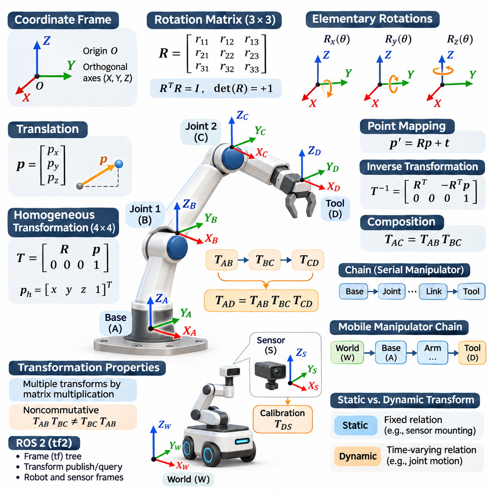
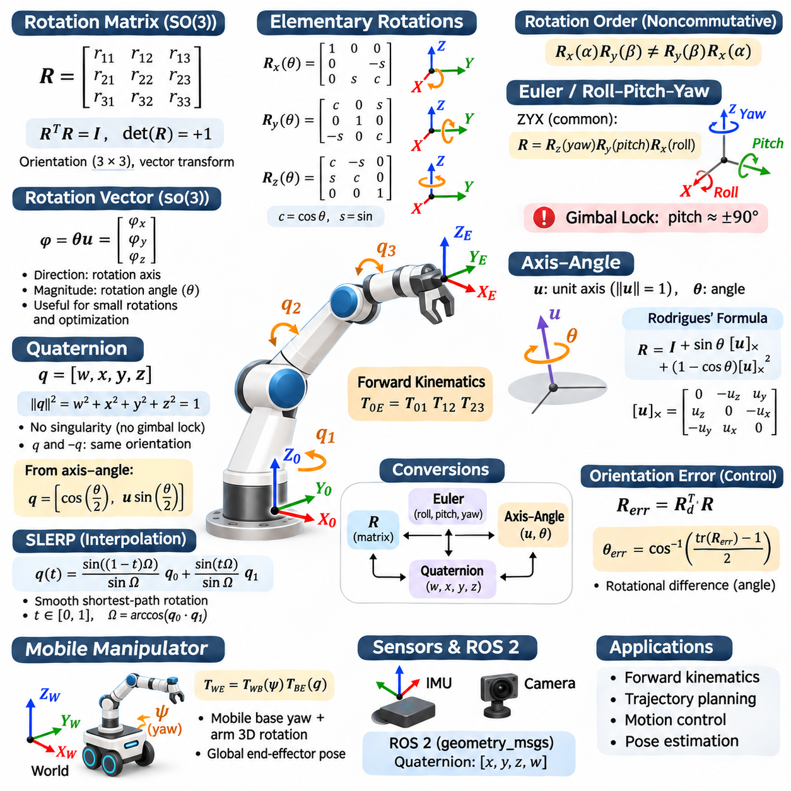
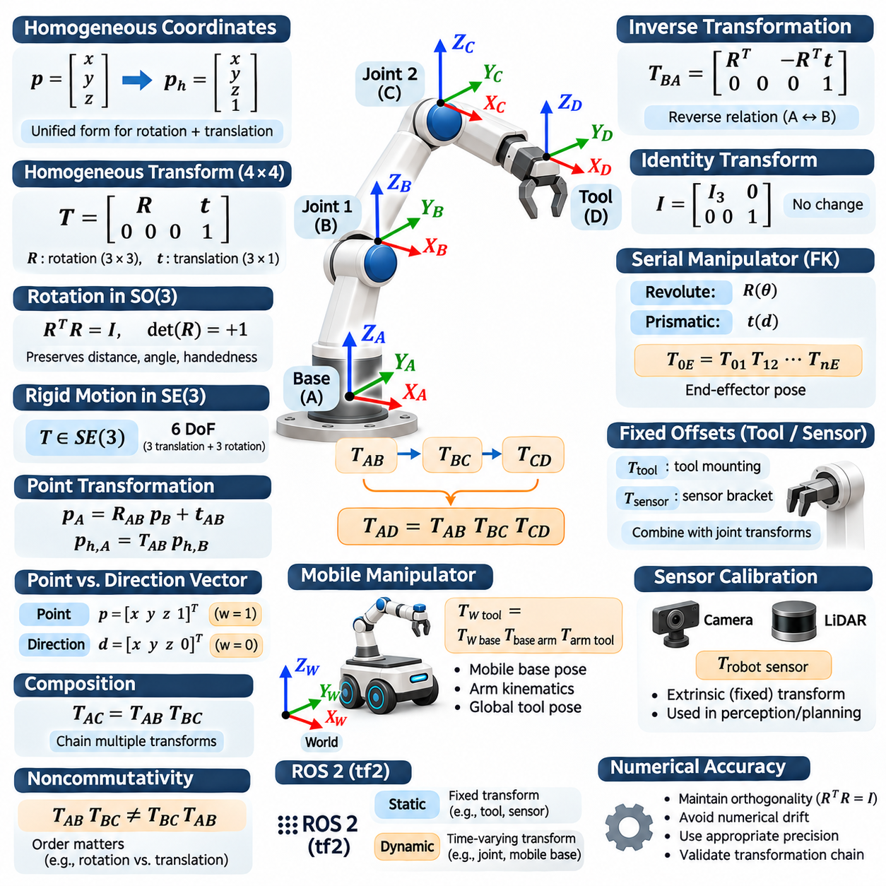
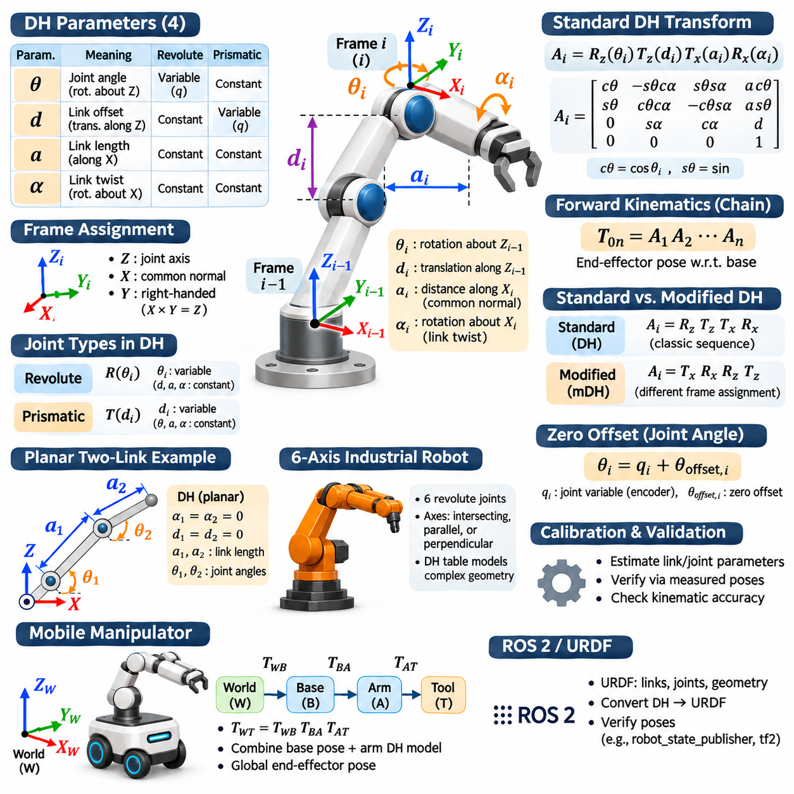
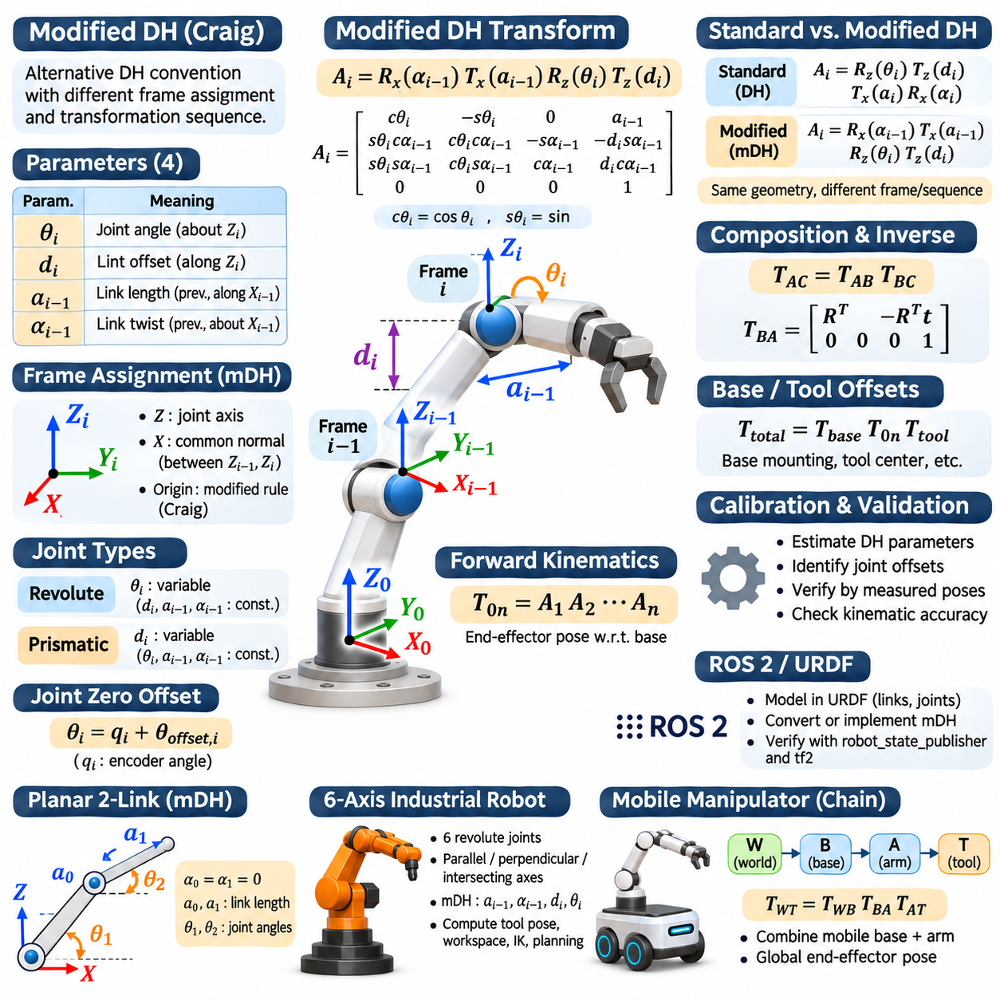
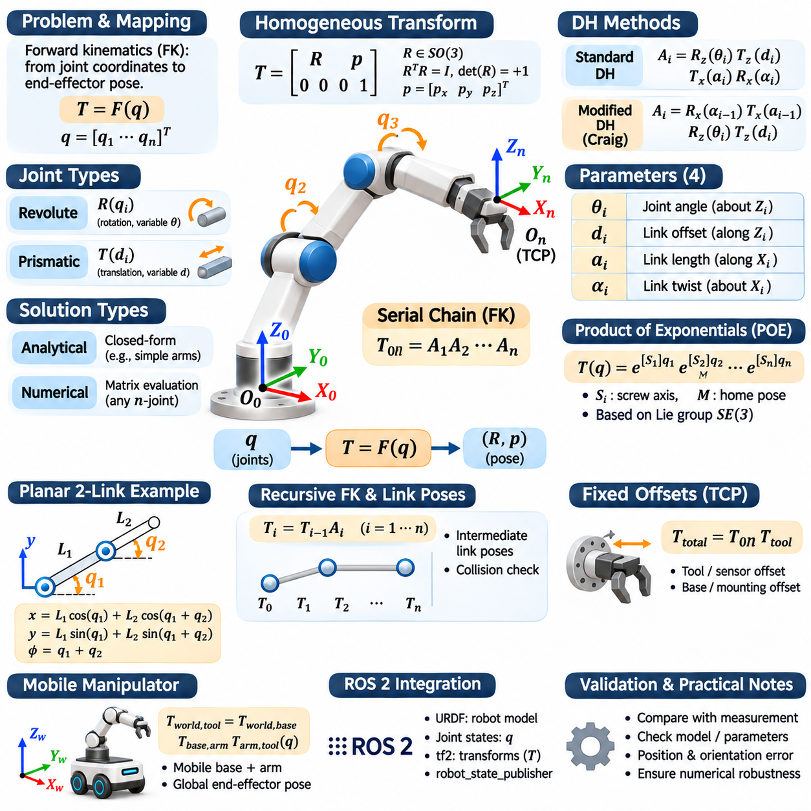
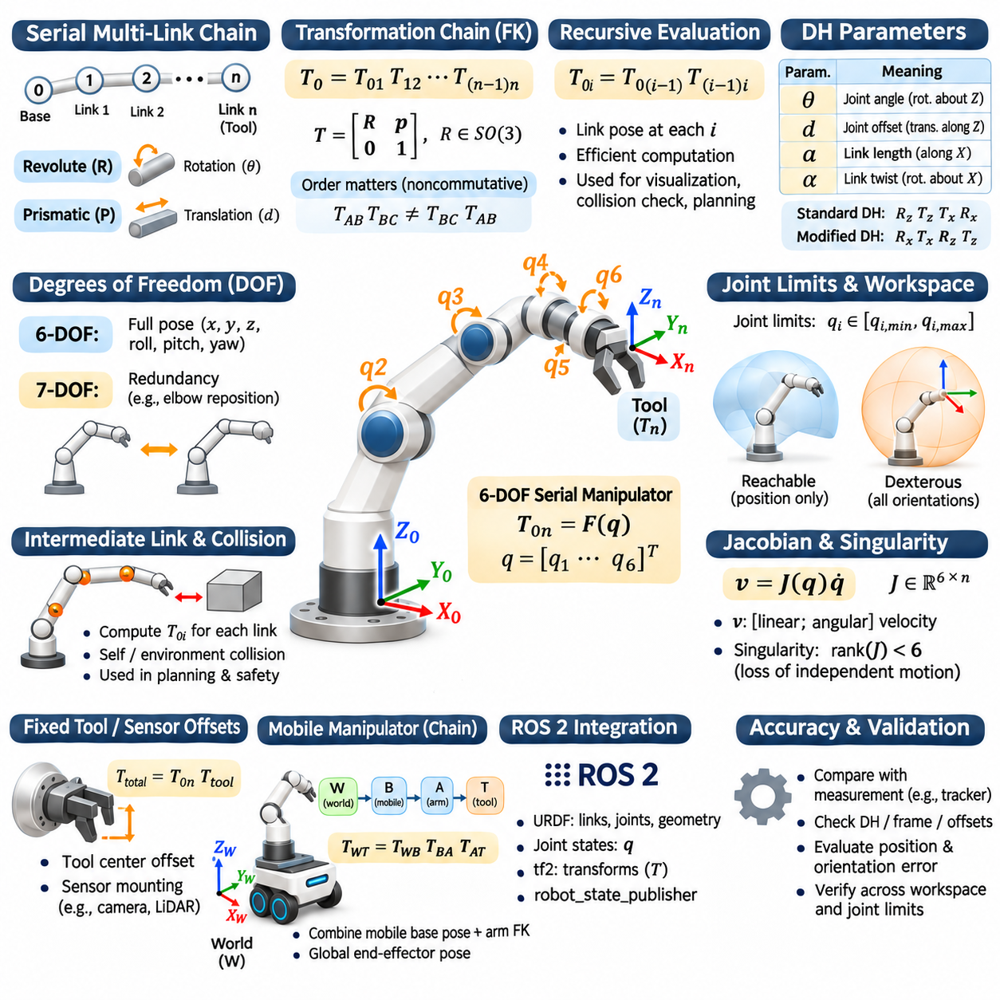
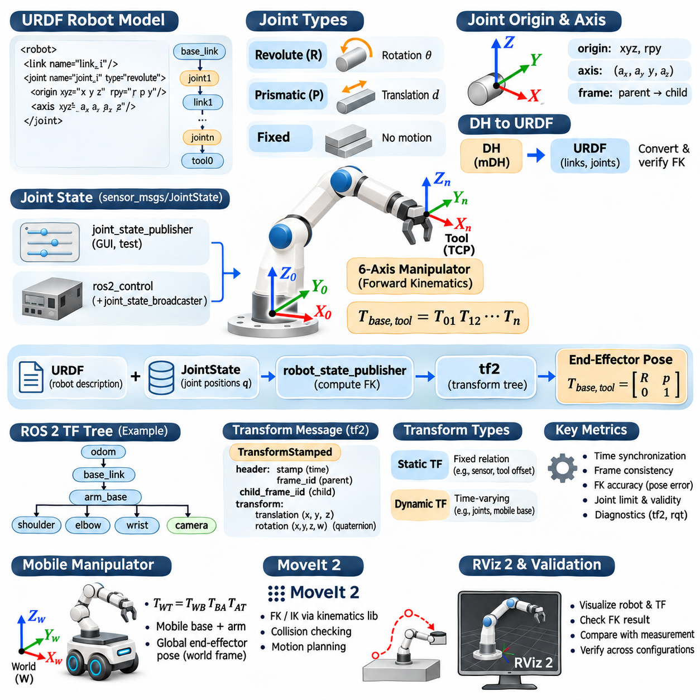
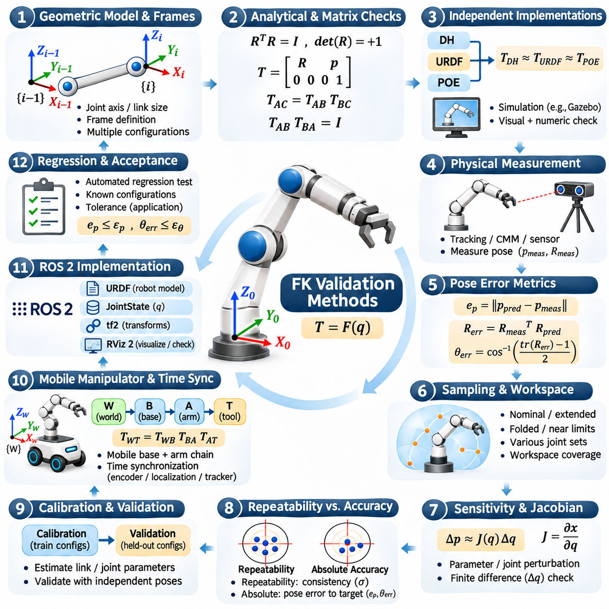

**Volume 02. Manipulator Mechanics and Control**

# Chapter 02. Forward Kinematics

## 01 Transformation Matrices

{width="7.268055555555556in" height="7.268055555555556in"}

Transformation matrices provide the mathematical foundation for describing the position and orientation of robot components within a common spatial reference system. In robotic manipulators, every joint and link introduces a geometric relationship between adjacent coordinate frames. These relationships are expressed through matrices that systematically convert points, vectors, and coordinate descriptions from one reference frame to another.

A coordinate frame consists of an origin and three mutually perpendicular axes defining a local spatial reference. Robot bases, joints, links, sensors, and end effectors commonly have their own coordinate frames. Transformation matrices establish the relationships among these frames, allowing geometric information measured in one coordinate system to be interpreted consistently in another without changing the underlying physical configuration.

The mathematical representation of a spatial transformation combines rotational and translational relationships. Rotation describes how the axes of one coordinate frame are oriented relative to another, while translation describes the displacement between their origins. Together, these operations determine the complete rigid-body pose of a robot component and provide the geometric basis for calculating manipulator configurations.

A three-dimensional rotation matrix is represented by a 3 × 3 matrix whose columns describe the axes of a rotated coordinate frame expressed in a reference frame. The matrix must satisfy the orthogonality condition RᵀR = I and the determinant condition det(R) = +1. These properties preserve distances, angles, and handedness, ensuring that the transformation represents a physically valid rigid-body rotation.

Rotation matrices can describe elementary rotations around the X, Y, and Z axes. A rotation around the X axis changes the orientation of the Y and Z axes while preserving the X direction. Similarly, rotations around the Y and Z axes affect their corresponding perpendicular planes. These elementary operations provide the building blocks for representing complex orientations encountered in multi-joint robotic manipulators.

The order of rotational operations is essential because three-dimensional rotations generally do not commute. Applying a rotation around the X axis followed by a rotation around the Z axis usually produces a different orientation from performing the same rotations in reverse order. Consequently, robotic software must maintain explicit conventions for rotation sequences, coordinate-frame definitions, and multiplication order.

Translation represents the displacement between coordinate-frame origins and is commonly expressed as a three-dimensional vector p = [px, py, pz]ᵀ. Unlike rotation, translation alone does not change the orientation of a rigid body. However, combining translations and rotations through ordinary matrix operations requires an extended representation that accommodates both operations within a unified mathematical structure.

Homogeneous coordinates provide this unified representation by extending a three-dimensional position vector into four dimensions. A point p = [x, y, z]ᵀ becomes pₕ = [x, y, z, 1]ᵀ. The additional coordinate enables translation and rotation to be performed through a single matrix multiplication, simplifying the composition of multiple geometric transformations across a robotic kinematic chain.

A homogeneous transformation matrix is a 4 × 4 matrix composed of a 3 × 3 rotation matrix R, a 3 × 1 translation vector p, and a final row [0, 0, 0, 1]. Its standard structure is T = [R p; 0 0 0 1]. This compact representation describes the pose of one coordinate frame relative to another and is fundamental to forward kinematics.

When a homogeneous transformation is applied to a point, the resulting coordinates are obtained through p\' = Rp + t, where R represents rotation and t represents translation. This operation first expresses the point through the specified rotational relationship and then applies the displacement. The result depends on the adopted coordinate convention, making frame notation essential for correct interpretation.

Transformation matrices are particularly useful because multiple transformations can be combined through matrix multiplication. If frame B is defined relative to frame A and frame C is defined relative to frame B, the transformation from C to A is obtained as T_AC = T_AB T_BC. This composition principle allows complex robot geometries to be represented as sequences of relatively simple relationships.

In a serial robotic manipulator, each joint establishes a transformation between neighboring link frames. Revolute joints introduce angle-dependent rotations, while prismatic joints introduce displacement-dependent translations. Multiplying the transformations from the base to the final link produces the end-effector pose. This process is the central mathematical operation of forward kinematics and supports robotic motion planning.

The multiplication order of transformation matrices must follow the physical and mathematical structure of the coordinate-frame chain. Matrix multiplication is generally noncommutative, meaning T_AB T_BC cannot be arbitrarily reordered. Incorrect multiplication sequences may generate plausible numerical results while producing physically incorrect poses, making transformation ordering a critical implementation consideration.

Inverse transformations describe the reverse relationship between two coordinate frames. For a rigid-body transformation containing rotation R and translation p, the inverse transformation contains Rᵀ and the translation −Rᵀp. This relationship follows from the orthogonality of rotation matrices and provides an efficient method for converting positions and orientations between reference frames without general-purpose matrix inversion.

Transformation matrices also distinguish between points and direction vectors. A position is represented using a homogeneous coordinate of one, allowing translation to affect its transformed value. A direction vector uses a homogeneous coordinate of zero, so only rotation influences its result. This distinction is important when transforming surface normals, motion directions, tool axes, and other geometric quantities.

For robotic manipulation, transformation matrices establish the relationship between the robot base, wrist, tool flange, and tool center point. A tool offset can be represented as an additional fixed transformation attached to the final robot link. Consequently, the actual working position of a gripper, welding torch, or inspection sensor can be calculated accurately even when its functional point differs from the mechanical mounting interface.

Mobile manipulators introduce additional transformation relationships because the robotic arm is mounted on a moving platform. The global end-effector pose depends on the mobile base pose, arm mounting configuration, and internal joint transformations. A typical relationship is T_world_tool = T_world_base T_base_arm T_arm_tool, where each matrix represents a specific geometric connection within the integrated robotic system.

Coordinate transformations are also essential for integrating perception systems with robotic manipulators. Cameras, LiDAR sensors, and depth sensors report measurements in their own coordinate frames. To use these measurements for grasping or inspection, the robot must transform detected object positions into the appropriate planning or control frame. Accurate sensor extrinsic calibration therefore directly influences manipulation accuracy.

Transformation matrices support both static and dynamic geometric relationships. Static transformations describe fixed connections, such as the mounting offset between a robot base and a sensor. Dynamic transformations describe relationships that change with joint motion or mobile-platform movement. Maintaining these distinctions allows robotic software to update changing poses efficiently while preserving fixed mechanical calibration parameters.

Numerical precision is important when transformations are repeatedly multiplied across long kinematic chains. Floating-point errors may gradually cause a computed rotation matrix to deviate from exact orthogonality. Validation procedures can examine RᵀR and det(R), while suitable orthonormalization methods can restore valid rotation properties when necessary. These precautions improve numerical reliability in repeated geometric calculations.

Transformation conventions must be documented consistently across mechanical design, simulation, and control software. Engineers should specify whether matrices represent active or passive transformations, whether vectors are expressed as columns or rows, and which coordinate frames define each transformation. Inconsistent conventions can introduce orientation errors, incorrect tool offsets, and unexpected motion during system integration.

In ROS 2 robotic systems, transformation relationships are commonly managed through the tf2 framework. Robot descriptions define structural relationships among links, while joint-state information supplies changing configurations. Transformation data allows perception, navigation, and manipulation components to interpret spatial information within connected coordinate frames, supporting modular integration across distributed robotic software components.

Transformation matrices also provide a foundation for calibration and validation procedures. Known geometric reference points can be measured and transformed between coordinate systems to evaluate positional consistency. Differences between predicted and measured coordinates reveal potential errors in frame definitions, mechanical dimensions, joint offsets, or sensor mounting parameters, helping engineers identify systematic inaccuracies.

Industrial applications require transformation models that remain consistent under practical operating conditions. Mechanical deflection, thermal expansion, mounting tolerances, and calibration drift can cause differences between ideal mathematical models and physical robot behavior. Although rigid transformation matrices do not directly represent structural deformation, they provide the nominal geometric reference against which these deviations can be evaluated.

Efficient transformation computation is especially important in real-time robotic control. Forward kinematics may be evaluated repeatedly for trajectory tracking, collision checking, tool positioning, and sensor alignment. Implementations can improve computational efficiency by exploiting rigid-transform structure, caching fixed transformations, and updating only those matrix relationships affected by changing joint positions.

Ultimately, transformation matrices connect abstract geometric models with the physical behavior of robotic manipulators. They provide a consistent framework for representing spatial relationships, composing joint motions, integrating sensors, and calculating tool poses. A rigorous understanding of these matrices is essential for developing accurate forward kinematics, reliable motion control, and coordinated mobile manipulation systems.

## 02 Rotation Representations

{width="7.268055555555556in" height="7.268055555555556in"}

Rotation representations provide the mathematical framework for describing the orientation of rigid bodies in three-dimensional space. In robotic manipulators, orientation determines how links, joints, tools, and sensors are aligned relative to reference coordinate frames. Accurate rotational modeling is essential for forward kinematics, trajectory planning, motion control, and the spatial coordination of robotic components.

Unlike position, which can be represented directly by three Cartesian coordinates, orientation requires a mathematical description of rotational relationships. Several representations are used in robotics, including rotation matrices, Euler angles, roll-pitch-yaw angles, axis-angle parameters, and quaternions. Each representation provides different advantages regarding numerical stability, computational efficiency, interpretability, and mathematical complexity.

A rotation matrix represents orientation through a 3 × 3 orthogonal matrix belonging to the special orthogonal group SO(3). Its columns describe the directions of the rotated coordinate axes expressed in a reference frame. A valid rotation matrix satisfies RᵀR = I and det(R) = +1, ensuring that rotations preserve distances, angles, and coordinate-system handedness without introducing scaling or reflection.

Rotation matrices are particularly useful for transforming vectors between coordinate frames. If a vector is expressed in a local frame, multiplication by the appropriate rotation matrix expresses that vector in the reference frame. Multiple rotations can be composed through matrix multiplication, making this representation especially suitable for serial manipulators, where joint rotations must be combined along a kinematic chain.

Elementary rotation matrices describe rotations around the principal coordinate axes. Rotations about the X, Y, and Z axes are commonly denoted Rx(θ), Ry(θ), and Rz(θ). Each matrix contains sine and cosine functions of the rotation angle. By multiplying elementary rotation matrices in a specified order, complex three-dimensional orientations can be constructed from simple rotational operations.

The order of rotation operations is critical because three-dimensional rotations are generally noncommutative. A rotation around the X axis followed by a rotation around the Y axis usually produces a different final orientation from the reverse sequence. Consequently, every orientation representation must specify its axis convention, multiplication order, and reference-frame interpretation to avoid ambiguity during implementation.

Euler angles describe orientation using three successive rotations about specified axes. Depending on the selected convention, rotations may occur around fixed reference axes or moving body axes. Common sequences include ZYX and ZXZ, although many alternatives exist. Euler angles are intuitive for describing orientation but require careful handling of axis definitions and rotation sequences.

Roll-pitch-yaw angles are widely used in mobile robotics and robotic manipulation because they provide an understandable description of orientation. Roll commonly represents rotation about the X axis, pitch about the Y axis, and yaw about the Z axis. Under a common fixed-axis convention, the resulting rotation matrix is R = Rz(yaw) Ry(pitch) Rx(roll), although other conventions are possible.

Despite their intuitive interpretation, Euler-angle representations contain singular configurations known as gimbal lock. In a ZYX convention, this occurs when pitch reaches approximately +90 or −90 degrees. At these configurations, two rotational degrees of freedom become locally indistinguishable in the parameterization, making orientation recovery and angular-rate calculations numerically problematic.

Gimbal lock does not indicate that the physical robot has lost a mechanical degree of freedom. Instead, it is a mathematical limitation of the selected orientation coordinates. The robot may still rotate freely, but the Euler-angle representation becomes locally singular. This distinction is important when designing controllers, interpreting sensor measurements, and converting between orientation representations.

The axis-angle representation describes a rotation through a unit vector defining the rotation axis and a scalar angle defining the rotation magnitude. According to Euler\'s rotation theorem, every proper three-dimensional rotation can be represented as a single rotation about an appropriate axis. This formulation provides a geometrically meaningful description of orientation changes between rigid-body configurations.

Rodrigues\' rotation formula converts an axis-angle representation into a rotation matrix. For a unit axis vector u and rotation angle θ, the matrix is R = I + sin(θ)[u]× + (1 − cos(θ))[u]ײ, where [u]× is the skew-symmetric cross-product matrix. This relationship is useful for rotational interpolation, geometric optimization, and exponential-coordinate formulations.

Rotation vectors combine the axis and angle into a three-dimensional vector whose direction specifies the rotation axis and whose magnitude specifies the rotation angle. This compact representation is closely related to the Lie algebra so(3). It is useful for expressing small orientation corrections, calculating rotational errors, and developing numerical optimization algorithms for robotic estimation and control.

Quaternions represent three-dimensional orientation using four parameters consisting of one scalar component and three vector components. A quaternion may be written as q = [w, x, y, z], where w is the scalar component. Unit quaternions satisfy w² + x² + y² + z² = 1 and represent valid spatial rotations without the local singularities associated with Euler-angle parameterizations.

A unit quaternion corresponding to an axis-angle rotation can be expressed as q = [cos(θ/2), ux sin(θ/2), uy sin(θ/2), uz sin(θ/2)]. This formulation encodes rotation using trigonometric relationships involving half the rotation angle. Quaternions provide a compact and computationally convenient representation for orientation estimation, motion interpolation, and robotic control.

Quaternion multiplication allows successive rotations to be combined without constructing intermediate rotation matrices. However, multiplication order remains important because quaternion products are generally noncommutative. Quaternion conventions must also be defined carefully, including component ordering, active versus passive rotation interpretation, and the relationship between quaternion multiplication and coordinate-frame transformations.

An important characteristic of unit quaternions is that q and −q represent the same physical orientation. This double-cover property must be considered when interpolating rotations or comparing orientation measurements. Algorithms that ignore quaternion sign equivalence may introduce discontinuities, unnecessarily long interpolation paths, or abrupt changes in commanded orientation trajectories.

Spherical linear interpolation, commonly called SLERP, provides smooth interpolation between two unit quaternions along a constant-angular-speed path on the unit quaternion sphere. It is widely used for orientation trajectory generation because it avoids many limitations of direct Euler-angle interpolation. Appropriate quaternion sign selection helps ensure interpolation follows the shorter rotational path.

Rotation representations also differ in their numerical constraints. Rotation matrices contain nine elements constrained by orthogonality, while unit quaternions contain four elements constrained by unit magnitude. Euler angles use three parameters but exhibit coordinate singularities. Axis-angle and rotation-vector formulations are compact but require special numerical treatment near zero rotation and certain angular boundaries.

Converting between representations is a common requirement in robotic software. Rotation matrices may be converted into Euler angles for visualization, quaternions for interpolation, or rotation vectors for optimization. These conversions must account for numerical tolerances, angle wrapping, normalization, and singular configurations to maintain consistency across planning, estimation, and control components.

In forward kinematics, joint rotations are commonly represented internally through rotation matrices or homogeneous transformations. The final end-effector orientation is obtained by composing the rotational contributions of individual joints. This orientation may subsequently be converted into Euler angles or quaternions for communication with motion planners, user interfaces, or external robotic systems.

Mobile manipulators require consistent orientation representations across the mobile platform and robotic arm. The platform heading may be represented by yaw, while the arm orientation generally requires full three-dimensional rotation. Combining these relationships allows the end-effector orientation to be calculated relative to the world frame, even when the mobile base changes its heading or spatial attitude.

Sensor integration introduces additional requirements for rotational consistency. Inertial measurement units commonly estimate orientation using quaternions or rotation matrices, while cameras and localization systems may provide poses using different conventions. Transforming these measurements into a common reference frame requires explicit axis definitions, correct rotation composition, and careful handling of coordinate-system conventions.

In ROS 2, orientation is commonly exchanged using quaternion fields within pose and transformation messages. The standard geometry message convention stores quaternion components as x, y, z, and w. Developers must therefore distinguish this storage order from mathematical notation that places the scalar component first. Incorrect component ordering can produce severe orientation errors despite otherwise valid numerical values.

For real-time control, orientation errors should be represented in a form suitable for continuous feedback calculations. Rotation matrices, quaternion error formulations, and logarithmic maps on SO(3) are commonly used to describe rotational differences. These approaches can avoid the local singularities of Euler-angle feedback, although each requires careful treatment of conventions and numerical edge cases.

Ultimately, no single rotation representation is optimal for every robotic application. Rotation matrices provide direct geometric transformations, Euler angles offer intuitive interpretation, axis-angle parameters describe meaningful rotational geometry, and quaternions support efficient interpolation and orientation tracking. Selecting and combining these representations appropriately is essential for accurate forward kinematics and reliable mobile manipulator control.

## 03 Homogeneous Transforms

{width="7.268055555555556in" height="7.268055555555556in"}

Homogeneous transformations provide a unified mathematical framework for representing the position and orientation of rigid bodies in three-dimensional space. In robotic manipulators, they describe spatial relationships between coordinate frames attached to joints, links, tools, and sensors. By combining rotation and translation into a single matrix, homogeneous transformations simplify forward kinematics and enable systematic geometric calculations across complex robotic mechanisms.

A rigid-body transformation describes how a point or coordinate frame is positioned and oriented relative to another reference frame. Rotation determines the relative orientation of coordinate axes, while translation specifies the displacement between frame origins. These operations must be combined consistently because the position of a transformed point depends on both its original coordinates and the orientation of the reference system.

Homogeneous coordinates extend ordinary three-dimensional Cartesian coordinates by introducing an additional coordinate component. A point represented as p = [x, y, z]ᵀ becomes pₕ = [x, y, z, 1]ᵀ. This extension allows rotation and translation to be expressed through matrix multiplication, eliminating the need to handle them as separate operations during repeated coordinate transformations.

A homogeneous transformation matrix is represented by a 4 × 4 matrix containing a 3 × 3 rotation matrix R and a 3 × 1 translation vector t. Its standard structure is T = [R t; 0 0 0 1]. The upper-left block determines orientation, the upper-right column determines position, and the final row preserves the homogeneous coordinate structure required for rigid-body transformations.

The rotation component belongs to the special orthogonal group SO(3), satisfying RᵀR = I and det(R) = +1. These conditions ensure that the transformation preserves distances, angles, and the handedness of coordinate systems. The translation component is an unrestricted three-dimensional vector, allowing the transformed coordinate frame to occupy any position within the reference space.

Homogeneous transformations belong to the special Euclidean group SE(3), which describes rigid-body motions in three-dimensional space. This mathematical structure combines rotational and translational degrees of freedom into a single representation. Although the transformation matrix contains sixteen numerical entries, a rigid-body pose has only six independent degrees of freedom: three translational and three rotational.

Applying a homogeneous transformation to a point produces its coordinates in another reference frame. For a transformation T_AB that maps coordinates from frame B into frame A, the relationship is p_A = R_AB p_B + t_AB. In homogeneous form, this becomes pₕ,A = T_AB pₕ,B, allowing the complete transformation to be performed through one matrix multiplication.

Homogeneous transformations distinguish between position vectors and direction vectors through the fourth coordinate component. A position vector uses a homogeneous coordinate of one, allowing translation to affect its transformed value. A direction vector uses zero, eliminating the translational contribution. This distinction is essential when transforming tool directions, velocity vectors, geometric axes, and other quantities that do not represent physical locations.

Transformation composition allows multiple coordinate relationships to be combined into a single matrix. If frame B is defined relative to frame A and frame C is defined relative to frame B, the combined transformation is T_AC = T_AB T_BC. This operation forms the mathematical foundation of serial manipulator forward kinematics, where individual joint transformations are multiplied to obtain the final end-effector pose.

Matrix multiplication order must follow the defined coordinate-frame relationships because rigid-body transformations generally do not commute. Applying a rotation before a translation can produce a different result from applying the translation first. Incorrect ordering may generate mathematically valid matrices that describe physically incorrect configurations, making consistent frame notation and multiplication conventions essential.

The inverse of a homogeneous transformation describes the reverse relationship between two coordinate frames. If T_AB contains rotation R and translation t, its inverse is T_BA = [Rᵀ −Rᵀt; 0 0 0 1]. This expression exploits the orthogonality of rotation matrices and provides an efficient method for reversing coordinate transformations without performing a general-purpose matrix inversion.

The identity transformation represents two coincident coordinate frames with identical origins and orientations. It contains a 3 × 3 identity rotation matrix, a zero translation vector, and the standard homogeneous final row. Multiplying any valid homogeneous transformation by the identity leaves it unchanged, making the identity useful for initialization, reference configurations, and transformation-chain validation.

In a serial robotic manipulator, each joint contributes a transformation between adjacent link coordinate frames. Revolute joints introduce angle-dependent rotational relationships, while prismatic joints introduce displacement-dependent translations. The complete forward kinematic model is obtained by multiplying these transformations in sequence, producing the end-effector pose as a function of the robot\'s joint variables.

Homogeneous transformations also support the representation of fixed mechanical offsets. Tool mounting positions, sensor brackets, and joint-axis displacements can be modeled as constant transformations between connected components. These fixed relationships can be combined with variable joint transformations, allowing robotic software to distinguish permanent mechanical geometry from configuration-dependent motion.

For mobile manipulators, the transformation chain extends beyond the robotic arm to include the moving platform. The global tool pose may be expressed as T_world_tool = T_world_base T_base_arm T_arm_tool. This relationship combines platform localization, arm mounting geometry, and manipulator kinematics, allowing the tool position and orientation to be calculated consistently as the mobile base moves.

Sensor integration relies heavily on homogeneous transformations because perception measurements are usually expressed in sensor-specific coordinate frames. Camera detections, LiDAR point clouds, and depth measurements must be transformed into robot or world coordinates before they can support manipulation tasks. Accurate extrinsic calibration establishes the fixed transformations required to connect these sensing systems with the robot\'s kinematic model.

In ROS 2, coordinate transformations are commonly managed through the tf2 framework. Static transforms describe fixed mechanical relationships, while dynamic transforms represent changing robot poses and joint configurations. Although transformations are often transmitted using translation vectors and quaternions, they can be converted into homogeneous matrices for geometric computation, planning, and kinematic analysis.

Numerical accuracy is important when homogeneous transformations are repeatedly composed across long kinematic chains. Floating-point errors can gradually affect the orthogonality of the rotation component. Implementations should verify rotational validity, maintain consistent numerical precision, and apply suitable normalization or orthonormalization procedures when necessary to prevent accumulated geometric inconsistencies.

Homogeneous transformations provide an essential connection between mathematical kinematic models and physical robotic systems. They enable consistent pose calculations, coordinate conversion, sensor alignment, and geometric reasoning across stationary and mobile manipulators. Their systematic application forms the foundation for reliable forward kinematics, motion planning, calibration, and integrated robotic control.

## 04 DH Parameters

{width="7.268055555555556in" height="7.268055555555556in"}

Denavit-Hartenberg parameters provide a systematic mathematical method for describing the geometric relationships between consecutive links in a robotic manipulator. The DH convention reduces each joint-to-joint transformation to four parameters representing relative rotation and translation. This standardized approach simplifies forward kinematics, supports consistent coordinate-frame assignment, and enables efficient modeling of serial robotic mechanisms.

The fundamental principle of DH modeling is to attach coordinate frames to individual robot links according to defined geometric rules. Each frame is positioned relative to neighboring joint axes, allowing the spatial relationship between consecutive links to be described through a compact parameter set. Proper frame assignment is essential because inconsistent axis definitions can produce incorrect transformations even when physical link dimensions are accurate.

The four standard DH parameters are joint angle θ, link offset d, link length a, and link twist α. Together, these parameters describe the relative position and orientation of adjacent coordinate frames. Two parameters represent rotational relationships, while the other two represent translational relationships. Their combined transformation captures the essential geometry required for serial manipulator forward kinematics.

The joint angle θ describes rotation about the local Z axis and determines the angular relationship between consecutive X axes. In a revolute joint, θ is normally the variable parameter controlled by the actuator. For a prismatic joint, θ remains constant because the joint produces linear displacement rather than rotation. Joint-angle conventions must account for mechanical zero positions and encoder offsets.

The link offset d represents displacement along the joint Z axis between the origins associated with consecutive link frames. For revolute joints, this parameter is generally constant and describes a fixed geometric separation. For prismatic joints, d becomes the variable joint coordinate, representing the linear extension or retraction of the mechanism along its designated motion axis.

The link length a describes the distance between consecutive joint axes measured along their common normal. It represents the geometric separation between neighboring Z axes and is often associated with the physical length of a robot link. However, the DH link length is a geometric parameter rather than necessarily the complete physical dimension of a mechanical component.

The link twist α represents the angular relationship between consecutive joint axes, measured as a rotation about the common-normal X axis. It determines how the orientation of one joint axis differs from the next. Typical industrial manipulators contain link twists of zero, positive ninety degrees, or negative ninety degrees, although arbitrary angles are possible depending on mechanical architecture.

In the standard DH convention, the transformation from frame i−1 to frame i is constructed as A_i = Rz(θ_i) Tz(d_i) Tx(a_i) Rx(α_i). This sequence applies rotation around Z, translation along Z, translation along X, and rotation around X. The multiplication order is essential because rigid-body transformations are generally noncommutative, meaning rearranging the operations changes the resulting pose.

The resulting homogeneous transformation matrix combines the four DH parameters into a 4 × 4 representation. Its rotation component contains trigonometric functions of θ and α, while its translation component depends on a and d. This compact matrix describes the pose of one link frame relative to its predecessor and provides the fundamental building block for serial-chain kinematic calculations.

Forward kinematics is obtained by multiplying the individual DH transformation matrices in the physical order of the robot joints. For an n-joint serial manipulator, the overall transformation is T_0n = A_1 A_2 \... A_n. The resulting matrix contains the end-effector position and orientation relative to the base frame, expressed as functions of the joint variables and fixed geometric parameters.

Coordinate-frame assignment begins by identifying the motion axis of each joint. The Z axis is aligned with the corresponding revolute or prismatic joint axis, while the X axis is selected along the common normal between neighboring Z axes. The Y axis completes the right-handed coordinate system. These rules establish a consistent geometric relationship between adjacent frames.

Special care is required when neighboring joint axes intersect or are parallel. Intersecting axes have zero common-normal distance, while parallel axes may permit multiple valid common-normal choices. Additional frame-placement conventions are therefore necessary to remove ambiguity. Different valid assignments may produce different parameter tables while describing the same physical robotic mechanism.

A revolute joint changes the angular relationship between adjacent links while preserving their fixed geometric dimensions. Consequently, θ varies with joint motion, while d, a, and α normally remain constant. In contrast, a prismatic joint changes the relative displacement along its motion axis, making d variable while θ, a, and α remain fixed under the standard DH convention.

A simple planar two-link manipulator illustrates the practical interpretation of DH parameters. When both revolute joint axes are parallel and perpendicular to the motion plane, the link twists are zero. The link lengths represent the distances between successive joint axes, while the joint angles determine the planar configuration. Matrix multiplication then produces the end-effector position from the two joint variables.

Industrial six-axis manipulators require more complex DH models because their joint axes may be parallel, perpendicular, intersecting, or spatially offset. Each joint contributes a transformation describing its local geometry. Combining these transformations provides a complete kinematic model suitable for calculating tool poses, analyzing workspace boundaries, and supporting inverse kinematics and trajectory planning.

DH parameters must be distinguished from actual mechanical dimensions and assembly drawings. The parameter values depend on coordinate-frame placement rather than solely on visible link geometry. A robot may contain structural offsets, angled brackets, or complex housings that do not directly correspond to individual DH parameters. Accurate modeling therefore requires careful interpretation of joint-axis geometry.

Joint zero offsets are particularly important when connecting theoretical DH models to physical robots. Encoder readings may not correspond directly to the mathematical zero angles assumed by the kinematic model. An offset relationship such as θ_i = q_i + θ_offset,i can align measured joint coordinates with the DH convention. Incorrect offsets may cause systematic end-effector positioning errors.

DH modeling also supports parameter identification and geometric calibration. Nominal link lengths, offsets, and twists can be refined using measured end-effector poses collected across multiple joint configurations. Optimization methods estimate parameter corrections that reduce differences between predicted and observed positions. This process improves kinematic accuracy when manufacturing tolerances or assembly variations affect the robot geometry.

The standard DH method should not be confused with the modified DH convention. Both use four geometric parameters, but their coordinate-frame assignments and transformation sequences differ. A parameter table developed for one convention cannot be transferred directly to the other without appropriate conversion. Maintaining explicit documentation of the selected convention prevents integration errors.

For mobile manipulators, DH parameters describe the internal geometry of the robotic arm, while additional transformations connect the arm to the mobile platform and world coordinate frame. The complete tool pose combines mobile-base localization, arm mounting geometry, and the DH-based forward kinematic chain. This separation supports modular modeling of the mobile platform and manipulation subsystem.

In ROS 2 environments, robot geometry is commonly described through URDF models containing joint origins, axes, and link relationships. DH parameters can be converted into equivalent fixed and variable transformations for comparison with URDF-based kinematics. However, the two representations use different modeling conventions, so frame definitions and joint-axis orientations must be verified carefully.

Numerical validation is essential after constructing a DH model. Predicted end-effector poses should be compared with known configurations, simulation results, and physical measurements. Tests should include zero positions, representative joint configurations, and configurations near workspace boundaries. These comparisons help detect incorrect signs, parameter indexing errors, and inconsistent coordinate-frame assignments.

The DH convention offers substantial advantages through compact parameterization, systematic transformation construction, and straightforward analytical implementation. However, its reliance on specific frame-assignment rules can become inconvenient for unusual mechanisms or complex branching structures. Alternative approaches, including product-of-exponentials formulations, may provide greater flexibility for certain robotic architectures.

Ultimately, DH parameters establish a practical bridge between mechanical geometry and mathematical forward kinematics. By describing each joint relationship through four standardized quantities, engineers can construct consistent serial manipulator models, calculate end-effector poses, and support calibration and control development. Correct parameter assignment and convention management are essential for reliable robotic manipulation.

## 05 Modified DH Method

{width="7.268055555555556in" height="7.268055555555556in"}

The Modified Denavit-Hartenberg method provides a systematic framework for representing the geometric relationships between consecutive links of a robotic manipulator. Like the standard DH convention, it uses four parameters to describe relative rotation and translation. However, the modified method adopts a different coordinate-frame assignment and transformation sequence, offering an alternative approach to constructing forward kinematic models.

The Modified DH method is commonly associated with Craig\'s formulation of robotic kinematics. Its primary distinction lies in how coordinate frames are attached to links and how transformations are distributed between neighboring joints. This arrangement can simplify certain manipulator models by associating geometric parameters more directly with preceding link frames and joint transformations.

The four Modified DH parameters are joint angle θ, joint offset d, link length a, and link twist α. These quantities retain their fundamental geometric meanings from the standard DH method, but their indexing and frame associations differ. Consequently, identical numerical parameter tables cannot generally be exchanged between standard and modified conventions without reconstructing the corresponding coordinate transformations.

In the Modified DH convention, the Z axis is aligned with the corresponding joint motion axis, while the X axis follows the common normal between neighboring joint axes. The coordinate-frame origins are positioned according to the modified assignment rules. These choices establish the geometric relationships required to describe each joint transformation consistently across the manipulator.

A commonly used Modified DH transformation is expressed as A_i = Rx(α\\_) Tx(a\\_) Rz(θ_i) Tz(d_i). This sequence first applies the preceding link twist and length, followed by the current joint rotation and displacement. The expression assumes a consistent column-vector convention, and its multiplication order must be preserved to obtain the intended transformation.

The link length a\\_ represents the distance between neighboring joint axes measured along their common normal. The link twist α\\_ describes the relative angular orientation of those axes around the associated X direction. Both parameters normally remain constant for rigid links, providing a geometric description of the mechanical structure independent of joint motion.

The joint angle θ_i represents rotation about the current joint axis and becomes the variable coordinate for a revolute joint. The joint offset d_i represents translation along that axis and becomes variable for a prismatic joint. This distinction allows the same transformation structure to describe different joint types while preserving a consistent mathematical relationship between joint motion and link geometry.

The resulting homogeneous transformation matrix combines the four parameters into a single 4 × 4 representation. Its rotational block determines the orientation of the succeeding frame, while its translational block specifies the relative displacement. The matrix belongs to the special Euclidean group SE(3), ensuring that the transformation represents a valid rigid-body motion.

Forward kinematics is calculated by multiplying the Modified DH transformations in the physical order of the manipulator joints. For an n-joint serial mechanism, the complete transformation is T_0n = A_1 A_2 \... A_n, assuming compatible base and terminal frame definitions. The resulting matrix expresses the final tool or link pose relative to the selected reference frame.

The modified convention differs from standard DH primarily in transformation ordering and parameter association. Standard DH commonly uses Rz(θ_i) Tz(d_i) Tx(a_i) Rx(α_i), whereas Modified DH uses preceding-link transformations before current-joint transformations. Both methods describe the same physical geometry when frames and parameters are assigned consistently.

Coordinate-frame assignment requires particular attention when adjacent joint axes are parallel, intersecting, or coincident. Parallel axes may admit multiple valid common normals, while intersecting axes produce zero common-normal distance. These geometric conditions can create alternative valid frame assignments, making explicit documentation necessary for reproducible kinematic modeling.

For a planar two-link manipulator, the Modified DH method produces a compact representation because parallel revolute axes generally have zero link twist. The link lengths describe the distances between joint axes, and the joint angles determine the planar configuration. Appropriate multiplication of the resulting transformations reproduces the familiar trigonometric expressions for end-effector position.

Industrial six-axis manipulators often contain combinations of parallel, perpendicular, and intersecting joint axes. Modified DH parameters describe these relationships through link lengths, twists, offsets, and joint angles. The resulting model supports tool-pose computation, workspace evaluation, inverse kinematics, and trajectory planning without requiring detailed representations of external mechanical housings.

Joint zero offsets must be incorporated when mathematical joint coordinates differ from physical encoder readings. For a revolute joint, the effective angle may be expressed as θ_i = q_i + θ_offset,i. Similar offset relationships can be applied to prismatic joints. Correctly identifying these offsets is essential for matching the Modified DH model to the actual mechanical configuration.

Base and tool transformations are frequently required in addition to the Modified DH chain. The manipulator base frame may differ from the mounting interface, while the final modeled frame may not coincide with the tool center point. Fixed transformations can account for these differences, ensuring that the calculated pose corresponds to the physical working location of the end effector.

For mobile manipulators, the Modified DH chain describes the internal geometry of the robotic arm, while additional transformations connect it to the mobile platform. The global tool pose combines mobile-base localization, arm mounting geometry, joint transformations, and tool offsets. This modular structure allows platform navigation and arm manipulation to share a consistent spatial representation.

The Modified DH method can be implemented efficiently using numerical computing libraries and robotic software frameworks. Each transformation is evaluated from its parameter values and current joint coordinate, then multiplied into the cumulative kinematic chain. Fixed trigonometric terms may be precomputed, while variable terms are updated as joint positions change during robot operation.

In ROS 2, manipulator geometry is commonly represented through URDF joint origins, joint axes, and link connections. Modified DH models can be converted into equivalent transformation chains for comparison with URDF-based forward kinematics. Because the conventions differ, correct conversion requires careful handling of joint-axis definitions, frame placement, and fixed geometric offsets.

Geometric calibration can improve the accuracy of Modified DH models by estimating corrections to nominal link parameters and joint offsets. Measurements collected from multiple robot configurations are compared with predicted tool poses. Optimization algorithms then adjust selected parameters to reduce systematic errors caused by manufacturing tolerances, assembly variations, or imperfect initial measurements.

Numerical validation should include zero configurations, representative operating poses, and configurations near joint limits. Predicted transformations can be compared with simulation models, independent kinematic implementations, and measured robot positions. These tests help identify incorrect parameter signs, indexing mistakes, missing fixed transformations, and inconsistencies between coordinate-frame conventions.

Although Modified DH provides a compact and structured representation, it is not universally superior to standard DH. The preferred convention depends on mechanical geometry, software architecture, and engineering requirements. Complex branching mechanisms, closed-chain robots, and unusual joint arrangements may benefit from alternative formulations such as the product-of-exponentials method.

The Modified DH method remains an important tool for connecting mechanical geometry with mathematical robot models. Its consistent treatment of link relationships and joint transformations supports forward kinematics, calibration, simulation, and control development. Accurate frame assignment, parameter indexing, and convention management are essential for reliable implementation in industrial and mobile manipulators.

## 06 Forward Kinematics Solutions

{width="7.268055555555556in" height="7.268055555555556in"}

Forward kinematics solutions determine the position and orientation of a robotic manipulator\'s end effector from known joint coordinates and geometric parameters. The process establishes a mathematical mapping between joint space and Cartesian space, allowing robot configurations to be translated into physical tool poses. Accurate forward kinematics is fundamental to motion planning, simulation, calibration, workspace analysis, and coordinated manipulation.

The forward kinematics problem begins with a defined robot structure, including joint types, link dimensions, and coordinate-frame relationships. Revolute joints contribute angular variables, while prismatic joints contribute linear displacement variables. By combining these variables with fixed mechanical geometry, the kinematic model predicts the spatial configuration of the robot without requiring direct measurement of the end-effector pose.

A general forward kinematic mapping can be expressed as T = F(q), where q represents the vector of joint coordinates and T is the resulting homogeneous transformation matrix. The transformation contains a rotation matrix describing orientation and a translation vector describing position. For a serial manipulator with n joints, the mapping depends on the ordered composition of transformations associated with each joint and link.

Analytical forward kinematics derives explicit mathematical expressions for the end-effector pose using the robot\'s geometric structure. Trigonometric relationships, transformation matrices, and symbolic algebra can produce closed-form expressions for position and orientation. These solutions provide insight into how individual joint movements influence the final pose and are particularly useful for understanding relatively simple manipulator architectures.

Numerical forward kinematics evaluates transformation matrices using specific joint values rather than deriving fully expanded symbolic expressions. Each joint transformation is calculated from its current coordinate and fixed parameters, then multiplied into the cumulative transformation. This approach is straightforward to implement and scales effectively to manipulators with many joints or complicated geometric relationships.

Homogeneous transformation matrices provide the most common representation for forward kinematic calculations. Each matrix combines rotation and translation into a single rigid-body transformation. Multiplying consecutive matrices produces the overall relationship between the base frame and the end-effector frame, preserving the spatial effects of every intermediate joint and link.

The Denavit-Hartenberg convention simplifies forward kinematics by describing consecutive link relationships through four geometric parameters. Each parameter set generates a transformation matrix associated with a joint or link. The complete solution is obtained by multiplying these matrices in sequence, allowing a compact parameter table to define the kinematic structure of a serial manipulator.

Modified Denavit-Hartenberg formulations provide an alternative arrangement of coordinate frames and transformation operations. Although their parameter indexing and multiplication sequences differ from standard DH models, both approaches can represent the same physical mechanism. Correct forward kinematics requires maintaining a consistent convention throughout parameter assignment, transformation construction, and matrix composition.

A planar two-link manipulator provides a simple analytical example. With link lengths L1 and L2 and revolute joint angles q1 and q2, the end-effector position is x = L1 cos(q1) + L2 cos(q1 + q2) and y = L1 sin(q1) + L2 sin(q1 + q2). The end-effector orientation in the plane is q1 + q2, demonstrating how individual joint angles combine to determine the final pose.

Three-dimensional manipulators require additional transformations because their joints may rotate around different spatial axes. Each rotation changes the orientation of subsequent joint axes, making transformation order essential. The final pose depends not only on individual joint values but also on the geometric arrangement of the entire kinematic chain, including fixed offsets and link twists.

Forward kinematics solutions are deterministic for a fully specified robot configuration and geometric model. A given set of joint coordinates produces one predicted end-effector pose under the assumed rigid-body model. This differs from inverse kinematics, where a desired end-effector pose may correspond to multiple joint configurations, a single configuration, or no physically reachable configuration.

The product-of-exponentials formulation provides another systematic method for computing forward kinematics. It represents joint motions through matrix exponentials associated with screw axes. A typical expression is T(q) = exp([S1]q1) exp([S2]q2) \... exp([Sn]qn) M, where M describes the home configuration and each screw axis defines a joint\'s spatial motion.

The product-of-exponentials method is closely connected to rigid-body motion theory and the Lie group SE(3). Its screw-axis representation avoids some coordinate-frame assignment difficulties associated with DH conventions. This approach is useful for modern robot modeling, geometric control, and analytical derivation, particularly when transformations must be expressed consistently across different reference frames.

Forward kinematics can also be evaluated recursively by propagating transformations from the robot base toward the end effector. At each joint, the current transformation is combined with the preceding cumulative transformation. Recursive evaluation allows intermediate link poses to be obtained efficiently, supporting collision checking, visualization, sensor placement analysis, and dynamic model development.

Intermediate link transformations are especially important for manipulators operating in constrained environments. Although the final tool pose may satisfy a task requirement, intermediate links can collide with surrounding equipment or exceed workspace boundaries. Computing the complete sequence of link poses enables geometric collision detection and helps motion planners evaluate the feasibility of candidate joint configurations.

Tool center point offsets must be included when the physical working point differs from the terminal link frame. A fixed transformation connects the modeled end-effector frame to the actual tool center point. This additional transformation ensures that calculated positions correspond to gripper contact locations, welding tips, inspection sensors, or other application-specific working points.

For mobile manipulators, forward kinematics must account for both mobile-base motion and robotic-arm configuration. The global tool transformation can be expressed as T_world_tool = T_world_base T_base_arm T_arm_tool(q). This relationship combines platform localization, fixed arm mounting geometry, and joint-dependent arm kinematics into a unified spatial model.

Mobile-base localization uncertainty can influence the accuracy of the global forward kinematic solution. Even when joint encoders provide precise measurements, errors in platform position or orientation propagate into the estimated tool pose. Accurate manipulation therefore requires coordinated consideration of localization quality, mechanical calibration, sensor alignment, and joint measurement precision.

Forward kinematics is frequently implemented in robot software through transformation trees and kinematic libraries. In ROS 2, URDF models define link and joint relationships, while joint states provide current configuration values. The tf2 framework distributes coordinate transformations, allowing perception, planning, and control components to access consistent representations of robot geometry.

Computational efficiency becomes important when forward kinematics is evaluated repeatedly inside real-time control loops. Matrix operations should avoid unnecessary allocations, and constant transformations can be precomputed. Efficient numerical libraries, optimized trigonometric evaluation, and suitable data structures reduce computational overhead while preserving sufficient accuracy for robotic control.

Validation of forward kinematic solutions requires comparison with independent calculations, simulation models, and physical measurements. Representative tests should include zero configurations, joint-limit positions, and intermediate operating poses. Discrepancies may reveal incorrect axis definitions, missing offsets, inconsistent rotation conventions, or errors in transformation multiplication order.

Numerical robustness must also be considered when transformations are repeatedly composed. Floating-point errors can affect rotation-matrix orthogonality and introduce small pose inconsistencies. Appropriate precision, normalization procedures, and geometric consistency checks help maintain reliable results, particularly in long kinematic chains and high-accuracy manipulation applications.

Forward kinematics solutions form the computational foundation of robotic manipulation by converting joint coordinates into meaningful spatial information. Analytical, numerical, DH-based, and screw-theoretic approaches provide complementary methods for constructing these solutions. Their correct implementation enables reliable pose estimation, motion planning, collision analysis, calibration, and integrated mobile manipulator control.

## 07 Multi Link Chains

{width="7.268055555555556in" height="7.268055555555556in"}

Multi-link chains form the fundamental mechanical structure of serial robotic manipulators by connecting multiple rigid links through movable joints. Each joint introduces a controlled degree of freedom, while each link establishes a geometric relationship between adjacent coordinate frames. The complete chain determines how individual joint motions combine to produce the position and orientation of the end effector within the robot\'s workspace.

A serial kinematic chain consists of links connected sequentially from a fixed or moving base to a terminal tool frame. Revolute joints introduce rotational motion, while prismatic joints provide linear displacement. The arrangement of these joints determines the manipulator\'s mobility, reachable workspace, and possible configurations. Accurate modeling requires identifying joint axes, link dimensions, and the relative placement of all coordinate frames.

The mathematical representation of a multi-link chain relies on consecutive rigid-body transformations. Each transformation describes the position and orientation of one link frame relative to its predecessor. By multiplying these transformations in the correct order, the complete forward kinematic relationship is obtained. This process converts a collection of local geometric relationships into a unified description of the manipulator\'s global configuration.

For an n-joint serial manipulator, the overall transformation can be expressed as T_0n = T_01 T_12 \... T\\_(n−1)n. Each matrix represents the relative pose between neighboring coordinate frames and depends on fixed geometric parameters and joint variables. The resulting homogeneous transformation contains the final end-effector position and orientation relative to the base coordinate frame.

Transformation order is essential because rigid-body rotations and translations generally do not commute. A rotation applied at an early joint changes the orientation of all subsequent links and their associated motion axes. Consequently, modifying a proximal joint can affect the position of the entire downstream chain, while modifying a distal joint generally influences only the links and tools beyond that joint.

The Denavit-Hartenberg convention provides a compact method for describing multi-link chains through four parameters per joint relationship. Link length, link twist, joint angle, and joint offset define the transformations between adjacent frames. These parameters can be organized into a table and converted into homogeneous transformation matrices, allowing systematic computation of the complete serial-chain geometry.

Modified Denavit-Hartenberg formulations offer an alternative coordinate-frame assignment and transformation sequence. Although standard and modified conventions use similar geometric parameters, their indexing and matrix construction differ. Consistency is therefore essential when combining transformations across multiple links. Mixing conventions without appropriate conversion can produce incorrect tool poses even when individual parameter values appear reasonable.

Recursive transformation evaluation provides an efficient computational strategy for long kinematic chains. Starting from the base frame, each new joint transformation is multiplied by the accumulated transformation from preceding joints. This procedure produces the pose of every intermediate link, not only the final end effector. Such intermediate results are valuable for visualization, collision detection, sensor placement, and motion planning.

The number of joints influences the manipulator\'s degrees of freedom and available motion capabilities. A typical six-axis industrial manipulator can control three-dimensional position and orientation within its reachable workspace, subject to kinematic limitations. Manipulators with more than six independent joints may possess kinematic redundancy, allowing multiple joint configurations to achieve the same end-effector pose.

Kinematic redundancy introduces additional flexibility into multi-link chain control. A seven-degree-of-freedom manipulator, for example, may reposition its elbow while maintaining a desired tool pose. This capability can support obstacle avoidance, joint-limit avoidance, and improved manipulability. However, selecting among redundant configurations requires additional optimization criteria beyond the basic forward kinematic relationship.

Joint limits impose physical constraints on the configurations available to a multi-link chain. Revolute joints have angular operating ranges, while prismatic joints have allowable displacement intervals. These restrictions reduce the set of reachable poses and influence motion planning. Even when a mathematical transformation is valid, the corresponding configuration may be physically impossible because of joint limits or mechanical interference.

The workspace of a multi-link manipulator is determined by its link geometry, joint arrangement, and allowable joint ranges. Reachable workspace describes positions the end effector can attain with at least one orientation, while dexterous workspace describes positions where all orientations in a specified orientation set are achievable. Workspace evaluation helps determine whether a manipulator can satisfy the geometric requirements of an application.

Kinematic singularities occur when the manipulator loses the ability to generate certain instantaneous Cartesian motions independently. These configurations are associated with a reduction in Jacobian rank and may produce large joint velocities for small commanded tool motions. Although forward kinematics remains mathematically defined at singularities, inverse kinematics and differential motion control can become poorly conditioned.

The Jacobian matrix describes how joint velocities influence end-effector linear and angular velocities. For a multi-link chain, each Jacobian column depends on the corresponding joint axis and its relationship to the tool position. Revolute joints contribute rotational and translational velocity effects, while prismatic joints contribute translational motion. The Jacobian therefore connects chain geometry with differential kinematics and control.

Intermediate link poses are essential for evaluating collisions throughout the complete manipulator structure. A tool may reach its desired target while an elbow or forearm intersects surrounding equipment. Computing transformations for every link enables collision-checking algorithms to evaluate the robot\'s full geometry. This capability becomes especially important in confined industrial environments and mobile manipulation applications.

Multi-link chains may include fixed transformations representing tool adapters, sensor mounts, mechanical spacers, and structural offsets. These transformations do not introduce additional controllable degrees of freedom but alter the spatial relationships between components. Including them in the kinematic model ensures that calculated tool poses correspond accurately to physical mounting locations and application-specific working points.

For mobile manipulators, the robotic arm forms a multi-link chain mounted on a moving platform. The complete transformation includes the world-to-base pose, the fixed arm mounting relationship, and the joint-dependent arm transformations. This combined model allows the end-effector pose to be calculated relative to the environment while both the mobile platform and robotic arm change configuration.

The interaction between mobile-base motion and arm motion introduces additional kinematic complexity. Platform translation and rotation alter the global positions of every arm joint, while arm movements change the tool pose relative to the platform. Coordinated motion planning must consider both subsystems to maintain tool alignment, avoid obstacles, and satisfy workspace constraints during manipulation.

Robot description formats such as URDF represent multi-link structures through connected links and joints. In ROS 2, joint-state information updates variable transformations, while tf2 maintains relationships between coordinate frames. These tools support consistent forward kinematic evaluation across perception, planning, simulation, and control components, allowing multiple software modules to share the same robot geometry.

Computational efficiency is important when evaluating multi-link chains repeatedly during real-time operation. Constant link transformations can be precomputed, while variable joint transformations are updated from encoder measurements. Recursive multiplication avoids redundant calculations and allows intermediate results to be reused. Efficient implementations support high-frequency control, collision monitoring, and trajectory evaluation.

Numerical accuracy becomes increasingly important as the number of composed transformations grows. Floating-point errors can accumulate across long chains and introduce small inconsistencies in calculated positions or rotation matrices. Suitable numerical precision, rotation normalization, and geometric consistency checks help maintain reliable kinematic results, particularly in high-accuracy industrial manipulation.

Validation of a multi-link model should include comparisons with independent kinematic calculations, simulation results, and physical robot measurements. Tests should cover zero configurations, representative operating poses, joint limits, and configurations near singularities. Differences may reveal incorrect joint-axis directions, missing offsets, inconsistent coordinate conventions, or errors in transformation ordering.

Multi-link chain modeling provides the foundation for understanding how complex robotic manipulators convert individual joint movements into coordinated spatial motion. By combining rigid-body transformations, joint constraints, workspace analysis, and differential kinematics, engineers can develop reliable models for planning and control. These principles apply directly to industrial robot arms, collaborative manipulators, and integrated mobile manipulation systems.

## 08 Implementation in ROS2

{width="7.268055555555556in" height="7.268055555555556in"}

Implementing forward kinematics in ROS 2 requires a consistent representation of robot geometry, joint states, and coordinate transformations. ROS 2 provides a modular software architecture that connects robot descriptions with real-time motion information. By combining URDF models, joint-state publishing, robot_state_publisher, and tf2, developers can calculate and distribute link poses throughout a robotic system.

The implementation begins with a robot description that defines the mechanical structure of the manipulator. The Unified Robot Description Format, or URDF, represents rigid links and their connections through joints. Each link contains geometric and optional physical properties, while each joint specifies the relationship between connected links, including its origin, motion axis, and allowable movement range.

URDF organizes a robotic manipulator as a tree of links connected by joints. Every non-root link has one parent joint, establishing a unique transformation path from the base to each descendant link. This structure supports serial manipulators and branching mechanisms, although closed kinematic loops cannot be represented directly without additional modeling techniques.

Joint definitions determine how relative transformations change during robot operation. Revolute and continuous joints describe rotation about specified axes, while prismatic joints describe translation along defined directions. Fixed joints represent mechanical connections without independent motion. Each movable joint contributes a configuration variable that influences the resulting forward kinematic transformation.

The origin element of a URDF joint specifies the fixed pose of the joint frame relative to its parent link frame. Translation is represented through xyz coordinates, while orientation is commonly expressed using roll, pitch, and yaw angles. The axis element defines the direction of motion in the joint frame. Correct interpretation of these definitions is essential for constructing valid transformation chains.

Forward kinematics in ROS 2 relies on joint-state information representing the current robot configuration. The sensor_msgs/msg/JointState message contains joint names, positions, velocities, and efforts. Position values provide the variables required to evaluate joint transformations. Accurate name matching between joint-state messages and URDF definitions ensures that each measurement updates the intended joint.

The joint_state_publisher package can generate joint-state messages from a robot description, supporting testing and visualization without physical hardware. Its graphical interface variant allows users to adjust joint positions interactively. For operational robots, joint states are normally obtained from hardware interfaces, motor controllers, or ros2_control components that report measured joint positions.

The robot_state_publisher node converts robot geometry and joint-state information into coordinate transformations. It evaluates the kinematic relationships defined by the URDF model and publishes transformations between connected link frames. Movable joint transformations change as joint positions are updated, while fixed joint relationships remain constant throughout operation.

The tf2 framework manages coordinate-frame relationships across ROS 2 applications. It maintains time-indexed transformations and allows software components to request the relative pose between frames. By composing transformations along a valid frame path, tf2 provides the relationship between the robot base, intermediate links, end effector, sensors, and other connected coordinate systems.

Static transformations describe fixed geometric relationships such as sensor mounting offsets, tool adapters, and rigid mechanical connections. These transforms can be published through robot_state_publisher or dedicated static transform publishers. Dynamic transformations describe changing relationships associated with joint motion, mobile-base localization, and other time-dependent robot states.

A typical ROS 2 forward kinematics pipeline begins with a URDF description and incoming joint-state messages. The robot_state_publisher node evaluates the corresponding link transformations and publishes them through tf2. Other nodes then query the transformation between the base frame and tool frame to obtain the current end-effector position and orientation.

For a serial manipulator, the end-effector transformation is obtained by composing the relative transformations along the chain. If the frames are connected as base, shoulder, elbow, wrist, and tool, the overall pose is calculated through successive matrix multiplication. tf2 performs this composition using the transformation tree, eliminating the need for each application to reconstruct the complete chain independently.

Although URDF does not directly use Denavit-Hartenberg parameter tables, DH-based models can be converted into equivalent link and joint transformations. Standard and modified DH conventions require different conversion procedures because their frame assignments differ. The resulting URDF should reproduce the same forward kinematic poses as the original mathematical model across representative joint configurations.

The ros2_control framework provides standardized interfaces between ROS 2 applications and robot hardware. Hardware components expose joint-state interfaces, while controllers coordinate communication and command execution. A joint_state_broadcaster commonly publishes measured joint information, enabling robot_state_publisher to update the kinematic transformation tree from actual robot motion.

Forward kinematics can also be computed directly through dedicated kinematic libraries rather than relying exclusively on tf2 queries. Libraries associated with MoveIt 2 and other robotics frameworks maintain robot models and evaluate link poses from joint configurations. Direct computation is useful when testing hypothetical configurations, evaluating trajectories, or calculating poses independently of live joint-state updates.

MoveIt 2 integrates robot descriptions, kinematic models, collision geometry, and planning components. Its robot-state representation supports forward kinematics for arbitrary valid joint configurations. This capability allows planners to evaluate candidate robot poses before execution, while collision-checking components determine whether the corresponding link configurations intersect obstacles or other robot structures.

For mobile manipulators, the transformation tree must include the mobile platform and robotic arm within a common coordinate system. Frames such as map, odom, base_link, arm_base, and tool0 describe relationships between localization, odometry, platform geometry, and manipulator motion. Combining these transformations enables the tool pose to be expressed relative to the robot or global environment.

Mobile-base localization introduces time-dependent transformations that must remain synchronized with arm joint measurements. If platform pose and joint states correspond to different timestamps, the calculated global tool pose may be inconsistent. tf2 supports timestamped transform queries, allowing applications to retrieve transformations associated with a specified observation or control time when suitable data is available.

Sensor integration depends on accurate coordinate-frame definitions. Cameras, LiDAR sensors, depth sensors, and force-torque sensors may each have dedicated frames connected to the robot structure. Fixed extrinsic calibration determines their mounting transformations. These relationships allow perception measurements to be transformed into the coordinate systems required for grasping, inspection, navigation, and manipulation.

Quaternion representations are commonly used for orientation in ROS 2 transformation messages. A geometry_msgs/msg/TransformStamped message contains translation, quaternion rotation, frame identifiers, and timestamp information. Applications may convert these values into homogeneous transformation matrices when performing matrix-based forward kinematics, geometric calculations, or compatibility checks with external robotics software.

Frame naming conventions are important for maintaining a reliable transformation tree. Every frame should have a clear meaning, and parent-child relationships should remain consistent with the mechanical model. Duplicate frame identifiers, disconnected frame trees, or conflicting transform publishers can prevent successful lookup operations or produce ambiguous geometric interpretations.

Validation begins by displaying the robot model and its coordinate frames in RViz 2. Developers can move individual joints and observe whether the corresponding links rotate or translate as expected. Comparing displayed tool poses with independent calculations helps identify incorrect joint axes, origin offsets, frame orientations, and inconsistent robot descriptions.

Runtime diagnostics should also verify joint-state completeness, transform availability, timestamp consistency, and expected update rates. Missing joint values can prevent dynamic transforms from updating correctly, while stale transformations can affect downstream planning and control. Monitoring these conditions helps distinguish geometric modeling errors from communication or synchronization problems.

A reliable ROS 2 forward kinematics implementation connects mathematical geometry with continuously updated robot state information. URDF defines the mechanical relationships, joint-state interfaces provide configuration measurements, robot_state_publisher evaluates link transforms, and tf2 distributes spatial relationships. Together, these components support consistent perception, planning, visualization, and control for industrial and mobile manipulators.

## 09 Validation Methods

{width="7.268055555555556in" height="7.268055555555556in"}

Validation methods for forward kinematics establish whether a robotic manipulator\'s mathematical model accurately represents its physical geometry and motion. Validation compares predicted link and end-effector poses against independent calculations, simulation results, or measured robot configurations. A systematic process is essential because small errors in joint definitions, link dimensions, or transformation conventions can propagate through the entire kinematic chain.

The validation process begins by confirming the robot\'s geometric model and coordinate-frame definitions. Each joint axis, link offset, rotation convention, and reference frame must correspond to the intended mechanical structure. Incorrect frame assignments may produce plausible results for selected configurations while generating significant errors elsewhere. Validation therefore requires multiple configurations rather than relying on a single reference pose.

Analytical verification provides an initial method for checking forward kinematic equations. Simple configurations can often be evaluated manually using geometric reasoning and trigonometric relationships. Zero-angle positions, aligned links, and perpendicular joint arrangements are particularly useful because their expected transformations are relatively easy to derive. Agreement between analytical and numerical calculations increases confidence in the model.

Transformation matrix properties provide additional mathematical validation criteria. A valid homogeneous rigid-body transformation must contain a proper rotation matrix satisfying RᵀR = I and det(R) = +1. Its final row must equal [0, 0, 0, 1]. Checking these properties helps identify numerical corruption, incorrect matrix construction, and invalid rotation representations before the resulting poses are used by other robotic components.

Coordinate-frame consistency is essential when evaluating transformation chains. Every transformation must map coordinates between clearly defined source and destination frames. Composition should follow compatible frame relationships, such as T_AC = T_AB T_BC. Incorrect multiplication order or inconsistent notation may generate mathematically valid matrices that describe physically incorrect poses, making frame-level verification a fundamental validation activity.

Inverse transformation testing offers a straightforward consistency check. For a valid transformation T_AB, the reverse transformation T_BA should satisfy T_AB T_BA = I within numerical tolerance. This test verifies the relationship between rotation and translation components and helps detect sign errors or incorrect inverse calculations. It is especially useful when software modules exchange transformations using different frame conventions.

Independent implementation comparison reduces the risk of repeating the same modeling error. A DH-based forward kinematic model can be compared with a URDF-based implementation or a product-of-exponentials formulation. When equivalent robot geometry and joint coordinates are used, the resulting tool poses should agree within specified numerical tolerances. Differences indicate potential frame, parameter, or transformation inconsistencies.

Simulation-based validation provides a practical environment for observing complete robot motion. A kinematic model can be evaluated in a simulator while individual joints move through representative ranges. Visual inspection helps identify reversed joint directions, unexpected link rotations, and incorrect mounting offsets. Quantitative comparisons between simulated link poses and calculated transformations provide stronger evidence than visualization alone.

Physical measurement is necessary when validating a mathematical model against an actual robotic system. End-effector positions and orientations can be measured using calibrated tracking systems, coordinate measurement equipment, or suitable external sensors. These measurements are compared with forward kinematic predictions at known joint configurations. The quality of the reference instrument and measurement procedure directly affects the reliability of the conclusions.

Position error can be quantified using the Euclidean distance between predicted and measured tool positions. If p_pred and p_meas represent the corresponding position vectors, the error is e_p = \|\|p_pred − p_meas\|\|. Evaluating this quantity across multiple configurations reveals how positioning accuracy varies throughout the workspace. Mean, maximum, and root-mean-square errors provide complementary summaries of model performance.

Orientation error requires a rotational metric rather than direct subtraction of Euler angles. A relative rotation can be calculated as R_err = R_measᵀ R_pred, and its angular magnitude can be obtained from the rotation matrix trace. This approach measures the smallest rotational difference between two orientations and avoids ambiguities associated with Euler-angle wrapping and equivalent angle representations.

Joint-space sampling is important because model accuracy may vary across the robot\'s operating range. Validation configurations should include nominal operating poses, extended configurations, folded configurations, and positions near joint limits. Sampling should also cover different combinations of joint angles, since errors may appear only when several transformations interact. A diverse test set provides stronger evidence of geometric consistency.

Sensitivity analysis examines how errors in joint coordinates and geometric parameters affect the calculated end-effector pose. Small joint perturbations can be propagated through the kinematic model to estimate their influence on tool position and orientation. Jacobian-based analysis provides a local approximation of these relationships. This information helps identify joints and geometric parameters that contribute most strongly to positioning uncertainty.

Numerical differentiation can validate analytical Jacobians derived from the forward kinematic model. Small perturbations are applied to individual joint variables, and the resulting pose changes are compared with Jacobian predictions. The perturbation size must balance truncation error and floating-point precision. Agreement between numerical and analytical derivatives provides an additional check on joint-axis definitions and transformation consistency.

Repeatability and absolute accuracy should be evaluated separately. Repeatability describes how consistently a robot returns to the same physical pose under repeated commands, while absolute accuracy measures agreement with the intended or predicted pose. A robot may demonstrate excellent repeatability despite systematic geometric errors. Forward kinematic validation therefore requires external reference measurements when absolute positioning accuracy is important.

Calibration and validation serve related but distinct purposes. Calibration estimates corrections to link dimensions, joint offsets, and other model parameters using measurement data. Validation evaluates the corrected model on independent configurations not used during parameter estimation. Separating these datasets reduces the risk of overfitting and provides a more reliable assessment of performance across the intended workspace.

For mobile manipulators, validation must include the transformation chain connecting the mobile platform, arm mounting interface, and tool frame. Errors in platform localization, base orientation, or mounting calibration can affect the global tool pose even when arm kinematics is correct. Testing the arm relative to its base separately from the complete world-referenced chain helps isolate the sources of positioning error.

Time synchronization becomes important when the robot or mobile platform moves during measurement. Joint encoder readings, platform localization estimates, and external tracking measurements must correspond to compatible timestamps. Temporal misalignment can produce apparent geometric errors even when the underlying kinematic model is accurate. Timestamped data collection and synchronized comparison procedures reduce this source of uncertainty.

In ROS 2, validation commonly combines URDF inspection, joint-state monitoring, tf2 transformation queries, and RViz 2 visualization. Developers can compare transformations published by robot_state_publisher with independently calculated forward kinematic results. Frame connectivity, joint naming, transform timestamps, and static mounting relationships should be checked to ensure that software integration preserves the intended geometry.

Automated testing improves reliability by evaluating known configurations whenever the robot model or software implementation changes. Regression tests can compare computed transformations against reference results using explicit position and orientation tolerances. Tests should also verify transformation validity, inverse consistency, and expected joint behavior. Continuous testing helps prevent previously corrected modeling errors from reappearing.

Validation tolerances should reflect the intended application and measurement uncertainty. A coarse positioning task may accept errors that would be unacceptable for precision assembly or robotic inspection. Numerical computation tolerances should be distinguished from physical positioning tolerances because they represent different error sources. Acceptance criteria should therefore be defined using operational requirements and realistic measurement capabilities.

A comprehensive validation process combines mathematical checks, independent implementations, simulation, physical measurements, and automated regression testing. Each method addresses different failure modes, from incorrect matrix algebra to mechanical calibration errors and software synchronization problems. Together, these methods establish confidence that forward kinematic calculations provide reliable spatial information for planning, control, and robotic manipulation.
