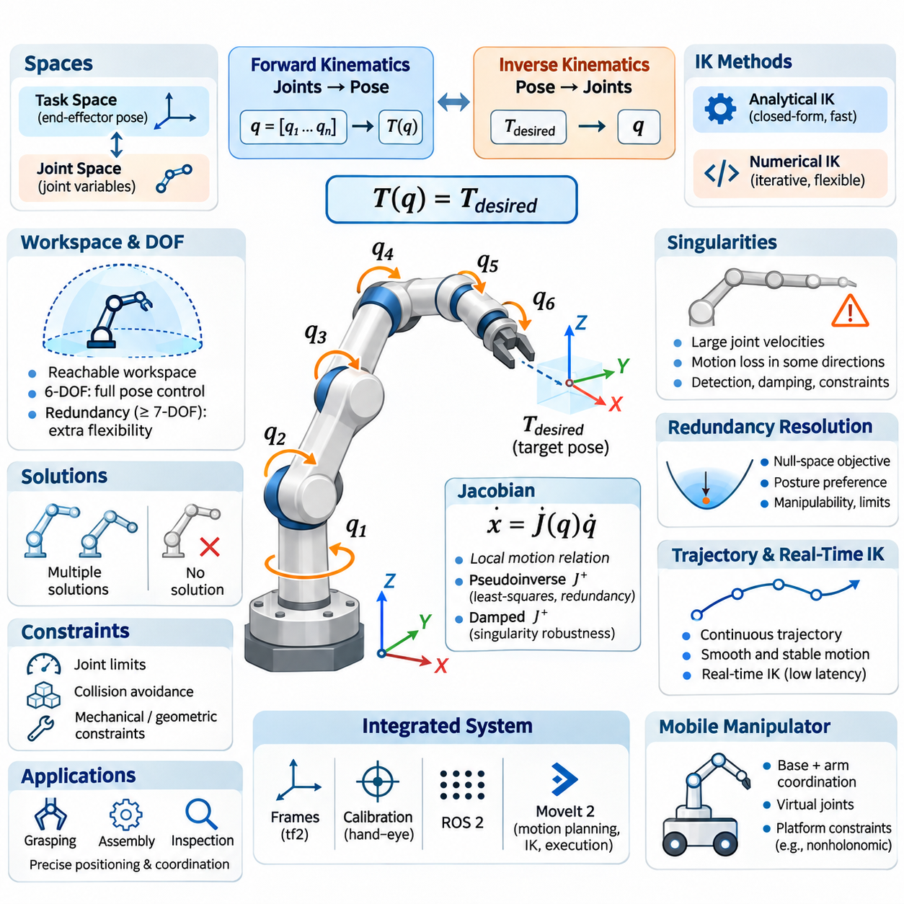
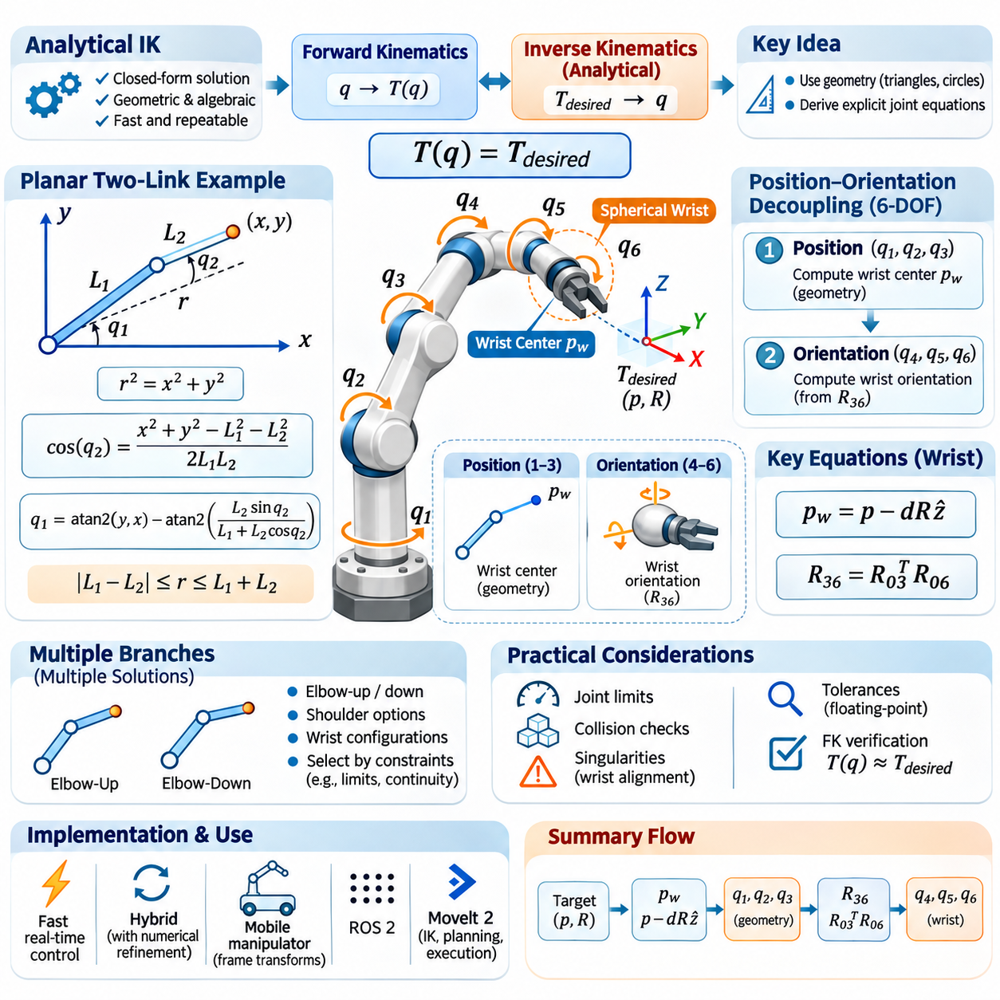
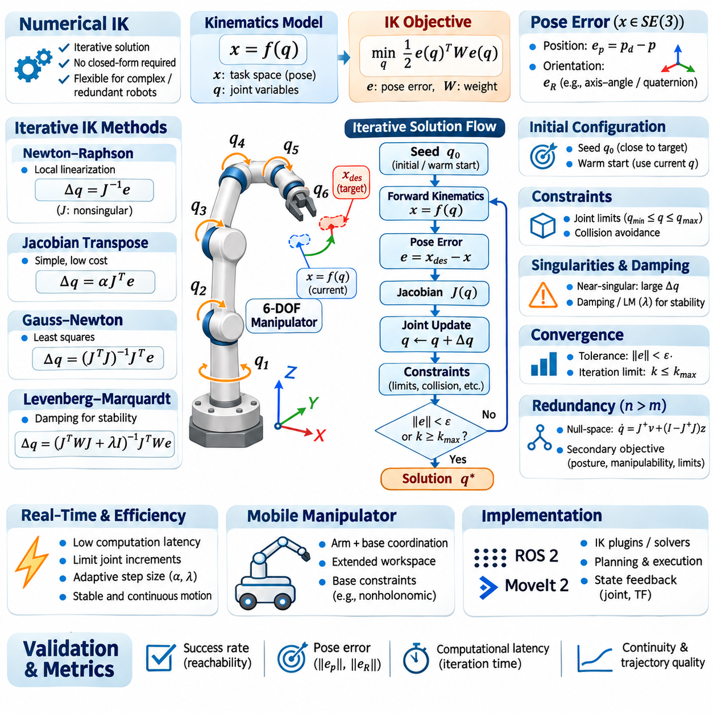
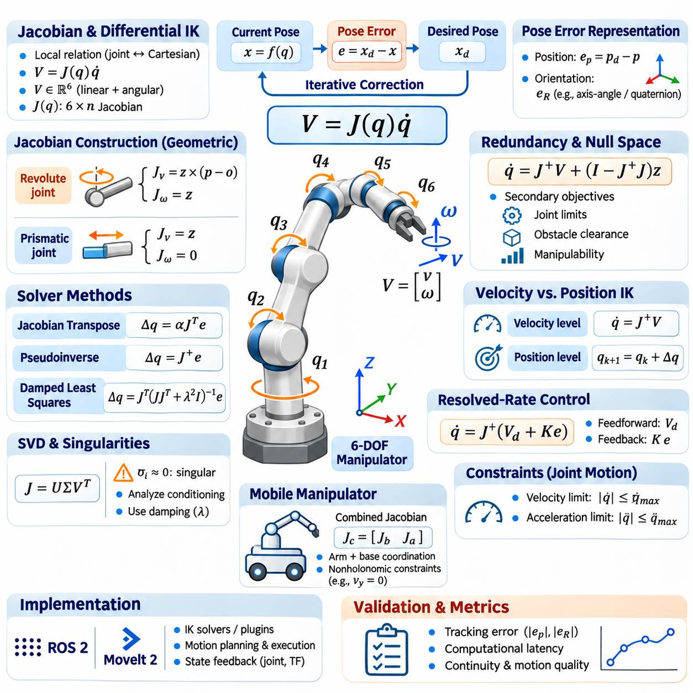
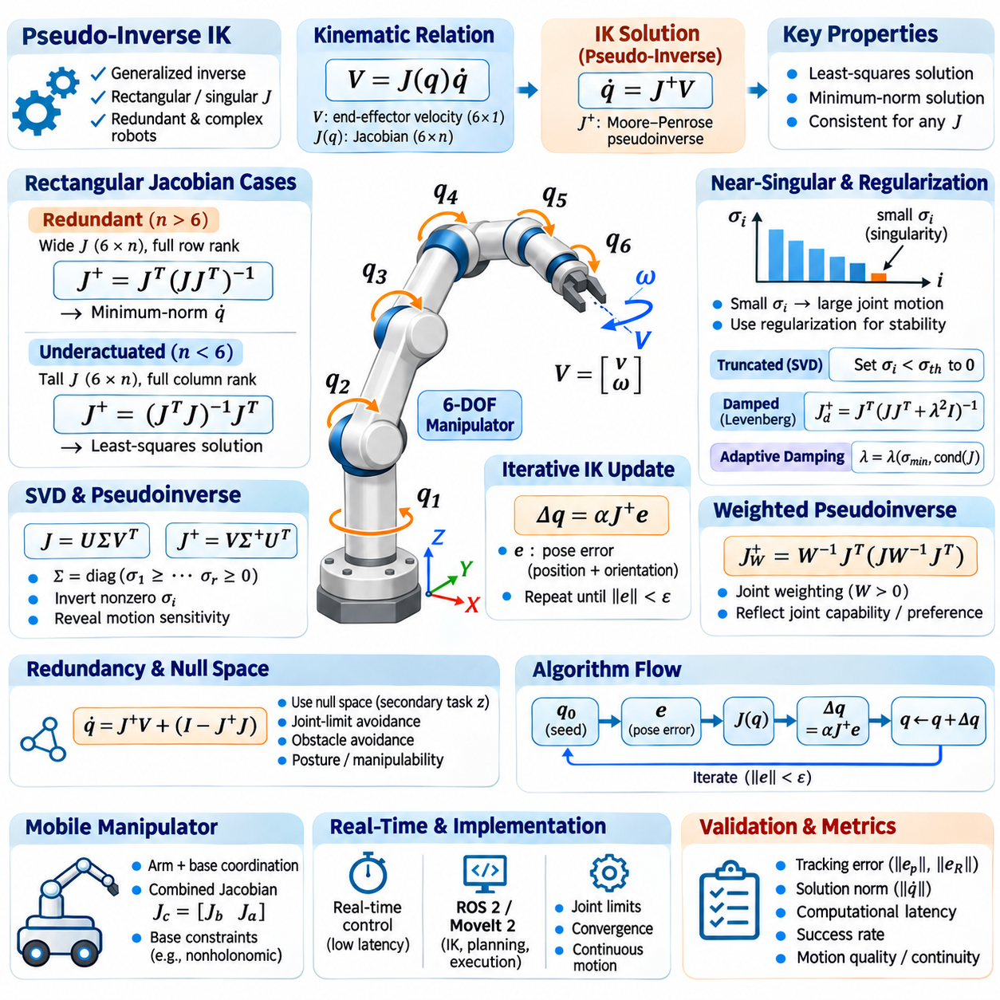
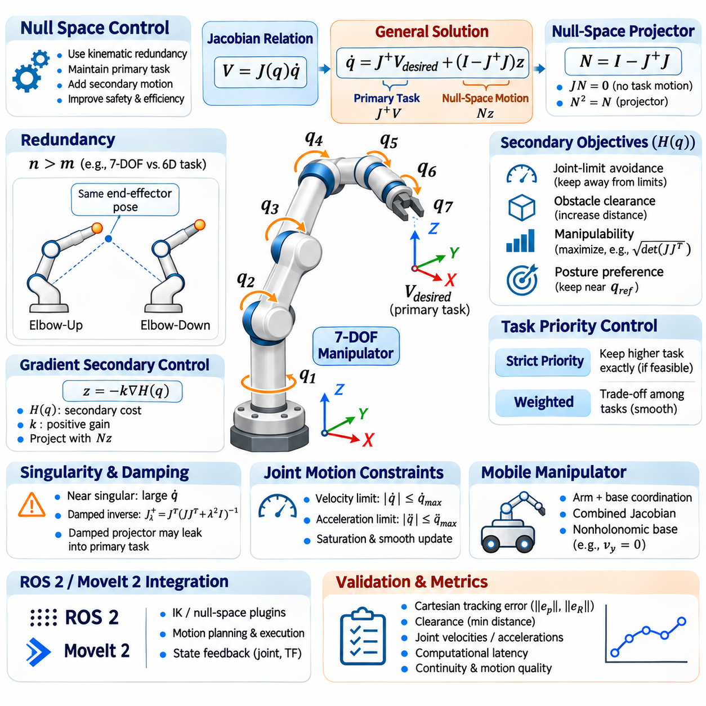
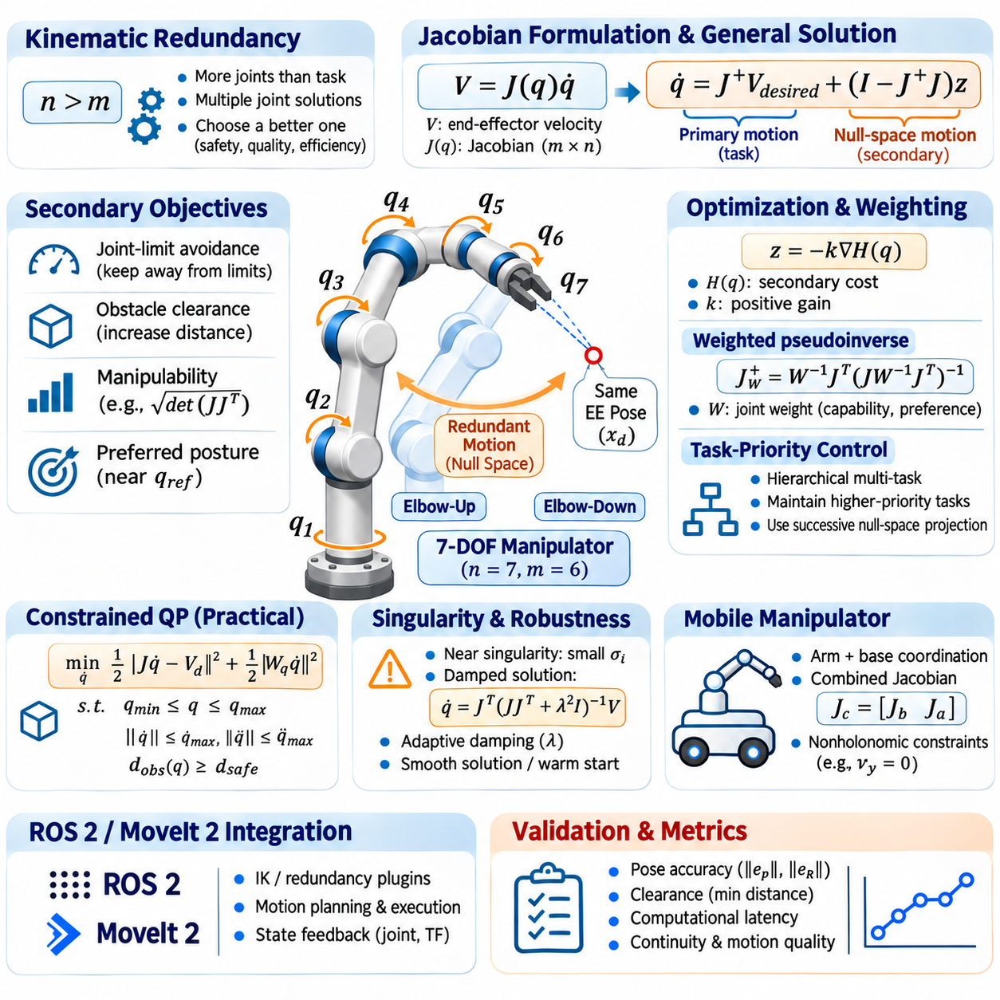
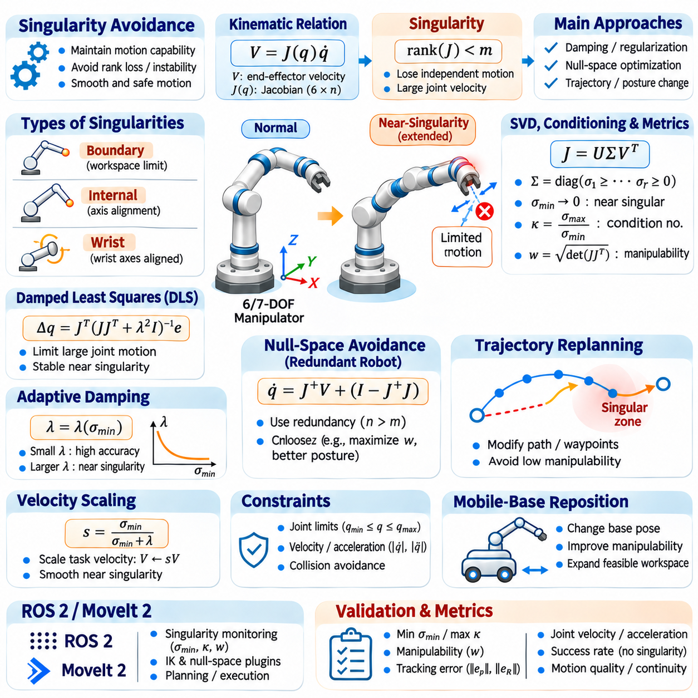
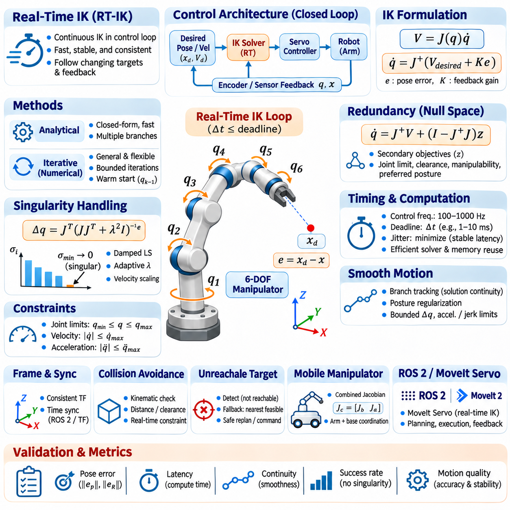
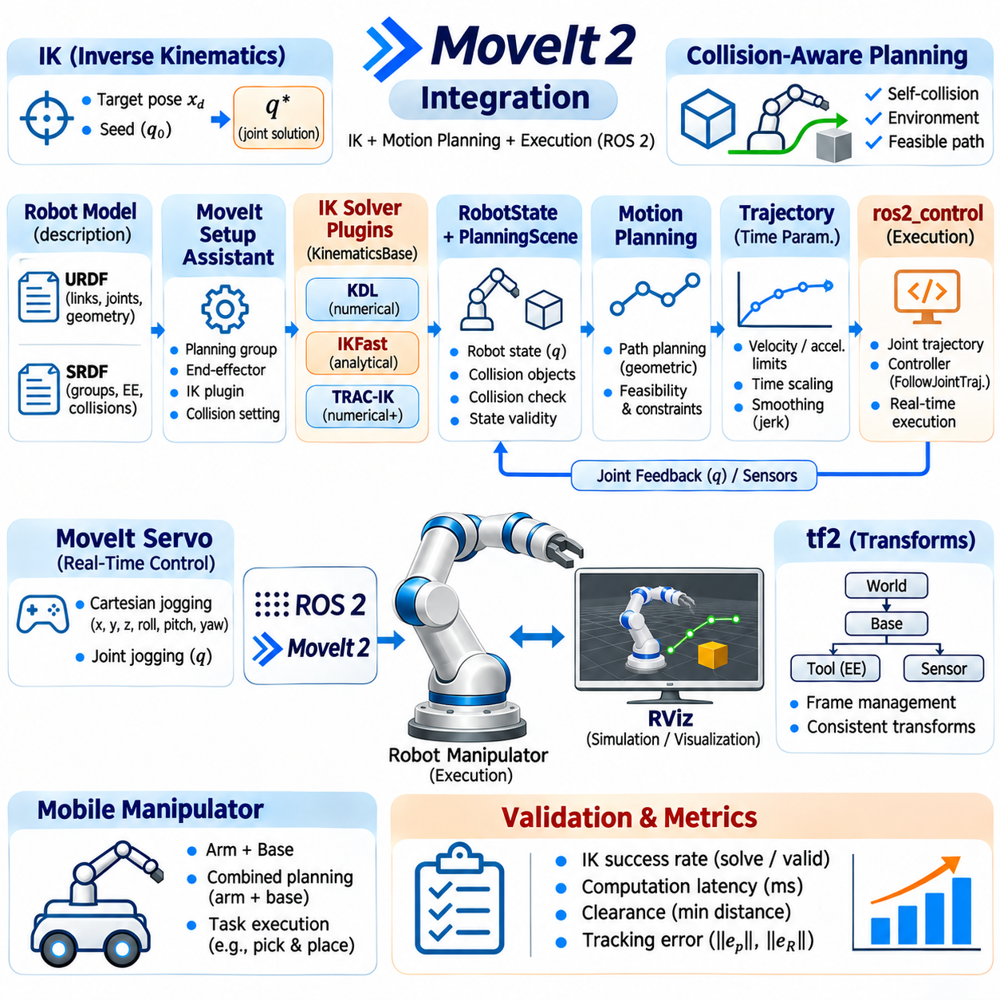

**Volume 02. Manipulator Mechanics and Control**

# Chapter 03. Inverse Kinematics

## 01 Inverse Kinematics Overview

{width="7.268055555555556in" height="7.268055555555556in"}

Inverse kinematics is a fundamental mathematical process in robotics that determines the joint configurations required to position and orient a robot\'s end effector at a desired target pose. Unlike forward kinematics, which calculates the end-effector pose from known joint variables, inverse kinematics works backward from a specified Cartesian target. This capability enables robotic manipulators to perform precise positioning, grasping, assembly, and coordinated motion in complex environments.

The inverse kinematics problem establishes a relationship between task-space coordinates and joint-space variables. Task space describes the position and orientation of the end effector, while joint space represents the angular or linear displacement of individual joints. A robotic controller must transform desired task-space commands into feasible joint configurations while respecting mechanical limitations, geometric constraints, and the available degrees of freedom.

Mathematically, inverse kinematics seeks a joint vector q satisfying the relationship T(q) = T_desired, where T(q) represents the forward kinematics transformation and T_desired defines the requested end-effector pose. For a manipulator with multiple revolute or prismatic joints, this relationship generally produces a system of nonlinear equations. Solving these equations requires consideration of link geometry, coordinate transformations, joint arrangements, and numerical accuracy.

A fundamental characteristic of inverse kinematics is that a desired end-effector pose does not necessarily correspond to a unique joint configuration. Some target poses may have several valid solutions, while others may have no physically achievable solution. Multiple configurations can arise from different elbow positions, wrist orientations, or redundant joint arrangements. Consequently, inverse kinematics must identify not only mathematical solutions but also configurations suitable for practical robotic operation.

The existence of an inverse kinematics solution depends on the manipulator\'s reachable workspace and mechanical structure. A target outside the reachable workspace cannot be achieved regardless of the computational method used. Even when the target position is reachable, the requested orientation may be impossible because of joint restrictions or insufficient degrees of freedom. Reachability analysis therefore provides an essential preliminary condition for successful inverse kinematics computation.

Manipulator degrees of freedom strongly influence the complexity of inverse kinematics. A conventional six-degree-of-freedom industrial robot can often control three-dimensional position and orientation independently within suitable workspace regions. Robots with fewer degrees of freedom may be unable to satisfy arbitrary six-dimensional pose requirements. Redundant manipulators with seven or more degrees of freedom introduce additional flexibility but require strategies for selecting among infinitely many possible configurations.

Inverse kinematics methods are commonly divided into analytical and numerical approaches. Analytical methods derive joint variables through geometric relationships and algebraic transformations, potentially providing exact solutions within mathematical and numerical precision limits. Numerical methods use iterative computations to reduce the difference between the current and desired end-effector poses. Both approaches are important because different manipulator structures impose different computational and implementation requirements.

Analytical inverse kinematics is particularly attractive for manipulators with geometric structures that permit closed-form solutions. Certain industrial robot architectures allow the position of the wrist center to be separated from the orientation of the final joints. This geometric property simplifies the solution process and enables efficient computation of multiple joint configurations. However, general manipulator structures do not always admit practical closed-form expressions.

Numerical inverse kinematics provides greater flexibility when analytical solutions are unavailable or difficult to derive. An iterative solver begins with an initial joint configuration, evaluates the current end-effector pose, and computes adjustments intended to reduce the pose error. This procedure continues until the solution satisfies a predefined tolerance or a termination condition. Numerical methods can accommodate complex kinematic chains, although convergence and computational efficiency require careful management.

The Jacobian matrix plays a central role in numerical inverse kinematics by describing the local relationship between joint velocities and end-effector motion. For a manipulator, the differential relationship can be expressed as x_dot = J(q)q_dot, where J(q) is the Jacobian matrix. By using appropriate inverse or generalized inverse operations, the controller estimates joint movements needed to achieve a desired Cartesian displacement.

A major challenge arises when the Jacobian becomes singular or approaches a singular configuration. Near singularities, small desired Cartesian movements may require extremely large joint velocities, while certain motion directions become difficult or impossible to generate instantaneously. These conditions can produce numerical instability, actuator saturation, and degraded tracking performance. Robust inverse kinematics systems therefore incorporate singularity detection, damping, and motion constraints.

The pseudoinverse of the Jacobian is widely used when the Jacobian is rectangular or cannot be inverted directly. This technique provides least-squares solutions to differential inverse kinematics problems and is especially useful for redundant manipulators. Nevertheless, an undamped pseudoinverse may amplify numerical errors near singularities. Damped least-squares methods improve robustness by limiting excessive joint updates at the expense of introducing controlled tracking error.

Redundant manipulators introduce an important opportunity for secondary optimization. When the robot possesses more degrees of freedom than required by the primary task, additional joint motions can be performed without changing the end-effector motion to first order. Null-space control exploits this property to support joint-limit avoidance, obstacle avoidance, posture optimization, and improved manipulability while maintaining the primary positioning objective.

Joint limits represent essential physical constraints in inverse kinematics. Every revolute or prismatic joint operates within a permitted displacement range determined by mechanical construction, actuator design, and safety requirements. A mathematically valid solution may still be unacceptable if it exceeds these limits. Practical inverse kinematics algorithms must therefore evaluate feasible joint intervals and reject or modify configurations that violate the robot\'s operating constraints.

Collision avoidance introduces another layer of complexity because a valid end-effector pose does not guarantee a collision-free robot configuration. Different inverse kinematics solutions may place intermediate links in substantially different positions. The solver or associated motion planner must consider potential collisions with the robot itself, surrounding equipment, workpieces, and nearby personnel. Configuration selection becomes particularly important in confined industrial workspaces.

Inverse kinematics also interacts closely with trajectory planning. Solving individual target poses independently can produce discontinuous changes in joint configurations, especially when multiple solution branches exist. Such discontinuities may cause abrupt motion commands or unnecessary joint rotation. Continuous trajectory execution therefore benefits from maintaining configuration consistency, selecting solutions near the current posture, and enforcing joint velocity and acceleration constraints.

Real-time inverse kinematics requires predictable computational behavior because robotic controllers operate under strict timing requirements. Industrial manipulators may update motion commands at high frequencies, leaving limited time for iterative calculations. Efficient algorithms must balance convergence accuracy, computational cost, numerical stability, and deterministic execution. Warm-start strategies, bounded iterations, and carefully selected convergence tolerances can improve real-time performance.

Mobile manipulators introduce additional inverse kinematics considerations because the robotic arm is mounted on a movable platform. The end-effector pose depends on both the manipulator joints and the mobile base position and orientation. A target that is unreachable from one base configuration may become accessible after repositioning the platform. Coordinated inverse kinematics can therefore treat base motion and arm articulation as interconnected variables within a larger kinematic system.

In practical mobile manipulation, the relationship between the global reference frame, mobile base frame, manipulator base frame, and end-effector frame must remain consistent. Localization uncertainty, platform positioning errors, and calibration inaccuracies directly influence the accuracy of inverse kinematics results. Reliable operation requires synchronized coordinate transformations, accurate geometric models, and continuous feedback from the robot\'s sensing and control systems.

Inverse kinematics accuracy depends on the quality of the underlying kinematic model. Incorrect link dimensions, joint offsets, axis orientations, or tool-center-point definitions can create systematic positioning errors even when the numerical solver converges successfully. Calibration procedures and experimental measurements are therefore essential for aligning theoretical solutions with actual robot behavior. Model validation should cover representative configurations throughout the operational workspace.

Modern robotics software provides inverse kinematics capabilities through reusable libraries and motion-planning frameworks. Within ROS 2 environments, MoveIt 2 supports configurable inverse kinematics solvers that can be integrated with robot descriptions, planning groups, and collision-checking systems. These tools reduce implementation complexity, but successful deployment still requires correct kinematic modeling, appropriate solver configuration, and systematic verification.

The selection of an inverse kinematics method depends on the robot architecture and application requirements. High-speed industrial manipulation may favor efficient analytical solutions, while complex redundant robots often benefit from numerical optimization. Tasks involving obstacle avoidance, human interaction, or constrained workspaces may require additional optimization objectives. No single algorithm provides optimal performance across every manipulator geometry and operating condition.

Inverse kinematics ultimately forms the mathematical bridge between desired robotic behavior and executable joint motion. Its effectiveness depends on combining geometric reasoning, numerical computation, constraint handling, and feedback control within a consistent engineering framework. Understanding these foundations prepares the development of analytical methods, Jacobian-based solvers, pseudoinverse techniques, redundancy resolution, singularity avoidance, and real-time integration in advanced manipulation systems.

## 02 Analytical Methods

{width="7.268055555555556in" height="7.268055555555556in"}

Analytical inverse kinematics is a mathematical approach that determines robot joint variables through explicit geometric relationships and algebraic equations. Unlike numerical techniques that progressively approximate a solution, analytical methods derive joint configurations directly from the desired end-effector pose. When a manipulator possesses suitable geometric properties, these methods provide computationally efficient and highly repeatable solutions for industrial robotic motion.

The foundation of analytical inverse kinematics lies in the mathematical structure of the robot\'s kinematic chain. Each joint contributes a transformation that describes the relative position and orientation between adjacent links. By combining these transformations, forward kinematics expresses the end-effector pose as a function of joint variables. Analytical inversion rearranges these relationships to obtain explicit expressions for the unknown joint coordinates.

A closed-form solution represents joint variables using a finite combination of mathematical operations, including arithmetic, trigonometric functions, and inverse trigonometric functions. Such solutions avoid iterative convergence procedures and generally provide predictable computational execution. However, not every manipulator admits a practical closed-form solution, particularly when complex joint arrangements introduce strongly coupled nonlinear equations.

Geometric inverse kinematics is especially effective for manipulators whose link arrangements can be represented through triangles, circles, and intersecting rotational axes. By examining the spatial relationships between joints and target positions, joint angles can be derived using elementary geometric principles. The law of cosines, the law of sines, and trigonometric identities frequently provide the mathematical foundation for these derivations.

A planar two-link manipulator provides a fundamental example of analytical inverse kinematics. Given link lengths L1 and L2 and a target position (x, y), the distance from the base to the target is determined by r² = x² + y². The elbow angle satisfies cos(q2) = (x² + y² - L1² - L2²)/(2L1L2). This equation establishes the geometric relationship between the target position and the relative orientation of the two links.

After determining the elbow angle, the shoulder angle can be calculated using q1 = atan2(y, x) - atan2(L2 sin(q2), L1 + L2 cos(q2)). The use of atan2 preserves quadrant information and improves angular consistency compared with a simple inverse tangent. Depending on the target position, two distinct elbow configurations may exist, commonly described as elbow-up and elbow-down solutions.

The existence of a valid two-link solution depends on the target distance satisfying \|L1 - L2\| ≤ r ≤ L1 + L2. If this condition is violated, the target lies outside the reachable workspace. Numerical rounding may also produce cosine values slightly outside the interval from negative one to positive one. Robust implementations distinguish genuine unreachable targets from small floating-point errors before applying inverse trigonometric functions.

Three-dimensional manipulators extend geometric reasoning by introducing additional rotational axes and spatial constraints. In many industrial robot architectures, the first joint controls the horizontal orientation of the arm, while subsequent joints determine the radial and vertical position of the wrist center. This arrangement allows the original spatial problem to be decomposed into simpler geometric subproblems involving planar triangles and angular relationships.

A particularly important analytical technique is position-orientation decoupling, which separates the determination of wrist-center position from the calculation of wrist orientation. This approach is applicable to certain six-degree-of-freedom manipulators whose final three revolute joint axes intersect at a common point. Under this geometric condition, the first three joints can determine wrist-center position while the remaining joints establish tool orientation.

For a manipulator with a spherical wrist, the wrist-center position can be calculated from the desired end-effector transformation. If p represents the desired tool position, R represents its orientation matrix, and d denotes the wrist-to-tool offset along the tool\'s local z-axis, the wrist center is expressed as p_w = p - dR[0, 0, 1]ᵀ. More general tool offsets require applying the complete rotation matrix to the corresponding offset vector.

Once the wrist-center position is known, the first three joint variables can often be obtained through geometric construction. The base rotation aligns the manipulator with the target\'s horizontal direction, while the shoulder and elbow joints establish the required radial distance and height. Link lengths and offsets determine the exact trigonometric relationships, making accurate mechanical parameters essential for reliable analytical solutions.

The orientation of the wrist is determined after calculating the transformation produced by the first three joints. If R_06 represents the desired end-effector orientation and R_03 represents the orientation generated by the positioning joints, the remaining wrist rotation is R_36 = R_03ᵀR_06. This matrix contains the orientation information required to calculate the final three joint angles according to the wrist\'s rotational-axis arrangement.

Extracting wrist angles from a rotation matrix requires careful handling of trigonometric relationships and angular ambiguities. Different combinations of wrist joint angles can produce the same orientation, leading to multiple valid solutions. Certain configurations may also create wrist singularities, where two rotational axes become aligned and individual joint angles cannot be uniquely determined from the orientation matrix.

Analytical inverse kinematics frequently produces several solution branches for a single target pose. A six-axis industrial manipulator may exhibit alternative shoulder, elbow, and wrist configurations, with some common geometries allowing up to eight discrete solutions away from singularities. The actual number depends on robot architecture, joint limits, geometric degeneracies, and target reachability. Each candidate must be evaluated before execution.

Solution branch selection is an important practical consideration because mathematically equivalent end-effector poses may require substantially different joint movements. A controller may prefer the configuration closest to the current joint state to reduce unnecessary motion. Additional criteria can include joint-limit margins, collision risk, actuator loading, cable routing constraints, and continuity with previously executed trajectories.

Algebraic analytical methods provide an alternative when direct geometric construction is insufficient. These techniques manipulate forward kinematics equations using symbolic substitution, trigonometric identities, and polynomial elimination. By transforming coupled nonlinear equations into polynomial expressions, the solver can identify candidate roots corresponding to possible joint configurations. Real solutions must then be reconstructed and verified.

The complexity of symbolic elimination increases significantly with manipulator geometry. General six-revolute-joint manipulators may require high-degree polynomial formulations, and their solutions are not necessarily expressible through simple elementary functions. Although specialized algebraic techniques can compute all isolated solutions for certain general architectures, such approaches may be considerably more expensive than the compact formulas available for geometrically structured robots.

The Denavit-Hartenberg convention provides a systematic framework for expressing manipulator geometry through link lengths, link twists, joint offsets, and joint angles. Analytical derivations can use these parameters to construct transformation matrices and identify relationships suitable for algebraic simplification. Nevertheless, the existence of a standardized kinematic representation does not guarantee that a simple analytical inverse kinematics solution can be obtained.

Singular configurations require special treatment in analytical solvers because ordinary formulas may involve division by zero or undefined angular relationships. For example, a fully extended arm may cause distinct elbow configurations to merge, while a wrist singularity may eliminate the independent determination of two wrist angles. Reliable implementations identify these conditions explicitly and apply suitable alternative parameterizations or continuity rules.

Numerical precision remains important even when analytical formulas are mathematically exact. Floating-point arithmetic introduces small errors into trigonometric calculations, matrix operations, and geometric comparisons. Values close to singular conditions can be particularly sensitive to rounding. Practical solvers therefore apply numerical tolerances, normalize rotation matrices when appropriate, and validate computed solutions through forward kinematics.

Forward kinematics verification provides a direct method for evaluating analytical inverse kinematics results. Each candidate joint configuration is substituted into the robot\'s forward kinematics model to reconstruct the resulting end-effector pose. The reconstructed position and orientation are compared with the requested target using defined error metrics. Candidates exceeding the permitted tolerance are rejected before motion planning or controller execution.

Analytical inverse kinematics is particularly valuable in real-time robotic systems because explicit formulas generally require bounded and relatively small computational effort. Predictable execution supports high-frequency trajectory generation, repeated pose calculations, and industrial automation workloads. However, computational efficiency alone does not guarantee safe operation, since collision checking, joint constraints, and trajectory feasibility must still be evaluated separately.

For mobile manipulators, analytical inverse kinematics can be applied to the robotic arm after expressing the desired target pose in the arm\'s base coordinate frame. The mobile platform\'s estimated position and orientation determine the transformation between global coordinates and the manipulator base. When the platform moves, this transformation changes, requiring the arm\'s target pose and corresponding joint solutions to be updated consistently.

Analytical methods also support hybrid inverse kinematics architectures. A closed-form solver can rapidly generate candidate configurations, while numerical optimization or motion planning refines the selection according to additional constraints. This combination preserves the computational advantages of analytical solutions while accommodating practical requirements such as obstacle avoidance, joint-limit optimization, and task-specific posture preferences.

Industrial deployment requires analytical solvers to be validated across the manipulator\'s complete operational workspace. Testing should include workspace boundaries, singular configurations, multiple solution branches, joint-limit conditions, and representative tool orientations. Integration with ROS 2 and MoveIt 2 can provide a structured environment for connecting analytical inverse kinematics with robot descriptions, collision checking, and trajectory planning.

Analytical inverse kinematics remains a foundational technique for converting Cartesian motion requirements into executable robot joint configurations. Its effectiveness depends on understanding manipulator geometry, deriving mathematically valid solutions, handling multiple configurations, and verifying physical feasibility. These principles provide the basis for reliable industrial robot control and establish a reference against which numerical and optimization-based inverse kinematics methods can be evaluated.

## 03 Numerical Methods

{width="7.268055555555556in" height="7.268055555555556in"}

Numerical inverse kinematics provides a computational framework for determining robot joint configurations when direct analytical solutions are unavailable or impractical. Instead of deriving explicit formulas for every joint variable, numerical methods iteratively adjust joint coordinates to reduce the difference between the current end-effector pose and a desired target. This flexibility makes numerical techniques particularly valuable for complex manipulators, redundant robotic arms, and mobile manipulation systems.

The numerical inverse kinematics problem begins with a nonlinear mapping between joint space and task space. Forward kinematics defines the end-effector pose as x = f(q), where q represents the joint vector and x represents the task-space configuration. The objective is to find a joint vector q that minimizes the discrepancy between f(q) and the desired pose x_d. Because this relationship is generally nonlinear, iterative optimization provides a practical solution strategy.

A numerical solver typically begins with an initial joint configuration known as the initial guess or seed configuration. The forward kinematics model calculates the corresponding end-effector pose, which is compared with the target. The resulting pose error determines the next adjustment to the joint variables. Repeated updates gradually move the estimated configuration toward a solution, provided the algorithm converges within the available workspace and constraints.

The initial configuration strongly influences numerical inverse kinematics performance. A seed close to the desired solution often reduces the number of iterations and improves convergence reliability. Conversely, an unfavorable initial configuration may lead to slow convergence, convergence toward an undesirable solution, or failure near singularities. Practical systems frequently use the current measured joint state as the initial guess to preserve motion continuity.

Pose error representation is essential because robotic tasks involve both position and orientation. Position error can be calculated as the difference between desired and current Cartesian coordinates. Orientation error requires a representation that respects three-dimensional rotational geometry. Rotation matrices, axis-angle representations, and unit quaternions are commonly used to construct suitable orientation residuals without introducing unnecessary parameterization ambiguities.

A common numerical formulation defines a weighted objective function based on position and orientation errors. The objective may be expressed as E(q) = 0.5 e(q)ᵀW e(q), where e(q) represents the task-space error vector and W is a positive semidefinite weighting matrix. Appropriate weights balance translational and rotational accuracy while accounting for their different physical units. The solver seeks joint variables that reduce this objective.

Newton-based methods use local derivatives to estimate how changes in joint coordinates affect the task-space error. By linearizing the kinematic mapping around the current configuration, the solver obtains a local approximation of the nonlinear problem. The resulting update equation relates the desired Cartesian correction to a joint displacement through the Jacobian matrix. Repeating this procedure progressively refines the estimated joint configuration.

The Newton-Raphson method is a classical iterative approach for solving nonlinear equations. In inverse kinematics, the current estimate is updated using a local linear approximation of the forward kinematics relationship. When the relevant Jacobian is square and nonsingular, a typical update takes the form q_next = q_current + J(q_current)⁻¹e. This expression assumes the pose error is defined consistently with the Jacobian and the chosen coordinate representation.

The convergence behavior of Newton-Raphson methods depends on the initial estimate and local properties of the kinematic equations. Near a valid solution with a nonsingular Jacobian, convergence can be rapid. However, large initial errors, singular configurations, or poorly conditioned Jacobians may cause unstable updates. Practical implementations therefore limit joint increments and apply convergence monitoring to prevent excessive or physically unrealistic movements.

Jacobian transpose methods provide an alternative that avoids explicitly computing the inverse of the Jacobian. A typical update is expressed as Δq = αJᵀe, where α is a positive step-size parameter. For a compatible task-space error definition, this direction corresponds to a gradient-based reduction of the local pose-error objective. Although computationally simple, convergence may be slow when the manipulator exhibits strong directional differences in sensitivity.

Gradient descent methods formulate inverse kinematics as an optimization problem over joint variables. The algorithm evaluates the gradient of a differentiable error function and updates the joint configuration in the direction of decreasing error. Step-size selection is important because excessively large updates can cause oscillation or divergence, while very small updates increase computational time. Adaptive step-size strategies can improve practical convergence.

Gauss-Newton methods are particularly suitable for inverse kinematics objectives expressed as nonlinear least-squares problems. By approximating the objective\'s curvature using first-order derivatives of the residuals, Gauss-Newton computes joint updates without requiring the full second-order Hessian matrix. This approach can converge efficiently when the residuals are small and the local Jacobian provides sufficient information about the task-space geometry.

The Levenberg-Marquardt method combines characteristics of Gauss-Newton optimization and damped gradient-based updates. A representative joint correction is Δq = (JᵀWJ + λI)⁻¹JᵀWe, where λ is a positive damping parameter. Damping improves numerical conditioning and limits excessively large updates near singular configurations. The damping value may be adjusted according to error reduction, convergence behavior, or local manipulability.

Damped least-squares methods are widely used because they provide a practical compromise between tracking accuracy and numerical robustness. When the manipulator approaches a singularity, the damping term reduces amplification of joint velocities or position increments. However, excessive damping slows convergence and increases residual tracking error. Selecting appropriate damping parameters is therefore an important part of numerical inverse kinematics implementation.

Numerical inverse kinematics must also address manipulators whose number of joints differs from the number of task-space constraints. For redundant manipulators, multiple joint updates may produce the same first-order Cartesian correction. For underactuated manipulators, some desired task-space motions may be impossible. Least-squares formulations and generalized inverse techniques provide systematic approaches for finding approximate solutions under these conditions.

Joint constraints can be incorporated into numerical optimization through bounds, penalties, or constrained optimization algorithms. Joint position limits restrict feasible configurations, while velocity and acceleration limits constrain successive updates during motion execution. Additional constraints may address self-collision, environmental obstacles, and preferred joint postures. These requirements transform basic inverse kinematics into a more comprehensive constrained optimization problem.

Sequential quadratic programming and related constrained optimization techniques can handle nonlinear objectives together with equality and inequality constraints. At each iteration, the solver constructs a local approximation of the optimization problem and computes a feasible or constraint-aware update. Such methods are useful when precise task-space positioning must coexist with joint restrictions and collision-avoidance requirements, although computational cost may increase.

Numerical singularity handling is essential because the Jacobian may lose rank or become poorly conditioned in certain configurations. Singular value decomposition provides information about the Jacobian\'s directional sensitivity and numerical rank. Small singular values indicate directions in which Cartesian motion requires disproportionately large joint changes. Damping, step-size reduction, and singularity-aware optimization can improve stability in these regions.

Convergence criteria determine when an iterative solver should terminate. Common conditions include position-error tolerance, orientation-error tolerance, maximum iteration count, and minimum improvement between successive updates. A solver may also terminate when joint constraints prevent further progress. Distinguishing successful convergence from stagnation or infeasibility is important for reliable integration with higher-level robotic planning systems.

Numerical stability depends on consistent coordinate conventions, accurate Jacobian computation, and appropriate scaling of residuals. Position and orientation errors have different physical units and may exhibit different numerical magnitudes. Poor scaling can cause the solver to prioritize one component excessively. Weight normalization, bounded updates, and well-defined rotation-error representations help maintain balanced optimization behavior.

Computational efficiency is especially important for real-time inverse kinematics. Repeated matrix operations, collision evaluations, and constraint checks can introduce significant processing overhead. Efficient implementations reuse intermediate calculations, exploit matrix structure, and limit unnecessary iterations. Warm-start initialization using the previous solution is particularly effective when target poses change gradually along a continuous trajectory.

For mobile manipulators, numerical inverse kinematics can incorporate both robotic arm joints and mobile base coordinates into a unified optimization variable. This expanded formulation allows the system to distribute required end-effector motion between arm articulation and platform repositioning. However, mobile base kinematic constraints, localization uncertainty, and coordination requirements must be considered when determining feasible updates.

Numerical inverse kinematics also supports task-specific optimization objectives beyond basic pose tracking. A solver may favor configurations with improved manipulability, increased distance from joint limits, reduced energy consumption, or better collision clearance. Weighted objectives and hierarchical optimization can express these preferences while preserving essential task constraints. Such capabilities are especially useful for redundant and highly articulated robotic systems.

Validation of numerical inverse kinematics requires systematic testing across representative workspace regions and challenging configurations. Test cases should include reachable targets, unreachable targets, singularities, joint-limit boundaries, and multiple initial guesses. Performance measurements should examine pose accuracy, iteration count, execution time, convergence success rate, and solution continuity. These metrics reveal the practical reliability of different numerical algorithms.

In ROS 2 and MoveIt 2 environments, numerical inverse kinematics solvers can be integrated with robot kinematic descriptions, planning groups, and motion-planning pipelines. Solver configuration influences convergence tolerance, timeout behavior, and seed selection. Integration testing must verify that computed joint configurations satisfy the robot model and remain compatible with collision checking, trajectory generation, and controller execution.

Numerical inverse kinematics provides a flexible foundation for solving complex robotic positioning problems that cannot be addressed efficiently through simple analytical expressions. Its effectiveness depends on accurate mathematical modeling, robust iterative updates, appropriate constraint handling, and careful convergence management. These principles establish the basis for advanced Jacobian-based methods, pseudoinverse techniques, redundancy resolution, and real-time optimization in modern robotic manipulation.

## 04 Jacobian Based Methods

{width="7.268055555555556in" height="7.268055555555556in"}

Jacobian-based methods provide a fundamental mathematical framework for solving inverse kinematics through the differential relationship between joint motion and end-effector motion. Rather than directly solving nonlinear position equations, these methods use the Jacobian matrix to approximate how small joint changes affect Cartesian position and orientation. This approach supports flexible inverse kinematics computation for industrial manipulators, redundant robotic arms, and mobile manipulation systems.

The Jacobian matrix represents the local sensitivity of end-effector motion to changes in individual joint variables. For a manipulator with n joints, the geometric Jacobian typically maps an n-dimensional joint velocity vector into a six-dimensional spatial velocity vector. This relationship is expressed as V = J(q)q_dot, where V contains linear and angular velocity components, J(q) is the configuration-dependent Jacobian, and q_dot represents joint velocities.

Jacobian-based inverse kinematics transforms a desired end-effector motion into corresponding joint movements. Given a target pose, the controller calculates the difference between the current and desired configurations. This error is converted into a Cartesian correction, which is mapped into joint-space increments using the Jacobian. Repeated corrections allow the robot to approach the target without requiring a complete analytical solution to the nonlinear kinematic equations.

The Jacobian can be derived from the manipulator\'s forward kinematics model by differentiating end-effector position and orientation with respect to joint variables. Alternatively, geometric construction uses joint-axis directions and their spatial relationships to the end effector. Both approaches describe the same local motion relationship when consistent coordinate frames and velocity representations are used, although their mathematical expressions may differ.

For a revolute joint, the linear velocity contribution depends on the cross product between the joint-axis direction and the vector connecting the joint origin to the end effector. The angular velocity contribution equals the joint-axis direction. For a prismatic joint, the linear velocity contribution follows the translation axis, while its angular contribution is zero. These geometric relationships provide an efficient procedure for constructing Jacobian columns.

The Jacobian changes as the manipulator moves because joint-axis orientations and relative link positions depend on the current configuration. Consequently, a Jacobian calculated at one posture generally cannot accurately describe motion at a distant posture. Iterative inverse kinematics must therefore update the Jacobian as the joint configuration changes. Accurate forward kinematics and consistent coordinate transformations are essential for reliable calculations.

When the Jacobian is square and nonsingular, joint velocities can be calculated using q_dot = J(q)⁻¹V_desired. This direct inverse provides a local mapping from desired Cartesian velocity to joint velocity. However, it applies only when the Jacobian has the appropriate dimensions and full rank. Many practical manipulators have redundant joints, insufficient degrees of freedom, or configurations where direct inversion becomes numerically unstable.

The Jacobian transpose method offers a computationally simple alternative for iterative inverse kinematics. A representative update is Δq = αJᵀe, where e denotes a compatible task-space error and α controls the correction magnitude. Under appropriate error definitions, this update follows a direction that locally reduces the squared pose error. Its simplicity makes it attractive for basic controllers, although convergence may be slow in poorly conditioned configurations.

The Jacobian pseudoinverse method extends differential inverse kinematics to rectangular and rank-deficient systems. A typical correction is Δq = J⁺e, where J⁺ denotes the Moore-Penrose pseudoinverse. For full-row-rank redundant manipulators, this provides the minimum-norm joint correction satisfying the linearized task equation. When exact satisfaction is impossible, the pseudoinverse provides a least-squares approximation to the requested Cartesian correction.

Singular value decomposition provides a systematic way to calculate the pseudoinverse and analyze Jacobian conditioning. The decomposition J = UΣVᵀ separates the mapping into orthogonal motion directions and associated singular values. Small singular values indicate directions with weak motion capability. Their reciprocals can amplify joint updates, making numerical regularization important near singular configurations and workspace boundaries.

Damped least-squares methods improve robustness by modifying the inverse calculation to reduce sensitivity to small singular values. A common correction is Δq = Jᵀ(JJᵀ + λ²I)⁻¹e, where λ is a damping parameter. This formulation limits excessive joint increments near singularities, although it introduces additional tracking error. Adaptive damping can balance accuracy and stability according to the local conditioning of the Jacobian.

Jacobian-based methods can operate at velocity level or position level. Velocity-level control converts a desired Cartesian velocity into joint velocity commands, while position-level inverse kinematics repeatedly calculates finite joint increments from pose errors. These formulations are closely related but require different attention to integration, sampling intervals, and motion constraints. Large position updates may invalidate the local linear approximation underlying the Jacobian.

Position and orientation errors must be represented consistently when constructing six-dimensional correction vectors. Translational error is commonly defined as the difference between target and current positions. Rotational error can be represented using rotation matrices, axis-angle coordinates, or logarithmic mappings on the rotation group. The resulting angular correction must correspond to the Jacobian\'s angular velocity convention to avoid incorrect or unstable updates.

The use of weighted Jacobian methods allows different task dimensions to receive different priorities. Translational accuracy may be emphasized during precise positioning, while orientation accuracy may dominate tool alignment tasks. Weighting matrices can also compensate for differences in physical units between linear and angular quantities. Appropriate scaling is necessary because arbitrary weights can distort optimization behavior and produce undesirable joint movements.

Redundant manipulators provide additional flexibility because the number of controllable joints exceeds the number of independent task constraints. Jacobian-based inverse kinematics can exploit this redundancy through null-space motion. A general velocity solution is q_dot = J⁺V_desired + (I - J⁺J)z, where z represents a secondary joint-space command. The second term produces no instantaneous end-effector velocity in the ideal linearized model.

Null-space control supports secondary objectives such as joint-limit avoidance, posture optimization, obstacle clearance, and improved manipulability. For example, a gradient-based secondary command can move joints away from mechanical limits while preserving the primary end-effector task to first order. However, near singularities or when damping is introduced, task preservation may become approximate. Secondary objectives must therefore be coordinated with primary tracking requirements.

Singularity detection is particularly important in Jacobian-based control because singular configurations reduce the rank of the velocity mapping. Near such configurations, certain Cartesian directions require disproportionately large joint velocities or become locally inaccessible. Condition numbers, minimum singular values, and manipulability measures can identify deteriorating configurations. Controllers may respond by reducing speed, increasing damping, or modifying the planned posture.

Joint velocity limits and actuator capabilities impose practical constraints on Jacobian-based solutions. Even when a desired Cartesian velocity is mathematically achievable, the corresponding joint velocities may exceed motor or transmission limits. Velocity scaling, constrained least-squares optimization, and joint-limit-aware corrections help maintain feasible commands. Acceleration and torque limits must also be considered by downstream trajectory generation and control systems.

Real-time implementation requires efficient Jacobian evaluation and predictable numerical computation. Robotic controllers may repeatedly update Jacobian matrices, solve linear systems, and calculate joint corrections within short control periods. Matrix factorization methods, bounded iteration counts, and reuse of intermediate computations can reduce processing overhead. Numerical performance must be evaluated together with tracking accuracy and robustness under changing robot configurations.

For mobile manipulators, the Jacobian can be extended to include both robotic arm joints and mobile platform motion. The combined Jacobian describes how base movement and arm articulation contribute to end-effector velocity. This enables coordinated motion allocation between navigation and manipulation. However, wheeled platforms may impose nonholonomic constraints, requiring feasible base velocity parameterizations rather than arbitrary Cartesian base motion.

Jacobian-based control is also closely related to resolved-rate motion control, where desired Cartesian trajectories are converted into continuous joint velocity commands. Feedback terms compensate for accumulated pose errors, while feedforward terms represent planned end-effector motion. Combining these components improves tracking performance during continuous manipulation. Stable operation requires suitable gains, consistent reference frames, and appropriate handling of actuator saturation.

Implementation in ROS 2 and MoveIt 2 can use robot kinematic models to calculate Jacobians and support differential inverse kinematics. Jacobian-based solvers may operate within motion-planning components or servo-control interfaces that convert Cartesian commands into joint motion. Correct integration requires accurate robot descriptions, coordinate-frame consistency, joint-state feedback, and appropriate collision and safety constraints.

Validation of Jacobian-based inverse kinematics should cover representative workspace positions, singular configurations, joint-limit boundaries, and rapidly changing target poses. Important evaluation metrics include Cartesian tracking error, joint velocity magnitude, computational latency, convergence behavior, and solution continuity. Comparing Jacobian transpose, pseudoinverse, and damped least-squares methods reveals their different tradeoffs in accuracy, stability, and computational efficiency.

Jacobian-based methods establish a versatile foundation for differential inverse kinematics and real-time robotic motion control. Their effectiveness depends on accurate kinematic modeling, consistent error representations, stable matrix computations, and proper treatment of singularities and constraints. These principles connect numerical inverse kinematics with pseudoinverse optimization, redundancy resolution, null-space control, and coordinated mobile manipulation in advanced robotic systems.

## 05 Pseudo Inverse Methods

{width="7.268055555555556in" height="7.268055555555556in"}

Pseudoinverse methods provide a systematic mathematical approach to inverse kinematics when the Jacobian matrix is rectangular, singular, or unsuitable for direct inversion. These methods extend conventional matrix inversion by computing joint movements that best approximate desired end-effector motion. They are particularly important for redundant manipulators, underactuated robotic systems, and complex mobile manipulators requiring flexible joint-space solutions.

The mathematical foundation of pseudoinverse inverse kinematics is the differential relationship V = J(q)q_dot, where V represents end-effector velocity, J(q) denotes the Jacobian matrix, and q_dot represents joint velocity. The objective is to determine joint velocities that reproduce the desired Cartesian motion as closely as possible. Because the Jacobian is not always square or invertible, generalized inverse techniques provide a consistent computational framework.

The Moore-Penrose pseudoinverse is the most widely used generalized inverse in robotic kinematics. It is denoted by J⁺ and satisfies mathematical properties that ensure a unique generalized inverse for any matrix. The basic inverse kinematics solution is q_dot = J⁺V_desired. This expression provides a least-squares solution when exact Cartesian motion cannot be achieved and selects a minimum-norm solution when multiple joint velocity vectors satisfy the task.

For a redundant manipulator with more joint variables than independent task dimensions, the Jacobian is often a wide matrix. When it has full row rank, the pseudoinverse can be expressed as J⁺ = Jᵀ(JJᵀ)⁻¹. This formulation produces the joint velocity vector with minimum Euclidean norm among all solutions satisfying the desired instantaneous task velocity. Such behavior reduces unnecessary joint movement but does not automatically optimize energy consumption.

For manipulators with fewer joint variables than task dimensions, the Jacobian may be a tall matrix. If it has full column rank, the pseudoinverse is J⁺ = (JᵀJ)⁻¹Jᵀ. The resulting joint velocity minimizes the squared difference between achievable and desired Cartesian velocities. This formulation is useful when a robot cannot independently control every component of the requested end-effector motion.

The minimum-norm property is an important characteristic of pseudoinverse solutions. Among multiple joint velocity vectors producing the same Cartesian velocity, the Moore-Penrose pseudoinverse selects the vector with the smallest Euclidean magnitude. This provides a mathematically consistent default solution for redundant robots. However, minimum joint velocity does not necessarily correspond to minimum actuator torque, mechanical stress, or power consumption.

Singular value decomposition provides a numerically reliable method for calculating the pseudoinverse. The Jacobian is decomposed as J = UΣVᵀ, where U and V contain orthogonal singular vectors and Σ contains nonnegative singular values. The pseudoinverse is reconstructed as J⁺ = VΣ⁺Uᵀ. Nonzero singular values are inverted, while zero singular values remain zero, allowing the method to handle rank-deficient matrices.

The singular values reveal how effectively joint motion produces Cartesian motion in different directions. Large singular values indicate directions with relatively strong motion sensitivity, while small singular values correspond to weakly controllable directions. When a singular value approaches zero, its reciprocal becomes large and can amplify joint velocities dramatically. This behavior explains why ordinary pseudoinverse solutions may become unstable near singular configurations.

Truncated pseudoinverse methods improve numerical stability by discarding singular values below a selected threshold. Instead of inverting every nonzero singular value, the algorithm treats sufficiently small values as zero. This prevents extreme amplification of joint commands but sacrifices motion accuracy along the discarded directions. Threshold selection must balance numerical robustness, task accuracy, and the manipulator\'s operating requirements.

Damped pseudoinverse methods provide a smoother alternative to abrupt singular-value truncation. A common formulation is J_d⁺ = Jᵀ(JJᵀ + λ²I)⁻¹, where λ is a positive damping coefficient. Damping reduces the influence of small singular values and limits excessive joint velocities. However, the resulting solution generally introduces Cartesian tracking error, especially when damping is large.

Adaptive damping adjusts the regularization strength according to the manipulator\'s current configuration. When the Jacobian is well conditioned, damping can remain small to preserve tracking accuracy. As the robot approaches a singularity, damping increases to suppress unstable joint commands. Singular values, condition numbers, and manipulability measures can guide this adjustment, although abrupt parameter changes should be avoided.

Weighted pseudoinverse methods extend minimum-norm optimization by assigning different costs to individual joint movements. For a positive-definite joint weighting matrix W, a full-row-rank weighted pseudoinverse can be written as J_W⁺ = W⁻¹Jᵀ(JW⁻¹Jᵀ)⁻¹. This formulation minimizes the weighted joint velocity norm while satisfying the desired Cartesian velocity. Weight selection can reflect joint capabilities, mechanical limits, or preferred motion characteristics.

Joint weighting is especially useful when a manipulator contains actuators with different velocity capacities, transmission ratios, or mechanical characteristics. Larger penalties can discourage movement of selected joints, while smaller penalties allow other joints to contribute more strongly. However, poorly selected weights may create unfavorable configurations or reduce available motion flexibility. Practical implementations therefore require careful normalization and experimental validation.

For redundant manipulators, pseudoinverse methods provide a foundation for null-space control. The general differential solution can be expressed as q_dot = J⁺V_desired + (I - J⁺J)z, where z is an arbitrary secondary joint-space command. The null-space projector removes components of z that would affect the primary Cartesian task. This allows additional joint motion while preserving the desired end-effector velocity in the ideal differential model.

Secondary null-space objectives can include joint-limit avoidance, collision clearance, posture optimization, and improved manipulability. A gradient-based command may guide the robot toward preferred configurations while the pseudoinverse maintains primary task tracking. The effectiveness of this approach depends on the available redundancy and the local Jacobian rank. Damped projectors may introduce primary-task interference and require additional coordination.

Pseudoinverse inverse kinematics can also be implemented at the position level through iterative joint updates. The controller calculates a pose error e between the current and desired end-effector configurations and applies Δq = αJ⁺e, where α is a step-size parameter. Forward kinematics is then recomputed, and the procedure repeats until the pose error reaches an acceptable tolerance or a termination condition occurs.

The accuracy of iterative pseudoinverse methods depends on consistent position and orientation error representations. Translational errors are expressed in linear coordinates, while rotational errors require suitable representations such as axis-angle vectors or rotation logarithms. The error vector must use the same reference frame and velocity convention as the Jacobian. Inconsistent definitions can produce incorrect corrections or unstable convergence.

Joint position and velocity limits impose practical restrictions on pseudoinverse solutions. Although a minimum-norm solution minimizes the overall joint velocity magnitude, individual joints may still exceed their permitted operating ranges. Velocity scaling, constrained least-squares optimization, and joint-limit-aware weighting can improve feasibility. Acceleration limits and collision constraints must also be addressed before executing the resulting motion.

Pseudoinverse methods are sensitive to modeling errors because the Jacobian is derived from the robot\'s kinematic parameters. Incorrect link dimensions, joint-axis definitions, tool offsets, or coordinate transformations can produce systematic motion errors. Accurate calibration and forward kinematics verification are therefore necessary. Real-time joint feedback can further reduce accumulated tracking errors during continuous motion execution.

Computational efficiency is important when pseudoinverse calculations are performed repeatedly in high-frequency control loops. Singular value decomposition provides robust numerical behavior but may require more computation than specialized matrix factorizations. Efficient implementations exploit matrix dimensions, reuse intermediate calculations, and avoid explicitly forming poorly conditioned normal equations. Solver selection should consider both numerical reliability and execution time.

For mobile manipulators, the Jacobian can include robotic arm joints and mobile base motion variables. The pseudoinverse then distributes desired end-effector motion across the combined system. This approach enables coordinated arm-base movement and can exploit additional degrees of freedom for improved reachability. However, wheeled-base constraints and localization uncertainty must be incorporated to ensure physically achievable commands.

Pseudoinverse methods can be combined with hierarchical task control when multiple objectives have different priorities. A primary task may maintain end-effector positioning, while secondary tasks regulate posture or avoid obstacles. Successive null-space projections allow lower-priority commands to operate within the remaining motion freedom. Exact priority preservation requires careful projector construction, especially near singularities and under damping.

Industrial applications benefit from pseudoinverse methods because they support flexible motion generation across diverse manipulator architectures. They are commonly associated with differential inverse kinematics, resolved-rate control, redundant robot coordination, and Cartesian servoing. Integration with ROS 2 and MoveIt 2 can connect these calculations to robot descriptions, joint-state feedback, motion planning, and collision checking.

Validation should examine pseudoinverse behavior across regular configurations, near-singular regions, joint-limit boundaries, and unreachable Cartesian commands. Important metrics include tracking accuracy, maximum joint velocity, numerical conditioning, computational latency, and solution continuity. Comparing ordinary, truncated, damped, and weighted pseudoinverse methods reveals their different compromises between precision, stability, and motion efficiency.

Pseudoinverse methods establish a versatile foundation for inverse kinematics in robots with complex or redundant kinematic structures. Their practical effectiveness depends on accurate Jacobian modeling, stable matrix decomposition, appropriate regularization, and explicit treatment of physical constraints. These principles support advanced null-space control, redundancy resolution, singularity avoidance, and coordinated mobile manipulation within modern robotic control architectures.

## 06 Null Space Control

{width="7.268055555555556in" height="7.268055555555556in"}

Null-space control is a fundamental technique for exploiting kinematic redundancy in robotic manipulators. It enables a robot to perform secondary joint motions while maintaining a primary end-effector task. When the number of controllable joints exceeds the number of independent task constraints, multiple joint configurations can produce the same end-effector motion. Null-space control uses this additional freedom to improve safety, flexibility, and operational efficiency.

The mathematical foundation of null-space control is the Jacobian relationship V = J(q)q_dot, where V represents end-effector velocity and q_dot represents joint velocity. Joint motions belonging to the null space of J satisfy J(q)q_dot_null = 0. Consequently, these motions produce no instantaneous end-effector velocity in the specified task coordinates. This property allows joint posture adjustments without disturbing the primary task at the differential level.

For a redundant manipulator, the general joint velocity solution can be expressed as q_dot = J⁺V_desired + (I − J⁺J)z. Here, J⁺ is the Moore-Penrose pseudoinverse, I is the identity matrix, and z is an arbitrary secondary joint velocity vector. The first term generates the desired Cartesian motion, while the second term projects secondary commands into the Jacobian null space. Exact primary-task tracking requires the desired velocity to be achievable.

The matrix N = I − J⁺J is known as the null-space projector. It removes components of a secondary command that would affect the primary task in the local linearized model. For an exact Moore-Penrose pseudoinverse, the projector satisfies JN = 0 and N² = N. These properties ensure that projected motion remains within the Jacobian null space, although the available null-space dimension changes when the Jacobian rank changes.

Null-space control is particularly useful for manipulators with seven or more joints performing six-dimensional end-effector tasks. A seven-degree-of-freedom robotic arm can often adjust its elbow position while maintaining the same tool pose. This additional freedom allows the robot to avoid obstacles, maintain favorable joint configurations, and improve reachability. The available redundancy depends on the active task constraints and the current Jacobian rank.

Secondary objectives are commonly represented through differentiable cost functions defined over joint coordinates. If H(q) measures an undesirable configuration property, a secondary command can be selected as z = −k∇H(q), where k is a positive gain. The projected gradient then attempts to reduce the cost without changing the primary task velocity. This method provides a systematic connection between null-space motion and optimization-based robotic control.

Joint-limit avoidance is one of the most important applications of null-space control. A cost function can penalize joint positions approaching mechanical boundaries, encouraging the manipulator to remain near preferred operating regions. Its gradient generates corrective joint motion, which is projected into the null space. However, avoidance cannot be guaranteed when the remaining null-space freedom is insufficient or when constraints conflict.

Obstacle avoidance can also be incorporated as a secondary objective. Distances between robot links and nearby obstacles can be converted into repulsive potential functions or differentiable clearance costs. The resulting gradients encourage configurations with greater separation while preserving the primary end-effector motion. Reliable implementation requires accurate collision geometry, environmental perception, and appropriate treatment of rapidly changing obstacles.

Manipulability optimization uses null-space motion to improve the robot\'s ability to generate Cartesian velocities. A common manipulability measure is based on the Jacobian singular values, such as the square root of det(JJᵀ) for a full-row-rank task Jacobian. Maximizing this measure can guide the manipulator away from poorly conditioned configurations. Nevertheless, manipulability depends on task scaling and does not directly represent actuator torque capability.

Posture optimization allows the robot to maintain preferred configurations during task execution. A reference posture may be selected to reduce mechanical strain, improve visibility, or maintain clearance around nearby equipment. A quadratic posture cost penalizes deviations from the preferred joint configuration. Its gradient can then be projected into the null space, providing smooth posture regulation when sufficient redundancy is available.

Null-space control supports hierarchical task execution when multiple objectives have different priorities. The highest-priority task determines the essential end-effector behavior, while lower-priority tasks use the remaining degrees of freedom. Additional projectors can be constructed to protect previously assigned tasks. This approach is often called task-priority control and requires careful handling of rank changes, incompatible objectives, and numerical conditioning.

The distinction between strict and weighted task priorities is important. Strict hierarchy attempts to preserve higher-priority tasks exactly whenever they are feasible, whereas weighted optimization permits compromises among objectives. Null-space projection naturally supports strict differential priorities under suitable rank conditions. Weighted approaches may provide smoother behavior when constraints conflict, but they do not necessarily guarantee exact preservation of the primary task.

Singularities influence null-space control because the Jacobian rank determines the available motion directions. Near singular configurations, the pseudoinverse may generate excessively large joint velocities, and the numerical null-space basis may change rapidly. Singular value decomposition can identify weakly controllable directions. Robust controllers combine singularity detection, bounded commands, and appropriate regularization to maintain stable operation.

Damped pseudoinverse methods improve numerical stability but modify the mathematical properties of null-space projection. When a damped inverse replaces the exact Moore-Penrose pseudoinverse, the matrix I − J_d⁺J generally does not satisfy JN = 0. Consequently, projected secondary motion may introduce primary-task errors. Controllers must account for this leakage through task-error feedback, modified projectors, or constrained optimization.

Joint velocity limits impose additional restrictions on null-space motion. Although a secondary command may preserve the end-effector task mathematically, its combined joint velocities can exceed actuator capabilities. Velocity saturation can then distort both primary and secondary commands. Constraint-aware optimization, command scaling, and active-set methods help enforce feasible joint motion while maintaining the intended task priorities.

Null-space motion must also respect joint acceleration and torque limits during dynamic execution. Rapid changes in secondary commands can produce undesirable mechanical loads even when instantaneous velocity constraints are satisfied. Smooth cost functions, bounded gradients, and acceleration-aware trajectory generation reduce these effects. Dynamic consistency becomes especially important when null-space control is integrated with force or operational-space control.

In dynamically consistent control, null-space projectors can be constructed using the robot inertia matrix rather than only Euclidean joint-space geometry. Such formulations distinguish kinematic redundancy from dynamic coupling between joints. Dynamically consistent generalized inverses help prevent secondary joint torques from interfering with primary operational-space acceleration under appropriate modeling assumptions. This distinction is important in torque-controlled manipulators.

Real-time null-space control requires repeated evaluation of Jacobians, objective gradients, and projection matrices. Computational efficiency depends on the number of joints, task dimensions, and active constraints. Efficient matrix factorizations and incremental calculations can reduce processing overhead. Control gains and numerical thresholds must be selected to avoid oscillation, abrupt posture changes, and excessive computation within the servo cycle.

For mobile manipulators, null-space control can coordinate robotic arm posture and mobile base motion. The combined kinematic model may contain additional degrees of freedom beyond those required for the end-effector task. Secondary objectives can encourage favorable base positioning, preserve arm reachability, or avoid nearby obstacles. Wheeled-platform constraints must be represented correctly because not every apparent base motion is physically achievable.

Null-space control can improve manipulation in confined industrial environments where the end effector must follow a precise trajectory while robot links avoid surrounding structures. The primary task maintains tool position and orientation, while secondary motion adjusts elbow posture or other redundant joints. This capability is valuable for inspection, assembly, welding, and material handling, provided collision constraints and safety requirements remain satisfied.

Integration with ROS 2 and MoveIt 2 can use robot kinematic models, joint-state feedback, and Jacobian calculations to support redundancy-aware control. Null-space objectives may be implemented in custom controllers or optimization-based motion components. Successful integration requires consistent coordinate frames, accurate joint limits, reliable state estimation, and compatible command interfaces. Collision checking and trajectory validation remain necessary before execution.

Validation should examine primary-task tracking accuracy, secondary-objective improvement, joint-limit behavior, and numerical stability. Test scenarios should include singular configurations, changing obstacle positions, conflicting objectives, and limited redundancy. Important metrics include Cartesian error, joint velocity magnitude, minimum obstacle clearance, computational latency, and posture continuity. These measurements reveal whether secondary motion remains beneficial without compromising essential tasks.

Null-space control provides a powerful framework for coordinating multiple robotic objectives through kinematic redundancy. Its effectiveness depends on accurate Jacobian modeling, reliable pseudoinverse computation, well-designed secondary cost functions, and explicit constraint handling. By separating primary task execution from secondary configuration optimization, null-space control establishes a foundation for redundancy resolution, hierarchical control, and coordinated mobile manipulation.

## 07 Redundancy Resolution

{width="7.268055555555556in" height="7.268055555555556in"}

Redundancy resolution is a fundamental capability of robotic manipulators that possess more controllable degrees of freedom than required by their primary task. This additional freedom allows multiple joint configurations to produce the same end-effector pose or motion. Redundancy resolution determines how these alternatives should be selected to improve motion quality, safety, and operational efficiency while maintaining the desired task performance.

A manipulator is kinematically redundant when its joint-space dimension exceeds the number of independent task constraints. For example, a seven-degree-of-freedom robotic arm performing a six-dimensional positioning task generally has one additional degree of freedom. This redundancy creates a family of possible joint configurations rather than a unique solution. The available freedom depends on the current configuration, task definition, and Jacobian rank.

The mathematical foundation of redundancy resolution is the differential kinematic relationship V = J(q)q_dot. When the Jacobian contains more columns than independent rows, multiple joint velocity vectors may generate the same Cartesian velocity. A general solution is q_dot = J⁺V_desired + (I − J⁺J)z, where J⁺ is the Moore-Penrose pseudoinverse and z represents an additional joint-space command.

The first component of the general solution provides the minimum-norm joint velocity required for the primary task, assuming the desired velocity is achievable. The second component belongs to the Jacobian null space and does not change the instantaneous end-effector velocity. By selecting the secondary command appropriately, the robot can optimize its internal configuration while preserving primary task execution at the differential level.

Redundancy resolution differs from basic inverse kinematics because it addresses the selection of preferred solutions rather than merely finding a feasible joint configuration. Multiple solutions may satisfy the same end-effector requirement but differ significantly in mechanical loading, obstacle clearance, or proximity to joint limits. A redundancy resolution strategy evaluates these differences and guides the manipulator toward configurations that better satisfy operational objectives.

Optimization-based redundancy resolution expresses secondary preferences through mathematical objective functions. A cost function H(q) may represent joint-limit proximity, posture deviation, collision risk, or other configuration properties. A common secondary velocity command is z = −k∇H(q), where k is a positive gain. Projecting this command into the null space allows the robot to reduce the cost while approximately preserving the primary task over finite motion steps.

Joint-limit avoidance is an important redundancy resolution objective because excessive joint displacement can reduce future maneuverability or cause mechanical restrictions. A penalty function can increase as a joint approaches its permitted boundary, producing a gradient that encourages movement toward safer configurations. The resulting correction is projected into the available null space. However, strict avoidance may require explicit inequality constraints when redundancy is limited.

Obstacle avoidance benefits from redundancy because the robot can reposition intermediate links without changing the required tool pose. Collision-distance functions measure separation between robot geometry and surrounding objects. Their gradients can generate secondary motion that increases clearance from obstacles. This capability is particularly valuable in confined workspaces, although accurate perception, collision modeling, and constraint enforcement remain essential.

Manipulability optimization seeks joint configurations that provide favorable Cartesian motion capability. A common measure uses the singular values of the task Jacobian to describe local velocity transmission. Increasing manipulability can reduce sensitivity to singularities and improve motion flexibility. Nevertheless, the selected measure must account for task dimensions and physical units, and high manipulability does not automatically imply low actuator torque or energy consumption.

Posture optimization provides another practical redundancy resolution strategy. A preferred joint configuration may be chosen to improve visibility, reduce cable interference, or maintain ergonomic mechanical arrangements. A quadratic cost function penalizes deviations from this reference posture. Null-space projection then encourages the manipulator to remain near the preferred configuration while continuing to satisfy the primary Cartesian task.

Weighted pseudoinverse methods allow redundancy resolution to account for different joint characteristics. A positive-definite weighting matrix can penalize movement of selected joints according to their mechanical limitations or operational preferences. The resulting weighted solution minimizes a joint-space cost rather than the ordinary Euclidean velocity norm. Proper weighting is especially useful when joints have different speed capabilities or transmission characteristics.

Task-priority control extends redundancy resolution to multiple objectives arranged in a hierarchy. The highest-priority task receives the available motion capability first, while lower-priority tasks operate within the remaining freedom. Successive null-space projections can preserve previously assigned tasks under appropriate rank conditions. This framework supports complex behaviors but requires careful handling of conflicting objectives and changing task dimensions.

Strict task priorities and weighted optimization provide different approaches to managing competing objectives. Strict hierarchy protects higher-priority tasks whenever feasible, whereas weighted formulations permit controlled compromises. Weighted optimization may produce smoother transitions when objectives conflict, but it cannot guarantee exact task priority preservation. The appropriate method depends on safety requirements, task accuracy, and available computational resources.

Redundancy resolution can also be formulated as a constrained optimization problem. Joint velocities are selected to minimize a chosen objective while satisfying Cartesian motion requirements and physical limits. Equality constraints represent essential task relationships, while inequality constraints can enforce joint bounds, collision clearance, and actuator limits. Quadratic programming provides a practical framework for solving such problems during robotic motion.

Singular configurations complicate redundancy resolution because the Jacobian rank determines the available null-space dimension. Near singularities, pseudoinverse solutions may become sensitive to small numerical errors and generate excessive joint velocities. Damped least-squares methods improve stability but can introduce primary-task tracking errors. Robust redundancy resolution therefore combines conditioning analysis, bounded commands, and appropriate regularization.

The continuity of redundancy resolution is important during trajectory execution. Selecting independently optimized joint configurations at successive target poses may produce sudden posture changes or discontinuous joint commands. Warm-start initialization, posture regularization, and velocity constraints help preserve smooth motion. Continuous solution tracking is particularly important when the robot operates near obstacles or performs precision assembly tasks.

Dynamic redundancy resolution extends the optimization process beyond joint positions and velocities. Secondary objectives may consider actuator torque, joint acceleration, inertia coupling, and energy consumption. These factors require a dynamic model rather than a purely kinematic Jacobian. Dynamically consistent generalized inverses and constrained optimization can help coordinate task execution with mechanical loading and actuator capabilities.

For mobile manipulators, redundancy resolution can distribute motion between the robotic arm and mobile platform. The combined system often contains more controllable coordinates than required for the end-effector task. Secondary objectives may favor base repositioning, preserve arm workspace, or reduce unnecessary arm extension. However, wheeled-platform kinematic constraints and localization uncertainty must be included to ensure physically feasible motion.

Redundancy resolution is particularly valuable in industrial inspection and manufacturing applications. A robotic arm may need to maintain a precise sensor or tool pose while avoiding surrounding structures and preserving favorable joint configurations. Redundant motion allows the system to adapt its internal posture without interrupting the primary task. This improves flexibility when inspecting large products or operating in geometrically constrained environments.

Real-time redundancy resolution requires repeated computation of Jacobians, pseudoinverses, objective gradients, and constraint evaluations. Computational complexity increases with the number of joints and active optimization objectives. Efficient matrix factorizations, bounded solver iterations, and reuse of previous solutions help reduce processing latency. Predictable execution time is essential when redundancy resolution operates within high-frequency servo loops.

Integration with ROS 2 and MoveIt 2 can connect redundancy-aware inverse kinematics with robot descriptions, joint-state feedback, motion planning, and collision checking. Custom controllers or optimization-based solvers may implement secondary objectives beyond basic end-effector positioning. Reliable integration requires consistent coordinate frames, accurate joint limits, and compatible trajectory interfaces. Computed motions must remain consistent with the robot\'s physical constraints.

Validation should evaluate whether redundancy resolution improves secondary objectives without degrading primary task performance. Representative tests include joint-limit boundaries, singular configurations, narrow passages, changing obstacles, and continuous Cartesian trajectories. Important metrics include pose accuracy, joint velocity magnitude, minimum collision clearance, manipulability, computational latency, and solution continuity.

Redundancy resolution provides a systematic framework for selecting effective joint motions from multiple kinematically valid alternatives. Its success depends on accurate robot models, appropriate objective functions, stable numerical methods, and explicit treatment of constraints. By exploiting additional degrees of freedom, redundancy resolution supports safer manipulation, improved motion flexibility, hierarchical task execution, and coordinated control of advanced mobile manipulators.

## 08 Singularity Avoidance

{width="7.268055555555556in" height="7.268055555555556in"}

Singularity avoidance is a fundamental requirement in robotic inverse kinematics because singular configurations reduce the manipulator\'s ability to generate motion in certain Cartesian directions. Near a singularity, small end-effector velocity commands may require excessively large joint velocities, creating instability and actuator overload. Effective avoidance strategies maintain numerical robustness, preserve motion continuity, and improve the safety of robotic manipulation.

A kinematic singularity occurs when the Jacobian matrix loses rank, causing one or more independent Cartesian motion directions to become locally unavailable. The differential relationship V = J(q)q_dot describes how joint velocities produce end-effector velocity. When J(q) becomes rank deficient, the mapping cannot generate arbitrary velocities within the nominal task space. This limitation depends on the manipulator geometry and current joint configuration.

Singularities can arise from different geometric arrangements of robotic joints and links. Boundary singularities often occur near the limits of the reachable workspace, where the arm becomes fully extended or folded. Internal singularities may appear when joint axes align or certain link configurations reduce independent motion directions. Wrist singularities commonly occur when rotational axes become aligned, limiting independent orientation control.

The consequences of singularities extend beyond mathematical difficulties in inverse kinematics. Near-singular configurations can produce rapid joint motion, poor Cartesian tracking, and increased sensitivity to measurement errors. Actuator velocity limits may prevent the robot from following the commanded trajectory, while abrupt joint changes can create undesirable mechanical loads. These effects make singularity management essential for reliable industrial robot operation.

Singular value decomposition provides a systematic method for analyzing singularity conditions. The Jacobian is decomposed as J = UΣVᵀ, where Σ contains singular values describing motion sensitivity along independent directions. A singularity occurs when the Jacobian loses rank and one or more singular values become zero. Small singular values indicate proximity to rank deficiency and identify directions with limited Cartesian motion capability.

The minimum singular value is commonly used as an indicator of singularity proximity. As this value approaches zero, the Jacobian becomes increasingly sensitive to numerical errors and commanded joint velocities may grow rapidly. Monitoring the minimum singular value allows the controller to detect deteriorating kinematic conditions before complete rank loss occurs. Threshold selection must account for scaling, robot geometry, and the required task accuracy.

The Jacobian condition number provides another measure of numerical sensitivity. It is commonly defined as the ratio between the largest and smallest nonzero singular values for a full-rank Jacobian. A large condition number indicates that the manipulator responds very differently to motion commands along different Cartesian directions. Near singularities, the condition number increases sharply, making direct inverse calculations unreliable.

Manipulability measures provide a geometric interpretation of the robot\'s ability to generate Cartesian motion. A commonly used measure is w = sqrt(det(JJᵀ)) for a task Jacobian with appropriate dimensions and full row rank. The measure decreases toward zero as the Jacobian approaches rank deficiency. Manipulability optimization can therefore guide redundant manipulators toward configurations with improved motion capability.

Damped least-squares inverse kinematics is one of the most widely used methods for handling near-singular configurations. A typical correction is Δq = Jᵀ(JJᵀ + λ²I)⁻¹e, where e is the Cartesian pose error and λ is a positive damping parameter. Damping limits the amplification associated with small singular values, reducing excessive joint corrections. However, increased damping introduces additional tracking error.

Adaptive damping improves the balance between tracking accuracy and numerical stability. When the manipulator operates far from singularities, damping can remain small to preserve accurate Cartesian motion. As the minimum singular value decreases, damping is increased to limit unstable joint commands. Smooth adjustment functions are preferred because abrupt damping changes can introduce discontinuities in joint velocity or acceleration.

Singular value truncation provides another numerical strategy for avoiding excessive inverse amplification. Singular values below a selected threshold are treated as zero during pseudoinverse computation. This prevents unstable joint commands in weakly controllable directions but reduces the robot\'s ability to track motion along those directions. Truncation thresholds should therefore be selected according to the task requirements and acceptable tracking error.

Redundant manipulators can actively avoid singularities by adjusting their internal joint configuration without changing the primary end-effector task. Null-space control provides a mechanism for this adjustment through q_dot = J⁺V_desired + (I − J⁺J)z. The secondary command z can be selected to increase manipulability or improve Jacobian conditioning. This approach is effective only when sufficient redundancy remains available.

A singularity avoidance objective can be formulated as an optimization problem over joint coordinates. For example, a controller may maximize a manipulability function or minimize a penalty associated with small singular values. The gradient of this objective generates a preferred joint-space direction, which can be projected into the null space. Care is required because gradients may become poorly behaved near rank changes or degenerate configurations.

Trajectory planning provides an additional layer of singularity avoidance by selecting paths that remain within well-conditioned regions of the workspace. Rather than reacting only after a singularity is approached, a planner can evaluate candidate joint-space trajectories and reject configurations with unacceptable conditioning. This strategy is particularly valuable for repetitive industrial tasks where the motion path can be optimized before execution.

Cartesian trajectory modification may be necessary when the desired path passes through a singular configuration. Small changes in tool orientation, approach direction, or intermediate waypoints can sometimes avoid problematic joint arrangements. However, such modifications must respect task tolerances and process requirements. When the Cartesian path is strictly constrained, singularity handling may require velocity reduction or alternative joint configurations.

Joint velocity scaling is a practical technique for maintaining actuator feasibility near singularities. If inverse kinematics produces joint velocities exceeding permitted limits, the commanded Cartesian speed can be reduced while preserving the intended motion direction when feasible. This approach prevents excessive actuator commands but increases task execution time. Velocity scaling should be combined with acceleration and jerk limits to maintain smooth motion.

Singularity avoidance must also account for joint position limits and collision constraints. A configuration with favorable Jacobian conditioning may still be unsafe if it approaches mechanical boundaries or nearby obstacles. Multi-objective optimization can balance manipulability, joint-limit distance, collision clearance, and task accuracy. Explicit constraints are necessary when safety requirements cannot be guaranteed through weighted penalties alone.

For mobile manipulators, singularity avoidance can exploit coordinated motion between the robotic arm and mobile platform. Repositioning the base changes the arm\'s relative task geometry and may move the manipulator away from poorly conditioned configurations. The combined Jacobian can represent contributions from arm joints and feasible base motion. Platform kinematic constraints and localization uncertainty must be considered during coordinated optimization.

Real-time singularity monitoring requires repeated evaluation of Jacobian conditioning and joint motion feasibility. Singular value decomposition provides detailed information but introduces computational overhead. Efficient implementations may use selected conditioning indicators, cached matrix factorizations, or simplified monitoring criteria. The monitoring process must operate within the available control period without compromising command generation or safety functions.

Singularity avoidance is closely connected to resolved-rate motion control and differential inverse kinematics. Feedback terms correct Cartesian tracking errors, while feedforward commands represent desired motion along the planned trajectory. Near singularities, these commands must be limited to prevent unstable joint responses. Stable operation requires coordinated selection of feedback gains, damping parameters, and joint velocity constraints.

Industrial applications frequently encounter singularity challenges during welding, assembly, inspection, and complex tool orientation tasks. A robotic arm may approach an extended configuration while reaching a distant feature or encounter wrist-axis alignment during tool rotation. Singularity-aware planning and control can reduce abrupt motion and improve process consistency. These capabilities are especially important when operating near equipment or human workspaces.

Integration with ROS 2 and MoveIt 2 can support singularity-aware inverse kinematics through robot kinematic models, Jacobian calculations, and motion-planning constraints. Servo controllers may monitor singularity proximity and reduce commanded motion when necessary. Planning components can evaluate alternative configurations or trajectories. Reliable integration requires accurate robot descriptions, consistent coordinate frames, and appropriate controller limits.

Validation should include configurations near workspace boundaries, wrist singularities, internal singularities, and joint-limit intersections. Important metrics include minimum singular value, Jacobian condition number, maximum joint velocity, Cartesian tracking error, and computational latency. Tests should also evaluate damping transitions, trajectory continuity, and recovery behavior after entering poorly conditioned regions.

Singularity avoidance provides a critical foundation for stable and reliable inverse kinematics in advanced robotic systems. Its effectiveness depends on accurate Jacobian modeling, robust numerical regularization, appropriate trajectory planning, and explicit enforcement of physical constraints. Combining preventive planning with real-time monitoring enables manipulators to maintain safer motion, improved tracking performance, and greater operational flexibility.

## 09 Real Time IK

{width="7.268055555555556in" height="7.268055555555556in"}

Real-time inverse kinematics enables robotic manipulators to continuously convert desired end-effector motion into executable joint commands within strict control deadlines. Unlike offline inverse kinematics, real-time IK must respond to changing targets, sensor feedback, and environmental conditions during operation. Its effectiveness depends on numerical stability, predictable computation time, and consistent enforcement of physical constraints.

The fundamental objective of real-time IK is to determine joint positions or velocities that achieve a desired Cartesian pose or motion. The differential relationship V = J(q)q_dot connects end-effector velocity with joint velocity through the Jacobian matrix. A controller repeatedly evaluates this relationship using current joint states and updated task commands. Accurate timing and consistent coordinate transformations are essential for reliable execution.

Real-time IK commonly operates within a hierarchical robotic control architecture. A motion planner generates desired trajectories, an IK solver computes feasible joint commands, and lower-level servo controllers execute those commands. Joint encoders and external sensors provide feedback for subsequent calculations. Separating planning, kinematic computation, and actuator control allows each component to operate at an appropriate update frequency.

Control frequency is a critical design parameter because IK calculations must finish before their assigned deadlines. Industrial servo loops may operate at hundreds or thousands of updates per second, depending on the controller architecture. The IK solver may run at the servo frequency or at a slower coordinated rate. Deadline violations can produce delayed commands, tracking errors, and unstable responses, making worst-case execution time important.

Analytical IK methods can provide fast solutions when a manipulator possesses a suitable geometric structure. Closed-form expressions avoid repeated numerical iterations and may offer predictable execution time. However, analytical solutions can contain multiple branches, and selecting a continuous branch requires careful handling. Complex redundant manipulators often require numerical methods because compact analytical solutions may not exist.

Numerical IK methods solve the kinematic problem through iterative updates. A typical position-level correction is Δq = αJ⁺e, where e represents Cartesian pose error and α is a step-size parameter. Each iteration updates the joint configuration and recomputes forward kinematics. Real-time implementations restrict iteration counts and apply convergence tolerances to prevent unpredictable execution delays.

Differential IK is especially suitable for continuous Cartesian servoing because it directly computes joint velocities from desired end-effector velocities. A common command is q_dot = J⁺(V_desired + Ke), where K is a feedback gain matrix and e represents task-space error. The feedforward term follows the desired motion, while feedback compensates for tracking deviations. The pose-error convention must remain consistent with the Jacobian.

Singularity handling is essential because the Jacobian may become poorly conditioned during motion. Near singularities, ordinary pseudoinverse calculations can generate excessive joint velocities. Damped least-squares methods reduce this amplification through regularization, although they introduce tracking error. Adaptive damping and velocity scaling help balance numerical stability with task accuracy while preserving smooth command transitions.

Joint position, velocity, and acceleration limits must be incorporated into real-time IK calculations. A mathematically valid solution may still exceed actuator capabilities or mechanical boundaries. Constrained optimization can enforce these limits directly, while simpler controllers may apply velocity scaling and command saturation. Safety-critical constraints require explicit enforcement rather than relying exclusively on weighted penalty functions.

Redundant manipulators can use null-space control to improve posture while maintaining primary Cartesian motion. The general command q_dot = J⁺V_desired + (I − J⁺J)z combines task execution with secondary joint-space behavior. The secondary command may encourage joint-limit avoidance, obstacle clearance, or favorable manipulability. Real-time implementations must limit secondary motion to prevent abrupt posture changes.

Computational efficiency determines whether an IK algorithm can operate reliably within the available control period. Repeated matrix decompositions, collision evaluations, and optimization iterations can increase processing latency. Efficient implementations reuse intermediate results, exploit matrix structure, and avoid unnecessary memory allocation. Solver selection should consider execution-time variability as well as average computational performance.

Warm-start initialization improves iterative IK performance by using the previous solution as the initial estimate for the next control cycle. Because consecutive target poses are usually close during continuous motion, the previous joint configuration often provides a favorable starting point. Warm starting can reduce iteration counts and improve solution continuity. However, sudden target changes may require additional safeguards or reinitialization.

Trajectory continuity is essential for avoiding abrupt joint motion during real-time operation. Independently solving consecutive IK targets can produce discontinuous configurations, especially when multiple solutions exist. Branch tracking, posture regularization, and bounded joint updates help maintain smooth behavior. Acceleration and jerk constraints should also be considered when converting IK outputs into executable actuator commands.

Sensor feedback introduces uncertainty and delay into real-time IK systems. Joint encoder measurements, vision-based target estimates, and mobile-base localization may arrive at different frequencies. Timestamp alignment, filtering, and state estimation help maintain a consistent robot state. Excessive filtering can introduce additional delay, so the controller must balance noise suppression against responsiveness and tracking accuracy.

Coordinate frame consistency is particularly important when combining sensor measurements with Cartesian control commands. Desired poses, measured tool positions, and Jacobian velocities must use compatible reference frames and transformation conventions. Incorrect frame conversions can produce systematic motion errors or unstable feedback. Real-time systems should maintain validated transformation chains and reject stale or inconsistent state information.

Real-time IK must respond safely when requested targets are unreachable or constraints become incompatible. A solver may fail to converge, encounter joint limits, or identify a Cartesian command outside the feasible motion space. The controller should detect these conditions and apply bounded fallback behavior. Possible responses include reducing speed, holding the current command, or requesting trajectory replanning from a higher-level controller.

For mobile manipulators, real-time IK may coordinate robotic arm joints with mobile-base motion. The combined Jacobian represents how feasible platform and arm velocities contribute to end-effector movement. This enables continuous manipulation while the base moves or adjusts its position. Wheeled-base nonholonomic constraints, localization uncertainty, and communication delays must be included to prevent physically inconsistent commands.

Real-time IK can be integrated with collision avoidance through distance constraints or local motion corrections. Collision geometry and environmental perception provide information about nearby obstacles. Optimization-based controllers can adjust joint velocities while preserving essential Cartesian tasks when feasible. However, collision calculations must remain computationally bounded, and independent safety mechanisms are required for hazardous conditions.

ROS 2 and MoveIt 2 provide software components that can support real-time manipulation workflows. Robot descriptions define kinematic chains, while joint-state interfaces provide feedback and servo components generate motion commands. MoveIt Servo can support Cartesian jogging and joint-space command generation. Achieving deterministic execution still requires appropriate controller design, communication settings, and real-time operating-system considerations.

Real-time software architecture must minimize unpredictable scheduling delays and shared-resource contention. Dedicated control threads, appropriate process priorities, and bounded communication queues can improve timing consistency. Memory allocation and blocking operations should be minimized within time-critical execution paths. Monitoring deadline misses and execution jitter provides practical evidence of whether the controller satisfies its timing requirements.

Industrial applications require real-time IK to maintain reliable motion during inspection, assembly, welding, and adaptive manipulation. A robot may continuously adjust its tool pose using visual feedback while preserving smooth joint trajectories. The controller must coordinate perception updates, kinematic corrections, and actuator execution without exceeding physical limits. Robust real-time IK improves adaptability when workpieces or operating conditions change.

Validation should evaluate tracking accuracy, solver convergence, computational latency, and deadline reliability under representative operating conditions. Tests should include near-singular configurations, joint-limit boundaries, abrupt target changes, sensor delays, and unreachable commands. Important metrics include Cartesian pose error, maximum joint velocity, iteration count, worst-case observed execution time, and command continuity.

Real-time inverse kinematics connects mathematical motion computation with continuous robotic execution. Its reliability depends on accurate kinematic models, stable numerical algorithms, bounded computation, synchronized feedback, and explicit constraint handling. Combining efficient IK solvers with robust control architecture enables responsive manipulation, coordinated arm-base motion, and dependable operation in dynamic industrial environments.

## 10 MoveIt2 Integration

{width="7.268055555555556in" height="7.268055555555556in"}

MoveIt 2 integration provides a practical framework for connecting inverse kinematics algorithms with robotic motion planning and execution in ROS 2 environments. It combines robot modeling, kinematic solvers, collision checking, trajectory generation, and controller interfaces. For robotic manipulators, this integration transforms mathematical IK solutions into coordinated motions that respect joint limits, workspace constraints, and operational requirements.

MoveIt 2 relies on a robot description that defines the mechanical structure and kinematic relationships of the manipulator. The Unified Robot Description Format, or URDF, specifies links, joints, coordinate frames, and geometric properties. Accurate joint axes, link dimensions, and tool transformations are essential because inverse kinematics calculations depend directly on these parameters. Incorrect descriptions can produce systematic positioning errors.

The Semantic Robot Description Format, or SRDF, complements the URDF by defining planning groups, end-effectors, virtual joints, and selected collision relationships. Planning groups identify the joints controlled together during motion planning and inverse kinematics. A manipulator group may contain only robotic arm joints, while a combined group may include additional movable components. Correct semantic configuration ensures that solvers operate on the intended kinematic chain.

The MoveIt Setup Assistant simplifies configuration by generating planning groups, collision settings, and supporting configuration files. Developers select relevant joints, define end-effectors, and configure kinematics plugins according to the robot architecture. The generated configuration provides a starting point rather than a complete validated deployment. Joint limits, controller mappings, and collision assumptions must be checked against the physical system.

MoveIt 2 uses a plugin-based kinematics architecture that allows different inverse kinematics solvers to be integrated. The KinematicsBase interface defines the expected behavior for solver initialization, forward kinematics, and inverse kinematics requests. Solver plugins can implement analytical methods, numerical iteration, or specialized optimization techniques. This architecture allows applications to select algorithms appropriate for their robot geometry and performance requirements.

KDL-based numerical solvers are commonly used for general robotic manipulators because they support iterative inverse kinematics without requiring a closed-form solution. They use the robot\'s kinematic structure and a seed configuration to search for feasible joint values. Convergence depends on the initial estimate, target pose, joint limits, and numerical conditioning. Near singularities or unreachable targets, additional handling may be necessary.

Analytical solvers can improve computation speed when the manipulator geometry supports closed-form inverse kinematics. IKFast is an example of an analytical solver approach that can generate multiple candidate solutions for compatible robot structures. Applications must select solutions that satisfy joint limits and preserve trajectory continuity. Analytical speed does not eliminate the need for collision checking, branch selection, or execution validation.

Alternative numerical solvers may improve robustness for redundant manipulators or difficult target configurations. Optimization-based methods can incorporate joint-limit penalties, posture preferences, and additional objectives during inverse kinematics. TRAC-IK is an example of a solver that combines numerical search strategies to improve solution discovery. Actual performance depends on the robot model, solver configuration, and task characteristics.

Inverse kinematics requests in MoveIt 2 typically specify a desired end-effector pose, a planning group, and an initial robot state. The solver searches for joint configurations satisfying the target within configured tolerances and constraints. Seed states influence which solution is returned when multiple configurations are possible. Using the current joint state as a seed often improves continuity during repeated IK requests.

The RobotState representation maintains joint positions and provides access to forward kinematics and Jacobian calculations. Applications can update joint values, compute link transformations, and request inverse kinematics through supported interfaces. This representation is useful for evaluating candidate configurations before motion planning. Consistent robot state updates are necessary when joint feedback changes during continuous operation.

The PlanningScene represents the robot and its surrounding environment for collision and feasibility evaluation. It combines robot geometry, attached objects, world obstacles, and collision permissions. An IK solution that satisfies the desired end-effector pose may still be invalid because of self-collision or environmental interference. Collision-aware validation is therefore essential before accepting a candidate configuration for execution.

Motion planning extends inverse kinematics by generating continuous paths between robot configurations. MoveIt 2 can use planning pipelines that include sampling-based and optimization-based planners, depending on the installed configuration. The planner evaluates geometric feasibility and collision constraints across the path. A valid IK endpoint alone does not guarantee that the robot can reach that endpoint safely.

Trajectory processing converts geometric paths into time-parameterized joint trajectories. Joint velocity and acceleration limits determine how quickly the robot can move between configurations. Time parameterization must preserve the intended path while producing commands compatible with controller capabilities. Additional smoothing and jerk-aware processing may be required for applications demanding high motion quality.

MoveIt 2 communicates with robot controllers through execution interfaces that support joint trajectory commands. Integration with ros2_control can connect planned trajectories to hardware interfaces and joint trajectory controllers. Controller configuration must match the robot\'s joint names, command interfaces, and feedback capabilities. Execution monitoring helps detect deviations, communication failures, and incomplete trajectory execution.

MoveIt Servo supports responsive manipulation by converting Cartesian or joint-space commands into incremental robot motion. It is useful for teleoperation, visual servoing, and local motion correction. Servo operation can incorporate joint-limit handling, collision proximity monitoring, and singularity-related velocity scaling. However, its responsiveness and timing behavior depend on the configured control pipeline and hardware interfaces.

Real-time inverse kinematics integration requires attention to computation deadlines, feedback latency, and command continuity. Repeated IK calculations should use consistent state estimates and bounded execution times. Warm-start initialization and appropriate solver tolerances can improve efficiency. Applications requiring deterministic servo behavior must separately validate operating-system scheduling, communication latency, and controller timing.

Redundancy resolution can be integrated through customized kinematics plugins or optimization-based control components. A redundant manipulator may use additional degrees of freedom to avoid joint limits, maintain preferred postures, or improve manipulability. Standard pose-based IK interfaces do not automatically provide arbitrary null-space objectives. Advanced behaviors therefore require explicit solver design and suitable integration with motion planning.

For mobile manipulators, MoveIt 2 can model robotic arm motion together with selected mobile-base degrees of freedom. The robot description may include virtual joints or additional kinematic variables representing platform movement. Coordinated planning requires consistency between manipulator kinematics, mobile navigation, and platform constraints. Wheeled-base nonholonomic behavior cannot be assumed to follow directly from a conventional arm IK solver.

Coordinate transformation management is essential when integrating MoveIt 2 with external sensors and mobile platforms. The tf2 framework provides transformations among robot base, tool, sensor, and world coordinate frames. Target poses must be expressed in compatible reference frames before inverse kinematics calculations. Incorrect or outdated transformations can produce inaccurate tool positioning and unsafe motion commands.

Industrial inspection and assembly applications benefit from MoveIt 2 because it connects target pose generation with collision-aware motion planning. A vision system may identify a workpiece feature and generate a desired tool pose. The IK solver determines candidate joint configurations, while the planning pipeline evaluates feasible motion paths. This separation supports adaptable robotic workflows when workpiece geometry or operating conditions change.

Simulation provides an important environment for validating MoveIt 2 integration before hardware deployment. Robot models can be visualized in RViz, while physics simulators can evaluate motion behavior and controller interactions. Simulation tests should examine reachability, joint limits, collision clearance, and trajectory continuity. Differences between simulated and physical systems must be addressed through calibration and hardware testing.

Performance evaluation should measure IK success rate, computation latency, planning time, collision rejection behavior, and execution accuracy. Representative scenarios include unreachable targets, near-singular configurations, narrow workspaces, and repeated Cartesian commands. Solver comparisons should use identical robot models and consistent task conditions. These measurements help determine whether the selected configuration satisfies application requirements.

MoveIt 2 integration establishes a structured connection between inverse kinematics theory and practical robotic manipulation. Its reliability depends on accurate robot descriptions, suitable solver plugins, consistent state feedback, collision-aware planning, and validated controller interfaces. Combining these components enables flexible motion generation, redundancy-aware manipulation, responsive servo control, and coordinated operation of advanced robotic systems.
