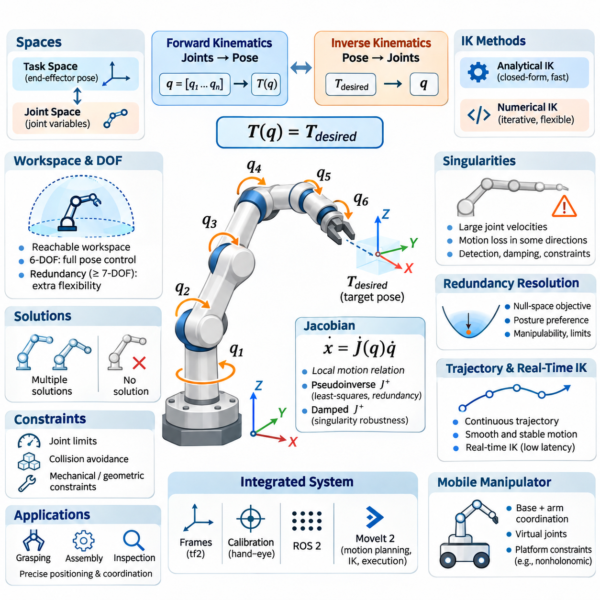
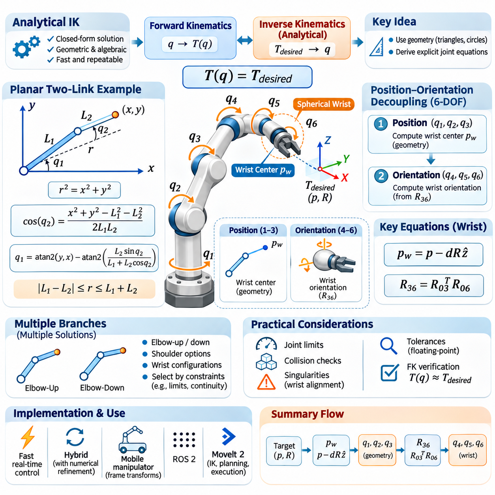
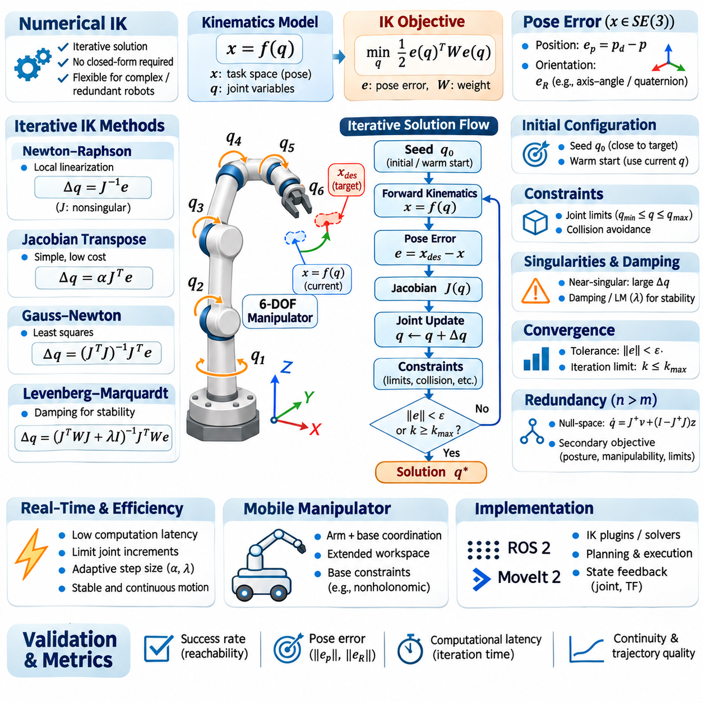
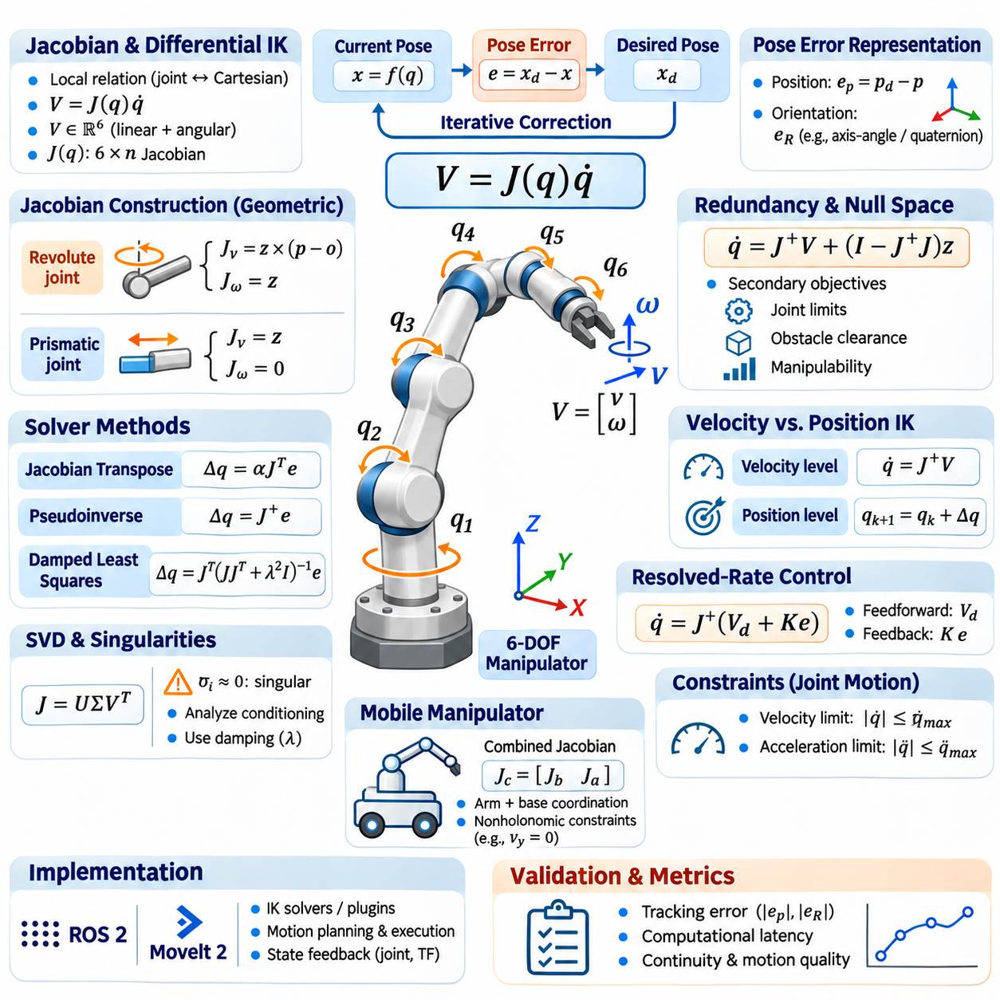
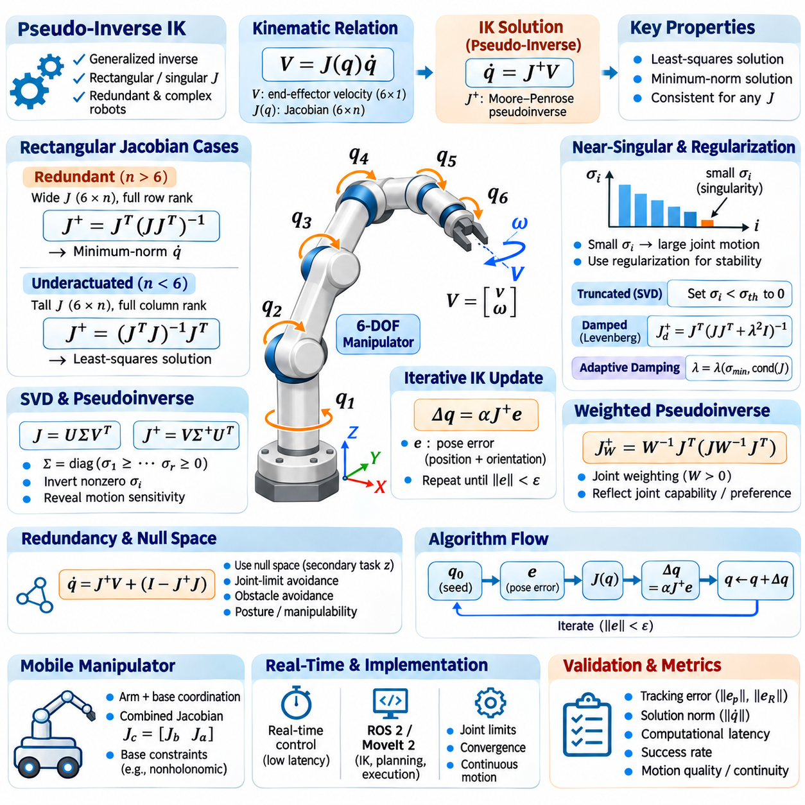
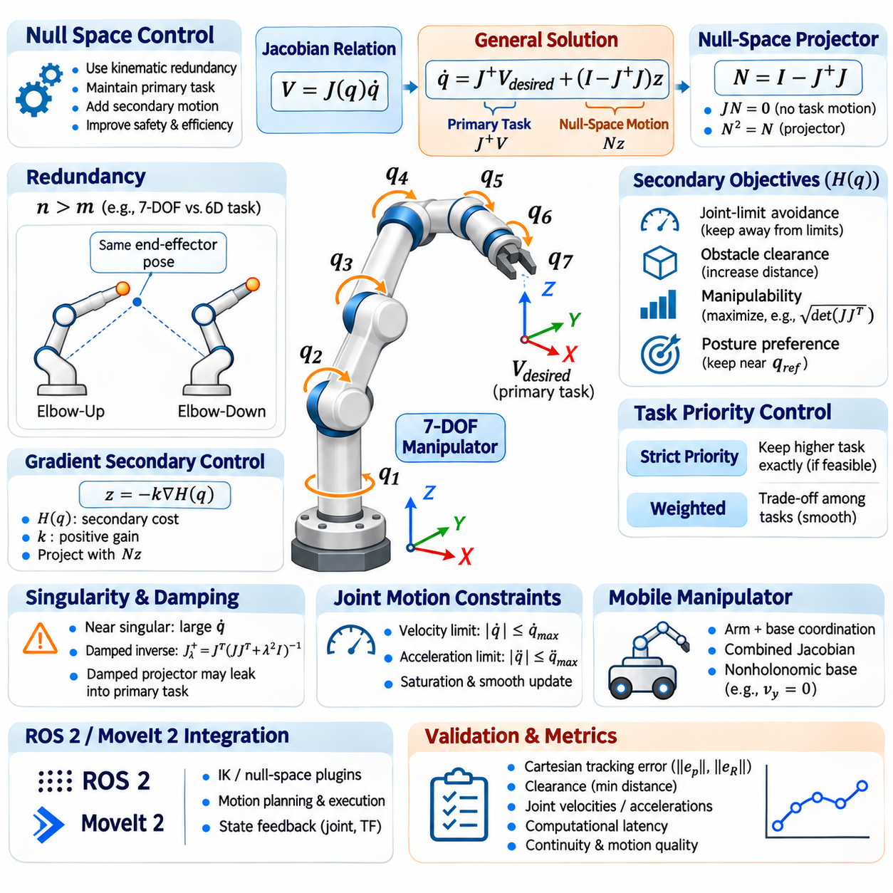
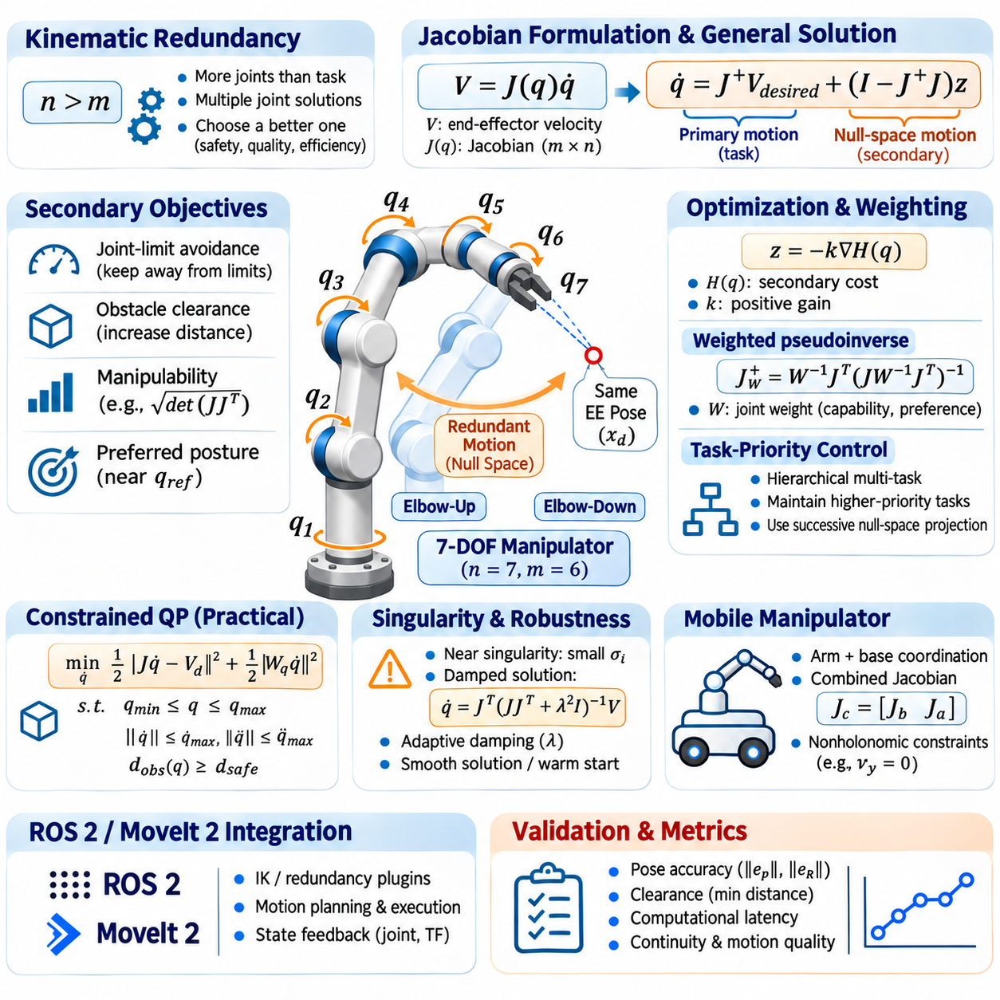
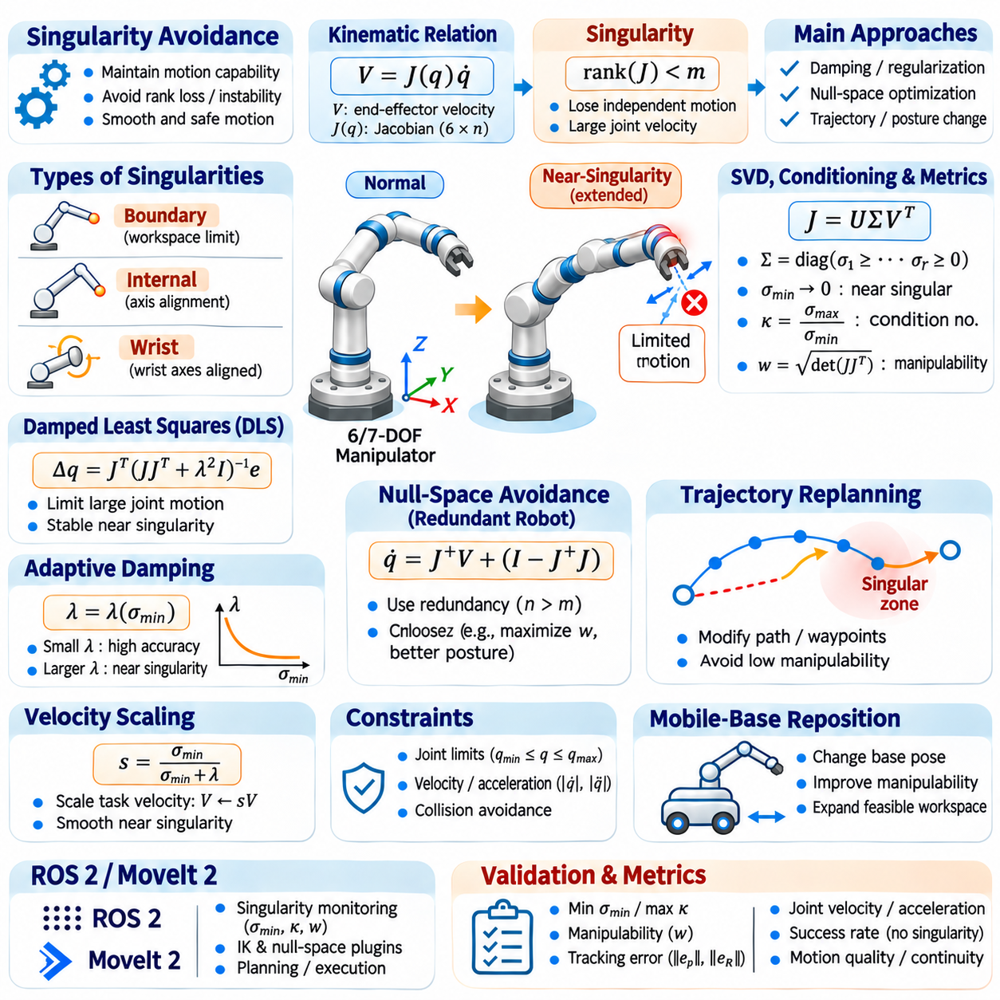
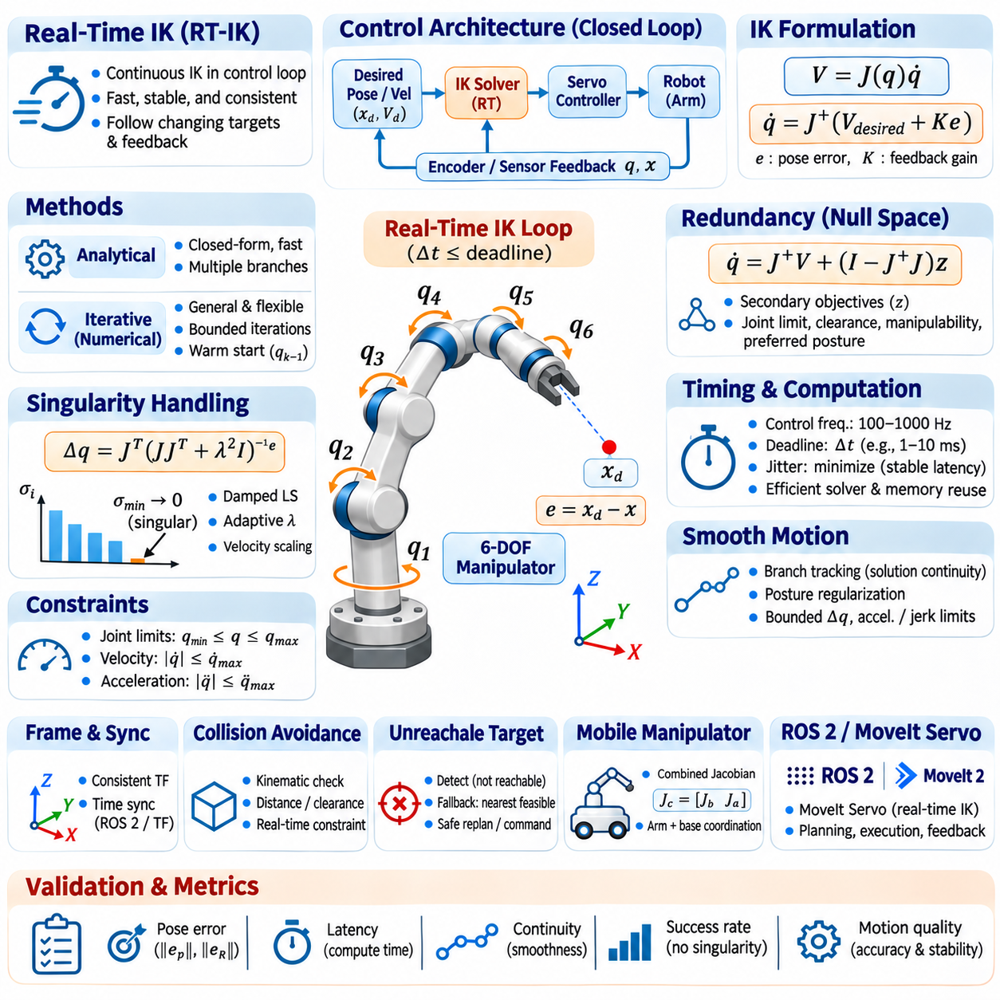
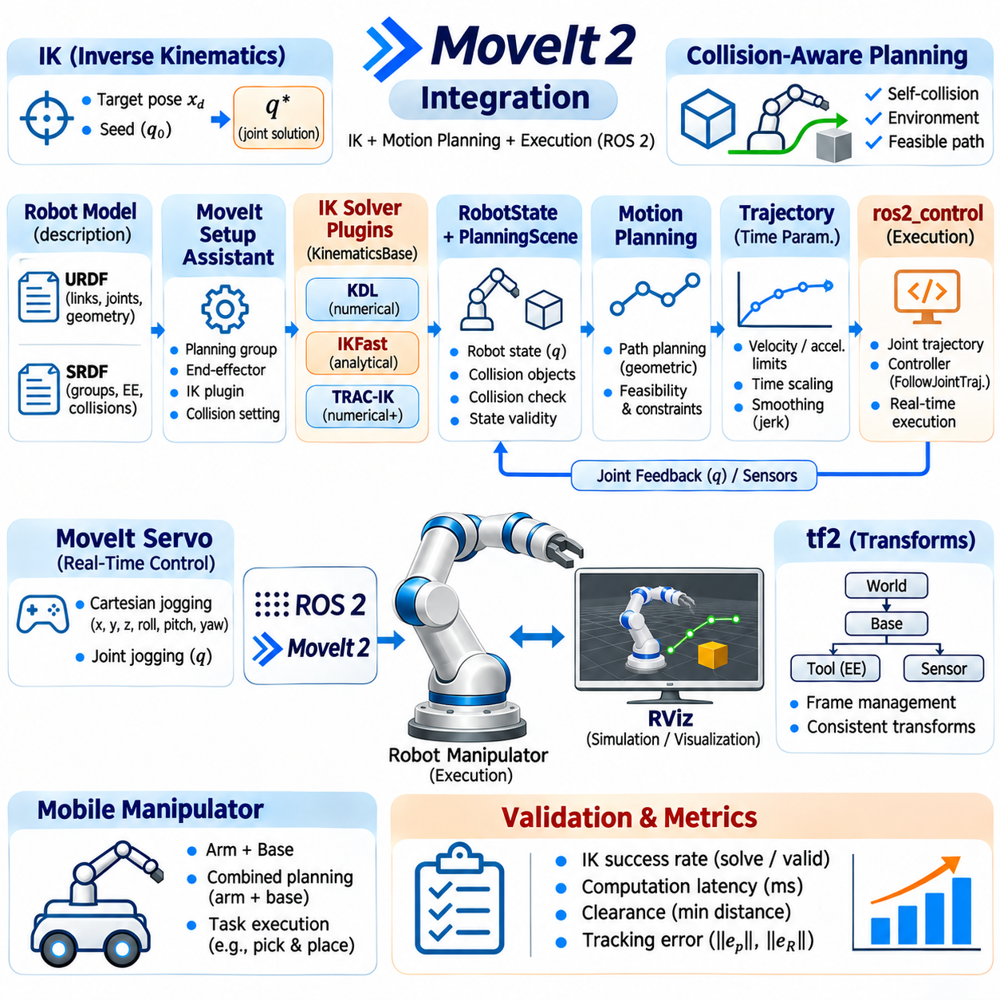

# Chapter 03. Inverse Kinematics

## 01 Inverse Kinematics Overview

{width="7.268055555555556in" height="7.268055555555556in"}

역기구학(Inverse Kinematics)은 로봇공학(Robotics)의 핵심적인 수학적 계산 과정으로, 로봇의 말단효과기(End Effector)를 원하는 목표 위치와 자세에 배치하기 위해 필요한 관절 구성(Joint Configuration)을 결정한다. 관절 변수를 이용하여 말단효과기의 위치와 자세를 계산하는 순기구학(Forward Kinematics)과 달리, 역기구학은 지정된 데카르트 좌표계(Cartesian Coordinate System)의 목표로부터 관절 변수를 역으로 계산한다. 이러한 기능은 로봇 매니퓰레이터(Robotic Manipulator)가 정밀 위치 결정, 물체 파지, 조립 및 복잡한 환경에서의 협조 동작을 수행할 수 있도록 한다.

역기구학 문제(Inverse Kinematics Problem)는 작업공간 좌표(Task-Space Coordinates)와 관절공간 변수(Joint-Space Variables) 사이의 관계를 설정한다. 작업공간(Task Space)은 말단효과기의 위치와 방향을 나타내며, 관절공간(Joint Space)은 개별 관절의 회전각 또는 직선 변위를 나타낸다. 로봇 제어기(Robot Controller)는 기계적 한계, 기하학적 제약조건(Geometric Constraints), 사용 가능한 자유도(Degrees of Freedom)를 고려하면서 원하는 작업공간 명령을 실행 가능한 관절 구성으로 변환해야 한다.

수학적으로 역기구학은 T(q) = T_desired 관계를 만족하는 관절 벡터(Joint Vector) q를 구하는 과정이다. 여기서 T(q)는 순기구학 변환(Forward Kinematics Transformation)을 나타내며, T_desired는 요구되는 말단효과기의 목표 자세(Target Pose)를 정의한다. 여러 회전관절(Revolute Joint) 또는 직동관절(Prismatic Joint)을 가진 매니퓰레이터에서 이러한 관계는 일반적으로 비선형 방정식(Nonlinear Equations)의 형태로 표현된다. 이를 해결하려면 링크 기하학(Link Geometry), 좌표 변환(Coordinate Transformation), 관절 배치 및 수치 정확도를 함께 고려해야 한다.

역기구학의 중요한 특징은 하나의 목표 말단효과기 자세가 반드시 유일한 관절 구성에 대응하지 않는다는 점이다. 일부 목표 자세에는 여러 유효한 해(Solution)가 존재할 수 있으며, 다른 목표 자세에는 물리적으로 실현 가능한 해가 존재하지 않을 수도 있다. 여러 해는 팔꿈치 위치(Elbow Position), 손목 방향(Wrist Orientation), 또는 여유 자유도를 가진 관절 배치에서 발생할 수 있다. 따라서 역기구학은 수학적으로 가능한 해뿐 아니라 실제 로봇 운용에 적합한 관절 구성을 선택해야 한다.

역기구학 해의 존재 여부는 매니퓰레이터의 도달 가능 작업공간(Reachable Workspace)과 기계적 구조에 따라 결정된다. 도달 가능 작업공간 밖에 있는 목표는 어떤 계산 방법을 사용하더라도 달성할 수 없다. 목표 위치에 도달할 수 있더라도 관절 제한이나 자유도 부족으로 인해 요구되는 방향을 구현하지 못할 수 있다. 따라서 도달 가능성 분석(Reachability Analysis)은 성공적인 역기구학 계산을 위한 필수적인 사전 조건을 제공한다.

매니퓰레이터의 자유도(Degrees of Freedom)는 역기구학의 복잡성에 큰 영향을 미친다. 일반적인 6자유도(6-DOF) 산업용 로봇은 적절한 작업공간 영역에서 3차원 위치와 방향을 독립적으로 제어할 수 있다. 자유도가 더 적은 로봇은 임의의 6차원 자세 요구조건을 만족하지 못할 수 있다. 반면 7자유도 이상의 중복 매니퓰레이터(Redundant Manipulator)는 추가적인 유연성을 제공하지만, 무수히 많은 가능한 관절 구성 중 적절한 해를 선택하기 위한 전략이 필요하다.

역기구학 계산 방법은 일반적으로 해석적 방법(Analytical Methods)과 수치적 방법(Numerical Methods)으로 구분된다. 해석적 방법은 기하학적 관계와 대수적 변환을 통해 관절 변수를 유도하며, 수학적 및 수치적 정밀도 범위 내에서 정확한 해를 제공할 수 있다. 수치적 방법은 반복 계산을 통해 현재 말단효과기 자세와 목표 자세 사이의 오차를 줄인다. 매니퓰레이터의 구조에 따라 계산 및 구현 요구사항이 달라지므로 두 방법 모두 중요하다.

해석적 역기구학(Analytical Inverse Kinematics)은 닫힌형 해(Closed-Form Solution)를 구할 수 있는 기하학적 구조를 가진 매니퓰레이터에서 특히 유용하다. 일부 산업용 로봇 구조에서는 손목 중심(Wrist Center)의 위치 계산을 마지막 관절들의 방향 계산과 분리할 수 있다. 이러한 기하학적 특성은 해를 구하는 과정을 단순화하고 여러 관절 구성을 효율적으로 계산하도록 한다. 그러나 일반적인 매니퓰레이터 구조에서는 항상 실용적인 닫힌형 수식을 얻을 수 있는 것은 아니다.

수치적 역기구학(Numerical Inverse Kinematics)은 해석적 해를 구할 수 없거나 유도하기 어려운 경우에 더 높은 유연성을 제공한다. 반복 계산을 수행하는 해법기(Iterative Solver)는 초기 관절 구성에서 시작하여 현재 말단효과기 자세를 평가하고, 자세 오차를 줄이기 위한 관절 조정량을 계산한다. 이러한 과정은 해가 미리 정의된 허용오차(Tolerance)를 만족하거나 종료 조건에 도달할 때까지 계속된다. 수치적 방법은 복잡한 운동학 체인(Kinematic Chain)을 처리할 수 있지만, 수렴성(Convergence)과 계산 효율성을 신중하게 관리해야 한다.

자코비안 행렬(Jacobian Matrix)은 관절 속도와 말단효과기 운동 사이의 국소적 관계를 나타내므로 수치적 역기구학에서 핵심적인 역할을 수행한다. 매니퓰레이터의 미분 관계는 x_dot = J(q)q_dot으로 표현할 수 있으며, 여기서 J(q)는 자코비안 행렬이다. 적절한 역행렬(Inverse Matrix) 또는 일반화 역행렬(Generalized Inverse)을 이용하면 제어기는 원하는 데카르트 좌표계 변위를 구현하기 위해 필요한 관절 운동을 추정할 수 있다.

자코비안 행렬이 특이 상태(Singular Configuration)에 도달하거나 이에 가까워질 때 중요한 문제가 발생한다. 특이점(Singularity) 근처에서는 작은 데카르트 좌표계 운동을 구현하기 위해 매우 큰 관절 속도가 필요할 수 있으며, 특정 운동 방향은 순간적으로 생성하기 어렵거나 불가능해질 수 있다. 이러한 조건은 수치적 불안정성(Numerical Instability), 구동기 포화(Actuator Saturation), 추종 성능 저하를 유발할 수 있다. 따라서 강건한 역기구학 시스템은 특이점 검출, 감쇠(Damping), 운동 제약조건을 포함한다.

자코비안의 의사역행렬(Pseudoinverse)은 자코비안 행렬이 직사각형이거나 직접 역행렬을 계산할 수 없는 경우에 널리 사용된다. 이 기법은 미분 역기구학 문제에 대한 최소제곱 해(Least-Squares Solution)를 제공하며, 특히 중복 매니퓰레이터에서 유용하다. 그러나 감쇠가 적용되지 않은 의사역행렬은 특이점 근처에서 수치 오차를 증폭시킬 수 있다. 감쇠 최소제곱법(Damped Least Squares)은 제한된 추종 오차를 허용하는 대신 과도한 관절 갱신량을 억제하여 강건성을 향상시킨다.

중복 매니퓰레이터는 부가적인 최적화(Secondary Optimization)를 수행할 수 있는 중요한 가능성을 제공한다. 로봇이 주 작업에 필요한 자유도보다 많은 자유도를 보유하면, 일차 근사에서 말단효과기 운동을 변경하지 않으면서 추가적인 관절 운동을 수행할 수 있다. 영공간 제어(Null-Space Control)는 이러한 특성을 활용하여 주요 위치 결정 목표를 유지하면서 관절 한계 회피, 장애물 회피, 자세 최적화(Posture Optimization), 조작성(Manipulability) 향상을 지원한다.

관절 한계(Joint Limits)는 역기구학에서 반드시 고려해야 하는 물리적 제약조건이다. 모든 회전관절과 직동관절은 기계적 구조, 구동기 설계 및 안전 요구사항에 의해 결정되는 허용 변위 범위 내에서 동작한다. 수학적으로 유효한 해라도 이러한 한계를 초과하면 실제 로봇에 적용할 수 없다. 따라서 실용적인 역기구학 알고리즘은 허용 가능한 관절 범위를 평가하고, 로봇의 운용 제약조건을 위반하는 관절 구성을 제거하거나 수정해야 한다.

충돌 회피(Collision Avoidance)는 유효한 말단효과기 자세가 반드시 충돌 없는 로봇 구성을 보장하지 않기 때문에 추가적인 복잡성을 발생시킨다. 서로 다른 역기구학 해는 중간 링크(Intermediate Links)를 상당히 다른 위치에 배치할 수 있다. 해법기 또는 연계된 동작 계획기(Motion Planner)는 로봇 자체, 주변 설비, 작업물 및 인근 작업자와의 잠재적인 충돌을 고려해야 한다. 특히 제한된 산업용 작업공간에서는 적절한 관절 구성 선택이 매우 중요하다.

역기구학은 궤적 계획(Trajectory Planning)과도 밀접하게 연결된다. 개별 목표 자세에 대한 해를 독립적으로 계산하면, 특히 여러 해의 분기(Solution Branch)가 존재하는 경우 관절 구성에서 불연속적인 변화가 발생할 수 있다. 이러한 불연속성은 급격한 운동 명령이나 불필요한 관절 회전을 유발할 수 있다. 따라서 연속적인 궤적 실행을 위해서는 관절 구성의 일관성을 유지하고, 현재 자세에 가까운 해를 선택하며, 관절 속도와 가속도 제약조건을 적용하는 것이 유리하다.

실시간 역기구학(Real-Time Inverse Kinematics)은 로봇 제어기가 엄격한 시간 요구조건에서 동작하므로 예측 가능한 계산 특성을 필요로 한다. 산업용 매니퓰레이터는 높은 주파수로 운동 명령을 갱신할 수 있어 반복 계산에 사용할 수 있는 시간이 제한된다. 효율적인 알고리즘은 수렴 정확도, 계산 비용, 수치적 안정성 및 결정론적 실행(Deterministic Execution) 사이의 균형을 유지해야 한다. 초기해 재사용(Warm Start), 반복 횟수 제한 및 적절한 수렴 허용오차 설정은 실시간 성능을 향상시킬 수 있다.

모바일 매니퓰레이터(Mobile Manipulator)는 로봇 팔이 이동 플랫폼(Mobile Platform)에 장착되어 있으므로 추가적인 역기구학 고려사항이 발생한다. 말단효과기의 자세는 매니퓰레이터 관절뿐 아니라 이동 베이스(Mobile Base)의 위치와 방향에도 영향을 받는다. 특정 베이스 구성에서는 도달할 수 없는 목표도 플랫폼을 재배치하면 접근할 수 있다. 따라서 협조 역기구학(Coordinated Inverse Kinematics)은 베이스 운동과 로봇 팔 관절 운동을 더 큰 운동학 시스템 내에서 상호 연결된 변수로 취급할 수 있다.

실제 모바일 매니퓰레이션(Mobile Manipulation)에서는 전역 기준 좌표계(Global Reference Frame), 이동 베이스 좌표계(Mobile Base Frame), 매니퓰레이터 베이스 좌표계(Manipulator Base Frame), 말단효과기 좌표계(End-Effector Frame) 사이의 관계가 일관되게 유지되어야 한다. 위치 추정 불확실성(Localization Uncertainty), 플랫폼 위치 오차 및 보정 부정확성은 역기구학 결과의 정확도에 직접적인 영향을 미친다. 신뢰성 있는 운용을 위해서는 동기화된 좌표 변환, 정확한 기하학적 모델 및 로봇 센싱과 제어 시스템의 지속적인 피드백이 필요하다.

역기구학의 정확도는 기반이 되는 운동학 모델(Kinematic Model)의 품질에 따라 결정된다. 잘못된 링크 치수, 관절 오프셋(Joint Offset), 관절축 방향 또는 공구 중심점(Tool Center Point, TCP) 정의는 수치 해법기가 성공적으로 수렴하더라도 체계적인 위치 오차를 발생시킬 수 있다. 따라서 이론적 해와 실제 로봇 동작을 일치시키기 위해 보정 절차(Calibration Procedure)와 실험적 측정이 필수적이다. 모델 검증(Model Validation)은 운용 작업공간 전반의 대표적인 관절 구성을 포함해야 한다.

현대 로봇 소프트웨어는 재사용 가능한 라이브러리와 동작 계획 프레임워크(Motion Planning Framework)를 통해 역기구학 기능을 제공한다. ROS 2 환경에서 MoveIt 2는 로봇 기술 모델(Robot Description), 계획 그룹(Planning Group), 충돌 검사 시스템(Collision Checking System)과 통합할 수 있는 설정 가능한 역기구학 해법기를 지원한다. 이러한 도구는 구현 복잡성을 줄이지만, 성공적인 배포를 위해서는 정확한 운동학 모델링, 적절한 해법기 설정 및 체계적인 검증이 여전히 필요하다.

역기구학 방법의 선택은 로봇 구조와 응용 요구사항에 따라 달라진다. 고속 산업용 매니퓰레이션은 효율적인 해석적 해를 선호할 수 있으며, 복잡한 중복 로봇은 수치 최적화(Numerical Optimization)를 통해 더 큰 이점을 얻을 수 있다. 장애물 회피, 인간과의 상호작용 또는 제한된 작업공간을 포함하는 작업에서는 추가적인 최적화 목표가 필요할 수 있다. 모든 매니퓰레이터 구조와 운용 조건에서 최적의 성능을 제공하는 단일 알고리즘은 존재하지 않는다.

궁극적으로 역기구학은 원하는 로봇 동작과 실행 가능한 관절 운동을 연결하는 수학적 가교 역할을 수행한다. 역기구학의 효과적인 구현은 기하학적 추론(Geometric Reasoning), 수치 계산(Numerical Computation), 제약조건 처리(Constraint Handling), 피드백 제어(Feedback Control)를 일관된 공학적 체계로 결합하는 데 달려 있다. 이러한 기초에 대한 이해는 고급 매니퓰레이션 시스템에서 해석적 방법, 자코비안 기반 해법기, 의사역행렬 기법, 중복성 해결(Redundancy Resolution), 특이점 회피(Singularity Avoidance) 및 실시간 통합 기술을 개발하기 위한 기반을 제공한다.

## 02 Analytical Methods

{width="7.268055555555556in" height="7.268055555555556in"}

해석적 역기구학(Analytical Inverse Kinematics)은 명시적인 기하학적 관계(Geometric Relationships)와 대수 방정식(Algebraic Equations)을 통해 로봇의 관절 변수(Joint Variables)를 결정하는 수학적 접근 방법이다. 해를 점진적으로 근사하는 수치적 기법(Numerical Techniques)과 달리, 해석적 방법(Analytical Methods)은 원하는 말단효과기 자세(End-Effector Pose)로부터 관절 구성을 직접 유도한다. 매니퓰레이터(Manipulator)가 적절한 기하학적 특성을 갖는 경우, 이러한 방법은 산업용 로봇의 동작을 위해 계산 효율성이 높고 반복성이 우수한 해를 제공한다.

해석적 역기구학의 기초는 로봇의 운동학 체인(Kinematic Chain)이 가지는 수학적 구조에 있다. 각 관절은 인접한 링크 사이의 상대적인 위치와 방향을 나타내는 변환(Transformation)에 기여한다. 이러한 변환을 결합하면 순기구학(Forward Kinematics)은 말단효과기의 자세를 관절 변수의 함수로 표현한다. 해석적 역변환(Analytical Inversion)은 이러한 관계를 재정리하여 알려지지 않은 관절 좌표(Joint Coordinates)에 대한 명시적인 수식을 도출한다.

닫힌형 해(Closed-Form Solution)는 사칙연산, 삼각함수(Trigonometric Functions), 역삼각함수(Inverse Trigonometric Functions)를 포함한 유한한 수학적 연산의 조합으로 관절 변수를 표현한다. 이러한 해는 반복적인 수렴 절차(Iterative Convergence Procedure)를 사용하지 않으므로 일반적으로 예측 가능한 계산 실행 특성을 제공한다. 그러나 모든 매니퓰레이터에서 실용적인 닫힌형 해를 구할 수 있는 것은 아니며, 특히 복잡한 관절 배치가 강하게 결합된 비선형 방정식(Nonlinear Equations)을 형성하는 경우에는 더욱 어렵다.

기하학적 역기구학(Geometric Inverse Kinematics)은 링크 배치를 삼각형, 원 및 교차하는 회전축으로 표현할 수 있는 매니퓰레이터에서 특히 효과적이다. 관절과 목표 위치 사이의 공간적 관계를 분석하면 기본적인 기하학 원리를 이용하여 관절 각도를 유도할 수 있다. 코사인 법칙(Law of Cosines), 사인 법칙(Law of Sines), 삼각함수 항등식(Trigonometric Identities)은 이러한 수학적 유도의 기초로 자주 사용된다.

평면 2링크 매니퓰레이터(Planar Two-Link Manipulator)는 해석적 역기구학의 기본적인 예를 제공한다. 링크 길이 L1과 L2, 목표 위치 (x, y)가 주어지면 베이스에서 목표까지의 거리는 r² = x² + y²로 결정된다. 팔꿈치 관절 각도(Elbow Joint Angle)는 cos(q2) = (x² + y² - L1² - L2²)/(2L1L2)를 만족한다. 이 방정식은 목표 위치와 두 링크의 상대적인 방향 사이에 존재하는 기하학적 관계를 정의한다.

팔꿈치 관절 각도를 결정한 후에는 q1 = atan2(y, x) - atan2(L2 sin(q2), L1 + L2 cos(q2))를 이용하여 어깨 관절 각도(Shoulder Joint Angle)를 계산할 수 있다. atan2 함수는 사분면 정보(Quadrant Information)를 유지하므로 단순한 역탄젠트(Inverse Tangent)보다 각도 계산의 일관성을 향상시킨다. 목표 위치에 따라 일반적으로 팔꿈치 위쪽 구성(Elbow-Up Configuration)과 팔꿈치 아래쪽 구성(Elbow-Down Configuration)으로 구분되는 두 개의 서로 다른 관절 구성이 존재할 수 있다.

유효한 2링크 해의 존재 여부는 목표 거리 r이 \|L1 - L2\| ≤ r ≤ L1 + L2 조건을 만족하는지에 따라 결정된다. 이 조건을 위반하면 목표는 도달 가능 작업공간(Reachable Workspace) 밖에 위치한다. 또한 수치 반올림(Numerical Rounding)으로 인해 코사인 값이 -1에서 1 사이의 범위를 미세하게 벗어날 수 있다. 강건한 구현(Robust Implementation)에서는 역삼각함수를 적용하기 전에 실제로 도달할 수 없는 목표와 작은 부동소수점 오차(Floating-Point Errors)를 구분해야 한다.

3차원 매니퓰레이터(Three-Dimensional Manipulator)는 추가적인 회전축과 공간적 제약조건(Spatial Constraints)을 도입하여 기하학적 추론을 확장한다. 많은 산업용 로봇 구조에서 첫 번째 관절은 로봇 팔의 수평 방향을 제어하고, 이후 관절들은 손목 중심(Wrist Center)의 반경 방향 및 수직 위치를 결정한다. 이러한 배치는 원래의 공간 문제를 평면 삼각형과 각도 관계를 이용하는 더 단순한 기하학적 하위 문제(Geometric Subproblems)로 분해할 수 있도록 한다.

특히 중요한 해석적 기법은 손목 중심의 위치 결정과 손목 방향 계산을 분리하는 위치-자세 분리(Position-Orientation Decoupling)이다. 이 방법은 마지막 세 회전관절 축이 하나의 공통점에서 교차하는 특정 6자유도 매니퓰레이터에 적용할 수 있다. 이러한 기하학적 조건에서는 처음 세 관절이 손목 중심의 위치를 결정하고, 나머지 관절들이 공구의 방향(Tool Orientation)을 설정할 수 있다.

구형 손목(Spherical Wrist)을 가진 매니퓰레이터에서는 원하는 말단효과기 변환(End-Effector Transformation)으로부터 손목 중심 위치를 계산할 수 있다. p가 원하는 공구 위치를 나타내고, R이 방향 행렬(Orientation Matrix)을 나타내며, d가 공구의 국소 z축을 따라 정의된 손목에서 공구까지의 오프셋(Offset)을 의미하면 손목 중심은 p_w = p - dR[0, 0, 1]ᵀ로 표현된다. 보다 일반적인 공구 오프셋은 해당 오프셋 벡터에 전체 회전 행렬(Rotation Matrix)을 적용해야 한다.

손목 중심 위치가 결정되면 처음 세 관절 변수는 기하학적 구성을 통해 계산할 수 있는 경우가 많다. 베이스 회전(Base Rotation)은 매니퓰레이터를 목표의 수평 방향에 정렬하며, 어깨와 팔꿈치 관절은 필요한 반경 거리와 높이를 설정한다. 링크 길이(Link Lengths)와 오프셋은 정확한 삼각함수 관계를 결정하므로 신뢰성 있는 해석적 해를 얻기 위해서는 정확한 기계적 매개변수(Mechanical Parameters)가 필수적이다.

손목의 방향은 처음 세 관절이 생성하는 변환을 계산한 후 결정된다. R_06이 원하는 말단효과기 방향을 나타내고 R_03이 위치 결정 관절(Positioning Joints)에 의해 생성된 방향을 나타내면, 나머지 손목 회전은 R_36 = R_03ᵀR_06으로 표현된다. 이 행렬에는 손목의 회전축 배치(Rotational-Axis Arrangement)에 따라 마지막 세 관절 각도를 계산하는 데 필요한 방향 정보가 포함된다.

회전 행렬에서 손목 관절 각도를 추출하려면 삼각함수 관계와 각도 모호성(Angular Ambiguities)을 신중하게 처리해야 한다. 서로 다른 손목 관절 각도 조합이 동일한 방향을 생성할 수 있으므로 여러 유효한 해가 존재할 수 있다. 또한 특정 관절 구성에서는 손목 특이점(Wrist Singularity)이 발생할 수 있으며, 이 경우 방향 행렬만으로 개별 관절 각도를 유일하게 결정할 수 없게 된다.

해석적 역기구학은 하나의 목표 자세에 대해 여러 해의 분기(Solution Branches)를 생성하는 경우가 많다. 6축 산업용 매니퓰레이터(Six-Axis Industrial Manipulator)는 어깨, 팔꿈치 및 손목의 대체 구성을 가질 수 있으며, 일부 일반적인 기하학적 구조에서는 특이점을 벗어난 영역에서 최대 8개의 이산적인 해(Discrete Solutions)가 존재할 수 있다. 실제 해의 개수는 로봇 구조, 관절 한계, 기하학적 퇴화(Geometric Degeneracies), 목표 도달 가능성에 따라 달라진다. 각 후보 해는 실행 전에 평가되어야 한다.

해의 분기 선택(Solution Branch Selection)은 수학적으로 동일한 말단효과기 자세라도 상당히 다른 관절 운동이 필요할 수 있으므로 중요한 실무적 고려사항이다. 제어기는 불필요한 움직임을 줄이기 위해 현재 관절 상태(Current Joint State)에 가장 가까운 구성을 선호할 수 있다. 추가적인 평가 기준에는 관절 한계 여유도(Joint-Limit Margins), 충돌 위험(Collision Risk), 구동기 부하(Actuator Loading), 케이블 배선 제약조건(Cable Routing Constraints), 이전에 실행된 궤적과의 연속성(Trajectory Continuity)이 포함될 수 있다.

대수적 해석 방법(Algebraic Analytical Methods)은 직접적인 기하학적 구성이 충분하지 않을 때 대안적인 접근법을 제공한다. 이러한 기법은 기호적 치환(Symbolic Substitution), 삼각함수 항등식, 다항식 소거(Polynomial Elimination)를 이용하여 순기구학 방정식을 변형한다. 결합된 비선형 방정식을 다항식 표현(Polynomial Expressions)으로 변환하면 해법기는 가능한 관절 구성에 대응하는 후보 근(Candidate Roots)을 식별할 수 있다. 이후 실수해(Real Solutions)를 복원하고 검증해야 한다.

기호적 소거(Symbolic Elimination)의 복잡성은 매니퓰레이터의 기하학적 구조에 따라 크게 증가한다. 일반적인 6회전관절 매니퓰레이터(Six-Revolute-Joint Manipulator)는 고차 다항식(High-Degree Polynomial) 형태를 필요로 할 수 있으며, 그 해가 반드시 단순한 초등함수(Elementary Functions)로 표현되는 것은 아니다. 특수한 대수적 기법을 이용하면 일부 일반적인 로봇 구조에서 모든 고립해(Isolated Solutions)를 계산할 수 있지만, 이러한 접근법은 기하학적으로 구조화된 로봇에서 사용할 수 있는 간결한 수식보다 계산 비용이 상당히 클 수 있다.

데나비트-하텐버그 규약(Denavit-Hartenberg Convention)은 링크 길이, 링크 비틀림(Link Twist), 관절 오프셋 및 관절 각도를 통해 매니퓰레이터의 기하학적 구조를 표현하는 체계적인 프레임워크를 제공한다. 해석적 유도(Analytical Derivation)에서는 이러한 매개변수를 이용하여 변환 행렬을 구성하고 대수적 단순화에 적합한 관계를 식별할 수 있다. 그러나 표준화된 운동학 표현(Kinematic Representation)이 존재한다고 해서 반드시 단순한 해석적 역기구학 해를 얻을 수 있는 것은 아니다.

특이 구성(Singular Configurations)은 일반적인 수식에서 0으로 나누기(Division by Zero) 또는 정의되지 않은 각도 관계가 발생할 수 있으므로 특별한 처리가 필요하다. 예를 들어 로봇 팔이 완전히 펼쳐진 상태에서는 서로 다른 팔꿈치 구성이 하나로 합쳐질 수 있으며, 손목 특이점에서는 두 손목 관절 각도를 독립적으로 결정할 수 없게 될 수 있다. 신뢰성 있는 구현에서는 이러한 조건을 명시적으로 식별하고 적절한 대체 매개변수화(Alternative Parameterizations) 또는 연속성 규칙(Continuity Rules)을 적용한다.

해석적 수식이 수학적으로 정확하더라도 수치 정밀도(Numerical Precision)는 여전히 중요하다. 부동소수점 연산(Floating-Point Arithmetic)은 삼각함수 계산, 행렬 연산 및 기하학적 비교 과정에서 작은 오차를 발생시킨다. 특히 특이 조건에 가까운 값은 반올림 오차(Rounding Errors)에 민감할 수 있다. 따라서 실용적인 해법기는 수치 허용오차(Numerical Tolerances)를 적용하고, 필요한 경우 회전 행렬을 정규화(Normalization)하며, 순기구학을 통해 계산된 해를 검증한다.

순기구학 검증(Forward Kinematics Verification)은 해석적 역기구학 결과를 평가하는 직접적인 방법을 제공한다. 각 후보 관절 구성을 로봇의 순기구학 모델에 대입하여 결과적인 말단효과기 자세를 재구성한다. 재구성된 위치와 방향은 정의된 오차 지표(Error Metrics)를 이용하여 요청된 목표와 비교한다. 허용오차를 초과하는 후보는 동작 계획(Motion Planning) 또는 제어기 실행(Controller Execution) 이전에 제거된다.

해석적 역기구학은 명시적인 수식이 일반적으로 제한적이고 비교적 작은 계산량을 필요로 하므로 실시간 로봇 시스템(Real-Time Robotic Systems)에서 특히 유용하다. 예측 가능한 실행 특성은 고주파 궤적 생성(High-Frequency Trajectory Generation), 반복적인 자세 계산 및 산업 자동화 작업을 지원한다. 그러나 계산 효율성만으로 안전한 운용이 보장되는 것은 아니며, 충돌 검사(Collision Checking), 관절 제약조건 및 궤적 실행 가능성(Trajectory Feasibility)은 별도로 평가해야 한다.

모바일 매니퓰레이터(Mobile Manipulator)에서는 원하는 목표 자세를 로봇 팔의 베이스 좌표계(Arm Base Coordinate Frame)로 표현한 후 해석적 역기구학을 적용할 수 있다. 이동 플랫폼(Mobile Platform)의 추정 위치와 방향은 전역 좌표계(Global Coordinates)와 매니퓰레이터 베이스 사이의 변환을 결정한다. 플랫폼이 이동하면 이러한 변환도 달라지므로 로봇 팔의 목표 자세와 이에 대응하는 관절 해를 일관되게 갱신해야 한다.

해석적 방법은 하이브리드 역기구학 구조(Hybrid Inverse Kinematics Architecture)도 지원한다. 닫힌형 해법기(Closed-Form Solver)는 후보 관절 구성을 빠르게 생성할 수 있으며, 수치 최적화(Numerical Optimization) 또는 동작 계획은 추가적인 제약조건에 따라 해의 선택을 개선할 수 있다. 이러한 조합은 해석적 해의 계산상 장점을 유지하면서 장애물 회피, 관절 한계 최적화(Joint-Limit Optimization), 작업별 자세 선호도(Task-Specific Posture Preferences)와 같은 실제 요구사항을 수용한다.

산업 현장 배포(Industrial Deployment)를 위해서는 매니퓰레이터의 전체 운용 작업공간(Operational Workspace)에 걸쳐 해석적 해법기를 검증해야 한다. 시험에는 작업공간 경계(Workspace Boundaries), 특이 구성, 여러 해의 분기, 관절 한계 조건 및 대표적인 공구 방향이 포함되어야 한다. ROS 2 및 MoveIt 2와의 통합은 해석적 역기구학을 로봇 기술 모델(Robot Descriptions), 충돌 검사 및 궤적 계획(Trajectory Planning)과 연결하기 위한 체계적인 환경을 제공할 수 있다.

해석적 역기구학은 데카르트 좌표계 운동 요구사항(Cartesian Motion Requirements)을 실행 가능한 로봇 관절 구성으로 변환하는 핵심적인 기술이다. 그 효과는 매니퓰레이터의 기하학적 구조를 이해하고, 수학적으로 유효한 해를 유도하며, 여러 관절 구성을 처리하고, 물리적 실행 가능성(Physical Feasibility)을 검증하는 데 달려 있다. 이러한 원리는 신뢰성 있는 산업용 로봇 제어의 기반을 제공하며, 수치적 역기구학(Numerical Inverse Kinematics)과 최적화 기반 역기구학(Optimization-Based Inverse Kinematics)의 성능을 평가하기 위한 비교 기준을 확립한다.

## 03 Numerical Methods

{width="7.268055555555556in" height="7.268055555555556in"}

수치적 역기구학(Numerical Inverse Kinematics)은 직접적인 해석적 해(Analytical Solution)를 구할 수 없거나 실용적이지 않은 경우 로봇의 관절 구성(Joint Configuration)을 결정하기 위한 계산 프레임워크(Computational Framework)를 제공한다. 수치적 방법(Numerical Methods)은 모든 관절 변수에 대한 명시적인 수식을 유도하는 대신, 관절 좌표를 반복적으로 조정하여 현재 말단효과기 자세(End-Effector Pose)와 원하는 목표 사이의 차이를 줄인다. 이러한 유연성으로 인해 수치적 기법은 복잡한 매니퓰레이터(Manipulator), 중복 로봇 팔(Redundant Robotic Arm), 모바일 매니퓰레이션 시스템(Mobile Manipulation System)에서 특히 유용하다.

수치적 역기구학 문제(Numerical Inverse Kinematics Problem)는 관절공간(Joint Space)과 작업공간(Task Space) 사이의 비선형 매핑(Nonlinear Mapping)에서 시작된다. 순기구학(Forward Kinematics)은 말단효과기 자세를 x = f(q)로 정의하며, 여기서 q는 관절 벡터(Joint Vector)를 나타내고 x는 작업공간 구성(Task-Space Configuration)을 나타낸다. 목표는 f(q)와 원하는 자세 x_d 사이의 차이를 최소화하는 관절 벡터 q를 찾는 것이다. 이러한 관계는 일반적으로 비선형이므로 반복 최적화(Iterative Optimization)가 실용적인 해결 전략을 제공한다.

수치 해법기(Numerical Solver)는 일반적으로 초기 추정값(Initial Guess) 또는 시드 구성(Seed Configuration)이라고 하는 초기 관절 구성에서 시작한다. 순기구학 모델(Forward Kinematics Model)은 해당 말단효과기 자세를 계산하고 이를 목표 자세와 비교한다. 그 결과로 얻어진 자세 오차(Pose Error)는 다음 관절 변수 조정량을 결정한다. 알고리즘이 사용 가능한 작업공간과 제약조건 내에서 수렴한다면 반복적인 갱신을 통해 추정된 관절 구성은 점진적으로 해에 가까워진다.

초기 구성(Initial Configuration)은 수치적 역기구학의 성능에 큰 영향을 미친다. 원하는 해에 가까운 시드(Seed)는 반복 횟수를 줄이고 수렴 신뢰성(Convergence Reliability)을 향상시키는 경우가 많다. 반대로 부적절한 초기 구성은 느린 수렴, 바람직하지 않은 해로의 수렴 또는 특이점(Singularity) 근처에서의 실패를 유발할 수 있다. 실제 시스템에서는 동작 연속성(Motion Continuity)을 유지하기 위해 현재 측정된 관절 상태(Current Measured Joint State)를 초기 추정값으로 사용하는 경우가 많다.

자세 오차 표현(Pose Error Representation)은 로봇 작업이 위치(Position)와 방향(Orientation)을 모두 포함하므로 필수적이다. 위치 오차(Position Error)는 원하는 데카르트 좌표(Cartesian Coordinates)와 현재 좌표 사이의 차이로 계산할 수 있다. 방향 오차(Orientation Error)는 3차원 회전 기하학(Three-Dimensional Rotational Geometry)을 적절하게 반영하는 표현이 필요하다. 회전 행렬(Rotation Matrix), 축-각 표현(Axis-Angle Representation), 단위 쿼터니언(Unit Quaternion)은 불필요한 매개변수화 모호성(Parameterization Ambiguity)을 발생시키지 않으면서 적절한 방향 잔차(Orientation Residual)를 구성하는 데 일반적으로 사용된다.

일반적인 수치적 정식화(Numerical Formulation)는 위치 오차와 방향 오차를 기반으로 가중 목적함수(Weighted Objective Function)를 정의한다. 목적함수는 E(q) = 0.5 e(q)ᵀW e(q)로 표현할 수 있으며, 여기서 e(q)는 작업공간 오차 벡터(Task-Space Error Vector)를 나타내고 W는 양의 준정부호 가중 행렬(Positive Semidefinite Weighting Matrix)이다. 적절한 가중치는 병진 정확도(Translational Accuracy)와 회전 정확도(Rotational Accuracy)의 균형을 유지하면서 서로 다른 물리적 단위를 고려한다. 해법기는 이러한 목적함수를 감소시키는 관절 변수를 탐색한다.

뉴턴 기반 방법(Newton-Based Methods)은 국소 미분값(Local Derivatives)을 이용하여 관절 좌표 변화가 작업공간 오차에 미치는 영향을 추정한다. 현재 구성 주변에서 운동학 매핑(Kinematic Mapping)을 선형화(Linearization)하면 비선형 문제의 국소 근사(Local Approximation)를 얻을 수 있다. 그 결과로 생성되는 갱신 방정식(Update Equation)은 자코비안 행렬(Jacobian Matrix)을 통해 원하는 데카르트 좌표 보정량(Cartesian Correction)을 관절 변위(Joint Displacement)와 연결한다. 이러한 절차를 반복하면 추정된 관절 구성이 점진적으로 개선된다.

뉴턴-랩슨 방법(Newton-Raphson Method)은 비선형 방정식을 해결하기 위한 고전적인 반복 접근법(Classical Iterative Approach)이다. 역기구학에서는 순기구학 관계의 국소 선형 근사(Local Linear Approximation)를 이용하여 현재 추정값을 갱신한다. 관련 자코비안이 정방행렬(Square Matrix)이고 비특이(Non-Singular)인 경우, 일반적인 갱신식은 q_next = q_current + J(q_current)⁻¹e로 표현된다. 이 식은 자세 오차가 자코비안 및 선택된 좌표 표현과 일관되게 정의되어 있다고 가정한다.

뉴턴-랩슨 방법의 수렴 특성(Convergence Behavior)은 초기 추정값과 운동학 방정식의 국소적 특성에 따라 달라진다. 유효한 해 근처에서 자코비안이 비특이 상태라면 빠른 수렴이 가능하다. 그러나 큰 초기 오차, 특이 구성(Singular Configuration), 또는 조건수가 나쁜 자코비안(Poorly Conditioned Jacobian)은 불안정한 갱신을 유발할 수 있다. 따라서 실제 구현에서는 과도하거나 물리적으로 비현실적인 움직임을 방지하기 위해 관절 증분(Joint Increment)을 제한하고 수렴 상태를 감시한다.

자코비안 전치 방법(Jacobian Transpose Method)은 자코비안의 역행렬을 명시적으로 계산하지 않는 대안적인 접근법을 제공한다. 일반적인 갱신식은 Δq = αJᵀe로 표현되며, 여기서 α는 양의 스텝 크기 매개변수(Positive Step-Size Parameter)이다. 작업공간 오차가 적절하게 정의된 경우 이 방향은 국소 자세 오차 목적함수를 감소시키는 기울기 기반 방향(Gradient-Based Direction)에 해당한다. 계산은 비교적 단순하지만 매니퓰레이터의 방향별 민감도(Directional Sensitivity)에 큰 차이가 있으면 수렴 속도가 느려질 수 있다.

경사하강법(Gradient Descent Methods)은 역기구학을 관절 변수에 대한 최적화 문제(Optimization Problem)로 정식화한다. 알고리즘은 미분 가능한 오차 함수(Differentiable Error Function)의 기울기를 평가하고 오차가 감소하는 방향으로 관절 구성을 갱신한다. 스텝 크기 선택(Step-Size Selection)은 매우 중요한데, 지나치게 큰 갱신은 진동(Oscillation)이나 발산(Divergence)을 유발할 수 있고 너무 작은 갱신은 계산 시간을 증가시키기 때문이다. 적응형 스텝 크기 전략(Adaptive Step-Size Strategy)은 실제 수렴 성능을 개선할 수 있다.

가우스-뉴턴 방법(Gauss-Newton Method)은 비선형 최소제곱 문제(Nonlinear Least-Squares Problem)로 표현되는 역기구학 목적함수에 특히 적합하다. 잔차(Residual)의 1차 미분값을 이용하여 목적함수의 곡률(Curvature)을 근사하므로 전체 2차 헤시안 행렬(Hessian Matrix)을 계산하지 않고도 관절 갱신량을 구할 수 있다. 이러한 접근법은 잔차가 작고 국소 자코비안이 작업공간의 기하학적 특성에 대한 충분한 정보를 제공할 때 효율적으로 수렴할 수 있다.

레벤버그-마쿼트 방법(Levenberg-Marquardt Method)은 가우스-뉴턴 최적화(Gauss-Newton Optimization)와 감쇠된 기울기 기반 갱신(Damped Gradient-Based Update)의 특성을 결합한다. 대표적인 관절 보정식은 Δq = (JᵀWJ + λI)⁻¹JᵀWe이며, 여기서 λ는 양의 감쇠 매개변수(Damping Parameter)이다. 감쇠는 수치적 조건(Numerical Conditioning)을 개선하고 특이 구성 근처에서 지나치게 큰 갱신을 제한한다. 감쇠값은 오차 감소, 수렴 특성 또는 국소 조작성(Local Manipulability)에 따라 조정할 수 있다.

감쇠 최소제곱법(Damped Least-Squares Method)은 추종 정확도(Tracking Accuracy)와 수치적 강건성(Numerical Robustness) 사이에서 실용적인 절충안을 제공하므로 널리 사용된다. 매니퓰레이터가 특이점에 접근하면 감쇠항(Damping Term)은 관절 속도 또는 위치 증분이 과도하게 증폭되는 현상을 줄인다. 그러나 감쇠가 지나치면 수렴 속도가 느려지고 잔여 추종 오차(Residual Tracking Error)가 증가한다. 따라서 적절한 감쇠 매개변수를 선택하는 것은 수치적 역기구학 구현의 중요한 요소이다.

수치적 역기구학은 관절 수와 작업공간 제약조건의 수가 서로 다른 매니퓰레이터도 처리해야 한다. 중복 매니퓰레이터(Redundant Manipulator)에서는 여러 관절 갱신량이 동일한 1차 근사 데카르트 좌표 보정(First-Order Cartesian Correction)을 생성할 수 있다. 구동 자유도가 부족한 매니퓰레이터(Underactuated Manipulator)에서는 일부 원하는 작업공간 운동이 불가능할 수 있다. 최소제곱 정식화(Least-Squares Formulation)와 일반화 역행렬 기법(Generalized Inverse Techniques)은 이러한 조건에서 근사해를 구하기 위한 체계적인 접근법을 제공한다.

관절 제약조건(Joint Constraints)은 경계값(Bounds), 페널티(Penalties), 또는 제약 최적화 알고리즘(Constrained Optimization Algorithms)을 통해 수치 최적화에 포함할 수 있다. 관절 위치 한계(Joint Position Limits)는 실행 가능한 관절 구성을 제한하며, 속도와 가속도 한계는 동작 실행 중 연속적인 갱신을 제약한다. 추가적인 제약조건에는 자기 충돌(Self-Collision), 환경 장애물(Environmental Obstacles), 선호 관절 자세(Preferred Joint Postures)가 포함될 수 있다. 이러한 요구사항은 기본 역기구학을 보다 포괄적인 제약 최적화 문제로 확장한다.

순차 이차 계획법(Sequential Quadratic Programming)과 관련 제약 최적화 기법은 등식 제약조건(Equality Constraints) 및 부등식 제약조건(Inequality Constraints)과 함께 비선형 목적함수를 처리할 수 있다. 각 반복 단계에서 해법기는 최적화 문제의 국소 근사를 구성하고 실행 가능하거나 제약조건을 고려한 갱신량을 계산한다. 이러한 방법은 정밀한 작업공간 위치 결정과 관절 제한 및 충돌 회피 요구사항을 동시에 만족해야 할 때 유용하지만 계산 비용이 증가할 수 있다.

수치적 특이점 처리(Numerical Singularity Handling)는 특정 구성에서 자코비안의 계수(Rank)가 감소하거나 조건수가 나빠질 수 있으므로 필수적이다. 특이값 분해(Singular Value Decomposition, SVD)는 자코비안의 방향별 민감도와 수치적 계수(Numerical Rank)에 대한 정보를 제공한다. 작은 특이값(Singular Values)은 데카르트 좌표 운동을 구현하기 위해 불균형적으로 큰 관절 변화가 필요한 방향을 나타낸다. 감쇠, 스텝 크기 감소 및 특이점 인식 최적화(Singularity-Aware Optimization)는 이러한 영역에서 안정성을 향상시킬 수 있다.

수렴 기준(Convergence Criteria)은 반복 해법기가 언제 종료되어야 하는지를 결정한다. 일반적인 조건에는 위치 오차 허용범위(Position-Error Tolerance), 방향 오차 허용범위(Orientation-Error Tolerance), 최대 반복 횟수(Maximum Iteration Count), 연속 갱신 사이의 최소 개선량(Minimum Improvement)이 포함된다. 관절 제약조건으로 인해 더 이상 진행할 수 없는 경우에도 해법기가 종료될 수 있다. 성공적인 수렴과 정체(Stagnation) 또는 실행 불가능성(Infeasibility)을 구분하는 것은 상위 로봇 계획 시스템과의 신뢰성 있는 통합에 중요하다.

수치적 안정성(Numerical Stability)은 일관된 좌표계 규약(Coordinate Conventions), 정확한 자코비안 계산 및 적절한 잔차 스케일링(Residual Scaling)에 따라 달라진다. 위치 오차와 방향 오차는 서로 다른 물리적 단위를 가지며 수치적 크기도 다를 수 있다. 부적절한 스케일링은 해법기가 특정 오차 성분을 지나치게 우선시하도록 만들 수 있다. 가중치 정규화(Weight Normalization), 제한된 갱신량(Bounded Updates), 명확하게 정의된 회전 오차 표현(Rotation-Error Representation)은 균형 잡힌 최적화 동작을 유지하는 데 도움이 된다.

계산 효율성(Computational Efficiency)은 실시간 역기구학(Real-Time Inverse Kinematics)에서 특히 중요하다. 반복적인 행렬 연산(Matrix Operations), 충돌 평가(Collision Evaluation), 제약조건 검사는 상당한 처리 부하를 발생시킬 수 있다. 효율적인 구현은 중간 계산 결과를 재사용하고 행렬 구조(Matrix Structure)를 활용하며 불필요한 반복을 제한한다. 이전 해를 이용한 초기화(Warm-Start Initialization)는 목표 자세가 연속적인 궤적을 따라 점진적으로 변화할 때 특히 효과적이다.

모바일 매니퓰레이터(Mobile Manipulator)에서는 수치적 역기구학이 로봇 팔의 관절과 이동 베이스 좌표(Mobile Base Coordinates)를 하나의 통합 최적화 변수(Unified Optimization Variable)에 포함할 수 있다. 이러한 확장된 정식화는 필요한 말단효과기 운동을 로봇 팔의 관절 운동과 플랫폼 재배치(Platform Repositioning) 사이에 분배할 수 있도록 한다. 그러나 실행 가능한 갱신량을 결정할 때는 이동 베이스의 운동학적 제약조건(Kinematic Constraints), 위치 추정 불확실성(Localization Uncertainty), 협조 제어 요구사항(Coordination Requirements)을 고려해야 한다.

수치적 역기구학은 기본적인 자세 추종(Pose Tracking)을 넘어 작업별 최적화 목표(Task-Specific Optimization Objectives)도 지원한다. 해법기는 향상된 조작성(Manipulability), 관절 한계로부터의 거리 증가, 에너지 소비 감소 또는 충돌 여유거리(Collision Clearance)가 개선된 구성을 선호할 수 있다. 가중 목적함수(Weighted Objectives)와 계층적 최적화(Hierarchical Optimization)는 필수 작업 제약조건을 유지하면서 이러한 선호도를 표현할 수 있다. 이러한 기능은 중복 자유도가 많고 관절 구조가 복잡한 로봇 시스템에서 특히 유용하다.

수치적 역기구학의 검증(Validation)을 위해서는 대표적인 작업공간 영역과 까다로운 관절 구성에 대한 체계적인 시험이 필요하다. 시험 사례(Test Cases)에는 도달 가능한 목표, 도달 불가능한 목표, 특이점, 관절 한계 경계 및 여러 초기 추정값이 포함되어야 한다. 성능 측정(Performance Measurement)은 자세 정확도(Pose Accuracy), 반복 횟수(Iteration Count), 실행 시간(Execution Time), 수렴 성공률(Convergence Success Rate), 해의 연속성(Solution Continuity)을 평가해야 한다. 이러한 지표는 서로 다른 수치 알고리즘의 실제 신뢰성을 보여준다.

ROS 2 및 MoveIt 2 환경에서는 수치적 역기구학 해법기를 로봇 운동학 기술 모델(Robot Kinematic Descriptions), 계획 그룹(Planning Groups), 동작 계획 파이프라인(Motion-Planning Pipelines)과 통합할 수 있다. 해법기 설정(Solver Configuration)은 수렴 허용오차, 시간 초과 동작(Timeout Behavior), 시드 선택(Seed Selection)에 영향을 미친다. 통합 시험(Integration Testing)에서는 계산된 관절 구성이 로봇 모델을 만족하고 충돌 검사, 궤적 생성(Trajectory Generation), 제어기 실행(Controller Execution)과 호환되는지 검증해야 한다.

수치적 역기구학은 단순한 해석적 수식으로 효율적으로 해결하기 어려운 복잡한 로봇 위치 결정 문제를 위한 유연한 기반을 제공한다. 그 효과는 정확한 수학적 모델링(Mathematical Modeling), 강건한 반복 갱신(Robust Iterative Updates), 적절한 제약조건 처리(Constraint Handling), 신중한 수렴 관리(Convergence Management)에 달려 있다. 이러한 원리는 현대 로봇 매니퓰레이션(Modern Robotic Manipulation)에서 고급 자코비안 기반 방법(Jacobian-Based Methods), 의사역행렬 기법(Pseudoinverse Techniques), 중복성 해결(Redundancy Resolution), 실시간 최적화(Real-Time Optimization)를 구현하기 위한 기초를 형성한다.

## 04 Jacobian Based Methods

{width="7.268055555555556in" height="7.268055555555556in"}

자코비안 기반 방법(Jacobian-Based Methods)은 관절 운동(Joint Motion)과 말단효과기 운동(End-Effector Motion) 사이의 미분 관계(Differential Relationship)를 통해 역기구학(Inverse Kinematics)을 해결하는 핵심적인 수학적 프레임워크(Mathematical Framework)를 제공한다. 이러한 방법은 비선형 위치 방정식(Nonlinear Position Equations)을 직접 해결하는 대신, 자코비안 행렬(Jacobian Matrix)을 이용하여 작은 관절 변화가 데카르트 좌표계(Cartesian Coordinate System)의 위치와 방향에 미치는 영향을 근사한다. 이 접근법은 산업용 매니퓰레이터(Industrial Manipulator), 중복 로봇 팔(Redundant Robotic Arm), 모바일 매니퓰레이션 시스템(Mobile Manipulation System)에서 유연한 역기구학 계산을 지원한다.

자코비안 행렬(Jacobian Matrix)은 개별 관절 변수(Joint Variables)의 변화에 대한 말단효과기 운동의 국소 민감도(Local Sensitivity)를 나타낸다. n개의 관절을 가진 매니퓰레이터에서 기하학적 자코비안(Geometric Jacobian)은 일반적으로 n차원 관절 속도 벡터(Joint Velocity Vector)를 6차원 공간 속도 벡터(Spatial Velocity Vector)로 변환한다. 이러한 관계는 V = J(q)q_dot으로 표현되며, 여기서 V는 선속도(Linear Velocity)와 각속도(Angular Velocity) 성분을 포함하고, J(q)는 관절 구성에 따라 달라지는 자코비안이며, q_dot은 관절 속도를 나타낸다.

자코비안 기반 역기구학(Jacobian-Based Inverse Kinematics)은 원하는 말단효과기 운동을 이에 대응하는 관절 운동으로 변환한다. 목표 자세(Target Pose)가 주어지면 제어기(Controller)는 현재 구성과 원하는 구성 사이의 차이를 계산한다. 이 오차는 데카르트 좌표계 보정량(Cartesian Correction)으로 변환되며, 자코비안을 이용하여 관절공간 증분(Joint-Space Increments)으로 매핑된다. 반복적인 보정을 통해 로봇은 비선형 운동학 방정식에 대한 완전한 해석적 해(Analytical Solution)를 구하지 않고도 목표에 접근할 수 있다.

자코비안은 말단효과기의 위치와 방향을 관절 변수에 대해 미분하여 매니퓰레이터의 순기구학 모델(Forward Kinematics Model)로부터 유도할 수 있다. 다른 방법으로는 관절축 방향(Joint-Axis Directions)과 말단효과기에 대한 공간적 관계를 이용하는 기하학적 구성(Geometric Construction)이 있다. 두 접근법은 일관된 좌표계(Coordinate Frames)와 속도 표현(Velocity Representations)을 사용할 경우 동일한 국소 운동 관계를 설명하지만, 수학적 표현은 서로 다를 수 있다.

회전관절(Revolute Joint)의 경우 선속도 기여도(Linear Velocity Contribution)는 관절축 방향과 관절 원점(Joint Origin)에서 말단효과기까지 연결하는 벡터 사이의 외적(Cross Product)에 따라 결정된다. 각속도 기여도(Angular Velocity Contribution)는 관절축 방향과 같다. 직동관절(Prismatic Joint)의 경우 선속도 기여도는 병진축(Translation Axis)을 따르며, 각속도 기여도는 0이다. 이러한 기하학적 관계는 자코비안의 열(Column)을 효율적으로 구성하는 절차를 제공한다.

자코비안은 매니퓰레이터가 움직임에 따라 변화한다. 이는 관절축 방향과 링크의 상대 위치(Relative Link Positions)가 현재 관절 구성(Current Configuration)에 의존하기 때문이다. 따라서 특정 자세에서 계산한 자코비안은 일반적으로 멀리 떨어진 다른 자세에서의 운동을 정확하게 설명할 수 없다. 반복 역기구학(Iterative Inverse Kinematics)은 관절 구성이 변화할 때마다 자코비안을 갱신해야 한다. 신뢰성 있는 계산을 위해서는 정확한 순기구학과 일관된 좌표 변환(Coordinate Transformations)이 필수적이다.

자코비안이 정방행렬(Square Matrix)이고 비특이(Non-Singular)인 경우, 관절 속도는 q_dot = J(q)⁻¹V_desired를 이용하여 계산할 수 있다. 이러한 직접 역변환(Direct Inverse)은 원하는 데카르트 좌표계 속도(Cartesian Velocity)를 관절 속도로 변환하는 국소 매핑(Local Mapping)을 제공한다. 그러나 이 방법은 자코비안이 적절한 차원(Dimensions)과 완전 계수(Full Rank)를 가질 때만 적용할 수 있다. 실제 매니퓰레이터 중에는 중복 관절, 부족한 자유도 또는 직접 역변환이 수치적으로 불안정해지는 구성을 가진 경우가 많다.

자코비안 전치 방법(Jacobian Transpose Method)은 반복 역기구학을 위한 계산이 간단한 대안을 제공한다. 대표적인 갱신식은 Δq = αJᵀe이며, 여기서 e는 호환 가능한 작업공간 오차(Task-Space Error)를 나타내고 α는 보정 크기(Correction Magnitude)를 제어한다. 적절한 오차 정의(Error Definition)에서는 이러한 갱신이 제곱 자세 오차(Squared Pose Error)를 국소적으로 감소시키는 방향을 따른다. 계산 구조가 단순하므로 기본 제어기에 적합하지만, 조건수가 나쁜 구성(Poorly Conditioned Configuration)에서는 수렴 속도가 느려질 수 있다.

자코비안 의사역행렬 방법(Jacobian Pseudoinverse Method)은 미분 역기구학(Differential Inverse Kinematics)을 직사각형 행렬(Rectangular Matrix)과 계수 부족 시스템(Rank-Deficient System)으로 확장한다. 일반적인 보정식은 Δq = J⁺e이며, 여기서 J⁺는 무어-펜로즈 의사역행렬(Moore-Penrose Pseudoinverse)을 나타낸다. 완전 행 계수(Full Row Rank)를 가진 중복 매니퓰레이터에서는 선형화된 작업 방정식을 만족하는 최소 노름 관절 보정량(Minimum-Norm Joint Correction)을 제공한다. 정확한 만족이 불가능한 경우 의사역행렬은 요청된 데카르트 좌표계 보정량에 대한 최소제곱 근사(Least-Squares Approximation)를 제공한다.

특이값 분해(Singular Value Decomposition, SVD)는 의사역행렬을 계산하고 자코비안의 조건 상태(Jacobian Conditioning)를 분석하는 체계적인 방법을 제공한다. 분해식 J = UΣVᵀ는 매핑을 서로 직교하는 운동 방향(Orthogonal Motion Directions)과 관련 특이값(Singular Values)으로 분리한다. 작은 특이값은 운동 생성 능력이 약한 방향을 나타낸다. 이러한 값의 역수는 관절 갱신량을 증폭시킬 수 있으므로 특이 구성(Singular Configurations)과 작업공간 경계(Workspace Boundaries) 근처에서는 수치적 정규화(Numerical Regularization)가 중요하다.

감쇠 최소제곱법(Damped Least-Squares Methods)은 작은 특이값에 대한 민감도를 줄이도록 역변환 계산을 수정하여 강건성(Robustness)을 향상시킨다. 일반적인 보정식은 Δq = Jᵀ(JJᵀ + λ²I)⁻¹e이며, 여기서 λ는 감쇠 매개변수(Damping Parameter)이다. 이러한 정식화는 특이점 근처에서 과도한 관절 증분(Joint Increments)을 제한하지만 추가적인 추종 오차(Tracking Error)를 발생시킨다. 적응형 감쇠(Adaptive Damping)는 자코비안의 국소 조건 상태에 따라 정확도와 안정성 사이의 균형을 조정할 수 있다.

자코비안 기반 방법은 속도 수준(Velocity Level) 또는 위치 수준(Position Level)에서 동작할 수 있다. 속도 수준 제어(Velocity-Level Control)는 원하는 데카르트 좌표계 속도를 관절 속도 명령으로 변환하며, 위치 수준 역기구학(Position-Level Inverse Kinematics)은 자세 오차로부터 유한한 관절 증분을 반복적으로 계산한다. 두 정식화는 밀접하게 관련되어 있지만 적분(Integration), 샘플링 간격(Sampling Intervals), 운동 제약조건(Motion Constraints)에 대해 서로 다른 고려가 필요하다. 큰 위치 갱신량은 자코비안의 기반이 되는 국소 선형 근사(Local Linear Approximation)를 무효화할 수 있다.

6차원 보정 벡터(Six-Dimensional Correction Vector)를 구성할 때 위치 오차(Position Error)와 방향 오차(Orientation Error)는 일관되게 표현되어야 한다. 병진 오차(Translational Error)는 일반적으로 목표 위치와 현재 위치 사이의 차이로 정의된다. 회전 오차(Rotational Error)는 회전 행렬(Rotation Matrices), 축-각 좌표(Axis-Angle Coordinates), 또는 회전군(Rotation Group)의 로그 매핑(Logarithmic Mapping)을 이용하여 표현할 수 있다. 결과적인 각도 보정량(Angular Correction)은 잘못되거나 불안정한 갱신을 방지하기 위해 자코비안의 각속도 규약(Angular Velocity Convention)과 일치해야 한다.

가중 자코비안 방법(Weighted Jacobian Methods)을 사용하면 서로 다른 작업 차원(Task Dimensions)에 서로 다른 우선순위를 부여할 수 있다. 정밀 위치 결정(Precise Positioning)에서는 병진 정확도(Translational Accuracy)를 강조할 수 있으며, 공구 정렬 작업(Tool Alignment Tasks)에서는 방향 정확도(Orientation Accuracy)가 더 중요할 수 있다. 가중 행렬(Weighting Matrices)은 선형량과 각도량 사이의 물리적 단위 차이를 보정하는 데도 사용할 수 있다. 임의의 가중치는 최적화 동작을 왜곡하고 바람직하지 않은 관절 운동을 생성할 수 있으므로 적절한 스케일링(Scaling)이 필요하다.

중복 매니퓰레이터(Redundant Manipulator)는 제어 가능한 관절 수가 독립적인 작업 제약조건(Task Constraints)의 수보다 많으므로 추가적인 유연성을 제공한다. 자코비안 기반 역기구학은 영공간 운동(Null-Space Motion)을 통해 이러한 중복성(Redundancy)을 활용할 수 있다. 일반적인 속도 해는 q_dot = J⁺V_desired + (I - J⁺J)z로 표현되며, 여기서 z는 보조 관절공간 명령(Secondary Joint-Space Command)을 나타낸다. 두 번째 항은 이상적인 선형화 모델(Ideal Linearized Model)에서 순간적인 말단효과기 속도를 발생시키지 않는다.

영공간 제어(Null-Space Control)는 관절 한계 회피(Joint-Limit Avoidance), 자세 최적화(Posture Optimization), 장애물 여유거리(Obstacle Clearance), 조작성 향상(Manipulability Improvement)과 같은 보조 목표(Secondary Objectives)를 지원한다. 예를 들어 기울기 기반 보조 명령(Gradient-Based Secondary Command)은 주요 말단효과기 작업을 1차 근사에서 유지하면서 관절을 기계적 한계에서 멀어지도록 이동시킬 수 있다. 그러나 특이점 근처이거나 감쇠가 도입된 경우 작업 보존(Task Preservation)은 근사적으로만 성립할 수 있다. 따라서 보조 목표는 주요 추종 요구사항(Primary Tracking Requirements)과 조화롭게 조정되어야 한다.

특이점 검출(Singularity Detection)은 특이 구성이 속도 매핑(Velocity Mapping)의 계수(Rank)를 감소시키므로 자코비안 기반 제어에서 특히 중요하다. 이러한 구성 근처에서는 특정 데카르트 좌표계 방향의 운동에 불균형적으로 큰 관절 속도가 필요하거나 국소적으로 접근할 수 없게 된다. 조건수(Condition Numbers), 최소 특이값(Minimum Singular Values), 조작성 지표(Manipulability Measures)는 구성이 악화되는 상태를 식별할 수 있다. 제어기는 속도 감소, 감쇠 증가 또는 계획된 자세 수정으로 대응할 수 있다.

관절 속도 한계(Joint Velocity Limits)와 구동기 성능(Actuator Capabilities)은 자코비안 기반 해에 실질적인 제약조건을 부과한다. 원하는 데카르트 좌표계 속도가 수학적으로 실현 가능하더라도 해당 관절 속도는 모터 또는 동력전달장치(Transmission)의 한계를 초과할 수 있다. 속도 스케일링(Velocity Scaling), 제약 최소제곱 최적화(Constrained Least-Squares Optimization), 관절 한계를 고려한 보정(Joint-Limit-Aware Corrections)은 실행 가능한 명령을 유지하는 데 도움이 된다. 가속도 및 토크 한계(Acceleration and Torque Limits)도 후속 궤적 생성 및 제어 시스템에서 고려해야 한다.

실시간 구현(Real-Time Implementation)을 위해서는 효율적인 자코비안 평가(Jacobian Evaluation)와 예측 가능한 수치 계산(Numerical Computation)이 필요하다. 로봇 제어기는 짧은 제어 주기(Control Periods) 내에서 자코비안 행렬을 반복적으로 갱신하고 선형 시스템(Linear Systems)을 해결하며 관절 보정량을 계산할 수 있다. 행렬 분해 방법(Matrix Factorization Methods), 제한된 반복 횟수(Bounded Iteration Counts), 중간 계산 결과의 재사용은 처리 부하를 줄일 수 있다. 수치적 성능은 변화하는 로봇 구성에서의 추종 정확도 및 강건성과 함께 평가되어야 한다.

모바일 매니퓰레이터(Mobile Manipulator)에서는 자코비안을 로봇 팔의 관절과 이동 플랫폼 운동(Mobile Platform Motion)을 모두 포함하도록 확장할 수 있다. 결합 자코비안(Combined Jacobian)은 베이스 이동(Base Movement)과 로봇 팔 관절 운동(Arm Articulation)이 말단효과기 속도에 어떻게 기여하는지를 설명한다. 이를 통해 내비게이션(Navigation)과 매니퓰레이션(Manipulation) 사이에서 협조적인 운동 분배(Coordinated Motion Allocation)가 가능해진다. 그러나 바퀴형 플랫폼(Wheeled Platform)은 비홀로노믹 제약조건(Nonholonomic Constraints)을 가질 수 있으므로 임의의 데카르트 좌표계 베이스 운동 대신 실행 가능한 베이스 속도 매개변수화(Base Velocity Parameterization)가 필요하다.

자코비안 기반 제어는 원하는 데카르트 좌표계 궤적(Cartesian Trajectory)을 연속적인 관절 속도 명령으로 변환하는 분해 속도 운동 제어(Resolved-Rate Motion Control)와도 밀접하게 관련된다. 피드백 항(Feedback Terms)은 누적된 자세 오차를 보상하며, 피드포워드 항(Feedforward Terms)은 계획된 말단효과기 운동을 나타낸다. 이러한 요소를 결합하면 연속적인 매니퓰레이션 과정에서 추종 성능(Tracking Performance)이 향상된다. 안정적인 운용을 위해서는 적절한 제어 이득(Control Gains), 일관된 기준 좌표계(Reference Frames), 구동기 포화(Actuator Saturation)에 대한 적절한 처리가 필요하다.

ROS 2 및 MoveIt 2에서의 구현은 로봇 운동학 모델(Robot Kinematic Models)을 이용하여 자코비안을 계산하고 미분 역기구학(Differential Inverse Kinematics)을 지원할 수 있다. 자코비안 기반 해법기(Jacobian-Based Solvers)는 데카르트 좌표계 명령을 관절 운동으로 변환하는 동작 계획 구성요소(Motion-Planning Components) 또는 서보 제어 인터페이스(Servo-Control Interfaces) 내에서 동작할 수 있다. 올바른 통합을 위해서는 정확한 로봇 기술 모델(Robot Descriptions), 좌표계 일관성(Coordinate-Frame Consistency), 관절 상태 피드백(Joint-State Feedback), 적절한 충돌 및 안전 제약조건(Collision and Safety Constraints)이 필요하다.

자코비안 기반 역기구학의 검증(Validation)은 대표적인 작업공간 위치(Workspace Positions), 특이 구성(Singular Configurations), 관절 한계 경계(Joint-Limit Boundaries), 빠르게 변화하는 목표 자세를 포함해야 한다. 중요한 평가 지표(Evaluation Metrics)에는 데카르트 좌표계 추종 오차(Cartesian Tracking Error), 관절 속도 크기(Joint Velocity Magnitude), 계산 지연시간(Computational Latency), 수렴 특성(Convergence Behavior), 해의 연속성(Solution Continuity)이 포함된다. 자코비안 전치 방법, 의사역행렬 방법, 감쇠 최소제곱법을 비교하면 정확도, 안정성 및 계산 효율성 사이의 서로 다른 절충 관계(Tradeoffs)를 확인할 수 있다.

자코비안 기반 방법은 미분 역기구학(Differential Inverse Kinematics)과 실시간 로봇 운동 제어(Real-Time Robotic Motion Control)를 위한 다목적 기반을 제공한다. 그 효과는 정확한 운동학 모델링(Kinematic Modeling), 일관된 오차 표현(Error Representations), 안정적인 행렬 계산(Matrix Computations), 특이점 및 제약조건의 적절한 처리에 달려 있다. 이러한 원리는 수치적 역기구학(Numerical Inverse Kinematics)을 의사역행렬 최적화(Pseudoinverse Optimization), 중복성 해결(Redundancy Resolution), 영공간 제어(Null-Space Control), 고급 로봇 시스템의 협조 모바일 매니퓰레이션(Coordinated Mobile Manipulation)과 연결한다.

## 05 Pseudo Inverse Methods

{width="7.268055555555556in" height="7.268055555555556in"}

의사역행렬 방법(Pseudoinverse Methods)은 자코비안 행렬(Jacobian Matrix)이 직사각형이거나 특이 상태(Singular)이거나 직접적인 역행렬 계산에 적합하지 않은 경우 역기구학(Inverse Kinematics)을 해결하기 위한 체계적인 수학적 접근법을 제공한다. 이러한 방법은 원하는 말단효과기 운동(End-Effector Motion)을 가장 잘 근사하는 관절 운동을 계산함으로써 기존의 행렬 역변환(Matrix Inversion)을 확장한다. 특히 중복 매니퓰레이터(Redundant Manipulator), 구동 자유도가 부족한 로봇 시스템(Underactuated Robotic System), 유연한 관절공간 해(Joint-Space Solution)가 필요한 복잡한 모바일 매니퓰레이터(Mobile Manipulator)에서 중요하다.

의사역행렬 기반 역기구학(Pseudoinverse-Based Inverse Kinematics)의 수학적 기초는 V = J(q)q_dot으로 표현되는 미분 관계(Differential Relationship)에 있다. 여기서 V는 말단효과기 속도(End-Effector Velocity), J(q)는 자코비안 행렬, q_dot은 관절 속도(Joint Velocity)를 나타낸다. 목표는 원하는 데카르트 좌표계 운동(Cartesian Motion)을 가능한 한 정확하게 재현하는 관절 속도를 결정하는 것이다. 자코비안이 항상 정방행렬(Square Matrix)이거나 역변환 가능한 것은 아니므로 일반화 역행렬 기법(Generalized Inverse Techniques)이 일관된 계산 프레임워크(Computational Framework)를 제공한다.

무어-펜로즈 의사역행렬(Moore-Penrose Pseudoinverse)은 로봇 운동학(Robot Kinematics)에서 가장 널리 사용되는 일반화 역행렬(Generalized Inverse)이다. J⁺로 표기하며, 모든 행렬에 대해 유일한 일반화 역행렬이 존재하도록 보장하는 수학적 성질을 만족한다. 기본적인 역기구학 해는 q_dot = J⁺V_desired로 표현된다. 이 식은 정확한 데카르트 좌표계 운동을 구현할 수 없는 경우 최소제곱 해(Least-Squares Solution)를 제공하며, 여러 관절 속도 벡터가 작업을 만족하는 경우 최소 노름 해(Minimum-Norm Solution)를 선택한다.

독립적인 작업 차원(Task Dimensions)보다 관절 변수가 많은 중복 매니퓰레이터에서는 자코비안이 일반적으로 가로로 긴 행렬(Wide Matrix)이 된다. 완전 행 계수(Full Row Rank)를 가지는 경우 의사역행렬은 J⁺ = Jᵀ(JJᵀ)⁻¹로 표현할 수 있다. 이 정식화는 원하는 순간 작업 속도(Instantaneous Task Velocity)를 만족하는 모든 해 중에서 유클리드 노름(Euclidean Norm)이 최소인 관절 속도 벡터를 생성한다. 이러한 특성은 불필요한 관절 운동을 줄이지만 에너지 소비를 자동으로 최적화하지는 않는다.

작업 차원보다 관절 변수의 수가 적은 매니퓰레이터에서는 자코비안이 세로로 긴 행렬(Tall Matrix)이 될 수 있다. 완전 열 계수(Full Column Rank)를 가지는 경우 의사역행렬은 J⁺ = (JᵀJ)⁻¹Jᵀ로 표현된다. 그 결과로 얻어지는 관절 속도는 구현 가능한 데카르트 좌표계 속도와 원하는 속도 사이의 제곱 오차(Squared Error)를 최소화한다. 이러한 정식화는 로봇이 요청된 말단효과기 운동의 모든 성분을 독립적으로 제어할 수 없는 경우에 유용하다.

최소 노름 특성(Minimum-Norm Property)은 의사역행렬 해의 중요한 특징이다. 동일한 데카르트 좌표계 속도를 생성하는 여러 관절 속도 벡터 중에서 무어-펜로즈 의사역행렬은 유클리드 크기(Euclidean Magnitude)가 가장 작은 벡터를 선택한다. 이는 중복 로봇(Redundant Robot)에 대해 수학적으로 일관된 기본 해를 제공한다. 그러나 최소 관절 속도가 반드시 최소 구동기 토크(Actuator Torque), 기계적 응력(Mechanical Stress), 또는 전력 소비(Power Consumption)에 대응하는 것은 아니다.

특이값 분해(Singular Value Decomposition, SVD)는 의사역행렬을 계산하기 위한 수치적으로 신뢰성 있는 방법을 제공한다. 자코비안은 J = UΣVᵀ로 분해되며, 여기서 U와 V는 직교 특이벡터(Orthogonal Singular Vectors)를 포함하고 Σ는 음이 아닌 특이값(Nonnegative Singular Values)을 포함한다. 의사역행렬은 J⁺ = VΣ⁺Uᵀ로 재구성된다. 0이 아닌 특이값은 역수를 취하고 0인 특이값은 그대로 0으로 유지하므로 계수 부족 행렬(Rank-Deficient Matrix)도 처리할 수 있다.

특이값(Singular Values)은 관절 운동이 서로 다른 방향에서 데카르트 좌표계 운동을 얼마나 효과적으로 생성하는지를 나타낸다. 큰 특이값은 상대적으로 운동 민감도(Motion Sensitivity)가 높은 방향을 의미하며, 작은 특이값은 제어 가능성이 낮은 방향(Weakly Controllable Directions)에 대응한다. 특이값이 0에 가까워지면 그 역수가 커지면서 관절 속도가 급격하게 증폭될 수 있다. 이러한 현상은 일반적인 의사역행렬 해가 특이 구성(Singular Configuration) 근처에서 불안정해질 수 있는 이유를 설명한다.

절단 의사역행렬 방법(Truncated Pseudoinverse Methods)은 선택된 임계값(Threshold)보다 작은 특이값을 제거하여 수치적 안정성(Numerical Stability)을 향상시킨다. 모든 0이 아닌 특이값의 역수를 계산하는 대신, 알고리즘은 충분히 작은 값을 0으로 처리한다. 이를 통해 관절 명령(Joint Commands)의 극단적인 증폭을 방지할 수 있지만 제거된 방향에서의 운동 정확도(Motion Accuracy)는 감소한다. 임계값 선택은 수치적 강건성(Numerical Robustness), 작업 정확도(Task Accuracy), 매니퓰레이터의 운용 요구사항 사이의 균형을 고려해야 한다.

감쇠 의사역행렬 방법(Damped Pseudoinverse Methods)은 특이값을 갑작스럽게 절단하는 방식보다 부드러운 대안을 제공한다. 일반적인 정식화는 J_d⁺ = Jᵀ(JJᵀ + λ²I)⁻¹이며, 여기서 λ는 양의 감쇠 계수(Damping Coefficient)이다. 감쇠는 작은 특이값의 영향을 줄이고 과도한 관절 속도를 제한한다. 그러나 그 결과로 얻어지는 해는 일반적으로 데카르트 좌표계 추종 오차(Cartesian Tracking Error)를 발생시키며, 특히 감쇠가 큰 경우 오차가 증가한다.

적응형 감쇠(Adaptive Damping)는 매니퓰레이터의 현재 구성(Current Configuration)에 따라 정규화 강도(Regularization Strength)를 조정한다. 자코비안의 조건 상태가 양호한 경우 감쇠를 작게 유지하여 추종 정확도(Tracking Accuracy)를 보존할 수 있다. 로봇이 특이점에 접근하면 감쇠를 증가시켜 불안정한 관절 명령을 억제한다. 특이값, 조건수(Condition Numbers), 조작성 지표(Manipulability Measures)를 이러한 조정의 기준으로 사용할 수 있지만 매개변수의 급격한 변화는 피해야 한다.

가중 의사역행렬 방법(Weighted Pseudoinverse Methods)은 개별 관절 운동에 서로 다른 비용을 부여하여 최소 노름 최적화(Minimum-Norm Optimization)를 확장한다. 양의 정부호 관절 가중 행렬(Positive-Definite Joint Weighting Matrix) W에 대해 완전 행 계수 조건의 가중 의사역행렬은 J_W⁺ = W⁻¹Jᵀ(JW⁻¹Jᵀ)⁻¹로 표현할 수 있다. 이 정식화는 원하는 데카르트 좌표계 속도를 만족하면서 가중 관절 속도 노름(Weighted Joint Velocity Norm)을 최소화한다. 가중치 선택은 관절 성능, 기계적 한계 또는 선호하는 운동 특성을 반영할 수 있다.

관절 가중치(Joint Weighting)는 서로 다른 속도 성능(Velocity Capacities), 감속비(Transmission Ratios), 기계적 특성(Mechanical Characteristics)을 가진 구동기를 포함하는 매니퓰레이터에서 특히 유용하다. 특정 관절에 큰 페널티(Penalty)를 부여하면 해당 관절의 움직임을 억제할 수 있으며, 다른 관절에 작은 페널티를 부여하면 더 큰 운동 기여를 허용할 수 있다. 그러나 부적절한 가중치는 불리한 관절 구성을 만들거나 사용 가능한 운동 유연성을 감소시킬 수 있다. 따라서 실제 구현에는 신중한 정규화(Normalization)와 실험적 검증(Experimental Validation)이 필요하다.

중복 매니퓰레이터에서 의사역행렬 방법은 영공간 제어(Null-Space Control)의 기반을 제공한다. 일반적인 미분 해(Differential Solution)는 q_dot = J⁺V_desired + (I - J⁺J)z로 표현되며, 여기서 z는 임의의 보조 관절공간 명령(Secondary Joint-Space Command)이다. 영공간 투영 행렬(Null-Space Projector)은 주요 데카르트 좌표계 작업(Primary Cartesian Task)에 영향을 미치는 z의 성분을 제거한다. 이를 통해 이상적인 미분 모델(Ideal Differential Model)에서 원하는 말단효과기 속도를 유지하면서 추가적인 관절 운동을 수행할 수 있다.

보조 영공간 목표(Secondary Null-Space Objectives)에는 관절 한계 회피(Joint-Limit Avoidance), 충돌 여유거리(Collision Clearance), 자세 최적화(Posture Optimization), 조작성 향상(Manipulability Improvement)이 포함될 수 있다. 기울기 기반 명령(Gradient-Based Command)은 의사역행렬이 주요 작업 추종(Primary Task Tracking)을 유지하는 동안 로봇을 선호하는 관절 구성으로 유도할 수 있다. 이러한 접근법의 효과는 사용 가능한 중복성(Redundancy)과 국소 자코비안 계수(Local Jacobian Rank)에 따라 달라진다. 감쇠 투영 행렬(Damped Projectors)은 주요 작업에 간섭을 발생시킬 수 있으므로 추가적인 조정이 필요하다.

의사역행렬 역기구학(Pseudoinverse Inverse Kinematics)은 반복적인 관절 갱신(Iterative Joint Updates)을 통해 위치 수준(Position Level)에서도 구현할 수 있다. 제어기는 현재 말단효과기 구성과 원하는 구성 사이의 자세 오차(Pose Error) e를 계산하고 Δq = αJ⁺e를 적용하며, 여기서 α는 스텝 크기 매개변수(Step-Size Parameter)이다. 이후 순기구학(Forward Kinematics)을 다시 계산하고 자세 오차가 허용 가능한 범위에 도달하거나 종료 조건(Termination Condition)이 발생할 때까지 절차를 반복한다.

반복 의사역행렬 방법(Iterative Pseudoinverse Methods)의 정확도는 일관된 위치 및 방향 오차 표현(Position and Orientation Error Representations)에 따라 달라진다. 병진 오차(Translational Errors)는 선형 좌표(Linear Coordinates)로 표현되지만 회전 오차(Rotational Errors)는 축-각 벡터(Axis-Angle Vectors) 또는 회전 로그(Rotation Logarithms)와 같은 적절한 표현이 필요하다. 오차 벡터(Error Vector)는 자코비안과 동일한 기준 좌표계(Reference Frame) 및 속도 규약(Velocity Convention)을 사용해야 한다. 일관되지 않은 정의는 잘못된 보정이나 불안정한 수렴을 유발할 수 있다.

관절 위치 한계(Joint Position Limits)와 관절 속도 한계(Joint Velocity Limits)는 의사역행렬 해에 실질적인 제약조건을 부과한다. 최소 노름 해는 전체 관절 속도의 크기를 최소화하지만 개별 관절은 여전히 허용된 운용 범위를 초과할 수 있다. 속도 스케일링(Velocity Scaling), 제약 최소제곱 최적화(Constrained Least-Squares Optimization), 관절 한계를 고려한 가중치(Joint-Limit-Aware Weighting)는 실행 가능성을 향상시킬 수 있다. 또한 결과적인 운동을 실행하기 전에 가속도 한계(Acceleration Limits)와 충돌 제약조건(Collision Constraints)을 처리해야 한다.

의사역행렬 방법은 자코비안이 로봇의 운동학 매개변수(Kinematic Parameters)로부터 유도되므로 모델링 오차(Modeling Errors)에 민감하다. 잘못된 링크 치수(Link Dimensions), 관절축 정의(Joint-Axis Definitions), 공구 오프셋(Tool Offsets), 좌표 변환(Coordinate Transformations)은 체계적인 운동 오차(Systematic Motion Errors)를 발생시킬 수 있다. 따라서 정확한 보정(Calibration)과 순기구학 검증(Forward Kinematics Verification)이 필요하다. 실시간 관절 피드백(Real-Time Joint Feedback)은 연속적인 운동 실행 중 누적되는 추종 오차를 추가적으로 줄일 수 있다.

계산 효율성(Computational Efficiency)은 고주파 제어 루프(High-Frequency Control Loops)에서 의사역행렬 계산을 반복적으로 수행할 때 중요하다. 특이값 분해(Singular Value Decomposition)는 강건한 수치적 동작을 제공하지만 특수한 행렬 분해(Matrix Factorizations)보다 더 많은 계산량을 요구할 수 있다. 효율적인 구현은 행렬 차원(Matrix Dimensions)을 활용하고 중간 계산 결과를 재사용하며 조건수가 나쁜 정규방정식(Normal Equations)을 명시적으로 구성하는 것을 피한다. 해법기 선택(Solver Selection)은 수치적 신뢰성과 실행 시간을 모두 고려해야 한다.

모바일 매니퓰레이터(Mobile Manipulator)에서는 자코비안이 로봇 팔 관절과 이동 베이스 운동 변수(Mobile Base Motion Variables)를 포함할 수 있다. 의사역행렬은 원하는 말단효과기 운동을 결합 시스템(Combined System) 전체에 분배한다. 이러한 접근법은 협조적인 로봇 팔-베이스 운동(Coordinated Arm-Base Movement)을 가능하게 하며 추가적인 자유도(Degrees of Freedom)를 활용하여 도달 가능성(Reachability)을 향상시킬 수 있다. 그러나 물리적으로 실행 가능한 명령을 보장하려면 바퀴형 베이스 제약조건(Wheeled-Base Constraints)과 위치 추정 불확실성(Localization Uncertainty)을 반영해야 한다.

의사역행렬 방법은 여러 목표가 서로 다른 우선순위를 가지는 경우 계층적 작업 제어(Hierarchical Task Control)와 결합할 수 있다. 주요 작업(Primary Task)은 말단효과기의 위치 결정을 유지하고, 보조 작업(Secondary Tasks)은 자세를 조절하거나 장애물을 회피할 수 있다. 연속적인 영공간 투영(Successive Null-Space Projections)을 이용하면 낮은 우선순위의 명령이 남아 있는 운동 자유도(Motion Freedom) 내에서 동작할 수 있다. 정확한 우선순위 보존(Priority Preservation)을 위해서는 특히 특이점 근처와 감쇠 조건에서 투영 행렬을 신중하게 구성해야 한다.

산업용 응용(Industrial Applications)은 의사역행렬 방법이 다양한 매니퓰레이터 구조에서 유연한 운동 생성(Motion Generation)을 지원한다는 점에서 이점을 얻는다. 이러한 방법은 미분 역기구학(Differential Inverse Kinematics), 분해 속도 제어(Resolved-Rate Control), 중복 로봇 협조 제어(Redundant Robot Coordination), 데카르트 좌표계 서보 제어(Cartesian Servoing)와 일반적으로 연관된다. ROS 2 및 MoveIt 2와의 통합은 이러한 계산을 로봇 기술 모델(Robot Descriptions), 관절 상태 피드백(Joint-State Feedback), 동작 계획(Motion Planning), 충돌 검사(Collision Checking)와 연결할 수 있다.

검증(Validation)에서는 일반 구성(Regular Configurations), 특이점 근처 영역(Near-Singular Regions), 관절 한계 경계(Joint-Limit Boundaries), 도달 불가능한 데카르트 좌표계 명령(Unreachable Cartesian Commands)에 대한 의사역행렬 동작을 평가해야 한다. 중요한 지표에는 추종 정확도(Tracking Accuracy), 최대 관절 속도(Maximum Joint Velocity), 수치적 조건 상태(Numerical Conditioning), 계산 지연시간(Computational Latency), 해의 연속성(Solution Continuity)이 포함된다. 일반 의사역행렬, 절단 의사역행렬, 감쇠 의사역행렬, 가중 의사역행렬을 비교하면 정밀도, 안정성, 운동 효율성 사이의 서로 다른 절충 관계(Tradeoffs)를 확인할 수 있다.

의사역행렬 방법은 복잡하거나 중복된 운동학 구조(Kinematic Structures)를 가진 로봇의 역기구학을 위한 다목적 기반을 제공한다. 실제 효과는 정확한 자코비안 모델링(Jacobian Modeling), 안정적인 행렬 분해(Matrix Decomposition), 적절한 정규화(Regularization), 물리적 제약조건(Physical Constraints)의 명시적인 처리에 달려 있다. 이러한 원리는 현대 로봇 제어 아키텍처(Robotic Control Architectures)에서 고급 영공간 제어(Null-Space Control), 중복성 해결(Redundancy Resolution), 특이점 회피(Singularity Avoidance), 협조 모바일 매니퓰레이션(Coordinated Mobile Manipulation)을 지원한다.

## 06 Null Space Control

{width="7.268055555555556in" height="7.268055555555556in"}

영공간 제어(Null-Space Control)는 로봇 매니퓰레이터(Robotic Manipulator)의 운동학적 중복성(Kinematic Redundancy)을 활용하기 위한 핵심적인 기술이다. 이 기술은 로봇이 주요 말단효과기 작업(Primary End-Effector Task)을 유지하면서 보조 관절 운동(Secondary Joint Motion)을 수행할 수 있도록 한다. 제어 가능한 관절 수가 독립적인 작업 제약조건(Independent Task Constraints)의 수보다 많으면 여러 관절 구성(Joint Configurations)이 동일한 말단효과기 운동을 생성할 수 있다. 영공간 제어는 이러한 추가적인 자유도를 활용하여 안전성, 유연성 및 운용 효율성을 향상시킨다.

영공간 제어의 수학적 기초(Mathematical Foundation)는 자코비안 관계(Jacobian Relationship)인 V = J(q)q_dot에 있으며, 여기서 V는 말단효과기 속도(End-Effector Velocity)를 나타내고 q_dot은 관절 속도(Joint Velocity)를 나타낸다. J의 영공간(Null Space)에 속하는 관절 운동은 J(q)q_dot_null = 0을 만족한다. 따라서 이러한 운동은 지정된 작업 좌표(Task Coordinates)에서 순간적인 말단효과기 속도를 발생시키지 않는다. 이 특성은 미분 수준(Differential Level)에서 주요 작업을 방해하지 않으면서 관절 자세(Joint Posture)를 조정할 수 있도록 한다.

중복 매니퓰레이터(Redundant Manipulator)의 일반적인 관절 속도 해(General Joint Velocity Solution)는 q_dot = J⁺V_desired + (I − J⁺J)z로 표현할 수 있다. 여기서 J⁺는 무어-펜로즈 의사역행렬(Moore-Penrose Pseudoinverse), I는 단위행렬(Identity Matrix), z는 임의의 보조 관절 속도 벡터(Secondary Joint Velocity Vector)이다. 첫 번째 항은 원하는 데카르트 좌표계 운동(Cartesian Motion)을 생성하며, 두 번째 항은 보조 명령을 자코비안 영공간(Jacobian Null Space)으로 투영한다. 주요 작업의 정확한 추종(Exact Primary-Task Tracking)을 위해서는 원하는 속도가 실현 가능해야 한다.

행렬 N = I − J⁺J는 영공간 투영 행렬(Null-Space Projector)이라고 한다. 이 행렬은 국소 선형화 모델(Local Linearized Model)에서 주요 작업에 영향을 미치는 보조 명령의 성분을 제거한다. 정확한 무어-펜로즈 의사역행렬에 대해 투영 행렬은 JN = 0과 N² = N을 만족한다. 이러한 성질은 투영된 운동이 자코비안 영공간 내에 유지되도록 보장하지만, 사용 가능한 영공간 차원(Null-Space Dimension)은 자코비안의 계수(Rank)가 변화하면 달라진다.

영공간 제어는 6차원 말단효과기 작업(Six-Dimensional End-Effector Task)을 수행하는 7개 이상의 관절을 가진 매니퓰레이터에서 특히 유용하다. 7자유도 로봇 팔(Seven-Degree-of-Freedom Robotic Arm)은 동일한 공구 자세(Tool Pose)를 유지하면서 팔꿈치 위치(Elbow Position)를 조정할 수 있는 경우가 많다. 이러한 추가적인 자유도는 장애물 회피(Obstacle Avoidance), 유리한 관절 구성 유지, 도달 가능성(Reachability) 향상을 가능하게 한다. 사용 가능한 중복성은 활성 작업 제약조건(Active Task Constraints)과 현재 자코비안 계수(Current Jacobian Rank)에 따라 달라진다.

보조 목표(Secondary Objectives)는 일반적으로 관절 좌표에 대해 정의된 미분 가능한 비용함수(Differentiable Cost Functions)를 통해 표현된다. H(q)가 바람직하지 않은 관절 구성의 특성을 측정한다면, 보조 명령은 z = −k∇H(q)로 선택할 수 있으며, 여기서 k는 양의 이득(Positive Gain)이다. 투영된 기울기(Projected Gradient)는 주요 작업 속도를 변경하지 않으면서 비용을 감소시키도록 작용한다. 이러한 방법은 영공간 운동과 최적화 기반 로봇 제어(Optimization-Based Robotic Control)를 체계적으로 연결한다.

관절 한계 회피(Joint-Limit Avoidance)는 영공간 제어의 가장 중요한 응용 분야 중 하나이다. 비용함수(Cost Function)는 기계적 경계(Mechanical Boundaries)에 접근하는 관절 위치에 페널티(Penalty)를 부여하여 매니퓰레이터가 선호하는 운용 영역(Preferred Operating Regions)에 머물도록 유도할 수 있다. 비용함수의 기울기는 보정 관절 운동(Corrective Joint Motion)을 생성하며, 이 운동은 영공간으로 투영된다. 그러나 남아 있는 영공간 자유도가 충분하지 않거나 제약조건이 서로 충돌하는 경우에는 회피를 보장할 수 없다.

장애물 회피(Obstacle Avoidance)도 보조 목표로 통합할 수 있다. 로봇 링크(Robot Links)와 주변 장애물 사이의 거리는 반발 포텐셜 함수(Repulsive Potential Functions) 또는 미분 가능한 여유거리 비용함수(Differentiable Clearance Costs)로 변환할 수 있다. 그 결과로 생성되는 기울기는 주요 말단효과기 운동을 유지하면서 더 큰 이격거리(Separation Distance)를 확보하는 관절 구성을 유도한다. 신뢰성 있는 구현을 위해서는 정확한 충돌 형상(Collision Geometry), 환경 인식(Environmental Perception), 빠르게 변화하는 장애물에 대한 적절한 처리가 필요하다.

조작성 최적화(Manipulability Optimization)는 영공간 운동을 이용하여 로봇의 데카르트 좌표계 속도 생성 능력(Cartesian Velocity Generation Capability)을 향상시킨다. 일반적인 조작성 지표(Manipulability Measure)는 자코비안의 특이값(Singular Values)을 기반으로 하며, 완전 행 계수 작업 자코비안(Full-Row-Rank Task Jacobian)의 경우 det(JJᵀ)의 제곱근과 같은 형태를 사용한다. 이 지표를 최대화하면 매니퓰레이터가 조건수가 나쁜 구성(Poorly Conditioned Configurations)에서 벗어나도록 유도할 수 있다. 그러나 조작성은 작업 스케일링(Task Scaling)에 의존하며 구동기 토크 성능(Actuator Torque Capability)을 직접 나타내지는 않는다.

자세 최적화(Posture Optimization)는 로봇이 작업 수행 중 선호하는 관절 구성을 유지하도록 한다. 기준 자세(Reference Posture)는 기계적 부담(Mechanical Strain)을 줄이고 가시성(Visibility)을 개선하거나 주변 장비와의 여유거리(Clearance)를 유지하도록 선택할 수 있다. 이차 자세 비용함수(Quadratic Posture Cost)는 선호 관절 구성에서 벗어나는 정도에 페널티를 부여한다. 이후 해당 기울기를 영공간으로 투영하면 충분한 중복성이 존재하는 경우 부드러운 자세 조절(Smooth Posture Regulation)이 가능하다.

영공간 제어는 여러 목표가 서로 다른 우선순위(Priorities)를 가지는 경우 계층적 작업 실행(Hierarchical Task Execution)을 지원한다. 최상위 우선순위 작업(Highest-Priority Task)은 필수적인 말단효과기 동작을 결정하며, 낮은 우선순위 작업(Lower-Priority Tasks)은 남아 있는 자유도를 활용한다. 이전에 할당된 작업을 보호하기 위해 추가적인 투영 행렬(Projectors)을 구성할 수 있다. 이러한 접근법은 작업 우선순위 제어(Task-Priority Control)라고도 하며, 계수 변화(Rank Changes), 양립할 수 없는 목표(Incompatible Objectives), 수치적 조건 상태(Numerical Conditioning)를 신중하게 처리해야 한다.

엄격한 작업 우선순위(Strict Task Priorities)와 가중 작업 우선순위(Weighted Task Priorities)의 차이는 중요하다. 엄격한 계층 구조(Strict Hierarchy)는 실행 가능한 경우 높은 우선순위의 작업을 정확하게 유지하려고 하지만, 가중 최적화(Weighted Optimization)는 목표 사이의 절충(Compromises)을 허용한다. 영공간 투영(Null-Space Projection)은 적절한 계수 조건에서 엄격한 미분 우선순위(Strict Differential Priorities)를 자연스럽게 지원한다. 가중 접근법은 제약조건이 충돌할 때 더 부드러운 동작을 제공할 수 있지만 주요 작업의 정확한 보존을 반드시 보장하지는 않는다.

특이점(Singularities)은 자코비안 계수(Jacobian Rank)가 사용 가능한 운동 방향(Motion Directions)을 결정하므로 영공간 제어에 영향을 미친다. 특이 구성(Singular Configurations) 근처에서는 의사역행렬(Pseudoinverse)이 지나치게 큰 관절 속도를 생성할 수 있으며, 수치적 영공간 기저(Numerical Null-Space Basis)가 급격하게 변화할 수 있다. 특이값 분해(Singular Value Decomposition, SVD)는 제어 가능성이 낮은 방향(Weakly Controllable Directions)을 식별할 수 있다. 강건한 제어기(Robust Controllers)는 안정적인 운용을 유지하기 위해 특이점 검출, 제한된 명령(Bounded Commands), 적절한 정규화(Regularization)를 결합한다.

감쇠 의사역행렬 방법(Damped Pseudoinverse Methods)은 수치적 안정성을 향상시키지만 영공간 투영의 수학적 성질을 변화시킨다. 정확한 무어-펜로즈 의사역행렬 대신 감쇠 역행렬(Damped Inverse)을 사용하면 행렬 I − J_d⁺J는 일반적으로 JN = 0을 만족하지 않는다. 따라서 투영된 보조 운동이 주요 작업 오차(Primary-Task Errors)를 발생시킬 수 있다. 제어기는 작업 오차 피드백(Task-Error Feedback), 수정된 투영 행렬(Modified Projectors), 또는 제약 최적화(Constrained Optimization)를 통해 이러한 누출 현상(Leakage)을 고려해야 한다.

관절 속도 한계(Joint Velocity Limits)는 영공간 운동에 추가적인 제약조건을 부과한다. 보조 명령이 수학적으로 말단효과기 작업을 유지하더라도 결합된 관절 속도(Combined Joint Velocities)는 구동기 성능(Actuator Capabilities)을 초과할 수 있다. 이 경우 속도 포화(Velocity Saturation)는 주요 명령과 보조 명령을 모두 왜곡할 수 있다. 제약조건을 고려한 최적화(Constraint-Aware Optimization), 명령 스케일링(Command Scaling), 활성 집합 방법(Active-Set Methods)은 의도한 작업 우선순위를 유지하면서 실행 가능한 관절 운동을 보장하는 데 도움이 된다.

영공간 운동은 동적 실행(Dynamic Execution) 중 관절 가속도 한계(Joint Acceleration Limits)와 토크 한계(Torque Limits)도 준수해야 한다. 보조 명령이 급격하게 변화하면 순간적인 속도 제약조건을 만족하더라도 바람직하지 않은 기계적 하중(Mechanical Loads)이 발생할 수 있다. 부드러운 비용함수(Smooth Cost Functions), 제한된 기울기(Bounded Gradients), 가속도를 고려한 궤적 생성(Acceleration-Aware Trajectory Generation)은 이러한 영향을 줄인다. 동적 일관성(Dynamic Consistency)은 영공간 제어를 힘 제어(Force Control) 또는 작업공간 제어(Operational-Space Control)와 통합할 때 특히 중요하다.

동적으로 일관된 제어(Dynamically Consistent Control)에서는 유클리드 관절공간 기하학(Euclidean Joint-Space Geometry)뿐만 아니라 로봇 관성 행렬(Robot Inertia Matrix)을 이용하여 영공간 투영 행렬을 구성할 수 있다. 이러한 정식화는 운동학적 중복성(Kinematic Redundancy)과 관절 사이의 동적 결합(Dynamic Coupling)을 구분한다. 동적으로 일관된 일반화 역행렬(Dynamically Consistent Generalized Inverses)은 적절한 모델링 가정하에서 보조 관절 토크(Secondary Joint Torques)가 주요 작업공간 가속도(Primary Operational-Space Acceleration)에 간섭하지 않도록 돕는다. 이러한 구분은 토크 제어 매니퓰레이터(Torque-Controlled Manipulators)에서 중요하다.

실시간 영공간 제어(Real-Time Null-Space Control)는 자코비안, 목적함수 기울기(Objective Gradients), 투영 행렬(Projection Matrices)을 반복적으로 평가해야 한다. 계산 효율성(Computational Efficiency)은 관절 수, 작업 차원(Task Dimensions), 활성 제약조건(Active Constraints)에 따라 달라진다. 효율적인 행렬 분해(Matrix Factorizations)와 증분 계산(Incremental Calculations)은 처리 부하를 줄일 수 있다. 제어 이득(Control Gains)과 수치적 임계값(Numerical Thresholds)은 서보 주기(Servo Cycle) 내에서 진동(Oscillation), 급격한 자세 변화, 과도한 계산을 방지하도록 선택해야 한다.

모바일 매니퓰레이터(Mobile Manipulator)에서 영공간 제어는 로봇 팔 자세(Robotic Arm Posture)와 이동 베이스 운동(Mobile Base Motion)을 협조적으로 제어할 수 있다. 결합 운동학 모델(Combined Kinematic Model)은 말단효과기 작업에 필요한 자유도보다 많은 추가 자유도를 포함할 수 있다. 보조 목표는 유리한 베이스 위치(Base Positioning)를 유도하고 로봇 팔의 도달 가능성(Arm Reachability)을 유지하거나 주변 장애물을 회피하도록 설정할 수 있다. 바퀴형 플랫폼 제약조건(Wheeled-Platform Constraints)은 겉으로 가능한 것처럼 보이는 모든 베이스 운동이 실제로 실행 가능한 것은 아니므로 정확하게 표현해야 한다.

영공간 제어는 말단효과기가 정밀한 궤적(Precise Trajectory)을 따라야 하는 동시에 로봇 링크가 주변 구조물을 회피해야 하는 제한된 산업 환경(Confined Industrial Environments)에서 매니퓰레이션 성능을 향상시킬 수 있다. 주요 작업은 공구 위치(Tool Position)와 방향(Orientation)을 유지하며, 보조 운동은 팔꿈치 자세(Elbow Posture) 또는 다른 중복 관절을 조정한다. 이러한 기능은 충돌 제약조건(Collision Constraints)과 안전 요구사항(Safety Requirements)이 충족되는 경우 검사(Inspection), 조립(Assembly), 용접(Welding), 자재 취급(Material Handling)에 유용하다.

ROS 2 및 MoveIt 2와의 통합은 로봇 운동학 모델(Robot Kinematic Models), 관절 상태 피드백(Joint-State Feedback), 자코비안 계산(Jacobian Calculations)을 활용하여 중복성을 고려한 제어(Redundancy-Aware Control)를 지원할 수 있다. 영공간 목표(Null-Space Objectives)는 사용자 정의 제어기(Custom Controllers) 또는 최적화 기반 동작 구성요소(Optimization-Based Motion Components)에서 구현할 수 있다. 성공적인 통합을 위해서는 일관된 좌표계(Coordinate Frames), 정확한 관절 한계(Joint Limits), 신뢰성 있는 상태 추정(State Estimation), 호환 가능한 명령 인터페이스(Command Interfaces)가 필요하다. 실행 전에는 충돌 검사(Collision Checking)와 궤적 검증(Trajectory Validation)이 여전히 필요하다.

검증(Validation)에서는 주요 작업 추종 정확도(Primary-Task Tracking Accuracy), 보조 목표 개선 정도(Secondary-Objective Improvement), 관절 한계 동작(Joint-Limit Behavior), 수치적 안정성(Numerical Stability)을 평가해야 한다. 시험 시나리오(Test Scenarios)에는 특이 구성(Singular Configurations), 변화하는 장애물 위치(Changing Obstacle Positions), 충돌하는 목표(Conflicting Objectives), 제한된 중복성(Limited Redundancy)이 포함되어야 한다. 중요한 지표에는 데카르트 좌표계 오차(Cartesian Error), 관절 속도 크기(Joint Velocity Magnitude), 최소 장애물 여유거리(Minimum Obstacle Clearance), 계산 지연시간(Computational Latency), 자세 연속성(Posture Continuity)이 포함된다. 이러한 측정은 보조 운동이 필수 작업을 저해하지 않으면서 유익하게 작용하는지를 보여준다.

영공간 제어는 운동학적 중복성(Kinematic Redundancy)을 통해 여러 로봇 목표를 조정하는 강력한 프레임워크를 제공한다. 그 효과는 정확한 자코비안 모델링(Jacobian Modeling), 신뢰성 있는 의사역행렬 계산(Pseudoinverse Computation), 적절하게 설계된 보조 비용함수(Secondary Cost Functions), 명시적인 제약조건 처리(Constraint Handling)에 달려 있다. 주요 작업 실행(Primary Task Execution)과 보조 관절 구성 최적화(Secondary Configuration Optimization)를 분리함으로써 영공간 제어는 중복성 해결(Redundancy Resolution), 계층적 제어(Hierarchical Control), 협조 모바일 매니퓰레이션(Coordinated Mobile Manipulation)의 기반을 형성한다.

## 07 Redundancy Resolution

{width="7.268055555555556in" height="7.268055555555556in"}

중복성 해결(Redundancy Resolution)은 주요 작업(Primary Task)에 필요한 자유도보다 더 많은 제어 가능한 자유도(Controllable Degrees of Freedom)를 가진 로봇 매니퓰레이터(Robotic Manipulator)의 핵심적인 기능이다. 이러한 추가적인 자유도는 여러 관절 구성(Joint Configurations)이 동일한 말단효과기 자세(End-Effector Pose) 또는 운동을 생성할 수 있도록 한다. 중복성 해결은 원하는 작업 성능(Task Performance)을 유지하면서 운동 품질(Motion Quality), 안전성(Safety), 운용 효율성(Operational Efficiency)을 향상시키기 위해 이러한 대안 중 어떤 구성을 선택할지 결정한다.

매니퓰레이터는 관절공간 차원(Joint-Space Dimension)이 독립적인 작업 제약조건(Independent Task Constraints)의 수보다 많을 때 운동학적 중복성(Kinematic Redundancy)을 가진다. 예를 들어 6차원 위치 및 자세 결정 작업(Six-Dimensional Positioning Task)을 수행하는 7자유도 로봇 팔(Seven-Degree-of-Freedom Robotic Arm)은 일반적으로 하나의 추가 자유도를 가진다. 이러한 중복성은 유일한 해(Unique Solution) 대신 가능한 관절 구성의 집합을 생성한다. 사용 가능한 자유도는 현재 구성(Current Configuration), 작업 정의(Task Definition), 자코비안 계수(Jacobian Rank)에 따라 달라진다.

중복성 해결의 수학적 기초(Mathematical Foundation)는 미분 운동학 관계(Differential Kinematic Relationship)인 V = J(q)q_dot에 있다. 자코비안(Jacobian)의 열(Column) 수가 독립적인 행(Row) 수보다 많으면 여러 관절 속도 벡터(Joint Velocity Vectors)가 동일한 데카르트 좌표계 속도(Cartesian Velocity)를 생성할 수 있다. 일반적인 해는 q_dot = J⁺V_desired + (I − J⁺J)z로 표현되며, 여기서 J⁺는 무어-펜로즈 의사역행렬(Moore-Penrose Pseudoinverse)이고 z는 추가적인 관절공간 명령(Joint-Space Command)을 나타낸다.

일반해(General Solution)의 첫 번째 성분은 원하는 속도가 실현 가능한 경우 주요 작업에 필요한 최소 노름 관절 속도(Minimum-Norm Joint Velocity)를 제공한다. 두 번째 성분은 자코비안 영공간(Jacobian Null Space)에 속하며 순간적인 말단효과기 속도(Instantaneous End-Effector Velocity)를 변경하지 않는다. 보조 명령(Secondary Command)을 적절하게 선택하면 로봇은 미분 수준(Differential Level)에서 주요 작업 실행(Primary Task Execution)을 유지하면서 내부 관절 구성(Internal Joint Configuration)을 최적화할 수 있다.

중복성 해결은 단순히 실행 가능한 관절 구성(Feasible Joint Configuration)을 찾는 것이 아니라 선호하는 해(Preferred Solution)를 선택한다는 점에서 기본 역기구학(Basic Inverse Kinematics)과 다르다. 여러 해가 동일한 말단효과기 요구사항(End-Effector Requirement)을 만족하더라도 기계적 하중(Mechanical Loading), 장애물 여유거리(Obstacle Clearance), 관절 한계와의 근접도(Proximity to Joint Limits)는 크게 다를 수 있다. 중복성 해결 전략(Redundancy Resolution Strategy)은 이러한 차이를 평가하고 운용 목표(Operational Objectives)를 더 잘 만족하는 구성으로 매니퓰레이터를 유도한다.

최적화 기반 중복성 해결(Optimization-Based Redundancy Resolution)은 수학적 목적함수(Objective Functions)를 통해 보조적인 선호 조건(Secondary Preferences)을 표현한다. 비용함수(Cost Function) H(q)는 관절 한계 근접도(Joint-Limit Proximity), 자세 편차(Posture Deviation), 충돌 위험(Collision Risk), 또는 기타 관절 구성 특성을 나타낼 수 있다. 일반적인 보조 속도 명령(Secondary Velocity Command)은 z = −k∇H(q)이며, 여기서 k는 양의 이득(Positive Gain)이다. 이 명령을 영공간으로 투영하면 유한한 운동 단계(Finite Motion Steps)에서 주요 작업을 근사적으로 유지하면서 비용을 감소시킬 수 있다.

관절 한계 회피(Joint-Limit Avoidance)는 과도한 관절 변위(Joint Displacement)가 향후 기동성(Maneuverability)을 감소시키거나 기계적 제약(Mechanical Restrictions)을 유발할 수 있으므로 중요한 중복성 해결 목표이다. 페널티 함수(Penalty Function)는 관절이 허용 경계(Permitted Boundary)에 접근할수록 증가하도록 정의할 수 있으며, 이를 통해 더 안전한 관절 구성으로 이동하도록 유도하는 기울기(Gradient)를 생성한다. 그 결과로 얻어지는 보정량(Correction)은 사용 가능한 영공간으로 투영된다. 그러나 중복성이 제한된 경우 엄격한 회피를 위해서는 명시적인 부등식 제약조건(Inequality Constraints)이 필요할 수 있다.

장애물 회피(Obstacle Avoidance)는 로봇이 필요한 공구 자세(Tool Pose)를 변경하지 않으면서 중간 링크(Intermediate Links)의 위치를 조정할 수 있으므로 중복성의 이점을 활용한다. 충돌 거리 함수(Collision-Distance Functions)는 로봇 형상(Robot Geometry)과 주변 물체 사이의 이격거리(Separation Distance)를 측정한다. 이러한 함수의 기울기는 장애물과의 여유거리를 증가시키는 보조 운동(Secondary Motion)을 생성할 수 있다. 이 기능은 제한된 작업공간(Confined Workspaces)에서 특히 유용하지만 정확한 환경 인식(Environmental Perception), 충돌 모델링(Collision Modeling), 제약조건 적용(Constraint Enforcement)이 여전히 필수적이다.

조작성 최적화(Manipulability Optimization)는 유리한 데카르트 좌표계 운동 능력(Cartesian Motion Capability)을 제공하는 관절 구성을 탐색한다. 일반적인 지표는 작업 자코비안(Task Jacobian)의 특이값(Singular Values)을 사용하여 국소 속도 전달 특성(Local Velocity Transmission)을 설명한다. 조작성을 증가시키면 특이점(Singularities)에 대한 민감도를 줄이고 운동 유연성(Motion Flexibility)을 향상시킬 수 있다. 그러나 선택된 지표는 작업 차원(Task Dimensions)과 물리적 단위(Physical Units)를 고려해야 하며, 높은 조작성이 자동으로 낮은 구동기 토크(Actuator Torque)나 에너지 소비(Energy Consumption)를 의미하지는 않는다.

자세 최적화(Posture Optimization)는 또 다른 실용적인 중복성 해결 전략을 제공한다. 선호 관절 구성(Preferred Joint Configuration)은 가시성(Visibility)을 향상시키거나 케이블 간섭(Cable Interference)을 줄이거나 인체공학적으로 유리한 기계적 배치(Ergonomic Mechanical Arrangements)를 유지하도록 선택할 수 있다. 이차 비용함수(Quadratic Cost Function)는 기준 자세(Reference Posture)에서 벗어나는 정도에 페널티를 부여한다. 이후 영공간 투영(Null-Space Projection)은 주요 데카르트 좌표계 작업을 계속 만족하면서 매니퓰레이터가 선호하는 구성에 가깝게 유지되도록 유도한다.

가중 의사역행렬 방법(Weighted Pseudoinverse Methods)은 중복성 해결 과정에서 서로 다른 관절 특성(Joint Characteristics)을 고려할 수 있도록 한다. 양의 정부호 가중 행렬(Positive-Definite Weighting Matrix)은 기계적 한계(Mechanical Limitations)나 운용 선호도(Operational Preferences)에 따라 특정 관절의 움직임에 페널티를 부여할 수 있다. 그 결과로 얻어지는 가중 해(Weighted Solution)는 일반적인 유클리드 속도 노름(Euclidean Velocity Norm)이 아니라 관절공간 비용(Joint-Space Cost)을 최소화한다. 적절한 가중치는 관절마다 속도 성능(Speed Capabilities)이나 동력전달 특성(Transmission Characteristics)이 서로 다른 경우 특히 유용하다.

작업 우선순위 제어(Task-Priority Control)는 중복성 해결을 계층 구조(Hierarchy)로 배열된 여러 목표로 확장한다. 최상위 우선순위 작업(Highest-Priority Task)은 사용 가능한 운동 능력(Motion Capability)을 먼저 할당받으며, 낮은 우선순위 작업(Lower-Priority Tasks)은 남아 있는 자유도(Remaining Freedom) 내에서 동작한다. 연속적인 영공간 투영(Successive Null-Space Projections)은 적절한 계수 조건(Rank Conditions)에서 이전에 할당된 작업을 보존할 수 있다. 이러한 프레임워크는 복잡한 동작을 지원하지만 충돌하는 목표(Conflicting Objectives)와 변화하는 작업 차원(Changing Task Dimensions)을 신중하게 처리해야 한다.

엄격한 작업 우선순위(Strict Task Priorities)와 가중 최적화(Weighted Optimization)는 경쟁하는 목표(Competing Objectives)를 관리하기 위한 서로 다른 접근법을 제공한다. 엄격한 계층 구조(Strict Hierarchy)는 실행 가능한 경우 높은 우선순위 작업을 보호하지만, 가중 정식화(Weighted Formulations)는 제어된 절충(Controlled Compromises)을 허용한다. 가중 최적화는 목표가 충돌할 때 더 부드러운 전환(Smoother Transitions)을 생성할 수 있지만 정확한 작업 우선순위 보존(Exact Task Priority Preservation)을 보장하지는 않는다. 적절한 방법은 안전 요구사항(Safety Requirements), 작업 정확도(Task Accuracy), 사용 가능한 계산 자원(Computational Resources)에 따라 달라진다.

중복성 해결은 제약 최적화 문제(Constrained Optimization Problem)로도 정식화할 수 있다. 관절 속도는 데카르트 좌표계 운동 요구사항(Cartesian Motion Requirements)과 물리적 한계(Physical Limits)를 만족하면서 선택된 목적함수를 최소화하도록 결정된다. 등식 제약조건(Equality Constraints)은 필수 작업 관계(Essential Task Relationships)를 나타내며, 부등식 제약조건(Inequality Constraints)은 관절 경계(Joint Bounds), 충돌 여유거리(Collision Clearance), 구동기 한계(Actuator Limits)를 강제할 수 있다. 이차 계획법(Quadratic Programming)은 로봇 운동 중 이러한 문제를 해결하기 위한 실용적인 프레임워크를 제공한다.

특이 구성(Singular Configurations)은 자코비안 계수(Jacobian Rank)가 사용 가능한 영공간 차원(Null-Space Dimension)을 결정하므로 중복성 해결을 복잡하게 만든다. 특이점 근처에서는 의사역행렬 해(Pseudoinverse Solutions)가 작은 수치 오차(Numerical Errors)에 민감해지고 과도한 관절 속도를 생성할 수 있다. 감쇠 최소제곱법(Damped Least-Squares Methods)은 안정성을 향상시키지만 주요 작업 추종 오차(Primary-Task Tracking Errors)를 발생시킬 수 있다. 따라서 강건한 중복성 해결(Robust Redundancy Resolution)은 조건 상태 분석(Conditioning Analysis), 제한된 명령(Bounded Commands), 적절한 정규화(Regularization)를 결합한다.

중복성 해결의 연속성(Continuity)은 궤적 실행(Trajectory Execution) 중 중요하다. 연속적인 목표 자세(Target Poses)에서 독립적으로 최적화된 관절 구성을 선택하면 갑작스러운 자세 변화(Posture Changes)나 불연속적인 관절 명령(Discontinuous Joint Commands)이 발생할 수 있다. 이전 해를 활용한 초기화(Warm-Start Initialization), 자세 정규화(Posture Regularization), 속도 제약조건(Velocity Constraints)은 부드러운 운동(Smooth Motion)을 유지하는 데 도움이 된다. 연속적인 해 추종(Continuous Solution Tracking)은 로봇이 장애물 근처에서 동작하거나 정밀 조립 작업(Precision Assembly Tasks)을 수행할 때 특히 중요하다.

동적 중복성 해결(Dynamic Redundancy Resolution)은 최적화 과정을 관절 위치와 속도 이상의 영역으로 확장한다. 보조 목표(Secondary Objectives)는 구동기 토크(Actuator Torque), 관절 가속도(Joint Acceleration), 관성 결합(Inertia Coupling), 에너지 소비(Energy Consumption)를 고려할 수 있다. 이러한 요소에는 순수한 운동학적 자코비안(Kinematic Jacobian)이 아니라 동역학 모델(Dynamic Model)이 필요하다. 동적으로 일관된 일반화 역행렬(Dynamically Consistent Generalized Inverses)과 제약 최적화(Constrained Optimization)는 작업 실행을 기계적 하중(Mechanical Loading) 및 구동기 성능(Actuator Capabilities)과 조화롭게 조정하는 데 도움이 된다.

모바일 매니퓰레이터(Mobile Manipulator)에서는 중복성 해결을 통해 로봇 팔(Robotic Arm)과 이동 플랫폼(Mobile Platform) 사이에 운동을 분배할 수 있다. 결합 시스템(Combined System)은 말단효과기 작업에 필요한 것보다 더 많은 제어 가능한 좌표(Controllable Coordinates)를 포함하는 경우가 많다. 보조 목표는 베이스 재배치(Base Repositioning)를 선호하거나 로봇 팔 작업공간(Arm Workspace)을 유지하거나 불필요한 로봇 팔 신장(Arm Extension)을 줄이도록 설정할 수 있다. 그러나 물리적으로 실행 가능한 운동을 보장하기 위해 바퀴형 플랫폼의 운동학적 제약조건(Wheeled-Platform Kinematic Constraints)과 위치 추정 불확실성(Localization Uncertainty)을 포함해야 한다.

중복성 해결은 산업용 검사(Industrial Inspection) 및 제조 응용(Manufacturing Applications)에서 특히 유용하다. 로봇 팔은 주변 구조물을 회피하고 유리한 관절 구성을 유지하면서 정밀한 센서 자세(Sensor Pose) 또는 공구 자세(Tool Pose)를 유지해야 할 수 있다. 중복 운동(Redundant Motion)을 활용하면 주요 작업을 중단하지 않고 내부 자세(Internal Posture)를 조정할 수 있다. 이는 대형 제품(Large Products)을 검사하거나 기하학적으로 제약된 환경(Geometrically Constrained Environments)에서 작업할 때 유연성을 향상시킨다.

실시간 중복성 해결(Real-Time Redundancy Resolution)을 위해서는 자코비안(Jacobians), 의사역행렬(Pseudoinverses), 목적함수 기울기(Objective Gradients), 제약조건 평가(Constraint Evaluations)를 반복적으로 계산해야 한다. 계산 복잡도(Computational Complexity)는 관절 수와 활성 최적화 목표(Active Optimization Objectives)의 수가 증가함에 따라 커진다. 효율적인 행렬 분해(Matrix Factorizations), 제한된 해법기 반복 횟수(Bounded Solver Iterations), 이전 해의 재사용은 처리 지연시간(Processing Latency)을 줄이는 데 도움이 된다. 예측 가능한 실행 시간(Predictable Execution Time)은 중복성 해결이 고주파 서보 루프(High-Frequency Servo Loops) 내에서 동작할 때 필수적이다.

ROS 2 및 MoveIt 2와의 통합은 중복성을 고려한 역기구학(Redundancy-Aware Inverse Kinematics)을 로봇 기술 모델(Robot Descriptions), 관절 상태 피드백(Joint-State Feedback), 동작 계획(Motion Planning), 충돌 검사(Collision Checking)와 연결할 수 있다. 사용자 정의 제어기(Custom Controllers) 또는 최적화 기반 해법기(Optimization-Based Solvers)는 기본적인 말단효과기 위치 결정을 넘어서는 보조 목표를 구현할 수 있다. 신뢰성 있는 통합을 위해서는 일관된 좌표계(Coordinate Frames), 정확한 관절 한계(Joint Limits), 호환 가능한 궤적 인터페이스(Trajectory Interfaces)가 필요하다. 계산된 운동은 로봇의 물리적 제약조건과 일치해야 한다.

검증(Validation)에서는 중복성 해결이 주요 작업 성능(Primary Task Performance)을 저하시키지 않으면서 보조 목표를 개선하는지 평가해야 한다. 대표적인 시험에는 관절 한계 경계(Joint-Limit Boundaries), 특이 구성(Singular Configurations), 좁은 통로(Narrow Passages), 변화하는 장애물(Changing Obstacles), 연속적인 데카르트 좌표계 궤적(Continuous Cartesian Trajectories)이 포함된다. 중요한 지표에는 자세 정확도(Pose Accuracy), 관절 속도 크기(Joint Velocity Magnitude), 최소 충돌 여유거리(Minimum Collision Clearance), 조작성(Manipulability), 계산 지연시간(Computational Latency), 해의 연속성(Solution Continuity)이 포함된다.

중복성 해결은 운동학적으로 유효한 여러 대안(Kinematically Valid Alternatives) 중에서 효과적인 관절 운동을 선택하기 위한 체계적인 프레임워크를 제공한다. 그 성공 여부는 정확한 로봇 모델(Robot Models), 적절한 목적함수(Objective Functions), 안정적인 수치적 방법(Numerical Methods), 명시적인 제약조건 처리(Constraint Handling)에 달려 있다. 추가적인 자유도(Degrees of Freedom)를 활용함으로써 중복성 해결은 더 안전한 매니퓰레이션(Safer Manipulation), 향상된 운동 유연성(Motion Flexibility), 계층적 작업 실행(Hierarchical Task Execution), 고급 모바일 매니퓰레이터(Advanced Mobile Manipulators)의 협조 제어(Coordinated Control)를 지원한다.

## 08 Singularity Avoidance

{width="7.268055555555556in" height="7.268055555555556in"}

특이점 회피(Singularity Avoidance)는 특이 구성(Singular Configuration)이 매니퓰레이터(Manipulator)의 특정 데카르트 좌표계 방향(Cartesian Directions)에 대한 운동 생성 능력을 감소시키므로 로봇 역기구학(Robotic Inverse Kinematics)에서 필수적인 요구사항이다. 특이점 근처에서는 작은 말단효과기 속도 명령(End-Effector Velocity Commands)에도 지나치게 큰 관절 속도(Joint Velocities)가 필요할 수 있으며, 이로 인해 불안정성과 구동기 과부하(Actuator Overload)가 발생할 수 있다. 효과적인 회피 전략은 수치적 강건성(Numerical Robustness)을 유지하고 운동 연속성(Motion Continuity)을 보존하며 로봇 매니퓰레이션(Robotic Manipulation)의 안전성을 향상시킨다.

운동학적 특이점(Kinematic Singularity)은 자코비안 행렬(Jacobian Matrix)의 계수(Rank)가 감소하여 하나 이상의 독립적인 데카르트 좌표계 운동 방향이 국소적으로 사용 불가능해질 때 발생한다. 미분 관계(Differential Relationship) V = J(q)q_dot은 관절 속도가 말단효과기 속도(End-Effector Velocity)를 생성하는 방식을 설명한다. J(q)의 계수가 부족해지면 명목 작업공간(Nominal Task Space) 내에서 임의의 속도를 생성할 수 없게 된다. 이러한 한계는 매니퓰레이터의 기하학적 구조(Manipulator Geometry)와 현재 관절 구성(Current Joint Configuration)에 따라 달라진다.

특이점(Singularities)은 로봇 관절과 링크(Robot Joints and Links)의 다양한 기하학적 배치(Geometric Arrangements)에서 발생할 수 있다. 경계 특이점(Boundary Singularities)은 로봇 팔이 완전히 펴지거나 접히는 경우처럼 도달 가능한 작업공간(Reachable Workspace)의 경계 근처에서 자주 발생한다. 내부 특이점(Internal Singularities)은 관절축(Joint Axes)이 정렬되거나 특정 링크 구성(Link Configurations)이 독립적인 운동 방향을 감소시킬 때 나타날 수 있다. 손목 특이점(Wrist Singularities)은 일반적으로 회전축(Rotational Axes)이 일직선으로 정렬되어 독립적인 방향 제어(Orientation Control)가 제한될 때 발생한다.

특이점의 영향은 역기구학(Inverse Kinematics)의 수학적 어려움을 넘어선다. 특이점에 가까운 구성(Near-Singular Configurations)은 급격한 관절 운동(Rapid Joint Motion), 낮은 데카르트 좌표계 추종 성능(Cartesian Tracking), 측정 오차(Measurement Errors)에 대한 민감도 증가를 유발할 수 있다. 구동기 속도 한계(Actuator Velocity Limits)는 로봇이 명령된 궤적(Commanded Trajectory)을 추종하지 못하게 할 수 있으며, 갑작스러운 관절 변화는 바람직하지 않은 기계적 하중(Mechanical Loads)을 발생시킬 수 있다. 이러한 영향으로 인해 특이점 관리(Singularity Management)는 신뢰성 있는 산업용 로봇 운용에 필수적이다.

특이값 분해(Singular Value Decomposition, SVD)는 특이점 상태(Singularity Conditions)를 분석하기 위한 체계적인 방법을 제공한다. 자코비안은 J = UΣVᵀ로 분해되며, 여기서 Σ는 독립적인 방향의 운동 민감도(Motion Sensitivity)를 나타내는 특이값(Singular Values)을 포함한다. 특이점은 자코비안의 계수가 감소하고 하나 이상의 특이값이 0이 될 때 발생한다. 작은 특이값은 계수 부족(Rank Deficiency)에 가까워지고 있음을 나타내며 데카르트 좌표계 운동 능력(Cartesian Motion Capability)이 제한되는 방향을 식별한다.

최소 특이값(Minimum Singular Value)은 일반적으로 특이점 근접도(Singularity Proximity)를 나타내는 지표로 사용된다. 이 값이 0에 가까워질수록 자코비안은 수치 오차(Numerical Errors)에 더욱 민감해지며 명령된 관절 속도가 급격하게 증가할 수 있다. 최소 특이값을 모니터링하면 제어기(Controller)는 완전한 계수 손실(Rank Loss)이 발생하기 전에 운동학적 조건(Kinematic Conditions)의 악화를 감지할 수 있다. 임계값 선택(Threshold Selection)은 스케일링(Scaling), 로봇의 기하학적 구조(Robot Geometry), 요구되는 작업 정확도(Task Accuracy)를 고려해야 한다.

자코비안 조건수(Jacobian Condition Number)는 수치적 민감도(Numerical Sensitivity)를 측정하는 또 다른 지표를 제공한다. 완전 계수 자코비안(Full-Rank Jacobian)의 경우 일반적으로 가장 큰 특이값과 가장 작은 0이 아닌 특이값의 비율로 정의된다. 큰 조건수(Condition Number)는 매니퓰레이터가 서로 다른 데카르트 좌표계 방향의 운동 명령에 매우 다르게 반응한다는 것을 나타낸다. 특이점 근처에서는 조건수가 급격하게 증가하여 직접적인 역행렬 계산(Direct Inverse Calculations)의 신뢰성이 낮아진다.

조작성 지표(Manipulability Measures)는 로봇의 데카르트 좌표계 운동 생성 능력에 대한 기하학적 해석(Geometric Interpretation)을 제공한다. 일반적으로 사용되는 지표는 적절한 차원과 완전 행 계수(Full Row Rank)를 가진 작업 자코비안(Task Jacobian)에 대해 w = sqrt(det(JJᵀ))로 표현된다. 이 지표는 자코비안이 계수 부족 상태에 접근할수록 0에 가까워진다. 따라서 조작성 최적화(Manipulability Optimization)는 중복 매니퓰레이터(Redundant Manipulator)를 운동 능력이 향상된 관절 구성으로 유도할 수 있다.

감쇠 최소제곱 역기구학(Damped Least-Squares Inverse Kinematics)은 특이점에 가까운 구성을 처리하기 위해 가장 널리 사용되는 방법 중 하나이다. 일반적인 보정식은 Δq = Jᵀ(JJᵀ + λ²I)⁻¹e이며, 여기서 e는 데카르트 좌표계 자세 오차(Cartesian Pose Error)이고 λ는 양의 감쇠 매개변수(Damping Parameter)이다. 감쇠(Damping)는 작은 특이값과 관련된 증폭을 제한하여 과도한 관절 보정(Joint Corrections)을 감소시킨다. 그러나 감쇠가 증가하면 추가적인 추종 오차(Tracking Error)가 발생한다.

적응형 감쇠(Adaptive Damping)는 추종 정확도(Tracking Accuracy)와 수치적 안정성(Numerical Stability) 사이의 균형을 개선한다. 매니퓰레이터가 특이점에서 충분히 떨어진 영역에서 동작할 때는 감쇠를 작게 유지하여 정확한 데카르트 좌표계 운동을 보존할 수 있다. 최소 특이값이 감소하면 감쇠를 증가시켜 불안정한 관절 명령(Unstable Joint Commands)을 제한한다. 감쇠가 갑작스럽게 변화하면 관절 속도나 가속도에 불연속성(Discontinuities)이 발생할 수 있으므로 부드러운 조정 함수(Smooth Adjustment Functions)를 사용하는 것이 바람직하다.

특이값 절단(Singular Value Truncation)은 과도한 역변환 증폭(Inverse Amplification)을 방지하기 위한 또 다른 수치적 전략(Numerical Strategy)을 제공한다. 선택된 임계값(Threshold)보다 작은 특이값은 의사역행렬 계산(Pseudoinverse Computation) 과정에서 0으로 처리된다. 이를 통해 제어 가능성이 낮은 방향(Weakly Controllable Directions)에서 불안정한 관절 명령을 방지할 수 있지만, 해당 방향의 운동을 추종하는 로봇의 능력은 감소한다. 따라서 절단 임계값(Truncation Thresholds)은 작업 요구사항(Task Requirements)과 허용 가능한 추종 오차(Acceptable Tracking Error)에 따라 선택해야 한다.

중복 매니퓰레이터(Redundant Manipulators)는 주요 말단효과기 작업(Primary End-Effector Task)을 변경하지 않으면서 내부 관절 구성(Internal Joint Configuration)을 조정하여 특이점을 능동적으로 회피할 수 있다. 영공간 제어(Null-Space Control)는 q_dot = J⁺V_desired + (I − J⁺J)z를 통해 이러한 조정을 수행하는 메커니즘을 제공한다. 보조 명령(Secondary Command) z는 조작성(Manipulability)을 증가시키거나 자코비안 조건 상태(Jacobian Conditioning)를 개선하도록 선택할 수 있다. 이러한 접근법은 충분한 중복성(Redundancy)이 남아 있을 때만 효과적이다.

특이점 회피 목표(Singularity Avoidance Objective)는 관절 좌표(Joint Coordinates)에 대한 최적화 문제(Optimization Problem)로 정식화할 수 있다. 예를 들어 제어기는 조작성 함수(Manipulability Function)를 최대화하거나 작은 특이값과 관련된 페널티(Penalty)를 최소화할 수 있다. 이러한 목적함수의 기울기(Gradient)는 선호하는 관절공간 방향(Preferred Joint-Space Direction)을 생성하며, 이를 영공간으로 투영할 수 있다. 그러나 계수 변화(Rank Changes)나 퇴화 구성(Degenerate Configurations) 근처에서는 기울기의 동작이 불안정해질 수 있으므로 주의가 필요하다.

궤적 계획(Trajectory Planning)은 조건 상태가 양호한 작업공간 영역(Well-Conditioned Workspace Regions)에 머무르는 경로를 선택함으로써 추가적인 특이점 회피 기능을 제공한다. 특이점에 접근한 이후에만 대응하는 대신 계획기(Planner)는 후보 관절공간 궤적(Candidate Joint-Space Trajectories)을 평가하고 허용할 수 없는 조건 상태(Unacceptable Conditioning)를 가진 구성을 제외할 수 있다. 이러한 전략은 실행 전에 운동 경로(Motion Path)를 최적화할 수 있는 반복적인 산업 작업(Repetitive Industrial Tasks)에서 특히 유용하다.

원하는 경로가 특이 구성(Singular Configuration)을 통과하는 경우 데카르트 좌표계 궤적 수정(Cartesian Trajectory Modification)이 필요할 수 있다. 공구 방향(Tool Orientation), 접근 방향(Approach Direction), 중간 경유점(Intermediate Waypoints)을 조금만 변경해도 문제가 되는 관절 배치를 회피할 수 있는 경우가 있다. 그러나 이러한 수정은 작업 허용오차(Task Tolerances)와 공정 요구사항(Process Requirements)을 준수해야 한다. 데카르트 좌표계 경로가 엄격하게 제한된 경우에는 속도 감소(Velocity Reduction) 또는 대체 관절 구성(Alternative Joint Configurations)을 통해 특이점을 처리해야 할 수 있다.

관절 속도 스케일링(Joint Velocity Scaling)은 특이점 근처에서 구동기의 실행 가능성(Actuator Feasibility)을 유지하기 위한 실용적인 기술이다. 역기구학이 허용 한계를 초과하는 관절 속도를 생성하면 실행 가능한 경우 의도한 운동 방향을 유지하면서 명령된 데카르트 좌표계 속도(Commanded Cartesian Speed)를 감소시킬 수 있다. 이러한 접근법은 과도한 구동기 명령을 방지하지만 작업 실행 시간(Task Execution Time)을 증가시킨다. 부드러운 운동을 유지하기 위해 속도 스케일링은 가속도 한계(Acceleration Limits) 및 저크 한계(Jerk Limits)와 결합해야 한다.

특이점 회피는 관절 위치 한계(Joint Position Limits)와 충돌 제약조건(Collision Constraints)도 고려해야 한다. 자코비안 조건 상태가 유리한 관절 구성이라도 기계적 경계(Mechanical Boundaries)나 주변 장애물에 접근하면 안전하지 않을 수 있다. 다목적 최적화(Multi-Objective Optimization)는 조작성, 관절 한계까지의 거리(Joint-Limit Distance), 충돌 여유거리(Collision Clearance), 작업 정확도(Task Accuracy) 사이의 균형을 조정할 수 있다. 가중 페널티(Weighted Penalties)만으로 안전 요구사항을 보장할 수 없는 경우에는 명시적인 제약조건(Explicit Constraints)이 필요하다.

모바일 매니퓰레이터(Mobile Manipulator)에서는 로봇 팔(Robotic Arm)과 이동 플랫폼(Mobile Platform)의 협조 운동(Coordinated Motion)을 활용하여 특이점을 회피할 수 있다. 베이스 재배치(Base Repositioning)는 로봇 팔의 상대적인 작업 기하학(Relative Task Geometry)을 변화시키며, 매니퓰레이터를 조건 상태가 나쁜 구성(Poorly Conditioned Configurations)에서 벗어나게 할 수 있다. 결합 자코비안(Combined Jacobian)은 로봇 팔 관절과 실행 가능한 베이스 운동(Feasible Base Motion)의 기여를 나타낼 수 있다. 협조 최적화(Coordinated Optimization) 과정에서는 플랫폼의 운동학적 제약조건(Platform Kinematic Constraints)과 위치 추정 불확실성(Localization Uncertainty)을 고려해야 한다.

실시간 특이점 모니터링(Real-Time Singularity Monitoring)을 위해서는 자코비안 조건 상태(Jacobian Conditioning)와 관절 운동 실행 가능성(Joint Motion Feasibility)을 반복적으로 평가해야 한다. 특이값 분해(Singular Value Decomposition)는 상세한 정보를 제공하지만 계산 부하(Computational Overhead)를 발생시킨다. 효율적인 구현에서는 선택된 조건 상태 지표(Conditioning Indicators), 캐시된 행렬 분해 결과(Cached Matrix Factorizations), 단순화된 모니터링 기준(Simplified Monitoring Criteria)을 사용할 수 있다. 모니터링 과정은 명령 생성(Command Generation)이나 안전 기능(Safety Functions)을 저해하지 않으면서 사용 가능한 제어 주기(Control Period) 내에서 실행되어야 한다.

특이점 회피는 분해 속도 운동 제어(Resolved-Rate Motion Control) 및 미분 역기구학(Differential Inverse Kinematics)과 밀접하게 연결되어 있다. 피드백 항(Feedback Terms)은 데카르트 좌표계 추종 오차(Cartesian Tracking Errors)를 보정하며, 피드포워드 명령(Feedforward Commands)은 계획된 궤적을 따라 원하는 운동을 나타낸다. 특이점 근처에서는 불안정한 관절 응답(Joint Responses)을 방지하기 위해 이러한 명령을 제한해야 한다. 안정적인 운용을 위해서는 피드백 이득(Feedback Gains), 감쇠 매개변수(Damping Parameters), 관절 속도 제약조건(Joint Velocity Constraints)을 협조적으로 선택해야 한다.

산업용 응용(Industrial Applications)에서는 용접(Welding), 조립(Assembly), 검사(Inspection), 복잡한 공구 방향 제어(Complex Tool Orientation Tasks) 과정에서 특이점 문제가 자주 발생한다. 로봇 팔은 멀리 있는 작업 대상에 도달하는 과정에서 완전히 펼쳐진 구성(Extended Configuration)에 접근하거나 공구 회전(Tool Rotation) 중 손목축 정렬(Wrist-Axis Alignment)을 경험할 수 있다. 특이점을 고려한 계획 및 제어(Singularity-Aware Planning and Control)는 급격한 운동을 줄이고 공정 일관성(Process Consistency)을 향상시킬 수 있다. 이러한 기능은 장비 또는 작업자 공간(Human Workspaces) 근처에서 동작할 때 특히 중요하다.

ROS 2 및 MoveIt 2와의 통합은 로봇 운동학 모델(Robot Kinematic Models), 자코비안 계산(Jacobian Calculations), 동작 계획 제약조건(Motion-Planning Constraints)을 통해 특이점을 고려한 역기구학(Singularity-Aware Inverse Kinematics)을 지원할 수 있다. 서보 제어기(Servo Controllers)는 특이점 근접도(Singularity Proximity)를 모니터링하고 필요할 때 명령된 운동을 감소시킬 수 있다. 계획 구성요소(Planning Components)는 대체 관절 구성이나 궤적을 평가할 수 있다. 신뢰성 있는 통합을 위해서는 정확한 로봇 기술 모델(Robot Descriptions), 일관된 좌표계(Coordinate Frames), 적절한 제어기 한계(Controller Limits)가 필요하다.

검증(Validation)에는 작업공간 경계(Workspace Boundaries), 손목 특이점(Wrist Singularities), 내부 특이점(Internal Singularities), 관절 한계 교차 영역(Joint-Limit Intersections) 근처의 구성이 포함되어야 한다. 중요한 지표에는 최소 특이값(Minimum Singular Value), 자코비안 조건수(Jacobian Condition Number), 최대 관절 속도(Maximum Joint Velocity), 데카르트 좌표계 추종 오차(Cartesian Tracking Error), 계산 지연시간(Computational Latency)이 포함된다. 시험에서는 감쇠 전환(Damping Transitions), 궤적 연속성(Trajectory Continuity), 조건 상태가 나쁜 영역에 진입한 이후의 복구 동작(Recovery Behavior)도 평가해야 한다.

특이점 회피는 고급 로봇 시스템(Advanced Robotic Systems)에서 안정적이고 신뢰성 있는 역기구학을 구현하기 위한 핵심적인 기반을 제공한다. 그 효과는 정확한 자코비안 모델링(Jacobian Modeling), 강건한 수치적 정규화(Numerical Regularization), 적절한 궤적 계획(Trajectory Planning), 물리적 제약조건(Physical Constraints)의 명시적인 적용에 달려 있다. 예방적 계획(Preventive Planning)과 실시간 모니터링(Real-Time Monitoring)을 결합하면 매니퓰레이터는 더욱 안전한 운동, 향상된 추종 성능(Tracking Performance), 높은 운용 유연성(Operational Flexibility)을 유지할 수 있다.

## 09 Real Time IK

{width="7.268055555555556in" height="7.268055555555556in"}

실시간 역기구학(Real-Time Inverse Kinematics)은 로봇 매니퓰레이터(Robotic Manipulator)가 엄격한 제어 시간 제한(Control Deadlines) 내에서 원하는 말단효과기 운동(End-Effector Motion)을 실행 가능한 관절 명령(Joint Commands)으로 지속적으로 변환할 수 있도록 한다. 오프라인 역기구학(Offline Inverse Kinematics)과 달리 실시간 역기구학은 운용 중 변화하는 목표, 센서 피드백(Sensor Feedback), 환경 조건(Environmental Conditions)에 대응해야 한다. 그 효과는 수치적 안정성(Numerical Stability), 예측 가능한 계산 시간(Predictable Computation Time), 물리적 제약조건(Physical Constraints)의 일관된 적용에 달려 있다.

실시간 역기구학의 기본 목표는 원하는 데카르트 좌표계 자세(Cartesian Pose) 또는 운동을 구현하는 관절 위치(Joint Positions)나 관절 속도(Joint Velocities)를 결정하는 것이다. 미분 관계(Differential Relationship) V = J(q)q_dot은 자코비안 행렬(Jacobian Matrix)을 통해 말단효과기 속도(End-Effector Velocity)와 관절 속도를 연결한다. 제어기(Controller)는 현재 관절 상태(Current Joint States)와 갱신된 작업 명령(Task Commands)을 사용하여 이 관계를 반복적으로 평가한다. 정확한 타이밍(Timing)과 일관된 좌표 변환(Coordinate Transformations)은 신뢰성 있는 실행에 필수적이다.

실시간 역기구학은 일반적으로 계층적 로봇 제어 아키텍처(Hierarchical Robotic Control Architecture) 내에서 동작한다. 동작 계획기(Motion Planner)는 원하는 궤적(Desired Trajectories)을 생성하고, 역기구학 해법기(IK Solver)는 실행 가능한 관절 명령을 계산하며, 하위 수준 서보 제어기(Lower-Level Servo Controllers)는 이러한 명령을 실행한다. 관절 엔코더(Joint Encoders)와 외부 센서(External Sensors)는 후속 계산을 위한 피드백을 제공한다. 계획(Planning), 운동학 계산(Kinematic Computation), 구동기 제어(Actuator Control)를 분리하면 각 구성요소가 적절한 갱신 주파수(Update Frequency)에서 동작할 수 있다.

제어 주파수(Control Frequency)는 역기구학 계산이 할당된 시간 제한(Deadlines) 이전에 완료되어야 하므로 중요한 설계 매개변수(Design Parameter)이다. 산업용 서보 루프(Industrial Servo Loops)는 제어기 아키텍처에 따라 초당 수백 회에서 수천 회의 갱신 속도로 동작할 수 있다. 역기구학 해법기는 서보 주파수(Servo Frequency)와 동일한 속도 또는 더 느린 협조 갱신 속도(Coordinated Rate)로 실행될 수 있다. 시간 제한 위반(Deadline Violations)은 명령 지연(Delayed Commands), 추종 오차(Tracking Errors), 불안정한 응답(Unstable Responses)을 유발할 수 있으므로 최악 실행 시간(Worst-Case Execution Time)이 중요하다.

해석적 역기구학 방법(Analytical IK Methods)은 매니퓰레이터가 적절한 기하학적 구조(Geometric Structure)를 가진 경우 빠른 해를 제공할 수 있다. 폐형식 수식(Closed-Form Expressions)은 반복적인 수치 계산(Numerical Iterations)을 피하므로 예측 가능한 실행 시간을 제공할 수 있다. 그러나 해석적 해(Analytical Solutions)는 여러 해 분기(Solution Branches)를 포함할 수 있으며, 연속적인 분기를 선택하려면 신중한 처리가 필요하다. 복잡한 중복 매니퓰레이터(Redundant Manipulators)는 간결한 해석적 해가 존재하지 않을 수 있으므로 수치적 방법(Numerical Methods)이 필요한 경우가 많다.

수치적 역기구학 방법(Numerical IK Methods)은 반복적인 갱신(Iterative Updates)을 통해 운동학 문제(Kinematic Problem)를 해결한다. 일반적인 위치 수준 보정(Position-Level Correction)은 Δq = αJ⁺e이며, 여기서 e는 데카르트 좌표계 자세 오차(Cartesian Pose Error)를 나타내고 α는 스텝 크기 매개변수(Step-Size Parameter)이다. 각 반복 과정에서는 관절 구성(Joint Configuration)을 갱신하고 순기구학(Forward Kinematics)을 다시 계산한다. 실시간 구현에서는 예측할 수 없는 실행 지연을 방지하기 위해 반복 횟수(Iteration Counts)를 제한하고 수렴 허용오차(Convergence Tolerances)를 적용한다.

미분 역기구학(Differential IK)은 원하는 말단효과기 속도로부터 관절 속도를 직접 계산하므로 연속적인 데카르트 좌표계 서보 제어(Cartesian Servoing)에 특히 적합하다. 일반적인 명령은 q_dot = J⁺(V_desired + Ke)이며, 여기서 K는 피드백 이득 행렬(Feedback Gain Matrix)이고 e는 작업공간 오차(Task-Space Error)를 나타낸다. 피드포워드 항(Feedforward Term)은 원하는 운동을 추종하며, 피드백(Feedback)은 추종 편차(Tracking Deviations)를 보상한다. 자세 오차 규약(Pose-Error Convention)은 자코비안과 일관되게 유지되어야 한다.

특이점 처리(Singularity Handling)는 운동 중 자코비안의 조건 상태가 나빠질 수 있으므로 필수적이다. 특이점(Singularities) 근처에서는 일반적인 의사역행렬 계산(Pseudoinverse Calculations)이 과도한 관절 속도를 생성할 수 있다. 감쇠 최소제곱법(Damped Least-Squares Methods)은 정규화(Regularization)를 통해 이러한 증폭을 감소시키지만 추종 오차를 발생시킨다. 적응형 감쇠(Adaptive Damping)와 속도 스케일링(Velocity Scaling)은 부드러운 명령 전환(Smooth Command Transitions)을 유지하면서 수치적 안정성과 작업 정확도(Task Accuracy) 사이의 균형을 조정하는 데 도움이 된다.

관절 위치 한계(Joint Position Limits), 속도 한계(Velocity Limits), 가속도 한계(Acceleration Limits)는 실시간 역기구학 계산에 포함되어야 한다. 수학적으로 유효한 해(Mathematically Valid Solution)라도 구동기 성능(Actuator Capabilities)이나 기계적 경계(Mechanical Boundaries)를 초과할 수 있다. 제약 최적화(Constrained Optimization)는 이러한 한계를 직접 적용할 수 있으며, 단순한 제어기에서는 속도 스케일링과 명령 포화(Command Saturation)를 사용할 수 있다. 안전 필수 제약조건(Safety-Critical Constraints)은 가중 페널티 함수(Weighted Penalty Functions)에만 의존하지 않고 명시적으로 적용해야 한다.

중복 매니퓰레이터(Redundant Manipulators)는 영공간 제어(Null-Space Control)를 활용하여 주요 데카르트 좌표계 운동을 유지하면서 자세(Posture)를 개선할 수 있다. 일반적인 명령 q_dot = J⁺V_desired + (I − J⁺J)z는 작업 실행(Task Execution)과 보조 관절공간 동작(Secondary Joint-Space Behavior)을 결합한다. 보조 명령(Secondary Command)은 관절 한계 회피(Joint-Limit Avoidance), 장애물 여유거리(Obstacle Clearance), 유리한 조작성(Manipulability)을 유도할 수 있다. 실시간 구현에서는 갑작스러운 자세 변화를 방지하기 위해 보조 운동을 제한해야 한다.

계산 효율성(Computational Efficiency)은 역기구학 알고리즘(IK Algorithm)이 사용 가능한 제어 주기(Control Period) 내에서 신뢰성 있게 동작할 수 있는지를 결정한다. 반복적인 행렬 분해(Matrix Decompositions), 충돌 평가(Collision Evaluations), 최적화 반복(Optimization Iterations)은 처리 지연시간(Processing Latency)을 증가시킬 수 있다. 효율적인 구현은 중간 계산 결과(Intermediate Results)를 재사용하고 행렬 구조(Matrix Structure)를 활용하며 불필요한 메모리 할당(Memory Allocation)을 피한다. 해법기 선택(Solver Selection)은 평균 계산 성능뿐만 아니라 실행 시간 변동성(Execution-Time Variability)도 고려해야 한다.

웜 스타트 초기화(Warm-Start Initialization)는 이전 해(Previous Solution)를 다음 제어 주기의 초기 추정값(Initial Estimate)으로 사용하여 반복적 역기구학(Iterative IK)의 성능을 향상시킨다. 연속적인 운동 중에는 인접한 목표 자세(Target Poses)가 일반적으로 서로 가까우므로 이전 관절 구성(Previous Joint Configuration)이 유리한 시작점을 제공하는 경우가 많다. 웜 스타트는 반복 횟수를 줄이고 해의 연속성(Solution Continuity)을 개선할 수 있다. 그러나 갑작스러운 목표 변화(Sudden Target Changes)가 발생하면 추가적인 보호 조치(Safeguards)나 재초기화(Reinitialization)가 필요할 수 있다.

궤적 연속성(Trajectory Continuity)은 실시간 운용 중 갑작스러운 관절 운동을 방지하는 데 필수적이다. 연속적인 역기구학 목표(IK Targets)를 독립적으로 해결하면 특히 여러 해가 존재하는 경우 불연속적인 관절 구성(Discontinuous Joint Configurations)이 발생할 수 있다. 해 분기 추적(Branch Tracking), 자세 정규화(Posture Regularization), 제한된 관절 갱신(Bounded Joint Updates)은 부드러운 동작을 유지하는 데 도움이 된다. 역기구학 출력을 실행 가능한 구동기 명령(Actuator Commands)으로 변환할 때는 가속도 및 저크 제약조건(Jerk Constraints)도 고려해야 한다.

센서 피드백(Sensor Feedback)은 실시간 역기구학 시스템에 불확실성(Uncertainty)과 지연(Delay)을 도입한다. 관절 엔코더 측정값(Joint Encoder Measurements), 비전 기반 목표 추정값(Vision-Based Target Estimates), 이동 베이스 위치 추정값(Mobile-Base Localization)은 서로 다른 주파수로 도착할 수 있다. 타임스탬프 정렬(Timestamp Alignment), 필터링(Filtering), 상태 추정(State Estimation)은 일관된 로봇 상태(Robot State)를 유지하는 데 도움이 된다. 과도한 필터링은 추가적인 지연을 발생시킬 수 있으므로 제어기는 잡음 억제(Noise Suppression)와 응답성(Responsiveness), 추종 정확도(Tracking Accuracy) 사이의 균형을 조정해야 한다.

좌표계 일관성(Coordinate Frame Consistency)은 센서 측정값(Sensor Measurements)과 데카르트 좌표계 제어 명령(Cartesian Control Commands)을 결합할 때 특히 중요하다. 원하는 자세(Desired Poses), 측정된 공구 위치(Measured Tool Positions), 자코비안 속도(Jacobian Velocities)는 호환 가능한 기준 좌표계(Reference Frames)와 변환 규약(Transformation Conventions)을 사용해야 한다. 잘못된 좌표 변환(Frame Conversions)은 체계적인 운동 오차(Systematic Motion Errors)나 불안정한 피드백(Unstable Feedback)을 발생시킬 수 있다. 실시간 시스템은 검증된 변환 체인(Validated Transformation Chains)을 유지하고 오래되었거나 일관되지 않은 상태 정보(State Information)를 거부해야 한다.

실시간 역기구학은 요청된 목표에 도달할 수 없거나 제약조건이 서로 양립할 수 없게 되는 경우에도 안전하게 대응해야 한다. 해법기(Solver)는 수렴에 실패하거나 관절 한계(Joint Limits)에 도달하거나 실행 가능한 운동공간(Feasible Motion Space) 밖에 있는 데카르트 좌표계 명령을 식별할 수 있다. 제어기는 이러한 조건을 감지하고 제한된 대체 동작(Bounded Fallback Behavior)을 적용해야 한다. 가능한 대응에는 속도 감소(Speed Reduction), 현재 명령 유지(Command Holding), 상위 수준 제어기(Higher-Level Controller)에 대한 궤적 재계획(Trajectory Replanning) 요청이 포함된다.

모바일 매니퓰레이터(Mobile Manipulator)에서는 실시간 역기구학이 로봇 팔 관절(Robotic Arm Joints)과 이동 베이스 운동(Mobile-Base Motion)을 협조적으로 제어할 수 있다. 결합 자코비안(Combined Jacobian)은 실행 가능한 플랫폼 속도(Platform Velocities)와 로봇 팔 속도(Arm Velocities)가 말단효과기 운동에 기여하는 방식을 나타낸다. 이를 통해 베이스가 이동하거나 위치를 조정하는 동안 연속적인 매니퓰레이션(Continuous Manipulation)이 가능하다. 물리적으로 일관되지 않은 명령을 방지하기 위해 바퀴형 베이스의 비홀로노믹 제약조건(Nonholonomic Constraints), 위치 추정 불확실성(Localization Uncertainty), 통신 지연(Communication Delays)을 포함해야 한다.

실시간 역기구학은 거리 제약조건(Distance Constraints)이나 국소 운동 보정(Local Motion Corrections)을 통해 충돌 회피(Collision Avoidance)와 통합할 수 있다. 충돌 형상(Collision Geometry)과 환경 인식(Environmental Perception)은 주변 장애물에 대한 정보를 제공한다. 최적화 기반 제어기(Optimization-Based Controllers)는 실행 가능한 경우 필수적인 데카르트 좌표계 작업을 유지하면서 관절 속도를 조정할 수 있다. 그러나 충돌 계산(Collision Calculations)은 계산 시간이 제한되어야 하며, 위험한 상황에 대비한 독립적인 안전 메커니즘(Independent Safety Mechanisms)이 필요하다.

ROS 2와 MoveIt 2는 실시간 매니퓰레이션 작업 흐름(Real-Time Manipulation Workflows)을 지원할 수 있는 소프트웨어 구성요소(Software Components)를 제공한다. 로봇 기술 모델(Robot Descriptions)은 운동학 체인(Kinematic Chains)을 정의하고, 관절 상태 인터페이스(Joint-State Interfaces)는 피드백을 제공하며, 서보 구성요소(Servo Components)는 운동 명령을 생성한다. MoveIt Servo는 데카르트 좌표계 조깅(Cartesian Jogging)과 관절공간 명령 생성(Joint-Space Command Generation)을 지원할 수 있다. 결정론적 실행(Deterministic Execution)을 구현하려면 적절한 제어기 설계(Controller Design), 통신 설정(Communication Settings), 실시간 운영체제(Real-Time Operating System)에 대한 고려가 여전히 필요하다.

실시간 소프트웨어 아키텍처(Real-Time Software Architecture)는 예측할 수 없는 스케줄링 지연(Scheduling Delays)과 공유 자원 경합(Shared-Resource Contention)을 최소화해야 한다. 전용 제어 스레드(Dedicated Control Threads), 적절한 프로세스 우선순위(Process Priorities), 크기가 제한된 통신 큐(Bounded Communication Queues)는 타이밍 일관성(Timing Consistency)을 개선할 수 있다. 시간에 민감한 실행 경로(Time-Critical Execution Paths)에서는 메모리 할당과 블로킹 연산(Blocking Operations)을 최소화해야 한다. 시간 제한 미준수(Deadline Misses)와 실행 지터(Execution Jitter)를 모니터링하면 제어기가 타이밍 요구사항(Timing Requirements)을 충족하는지 판단할 수 있는 실질적인 근거를 얻을 수 있다.

산업용 응용(Industrial Applications)에서는 검사(Inspection), 조립(Assembly), 용접(Welding), 적응형 매니퓰레이션(Adaptive Manipulation) 과정에서 신뢰성 있는 운동을 유지하기 위해 실시간 역기구학이 필요하다. 로봇은 부드러운 관절 궤적(Smooth Joint Trajectories)을 유지하면서 시각 피드백(Visual Feedback)을 이용하여 공구 자세(Tool Pose)를 지속적으로 조정할 수 있다. 제어기는 물리적 한계(Physical Limits)를 초과하지 않으면서 인식 갱신(Perception Updates), 운동학적 보정(Kinematic Corrections), 구동기 실행(Actuator Execution)을 조정해야 한다. 강건한 실시간 역기구학(Robust Real-Time IK)은 작업물(Workpieces)이나 운용 조건(Operating Conditions)이 변화할 때 적응성을 향상시킨다.

검증(Validation)에서는 대표적인 운용 조건(Representative Operating Conditions)에서 추종 정확도(Tracking Accuracy), 해법기 수렴(Solver Convergence), 계산 지연시간(Computational Latency), 시간 제한 준수 신뢰성(Deadline Reliability)을 평가해야 한다. 시험에는 특이점에 가까운 구성(Near-Singular Configurations), 관절 한계 경계(Joint-Limit Boundaries), 갑작스러운 목표 변화(Abrupt Target Changes), 센서 지연(Sensor Delays), 도달 불가능한 명령(Unreachable Commands)이 포함되어야 한다. 중요한 지표에는 데카르트 좌표계 자세 오차(Cartesian Pose Error), 최대 관절 속도(Maximum Joint Velocity), 반복 횟수(Iteration Count), 관측된 최악 실행 시간(Worst-Case Observed Execution Time), 명령 연속성(Command Continuity)이 포함된다.

실시간 역기구학(Real-Time Inverse Kinematics)은 수학적 운동 계산(Mathematical Motion Computation)과 연속적인 로봇 실행(Continuous Robotic Execution)을 연결한다. 그 신뢰성은 정확한 운동학 모델(Kinematic Models), 안정적인 수치 알고리즘(Numerical Algorithms), 제한된 계산 시간(Bounded Computation), 동기화된 피드백(Synchronized Feedback), 명시적인 제약조건 처리(Constraint Handling)에 달려 있다. 효율적인 역기구학 해법기(IK Solvers)와 강건한 제어 아키텍처(Robust Control Architecture)를 결합하면 응답성이 높은 매니퓰레이션(Responsive Manipulation), 협조적인 로봇 팔-베이스 운동(Coordinated Arm-Base Motion), 동적인 산업 환경(Dynamic Industrial Environments)에서의 신뢰성 있는 운용을 구현할 수 있다.

## 10 MoveIt2 Integration

{width="7.268055555555556in" height="7.268055555555556in"}

MoveIt 2 통합(MoveIt 2 Integration)은 ROS 2 환경에서 역기구학(Inverse Kinematics) 알고리즘을 로봇 동작 계획(Robotic Motion Planning) 및 실행(Execution)과 연결하기 위한 실용적인 프레임워크를 제공한다. 로봇 모델링(Robot Modeling), 운동학 해법기(Kinematic Solvers), 충돌 검사(Collision Checking), 궤적 생성(Trajectory Generation), 제어기 인터페이스(Controller Interfaces)를 결합한다. 로봇 매니퓰레이터(Robotic Manipulators)에서 이러한 통합은 수학적으로 계산된 역기구학 해(IK Solutions)를 관절 한계(Joint Limits), 작업공간 제약조건(Workspace Constraints), 운용 요구사항(Operational Requirements)을 준수하는 협조 운동(Coordinated Motions)으로 변환한다.

MoveIt 2는 매니퓰레이터의 기계적 구조와 운동학적 관계(Kinematic Relationships)를 정의하는 로봇 기술 모델(Robot Description)에 의존한다. 통합 로봇 기술 형식(Unified Robot Description Format, URDF)은 링크(Links), 관절(Joints), 좌표계(Coordinate Frames), 기하학적 속성(Geometric Properties)을 지정한다. 역기구학 계산은 이러한 매개변수에 직접적으로 의존하므로 정확한 관절축(Joint Axes), 링크 치수(Link Dimensions), 공구 변환(Tool Transformations)이 필수적이다. 잘못된 기술 모델은 체계적인 위치 결정 오차(Systematic Positioning Errors)를 발생시킬 수 있다.

의미론적 로봇 기술 형식(Semantic Robot Description Format, SRDF)은 계획 그룹(Planning Groups), 말단효과기(End-Effectors), 가상 관절(Virtual Joints), 선택된 충돌 관계(Collision Relationships)를 정의하여 URDF를 보완한다. 계획 그룹은 동작 계획과 역기구학 과정에서 함께 제어되는 관절을 식별한다. 매니퓰레이터 그룹(Manipulator Group)은 로봇 팔 관절만 포함할 수 있으며, 결합 그룹(Combined Group)은 추가적인 이동 구성요소를 포함할 수 있다. 올바른 의미론적 구성(Semantic Configuration)은 해법기가 의도한 운동학 체인(Kinematic Chain)을 대상으로 동작하도록 보장한다.

MoveIt 설정 도우미(MoveIt Setup Assistant)는 계획 그룹, 충돌 설정(Collision Settings), 관련 설정 파일(Configuration Files)을 생성하여 구성을 단순화한다. 개발자는 관련 관절을 선택하고 말단효과기를 정의하며 로봇 아키텍처에 적합한 운동학 플러그인(Kinematics Plugins)을 설정한다. 생성된 구성은 완전히 검증된 배포 환경이 아니라 초기 설정을 위한 출발점을 제공한다. 관절 한계(Joint Limits), 제어기 매핑(Controller Mappings), 충돌 관련 가정(Collision Assumptions)은 실제 물리 시스템과 비교하여 검증해야 한다.

MoveIt 2는 서로 다른 역기구학 해법기를 통합할 수 있도록 플러그인 기반 운동학 아키텍처(Plugin-Based Kinematics Architecture)를 사용한다. KinematicsBase 인터페이스(Interface)는 해법기 초기화(Solver Initialization), 순기구학(Forward Kinematics), 역기구학 요청(Inverse Kinematics Requests)에 필요한 동작을 정의한다. 해법기 플러그인은 해석적 방법(Analytical Methods), 수치 반복(Numerical Iteration), 특수 최적화 기법(Specialized Optimization Techniques)을 구현할 수 있다. 이러한 아키텍처를 통해 응용 프로그램은 로봇의 기하학적 구조와 성능 요구사항에 적합한 알고리즘을 선택할 수 있다.

KDL 기반 수치 해법기(KDL-Based Numerical Solvers)는 폐형식 해(Closed-Form Solution)를 요구하지 않고 반복적인 역기구학을 지원하므로 일반적인 로봇 매니퓰레이터에 널리 사용된다. 이러한 해법기는 로봇의 운동학 구조와 초기 추정 구성(Seed Configuration)을 사용하여 실행 가능한 관절 값을 탐색한다. 수렴(Convergence)은 초기 추정값(Initial Estimate), 목표 자세(Target Pose), 관절 한계, 수치적 조건 상태(Numerical Conditioning)에 따라 달라진다. 특이점(Singularities)에 가깝거나 도달할 수 없는 목표(Unreachable Targets)를 처리할 때는 추가적인 대응이 필요할 수 있다.

매니퓰레이터의 기하학적 구조가 폐형식 역기구학(Closed-Form Inverse Kinematics)을 지원하는 경우 해석적 해법기(Analytical Solvers)를 통해 계산 속도를 향상시킬 수 있다. IKFast는 호환되는 로봇 구조에 대해 여러 개의 후보 해(Candidate Solutions)를 생성할 수 있는 해석적 해법기 접근법의 한 사례이다. 응용 프로그램은 관절 한계를 만족하고 궤적 연속성(Trajectory Continuity)을 유지하는 해를 선택해야 한다. 해석적 방법의 빠른 계산 속도가 충돌 검사(Collision Checking), 해 분기 선택(Branch Selection), 실행 검증(Execution Validation)의 필요성을 없애는 것은 아니다.

대체 수치 해법기(Alternative Numerical Solvers)는 중복 매니퓰레이터(Redundant Manipulators)나 해결하기 어려운 목표 구성(Difficult Target Configurations)에 대한 강건성(Robustness)을 향상시킬 수 있다. 최적화 기반 방법(Optimization-Based Methods)은 역기구학 계산 중 관절 한계 페널티(Joint-Limit Penalties), 선호 자세(Posture Preferences), 추가적인 목표(Additional Objectives)를 포함할 수 있다. TRAC-IK는 해 탐색 성능(Solution Discovery)을 향상시키기 위해 수치 탐색 전략(Numerical Search Strategies)을 결합한 해법기의 한 사례이다. 실제 성능은 로봇 모델(Robot Model), 해법기 구성(Solver Configuration), 작업 특성(Task Characteristics)에 따라 달라진다.

MoveIt 2의 역기구학 요청(IK Requests)은 일반적으로 원하는 말단효과기 자세(Desired End-Effector Pose), 계획 그룹(Planning Group), 초기 로봇 상태(Initial Robot State)를 지정한다. 해법기는 설정된 허용오차(Tolerances)와 제약조건(Constraints) 내에서 목표를 만족하는 관절 구성을 탐색한다. 여러 관절 구성이 가능한 경우 초기 추정 상태(Seed State)는 반환되는 해에 영향을 미친다. 현재 관절 상태(Current Joint State)를 초기 추정값으로 사용하면 반복적인 역기구학 요청에서 운동 연속성을 향상시키는 경우가 많다.

RobotState 표현(RobotState Representation)은 관절 위치(Joint Positions)를 유지하고 순기구학 및 자코비안(Jacobian) 계산에 접근할 수 있도록 한다. 응용 프로그램은 지원되는 인터페이스를 통해 관절 값을 갱신하고 링크 변환(Link Transformations)을 계산하며 역기구학을 요청할 수 있다. 이 표현은 동작 계획 전에 후보 관절 구성을 평가하는 데 유용하다. 연속적인 운용 중 관절 피드백(Joint Feedback)이 변경되는 경우 일관된 로봇 상태 갱신(Robot State Updates)이 필요하다.

계획 장면(PlanningScene)은 충돌 및 실행 가능성 평가(Collision and Feasibility Evaluation)를 위해 로봇과 주변 환경을 표현한다. 여기에는 로봇 형상(Robot Geometry), 부착된 물체(Attached Objects), 작업공간의 장애물(World Obstacles), 충돌 허용 설정(Collision Permissions)이 포함된다. 원하는 말단효과기 자세를 만족하는 역기구학 해라도 자기 충돌(Self-Collision)이나 환경과의 간섭(Environmental Interference) 때문에 유효하지 않을 수 있다. 따라서 실행을 위한 후보 관절 구성을 승인하기 전에 충돌을 고려한 검증(Collision-Aware Validation)이 필수적이다.

동작 계획(Motion Planning)은 로봇 관절 구성 사이의 연속적인 경로(Continuous Paths)를 생성함으로써 역기구학을 확장한다. MoveIt 2는 설치된 구성에 따라 샘플링 기반 계획기(Sampling-Based Planners)와 최적화 기반 계획기(Optimization-Based Planners)를 포함하는 계획 파이프라인(Planning Pipelines)을 사용할 수 있다. 계획기는 경로 전체에 걸쳐 기하학적 실행 가능성(Geometric Feasibility)과 충돌 제약조건(Collision Constraints)을 평가한다. 역기구학으로 유효한 종단점(IK Endpoint)을 얻었다는 사실만으로 로봇이 해당 지점까지 안전하게 도달할 수 있음을 보장하지는 않는다.

궤적 처리(Trajectory Processing)는 기하학적 경로(Geometric Paths)를 시간 매개변수가 적용된 관절 궤적(Time-Parameterized Joint Trajectories)으로 변환한다. 관절 속도 한계(Joint Velocity Limits)와 가속도 한계(Joint Acceleration Limits)는 로봇이 관절 구성 사이를 얼마나 빠르게 이동할 수 있는지를 결정한다. 시간 매개변수화(Time Parameterization)는 의도한 경로를 유지하면서 제어기 성능과 호환되는 명령을 생성해야 한다. 높은 운동 품질(Motion Quality)이 요구되는 응용 분야에서는 추가적인 평활화(Smoothing)와 저크를 고려한 처리(Jerk-Aware Processing)가 필요할 수 있다.

MoveIt 2는 관절 궤적 명령(Joint Trajectory Commands)을 지원하는 실행 인터페이스(Execution Interfaces)를 통해 로봇 제어기(Robot Controllers)와 통신한다. ros2_control과의 통합은 계획된 궤적을 하드웨어 인터페이스(Hardware Interfaces) 및 관절 궤적 제어기(Joint Trajectory Controllers)에 연결할 수 있다. 제어기 구성(Controller Configuration)은 로봇의 관절 이름(Joint Names), 명령 인터페이스(Command Interfaces), 피드백 기능(Feedback Capabilities)과 일치해야 한다. 실행 모니터링(Execution Monitoring)은 편차(Deviations), 통신 오류(Communication Failures), 불완전한 궤적 실행(Incomplete Trajectory Execution)을 감지하는 데 도움이 된다.

MoveIt Servo는 데카르트 좌표계 명령(Cartesian Commands) 또는 관절공간 명령(Joint-Space Commands)을 점진적인 로봇 운동(Incremental Robot Motion)으로 변환하여 응답성이 높은 매니퓰레이션(Responsive Manipulation)을 지원한다. 이는 원격 조작(Teleoperation), 시각 서보 제어(Visual Servoing), 국소 운동 보정(Local Motion Correction)에 유용하다. 서보 동작(Servo Operation)에는 관절 한계 처리(Joint-Limit Handling), 충돌 근접도 모니터링(Collision Proximity Monitoring), 특이점 관련 속도 스케일링(Singularity-Related Velocity Scaling)을 포함할 수 있다. 그러나 응답성과 타이밍 동작(Timing Behavior)은 구성된 제어 파이프라인(Control Pipeline)과 하드웨어 인터페이스에 따라 달라진다.

실시간 역기구학 통합(Real-Time Inverse Kinematics Integration)에서는 계산 시간 제한(Computation Deadlines), 피드백 지연시간(Feedback Latency), 명령 연속성(Command Continuity)을 고려해야 한다. 반복적인 역기구학 계산은 일관된 상태 추정값(State Estimates)과 제한된 실행 시간(Bounded Execution Times)을 사용해야 한다. 웜 스타트 초기화(Warm-Start Initialization)와 적절한 해법기 허용오차(Solver Tolerances)는 계산 효율성을 향상시킬 수 있다. 결정론적인 서보 동작(Deterministic Servo Behavior)이 필요한 응용 프로그램은 운영체제 스케줄링(Operating-System Scheduling), 통신 지연시간(Communication Latency), 제어기 타이밍(Controller Timing)을 별도로 검증해야 한다.

중복성 해결(Redundancy Resolution)은 사용자 정의 운동학 플러그인(Customized Kinematics Plugins)이나 최적화 기반 제어 구성요소(Optimization-Based Control Components)를 통해 통합할 수 있다. 중복 매니퓰레이터는 추가적인 자유도(Degrees of Freedom)를 활용하여 관절 한계를 회피하고 선호하는 자세(Preferred Postures)를 유지하거나 조작성(Manipulability)을 향상시킬 수 있다. 표준 자세 기반 역기구학 인터페이스(Standard Pose-Based IK Interfaces)는 임의의 영공간 목표(Null-Space Objectives)를 자동으로 제공하지 않는다. 따라서 고급 동작(Advanced Behaviors)을 구현하려면 명시적인 해법기 설계(Explicit Solver Design)와 동작 계획(Motion Planning)과의 적절한 통합이 필요하다.

모바일 매니퓰레이터(Mobile Manipulators)의 경우 MoveIt 2는 선택된 이동 베이스 자유도(Mobile-Base Degrees of Freedom)와 함께 로봇 팔 운동(Robotic Arm Motion)을 모델링할 수 있다. 로봇 기술 모델(Robot Description)에는 플랫폼 운동(Platform Movement)을 나타내는 가상 관절(Virtual Joints)이나 추가적인 운동학 변수(Kinematic Variables)가 포함될 수 있다. 협조 동작 계획(Coordinated Planning)을 위해서는 매니퓰레이터 운동학(Manipulator Kinematics), 모바일 내비게이션(Mobile Navigation), 플랫폼 제약조건(Platform Constraints) 사이의 일관성이 필요하다. 바퀴형 베이스의 비홀로노믹 운동 특성(Wheeled-Base Nonholonomic Behavior)이 일반적인 로봇 팔 역기구학 해법기(Conventional Arm IK Solver)만으로 자동 처리된다고 가정해서는 안 된다.

MoveIt 2를 외부 센서(External Sensors) 및 모바일 플랫폼과 통합할 때는 좌표 변환 관리(Coordinate Transformation Management)가 필수적이다. tf2 프레임워크(Framework)는 로봇 베이스(Robot Base), 공구(Tool), 센서(Sensor), 월드 좌표계(World Coordinate Frame) 사이의 변환을 제공한다. 역기구학 계산 전에 목표 자세(Target Poses)는 서로 호환되는 기준 좌표계(Reference Frames)로 표현되어야 한다. 잘못되었거나 오래된 좌표 변환은 부정확한 공구 위치 결정(Tool Positioning)과 안전하지 않은 운동 명령(Unsafe Motion Commands)을 발생시킬 수 있다.

산업용 검사(Industrial Inspection) 및 조립(Assembly) 응용 분야는 목표 자세 생성(Target Pose Generation)을 충돌을 고려한 동작 계획(Collision-Aware Motion Planning)과 연결하는 MoveIt 2의 기능을 통해 이점을 얻는다. 비전 시스템(Vision System)은 작업물(Workpiece)의 특정 형상을 식별하고 원하는 공구 자세(Desired Tool Pose)를 생성할 수 있다. 역기구학 해법기(IK Solver)는 후보 관절 구성을 결정하며, 계획 파이프라인(Planning Pipeline)은 실행 가능한 운동 경로(Feasible Motion Paths)를 평가한다. 이러한 분리 구조는 작업물의 기하학적 형상이나 운용 조건이 변경될 때 적응형 로봇 작업 흐름(Adaptable Robotic Workflows)을 지원한다.

시뮬레이션(Simulation)은 하드웨어에 배포하기 전에 MoveIt 2 통합을 검증하기 위한 중요한 환경을 제공한다. 로봇 모델은 RViz에서 시각화할 수 있으며, 물리 시뮬레이터(Physics Simulators)는 운동 동작(Motion Behavior)과 제어기 상호작용(Controller Interactions)을 평가할 수 있다. 시뮬레이션 시험에서는 도달 가능성(Reachability), 관절 한계(Joint Limits), 충돌 여유거리(Collision Clearance), 궤적 연속성(Trajectory Continuity)을 확인해야 한다. 시뮬레이션 시스템과 실제 물리 시스템 사이의 차이는 보정(Calibration)과 하드웨어 시험(Hardware Testing)을 통해 해결해야 한다.

성능 평가(Performance Evaluation)에서는 역기구학 성공률(IK Success Rate), 계산 지연시간(Computation Latency), 계획 시간(Planning Time), 충돌에 의한 거부 동작(Collision Rejection Behavior), 실행 정확도(Execution Accuracy)를 측정해야 한다. 대표적인 시험 시나리오에는 도달 불가능한 목표(Unreachable Targets), 특이점 근처 구성(Near-Singular Configurations), 좁은 작업공간(Narrow Workspaces), 반복적인 데카르트 좌표계 명령(Repeated Cartesian Commands)이 포함된다. 해법기를 비교할 때는 동일한 로봇 모델과 일관된 작업 조건(Task Conditions)을 사용해야 한다. 이러한 측정 결과는 선택한 구성이 응용 분야의 요구사항을 만족하는지 판단하는 데 도움이 된다.

MoveIt 2 통합은 역기구학 이론(Inverse Kinematics Theory)과 실제 로봇 매니퓰레이션(Practical Robotic Manipulation)을 체계적으로 연결한다. 그 신뢰성은 정확한 로봇 기술 모델(Robot Descriptions), 적절한 해법기 플러그인(Solver Plugins), 일관된 상태 피드백(Consistent State Feedback), 충돌을 고려한 계획(Collision-Aware Planning), 검증된 제어기 인터페이스(Validated Controller Interfaces)에 달려 있다. 이러한 구성요소를 결합하면 유연한 운동 생성(Flexible Motion Generation), 중복성을 고려한 매니퓰레이션(Redundancy-Aware Manipulation), 응답성 높은 서보 제어(Responsive Servo Control), 고급 로봇 시스템(Advanced Robotic Systems)의 협조 운용(Coordinated Operation)이 가능해진다.
