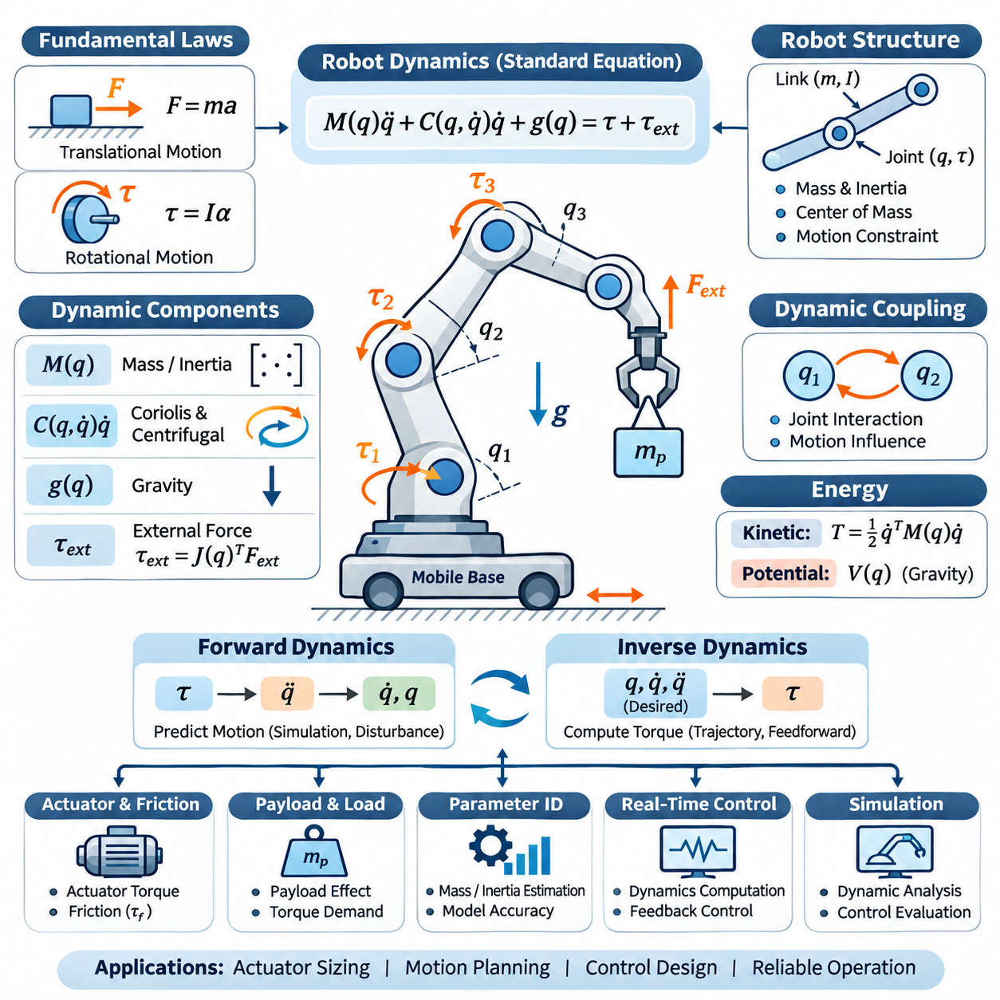
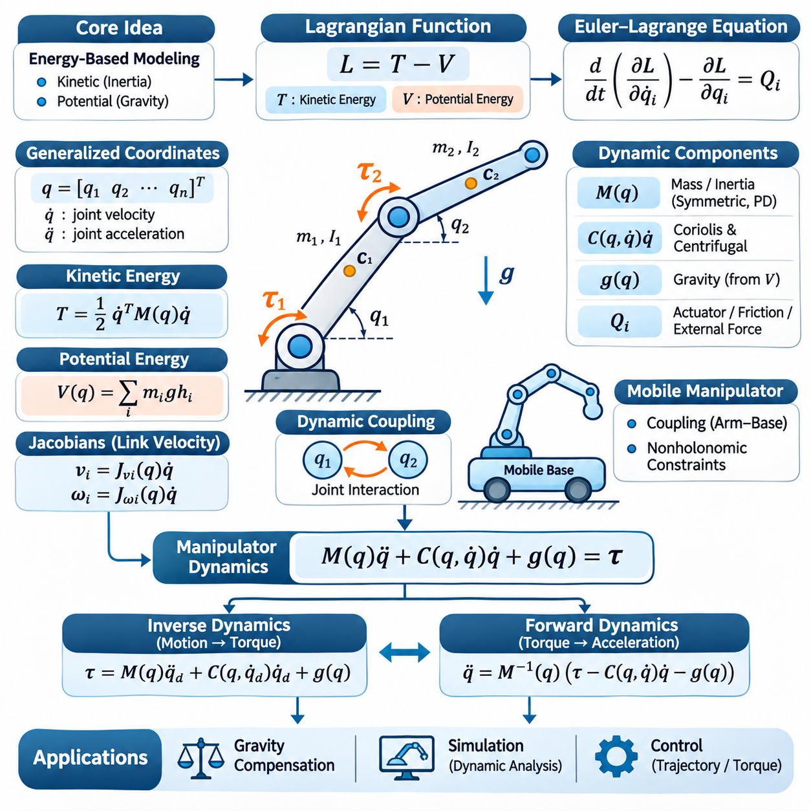
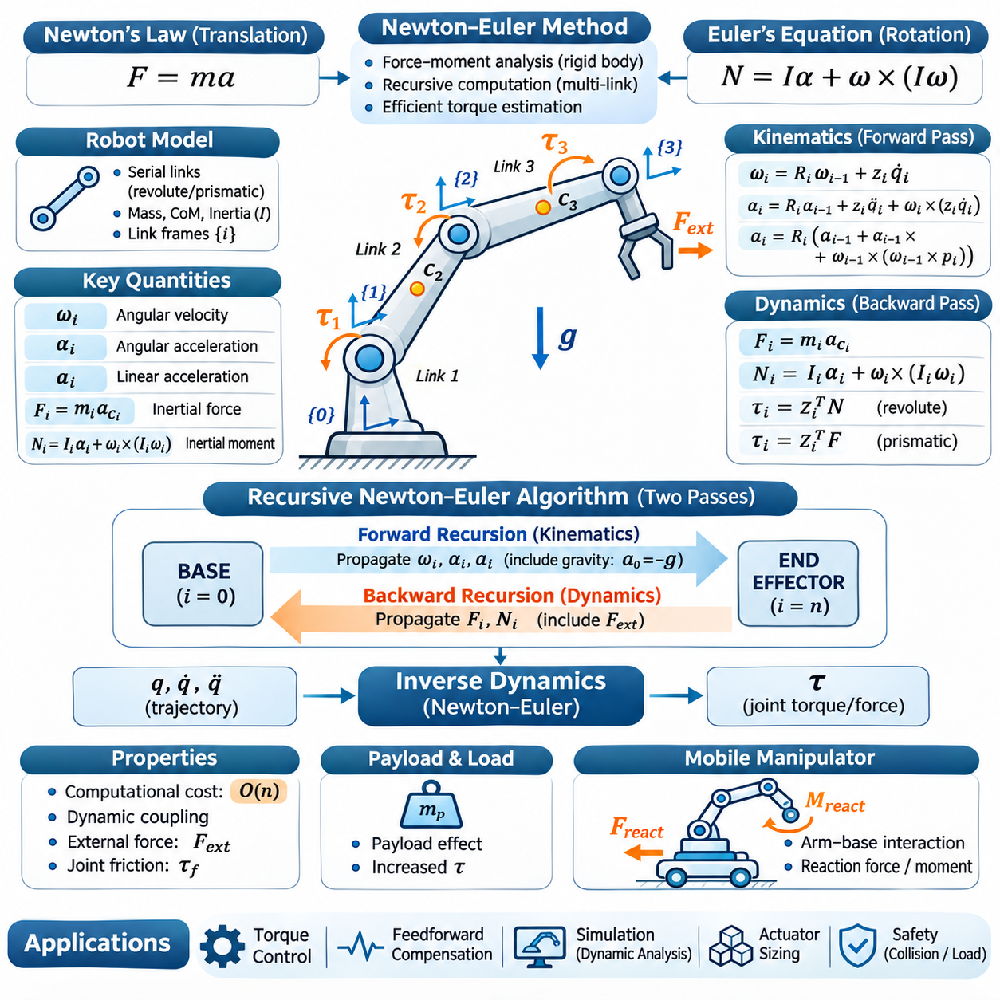
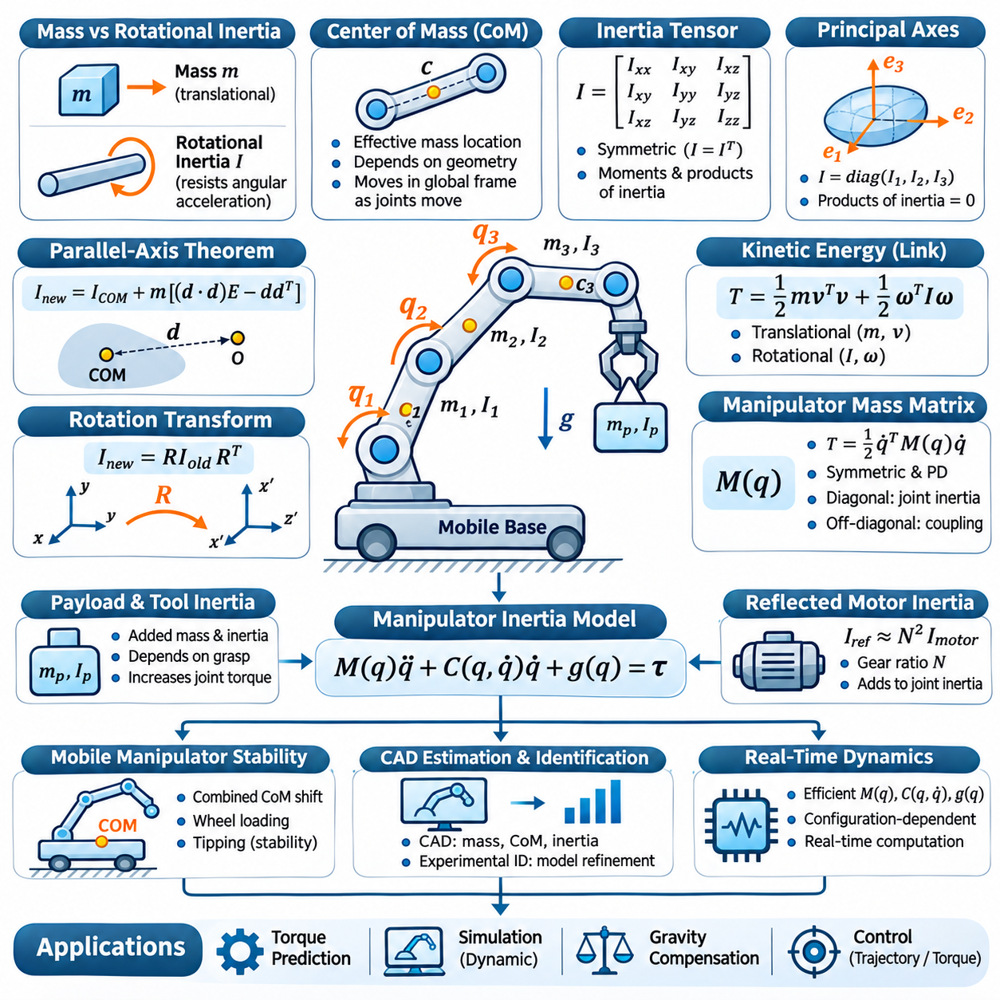
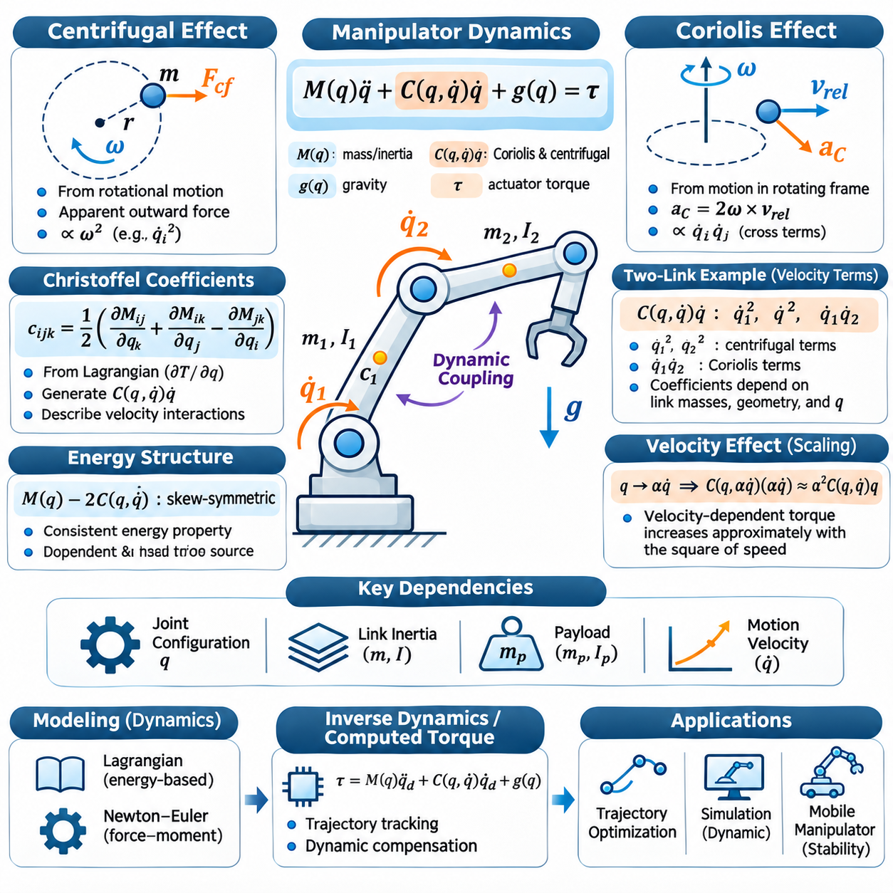
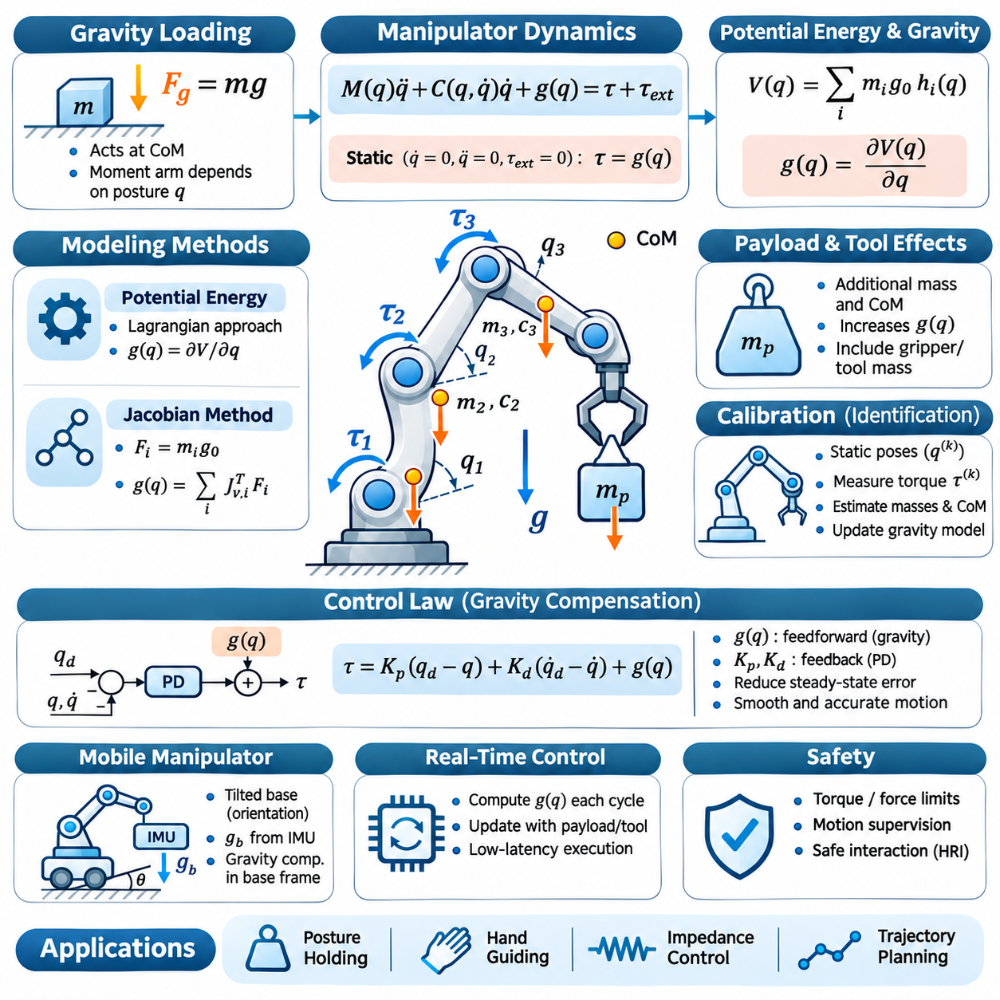
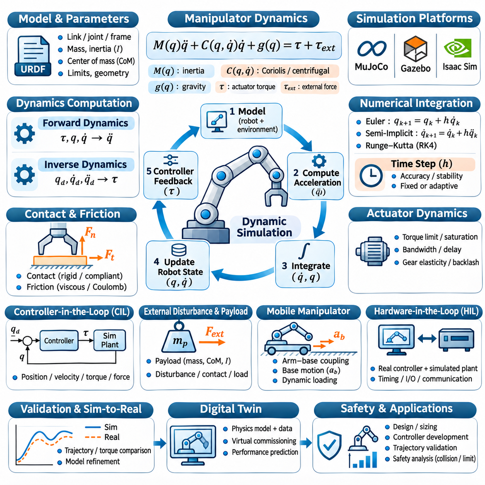
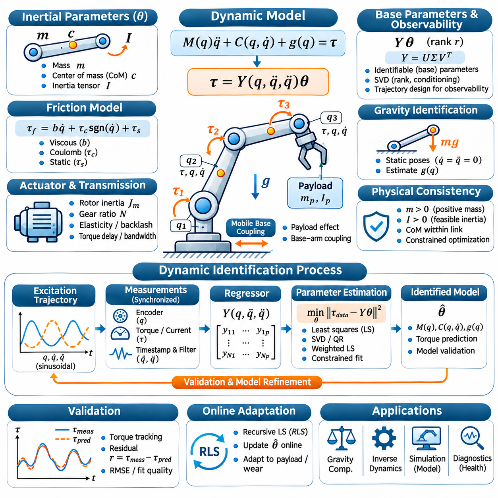
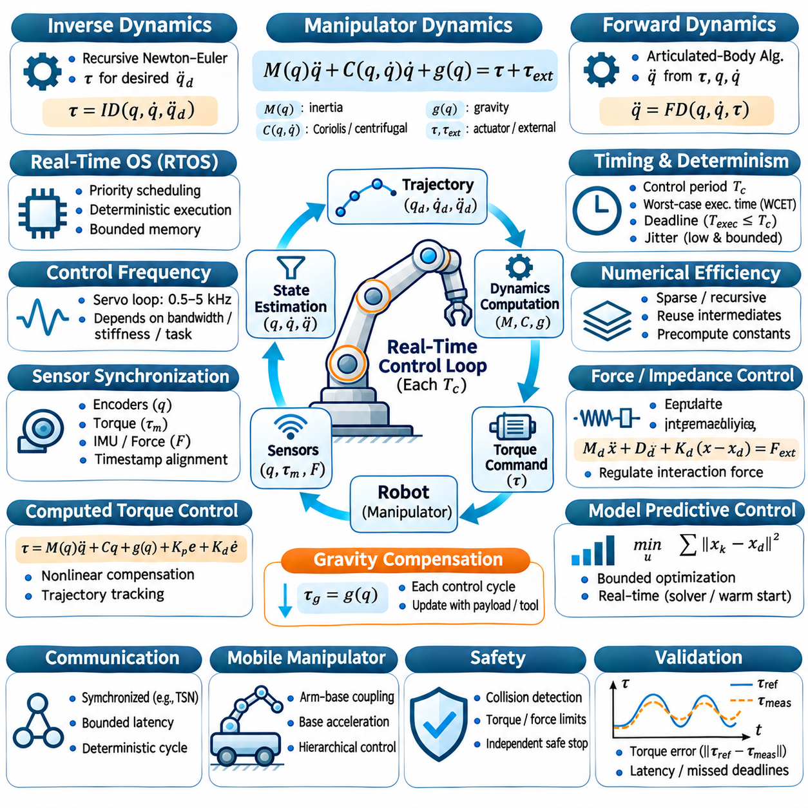

**Volume 02. Manipulator Mechanics and Control**


# Chapter 04. Dynamics

##  

## 01 Dynamics Fundamentals

{width="7.268055555555556in" height="7.268055555555556in"}

Robot dynamics describes the relationship between motion and the forces or torques that produce it. While kinematics determines the position, orientation, velocity, and acceleration of a manipulator without considering their causes, dynamics explains how mass, inertia, gravity, and external interactions influence motion. Dynamic analysis is essential for predicting actuator requirements, designing control systems, and ensuring reliable robotic operation.

A robotic manipulator consists of interconnected rigid bodies or flexible structures connected through mechanical joints. Each link possesses mass, a center of mass, and rotational inertia, while each joint introduces constraints on relative motion. When actuators generate torque, these mechanical properties determine the resulting acceleration. Consequently, identical torque commands can produce different movements depending on robot configuration, payload, and operating conditions.

The fundamental principles of robot dynamics originate from Newton\'s laws of motion. Translational motion follows the relationship between force, mass, and acceleration, expressed as F = ma. Rotational motion follows the corresponding relationship between torque and angular momentum. For a rigid body rotating about a fixed principal axis, the simplified expression τ = Iα describes how rotational inertia resists angular acceleration.

In multi-joint manipulators, dynamic behavior becomes more complicated because the motion of one link influences the forces acting on other links. Accelerating a shoulder joint changes the motion of the elbow and wrist, even when their actuators receive no additional commands. These interactions are known as dynamic coupling and must be considered when designing controllers that coordinate multiple joints during high-speed or precision operations.

The standard rigid-body dynamic equation of a robotic manipulator is commonly expressed as M(q)q̈ + C(q,q̇)q̇ + g(q) = τ + τext. Here, q represents joint positions, q̇ represents joint velocities, and q̈ represents joint accelerations. The equation combines inertial effects, velocity-dependent interactions, gravity, actuator torque, and generalized external forces into a unified mathematical description of robot motion.

The mass matrix M(q) represents the configuration-dependent inertia of the manipulator. Its diagonal elements describe effective inertia associated with individual joints, while off-diagonal elements represent inertial coupling between joints. For a physically valid rigid-body model with independent generalized coordinates, this matrix is symmetric and positive definite. Its properties strongly influence acceleration, torque demand, and numerical stability.

The velocity-dependent term C(q,q̇)q̇ represents Coriolis and centrifugal effects generated by coordinated joint motion. Coriolis effects arise from interactions involving multiple velocities, whereas centrifugal effects are associated with rotational motion. These contributions become particularly important when manipulators operate at high speeds, perform rapid directional changes, or execute trajectories involving simultaneous movement of several joints.

Gravity introduces configuration-dependent joint torques because the centers of mass of robot links occupy different positions throughout the workspace. The gravity vector g(q) describes the torque required to balance gravitational loading at a given configuration. A horizontally extended manipulator may require substantially greater holding torque than the same arm positioned vertically, depending on its geometry and joint arrangement.

External forces influence manipulator dynamics whenever the robot interacts with objects, tools, surfaces, or humans. A force applied at the end effector can be transformed into generalized joint forces using the transpose of the Jacobian matrix. The relationship τext = J(q)ᵀFext provides a mathematical connection between Cartesian interaction forces and joint-space dynamics, assuming consistent coordinate frames and force representations.

Robot dynamics can be analyzed through two complementary approaches known as forward dynamics and inverse dynamics. Forward dynamics calculates joint accelerations from applied torques and the current robot state. Inverse dynamics calculates the torques required to produce specified joint positions, velocities, and accelerations. Both approaches are fundamental to simulation, motion planning, actuator sizing, and model-based control.

Forward dynamics is especially useful for predicting robot behavior under actuator commands and external disturbances. Given the current joint configuration, velocity, and applied torque, the dynamic equation can be solved for acceleration. Numerical integration then estimates subsequent velocities and positions. Repeating this process enables simulation of manipulator motion and evaluation of control strategies before physical deployment.

Inverse dynamics supports the generation of actuator commands for desired robot trajectories. When a trajectory specifies joint position, velocity, and acceleration over time, the dynamic model determines the corresponding torque requirements. This capability enables feedforward compensation, reduces tracking errors, and improves performance during rapid motion. However, accurate results depend on reliable mechanical parameters and appropriate modeling assumptions.

The kinetic energy of a manipulator represents the energy associated with the translational and rotational motion of its links. It can be expressed in joint coordinates as T = ½q̇ᵀM(q)q̇. Potential energy primarily represents gravitational energy associated with link positions. These energy quantities provide a systematic foundation for deriving dynamic equations and understanding how energy is transferred between interconnected mechanical components.

Energy conservation offers an important perspective on robot behavior. In an ideal mechanical system without friction, external work, or energy dissipation, total mechanical energy remains constant. Real manipulators experience energy losses through bearings, gear transmissions, electrical resistance, and structural deformation. Understanding these losses helps engineers evaluate efficiency, thermal behavior, and the practical limits of sustained robotic operation.

Actuator dynamics introduce additional characteristics beyond the ideal rigid-body model. Electric motors generate torque through electromagnetic interactions, while gearboxes modify the relationship between motor torque and joint torque. Motor rotor inertia, transmission efficiency, backlash, and mechanical compliance can affect the response of a joint. These factors become increasingly important in high-performance manipulators requiring precise torque regulation.

Friction is another major source of deviation between theoretical predictions and measured robot behavior. Joint friction may include viscous friction, Coulomb friction, static friction, and velocity-dependent nonlinear effects. Friction can produce tracking errors, oscillations, and unexpected resistance during low-speed motion. Accurate compensation requires identifying relevant friction characteristics without introducing instability or excessive control effort.

Payload variation changes the dynamic characteristics of a robotic manipulator. When a gripper acquires an object, the effective mass distribution, center of mass, and inertia of the robot change. These changes influence acceleration capability, joint torque requirements, and braking behavior. Dynamic models used in industrial manipulation must therefore account for different payload conditions, particularly during lifting, transportation, and rapid repositioning tasks.

In mobile manipulators, arm dynamics interact with the motion and stability of the mobile platform. Accelerating or extending the arm generates reaction forces and moments that can influence platform attitude, wheel loading, and traction. A mobile base may also introduce acceleration disturbances into the manipulator. Coordinated dynamic analysis is necessary when the arm operates while the platform moves or when heavy objects are handled near stability limits.

The combined dynamics of a mobile manipulator depend on whether the platform is stationary, moving, or mechanically constrained. When the platform remains fixed, conventional manipulator equations may provide an adequate approximation. During simultaneous base and arm motion, the generalized coordinates must include relevant platform degrees of freedom. Wheel constraints, ground contact, suspension behavior, and platform inertia can significantly influence the resulting equations.

Dynamic modeling also supports mechanical design by identifying maximum joint torques, acceleration limits, and structural loading conditions. Engineers can evaluate candidate link dimensions, actuator capacities, transmission ratios, and payload configurations before manufacturing. Dynamic simulations help identify operating conditions that produce excessive mechanical stress or demand torque beyond available actuator capabilities, reducing the risk of costly design revisions.

A practical dynamic model requires accurate estimates of link masses, centers of mass, inertia tensors, and joint characteristics. These parameters may be obtained from computer-aided design models, manufacturer specifications, or experimental measurements. However, nominal design values may differ from actual hardware because of manufacturing tolerances, wiring, attached equipment, and assembly variations. Experimental validation is therefore essential for reliable prediction.

Dynamic identification estimates mechanical parameters from observed robot motion and actuator measurements. By applying carefully designed excitation trajectories and recording joint positions, velocities, accelerations, and torques, engineers can estimate identifiable combinations of inertial and friction parameters. The quality of identification depends on measurement accuracy, trajectory excitation, sensor calibration, and the mathematical structure of the selected dynamic model.

Real-time dynamic computation is necessary for advanced control systems that continuously adjust actuator commands. A controller may evaluate gravity compensation, inverse dynamics, or disturbance estimates at every control cycle. Computational efficiency becomes critical as the number of joints increases. Recursive formulations and optimized numerical implementations help maintain predictable execution times while supporting high-frequency robotic control.

Dynamic models are never perfect representations of physical systems. Unmodeled flexibility, temperature-dependent friction, uncertain payloads, sensor noise, and external disturbances introduce discrepancies between predicted and actual behavior. Robust control methods, feedback correction, and online parameter adaptation can reduce the influence of these uncertainties. Effective engineering balances model accuracy against computational complexity and operational reliability.

The fundamental purpose of manipulator dynamics is to connect mechanical design, motion generation, and control into a consistent engineering framework. By understanding how inertia, gravity, velocity-dependent forces, actuator torque, and external interactions determine motion, engineers can develop manipulators that operate accurately and efficiently. These principles establish the foundation for advanced torque control, force regulation, dynamic simulation, and safe physical interaction.

로봇 동역학(Robot Dynamics)은 운동(Motion)과 이를 발생시키는 힘(Force) 또는 토크(Torque) 사이의 관계를 설명하는 학문이다. 운동학(Kinematics)이 운동의 원인을 고려하지 않고 매니퓰레이터(Manipulator)의 위치(Position), 자세(Orientation), 속도(Velocity), 가속도(Acceleration)를 결정하는 반면, 동역학은 질량(Mass), 관성(Inertia), 중력(Gravity), 외부 상호작용(External Interaction)이 운동에 미치는 영향을 설명한다. 동역학 분석(Dynamic Analysis)은 액추에이터(Actuator) 요구사항 예측, 제어 시스템(Control System) 설계, 안정적인 로봇 운용을 위해 필수적이다.

로봇 매니퓰레이터(Robot Manipulator)는 기계적 관절(Mechanical Joint)로 연결된 강체(Rigid Body) 또는 유연 구조물(Flexible Structure)로 구성된다. 각 링크(Link)는 질량, 질량중심(Center of Mass), 회전 관성(Rotational Inertia)을 가지며, 각 관절은 상대 운동(Relative Motion)에 제약조건(Constraint)을 부여한다. 액추에이터가 토크를 발생시키면 이러한 기계적 특성이 결과적인 가속도를 결정한다. 따라서 동일한 토크 명령(Torque Command)이라도 로봇의 구성(Configuration), 페이로드(Payload), 운용 조건(Operating Condition)에 따라 서로 다른 운동이 발생할 수 있다.

로봇 동역학의 기본 원리는 뉴턴의 운동 법칙(Newton\'s Laws of Motion)에서 출발한다. 병진 운동(Translational Motion)은 힘, 질량, 가속도 사이의 관계를 나타내는 F = ma를 따른다. 회전 운동(Rotational Motion)은 토크와 각운동량(Angular Momentum) 사이의 대응 관계를 따른다. 고정된 주관성축(Principal Axis)을 중심으로 회전하는 강체에서는 단순화된 식 τ = Iα를 통해 회전 관성이 각가속도(Angular Acceleration)에 저항하는 특성을 설명할 수 있다.

다관절 매니퓰레이터(Multi-Joint Manipulator)에서는 하나의 링크 운동이 다른 링크에 작용하는 힘에 영향을 주기 때문에 동적 거동(Dynamic Behavior)이 더욱 복잡해진다. 어깨 관절(Shoulder Joint)을 가속하면 팔꿈치 관절(Elbow Joint)과 손목 관절(Wrist Joint)에 추가 명령을 전달하지 않더라도 이들의 운동이 변화한다. 이러한 상호작용을 동적 결합(Dynamic Coupling)이라고 하며, 고속 또는 정밀 작업에서 여러 관절을 조정하는 제어기(Controller)를 설계할 때 반드시 고려해야 한다.

로봇 매니퓰레이터의 표준 강체 동역학 방정식(Rigid-Body Dynamic Equation)은 일반적으로 M(q)q̈ + C(q,q̇)q̇ + g(q) = τ + τext로 표현된다. 여기서 q는 관절 위치(Joint Position), q̇는 관절 속도(Joint Velocity), q̈는 관절 가속도(Joint Acceleration)를 의미한다. 이 방정식은 관성 효과(Inertial Effect), 속도 의존 상호작용(Velocity-Dependent Interaction), 중력, 액추에이터 토크, 일반화된 외력(Generalized External Force)을 하나의 수학적 모델(Mathematical Model)로 통합한다.

질량 행렬(Mass Matrix) M(q)는 매니퓰레이터의 구성에 따라 변화하는 관성을 나타낸다. 대각 성분(Diagonal Element)은 개별 관절과 관련된 유효 관성(Effective Inertia)을 설명하고, 비대각 성분(Off-Diagonal Element)은 관절 사이의 관성 결합(Inertial Coupling)을 나타낸다. 독립적인 일반화 좌표(Generalized Coordinate)를 사용하는 물리적으로 타당한 강체 모델에서 이 행렬은 대칭(Symmetric)이며 양의 정부호(Positive Definite) 특성을 가진다. 이러한 특성은 가속도, 토크 요구량, 수치적 안정성(Numerical Stability)에 큰 영향을 미친다.

속도 의존 항(Velocity-Dependent Term) C(q,q̇)q̇는 여러 관절의 연동 운동에서 발생하는 코리올리 효과(Coriolis Effect)와 원심 효과(Centrifugal Effect)를 나타낸다. 코리올리 효과는 여러 속도 성분 사이의 상호작용에서 발생하며, 원심 효과는 회전 운동과 관련된다. 이러한 영향은 매니퓰레이터가 고속으로 동작하거나 급격하게 방향을 변경하거나 여러 관절을 동시에 움직이는 궤적(Trajectory)을 수행할 때 특히 중요해진다.

중력은 로봇 링크의 질량중심이 작업공간(Workspace) 내에서 서로 다른 위치를 차지하기 때문에 관절 구성에 따라 변화하는 토크를 발생시킨다. 중력 벡터(Gravity Vector) g(q)는 특정 구성에서 중력 하중(Gravitational Load)을 평형 상태로 유지하는 데 필요한 토크를 나타낸다. 수평으로 길게 뻗은 매니퓰레이터는 기하학적 구조(Geometry)와 관절 배치(Joint Arrangement)에 따라 수직으로 배치된 동일한 로봇보다 훨씬 큰 유지 토크(Holding Torque)를 요구할 수 있다.

외력(External Force)은 로봇이 물체, 도구, 표면 또는 사람과 상호작용할 때마다 매니퓰레이터의 동역학에 영향을 준다. 엔드 이펙터(End Effector)에 작용하는 힘은 자코비안 행렬(Jacobian Matrix)의 전치(Transpose)를 이용하여 일반화된 관절 힘(Generalized Joint Force)으로 변환할 수 있다. τext = J(q)ᵀFext 관계식은 좌표계(Coordinate Frame)와 힘 표현(Force Representation)이 일관되게 정의되었다는 가정하에 직교좌표계 상호작용 힘(Cartesian Interaction Force)과 관절 공간 동역학(Joint-Space Dynamics)을 연결한다.

로봇 동역학은 순방향 동역학(Forward Dynamics)과 역동역학(Inverse Dynamics)이라는 두 가지 상호보완적인 접근법으로 분석할 수 있다. 순방향 동역학은 현재 로봇 상태(Robot State)와 적용된 토크로부터 관절 가속도를 계산한다. 역동역학은 지정된 관절 위치, 속도, 가속도를 구현하는 데 필요한 토크를 계산한다. 두 접근법 모두 시뮬레이션(Simulation), 운동 계획(Motion Planning), 액추에이터 용량 선정(Actuator Sizing), 모델 기반 제어(Model-Based Control)의 핵심 기반이 된다.

순방향 동역학은 액추에이터 명령과 외란(External Disturbance)에 따른 로봇의 거동을 예측하는 데 특히 유용하다. 현재 관절 구성, 속도, 적용 토크가 주어지면 동역학 방정식을 풀어 가속도를 계산할 수 있다. 이후 수치 적분(Numerical Integration)을 통해 다음 시점의 속도와 위치를 추정한다. 이 과정을 반복하면 실제 하드웨어에 적용하기 전에 매니퓰레이터의 운동을 시뮬레이션하고 제어 전략(Control Strategy)의 성능을 평가할 수 있다.

역동역학은 원하는 로봇 궤적에 대응하는 액추에이터 명령을 생성하는 데 활용된다. 궤적이 시간에 따른 관절 위치, 속도, 가속도를 지정하면 동역학 모델(Dynamic Model)은 이에 필요한 토크를 계산한다. 이러한 기능은 피드포워드 보상(Feedforward Compensation)을 가능하게 하고 추종 오차(Tracking Error)를 줄이며 빠른 운동 중 제어 성능을 향상시킨다. 다만 정확한 결과를 얻으려면 신뢰할 수 있는 기계적 매개변수(Mechanical Parameter)와 적절한 모델링 가정(Modeling Assumption)이 필요하다.

매니퓰레이터의 운동에너지(Kinetic Energy)는 링크의 병진 운동과 회전 운동에 관련된 에너지를 의미한다. 관절 좌표(Joint Coordinate)를 사용하면 T = ½q̇ᵀM(q)q̇로 표현할 수 있다. 위치에너지(Potential Energy)는 주로 링크 위치와 관련된 중력 위치에너지를 나타낸다. 이러한 에너지량(Energy Quantity)은 동역학 방정식을 체계적으로 유도하고 서로 연결된 기계 구성요소 사이에서 에너지가 전달되는 과정을 이해하는 수학적 기반을 제공한다.

에너지 보존(Energy Conservation)은 로봇의 거동을 이해하는 중요한 관점을 제공한다. 마찰(Friction), 외부 일(External Work), 에너지 소산(Energy Dissipation)이 없는 이상적인 기계 시스템에서는 전체 기계적 에너지(Total Mechanical Energy)가 일정하게 유지된다. 실제 매니퓰레이터에서는 베어링(Bearing), 기어 전달장치(Gear Transmission), 전기 저항(Electrical Resistance), 구조 변형(Structural Deformation)을 통해 에너지 손실이 발생한다. 이러한 손실을 이해하면 효율(Efficiency), 열적 거동(Thermal Behavior), 지속 운용의 실제 한계를 평가할 수 있다.

액추에이터 동역학(Actuator Dynamics)은 이상적인 강체 모델에서 다루지 않는 추가적인 특성을 포함한다. 전기 모터(Electric Motor)는 전자기적 상호작용(Electromagnetic Interaction)을 통해 토크를 발생시키며, 기어박스(Gearbox)는 모터 토크와 관절 토크 사이의 관계를 변화시킨다. 모터 회전자 관성(Rotor Inertia), 전달 효율(Transmission Efficiency), 백래시(Backlash), 기계적 컴플라이언스(Mechanical Compliance)는 관절 응답(Joint Response)에 영향을 준다. 이러한 요소는 정밀한 토크 조절(Torque Regulation)이 필요한 고성능 매니퓰레이터에서 더욱 중요해진다.

마찰은 이론적 예측과 실제 측정된 로봇 거동 사이에 차이를 발생시키는 주요 원인이다. 관절 마찰(Joint Friction)에는 점성 마찰(Viscous Friction), 쿨롱 마찰(Coulomb Friction), 정지 마찰(Static Friction), 속도 의존 비선형 효과(Velocity-Dependent Nonlinear Effect)가 포함될 수 있다. 마찰은 저속 운동에서 추종 오차, 진동(Oscillation), 예상하지 못한 저항을 발생시킬 수 있다. 정확한 마찰 보상(Friction Compensation)을 위해서는 불안정성(Instability)이나 과도한 제어 노력(Control Effort)을 유발하지 않으면서 관련 마찰 특성을 식별해야 한다.

페이로드 변화(Payload Variation)는 로봇 매니퓰레이터의 동적 특성을 변화시킨다. 그리퍼(Gripper)가 물체를 파지하면 로봇의 유효 질량 분포(Effective Mass Distribution), 질량중심, 관성이 달라진다. 이러한 변화는 가속 성능(Acceleration Capability), 관절 토크 요구량, 제동 거동(Braking Behavior)에 영향을 준다. 따라서 산업용 매니퓰레이션(Industrial Manipulation)에 사용되는 동역학 모델은 다양한 페이로드 조건을 고려해야 하며, 특히 들어 올리기, 운반, 빠른 재배치 작업에서 중요하다.

모바일 매니퓰레이터(Mobile Manipulator)에서는 로봇 팔 동역학(Arm Dynamics)이 이동 플랫폼(Mobile Platform)의 운동 및 안정성과 상호작용한다. 로봇 팔을 가속하거나 길게 펼치면 반작용 힘(Reaction Force)과 모멘트(Reaction Moment)가 발생하여 플랫폼 자세(Platform Attitude), 바퀴 하중(Wheel Loading), 접지력(Traction)에 영향을 줄 수 있다. 이동 베이스(Mobile Base) 역시 매니퓰레이터에 가속도 외란(Acceleration Disturbance)을 전달할 수 있다. 플랫폼 이동 중 로봇 팔을 운용하거나 안정성 한계(Stability Limit) 근처에서 무거운 물체를 취급할 때는 통합 동역학 분석이 필요하다.

모바일 매니퓰레이터의 결합 동역학(Coupled Dynamics)은 플랫폼이 정지해 있는지, 이동하는지, 기계적으로 구속되어 있는지에 따라 달라진다. 플랫폼이 고정된 경우에는 기존 매니퓰레이터 동역학 방정식이 충분한 근사 모델(Approximate Model)을 제공할 수 있다. 베이스와 로봇 팔이 동시에 움직이는 경우에는 일반화 좌표에 관련 플랫폼 자유도(Degrees of Freedom)를 포함해야 한다. 바퀴 제약조건(Wheel Constraint), 지면 접촉(Ground Contact), 서스펜션 거동(Suspension Behavior), 플랫폼 관성(Platform Inertia)은 결과적인 동역학 방정식에 상당한 영향을 줄 수 있다.

동역학 모델링(Dynamic Modeling)은 최대 관절 토크(Maximum Joint Torque), 가속도 한계(Acceleration Limit), 구조 하중 조건(Structural Loading Condition)을 식별하여 기계 설계(Mechanical Design)를 지원한다. 엔지니어는 제조 이전에 링크 치수(Link Dimension), 액추에이터 용량(Actuator Capacity), 감속비(Gear Ratio), 페이로드 구성을 평가할 수 있다. 동역학 시뮬레이션은 과도한 기계적 응력(Mechanical Stress)을 발생시키거나 가용 액추에이터 토크를 초과하는 운용 조건을 찾아내어 설계 변경에 따른 비용 위험을 줄이는 데 도움이 된다.

실용적인 동역학 모델에는 링크 질량, 질량중심, 관성 텐서(Inertia Tensor), 관절 특성(Joint Characteristic)에 대한 정확한 추정값이 필요하다. 이러한 매개변수는 컴퓨터 지원 설계(Computer-Aided Design, CAD) 모델, 제조사 사양(Manufacturer Specification), 실험 측정(Experimental Measurement)으로부터 얻을 수 있다. 그러나 제조 공차(Manufacturing Tolerance), 배선(Wiring), 부착 장비(Attached Equipment), 조립 편차(Assembly Variation) 때문에 명목 설계값(Nominal Design Value)과 실제 하드웨어 특성이 다를 수 있다. 따라서 신뢰성 있는 예측을 위해 실험적 검증(Experimental Validation)이 필수적이다.

동적 식별(Dynamic Identification)은 관측된 로봇 운동과 액추에이터 측정값으로부터 기계적 매개변수를 추정하는 과정이다. 신중하게 설계된 가진 궤적(Excitation Trajectory)을 적용하고 관절 위치, 속도, 가속도, 토크를 기록하면 식별 가능한 관성 및 마찰 매개변수 조합을 추정할 수 있다. 식별 품질(Identification Quality)은 측정 정확도(Measurement Accuracy), 궤적의 가진 특성(Trajectory Excitation), 센서 보정(Sensor Calibration), 선택한 동역학 모델의 수학적 구조에 따라 달라진다.

실시간 동역학 계산(Real-Time Dynamic Computation)은 액추에이터 명령을 지속적으로 조정하는 고급 제어 시스템(Advanced Control System)에 필요하다. 제어기는 각 제어 주기(Control Cycle)마다 중력 보상(Gravity Compensation), 역동역학 또는 외란 추정(Disturbance Estimation)을 수행할 수 있다. 관절 수가 증가할수록 계산 효율(Computational Efficiency)이 중요해진다. 재귀적 계산 방식(Recursive Formulation)과 최적화된 수치 구현(Optimized Numerical Implementation)은 고주파 로봇 제어(High-Frequency Robot Control)를 지원하면서 예측 가능한 실행 시간(Execution Time)을 유지하는 데 도움이 된다.

동역학 모델은 실제 물리 시스템을 완벽하게 표현할 수 없다. 모델링되지 않은 유연성(Unmodeled Flexibility), 온도 의존 마찰(Temperature-Dependent Friction), 불확실한 페이로드(Uncertain Payload), 센서 잡음(Sensor Noise), 외부 외란은 예측된 거동과 실제 거동 사이에 차이를 발생시킨다. 강인 제어(Robust Control), 피드백 보정(Feedback Correction), 온라인 매개변수 적응(Online Parameter Adaptation)은 이러한 불확실성의 영향을 줄일 수 있다. 효과적인 엔지니어링은 모델 정확도(Model Accuracy), 계산 복잡도(Computational Complexity), 운용 신뢰성(Operational Reliability) 사이의 균형을 요구한다.

매니퓰레이터 동역학의 근본적인 목적은 기계 설계, 운동 생성(Motion Generation), 제어를 일관된 공학적 프레임워크(Engineering Framework)로 연결하는 것이다. 관성, 중력, 속도 의존 힘(Velocity-Dependent Force), 액추에이터 토크, 외부 상호작용이 운동을 결정하는 원리를 이해하면 정확하고 효율적으로 동작하는 매니퓰레이터를 개발할 수 있다. 이러한 원리는 고급 토크 제어(Advanced Torque Control), 힘 조절(Force Regulation), 동역학 시뮬레이션(Dynamic Simulation), 안전한 물리적 상호작용(Safe Physical Interaction)의 기초를 형성한다.

##  

## 02 Lagrangian Dynamics

{width="7.268055555555556in" height="7.268055555555556in"}

Lagrangian dynamics provides a systematic mathematical framework for describing the motion of robotic manipulators through energy relationships rather than directly analyzing individual forces. The method is particularly effective for interconnected mechanical systems with multiple degrees of freedom. By expressing kinetic and potential energy in generalized coordinates, engineers can derive equations of motion that capture inertia, gravitational loading, and dynamic coupling.

The foundation of Lagrangian dynamics is the Lagrangian function, defined as L = T − V, where T represents the total kinetic energy and V represents the total potential energy of the mechanical system. Kinetic energy depends on the velocities and inertial properties of moving links, while potential energy depends primarily on their positions within a gravitational field. This energy-based representation simplifies the mathematical description of complex robotic mechanisms.

Generalized coordinates describe the independent variables required to represent a robot\'s mechanical configuration. For a serial manipulator, these coordinates typically correspond to revolute joint angles or prismatic joint displacements. The generalized coordinate vector q contains all independent joint variables, while q̇ and q̈ represent their velocities and accelerations. This formulation accommodates different joint types without requiring separate force equations for every mechanical component.

The Euler-Lagrange equation establishes the relationship between the Lagrangian function and generalized forces. For each coordinate qi, the equation is written as d/dt(∂L/∂q̇i) − ∂L/∂qi = Qi, where Qi represents the corresponding generalized applied force or torque. Applying this equation to every independent coordinate produces a coupled system of differential equations describing the manipulator\'s motion under specified mechanical and external loading conditions.

The kinetic energy of a robotic manipulator includes translational and rotational contributions from every moving link. Translational kinetic energy depends on link mass and center-of-mass velocity, while rotational kinetic energy depends on angular velocity and inertia tensors. These contributions can be combined into T = ½q̇ᵀM(q)q̇, where M(q) is the configuration-dependent mass matrix representing the complete manipulator\'s inertial characteristics.

Link velocities can be calculated using Jacobian matrices that relate generalized joint velocities to Cartesian motion. The linear Jacobian determines the translational velocity of each link\'s center of mass, while the angular Jacobian determines its rotational velocity. Combining these relationships with link masses and inertia tensors produces individual contributions to the mass matrix. Summing the contributions of all links yields the complete manipulator inertia model.

The mass matrix is a central result of Lagrangian modeling because it describes how joint accelerations generate inertial forces. Its diagonal elements represent effective joint inertia, while off-diagonal elements describe inertial coupling between different joints. For a rigid manipulator expressed in independent generalized coordinates, the mass matrix is symmetric and positive definite. These properties are important for numerical computation, controller stability, and energy-based analysis.

Potential energy in conventional robotic manipulators is primarily associated with gravitational loading. Each link contributes gravitational potential energy according to its mass and the vertical position of its center of mass. The total potential energy is obtained by summing these contributions across all links. Differentiating this energy with respect to generalized coordinates produces the gravity vector g(q), which represents the torques required to balance gravitational effects.

The gravity vector changes continuously as the manipulator moves through different configurations. A horizontally extended arm may require substantial torque to maintain its position, whereas a vertically aligned configuration may produce different gravitational loading. Lagrangian dynamics captures these variations through the position-dependent potential energy function. This formulation provides a direct mathematical foundation for gravity compensation in robotic control systems.

Coriolis and centrifugal effects emerge naturally when the Euler-Lagrange equations are expanded. Because the mass matrix depends on joint configuration, differentiating kinetic energy with respect to time introduces terms involving products of joint velocities. These velocity-dependent terms describe dynamic interactions between moving links. They are commonly represented by C(q,q̇)q̇, where C is a matrix constructed to reproduce the required nonlinear velocity forces.

The resulting manipulator equation is commonly expressed as M(q)q̈ + C(q,q̇)q̇ + g(q) = τ, assuming an ideal rigid-body system without friction or external disturbances. Here, τ represents the generalized actuator torque vector. This compact equation combines inertial forces, velocity-dependent interactions, and gravitational loading. It provides the mathematical foundation for inverse dynamics, forward dynamics, trajectory tracking, and model-based torque control.

Nonconservative forces can be incorporated through generalized forces on the right-hand side of the Euler-Lagrange equations. These forces may include actuator torque, joint friction, damping, and external contact loading. For example, viscous damping can be modeled as a velocity-dependent resisting torque, while external Cartesian forces can be mapped into joint coordinates using the Jacobian transpose. This extension enables more realistic descriptions of industrial manipulators.

A two-link planar manipulator provides a useful example of Lagrangian modeling. Its generalized coordinates are the shoulder and elbow joint angles, and each link contributes translational and rotational kinetic energy. The potential energy depends on the vertical positions of the link centers of mass. Applying the Euler-Lagrange equations produces two coupled differential equations that describe how both actuator torques influence the acceleration of each joint.

Dynamic coupling becomes evident when the two-link equations are examined. Accelerating the shoulder joint influences the torque required at the elbow, while elbow motion changes the effective inertia experienced by the shoulder. These interactions depend on joint configuration and velocity. Lagrangian analysis captures them automatically through the total energy expressions, avoiding the need to calculate every internal reaction force between connected links.

One major advantage of the Lagrangian method is its ability to eliminate ideal constraint forces through the selection of independent generalized coordinates. Instead of explicitly calculating reaction forces at every joint, the formulation focuses on coordinates that satisfy the mechanical constraints. This approach reduces modeling complexity for serial manipulators and many constrained mechanisms. More complicated systems may require constraint equations and Lagrange multipliers.

Lagrange multipliers extend the energy formulation to systems containing additional holonomic constraints. Such constraints may describe closed kinematic chains, mechanically coupled joints, or prescribed geometric relationships. Introducing multipliers allows constraint forces to appear explicitly in the equations of motion. This capability is useful for parallel manipulators, cooperative manipulation mechanisms, and robotic systems involving multiple interconnected mechanical structures.

For mobile manipulators, Lagrangian dynamics can describe the combined motion of the robotic arm and mobile platform. Generalized coordinates may include platform position, orientation, and manipulator joint variables. The total kinetic energy then incorporates platform translation, platform rotation, and arm motion. Coupling terms describe how manipulator acceleration influences the base and how platform motion affects the dynamic behavior of the arm.

Mobile platforms with wheeled locomotion introduce additional modeling considerations because rolling constraints may be nonholonomic. These constraints restrict allowable velocities without necessarily reducing the system to independent position coordinates. Lagrange-d\'Alembert formulations with appropriate constraint forces can represent such systems. Accurate modeling must also consider wheel-ground interaction, platform inertia, and the assumptions used to describe traction and contact.

Lagrangian dynamics is particularly valuable for inverse dynamics calculations. Given desired joint positions, velocities, and accelerations, the dynamic model determines the actuator torques needed to execute the motion. These torque estimates can be incorporated into feedforward controllers to compensate for predictable mechanical loading. When combined with feedback control, model-based compensation can improve trajectory accuracy and reduce tracking errors during rapid manipulation.

The same equations support forward dynamics simulation by solving for joint acceleration. Given the current configuration, velocity, and applied torque, acceleration is calculated from the inverse of the mass matrix or an equivalent numerical solution. Numerical integration then updates joint velocity and position over time. Repeated calculations allow engineers to predict robot motion, evaluate actuator limits, and investigate the consequences of different control commands.

Lagrangian models also support energy-based stability analysis. The total mechanical energy can serve as a candidate Lyapunov function when analyzing certain controlled mechanical systems. Under appropriate assumptions, the relationship between the mass matrix and Coriolis terms provides useful structural properties for controller design. These properties help establish stability conditions for tracking controllers, adaptive control methods, and interaction control strategies.

The accuracy of Lagrangian dynamics depends on the mechanical parameters used to construct the energy functions. Link masses, centers of mass, inertia tensors, and geometric dimensions must be estimated reliably. Computer-aided design models provide initial parameter values, while experimental identification can improve agreement with physical hardware. Unmodeled friction, structural flexibility, gearbox dynamics, and uncertain payloads may still produce differences between predicted and measured behavior.

Symbolic computation tools can automate portions of Lagrangian model derivation, particularly for manipulators containing many joints. Symbolic differentiation generates equations from kinetic and potential energy expressions, while numerical implementations evaluate the resulting dynamics during simulation or control. However, symbolic expressions can become computationally expensive as system complexity increases. Efficient implementations often exploit matrix structure and recursive dynamic algorithms.

Lagrangian dynamics establishes a unified connection between mechanical energy, robot motion, and actuator requirements. Its mathematical structure makes it suitable for modeling serial manipulators, constrained mechanisms, and mobile manipulation systems. By deriving motion equations from kinetic and potential energy, engineers obtain consistent representations of inertia, gravitational effects, and dynamic coupling. These models form an essential foundation for advanced robotic control, simulation, and physical interaction.

라그랑주 동역학(Lagrangian Dynamics)은 개별적인 힘을 직접 분석하는 대신 에너지 관계(Energy Relationship)를 이용하여 로봇 매니퓰레이터(Robot Manipulator)의 운동을 설명하는 체계적인 수학적 프레임워크(Mathematical Framework)를 제공한다. 이 방법은 여러 자유도(Degrees of Freedom)를 가진 상호 연결된 기계 시스템(Mechanical System)에 특히 효과적이다. 운동에너지(Kinetic Energy)와 위치에너지(Potential Energy)를 일반화 좌표(Generalized Coordinate)로 표현하면 관성(Inertia), 중력 하중(Gravitational Loading), 동적 결합(Dynamic Coupling)을 포함하는 운동 방정식(Equation of Motion)을 유도할 수 있다.

라그랑주 동역학의 기초는 L = T − V로 정의되는 라그랑지안 함수(Lagrangian Function)이다. 여기서 T는 기계 시스템의 전체 운동에너지를 나타내고, V는 전체 위치에너지를 나타낸다. 운동에너지는 움직이는 링크(Link)의 속도(Velocity)와 관성 특성(Inertial Property)에 따라 결정되며, 위치에너지는 주로 중력장(Gravitational Field) 내에서의 위치에 따라 결정된다. 이러한 에너지 기반 표현(Energy-Based Representation)은 복잡한 로봇 기구(Mechanism)의 수학적 기술을 단순화한다.

일반화 좌표는 로봇의 기계적 구성(Mechanical Configuration)을 표현하는 데 필요한 독립 변수(Independent Variable)를 나타낸다. 직렬 매니퓰레이터(Serial Manipulator)에서 이러한 좌표는 일반적으로 회전 관절(Revolute Joint)의 각도 또는 직동 관절(Prismatic Joint)의 변위에 해당한다. 일반화 좌표 벡터(Generalized Coordinate Vector) q는 모든 독립 관절 변수를 포함하며, q̇와 q̈는 각각 관절 속도(Joint Velocity)와 관절 가속도(Joint Acceleration)를 나타낸다. 이러한 정식화(Formulation)는 기계 구성요소마다 별도의 힘 방정식을 작성하지 않고도 다양한 관절 유형을 처리할 수 있다.

오일러-라그랑주 방정식(Euler-Lagrange Equation)은 라그랑지안 함수와 일반화 힘(Generalized Force) 사이의 관계를 정의한다. 각 좌표 qi에 대해 방정식은 d/dt(∂L/∂q̇i) − ∂L/∂qi = Qi로 표현되며, Qi는 해당 좌표에 작용하는 일반화 힘 또는 토크(Torque)를 의미한다. 이 방정식을 모든 독립 좌표에 적용하면 지정된 기계적 하중(Mechanical Loading)과 외부 하중(External Loading) 조건에서 매니퓰레이터의 운동을 설명하는 결합 미분방정식(Coupled Differential Equation) 시스템을 얻을 수 있다.

로봇 매니퓰레이터의 운동에너지는 움직이는 모든 링크의 병진 운동(Translational Motion)과 회전 운동(Rotational Motion)에 의한 에너지를 포함한다. 병진 운동에너지는 링크 질량(Link Mass)과 질량중심 속도(Center-of-Mass Velocity)에 따라 결정되며, 회전 운동에너지는 각속도(Angular Velocity)와 관성 텐서(Inertia Tensor)에 따라 결정된다. 이러한 성분은 T = ½q̇ᵀM(q)q̇로 통합할 수 있으며, 여기서 M(q)는 전체 매니퓰레이터의 관성 특성을 나타내는 구성 의존 질량 행렬(Configuration-Dependent Mass Matrix)이다.

링크 속도는 일반화 관절 속도(Generalized Joint Velocity)와 직교좌표계 운동(Cartesian Motion)을 연결하는 자코비안 행렬(Jacobian Matrix)을 이용하여 계산할 수 있다. 선형 자코비안(Linear Jacobian)은 각 링크 질량중심의 병진 속도를 결정하고, 각속도 자코비안(Angular Jacobian)은 회전 속도를 결정한다. 이러한 관계를 링크 질량 및 관성 텐서와 결합하면 질량 행렬에 대한 각 링크의 기여 성분을 계산할 수 있다. 모든 링크의 기여 성분을 합산하면 완전한 매니퓰레이터 관성 모델(Inertia Model)을 얻는다.

질량 행렬(Mass Matrix)은 관절 가속도가 관성력(Inertial Force)을 발생시키는 방식을 설명하므로 라그랑주 모델링(Lagrangian Modeling)의 핵심 결과이다. 대각 성분(Diagonal Element)은 유효 관절 관성(Effective Joint Inertia)을 나타내고, 비대각 성분(Off-Diagonal Element)은 서로 다른 관절 사이의 관성 결합(Inertial Coupling)을 설명한다. 독립적인 일반화 좌표로 표현된 강체 매니퓰레이터(Rigid Manipulator)의 질량 행렬은 대칭(Symmetric)이며 양의 정부호(Positive Definite) 특성을 가진다. 이러한 특성은 수치 계산(Numerical Computation), 제어기 안정성(Controller Stability), 에너지 기반 분석(Energy-Based Analysis)에 중요하다.

일반적인 로봇 매니퓰레이터에서 위치에너지는 주로 중력 하중과 관련된다. 각 링크는 질량과 질량중심의 수직 위치(Vertical Position)에 따라 중력 위치에너지(Gravitational Potential Energy)에 기여한다. 전체 위치에너지는 모든 링크의 기여 성분을 합산하여 계산한다. 이 에너지를 일반화 좌표에 대해 미분하면 중력 벡터(Gravity Vector) g(q)를 얻을 수 있으며, 이는 중력 효과(Gravitational Effect)를 평형 상태로 유지하는 데 필요한 토크를 나타낸다.

중력 벡터는 매니퓰레이터가 서로 다른 구성으로 이동함에 따라 지속적으로 변화한다. 수평으로 뻗은 로봇 팔(Robot Arm)은 위치를 유지하기 위해 상당한 토크를 요구할 수 있지만, 수직으로 정렬된 구성에서는 다른 중력 하중이 발생할 수 있다. 라그랑주 동역학은 위치 의존 위치에너지 함수(Position-Dependent Potential Energy Function)를 통해 이러한 변화를 표현한다. 이 정식화는 로봇 제어 시스템(Robotic Control System)의 중력 보상(Gravity Compensation)을 위한 직접적인 수학적 기반을 제공한다.

코리올리 효과(Coriolis Effect)와 원심 효과(Centrifugal Effect)는 오일러-라그랑주 방정식을 전개하는 과정에서 자연스럽게 나타난다. 질량 행렬이 관절 구성에 따라 달라지므로 운동에너지를 시간에 대해 미분하면 관절 속도들의 곱을 포함하는 항이 발생한다. 이러한 속도 의존 항(Velocity-Dependent Term)은 움직이는 링크 사이의 동적 상호작용(Dynamic Interaction)을 설명한다. 일반적으로 C(q,q̇)q̇로 표현하며, C는 필요한 비선형 속도 힘(Nonlinear Velocity Force)을 재현하도록 구성된 행렬이다.

최종적으로 얻어지는 매니퓰레이터 방정식(Manipulator Equation)은 마찰(Friction)이나 외부 외란(External Disturbance)이 없는 이상적인 강체 시스템을 가정할 때 M(q)q̈ + C(q,q̇)q̇ + g(q) = τ로 표현된다. 여기서 τ는 일반화 액추에이터 토크 벡터(Generalized Actuator Torque Vector)를 의미한다. 이 간결한 방정식은 관성력, 속도 의존 상호작용, 중력 하중을 통합하며, 역동역학(Inverse Dynamics), 순방향 동역학(Forward Dynamics), 궤적 추종(Trajectory Tracking), 모델 기반 토크 제어(Model-Based Torque Control)의 수학적 기초를 제공한다.

비보존력(Nonconservative Force)은 오일러-라그랑주 방정식의 우변에 일반화 힘으로 포함할 수 있다. 이러한 힘에는 액추에이터 토크, 관절 마찰(Joint Friction), 감쇠(Damping), 외부 접촉 하중(External Contact Loading)이 포함된다. 예를 들어 점성 감쇠(Viscous Damping)는 속도에 비례하는 저항 토크(Resisting Torque)로 모델링할 수 있으며, 외부 직교좌표계 힘(External Cartesian Force)은 자코비안 전치(Jacobian Transpose)를 이용하여 관절 좌표로 변환할 수 있다. 이러한 확장은 산업용 매니퓰레이터(Industrial Manipulator)의 현실적인 동적 거동을 설명할 수 있게 한다.

2링크 평면 매니퓰레이터(Two-Link Planar Manipulator)는 라그랑주 모델링을 이해하는 데 유용한 예시이다. 일반화 좌표는 어깨 관절(Shoulder Joint)과 팔꿈치 관절(Elbow Joint)의 각도이며, 각 링크는 병진 운동에너지와 회전 운동에너지에 기여한다. 위치에너지는 링크 질량중심의 수직 위치에 따라 달라진다. 오일러-라그랑주 방정식을 적용하면 두 액추에이터 토크가 각 관절의 가속도에 어떤 영향을 미치는지 설명하는 두 개의 결합 미분방정식을 얻을 수 있다.

2링크 방정식을 분석하면 동적 결합이 명확하게 나타난다. 어깨 관절을 가속하면 팔꿈치 관절에 필요한 토크가 변화하고, 팔꿈치 관절의 운동은 어깨 관절에서 경험하는 유효 관성(Effective Inertia)을 변화시킨다. 이러한 상호작용은 관절 구성과 속도에 따라 달라진다. 라그랑주 분석(Lagrangian Analysis)은 전체 에너지 표현을 통해 이러한 영향을 자동으로 반영하므로 연결된 링크 사이의 모든 내부 반력(Internal Reaction Force)을 개별적으로 계산할 필요가 없다.

라그랑주 방법(Lagrangian Method)의 주요 장점 중 하나는 독립적인 일반화 좌표를 선택하여 이상적인 구속력(Constraint Force)을 제거할 수 있다는 점이다. 모든 관절에서 발생하는 반력을 명시적으로 계산하는 대신, 기계적 제약조건(Mechanical Constraint)을 만족하는 좌표에 집중한다. 이러한 접근법은 직렬 매니퓰레이터와 여러 구속 기구(Constrained Mechanism)의 모델링 복잡도(Modeling Complexity)를 줄여준다. 더 복잡한 시스템에서는 제약 방정식(Constraint Equation)과 라그랑주 승수(Lagrange Multiplier)가 필요할 수 있다.

라그랑주 승수는 추가적인 홀로노믹 제약조건(Holonomic Constraint)을 포함하는 시스템으로 에너지 기반 정식화를 확장한다. 이러한 제약조건은 폐쇄 운동학 체인(Closed Kinematic Chain), 기계적으로 결합된 관절(Mechanically Coupled Joint), 지정된 기하학적 관계(Geometric Relationship)를 설명할 수 있다. 승수를 도입하면 운동 방정식에 구속력을 명시적으로 포함할 수 있다. 이 기능은 병렬 매니퓰레이터(Parallel Manipulator), 협력 매니퓰레이션 기구(Cooperative Manipulation Mechanism), 여러 기계 구조물이 연결된 로봇 시스템에 유용하다.

모바일 매니퓰레이터(Mobile Manipulator)에서 라그랑주 동역학은 로봇 팔과 이동 플랫폼(Mobile Platform)의 결합 운동(Combined Motion)을 설명할 수 있다. 일반화 좌표에는 플랫폼 위치(Platform Position), 자세(Orientation), 매니퓰레이터 관절 변수(Joint Variable)가 포함될 수 있다. 전체 운동에너지는 플랫폼의 병진 운동, 회전 운동, 로봇 팔 운동을 모두 포함한다. 결합 항(Coupling Term)은 매니퓰레이터 가속도가 베이스(Base)에 미치는 영향과 플랫폼 운동이 로봇 팔의 동적 거동에 미치는 영향을 설명한다.

바퀴 기반 이동(Wheeled Locomotion)을 사용하는 모바일 플랫폼은 구름 제약조건(Rolling Constraint)이 비홀로노믹(Nonholonomic)일 수 있으므로 추가적인 모델링 고려사항이 필요하다. 이러한 제약조건은 허용 가능한 속도를 제한하지만 반드시 시스템을 독립적인 위치 좌표로 축소할 수 있는 것은 아니다. 적절한 구속력을 포함하는 라그랑주-달랑베르 정식화(Lagrange-d\'Alembert Formulation)를 사용하면 이러한 시스템을 표현할 수 있다. 정확한 모델링을 위해서는 바퀴와 지면의 상호작용(Wheel-Ground Interaction), 플랫폼 관성, 접지력(Traction)과 접촉(Contact)을 설명하는 가정도 고려해야 한다.

라그랑주 동역학은 역동역학 계산(Inverse Dynamics Calculation)에 특히 유용하다. 원하는 관절 위치, 속도, 가속도가 주어지면 동역학 모델은 해당 운동을 수행하는 데 필요한 액추에이터 토크를 결정한다. 이러한 토크 추정값(Torque Estimate)은 예측 가능한 기계적 하중을 보상하기 위해 피드포워드 제어기(Feedforward Controller)에 적용할 수 있다. 피드백 제어(Feedback Control)와 결합하면 모델 기반 보상(Model-Based Compensation)은 빠른 매니퓰레이션 작업에서 궤적 정확도(Trajectory Accuracy)를 향상시키고 추종 오차(Tracking Error)를 줄일 수 있다.

동일한 방정식은 관절 가속도를 계산함으로써 순방향 동역학 시뮬레이션(Forward Dynamics Simulation)도 지원한다. 현재 구성, 속도, 적용 토크가 주어지면 질량 행렬의 역행렬(Inverse Matrix) 또는 동등한 수치 해법(Numerical Solution)을 이용하여 가속도를 계산한다. 이후 수치 적분(Numerical Integration)을 통해 시간에 따른 관절 속도와 위치를 갱신한다. 이러한 계산을 반복하면 로봇 운동을 예측하고 액추에이터 한계(Actuator Limit)를 평가하며 다양한 제어 명령(Control Command)의 결과를 조사할 수 있다.

라그랑주 모델(Lagrangian Model)은 에너지 기반 안정성 분석(Energy-Based Stability Analysis)도 지원한다. 전체 기계적 에너지(Total Mechanical Energy)는 특정 제어 기계 시스템(Controlled Mechanical System)의 안정성을 분석할 때 리아푸노프 함수 후보(Candidate Lyapunov Function)로 활용할 수 있다. 적절한 가정하에서 질량 행렬과 코리올리 항 사이의 관계는 제어기 설계에 유용한 구조적 특성(Structural Property)을 제공한다. 이러한 특성은 추종 제어기(Tracking Controller), 적응 제어(Adaptive Control), 상호작용 제어(Interaction Control)의 안정성 조건(Stability Condition)을 확립하는 데 도움이 된다.

라그랑주 동역학의 정확도는 에너지 함수를 구성하는 데 사용되는 기계적 매개변수(Mechanical Parameter)에 따라 결정된다. 링크 질량, 질량중심, 관성 텐서, 기하학적 치수(Geometric Dimension)를 신뢰성 있게 추정해야 한다. 컴퓨터 지원 설계(Computer-Aided Design, CAD) 모델은 초기 매개변수 값을 제공하며, 실험적 식별(Experimental Identification)은 실제 하드웨어와의 일치도를 개선할 수 있다. 그러나 모델링되지 않은 마찰, 구조적 유연성(Structural Flexibility), 기어박스 동역학(Gearbox Dynamics), 불확실한 페이로드(Uncertain Payload)는 여전히 예측 결과와 측정 결과 사이에 차이를 발생시킬 수 있다.

기호 계산 도구(Symbolic Computation Tool)는 특히 관절 수가 많은 매니퓰레이터에서 라그랑주 모델 유도 과정의 일부를 자동화할 수 있다. 기호 미분(Symbolic Differentiation)은 운동에너지와 위치에너지 표현으로부터 방정식을 생성하며, 수치 구현(Numerical Implementation)은 시뮬레이션이나 제어 과정에서 결과적인 동역학을 계산한다. 그러나 시스템 복잡도가 증가하면 기호 표현(Symbolic Expression)의 계산 비용이 커질 수 있다. 효율적인 구현은 행렬 구조(Matrix Structure)와 재귀 동역학 알고리즘(Recursive Dynamic Algorithm)을 활용하는 경우가 많다.

라그랑주 동역학은 기계적 에너지(Mechanical Energy), 로봇 운동(Robot Motion), 액추에이터 요구사항(Actuator Requirement) 사이에 통합된 관계를 확립한다. 이러한 수학적 구조는 직렬 매니퓰레이터, 구속 기구, 모바일 매니퓰레이션 시스템(Mobile Manipulation System)의 모델링에 적합하다. 운동에너지와 위치에너지로부터 운동 방정식을 유도하면 관성, 중력 효과, 동적 결합을 일관되게 표현할 수 있다. 이러한 모델은 고급 로봇 제어(Advanced Robotic Control), 시뮬레이션(Simulation), 물리적 상호작용(Physical Interaction)을 위한 필수적인 기반을 형성한다.

##  

## 03 Newton Euler Method

{width="7.268055555555556in" height="7.268055555555556in"}

The Newton-Euler method provides a systematic approach to deriving the equations of motion for robotic manipulators by applying Newton\'s laws of translational motion and Euler\'s equations of rotational motion. Unlike energy-based formulations, this method directly analyzes forces, moments, and accelerations acting on individual links. It is particularly suitable for multi-link robotic systems where computational efficiency and accurate torque estimation are essential.

Newton\'s second law establishes that the net external force acting on a rigid body equals its mass multiplied by the acceleration of its center of mass. Euler\'s rotational equation relates applied moments to angular momentum changes. Together, these principles describe the complete rigid-body motion of each manipulator link. By considering both translational and rotational dynamics, engineers can determine how actuator torques produce coordinated mechanical movement.

A robotic manipulator is represented as a sequence of rigid links connected by revolute or prismatic joints. Each link possesses mass, a center of mass, and an inertia tensor describing its resistance to rotational acceleration. Coordinate frames are attached to individual links to express motion and loading consistently. The Newton-Euler formulation uses these physical properties to calculate the forces and moments transmitted through the mechanical structure.

The Newton-Euler method commonly employs a recursive computational procedure consisting of forward and backward passes. The forward recursion propagates velocities and accelerations from the robot base toward the end effector. The backward recursion propagates forces and moments from the end effector toward the base. Combining these calculations produces the generalized joint forces or torques required to generate a specified manipulator trajectory.

During forward recursion, the angular velocity of each link is calculated using the angular velocity of its parent link and the relative motion introduced by the connecting joint. For revolute joints, joint velocity contributes directly to angular velocity. For prismatic joints, relative joint motion contributes to linear velocity instead. Coordinate transformations ensure that motion quantities are expressed consistently between neighboring link frames.

Angular acceleration is obtained by differentiating the angular velocity relationships while accounting for motion between rotating coordinate frames. The resulting expressions include contributions from parent-link acceleration, joint acceleration, and velocity-dependent cross-product terms. These terms capture the effects of coordinated joint movement. Accurate angular acceleration computation is essential for estimating rotational inertia forces and actuator torque requirements.

Linear acceleration propagates through the manipulator according to the geometric relationships between connected links. The acceleration of a link origin depends on the acceleration of its parent, angular acceleration, angular velocity, and relative joint motion. Centripetal and Coriolis terms appear naturally in these calculations. The acceleration of each link\'s center of mass is subsequently determined from its origin acceleration and rotational motion.

Gravity can be incorporated into the recursive formulation by assigning an appropriate initial acceleration to the base frame. This approach allows gravitational loading to propagate through the same equations used for inertial acceleration. The resulting link forces therefore include the effects of gravity without requiring a separate calculation for every joint. Consistent sign conventions and coordinate definitions are necessary to obtain physically correct torque results.

After computing link accelerations, the inertial force acting on each link is determined from its mass and center-of-mass acceleration. The corresponding inertial moment depends on the link inertia tensor, angular acceleration, and angular velocity. Euler\'s rotational equation includes the gyroscopic contribution associated with angular momentum. These quantities form the basis for calculating the internal forces and moments transmitted between connected links.

The rotational equation for a rigid link can be expressed as N = Iα + ω × (Iω), where N represents the net moment about the center of mass, I is the inertia tensor, α is angular acceleration, and ω is angular velocity. The cross-product term describes gyroscopic effects arising from rotation. This equation remains applicable to general rigid-body rotation when all quantities are expressed in a consistent coordinate frame.

Backward recursion begins at the terminal link and proceeds toward the robot base. Forces and moments transmitted from downstream links are combined with the inertial loading of each current link. The resulting quantities represent the mechanical effort required to support and accelerate the connected structure. External forces applied at the end effector or intermediate links can also be incorporated into the backward propagation process.

Joint torque is obtained by projecting the transmitted moment onto the corresponding revolute joint axis. For prismatic joints, the generalized joint force is obtained by projecting the transmitted force onto the translation axis. These projections connect spatial force calculations with actuator requirements. Repeating the process across all joints produces the complete torque or force vector needed to execute the specified motion.

The recursive Newton-Euler algorithm is especially valuable because its computational complexity grows approximately linearly with the number of links in a conventional serial manipulator. Rather than explicitly constructing large symbolic expressions, the algorithm evaluates local mechanical relationships and propagates their results. This efficiency makes it suitable for high-frequency inverse dynamics calculations in industrial robot controllers and embedded robotic systems.

Inverse dynamics represents the most common application of the recursive Newton-Euler method. Given joint positions, velocities, and accelerations, the algorithm calculates the corresponding actuator torques. These estimates support feedforward compensation, trajectory tracking, actuator sizing, and dynamic performance evaluation. When combined with feedback control, inverse dynamics can improve tracking accuracy during rapid movements and under varying gravitational loading.

The Newton-Euler formulation can also support forward dynamics, although direct recursive inverse dynamics does not independently provide the most efficient forward dynamics solution. Forward dynamics requires calculating joint accelerations from applied torques and the current robot state. Algorithms such as articulated-body dynamics exploit related recursive rigid-body principles to perform this calculation efficiently without explicitly inverting the complete manipulator mass matrix.

Dynamic coupling between joints emerges naturally through recursive force and acceleration propagation. When one joint accelerates, the resulting inertial loading influences neighboring links and changes the torques required at other joints. These interactions depend on robot configuration, joint velocity, and mass distribution. The Newton-Euler method captures these effects through the physical relationships between interconnected rigid bodies.

External loading is particularly important in manipulation tasks involving grasping, lifting, assembly, and contact with surrounding objects. A force or moment applied at the end effector changes the mechanical loads transmitted through the robot structure. Recursive calculations can incorporate these external wrenches to determine additional actuator requirements. This capability supports payload evaluation, force-sensitive manipulation, and mechanical safety analysis.

For mobile manipulators, Newton-Euler dynamics can describe the forces and moments generated by the robotic arm and their transmission to the mobile platform. Rapid arm acceleration may create reaction moments that influence platform stability and wheel loading. When the base is moving, its linear and angular accelerations must also be considered. Coordinated modeling helps engineers evaluate the dynamic interaction between arm motion and mobile-base behavior.

The method can be extended to complex robotic structures containing branched kinematic chains, multiple manipulators, or floating-base mechanisms. Each branch contributes forces and moments that must be combined at shared mechanical connections. Floating-base systems require additional treatment of base motion and external contact constraints. These extensions are relevant to humanoid robots, mobile manipulation platforms, and coordinated multi-arm systems.

Accurate Newton-Euler calculations require reliable mechanical parameters, including link masses, centers of mass, inertia tensors, joint axes, and geometric transformations. These parameters can be obtained from computer-aided design models, manufacturer specifications, or experimental identification. Errors in mass distribution or coordinate frame definitions can produce substantial torque prediction errors, particularly during high-speed motion or heavy-payload manipulation.

Practical implementations must also consider friction, transmission losses, actuator dynamics, and structural compliance. The ideal rigid-body Newton-Euler model does not automatically account for these effects. Additional models may represent viscous friction, Coulomb friction, gearbox efficiency, motor rotor inertia, or flexible joints. Incorporating these characteristics improves agreement between calculated torque requirements and measured actuator behavior.

Numerical stability and computational consistency are important when implementing recursive dynamics in real-time software. Coordinate transformations, rotation matrices, and spatial vector operations must follow consistent mathematical conventions. Efficient implementations minimize unnecessary calculations and memory allocation while maintaining deterministic execution times. These considerations are especially important for high-frequency robotic control and safety-critical motion applications.

The Newton-Euler and Lagrangian methods describe the same underlying rigid-body mechanics but emphasize different mathematical approaches. Lagrangian dynamics derives equations from kinetic and potential energy, while Newton-Euler dynamics directly propagates forces, moments, velocities, and accelerations. Both can produce equivalent manipulator equations under consistent assumptions. The preferred method depends on modeling objectives, system complexity, and computational requirements.

The Newton-Euler method establishes a practical connection between rigid-body mechanics and real-time robotic control. Its recursive structure enables efficient calculation of actuator torques while preserving the physical relationships between interconnected links. By accounting for translational motion, rotational motion, gravity, and external loading, engineers can develop accurate dynamic models for industrial manipulators and mobile robotic systems. These models support reliable motion control, simulation, and mechanical performance optimization.

뉴턴-오일러 방법(Newton-Euler Method)은 뉴턴의 병진 운동 법칙(Newton\'s Laws of Translational Motion)과 오일러의 회전 운동 방정식(Euler\'s Equations of Rotational Motion)을 적용하여 로봇 매니퓰레이터(Robot Manipulator)의 운동 방정식(Equations of Motion)을 유도하는 체계적인 접근법이다. 에너지 기반 정식화(Energy-Based Formulation)와 달리, 이 방법은 개별 링크(Link)에 작용하는 힘(Force), 모멘트(Moment), 가속도(Acceleration)를 직접 분석한다. 계산 효율성(Computational Efficiency)과 정확한 토크 추정(Torque Estimation)이 중요한 다중 링크 로봇 시스템(Multi-Link Robotic System)에 특히 적합하다.

뉴턴의 제2법칙(Newton\'s Second Law)은 강체(Rigid Body)에 작용하는 순외력(Net External Force)이 질량(Mass)과 질량중심 가속도(Center-of-Mass Acceleration)의 곱과 같다는 관계를 정의한다. 오일러의 회전 방정식(Euler\'s Rotational Equation)은 작용 모멘트(Applied Moment)와 각운동량 변화(Angular Momentum Change)를 연결한다. 이 두 원리는 각 매니퓰레이터 링크의 완전한 강체 운동(Rigid-Body Motion)을 설명한다. 병진 동역학(Translational Dynamics)과 회전 동역학(Rotational Dynamics)을 함께 고려하면 액추에이터 토크(Actuator Torque)가 어떻게 조정된 기계적 운동(Coordinated Mechanical Movement)을 발생시키는지 결정할 수 있다.

로봇 매니퓰레이터는 회전 관절(Revolute Joint) 또는 직동 관절(Prismatic Joint)로 연결된 강체 링크의 연속적인 구조로 표현된다. 각 링크는 질량, 질량중심(Center of Mass), 회전 가속도(Rotational Acceleration)에 대한 저항을 설명하는 관성 텐서(Inertia Tensor)를 가진다. 운동과 하중을 일관되게 표현하기 위해 개별 링크에 좌표계(Coordinate Frame)를 부착한다. 뉴턴-오일러 정식화(Newton-Euler Formulation)는 이러한 물리적 특성을 이용하여 기계 구조(Mechanical Structure)를 통해 전달되는 힘과 모멘트를 계산한다.

뉴턴-오일러 방법은 일반적으로 순방향 계산(Forward Pass)과 역방향 계산(Backward Pass)으로 구성된 재귀적 계산 절차(Recursive Computational Procedure)를 사용한다. 순방향 재귀(Forward Recursion)는 로봇 베이스(Robot Base)에서 엔드 이펙터(End Effector) 방향으로 속도(Velocity)와 가속도를 전달한다. 역방향 재귀(Backward Recursion)는 엔드 이펙터에서 베이스 방향으로 힘과 모멘트를 전달한다. 이러한 계산을 결합하면 지정된 매니퓰레이터 궤적(Manipulator Trajectory)을 생성하는 데 필요한 일반화 관절 힘(Generalized Joint Force) 또는 토크를 구할 수 있다.

순방향 재귀 과정에서는 부모 링크(Parent Link)의 각속도(Angular Velocity)와 연결 관절의 상대 운동(Relative Motion)을 이용하여 각 링크의 각속도를 계산한다. 회전 관절에서는 관절 속도(Joint Velocity)가 각속도에 직접 기여한다. 반면 직동 관절에서는 상대적인 관절 운동이 선속도(Linear Velocity)에 기여한다. 좌표 변환(Coordinate Transformation)은 인접한 링크 좌표계(Link Frame) 사이에서 운동량(Motion Quantity)이 일관되게 표현되도록 보장한다.

각가속도(Angular Acceleration)는 회전 좌표계(Rotating Coordinate Frame) 사이의 운동을 고려하면서 각속도 관계를 미분하여 구한다. 결과적인 수식에는 부모 링크의 가속도, 관절 가속도(Joint Acceleration), 속도 의존 외적 항(Velocity-Dependent Cross-Product Term)이 포함된다. 이러한 항은 여러 관절의 연동 운동(Coordinated Joint Movement)에 따른 영향을 표현한다. 정확한 각가속도 계산은 회전 관성력(Rotational Inertia Force)과 액추에이터 토크 요구량(Actuator Torque Requirement)을 추정하는 데 필수적이다.

선가속도(Linear Acceleration)는 연결된 링크 사이의 기하학적 관계(Geometric Relationship)에 따라 매니퓰레이터 전체로 전달된다. 링크 원점(Link Origin)의 가속도는 부모 링크의 가속도, 각가속도, 각속도, 상대 관절 운동에 따라 결정된다. 이러한 계산 과정에서 구심 가속도 항(Centripetal Term)과 코리올리 항(Coriolis Term)이 자연스럽게 나타난다. 이후 각 링크의 질량중심 가속도는 링크 원점의 가속도와 회전 운동을 이용하여 결정된다.

중력(Gravity)은 베이스 좌표계(Base Frame)에 적절한 초기 가속도(Initial Acceleration)를 설정하는 방식으로 재귀 정식화에 포함할 수 있다. 이 접근법은 중력 하중(Gravitational Loading)이 관성 가속도(Inertial Acceleration)에 사용되는 동일한 방정식을 통해 전달되도록 한다. 따라서 결과적인 링크 힘(Link Force)에는 각 관절에 대해 별도의 계산을 수행하지 않아도 중력의 영향이 포함된다. 물리적으로 올바른 토크 결과를 얻기 위해서는 일관된 부호 규약(Sign Convention)과 좌표 정의(Coordinate Definition)가 필요하다.

링크 가속도를 계산한 후에는 각 링크의 질량과 질량중심 가속도를 이용하여 관성력(Inertial Force)을 결정한다. 해당 관성 모멘트(Inertial Moment)는 링크의 관성 텐서, 각가속도, 각속도에 따라 달라진다. 오일러의 회전 방정식에는 각운동량과 관련된 자이로스코프 항(Gyroscopic Contribution)이 포함된다. 이러한 물리량은 연결된 링크 사이에서 전달되는 내부 힘(Internal Force)과 모멘트를 계산하는 기초가 된다.

강체 링크의 회전 방정식(Rotational Equation)은 N = Iα + ω × (Iω)로 표현할 수 있다. 여기서 N은 질량중심에 대한 순모멘트(Net Moment), I는 관성 텐서, α는 각가속도, ω는 각속도를 나타낸다. 외적 항(Cross-Product Term)은 회전으로 인해 발생하는 자이로스코프 효과(Gyroscopic Effect)를 설명한다. 모든 물리량이 일관된 좌표계에서 표현된다면 이 방정식은 일반적인 강체 회전(General Rigid-Body Rotation)에 적용할 수 있다.

역방향 재귀는 말단 링크(Terminal Link)에서 시작하여 로봇 베이스 방향으로 진행된다. 하위 링크(Downstream Link)에서 전달되는 힘과 모멘트는 현재 링크(Current Link)의 관성 하중(Inertial Loading)과 결합된다. 결과적인 물리량은 연결된 구조물을 지지하고 가속하는 데 필요한 기계적 작용(Mechanical Effort)을 나타낸다. 엔드 이펙터 또는 중간 링크(Intermediate Link)에 작용하는 외력(External Force)도 역방향 전달 과정(Backward Propagation Process)에 포함할 수 있다.

관절 토크(Joint Torque)는 전달된 모멘트를 해당 회전 관절축(Revolute Joint Axis)에 투영(Projection)하여 구한다. 직동 관절에서는 전달된 힘을 병진축(Translation Axis)에 투영하여 일반화 관절 힘을 계산한다. 이러한 투영은 공간 힘 계산(Spatial Force Calculation)과 액추에이터 요구사항(Actuator Requirement)을 연결한다. 모든 관절에 대해 이 과정을 반복하면 지정된 운동을 수행하는 데 필요한 전체 토크 또는 힘 벡터(Force Vector)를 얻을 수 있다.

재귀 뉴턴-오일러 알고리즘(Recursive Newton-Euler Algorithm)은 일반적인 직렬 매니퓰레이터(Serial Manipulator)에서 계산 복잡도(Computational Complexity)가 링크 수에 대해 대략 선형적으로 증가한다는 점에서 특히 유용하다. 대규모 기호 표현(Symbolic Expression)을 명시적으로 구성하는 대신 국부적인 기계적 관계(Local Mechanical Relationship)를 계산하고 그 결과를 전달한다. 이러한 효율성 덕분에 산업용 로봇 제어기(Industrial Robot Controller)와 임베디드 로봇 시스템(Embedded Robotic System)의 고주파 역동역학 계산(High-Frequency Inverse Dynamics Calculation)에 적합하다.

역동역학(Inverse Dynamics)은 재귀 뉴턴-오일러 방법의 가장 일반적인 적용 분야이다. 관절 위치(Joint Position), 속도, 가속도가 주어지면 알고리즘은 해당 액추에이터 토크를 계산한다. 이러한 추정값은 피드포워드 보상(Feedforward Compensation), 궤적 추종(Trajectory Tracking), 액추에이터 용량 선정(Actuator Sizing), 동적 성능 평가(Dynamic Performance Evaluation)를 지원한다. 피드백 제어(Feedback Control)와 결합하면 빠른 운동이나 변화하는 중력 하중 조건에서 추종 정확도(Tracking Accuracy)를 향상시킬 수 있다.

뉴턴-오일러 정식화는 순방향 동역학(Forward Dynamics)도 지원할 수 있지만, 직접적인 재귀 역동역학(Recursive Inverse Dynamics)만으로 가장 효율적인 순방향 동역학 해법을 제공하는 것은 아니다. 순방향 동역학은 적용된 토크와 현재 로봇 상태(Robot State)로부터 관절 가속도를 계산해야 한다. 관절체 동역학 알고리즘(Articulated-Body Dynamics Algorithm)과 같은 방법은 관련된 재귀 강체 원리(Recursive Rigid-Body Principle)를 활용하여 전체 매니퓰레이터 질량 행렬(Mass Matrix)을 명시적으로 역행렬화하지 않고도 효율적으로 계산한다.

관절 사이의 동적 결합(Dynamic Coupling)은 재귀적인 힘과 가속도 전달 과정에서 자연스럽게 나타난다. 하나의 관절이 가속하면 발생한 관성 하중이 인접 링크(Neighboring Link)에 영향을 미치고 다른 관절에 필요한 토크를 변화시킨다. 이러한 상호작용은 로봇 구성(Robot Configuration), 관절 속도, 질량 분포(Mass Distribution)에 따라 달라진다. 뉴턴-오일러 방법은 상호 연결된 강체 사이의 물리적 관계를 통해 이러한 영향을 표현한다.

외부 하중(External Loading)은 파지(Grasping), 들어 올리기(Lifting), 조립(Assembly), 주변 물체와의 접촉(Contact)을 포함하는 매니퓰레이션 작업(Manipulation Task)에서 특히 중요하다. 엔드 이펙터에 작용하는 힘이나 모멘트는 로봇 구조를 통해 전달되는 기계적 하중(Mechanical Load)을 변화시킨다. 재귀 계산은 이러한 외부 렌치(External Wrench)를 포함하여 추가적인 액추에이터 요구량을 결정할 수 있다. 이 기능은 페이로드 평가(Payload Evaluation), 힘 민감 매니퓰레이션(Force-Sensitive Manipulation), 기계적 안전성 분석(Mechanical Safety Analysis)을 지원한다.

모바일 매니퓰레이터(Mobile Manipulator)에서 뉴턴-오일러 동역학은 로봇 팔(Robot Arm)이 발생시키는 힘과 모멘트 및 이들이 이동 플랫폼(Mobile Platform)으로 전달되는 과정을 설명할 수 있다. 빠른 로봇 팔 가속은 반작용 모멘트(Reaction Moment)를 발생시켜 플랫폼 안정성(Platform Stability)과 바퀴 하중(Wheel Loading)에 영향을 줄 수 있다. 베이스가 이동 중이라면 선가속도(Linear Acceleration)와 각가속도도 고려해야 한다. 통합 모델링(Coordinated Modeling)은 로봇 팔 운동과 이동 베이스 거동(Mobile-Base Behavior) 사이의 동적 상호작용을 평가하는 데 도움이 된다.

이 방법은 분기 운동학 체인(Branched Kinematic Chain), 다중 매니퓰레이터(Multiple Manipulator), 부유 베이스 기구(Floating-Base Mechanism)를 포함하는 복잡한 로봇 구조로 확장할 수 있다. 각 분기(Branch)에서 발생하는 힘과 모멘트는 공통 기계 연결부(Shared Mechanical Connection)에서 결합되어야 한다. 부유 베이스 시스템(Floating-Base System)은 베이스 운동과 외부 접촉 제약조건(External Contact Constraint)에 대한 추가 처리가 필요하다. 이러한 확장은 휴머노이드 로봇(Humanoid Robot), 모바일 매니퓰레이션 플랫폼(Mobile Manipulation Platform), 협조 다중 로봇 팔 시스템(Coordinated Multi-Arm System)에 중요하다.

정확한 뉴턴-오일러 계산을 위해서는 링크 질량(Link Mass), 질량중심, 관성 텐서, 관절축(Joint Axis), 기하학적 변환(Geometric Transformation)을 포함하는 신뢰성 있는 기계적 매개변수(Mechanical Parameter)가 필요하다. 이러한 매개변수는 컴퓨터 지원 설계(Computer-Aided Design, CAD) 모델, 제조사 사양(Manufacturer Specification), 실험적 식별(Experimental Identification)에서 얻을 수 있다. 질량 분포나 좌표계 정의의 오류는 특히 고속 운동(High-Speed Motion)이나 고중량 페이로드 매니퓰레이션(Heavy-Payload Manipulation)에서 상당한 토크 예측 오차(Torque Prediction Error)를 발생시킬 수 있다.

실제 구현에서는 마찰(Friction), 전달 손실(Transmission Loss), 액추에이터 동역학(Actuator Dynamics), 구조적 컴플라이언스(Structural Compliance)도 고려해야 한다. 이상적인 강체 뉴턴-오일러 모델(Rigid-Body Newton-Euler Model)은 이러한 영향을 자동으로 포함하지 않는다. 추가 모델을 통해 점성 마찰(Viscous Friction), 쿨롱 마찰(Coulomb Friction), 기어박스 효율(Gearbox Efficiency), 모터 회전자 관성(Motor Rotor Inertia), 유연 관절(Flexible Joint)을 표현할 수 있다. 이러한 특성을 포함하면 계산된 토크 요구량과 실제 측정된 액추에이터 거동(Measured Actuator Behavior) 사이의 일치도가 향상된다.

실시간 소프트웨어(Real-Time Software)에서 재귀 동역학(Recursive Dynamics)을 구현할 때는 수치적 안정성(Numerical Stability)과 계산 일관성(Computational Consistency)이 중요하다. 좌표 변환, 회전 행렬(Rotation Matrix), 공간 벡터 연산(Spatial Vector Operation)은 일관된 수학적 규약(Mathematical Convention)을 따라야 한다. 효율적인 구현은 불필요한 계산과 메모리 할당(Memory Allocation)을 최소화하면서 결정론적 실행 시간(Deterministic Execution Time)을 유지한다. 이러한 고려사항은 고주파 로봇 제어(High-Frequency Robotic Control)와 안전 필수 운동 응용(Safety-Critical Motion Application)에서 특히 중요하다.

뉴턴-오일러 방법과 라그랑주 방법(Lagrangian Method)은 동일한 강체 역학(Rigid-Body Mechanics)을 설명하지만 서로 다른 수학적 접근법을 강조한다. 라그랑주 동역학(Lagrangian Dynamics)은 운동에너지(Kinetic Energy)와 위치에너지(Potential Energy)로부터 방정식을 유도하는 반면, 뉴턴-오일러 동역학(Newton-Euler Dynamics)은 힘, 모멘트, 속도, 가속도를 직접 전달하며 계산한다. 두 방법은 일관된 가정하에서 동등한 매니퓰레이터 방정식(Manipulator Equation)을 생성할 수 있다. 적절한 방법의 선택은 모델링 목적(Modeling Objective), 시스템 복잡도(System Complexity), 계산 요구사항(Computational Requirement)에 따라 달라진다.

뉴턴-오일러 방법은 강체 역학과 실시간 로봇 제어(Real-Time Robotic Control) 사이에 실용적인 연결 관계를 확립한다. 재귀적 구조(Recursive Structure)를 통해 상호 연결된 링크 사이의 물리적 관계를 유지하면서 액추에이터 토크를 효율적으로 계산할 수 있다. 병진 운동, 회전 운동, 중력, 외부 하중을 고려함으로써 산업용 매니퓰레이터와 모바일 로봇 시스템(Mobile Robotic System)을 위한 정확한 동역학 모델(Dynamic Model)을 개발할 수 있다. 이러한 모델은 신뢰성 있는 운동 제어(Motion Control), 시뮬레이션(Simulation), 기계적 성능 최적화(Mechanical Performance Optimization)를 지원한다.

##  

## 04 Inertia Modeling

{width="7.268055555555556in" height="7.268055555555556in"}

Inertia modeling describes how the mass and spatial distribution of material within a robotic manipulator influence its resistance to acceleration. Unlike kinematic models, which describe motion without considering physical loading, inertia models quantify the mechanical effort required to change motion. Accurate inertia representation is essential for dynamic simulation, actuator selection, trajectory planning, and high-performance robotic control.

Mass represents resistance to translational acceleration, while rotational inertia describes resistance to changes in angular velocity. Two links with identical mass may exhibit significantly different rotational behavior because their material distributions differ. A long, slender link generally produces greater inertia about an axis perpendicular to its length than a compact link of equal mass. Consequently, link geometry must be considered alongside total mass.

The center of mass is the effective location at which the distributed mass of a rigid body can be represented for translational dynamics. Its position depends on the geometry, material density, and arrangement of internal components. In robotic manipulators, the center of mass changes in global coordinates as joints move, even though its location remains fixed within an ideal rigid link. Accurate center-of-mass estimation is critical for gravity compensation.

Rotational inertia is mathematically represented by the inertia tensor, a symmetric three-by-three matrix describing mass distribution relative to a selected coordinate frame. Its diagonal elements represent moments of inertia about coordinate axes, while off-diagonal elements describe products of inertia. These terms capture how rotation around one axis can influence angular momentum components along other axes, particularly in asymmetrical mechanical structures.

The inertia tensor about the center of mass can be expressed as I = ∫(rᵀrE − rrᵀ)dm, where r is the position vector from the center of mass to an infinitesimal mass element, and E is the identity matrix. This expression integrates the contribution of every mass element throughout the rigid body. It provides a general mathematical foundation for calculating rotational inertia from geometry and material density.

Principal moments of inertia are obtained by diagonalizing the inertia tensor. The corresponding eigenvectors define principal axes along which angular momentum and angular velocity are aligned for rotation about a single principal axis. These axes simplify mechanical analysis because the products of inertia vanish in the principal coordinate system. Principal inertia properties are commonly provided by computer-aided design software and mechanical simulation tools.

The parallel-axis theorem allows inertia to be transferred from the center of mass to another reference point. For a rigid body of mass m and displacement vector d between reference points, the transformed inertia is Inew = ICOM + m[(dᵀd)E − ddᵀ], assuming parallel coordinate axes. This relationship is essential when expressing link inertia about joint origins rather than individual centers of mass.

Coordinate transformations are required when inertia tensors are expressed in different orientations. If R represents the rotation matrix between coordinate frames, the transformed inertia tensor is Inew = R Iold Rᵀ. This operation preserves the physical inertia properties while changing their mathematical representation. Correct transformation is particularly important when assembling dynamic models from multiple links with independently defined local coordinate systems.

A robotic manipulator contains multiple links whose inertia contributions depend on joint configuration. Each link contributes translational and rotational kinetic energy, which can be expressed using its mass, center-of-mass Jacobian, and inertia tensor. Combining these contributions produces the manipulator mass matrix M(q). This matrix describes how the effective inertia experienced at each joint changes as the robot moves through its workspace.

The manipulator mass matrix is generally symmetric and positive definite when independent generalized coordinates describe a physically valid rigid-body system. Its diagonal elements represent effective joint inertia, while off-diagonal elements describe inertial coupling between joints. These coupling terms explain why accelerating one joint can generate torque requirements at other joints. Their magnitude depends on robot geometry, mass distribution, and current joint configuration.

Inertia modeling is closely related to kinetic energy. For a rigid link, translational kinetic energy is determined by its mass and center-of-mass velocity, while rotational kinetic energy depends on angular velocity and inertia tensor. The combined expression is T = ½mvᵀv + ½ωᵀIω. Summing these contributions across all links provides the energy representation used in Lagrangian dynamics and model-based control.

In Newton-Euler dynamics, inertia determines the forces and moments required to accelerate individual links. Translational inertial force is calculated from mass and center-of-mass acceleration, while rotational inertial moment includes angular acceleration and gyroscopic effects. These quantities propagate through the manipulator structure to determine joint torque requirements. Accurate inertia parameters therefore directly influence inverse dynamics predictions.

Payload inertia introduces additional loading when a manipulator grasps or carries an object. The payload contributes mass, center-of-mass displacement, and rotational inertia relative to the end effector. Its effective inertia depends on the grasp configuration and the object\'s geometry. A long object held far from the wrist may require substantially greater joint torque than a compact object of identical mass, particularly during rapid acceleration.

End effectors, grippers, cameras, and attached tools must be included in the inertia model when their contributions are significant. Even relatively lightweight components can produce considerable rotational inertia when mounted far from a joint axis. Ignoring these components may lead to inaccurate torque predictions and degraded trajectory tracking. Practical models should therefore represent the complete moving assembly rather than only the primary structural links.

Motor and transmission inertia also influence joint dynamics. A motor rotor possesses rotational inertia that contributes to the effective inertia observed at the joint through the transmission ratio. For an ideal rigid gearbox, reflected motor inertia scales approximately with the square of the gear ratio. This effect can become substantial in highly geared actuators and must be considered when evaluating acceleration performance and torque control bandwidth.

In mobile manipulators, inertia modeling must include both the robotic arm and the mobile platform when their motions are dynamically coupled. Platform mass, rotational inertia, and center-of-mass location influence acceleration, turning behavior, and stability. Arm motion can change the combined system\'s mass distribution and generate reaction moments. These effects become important when handling heavy payloads or operating with the arm extended beyond the platform footprint.

The combined center of mass of a mobile manipulator changes as the robotic arm moves. This variation influences wheel loading, ground contact forces, and resistance to tipping. Dynamic acceleration introduces additional inertial moments that may reduce stability margins. Accurate inertia models support stability analysis by predicting how arm configuration, payload location, and platform motion interact under different operating conditions.

Computer-aided design systems provide a practical starting point for inertia estimation. Three-dimensional mechanical models can calculate component mass, center of mass, and inertia tensors from geometry and assigned material density. However, model accuracy depends on correct material properties and complete representation of physical components. Wiring, fasteners, internal electronics, and manufacturing modifications may introduce discrepancies between nominal and actual inertia values.

Experimental inertia identification improves model accuracy by estimating inertial parameters from measured robot motion and actuator effort. Carefully designed excitation trajectories produce joint accelerations and dynamic interactions that reveal parameter sensitivity. Regression-based identification methods can estimate identifiable combinations of masses, centers of mass, and inertia components. Reliable identification requires accurate sensors, appropriate excitation, and careful treatment of friction.

Not every individual inertial parameter can necessarily be identified independently from joint measurements. Some parameters influence the equations of motion only through specific combinations, known as base inertial parameters. Identifiability depends on robot structure, available measurements, and excitation trajectories. Understanding these limitations prevents unrealistic expectations during parameter estimation and supports the construction of physically consistent dynamic models.

Uncertainty in inertia parameters can affect control performance, especially during rapid motion or heavy-payload manipulation. Incorrect mass or inertia estimates may cause feedforward torque errors, trajectory deviations, and unexpected actuator loading. Robust feedback control and adaptive estimation can reduce sensitivity to these uncertainties. Nevertheless, accurate baseline inertia models remain valuable for achieving predictable dynamic behavior and efficient control.

Inertia modeling also supports mechanical optimization by revealing how component placement influences actuator requirements. Reducing mass near the distal end of a manipulator can decrease the inertia experienced by upstream joints. Relocating heavy components toward the base may improve acceleration capability and reduce energy consumption. These design choices must be balanced against structural stiffness, workspace requirements, payload capacity, and manufacturing constraints.

Real-time control systems require efficient evaluation of configuration-dependent inertia properties. Rather than repeatedly constructing large symbolic expressions, practical implementations use optimized matrix operations or recursive rigid-body algorithms. These methods calculate mass matrices, inverse dynamics, and related quantities with predictable computational cost. Efficient inertia computation is especially important for high-frequency torque control and coordinated mobile manipulation.

Inertia modeling establishes the physical foundation connecting robot geometry, mass distribution, and dynamic behavior. By accurately representing link inertia tensors, centers of mass, payload effects, and configuration-dependent coupling, engineers can predict actuator loading and mechanical response. These models support reliable simulation, gravity compensation, inverse dynamics, stability evaluation, and advanced robotic control across industrial manipulators and mobile robotic systems.

관성 모델링(Inertia Modeling)은 로봇 매니퓰레이터(Robot Manipulator) 내부의 질량(Mass)과 물질의 공간적 분포(Spatial Distribution)가 가속도(Acceleration)에 대한 저항에 어떤 영향을 미치는지 설명한다. 물리적 하중(Physical Loading)을 고려하지 않고 운동을 설명하는 운동학 모델(Kinematic Model)과 달리, 관성 모델(Inertia Model)은 운동 상태를 변화시키는 데 필요한 기계적 작용(Mechanical Effort)을 정량화한다. 정확한 관성 표현(Inertia Representation)은 동역학 시뮬레이션(Dynamic Simulation), 액추에이터 선정(Actuator Selection), 궤적 계획(Trajectory Planning), 고성능 로봇 제어(High-Performance Robotic Control)에 필수적이다.

질량은 병진 가속도(Translational Acceleration)에 대한 저항을 나타내며, 회전 관성(Rotational Inertia)은 각속도(Angular Velocity) 변화에 대한 저항을 설명한다. 동일한 질량을 가진 두 링크(Link)라도 물질의 분포가 다르면 회전 거동(Rotational Behavior)이 크게 달라질 수 있다. 길고 가느다란 링크는 일반적으로 동일한 질량의 조밀한 링크보다 길이 방향에 수직인 축에 대해 더 큰 관성을 가진다. 따라서 링크의 전체 질량뿐 아니라 기하학적 형상(Geometry)도 함께 고려해야 한다.

질량중심(Center of Mass)은 강체(Rigid Body)에 분포된 질량을 병진 동역학(Translational Dynamics) 관점에서 대표할 수 있는 유효 위치(Effective Location)이다. 질량중심의 위치는 기하학적 형상, 재료 밀도(Material Density), 내부 구성요소(Internal Component)의 배치에 따라 결정된다. 로봇 매니퓰레이터에서는 관절(Joint)이 움직이면 전역 좌표계(Global Coordinate Frame)에서 질량중심의 위치가 변화하지만, 이상적인 강체 링크 내부에서는 그 위치가 고정되어 있다. 정확한 질량중심 추정(Center-of-Mass Estimation)은 중력 보상(Gravity Compensation)에 매우 중요하다.

회전 관성은 선택한 좌표계(Coordinate Frame)를 기준으로 질량 분포를 설명하는 대칭 3×3 행렬(Symmetric Three-by-Three Matrix)인 관성 텐서(Inertia Tensor)로 수학적으로 표현된다. 대각 성분(Diagonal Element)은 좌표축에 대한 관성 모멘트(Moment of Inertia)를 나타내고, 비대각 성분(Off-Diagonal Element)은 관성곱(Product of Inertia)을 설명한다. 이러한 항은 특히 비대칭 기계 구조(Asymmetrical Mechanical Structure)에서 한 축을 중심으로 한 회전이 다른 축 방향의 각운동량(Angular Momentum) 성분에 어떤 영향을 미치는지 나타낸다.

질량중심을 기준으로 한 관성 텐서는 I = ∫(rᵀrE − rrᵀ)dm으로 표현할 수 있다. 여기서 r은 질량중심에서 미소 질량 요소(Infinitesimal Mass Element)까지의 위치 벡터(Position Vector)이고, E는 단위 행렬(Identity Matrix)이다. 이 식은 강체 전체에 분포된 모든 질량 요소의 기여도를 적분(Integration)한다. 이를 통해 기하학적 형상과 재료 밀도로부터 회전 관성을 계산하기 위한 일반적인 수학적 기반(Mathematical Foundation)을 제공한다.

주관성 모멘트(Principal Moment of Inertia)는 관성 텐서를 대각화(Diagonalization)하여 얻는다. 이에 대응하는 고유벡터(Eigenvector)는 단일 주관성축(Principal Axis)을 중심으로 회전할 때 각운동량과 각속도가 정렬되는 축을 정의한다. 이러한 축은 주좌표계(Principal Coordinate System)에서 관성곱이 사라지므로 기계적 분석(Mechanical Analysis)을 단순화한다. 주관성 특성(Principal Inertia Property)은 일반적으로 컴퓨터 지원 설계(Computer-Aided Design, CAD) 소프트웨어와 기계 시뮬레이션 도구(Mechanical Simulation Tool)에서 제공된다.

평행축 정리(Parallel-Axis Theorem)는 질량중심을 기준으로 계산된 관성을 다른 기준점(Reference Point)으로 변환할 수 있도록 한다. 질량이 m이고 기준점 사이의 변위 벡터(Displacement Vector)가 d인 강체에서, 좌표축이 서로 평행하다고 가정하면 변환된 관성은 Inew = ICOM + m[(dᵀd)E − ddᵀ]로 표현된다. 이 관계는 개별 질량중심이 아니라 관절 원점(Joint Origin)을 기준으로 링크 관성을 표현할 때 필수적이다.

관성 텐서를 서로 다른 방향의 좌표계에서 표현할 때는 좌표 변환(Coordinate Transformation)이 필요하다. R이 좌표계 사이의 회전 행렬(Rotation Matrix)을 나타낸다면 변환된 관성 텐서는 Inew = R Iold Rᵀ로 표현된다. 이 연산은 물리적 관성 특성(Physical Inertia Property)을 유지하면서 수학적 표현만 변경한다. 올바른 변환은 독립적으로 정의된 국부 좌표계(Local Coordinate Frame)를 가진 여러 링크의 동역학 모델(Dynamic Model)을 구성할 때 특히 중요하다.

로봇 매니퓰레이터는 여러 링크로 구성되며, 각 링크의 관성 기여도(Inertia Contribution)는 관절 구성(Joint Configuration)에 따라 달라진다. 각 링크는 질량, 질량중심 자코비안(Center-of-Mass Jacobian), 관성 텐서를 이용하여 표현할 수 있는 병진 운동에너지(Translational Kinetic Energy)와 회전 운동에너지(Rotational Kinetic Energy)에 기여한다. 이러한 기여도를 결합하면 매니퓰레이터 질량 행렬(Manipulator Mass Matrix) M(q)를 얻는다. 이 행렬은 로봇이 작업공간(Workspace)을 이동할 때 각 관절에서 경험하는 유효 관성(Effective Inertia)이 어떻게 변화하는지 설명한다.

매니퓰레이터 질량 행렬은 물리적으로 타당한 강체 시스템(Physically Valid Rigid-Body System)을 독립적인 일반화 좌표(Independent Generalized Coordinate)로 표현할 때 일반적으로 대칭(Symmetric)이며 양의 정부호(Positive Definite) 특성을 가진다. 대각 성분은 유효 관절 관성(Effective Joint Inertia)을 나타내고, 비대각 성분은 관절 사이의 관성 결합(Inertial Coupling)을 설명한다. 이러한 결합 항(Coupling Term)은 하나의 관절을 가속할 때 다른 관절에도 토크가 필요한 이유를 설명한다. 그 크기는 로봇의 기하학적 구조, 질량 분포, 현재 관절 구성에 따라 결정된다.

관성 모델링은 운동에너지(Kinetic Energy)와 밀접한 관계가 있다. 강체 링크의 병진 운동에너지는 질량과 질량중심 속도(Center-of-Mass Velocity)에 따라 결정되며, 회전 운동에너지는 각속도와 관성 텐서에 따라 달라진다. 두 성분을 결합한 식은 T = ½mvᵀv + ½ωᵀIω로 표현된다. 모든 링크에 대해 이러한 기여도를 합산하면 라그랑주 동역학(Lagrangian Dynamics)과 모델 기반 제어(Model-Based Control)에 사용되는 에너지 표현(Energy Representation)을 얻을 수 있다.

뉴턴-오일러 동역학(Newton-Euler Dynamics)에서 관성은 개별 링크를 가속하는 데 필요한 힘과 모멘트(Moment)를 결정한다. 병진 관성력(Translational Inertial Force)은 질량과 질량중심 가속도(Center-of-Mass Acceleration)로 계산하며, 회전 관성 모멘트(Rotational Inertial Moment)에는 각가속도(Angular Acceleration)와 자이로스코프 효과(Gyroscopic Effect)가 포함된다. 이러한 물리량은 매니퓰레이터 구조를 따라 전달되어 관절 토크 요구량(Joint Torque Requirement)을 결정한다. 따라서 정확한 관성 매개변수(Inertia Parameter)는 역동역학(Inverse Dynamics) 예측에 직접적인 영향을 미친다.

페이로드 관성(Payload Inertia)은 매니퓰레이터가 물체를 파지하거나 운반할 때 추가적인 하중을 발생시킨다. 페이로드는 엔드 이펙터(End Effector)를 기준으로 질량, 질량중심 변위(Center-of-Mass Displacement), 회전 관성을 추가한다. 유효 관성은 파지 구성(Grasp Configuration)과 물체의 기하학적 형상에 따라 달라진다. 손목 관절(Wrist Joint)에서 멀리 떨어진 위치에 긴 물체를 파지하면 동일한 질량의 조밀한 물체보다 훨씬 큰 관절 토크가 필요할 수 있으며, 특히 빠른 가속 과정에서 이러한 차이가 두드러진다.

엔드 이펙터, 그리퍼(Gripper), 카메라(Camera), 부착 도구(Attached Tool)의 관성 기여도가 중요하다면 관성 모델에 반드시 포함해야 한다. 상대적으로 가벼운 구성요소라도 관절축(Joint Axis)에서 멀리 장착되면 상당한 회전 관성을 발생시킬 수 있다. 이러한 구성요소를 무시하면 토크 예측(Torque Prediction)이 부정확해지고 궤적 추종(Trajectory Tracking) 성능이 저하될 수 있다. 따라서 실용적인 모델은 주요 구조 링크뿐 아니라 움직이는 전체 조립체(Moving Assembly)를 표현해야 한다.

모터 및 동력 전달장치 관성(Motor and Transmission Inertia)도 관절 동역학(Joint Dynamics)에 영향을 준다. 모터 회전자(Motor Rotor)는 회전 관성을 가지며, 이 관성은 전달비(Transmission Ratio)를 통해 관절에서 관측되는 유효 관성에 기여한다. 이상적인 강체 기어박스(Ideal Rigid Gearbox)에서는 관절 측으로 환산된 모터 관성(Reflected Motor Inertia)이 감속비(Gear Ratio)의 제곱에 대략 비례한다. 이러한 영향은 감속비가 높은 액추에이터(Highly Geared Actuator)에서 상당히 커질 수 있으며, 가속 성능(Acceleration Performance)과 토크 제어 대역폭(Torque Control Bandwidth)을 평가할 때 고려해야 한다.

모바일 매니퓰레이터(Mobile Manipulator)에서는 로봇 팔(Robot Arm)과 이동 플랫폼(Mobile Platform)의 운동이 동적으로 결합(Dynamically Coupled)되어 있다면 두 시스템의 관성을 모두 모델링해야 한다. 플랫폼 질량(Platform Mass), 회전 관성, 질량중심 위치는 가속, 회전 거동(Turning Behavior), 안정성(Stability)에 영향을 준다. 로봇 팔의 운동은 전체 시스템의 질량 분포를 변화시키고 반작용 모멘트(Reaction Moment)를 발생시킬 수 있다. 이러한 영향은 무거운 페이로드를 취급하거나 로봇 팔이 플랫폼의 지지 영역(Platform Footprint) 밖으로 확장된 상태에서 운용할 때 중요해진다.

모바일 매니퓰레이터의 결합 질량중심(Combined Center of Mass)은 로봇 팔이 움직임에 따라 변화한다. 이러한 변화는 바퀴 하중(Wheel Loading), 지면 접촉력(Ground Contact Force), 전도 저항(Tipping Resistance)에 영향을 준다. 동적 가속(Dynamic Acceleration)은 추가적인 관성 모멘트(Inertial Moment)를 발생시켜 안정성 여유(Stability Margin)를 감소시킬 수 있다. 정확한 관성 모델은 로봇 팔 구성, 페이로드 위치, 플랫폼 운동이 다양한 운용 조건(Operating Condition)에서 어떻게 상호작용하는지 예측하여 안정성 분석(Stability Analysis)을 지원한다.

컴퓨터 지원 설계 시스템(Computer-Aided Design System)은 관성 추정(Inertia Estimation)을 위한 실용적인 출발점을 제공한다. 3차원 기계 모델(Three-Dimensional Mechanical Model)은 기하학적 형상과 지정된 재료 밀도로부터 구성요소 질량(Component Mass), 질량중심, 관성 텐서를 계산할 수 있다. 그러나 모델 정확도(Model Accuracy)는 올바른 재료 특성(Material Property)과 실제 구성요소의 완전한 표현에 따라 달라진다. 배선(Wiring), 체결부품(Fastener), 내부 전자장치(Internal Electronics), 제조 변경사항(Manufacturing Modification)은 명목 관성값(Nominal Inertia Value)과 실제 관성값 사이에 차이를 발생시킬 수 있다.

실험적 관성 식별(Experimental Inertia Identification)은 측정된 로봇 운동과 액추에이터 작용(Actuator Effort)으로부터 관성 매개변수를 추정하여 모델 정확도를 개선한다. 신중하게 설계된 가진 궤적(Excitation Trajectory)은 매개변수 민감도(Parameter Sensitivity)를 드러내는 관절 가속도와 동적 상호작용(Dynamic Interaction)을 발생시킨다. 회귀 기반 식별 방법(Regression-Based Identification Method)은 질량, 질량중심, 관성 성분의 식별 가능한 조합을 추정할 수 있다. 신뢰성 있는 식별을 위해서는 정확한 센서(Sensor), 적절한 가진(Excitation), 마찰(Friction)에 대한 신중한 처리가 필요하다.

모든 개별 관성 매개변수를 관절 측정값(Joint Measurement)으로부터 반드시 독립적으로 식별할 수 있는 것은 아니다. 일부 매개변수는 기본 관성 매개변수(Base Inertial Parameter)라고 하는 특정 조합을 통해서만 운동 방정식(Equation of Motion)에 영향을 미친다. 식별 가능성(Identifiability)은 로봇 구조(Robot Structure), 사용 가능한 측정값, 가진 궤적에 따라 달라진다. 이러한 한계를 이해하면 매개변수 추정(Parameter Estimation) 과정에서 비현실적인 기대를 방지하고 물리적으로 일관된 동역학 모델(Physically Consistent Dynamic Model)을 구성하는 데 도움이 된다.

관성 매개변수의 불확실성(Uncertainty)은 특히 빠른 운동이나 고중량 페이로드 매니퓰레이션(Heavy-Payload Manipulation)에서 제어 성능(Control Performance)에 영향을 줄 수 있다. 잘못된 질량 또는 관성 추정은 피드포워드 토크 오차(Feedforward Torque Error), 궤적 편차(Trajectory Deviation), 예상하지 못한 액추에이터 하중(Actuator Loading)을 발생시킬 수 있다. 강인 피드백 제어(Robust Feedback Control)와 적응 추정(Adaptive Estimation)은 이러한 불확실성에 대한 민감도를 줄일 수 있다. 그러나 정확한 기준 관성 모델(Baseline Inertia Model)은 예측 가능한 동적 거동(Dynamic Behavior)과 효율적인 제어를 달성하는 데 여전히 중요하다.

관성 모델링은 구성요소 배치(Component Placement)가 액추에이터 요구사항에 미치는 영향을 분석하여 기계적 최적화(Mechanical Optimization)를 지원한다. 매니퓰레이터의 말단부(Distal End) 근처 질량을 줄이면 상위 관절(Upstream Joint)이 경험하는 관성을 감소시킬 수 있다. 무거운 구성요소를 베이스(Base) 방향으로 재배치하면 가속 성능을 향상시키고 에너지 소비(Energy Consumption)를 줄일 수 있다. 이러한 설계 선택(Design Choice)은 구조 강성(Structural Stiffness), 작업공간 요구사항(Workspace Requirement), 페이로드 용량(Payload Capacity), 제조 제약조건(Manufacturing Constraint)과 균형을 이루어야 한다.

실시간 제어 시스템(Real-Time Control System)은 구성 의존 관성 특성(Configuration-Dependent Inertia Property)을 효율적으로 계산해야 한다. 대규모 기호 표현(Symbolic Expression)을 반복적으로 구성하는 대신 실제 구현에서는 최적화된 행렬 연산(Optimized Matrix Operation)이나 재귀 강체 알고리즘(Recursive Rigid-Body Algorithm)을 사용한다. 이러한 방법은 예측 가능한 계산 비용(Computational Cost)으로 질량 행렬, 역동역학 및 관련 물리량을 계산한다. 효율적인 관성 계산(Inertia Computation)은 특히 고주파 토크 제어(High-Frequency Torque Control)와 통합 모바일 매니퓰레이션(Coordinated Mobile Manipulation)에서 중요하다.

관성 모델링은 로봇의 기하학적 형상, 질량 분포, 동적 거동을 연결하는 물리적 기반(Physical Foundation)을 확립한다. 링크 관성 텐서, 질량중심, 페이로드 효과(Payload Effect), 구성 의존 결합(Configuration-Dependent Coupling)을 정확하게 표현하면 액추에이터 하중과 기계적 응답(Mechanical Response)을 예측할 수 있다. 이러한 모델은 산업용 매니퓰레이터(Industrial Manipulator)와 모바일 로봇 시스템(Mobile Robotic System) 전반에서 신뢰성 있는 시뮬레이션(Simulation), 중력 보상(Gravity Compensation), 역동역학, 안정성 평가(Stability Evaluation), 고급 로봇 제어(Advanced Robotic Control)를 지원한다.

##  

## 05 Coriolis and Centrifugal Forces

{width="7.268055555555556in" height="7.268055555555556in"}

Coriolis and centrifugal forces describe velocity-dependent dynamic effects that arise when robotic manipulators move through interconnected rotational and translational motions. These effects influence the actuator torques required to maintain desired trajectories, particularly during rapid or coordinated joint movements. Understanding their mathematical origins is essential for accurate dynamic modeling, inverse dynamics computation, and high-performance robotic control.

Centrifugal effects are associated with rotational motion and the acceleration required to maintain curved trajectories. A mass moving along a circular path experiences centripetal acceleration directed toward the center of rotation. In a rotating reference frame, the corresponding centrifugal force appears to act outward. Robotic dynamics incorporates these effects when calculating the forces and torques associated with rotating links and moving mass distributions.

Coriolis effects arise when motion occurs within a rotating coordinate frame. A point moving relative to a rotating link experiences an additional acceleration determined by the interaction between frame angular velocity and relative linear velocity. This acceleration is expressed as aC = 2ω × vrel, where ω represents angular velocity and vrel represents relative velocity. The resulting dynamic terms become important when multiple manipulator joints move simultaneously.

In robotic manipulators, Coriolis and centrifugal effects are closely related to dynamic coupling between joints. Motion at one joint changes the velocities and accelerations experienced by downstream links, influencing the torque requirements of other joints. These interactions depend on joint configuration, velocity, link geometry, and mass distribution. Consequently, independent joint models may become insufficient for accurate prediction during coordinated high-speed movement.

The standard manipulator dynamic equation is expressed as M(q)q̈ + C(q,q̇)q̇ + g(q) = τ, where M(q) is the mass matrix, C(q,q̇) represents velocity-dependent dynamic interactions, and g(q) describes gravitational loading. The vector C(q,q̇)q̇ contains the combined Coriolis and centrifugal terms. These contributions are nonlinear functions of joint velocities and generally depend on the current manipulator configuration.

Centrifugal contributions commonly involve squared joint velocities, while Coriolis contributions involve products of different joint velocities. For example, a two-joint manipulator may contain terms proportional to q̇1², q̇2², and q̇1q̇2. Their coefficients depend on link masses, geometric dimensions, and joint angles. These relationships explain why velocity-dependent torque requirements change as the robot moves through different configurations.

The velocity-dependent terms can be derived systematically from the configuration-dependent mass matrix using Lagrangian dynamics. When kinetic energy is differentiated with respect to time, variations in the mass matrix generate products of joint velocities. These terms are commonly organized using Christoffel symbols, which describe how the inertia matrix changes with generalized coordinates. This formulation provides a consistent mathematical foundation for nonlinear manipulator dynamics.

For a mass matrix M(q), Christoffel coefficients may be defined as cijk = ½(∂Mij/∂qk + ∂Mik/∂qj − ∂Mjk/∂qi). The corresponding velocity-dependent generalized force is obtained by summing cijk q̇j q̇k over the joint indices. These coefficients describe interactions between configuration-dependent inertia and joint velocities. They are especially useful when deriving dynamic equations for manipulators with several coupled joints.

The matrix C(q,q̇) is not uniquely defined because different matrix representations can produce the same velocity-dependent force vector. However, a common construction based on Christoffel coefficients provides useful mathematical properties. In particular, the matrix Ṁ(q) − 2C(q,q̇) can be made skew-symmetric. This structural relationship is important for energy analysis, stability proofs, and the development of model-based robotic controllers.

Coriolis and centrifugal terms do not represent independent energy sources within an ideal rigid-body manipulator. Instead, they describe how kinetic energy is redistributed through coordinated motion and changing inertia. Their contribution satisfies important energy relationships when the dynamic model is constructed consistently. Understanding these properties helps distinguish velocity-dependent inertial effects from dissipative forces such as friction and mechanical damping.

A two-link planar manipulator illustrates these interactions clearly. When the shoulder and elbow joints rotate simultaneously, the motion of the second link changes the inertial loading experienced by the first joint. The resulting dynamic equations contain products of joint velocities multiplied by configuration-dependent coefficients. These terms become significant when the elbow moves rapidly while the shoulder rotates or when both joints undergo coordinated acceleration.

The direction and magnitude of velocity-dependent torques depend on joint angles and motion direction. Reversing one joint velocity can change the sign of certain Coriolis terms, while centrifugal contributions involving squared velocities may retain their sign for a fixed configuration. This behavior produces different torque requirements for trajectories that pass through identical positions with different velocity combinations.

At low joint velocities, Coriolis and centrifugal effects are often relatively small compared with gravitational and acceleration-dependent inertial loading. Their magnitude generally increases quadratically when all joint velocities are scaled by the same factor. Consequently, doubling the speed of a given coordinated motion can approximately quadruple its velocity-dependent dynamic terms at the same configuration. This relationship becomes important in high-speed industrial manipulation.

Velocity-dependent dynamic effects influence trajectory planning because actuator torque limits constrain achievable joint speeds and accelerations. A trajectory that is geometrically feasible may require excessive torque when executed too quickly. Dynamic trajectory optimization therefore evaluates inertia, gravity, and velocity-dependent loading together. Appropriate timing adjustments can reduce peak torque demand while maintaining acceptable task completion times.

Inverse dynamics algorithms incorporate Coriolis and centrifugal effects when calculating actuator torques for specified joint trajectories. Given joint positions, velocities, and accelerations, the dynamic model predicts the required torque contributions. Accurate compensation improves trajectory tracking by reducing systematic errors caused by nonlinear mechanical interactions. These benefits are particularly noticeable in manipulators performing rapid coordinated movements.

Computed torque control uses a dynamic model to compensate for nonlinear robot behavior. The controller calculates torque commands that account for inertia, gravity, and velocity-dependent terms while feedback corrects remaining tracking errors. When the model is accurate, this approach can approximately linearize the closed-loop joint dynamics. However, uncertain inertial parameters, friction, and external disturbances can reduce compensation accuracy.

The Newton-Euler method captures Coriolis and centrifugal effects through recursive velocity and acceleration calculations. Cross-product operations naturally generate the required rotational and translational coupling terms. Unlike symbolic Lagrangian derivation, recursive algorithms do not necessarily construct the Coriolis matrix explicitly. This computational structure is advantageous for real-time inverse dynamics in manipulators with many degrees of freedom.

For mobile manipulators, velocity-dependent effects extend beyond the robotic arm to interactions with the moving platform. Base rotation, translational motion, and arm joint velocities can generate additional coupling terms in the combined dynamic model. These interactions influence actuator loading and may affect platform stability. Accurate modeling is particularly important when the arm performs manipulation tasks while the mobile base is turning or accelerating.

Rotating mobile platforms introduce additional reference-frame effects that must be distinguished from physical contact forces. Coriolis and centrifugal terms arise naturally when motion is described in rotating coordinates, while wheel-ground forces enforce traction and motion constraints. A consistent dynamic formulation separates these contributions to avoid double counting. This distinction is important when modeling wheeled mobile manipulators and floating-base robotic systems.

Payload properties strongly influence velocity-dependent dynamic loading. Increasing payload mass or moving its center of mass farther from a joint axis changes the effective inertia and coupling coefficients. A long object carried by a robotic arm may therefore generate substantial additional torque during coordinated rotation. Payload-aware dynamic models are necessary when manipulating objects with different masses, dimensions, and grasp configurations.

Model accuracy depends on reliable link masses, inertia tensors, center-of-mass locations, and joint geometry. Errors in these parameters propagate into the predicted Coriolis and centrifugal terms. Experimental dynamic identification can estimate relevant inertial parameter combinations from measured trajectories and actuator torques. Carefully selected excitation motions are necessary to distinguish velocity-dependent effects from gravity, friction, and acceleration-related loading.

Numerical implementation requires consistent coordinate definitions, accurate joint velocity measurements, and efficient computation. Differentiating noisy position signals can introduce significant velocity estimation errors, which are amplified in quadratic dynamic terms. Filtering and state estimation can improve robustness, although excessive filtering introduces delay. Real-time controllers must balance estimation accuracy, computational efficiency, and control responsiveness.

Simulation environments use Coriolis and centrifugal models to predict realistic manipulator behavior during complex motion. Neglecting these terms may produce inaccurate torque estimates, especially at high speeds or under heavy payloads. Comparing simulated joint torques with experimental measurements helps validate the dynamic model. Such validation supports actuator selection, controller tuning, and the assessment of mechanical operating limits.

Coriolis and centrifugal effects are fundamental components of nonlinear robotic dynamics. They explain how joint velocities, changing inertia, and coordinated link motion influence actuator torque requirements. Accurate representation enables improved inverse dynamics, trajectory optimization, computed torque control, and dynamic simulation. These principles are essential for developing reliable industrial manipulators and mobile robotic systems operating under demanding motion conditions.

코리올리 힘(Coriolis Force)과 원심력(Centrifugal Force)은 로봇 매니퓰레이터(Robot Manipulator)가 상호 연결된 회전 운동(Rotational Motion)과 병진 운동(Translational Motion)을 수행할 때 발생하는 속도 의존 동적 효과(Velocity-Dependent Dynamic Effect)를 설명한다. 이러한 효과는 특히 빠른 운동이나 여러 관절의 연동 운동(Coordinated Joint Movement)에서 원하는 궤적(Desired Trajectory)을 유지하는 데 필요한 액추에이터 토크(Actuator Torque)에 영향을 준다. 정확한 동역학 모델링(Dynamic Modeling), 역동역학 계산(Inverse Dynamics Computation), 고성능 로봇 제어(High-Performance Robotic Control)를 위해서는 이러한 효과의 수학적 기원(Mathematical Origin)을 이해하는 것이 필수적이다.

원심 효과(Centrifugal Effect)는 회전 운동과 곡선 궤적(Curved Trajectory)을 유지하는 데 필요한 가속도와 관련된다. 원형 경로(Circular Path)를 따라 움직이는 질량은 회전 중심을 향하는 구심 가속도(Centripetal Acceleration)를 경험한다. 회전 기준 좌표계(Rotating Reference Frame)에서는 이에 대응하는 원심력이 바깥쪽으로 작용하는 것처럼 나타난다. 로봇 동역학(Robot Dynamics)은 회전하는 링크(Link)와 이동하는 질량 분포(Mass Distribution)에 관련된 힘과 토크를 계산할 때 이러한 효과를 포함한다.

코리올리 효과(Coriolis Effect)는 회전 좌표계(Rotating Coordinate Frame) 내부에서 운동이 발생할 때 나타난다. 회전하는 링크를 기준으로 상대 운동(Relative Motion)을 수행하는 점은 좌표계의 각속도(Angular Velocity)와 상대 선속도(Relative Linear Velocity)의 상호작용에 의해 추가적인 가속도를 경험한다. 이 가속도는 aC = 2ω × vrel로 표현되며, 여기서 ω는 각속도, vrel은 상대 속도(Relative Velocity)를 나타낸다. 이러한 동적 항(Dynamic Term)은 여러 매니퓰레이터 관절이 동시에 움직일 때 중요해진다.

로봇 매니퓰레이터에서 코리올리 효과와 원심 효과는 관절 사이의 동적 결합(Dynamic Coupling)과 밀접하게 관련된다. 하나의 관절 운동은 하위 링크(Downstream Link)가 경험하는 속도와 가속도를 변화시키며, 다른 관절의 토크 요구량(Torque Requirement)에 영향을 준다. 이러한 상호작용은 관절 구성(Joint Configuration), 속도(Velocity), 링크 형상(Link Geometry), 질량 분포에 따라 달라진다. 따라서 여러 관절이 고속으로 연동하는 운동에서는 독립 관절 모델(Independent Joint Model)만으로 정확한 예측을 수행하기 어려울 수 있다.

표준 매니퓰레이터 동역학 방정식(Standard Manipulator Dynamic Equation)은 M(q)q̈ + C(q,q̇)q̇ + g(q) = τ로 표현된다. 여기서 M(q)는 질량 행렬(Mass Matrix), C(q,q̇)는 속도 의존 동적 상호작용(Velocity-Dependent Dynamic Interaction), g(q)는 중력 하중(Gravitational Loading)을 나타낸다. 벡터 C(q,q̇)q̇에는 코리올리 항(Coriolis Term)과 원심 항(Centrifugal Term)이 결합되어 포함된다. 이러한 성분은 관절 속도의 비선형 함수(Nonlinear Function)이며 일반적으로 현재 매니퓰레이터 구성에 따라 달라진다.

원심력 성분(Centrifugal Contribution)은 일반적으로 관절 속도의 제곱 항(Squared Joint Velocity Term)을 포함하며, 코리올리 성분(Coriolis Contribution)은 서로 다른 관절 속도의 곱을 포함한다. 예를 들어 2관절 매니퓰레이터(Two-Joint Manipulator)에서는 q̇1², q̇2², q̇1q̇2에 비례하는 항이 나타날 수 있다. 이러한 항의 계수(Coefficient)는 링크 질량(Link Mass), 기하학적 치수(Geometric Dimension), 관절 각도(Joint Angle)에 따라 달라진다. 이 관계는 로봇이 서로 다른 구성을 통과할 때 속도 의존 토크 요구량이 변화하는 이유를 설명한다.

속도 의존 항은 라그랑주 동역학(Lagrangian Dynamics)을 이용하여 구성 의존 질량 행렬(Configuration-Dependent Mass Matrix)로부터 체계적으로 유도할 수 있다. 운동에너지(Kinetic Energy)를 시간에 대해 미분하면 질량 행렬의 변화로 인해 관절 속도의 곱을 포함하는 항이 발생한다. 이러한 항은 일반적으로 일반화 좌표(Generalized Coordinate)에 따른 관성 행렬(Inertia Matrix)의 변화를 설명하는 크리스토펠 기호(Christoffel Symbol)를 사용하여 정리한다. 이 정식화(Formulation)는 비선형 매니퓰레이터 동역학(Nonlinear Manipulator Dynamics)에 대한 일관된 수학적 기반을 제공한다.

질량 행렬 M(q)에 대해 크리스토펠 계수(Christoffel Coefficient)는 cijk = ½(∂Mij/∂qk + ∂Mik/∂qj − ∂Mjk/∂qi)로 정의할 수 있다. 이에 대응하는 속도 의존 일반화 힘(Velocity-Dependent Generalized Force)은 관절 인덱스(Joint Index)에 대해 cijk q̇j q̇k를 합산하여 얻는다. 이러한 계수는 구성 의존 관성(Configuration-Dependent Inertia)과 관절 속도 사이의 상호작용을 설명한다. 여러 관절이 결합된 매니퓰레이터의 동역학 방정식을 유도할 때 특히 유용하다.

행렬 C(q,q̇)는 서로 다른 행렬 표현(Matrix Representation)이 동일한 속도 의존 힘 벡터(Velocity-Dependent Force Vector)를 생성할 수 있으므로 유일하게 정의되지 않는다. 그러나 크리스토펠 계수에 기반한 일반적인 구성 방법은 유용한 수학적 특성을 제공한다. 특히 Ṁ(q) − 2C(q,q̇) 행렬이 반대칭(Skew-Symmetric)이 되도록 구성할 수 있다. 이러한 구조적 관계(Structural Relationship)는 에너지 분석(Energy Analysis), 안정성 증명(Stability Proof), 모델 기반 로봇 제어기(Model-Based Robotic Controller) 개발에서 중요하다.

코리올리 항과 원심 항은 이상적인 강체 매니퓰레이터(Ideal Rigid-Body Manipulator) 내부에서 독립적인 에너지원(Independent Energy Source)을 나타내지 않는다. 대신 연동 운동과 변화하는 관성을 통해 운동에너지가 어떻게 재분배되는지를 설명한다. 동역학 모델이 일관되게 구성되면 이러한 항의 기여도는 중요한 에너지 관계(Energy Relationship)를 만족한다. 이러한 특성을 이해하면 속도 의존 관성 효과(Velocity-Dependent Inertial Effect)를 마찰(Friction)이나 기계적 감쇠(Mechanical Damping)와 같은 소산력(Dissipative Force)과 구분할 수 있다.

2링크 평면 매니퓰레이터(Two-Link Planar Manipulator)는 이러한 상호작용을 명확하게 보여준다. 어깨 관절(Shoulder Joint)과 팔꿈치 관절(Elbow Joint)이 동시에 회전하면 두 번째 링크의 운동이 첫 번째 관절에서 경험하는 관성 하중(Inertial Loading)을 변화시킨다. 결과적인 동역학 방정식에는 구성 의존 계수(Configuration-Dependent Coefficient)와 관절 속도 곱이 포함된다. 이러한 항은 어깨 관절이 회전하는 동안 팔꿈치 관절이 빠르게 움직이거나 두 관절이 연동 가속(Coordinated Acceleration)을 수행할 때 중요해진다.

속도 의존 토크(Velocity-Dependent Torque)의 방향과 크기는 관절 각도와 운동 방향(Motion Direction)에 따라 달라진다. 하나의 관절 속도를 반전시키면 특정 코리올리 항의 부호(Sign)가 바뀔 수 있지만, 속도 제곱을 포함하는 원심 항은 동일한 구성에서 부호가 유지될 수 있다. 이러한 특성으로 인해 동일한 위치를 통과하는 궤적이라도 관절 속도 조합(Joint Velocity Combination)이 다르면 서로 다른 토크 요구량이 발생한다.

관절 속도가 낮을 때 코리올리 효과와 원심 효과는 중력 하중 및 가속도 의존 관성 하중(Acceleration-Dependent Inertial Loading)에 비해 상대적으로 작을 수 있다. 모든 관절 속도를 동일한 비율로 증가시키면 이러한 효과의 크기는 일반적으로 속도의 제곱에 비례하여 증가한다. 따라서 동일한 구성에서 특정 연동 운동의 속도를 두 배로 증가시키면 속도 의존 동적 항의 크기는 약 네 배가 될 수 있다. 이러한 관계는 고속 산업용 매니퓰레이션(High-Speed Industrial Manipulation)에서 중요하다.

속도 의존 동적 효과는 액추에이터 토크 한계(Actuator Torque Limit)가 달성 가능한 관절 속도와 가속도를 제한하기 때문에 궤적 계획(Trajectory Planning)에 영향을 준다. 기하학적으로 실행 가능한 궤적(Geometrically Feasible Trajectory)이라도 지나치게 빠르게 수행하면 과도한 토크가 필요할 수 있다. 따라서 동적 궤적 최적화(Dynamic Trajectory Optimization)는 관성, 중력, 속도 의존 하중을 함께 평가한다. 적절한 시간 조정(Timing Adjustment)을 통해 허용 가능한 작업 완료 시간(Task Completion Time)을 유지하면서 최대 토크 요구량(Peak Torque Demand)을 줄일 수 있다.

역동역학 알고리즘(Inverse Dynamics Algorithm)은 지정된 관절 궤적에 필요한 액추에이터 토크를 계산할 때 코리올리 효과와 원심 효과를 포함한다. 관절 위치(Joint Position), 속도, 가속도가 주어지면 동역학 모델(Dynamic Model)은 필요한 토크 성분(Torque Contribution)을 예측한다. 정확한 보상(Compensation)은 비선형 기계적 상호작용(Nonlinear Mechanical Interaction)으로 인해 발생하는 체계적 오차(Systematic Error)를 줄여 궤적 추종 성능(Trajectory Tracking Performance)을 향상시킨다. 이러한 효과는 빠른 연동 운동을 수행하는 매니퓰레이터에서 특히 두드러진다.

계산 토크 제어(Computed Torque Control)는 동역학 모델을 사용하여 로봇의 비선형 거동(Nonlinear Robot Behavior)을 보상한다. 제어기(Controller)는 관성, 중력, 속도 의존 항을 고려한 토크 명령(Torque Command)을 계산하며, 피드백 제어(Feedback Control)는 남아 있는 추종 오차(Tracking Error)를 보정한다. 모델이 정확하다면 이 접근법은 폐루프 관절 동역학(Closed-Loop Joint Dynamics)을 근사적으로 선형화(Linearization)할 수 있다. 그러나 불확실한 관성 매개변수(Inertial Parameter), 마찰, 외부 외란(External Disturbance)은 보상 정확도를 저하시킬 수 있다.

뉴턴-오일러 방법(Newton-Euler Method)은 재귀적인 속도 및 가속도 계산(Recursive Velocity and Acceleration Calculation)을 통해 코리올리 효과와 원심 효과를 표현한다. 외적 연산(Cross-Product Operation)은 필요한 회전 및 병진 결합 항(Rotational and Translational Coupling Term)을 자연스럽게 생성한다. 기호적 라그랑주 유도(Symbolic Lagrangian Derivation)와 달리 재귀 알고리즘(Recursive Algorithm)은 코리올리 행렬(Coriolis Matrix)을 명시적으로 구성할 필요가 없다. 이러한 계산 구조는 자유도(Degrees of Freedom)가 많은 매니퓰레이터의 실시간 역동역학(Real-Time Inverse Dynamics)에 유리하다.

모바일 매니퓰레이터(Mobile Manipulator)에서는 속도 의존 효과가 로봇 팔(Robot Arm)을 넘어 이동 플랫폼(Mobile Platform)과의 상호작용으로 확장된다. 베이스 회전(Base Rotation), 병진 운동, 로봇 팔 관절 속도는 통합 동역학 모델(Combined Dynamic Model)에 추가적인 결합 항을 발생시킬 수 있다. 이러한 상호작용은 액추에이터 하중(Actuator Loading)에 영향을 주며 플랫폼 안정성(Platform Stability)에도 영향을 미칠 수 있다. 특히 이동 베이스가 회전하거나 가속하는 동안 로봇 팔이 매니퓰레이션 작업(Manipulation Task)을 수행할 때 정확한 모델링이 중요하다.

회전하는 이동 플랫폼은 실제 접촉력(Physical Contact Force)과 구분해야 하는 추가적인 기준 좌표계 효과(Reference-Frame Effect)를 발생시킨다. 코리올리 항과 원심 항은 회전 좌표계에서 운동을 표현할 때 자연스럽게 나타나지만, 바퀴와 지면 사이의 힘(Wheel-Ground Force)은 접지력(Traction)과 운동 제약조건(Motion Constraint)을 유지하는 역할을 한다. 일관된 동역학 정식화는 이러한 성분을 분리하여 중복 계산(Double Counting)을 방지한다. 이러한 구분은 바퀴형 모바일 매니퓰레이터(Wheeled Mobile Manipulator)와 부유 베이스 로봇 시스템(Floating-Base Robotic System)을 모델링할 때 중요하다.

페이로드 특성(Payload Property)은 속도 의존 동적 하중(Velocity-Dependent Dynamic Loading)에 큰 영향을 미친다. 페이로드 질량(Payload Mass)이 증가하거나 질량중심(Center of Mass)이 관절축(Joint Axis)에서 멀어지면 유효 관성(Effective Inertia)과 결합 계수(Coupling Coefficient)가 변화한다. 따라서 로봇 팔이 긴 물체를 운반할 때 연동 회전(Coordinated Rotation) 과정에서 상당한 추가 토크가 발생할 수 있다. 서로 다른 질량, 치수, 파지 구성(Grasp Configuration)을 가진 물체를 조작하려면 페이로드 인식 동역학 모델(Payload-Aware Dynamic Model)이 필요하다.

모델 정확도(Model Accuracy)는 신뢰성 있는 링크 질량(Link Mass), 관성 텐서(Inertia Tensor), 질량중심 위치(Center-of-Mass Location), 관절 기하학(Joint Geometry)에 따라 달라진다. 이러한 매개변수의 오차는 예측된 코리올리 항과 원심 항으로 전파된다. 실험적 동역학 식별(Experimental Dynamic Identification)은 측정된 궤적(Measured Trajectory)과 액추에이터 토크를 이용하여 관련 관성 매개변수 조합을 추정할 수 있다. 속도 의존 효과를 중력, 마찰, 가속도 관련 하중(Acceleration-Related Loading)과 구분하려면 신중하게 선택된 가진 운동(Excitation Motion)이 필요하다.

수치 구현(Numerical Implementation)에서는 일관된 좌표 정의(Coordinate Definition), 정확한 관절 속도 측정(Joint Velocity Measurement), 효율적인 계산이 필요하다. 잡음이 포함된 위치 신호(Position Signal)를 미분하면 상당한 속도 추정 오차(Velocity Estimation Error)가 발생할 수 있으며, 이러한 오차는 속도의 제곱을 포함하는 동적 항에서 증폭된다. 필터링(Filtering)과 상태 추정(State Estimation)은 강인성(Robustness)을 향상시킬 수 있지만, 과도한 필터링은 지연(Delay)을 발생시킨다. 실시간 제어기(Real-Time Controller)는 추정 정확도(Estimation Accuracy), 계산 효율성(Computational Efficiency), 제어 응답성(Control Responsiveness) 사이의 균형을 유지해야 한다.

시뮬레이션 환경(Simulation Environment)은 코리올리 모델과 원심 모델을 사용하여 복잡한 운동 중 매니퓰레이터의 현실적인 거동을 예측한다. 이러한 항을 무시하면 특히 고속 운동이나 고중량 페이로드 조건에서 부정확한 토크 추정값(Torque Estimate)이 발생할 수 있다. 시뮬레이션된 관절 토크(Simulated Joint Torque)와 실험 측정값(Experimental Measurement)을 비교하면 동역학 모델을 검증할 수 있다. 이러한 검증(Validation)은 액추에이터 선정(Actuator Selection), 제어기 튜닝(Controller Tuning), 기계적 운용 한계(Mechanical Operating Limit) 평가를 지원한다.

코리올리 효과와 원심 효과는 비선형 로봇 동역학(Nonlinear Robotic Dynamics)의 핵심 구성요소이다. 이들은 관절 속도, 변화하는 관성, 연동 링크 운동(Coordinated Link Motion)이 액추에이터 토크 요구량에 어떤 영향을 미치는지 설명한다. 정확한 모델링은 역동역학, 궤적 최적화(Trajectory Optimization), 계산 토크 제어, 동역학 시뮬레이션(Dynamic Simulation)의 성능을 향상시킨다. 이러한 원리는 까다로운 운동 조건(Demanding Motion Condition)에서 동작하는 신뢰성 높은 산업용 매니퓰레이터(Industrial Manipulator)와 모바일 로봇 시스템(Mobile Robotic System)을 개발하는 데 필수적이다.

##  

## 06 Gravity Compensation

{width="7.268055555555556in" height="7.268055555555556in"}

Gravity compensation is a fundamental technique in robotic manipulator control that counteracts the torques generated by gravitational forces acting on robot links and attached payloads. Without compensation, actuators must continuously resist gravity to maintain a desired posture. Accurate gravity compensation reduces steady-state positioning errors, improves motion smoothness, and supports precise manipulation across different joint configurations.

Gravity produces forces proportional to the mass of each link and the local gravitational acceleration. These forces act through the centers of mass and generate joint torques according to the geometry of the manipulator. Their magnitude changes as the robot moves because the moment arms between joint axes and centers of mass vary. Consequently, gravitational loading must be evaluated as a function of the current joint configuration.

The standard manipulator dynamics equation is M(q)q̈ + C(q,q̇)q̇ + g(q) = τ + τext, where M(q) represents the mass matrix, C(q,q̇) describes velocity-dependent effects, and g(q) is the gravity torque vector. When a manipulator remains stationary without external loading, joint velocities and accelerations are zero. The equilibrium condition becomes τ = g(q), indicating the actuator torques required to maintain a static posture.

Gravity compensation commonly uses a mathematical model to calculate the torque vector g(q) from measured joint positions. The controller applies these estimated torques as feedforward commands, reducing the corrective effort required from feedback control. Because gravitational torque depends primarily on configuration rather than joint velocity, it can be calculated independently of Coriolis and centrifugal effects in conventional rigid-body models.

The gravitational potential energy of a manipulator is determined by the masses and vertical positions of its links. For a system containing multiple rigid bodies, potential energy can be expressed as V(q) = Σ mi g0 hi(q), where mi is the mass of link i, g0 is gravitational acceleration, and hi(q) is its center-of-mass height. The gravity torque vector follows from the gradient g(q) = ∂V(q)/∂q, using consistent coordinate and sign conventions.

The potential-energy formulation provides a systematic method for deriving gravity torques in complex manipulators. Each joint contributes to changes in the vertical positions of downstream centers of mass. Differentiating the total potential energy with respect to joint coordinates reveals the gravitational loading associated with each actuator. This approach is particularly convenient when gravity compensation is integrated with Lagrangian dynamic modeling.

Gravity torque can also be calculated using link Jacobians. Each link experiences a gravitational force determined by its mass and the gravity vector, and its center-of-mass Jacobian maps this force into generalized joint coordinates. Summing the resulting contributions produces the complete gravity torque vector. This method is useful in numerical implementations because Jacobians are often already available for kinematic and dynamic calculations.

For a simple planar robotic arm, gravitational torque varies with the orientation of each link relative to the vertical direction. A horizontally extended arm generally requires substantial holding torque, while certain vertically aligned configurations produce smaller moments about selected joint axes. The exact relationship depends on joint definitions, link dimensions, and mass distribution. This configuration dependence makes fixed torque offsets inadequate for general gravity compensation.

Payload mass significantly influences gravity compensation requirements. When an object is grasped, its weight introduces additional forces and moments that must be supported by the manipulator joints. The resulting torque depends on payload mass, center-of-mass position, and grasp geometry. Controllers handling variable payloads should update their gravity models to avoid positioning errors and excessive actuator effort during lifting and holding operations.

End effectors, grippers, cameras, and mounted tools also contribute to gravitational loading. Although individual components may be relatively lightweight, their distance from upstream joint axes can produce substantial torque. Accurate compensation therefore requires a mechanical model that includes the complete moving assembly. Omitting attached equipment may cause systematic errors, especially when the manipulator operates with extended links.

Model-based gravity compensation is typically combined with proportional-derivative feedback control. The feedback controller corrects position and velocity errors, while the gravity feedforward term offsets the predicted gravitational torque. A representative control law is τ = Kp(qd − q) + Kd(q̇d − q̇) + g(q), where Kp and Kd are control gains. This structure improves posture regulation without requiring excessively high feedback gains.

Gravity compensation is particularly valuable in torque-controlled and collaborative robotic manipulators. By offsetting gravitational loading, the controller can make the arm easier to move through physical interaction while maintaining controlled mechanical behavior. This capability supports hand-guiding, teaching, and compliant manipulation. However, safe interaction also requires appropriate force limits, motion supervision, and independent safety mechanisms.

In impedance control, gravity compensation allows the desired mechanical response to be defined without the arm\'s weight dominating the interaction. The controller can regulate apparent stiffness and damping while compensating for predictable gravitational effects. Accurate compensation improves consistency across different postures. Residual modeling errors may still produce unintended motion, making feedback and safety constraints essential.

Mobile manipulators require additional consideration because the robotic arm is mounted on a platform that may move or tilt. Changes in platform orientation alter the direction of gravity expressed in the arm\'s base coordinate frame. Consequently, the gravity torque vector may change even when arm joint positions remain constant. Accurate compensation can incorporate platform orientation estimates obtained from inertial sensors and localization systems.

When a mobile platform operates on inclined surfaces, gravitational loading affects both the robotic arm and the platform itself. The arm controller must account for the gravity vector relative to its mounting frame, while the mobile base must manage slope-related forces and stability constraints. Coordinated modeling helps prevent unexpected arm motion and supports safe manipulation when the platform is stationary or moving on uneven terrain.

Gravity compensation accuracy depends on reliable estimates of link masses, centers of mass, joint geometry, and payload properties. Manufacturing tolerances, component replacements, and changing tool configurations may introduce discrepancies between nominal and actual parameters. These errors appear as residual gravitational torques. Calibration and dynamic parameter identification can improve compensation accuracy by adjusting the mechanical model to match observed behavior.

Experimental calibration commonly involves positioning the manipulator at several static configurations and measuring the actuator torques required to maintain equilibrium. The resulting measurements can be compared with model predictions to estimate gravitational parameters. Using multiple postures improves parameter observability and helps distinguish configuration-dependent gravitational effects from constant torque offsets. Friction and sensor bias must be considered during this process.

Friction complicates gravity compensation because static friction may partially support gravitational loading without measurable joint motion. Gearbox friction, motor cogging, and transmission hysteresis can obscure the true equilibrium torque. Measurements obtained while approaching the same posture from opposite directions may differ. Careful experimental procedures and appropriate friction models help separate these effects from gravitational loading.

Gravity compensation may be implemented through analytical equations, recursive dynamics algorithms, or numerical rigid-body libraries. For many manipulators, the gravity vector can be computed efficiently by evaluating inverse dynamics with zero joint velocities and accelerations. This approach reuses an existing dynamics implementation and avoids maintaining separate symbolic gravity equations. Consistent parameter definitions are essential for reliable results.

Real-time gravity compensation requires timely joint position measurements and predictable computation. Since gravitational torque varies with configuration, outdated position estimates may generate incorrect feedforward commands during rapid movement. Efficient algorithms and synchronized sensor updates reduce these errors. Compensation should operate within actuator torque limits and remain coordinated with the controller\'s feedback and safety functions.

Gravity compensation reduces unnecessary feedback effort but does not eliminate the need for active control. External disturbances, unmodeled payloads, friction, and mechanical flexibility can still produce positioning errors. Feedback regulation remains necessary to maintain accuracy and reject unexpected loading. In addition, gravity compensation cannot replace braking or mechanical holding devices when power loss or actuator failure must be considered.

Energy efficiency can improve when gravity compensation reduces repeated corrective motion and allows more appropriate feedback gains. However, maintaining a static posture against gravity may still require continuous motor current and electrical power. Gravity compensation does not remove the physical work required to lift a payload. Counterbalances, springs, and mechanical brakes may provide additional benefits by reducing sustained actuator loading.

Gravity compensation also supports trajectory planning and actuator sizing by identifying configuration-dependent holding torque requirements. Engineers can evaluate whether a manipulator can safely support its own weight and expected payload throughout the workspace. Combining gravitational torque predictions with inertial and velocity-dependent loading provides a more complete assessment of actuator capacity. This analysis is important for preventing overload during demanding manipulation tasks.

Gravity compensation connects mechanical modeling with practical robotic control by converting gravitational loading into predictable actuator torque commands. Accurate mass properties, coordinate transformations, and payload estimates enable reliable posture maintenance and improved tracking performance. When integrated with feedback control, safety supervision, and dynamic compensation, gravity modeling supports precise and efficient operation of industrial manipulators and mobile robotic systems.

중력 보상(Gravity Compensation)은 로봇 링크(Robot Link)와 부착된 페이로드(Payload)에 작용하는 중력(Gravitational Force)으로 인해 발생하는 토크(Torque)를 상쇄하는 로봇 매니퓰레이터 제어(Robotic Manipulator Control)의 핵심 기술이다. 중력 보상이 없으면 액추에이터(Actuator)는 원하는 자세(Desired Posture)를 유지하기 위해 지속적으로 중력에 저항해야 한다. 정확한 중력 보상은 정상상태 위치 오차(Steady-State Positioning Error)를 줄이고, 운동의 부드러움(Motion Smoothness)을 향상시키며, 다양한 관절 구성(Joint Configuration)에서 정밀한 매니퓰레이션(Precise Manipulation)을 지원한다.

중력은 각 링크의 질량(Mass)과 국부 중력 가속도(Local Gravitational Acceleration)에 비례하는 힘을 발생시킨다. 이러한 힘은 질량중심(Center of Mass)을 통해 작용하며, 매니퓰레이터의 기하학적 구조(Manipulator Geometry)에 따라 관절 토크(Joint Torque)를 생성한다. 로봇이 움직이면 관절축(Joint Axis)과 질량중심 사이의 모멘트 암(Moment Arm)이 달라지므로 중력 토크의 크기도 변화한다. 따라서 중력 하중(Gravitational Loading)은 현재 관절 구성의 함수(Function)로 평가해야 한다.

표준 매니퓰레이터 동역학 방정식(Standard Manipulator Dynamics Equation)은 M(q)q̈ + C(q,q̇)q̇ + g(q) = τ + τext로 표현된다. 여기서 M(q)는 질량 행렬(Mass Matrix), C(q,q̇)는 속도 의존 효과(Velocity-Dependent Effect), g(q)는 중력 토크 벡터(Gravity Torque Vector)를 나타낸다. 매니퓰레이터가 외부 하중(External Loading) 없이 정지 상태를 유지하면 관절 속도(Joint Velocity)와 관절 가속도(Joint Acceleration)는 0이 된다. 이때 평형 조건(Equilibrium Condition)은 τ = g(q)가 되며, 이는 정적 자세(Static Posture)를 유지하는 데 필요한 액추에이터 토크를 의미한다.

중력 보상은 일반적으로 수학적 모델(Mathematical Model)을 사용하여 측정된 관절 위치(Joint Position)로부터 토크 벡터 g(q)를 계산한다. 제어기(Controller)는 추정된 토크를 피드포워드 명령(Feedforward Command)으로 적용하여 피드백 제어(Feedback Control)에 필요한 보정 작용(Corrective Effort)을 줄인다. 중력 토크는 주로 관절 속도가 아닌 관절 구성에 따라 결정되므로, 일반적인 강체 모델(Rigid-Body Model)에서는 코리올리 효과(Coriolis Effect)와 원심 효과(Centrifugal Effect)와 독립적으로 계산할 수 있다.

매니퓰레이터의 중력 위치에너지(Gravitational Potential Energy)는 각 링크의 질량과 수직 위치(Vertical Position)에 의해 결정된다. 여러 강체(Rigid Body)로 구성된 시스템에서 위치에너지는 V(q) = Σ mi g0 hi(q)로 표현할 수 있다. 여기서 mi는 링크 i의 질량, g0는 중력 가속도(Gravitational Acceleration), hi(q)는 해당 링크의 질량중심 높이(Center-of-Mass Height)를 나타낸다. 중력 토크 벡터는 일관된 좌표계(Coordinate Frame)와 부호 규약(Sign Convention)을 사용하여 기울기(Gradient) g(q) = ∂V(q)/∂q로부터 구한다.

위치에너지 정식화(Potential-Energy Formulation)는 복잡한 매니퓰레이터의 중력 토크를 체계적으로 유도하는 방법을 제공한다. 각 관절은 하위 링크(Downstream Link)의 질량중심 수직 위치 변화에 기여한다. 전체 위치에너지(Total Potential Energy)를 관절 좌표(Joint Coordinate)에 대해 미분하면 각 액추에이터에 관련된 중력 하중을 구할 수 있다. 이 접근법은 중력 보상을 라그랑주 동역학 모델링(Lagrangian Dynamic Modeling)과 통합할 때 특히 편리하다.

중력 토크는 링크 자코비안(Link Jacobian)을 이용해서도 계산할 수 있다. 각 링크에는 질량과 중력 벡터(Gravity Vector)에 의해 결정되는 중력이 작용하며, 질량중심 자코비안(Center-of-Mass Jacobian)은 이 힘을 일반화 관절 좌표(Generalized Joint Coordinate)로 변환한다. 이러한 기여도를 모두 합산하면 전체 중력 토크 벡터를 얻는다. 이 방법은 자코비안이 운동학 계산(Kinematic Calculation)과 동역학 계산(Dynamic Calculation)에 이미 사용되는 경우가 많기 때문에 수치 구현(Numerical Implementation)에 유용하다.

단순한 평면 로봇 팔(Planar Robotic Arm)에서 중력 토크는 각 링크의 수직 방향에 대한 자세(Orientation)에 따라 달라진다. 수평으로 뻗은 로봇 팔은 일반적으로 상당한 자세 유지 토크(Holding Torque)를 필요로 하지만, 특정 수직 정렬 구성(Vertically Aligned Configuration)에서는 일부 관절축에 대한 모멘트가 더 작게 발생한다. 정확한 관계는 관절 정의(Joint Definition), 링크 치수(Link Dimension), 질량 분포(Mass Distribution)에 따라 달라진다. 이러한 구성 의존성(Configuration Dependence) 때문에 고정 토크 오프셋(Fixed Torque Offset)만으로는 일반적인 중력 보상을 수행하기 어렵다.

페이로드 질량(Payload Mass)은 중력 보상 요구사항에 상당한 영향을 준다. 물체를 파지(Grasping)하면 그 무게(Weight)로 인해 매니퓰레이터 관절이 지지해야 하는 추가적인 힘과 모멘트(Moment)가 발생한다. 결과적인 토크는 페이로드 질량, 질량중심 위치(Center-of-Mass Position), 파지 기하학(Grasp Geometry)에 따라 달라진다. 가변 페이로드(Variable Payload)를 취급하는 제어기는 물체를 들어 올리거나 유지하는 작업에서 위치 오차와 과도한 액추에이터 작용을 방지하기 위해 중력 모델(Gravity Model)을 갱신해야 한다.

엔드 이펙터(End Effector), 그리퍼(Gripper), 카메라(Camera), 장착 도구(Mounted Tool)도 중력 하중에 기여한다. 개별 구성요소(Component)가 상대적으로 가볍더라도 상위 관절축(Upstream Joint Axis)에서 멀리 떨어져 있으면 상당한 토크를 발생시킬 수 있다. 따라서 정확한 보상을 위해서는 움직이는 전체 조립체(Moving Assembly)를 포함하는 기계적 모델(Mechanical Model)이 필요하다. 부착 장비(Attached Equipment)를 제외하면 특히 매니퓰레이터 링크가 확장된 상태에서 체계적인 오차(Systematic Error)가 발생할 수 있다.

모델 기반 중력 보상(Model-Based Gravity Compensation)은 일반적으로 비례-미분 피드백 제어(Proportional-Derivative Feedback Control)와 결합된다. 피드백 제어기는 위치 오차(Position Error)와 속도 오차(Velocity Error)를 보정하고, 중력 피드포워드 항(Gravity Feedforward Term)은 예측된 중력 토크를 상쇄한다. 대표적인 제어 법칙(Control Law)은 τ = Kp(qd − q) + Kd(q̇d − q̇) + g(q)로 표현되며, 여기서 Kp와 Kd는 제어 이득(Control Gain)이다. 이러한 구조는 지나치게 높은 피드백 이득 없이도 자세 조절(Posture Regulation) 성능을 향상시킨다.

중력 보상은 토크 제어 매니퓰레이터(Torque-Controlled Manipulator)와 협동 로봇 매니퓰레이터(Collaborative Robotic Manipulator)에서 특히 유용하다. 중력 하중을 상쇄하면 제어된 기계적 거동(Controlled Mechanical Behavior)을 유지하면서 물리적 상호작용(Physical Interaction)을 통해 로봇 팔을 더 쉽게 움직일 수 있다. 이러한 기능은 직접 교시(Hand-Guiding), 티칭(Teaching), 컴플라이언트 매니퓰레이션(Compliant Manipulation)을 지원한다. 그러나 안전한 상호작용(Safe Interaction)을 위해서는 적절한 힘 제한(Force Limit), 운동 감시(Motion Supervision), 독립적인 안전 메커니즘(Independent Safety Mechanism)도 필요하다.

임피던스 제어(Impedance Control)에서 중력 보상은 로봇 팔의 무게가 상호작용을 지배하지 않도록 하면서 원하는 기계적 응답(Desired Mechanical Response)을 정의할 수 있게 한다. 제어기는 예측 가능한 중력 효과를 보상하면서 겉보기 강성(Apparent Stiffness)과 감쇠(Damping)를 조절할 수 있다. 정확한 보상은 다양한 자세에서 일관된 응답 특성(Response Characteristic)을 향상시킨다. 그러나 잔여 모델링 오차(Residual Modeling Error)는 여전히 의도하지 않은 운동(Unintended Motion)을 발생시킬 수 있으므로 피드백과 안전 제약조건(Safety Constraint)이 필수적이다.

모바일 매니퓰레이터(Mobile Manipulator)는 로봇 팔(Robot Arm)이 이동하거나 기울어질 수 있는 플랫폼(Mobile Platform)에 장착되므로 추가적인 고려가 필요하다. 플랫폼 자세(Platform Orientation)의 변화는 로봇 팔의 베이스 좌표계(Base Coordinate Frame)에서 표현되는 중력 방향을 변화시킨다. 따라서 로봇 팔의 관절 위치가 일정하게 유지되더라도 중력 토크 벡터가 달라질 수 있다. 정확한 보상을 위해서는 관성 센서(Inertial Sensor)와 위치 추정 시스템(Localization System)에서 얻은 플랫폼 자세 추정값(Platform Orientation Estimate)을 활용할 수 있다.

이동 플랫폼이 경사면(Inclined Surface)에서 운용되면 중력 하중은 로봇 팔과 플랫폼 자체에 모두 영향을 준다. 로봇 팔 제어기는 장착 좌표계(Mounting Frame)에 대한 중력 벡터를 고려해야 하며, 이동 베이스(Mobile Base)는 경사 관련 힘(Slope-Related Force)과 안정성 제약조건(Stability Constraint)을 관리해야 한다. 통합 모델링(Coordinated Modeling)은 예상하지 못한 로봇 팔 운동을 방지하고, 플랫폼이 정지하거나 불균일 지형(Uneven Terrain)에서 이동하는 동안 안전한 매니퓰레이션(Safe Manipulation)을 지원한다.

중력 보상 정확도(Gravity Compensation Accuracy)는 링크 질량(Link Mass), 질량중심, 관절 기하학(Joint Geometry), 페이로드 특성(Payload Property)에 대한 신뢰성 있는 추정값에 따라 달라진다. 제조 공차(Manufacturing Tolerance), 구성요소 교체(Component Replacement), 도구 구성(Tool Configuration)의 변화는 명목 매개변수(Nominal Parameter)와 실제 매개변수 사이에 차이를 발생시킬 수 있다. 이러한 오차는 잔여 중력 토크(Residual Gravitational Torque)로 나타난다. 보정(Calibration)과 동역학 매개변수 식별(Dynamic Parameter Identification)은 기계적 모델을 관측된 거동에 맞게 조정하여 보상 정확도를 향상시킬 수 있다.

실험적 보정(Experimental Calibration)은 일반적으로 매니퓰레이터를 여러 정적 구성(Static Configuration)에 위치시키고 평형 상태(Equilibrium State)를 유지하는 데 필요한 액추에이터 토크를 측정하는 방식으로 수행된다. 측정 결과를 모델 예측값(Model Prediction)과 비교하여 중력 매개변수(Gravitational Parameter)를 추정할 수 있다. 여러 자세를 사용하면 매개변수 관측 가능성(Parameter Observability)이 향상되고, 구성 의존 중력 효과를 일정한 토크 오프셋과 구분하는 데 도움이 된다. 이 과정에서는 마찰(Friction)과 센서 바이어스(Sensor Bias)를 고려해야 한다.

마찰은 정지 마찰(Static Friction)이 측정 가능한 관절 운동 없이 중력 하중의 일부를 지지할 수 있기 때문에 중력 보상을 복잡하게 만든다. 기어박스 마찰(Gearbox Friction), 모터 코깅(Motor Cogging), 동력 전달장치 히스테리시스(Transmission Hysteresis)는 실제 평형 토크(True Equilibrium Torque)를 파악하기 어렵게 만들 수 있다. 동일한 자세에 서로 반대 방향에서 접근하여 얻은 측정값이 서로 다를 수 있다. 신중한 실험 절차(Experimental Procedure)와 적절한 마찰 모델(Friction Model)은 이러한 효과를 중력 하중과 구분하는 데 도움이 된다.

중력 보상은 해석적 방정식(Analytical Equation), 재귀 동역학 알고리즘(Recursive Dynamics Algorithm), 수치 강체 라이브러리(Numerical Rigid-Body Library)를 통해 구현할 수 있다. 많은 매니퓰레이터에서는 관절 속도와 가속도를 0으로 설정한 상태에서 역동역학(Inverse Dynamics)을 계산하여 중력 벡터(Gravity Vector)를 효율적으로 구할 수 있다. 이 접근법은 기존 동역학 구현(Dynamics Implementation)을 재사용하며 별도의 기호적 중력 방정식(Symbolic Gravity Equation)을 유지할 필요가 없다. 신뢰성 있는 결과를 위해서는 일관된 매개변수 정의(Parameter Definition)가 필수적이다.

실시간 중력 보상(Real-Time Gravity Compensation)을 위해서는 적시에 제공되는 관절 위치 측정값(Joint Position Measurement)과 예측 가능한 계산(Predictable Computation)이 필요하다. 중력 토크는 관절 구성에 따라 변화하므로 오래된 위치 추정값(Outdated Position Estimate)은 빠른 운동 중 잘못된 피드포워드 명령을 생성할 수 있다. 효율적인 알고리즘(Efficient Algorithm)과 동기화된 센서 갱신(Synchronized Sensor Update)은 이러한 오차를 줄인다. 보상 기능은 액추에이터 토크 한계(Actuator Torque Limit) 내에서 동작해야 하며, 제어기의 피드백 기능과 안전 기능(Safety Function)에 연계되어야 한다.

중력 보상은 불필요한 피드백 작용(Feedback Effort)을 줄이지만 능동 제어(Active Control)의 필요성을 제거하지는 않는다. 외부 외란(External Disturbance), 모델링되지 않은 페이로드(Unmodeled Payload), 마찰, 기계적 유연성(Mechanical Flexibility)은 여전히 위치 오차를 발생시킬 수 있다. 정확도를 유지하고 예상하지 못한 하중을 억제하려면 피드백 조절(Feedback Regulation)이 필요하다. 또한 전원 손실(Power Loss)이나 액추에이터 고장(Actuator Failure)을 고려해야 하는 경우 중력 보상은 브레이크(Brake) 또는 기계적 유지 장치(Mechanical Holding Device)를 대체할 수 없다.

중력 보상이 반복적인 보정 운동(Corrective Motion)을 줄이고 보다 적절한 피드백 이득을 사용할 수 있도록 하면 에너지 효율(Energy Efficiency)이 향상될 수 있다. 그러나 중력에 저항하여 정적 자세를 유지하려면 여전히 지속적인 모터 전류(Motor Current)와 전력(Electrical Power)이 필요할 수 있다. 중력 보상은 페이로드를 들어 올리는 데 필요한 물리적 일(Physical Work)을 제거하지 않는다. 카운터밸런스(Counterbalance), 스프링(Spring), 기계식 브레이크(Mechanical Brake)는 지속적인 액추에이터 하중을 줄여 추가적인 이점을 제공할 수 있다.

중력 보상은 구성 의존 자세 유지 토크 요구량(Configuration-Dependent Holding Torque Requirement)을 파악함으로써 궤적 계획(Trajectory Planning)과 액추에이터 용량 선정(Actuator Sizing)도 지원한다. 엔지니어는 매니퓰레이터가 전체 작업공간(Workspace)에서 자체 무게와 예상 페이로드를 안전하게 지지할 수 있는지 평가할 수 있다. 중력 토크 예측값을 관성 하중(Inertial Loading) 및 속도 의존 하중(Velocity-Dependent Loading)과 결합하면 액추에이터 용량(Actuator Capacity)을 보다 종합적으로 평가할 수 있다. 이러한 분석은 까다로운 매니퓰레이션 작업에서 과부하(Overload)를 방지하는 데 중요하다.

중력 보상은 중력 하중을 예측 가능한 액추에이터 토크 명령으로 변환함으로써 기계적 모델링(Mechanical Modeling)과 실제 로봇 제어(Practical Robotic Control)를 연결한다. 정확한 질량 특성(Mass Property), 좌표 변환(Coordinate Transformation), 페이로드 추정(Payload Estimation)은 신뢰성 있는 자세 유지(Posture Maintenance)와 향상된 추종 성능(Tracking Performance)을 가능하게 한다. 중력 모델링을 피드백 제어, 안전 감시(Safety Supervision), 동적 보상(Dynamic Compensation)과 통합하면 산업용 매니퓰레이터(Industrial Manipulator)와 모바일 로봇 시스템(Mobile Robotic System)의 정밀하고 효율적인 운용을 지원할 수 있다.

##  

## 07 Dynamic Simulation

{width="7.268055555555556in" height="7.268055555555556in"}

Dynamic simulation enables engineers to predict how robotic manipulators respond to forces, torques, and motion commands before physical execution. Unlike kinematic simulation, which describes geometric motion, dynamic simulation incorporates mass, inertia, gravity, friction, and external loading. This capability supports mechanical design, controller development, trajectory validation, and safety analysis while reducing dependence on expensive physical experiments.

The mathematical foundation of manipulator simulation is the rigid-body dynamics equation M(q)q̈ + C(q,q̇)q̇ + g(q) = τ + τext. The mass matrix represents configuration-dependent inertia, while Coriolis and centrifugal terms describe velocity-dependent interactions. Gravity and external forces introduce additional loading. Solving these equations over time predicts how joint positions and velocities evolve under specified actuator commands.

Forward dynamics is the primary computational operation in dynamic simulation. Given the current joint configuration, joint velocities, applied torques, and external loading, the simulator calculates joint accelerations. These accelerations are integrated over time to update velocities and positions. Repeating this process generates a simulated motion trajectory that reflects the mechanical behavior of the manipulator under the selected operating conditions.

Inverse dynamics complements forward simulation by calculating the actuator torques required to produce a specified trajectory. Engineers can use inverse dynamics to evaluate whether planned joint motions remain within motor and transmission limits. Comparing required torques with actuator capabilities helps identify infeasible trajectories. This analysis is particularly useful during robot design, motion planning, and controller performance evaluation.

A dynamic simulation model requires accurate descriptions of link geometry, mass, centers of mass, and inertia tensors. Joint types, coordinate frames, mechanical limits, and actuator characteristics must also be defined. These properties determine how forces propagate through the robotic structure. Incomplete or inaccurate parameters can produce unrealistic acceleration, torque, and stability predictions, reducing the reliability of simulation results.

Robot description formats such as URDF can represent links, joints, collision geometry, and inertial properties. Simulation environments interpret these descriptions to construct articulated rigid-body systems. However, a valid geometric model does not guarantee a physically accurate dynamic model. Engineers must verify inertia tensors, joint axes, mass distribution, and coordinate transformations before relying on simulated mechanical behavior.

Numerical integration converts continuous dynamic equations into discrete updates suitable for computer simulation. Common integration methods include explicit Euler, semi-implicit Euler, and Runge-Kutta techniques. Each method provides different tradeoffs between computational cost, numerical accuracy, and stability. Selecting an appropriate integration step is essential because excessively large steps can introduce unrealistic motion or numerical instability.

Simulation time steps must be chosen according to the fastest relevant system dynamics. High-stiffness contacts, rapid actuator responses, and tightly coupled joints may require smaller integration intervals. Smaller steps generally improve temporal resolution but increase computational demand. Adaptive integration methods can adjust step sizes automatically, although fixed-step integration is often preferred when deterministic execution timing is required.

Contact dynamics becomes important when manipulators interact with objects, fixtures, or surrounding surfaces. Contact models estimate normal forces, tangential friction, and collision responses. Rigid contact formulations use constraints or impulses, while compliant contact models approximate deformation through stiffness and damping. The selected model influences simulated grasping behavior, impact response, and contact stability.

Friction modeling affects the realism of both joint motion and environmental interaction. Joint friction may include viscous friction, Coulomb friction, and static friction, while surface friction determines resistance to sliding. Simplified friction models improve computational efficiency but may overlook complex transmission behavior. Accurate friction representation is particularly important for low-speed positioning, force control, and manipulation involving sustained contact.

Actuator dynamics should be included when motor and transmission behavior significantly influences system response. An ideal torque source assumes commanded torque is applied immediately, whereas realistic actuators exhibit current limits, torque saturation, bandwidth constraints, and delays. Gearbox elasticity and backlash may introduce additional nonlinear effects. Including these characteristics improves predictions of tracking performance and mechanical loading.

Controller-in-the-loop simulation allows control algorithms to operate against a simulated mechanical plant. Position, velocity, torque, impedance, and force controllers can be evaluated under repeatable conditions. Engineers can introduce disturbances, parameter uncertainty, and sensor noise to examine controller robustness. This approach helps identify unstable behavior or excessive actuator commands before deploying control software to physical hardware.

External disturbances can be introduced to represent unexpected contact, payload variation, or environmental loading. A simulated manipulator may encounter forces that alter its intended trajectory or challenge its control system. Evaluating these scenarios reveals sensitivity to model errors and disturbances. Such testing is valuable for developing robust controllers and defining safe operating envelopes for industrial manipulation tasks.

Dynamic simulation also supports payload analysis by evaluating how additional mass changes joint torque requirements and motion performance. Payload location and rotational inertia influence the loading experienced by upstream joints. Simulated lifting, acceleration, and braking maneuvers help identify peak torque conditions. These results support actuator sizing, payload capacity assessment, and trajectory optimization under realistic mechanical constraints.

For mobile manipulators, simulation must consider interactions between the robotic arm and mobile platform. Arm acceleration generates reaction forces and moments that can influence platform motion and stability. Base acceleration, turning, and uneven terrain introduce additional dynamic coupling. Integrated simulation helps engineers evaluate coordinated motion, wheel loading, tipping risk, and manipulation accuracy under moving-base conditions.

Simulation environments such as MuJoCo, Gazebo-based systems, and NVIDIA Isaac Sim provide tools for modeling articulated robots and physical interactions. Their capabilities differ in contact handling, solver architecture, rendering, and integration with robotics software. Selecting a simulator depends on required physical fidelity, computational resources, and development objectives. No simulator should be assumed accurate without validation against the target hardware.

Real-time simulation attempts to execute simulated dynamics at the same rate as physical time. This capability is useful for operator training, hardware-in-the-loop testing, and integration with external controllers. However, complex contact calculations and detailed mechanical models can increase computational demand. Engineers must balance model fidelity with execution speed while monitoring whether simulation deadlines are consistently satisfied.

Hardware-in-the-loop simulation connects real control hardware with a simulated robot or environment. The controller receives simulated sensor measurements and generates commands that influence the virtual mechanical system. This arrangement allows communication timing, control interfaces, and failure responses to be tested without exposing physical machinery to unnecessary risk. Accurate timing and interface behavior are essential for meaningful results.

Simulation validation requires comparing predicted behavior with measurements from physical robots. Joint positions, velocities, actuator torques, and contact forces provide useful comparison variables. Differences may reveal incorrect inertial parameters, friction assumptions, actuator models, or numerical settings. Systematic validation across multiple trajectories and payload conditions improves confidence in the simulation model.

Parameter sensitivity analysis examines how uncertainty in mass, inertia, friction, or actuator properties affects simulated performance. Repeating simulations with varied parameter values reveals which assumptions most strongly influence stability and tracking accuracy. This process supports robust mechanical design and controller tuning. It also helps prioritize experimental measurements when complete physical characterization is impractical.

Digital twin systems extend dynamic simulation by connecting virtual robot models with operational data from physical equipment. Sensor measurements and estimated parameters can update the simulated representation as operating conditions change. Such systems support performance monitoring, fault investigation, and predictive evaluation. Their usefulness depends on synchronization accuracy, model fidelity, and reliable data exchange between physical and virtual systems.

Dynamic simulation can accelerate reinforcement learning and data-driven controller development by generating repeated interactions in virtual environments. Randomized physical parameters, disturbances, and payload conditions expose learning algorithms to diverse operating scenarios. However, discrepancies between simulated and real dynamics can reduce transfer performance. Domain randomization and physical validation help address this simulation-to-reality gap.

Safety evaluation benefits from simulated testing of extreme operating conditions that may be difficult or hazardous to reproduce physically. Engineers can examine actuator saturation, unexpected contact, payload overload, and loss of control authority. Simulation results help identify potential failure mechanisms and improve protective control strategies. Nevertheless, simulation cannot replace physical safety testing, risk assessment, or compliance verification.

Dynamic simulation connects mathematical robot models with practical engineering decisions. By combining rigid-body dynamics, numerical integration, contact modeling, actuator behavior, and feedback control, engineers can evaluate complex robotic motion before deployment. Validated simulations improve design confidence, reduce development costs, and support reliable operation. These capabilities are essential for advanced industrial manipulators and integrated mobile robotic systems.

동역학 시뮬레이션(Dynamic Simulation)은 로봇 매니퓰레이터(Robotic Manipulator)가 물리적으로 동작하기 전에 힘(Force), 토크(Torque), 운동 명령(Motion Command)에 어떻게 반응하는지 예측할 수 있도록 한다. 기하학적 운동(Geometric Motion)을 설명하는 운동학 시뮬레이션(Kinematic Simulation)과 달리, 동역학 시뮬레이션은 질량(Mass), 관성(Inertia), 중력(Gravity), 마찰(Friction), 외부 하중(External Loading)을 포함한다. 이러한 기능은 비용이 많이 드는 물리적 실험(Physical Experiment)에 대한 의존도를 줄이면서 기계 설계(Mechanical Design), 제어기 개발(Controller Development), 궤적 검증(Trajectory Validation), 안전성 분석(Safety Analysis)을 지원한다.

매니퓰레이터 시뮬레이션의 수학적 기반(Mathematical Foundation)은 강체 동역학 방정식(Rigid-Body Dynamics Equation) M(q)q̈ + C(q,q̇)q̇ + g(q) = τ + τext이다. 질량 행렬(Mass Matrix)은 구성 의존 관성(Configuration-Dependent Inertia)을 나타내며, 코리올리 항(Coriolis Term)과 원심 항(Centrifugal Term)은 속도 의존 상호작용(Velocity-Dependent Interaction)을 설명한다. 중력과 외력(External Force)은 추가적인 하중을 발생시킨다. 이러한 방정식을 시간에 따라 풀면 지정된 액추에이터 명령(Actuator Command)에 의해 관절 위치(Joint Position)와 속도(Velocity)가 어떻게 변화하는지 예측할 수 있다.

순방향 동역학(Forward Dynamics)은 동역학 시뮬레이션의 주요 계산 과정(Computational Operation)이다. 현재 관절 구성(Joint Configuration), 관절 속도(Joint Velocity), 적용 토크(Applied Torque), 외부 하중이 주어지면 시뮬레이터(Simulator)는 관절 가속도(Joint Acceleration)를 계산한다. 이러한 가속도를 시간에 따라 적분(Integration)하여 속도와 위치를 갱신한다. 이 과정을 반복하면 선택한 운용 조건(Operating Condition)에서 매니퓰레이터의 기계적 거동(Mechanical Behavior)을 반영하는 시뮬레이션 운동 궤적(Simulated Motion Trajectory)이 생성된다.

역동역학(Inverse Dynamics)은 지정된 궤적을 생성하는 데 필요한 액추에이터 토크를 계산하여 순방향 시뮬레이션(Forward Simulation)을 보완한다. 엔지니어는 역동역학을 이용하여 계획된 관절 운동이 모터(Motor)와 동력 전달장치(Transmission)의 한계 내에 있는지 평가할 수 있다. 필요한 토크와 액추에이터 성능(Actuator Capability)을 비교하면 실행 불가능한 궤적(Infeasible Trajectory)을 식별하는 데 도움이 된다. 이러한 분석은 로봇 설계, 운동 계획(Motion Planning), 제어기 성능 평가(Controller Performance Evaluation)에서 특히 유용하다.

동역학 시뮬레이션 모델(Dynamic Simulation Model)에는 링크 형상(Link Geometry), 질량, 질량중심(Center of Mass), 관성 텐서(Inertia Tensor)에 대한 정확한 설명이 필요하다. 관절 유형(Joint Type), 좌표계(Coordinate Frame), 기계적 한계(Mechanical Limit), 액추에이터 특성(Actuator Characteristic)도 정의해야 한다. 이러한 특성은 로봇 구조를 통해 힘이 어떻게 전달되는지 결정한다. 매개변수(Parameter)가 불완전하거나 부정확하면 비현실적인 가속도, 토크, 안정성 예측(Stability Prediction)이 발생하여 시뮬레이션 결과의 신뢰성이 저하될 수 있다.

URDF와 같은 로봇 기술 형식(Robot Description Format)은 링크, 관절, 충돌 형상(Collision Geometry), 관성 특성(Inertial Property)을 표현할 수 있다. 시뮬레이션 환경(Simulation Environment)은 이러한 정보를 해석하여 관절형 강체 시스템(Articulated Rigid-Body System)을 구성한다. 그러나 기하학적으로 유효한 모델(Geometric Model)이 반드시 물리적으로 정확한 동역학 모델(Dynamic Model)을 보장하는 것은 아니다. 엔지니어는 시뮬레이션된 기계적 거동을 신뢰하기 전에 관성 텐서, 관절축(Joint Axis), 질량 분포(Mass Distribution), 좌표 변환(Coordinate Transformation)을 검증해야 한다.

수치 적분(Numerical Integration)은 연속적인 동역학 방정식(Continuous Dynamic Equation)을 컴퓨터 시뮬레이션에 적합한 이산 갱신(Discrete Update)으로 변환한다. 일반적인 적분 방법(Integration Method)에는 명시적 오일러 방법(Explicit Euler Method), 반암시적 오일러 방법(Semi-Implicit Euler Method), 룽게-쿠타 방법(Runge-Kutta Method)이 포함된다. 각 방법은 계산 비용(Computational Cost), 수치 정확도(Numerical Accuracy), 안정성(Stability) 사이에서 서로 다른 절충 관계(Tradeoff)를 제공한다. 적절한 적분 시간 간격(Integration Step)을 선택하는 것은 지나치게 큰 시간 간격이 비현실적인 운동이나 수치적 불안정성(Numerical Instability)을 발생시킬 수 있기 때문에 필수적이다.

시뮬레이션 시간 간격(Simulation Time Step)은 시스템에서 가장 빠르게 변화하는 동역학 특성(System Dynamics)에 따라 선택해야 한다. 높은 강성 접촉(High-Stiffness Contact), 빠른 액추에이터 응답(Actuator Response), 강하게 결합된 관절(Tightly Coupled Joint)은 더 작은 적분 간격(Integration Interval)을 요구할 수 있다. 작은 시간 간격은 일반적으로 시간 해상도(Temporal Resolution)를 향상시키지만 계산 요구량(Computational Demand)을 증가시킨다. 적응형 적분 방법(Adaptive Integration Method)은 시간 간격을 자동으로 조정할 수 있지만, 결정론적 실행 시간(Deterministic Execution Timing)이 필요한 경우에는 고정 시간 간격 적분(Fixed-Step Integration)이 선호되는 경우가 많다.

접촉 동역학(Contact Dynamics)은 매니퓰레이터가 물체, 고정구(Fixture), 주변 표면(Surrounding Surface)과 상호작용할 때 중요해진다. 접촉 모델(Contact Model)은 법선력(Normal Force), 접선 마찰(Tangential Friction), 충돌 응답(Collision Response)을 추정한다. 강체 접촉 정식화(Rigid Contact Formulation)는 제약조건(Constraint)이나 충격량(Impulse)을 사용하며, 컴플라이언트 접촉 모델(Compliant Contact Model)은 강성(Stiffness)과 감쇠(Damping)를 통해 변형(Deformation)을 근사한다. 선택한 모델은 시뮬레이션된 파지 거동(Grasping Behavior), 충격 응답(Impact Response), 접촉 안정성(Contact Stability)에 영향을 준다.

마찰 모델링(Friction Modeling)은 관절 운동과 환경 상호작용(Environmental Interaction)의 현실성에 영향을 준다. 관절 마찰(Joint Friction)에는 점성 마찰(Viscous Friction), 쿨롱 마찰(Coulomb Friction), 정지 마찰(Static Friction)이 포함될 수 있으며, 표면 마찰(Surface Friction)은 미끄러짐(Sliding)에 대한 저항을 결정한다. 단순화된 마찰 모델(Simplified Friction Model)은 계산 효율성을 향상시키지만 복잡한 동력 전달 거동(Transmission Behavior)을 충분히 반영하지 못할 수 있다. 정확한 마찰 표현(Friction Representation)은 저속 위치 제어(Low-Speed Positioning), 힘 제어(Force Control), 지속적인 접촉을 수반하는 매니퓰레이션에서 특히 중요하다.

모터와 동력 전달장치의 거동이 시스템 응답(System Response)에 상당한 영향을 미치는 경우 액추에이터 동역학(Actuator Dynamics)을 포함해야 한다. 이상적인 토크원(Ideal Torque Source)은 명령된 토크가 즉시 적용된다고 가정하지만, 실제 액추에이터에는 전류 제한(Current Limit), 토크 포화(Torque Saturation), 대역폭 제약조건(Bandwidth Constraint), 지연(Delay)이 존재한다. 기어박스 탄성(Gearbox Elasticity)과 백래시(Backlash)는 추가적인 비선형 효과(Nonlinear Effect)를 발생시킬 수 있다. 이러한 특성을 포함하면 추종 성능(Tracking Performance)과 기계적 하중(Mechanical Loading)에 대한 예측 정확도가 향상된다.

제어기 연동 시뮬레이션(Controller-in-the-Loop Simulation)은 제어 알고리즘(Control Algorithm)이 시뮬레이션된 기계적 플랜트(Mechanical Plant)를 대상으로 동작하도록 한다. 위치 제어기(Position Controller), 속도 제어기(Velocity Controller), 토크 제어기(Torque Controller), 임피던스 제어기(Impedance Controller), 힘 제어기를 반복 가능한 조건에서 평가할 수 있다. 엔지니어는 외란(Disturbance), 매개변수 불확실성(Parameter Uncertainty), 센서 잡음(Sensor Noise)을 도입하여 제어기의 강인성(Controller Robustness)을 검토할 수 있다. 이 접근법은 제어 소프트웨어(Control Software)를 실제 하드웨어에 배포하기 전에 불안정한 거동이나 과도한 액추에이터 명령을 식별하는 데 도움이 된다.

외부 외란(External Disturbance)은 예상하지 못한 접촉(Unexpected Contact), 페이로드 변화(Payload Variation), 환경 하중(Environmental Loading)을 표현하기 위해 도입할 수 있다. 시뮬레이션된 매니퓰레이터는 의도한 궤적을 변화시키거나 제어 시스템(Control System)에 부담을 주는 힘을 경험할 수 있다. 이러한 시나리오(Scenario)를 평가하면 모델 오차(Model Error)와 외란에 대한 민감도(Sensitivity)를 파악할 수 있다. 이러한 시험은 강인 제어기(Robust Controller)를 개발하고 산업용 매니퓰레이션 작업의 안전 운용 범위(Safe Operating Envelope)를 정의하는 데 유용하다.

동역학 시뮬레이션은 추가 질량(Additional Mass)이 관절 토크 요구량과 운동 성능(Motion Performance)을 어떻게 변화시키는지 평가함으로써 페이로드 분석(Payload Analysis)도 지원한다. 페이로드 위치(Payload Location)와 회전 관성(Rotational Inertia)은 상위 관절(Upstream Joint)이 경험하는 하중에 영향을 준다. 시뮬레이션된 들어 올리기(Lifting), 가속(Acceleration), 제동(Braking) 동작은 최대 토크 조건(Peak Torque Condition)을 식별하는 데 도움이 된다. 이러한 결과는 현실적인 기계적 제약조건(Mechanical Constraint)하에서 액추에이터 용량 선정(Actuator Sizing), 페이로드 용량 평가(Payload Capacity Assessment), 궤적 최적화(Trajectory Optimization)를 지원한다.

모바일 매니퓰레이터(Mobile Manipulator)의 경우 시뮬레이션은 로봇 팔(Robot Arm)과 이동 플랫폼(Mobile Platform) 사이의 상호작용을 고려해야 한다. 로봇 팔의 가속은 플랫폼 운동과 안정성에 영향을 줄 수 있는 반작용 힘(Reaction Force)과 반작용 모멘트(Reaction Moment)를 발생시킨다. 베이스 가속(Base Acceleration), 회전(Turning), 불균일 지형(Uneven Terrain)은 추가적인 동적 결합(Dynamic Coupling)을 유발한다. 통합 시뮬레이션(Integrated Simulation)은 이동 베이스 조건에서 연동 운동(Coordinated Motion), 바퀴 하중(Wheel Loading), 전도 위험(Tipping Risk), 매니퓰레이션 정확도(Manipulation Accuracy)를 평가하는 데 도움이 된다.

MuJoCo, Gazebo 기반 시스템(Gazebo-Based System), NVIDIA Isaac Sim과 같은 시뮬레이션 환경은 관절형 로봇(Articulated Robot)과 물리적 상호작용(Physical Interaction)을 모델링하기 위한 도구를 제공한다. 이러한 환경은 접촉 처리(Contact Handling), 솔버 구조(Solver Architecture), 렌더링(Rendering), 로보틱스 소프트웨어 통합(Robotics Software Integration) 측면에서 서로 다른 기능을 가진다. 시뮬레이터 선택(Simulator Selection)은 요구되는 물리적 충실도(Physical Fidelity), 계산 자원(Computational Resource), 개발 목표(Development Objective)에 따라 달라진다. 어떤 시뮬레이터도 대상 하드웨어(Target Hardware)에 대한 검증 없이 정확하다고 가정해서는 안 된다.

실시간 시뮬레이션(Real-Time Simulation)은 시뮬레이션된 동역학을 실제 시간(Physical Time)과 동일한 속도로 실행하는 것을 목표로 한다. 이러한 기능은 작업자 교육(Operator Training), 하드웨어 연동 시험(Hardware-in-the-Loop Testing), 외부 제어기(External Controller)와의 통합에 유용하다. 그러나 복잡한 접촉 계산(Contact Calculation)과 상세한 기계적 모델은 계산 요구량을 증가시킬 수 있다. 엔지니어는 시뮬레이션 실행 기한(Simulation Deadline)이 지속적으로 충족되는지 감시하면서 모델 충실도(Model Fidelity)와 실행 속도(Execution Speed) 사이의 균형을 유지해야 한다.

하드웨어 연동 시뮬레이션(Hardware-in-the-Loop Simulation)은 실제 제어 하드웨어(Real Control Hardware)를 시뮬레이션된 로봇 또는 환경과 연결한다. 제어기는 시뮬레이션된 센서 측정값(Simulated Sensor Measurement)을 수신하고 가상 기계 시스템(Virtual Mechanical System)에 영향을 주는 명령을 생성한다. 이러한 구성은 실제 기계 장비(Physical Machinery)를 불필요한 위험에 노출시키지 않고 통신 타이밍(Communication Timing), 제어 인터페이스(Control Interface), 고장 응답(Failure Response)을 시험할 수 있도록 한다. 의미 있는 결과를 얻으려면 정확한 타이밍과 인터페이스 동작(Interface Behavior)이 필수적이다.

시뮬레이션 검증(Simulation Validation)은 예측된 거동(Predicted Behavior)을 실제 로봇의 측정값과 비교해야 한다. 관절 위치, 속도, 액추에이터 토크, 접촉력(Contact Force)은 유용한 비교 변수(Comparison Variable)를 제공한다. 차이가 발생하면 잘못된 관성 매개변수(Inertial Parameter), 마찰 가정(Friction Assumption), 액추에이터 모델(Actuator Model), 수치 설정(Numerical Setting)이 원인일 수 있다. 여러 궤적과 페이로드 조건에 걸친 체계적인 검증(Systematic Validation)은 시뮬레이션 모델에 대한 신뢰도를 향상시킨다.

매개변수 민감도 분석(Parameter Sensitivity Analysis)은 질량, 관성, 마찰, 액추에이터 특성의 불확실성이 시뮬레이션 성능에 어떤 영향을 미치는지 조사한다. 매개변수 값을 변화시키면서 시뮬레이션을 반복하면 어떤 가정(Assumption)이 안정성과 추종 정확도(Tracking Accuracy)에 가장 큰 영향을 미치는지 파악할 수 있다. 이 과정은 강인한 기계 설계(Robust Mechanical Design)와 제어기 튜닝(Controller Tuning)을 지원한다. 또한 모든 물리적 특성을 완전하게 파악하기 어려운 경우 우선적으로 수행해야 할 실험 측정(Experimental Measurement)을 결정하는 데 도움이 된다.

디지털 트윈 시스템(Digital Twin System)은 가상 로봇 모델(Virtual Robot Model)을 실제 장비의 운용 데이터(Operational Data)와 연결하여 동역학 시뮬레이션을 확장한다. 센서 측정값과 추정된 매개변수는 운용 조건이 변화함에 따라 시뮬레이션 표현(Simulated Representation)을 갱신할 수 있다. 이러한 시스템은 성능 모니터링(Performance Monitoring), 고장 조사(Fault Investigation), 예측 평가(Predictive Evaluation)를 지원한다. 그 유용성은 동기화 정확도(Synchronization Accuracy), 모델 충실도, 물리 시스템과 가상 시스템 사이의 신뢰성 있는 데이터 교환(Data Exchange)에 따라 달라진다.

동역학 시뮬레이션은 가상 환경(Virtual Environment)에서 반복적인 상호작용을 생성함으로써 강화학습(Reinforcement Learning)과 데이터 기반 제어기 개발(Data-Driven Controller Development)을 가속할 수 있다. 무작위화된 물리적 매개변수(Randomized Physical Parameter), 외란, 페이로드 조건은 학습 알고리즘(Learning Algorithm)을 다양한 운용 시나리오에 노출시킨다. 그러나 시뮬레이션 동역학(Simulated Dynamics)과 실제 동역학(Real Dynamics) 사이의 차이는 전이 성능(Transfer Performance)을 저하시킬 수 있다. 도메인 무작위화(Domain Randomization)와 물리적 검증(Physical Validation)은 이러한 시뮬레이션-현실 격차(Simulation-to-Reality Gap)를 줄이는 데 도움이 된다.

안전성 평가(Safety Evaluation)는 물리적으로 재현하기 어렵거나 위험할 수 있는 극한 운용 조건(Extreme Operating Condition)을 시뮬레이션으로 시험함으로써 이점을 얻는다. 엔지니어는 액추에이터 포화(Actuator Saturation), 예상하지 못한 접촉, 페이로드 과부하(Payload Overload), 제어 권한 상실(Loss of Control Authority)을 조사할 수 있다. 시뮬레이션 결과는 잠재적인 고장 메커니즘(Failure Mechanism)을 식별하고 보호 제어 전략(Protective Control Strategy)을 개선하는 데 도움이 된다. 그러나 시뮬레이션은 물리적 안전 시험(Physical Safety Testing), 위험 평가(Risk Assessment), 규정 준수 검증(Compliance Verification)을 대체할 수 없다.

동역학 시뮬레이션은 수학적 로봇 모델(Mathematical Robot Model)을 실제 엔지니어링 의사결정(Engineering Decision)과 연결한다. 강체 동역학(Rigid-Body Dynamics), 수치 적분, 접촉 모델링(Contact Modeling), 액추에이터 거동(Actuator Behavior), 피드백 제어(Feedback Control)를 결합하면 배포 전에 복잡한 로봇 운동을 평가할 수 있다. 검증된 시뮬레이션(Validated Simulation)은 설계 신뢰도(Design Confidence)를 높이고 개발 비용(Development Cost)을 줄이며 신뢰성 있는 운용(Reliable Operation)을 지원한다. 이러한 기능은 고급 산업용 매니퓰레이터(Advanced Industrial Manipulator)와 통합 모바일 로봇 시스템(Integrated Mobile Robotic System)에 필수적이다.

##  

## 08 Dynamic Identification

{width="7.268055555555556in" height="7.268055555555556in"}

Dynamic identification is the process of estimating the physical parameters that govern a robotic manipulator\'s motion from experimental measurements. Unlike purely theoretical modeling, it uses observed joint positions, velocities, accelerations, and actuator efforts to characterize real mechanical behavior. Accurate identification improves dynamic simulation, torque prediction, gravity compensation, and model-based control while reducing discrepancies between nominal and actual robot properties.

A manipulator\'s dynamic behavior depends on link masses, centers of mass, inertia tensors, friction, and transmission characteristics. Computer-aided design models provide initial estimates, but manufacturing tolerances, assembly variations, and attached equipment introduce uncertainty. Dynamic identification adjusts these parameters using measured motion and torque data. The resulting model more accurately represents the physical system under practical operating conditions.

The standard rigid-body dynamics equation is M(q)q̈ + C(q,q̇)q̇ + g(q) = τ, where q represents joint positions and τ denotes generalized actuator forces. For identification, this equation can be rearranged into the linear parameter form τ = Y(q,q̇,q̈)θ. Here, Y is the dynamic regressor matrix and θ contains unknown inertial parameters. This representation enables parameter estimation using established numerical optimization methods.

The dynamic regressor describes how individual physical parameters influence actuator torque under specified motion conditions. Its columns represent contributions from masses, first mass moments, and inertia tensor components. Although robot dynamics is nonlinear in joint positions and velocities, it is linear in appropriately selected inertial parameters. This property allows complex mechanical identification problems to be formulated as linear regression tasks.

Not all inertial parameters can be independently determined from joint torque measurements. Some parameters affect the equations only through particular combinations, creating structural dependencies in the regressor matrix. These identifiable combinations are called base parameters. Identifying the base parameter set reduces redundant variables and improves numerical conditioning while preserving the dynamic behavior observable through available measurements.

Experimental excitation trajectories are designed to reveal the influence of unknown parameters. Effective trajectories vary joint positions, velocities, and accelerations across a sufficiently broad operating range. Motions that remain near a single posture may provide insufficient information about inertia coupling. Carefully designed excitation improves parameter observability while respecting joint limits, actuator torque constraints, and mechanical safety requirements.

Trajectory design often uses combinations of sinusoidal functions to produce smooth, repeatable joint motion. Frequencies, amplitudes, and phase relationships are selected to excite different dynamic effects without exceeding hardware limits. Optimization can improve the conditioning of the resulting regressor matrix. Well-conditioned experiments reduce sensitivity to measurement noise and make parameter estimates more reliable.

Data acquisition requires synchronized measurements of joint positions, velocities, accelerations, and actuator torques. Encoder signals provide accurate position information, while torque measurements may come from joint sensors or calibrated motor-current estimates. Timing errors between measurements can introduce substantial regression bias. Reliable identification therefore depends on consistent sampling intervals, accurate timestamps, and appropriate sensor calibration.

Joint velocities and accelerations are often estimated by differentiating measured positions. However, numerical differentiation amplifies high-frequency sensor noise, particularly when calculating acceleration. Filtering, smoothing splines, or state observers can improve signal quality. Excessive filtering may introduce phase delay and distort dynamic relationships. Identification pipelines must balance noise reduction against preservation of meaningful motion information.

The collected measurements are assembled into a regression system τdata = Ydataθ + ε, where ε represents measurement errors and unmodeled dynamics. Ordinary least squares estimates parameters by minimizing the squared torque prediction residuals. When the regressor has sufficient rank, the solution can be obtained through QR decomposition or singular value decomposition. These numerical methods are generally preferable to explicitly inverting normal equations.

Weighted least squares accounts for differences in measurement reliability across joints or operating conditions. Measurements with lower uncertainty can receive greater influence during parameter estimation. Regularization may also be introduced to reduce sensitivity to noise or poorly observable parameter directions. These techniques improve numerical robustness, although excessive regularization can bias the resulting physical parameter estimates.

Physical consistency is essential because unconstrained regression can produce impossible parameter values. Estimated link masses must remain positive, and inertia tensors must satisfy rigid-body feasibility conditions. Constrained optimization can enforce these requirements while fitting measured torque data. Physically consistent estimates improve the reliability of subsequent simulation and control calculations, especially outside the original identification trajectories.

Friction identification is often performed alongside inertial parameter estimation. Common models include viscous friction proportional to velocity, Coulomb friction dependent on motion direction, and static friction near zero velocity. Transmission hysteresis and temperature-dependent behavior may require more detailed models. Separating friction from inertial effects is important because both influence measured actuator torque during dynamic motion.

Gravity-related parameters can be estimated using measurements collected at multiple static configurations. When joint velocities and accelerations are approximately zero, gravitational loading dominates the ideal rigid-body torque equation. Comparing measured holding torques across postures reveals combinations of masses and center-of-mass locations. Friction, motor offsets, and external loading must be considered to prevent biased estimates.

Dynamic identification may also incorporate actuator and transmission properties. Motor rotor inertia, gearbox efficiency, elastic deformation, and torque-command delays can affect the measured relationship between motion and actuator effort. Simplified rigid-body models may not capture these effects completely. Extended identification models help distinguish mechanical inertia from actuator dynamics when high-accuracy torque prediction is required.

Parameter observability depends on robot structure, sensor availability, and the selected excitation motions. Singular value analysis of the regressor matrix reveals weakly observable parameter combinations. Small singular values indicate directions in parameter space that are difficult to estimate reliably. Engineers can use this information to redesign excitation trajectories, remove redundant parameters, or introduce additional measurements.

Validation must use trajectories that were not employed during parameter estimation. The identified model predicts joint torques from measured positions, velocities, and accelerations, and these predictions are compared with experimental torque measurements. Root mean square error and normalized prediction error provide useful performance indicators. Validation across different speeds, configurations, and payload conditions reveals whether the model generalizes.

Residual analysis examines the difference between predicted and measured actuator torques. Systematic residual patterns may indicate unmodeled friction, incorrect gravity parameters, structural flexibility, or sensor calibration errors. Residuals correlated with joint velocity suggest friction-related discrepancies, while configuration-dependent errors may indicate mass distribution problems. Such analysis guides iterative refinement of the dynamic model.

For mobile manipulators, identification becomes more complex because robotic arm motion interacts with the mobile platform. Base acceleration and rotation can introduce additional inertial effects, while platform compliance influences measured joint responses. Identification experiments may be conducted with the base stationary before extending the model to moving-base conditions. Coordinated measurements help characterize coupling between platform and arm dynamics.

Payload identification is important when robots manipulate objects with unknown mass properties. Changes in measured joint torque can reveal payload mass and center-of-mass location under suitable excitation conditions. More advanced methods estimate payload rotational inertia as well. Online payload estimation allows controllers to update gravity and dynamic compensation when tools or handled objects change during operation.

Online dynamic identification continuously or periodically updates parameter estimates using operational measurements. Recursive least squares and adaptive estimation algorithms can track changes in payload or mechanical characteristics. However, reliable adaptation requires sufficient excitation and protection against noisy or misleading measurements. Parameter bounds and update supervision help prevent unstable control behavior caused by incorrect estimates.

Identification accuracy is influenced by temperature, wear, lubrication, and mechanical aging. Friction characteristics may change as transmissions warm up, while backlash and compliance can evolve during long-term operation. Periodic identification can reveal these changes and support maintenance planning. Comparing parameter trends over time may help distinguish normal operating variation from emerging mechanical degradation.

Real-time controllers benefit from identified dynamic models through improved feedforward torque compensation and trajectory tracking. More accurate inertia, gravity, and friction estimates reduce systematic control errors and unnecessary corrective effort. Identified parameters also improve simulation fidelity and actuator loading predictions. Nevertheless, feedback control remains necessary because identification cannot eliminate all disturbances and modeling uncertainty.

Dynamic identification connects theoretical robot mechanics with experimentally observed behavior. By combining excitation trajectory design, synchronized data acquisition, regression analysis, physical constraints, and independent validation, engineers can construct reliable dynamic models. These models support accurate inverse dynamics, gravity compensation, adaptive control, and mechanical diagnostics, enabling more predictable operation of industrial manipulators and mobile robotic systems.

동역학 식별(Dynamic Identification)은 실험적 측정값(Experimental Measurement)을 이용하여 로봇 매니퓰레이터(Robotic Manipulator)의 운동을 지배하는 물리적 매개변수(Physical Parameter)를 추정하는 과정이다. 순수한 이론적 모델링(Theoretical Modeling)과 달리 관측된 관절 위치(Joint Position), 속도(Velocity), 가속도(Acceleration), 액추에이터 작용력(Actuator Effort)을 활용하여 실제 기계적 거동(Mechanical Behavior)을 특성화한다. 정확한 식별은 동역학 시뮬레이션(Dynamic Simulation), 토크 예측(Torque Prediction), 중력 보상(Gravity Compensation), 모델 기반 제어(Model-Based Control)를 개선하고 명목상 로봇 특성과 실제 특성 사이의 차이를 줄인다.

매니퓰레이터의 동적 거동(Dynamic Behavior)은 링크 질량(Link Mass), 질량중심(Center of Mass), 관성 텐서(Inertia Tensor), 마찰(Friction), 동력 전달 특성(Transmission Characteristic)에 따라 달라진다. 컴퓨터 지원 설계(Computer-Aided Design) 모델은 초기 추정값을 제공하지만, 제조 공차(Manufacturing Tolerance), 조립 편차(Assembly Variation), 부착 장비(Attached Equipment)는 불확실성(Uncertainty)을 발생시킨다. 동역학 식별은 측정된 운동 데이터와 토크 데이터를 이용하여 이러한 매개변수를 조정한다. 결과적으로 얻어진 모델은 실제 운용 조건(Operating Condition)에서 물리 시스템(Physical System)을 더욱 정확하게 표현한다.

표준 강체 동역학 방정식(Standard Rigid-Body Dynamics Equation)은 M(q)q̈ + C(q,q̇)q̇ + g(q) = τ로 표현되며, 여기서 q는 관절 위치를 나타내고 τ는 일반화 액추에이터 힘(Generalized Actuator Force)을 의미한다. 식별을 위해 이 방정식은 선형 매개변수 형태(Linear Parameter Form)인 τ = Y(q,q̇,q̈)θ로 재구성할 수 있다. 여기서 Y는 동역학 회귀 행렬(Dynamic Regressor Matrix)이고 θ는 알려지지 않은 관성 매개변수(Inertial Parameter)를 포함한다. 이러한 표현은 기존 수치 최적화 방법(Numerical Optimization Method)을 이용한 매개변수 추정을 가능하게 한다.

동역학 회귀 행렬(Dynamic Regressor Matrix)은 지정된 운동 조건에서 개별 물리적 매개변수가 액추에이터 토크(Actuator Torque)에 어떤 영향을 미치는지 설명한다. 행렬의 각 열(Column)은 질량(Mass), 질량 일차 모멘트(First Mass Moment), 관성 텐서 성분(Inertia Tensor Component)의 기여도를 나타낸다. 로봇 동역학(Robot Dynamics)은 관절 위치와 속도에 대해 비선형적이지만, 적절하게 선택된 관성 매개변수에 대해서는 선형적이다. 이러한 특성은 복잡한 기계적 식별 문제(Mechanical Identification Problem)를 선형 회귀 문제(Linear Regression Task)로 정식화할 수 있도록 한다.

모든 관성 매개변수를 관절 토크 측정값(Joint Torque Measurement)만으로 독립적으로 결정할 수 있는 것은 아니다. 일부 매개변수는 특정 조합을 통해서만 동역학 방정식에 영향을 미치므로 회귀 행렬에 구조적 종속성(Structural Dependency)이 발생한다. 이러한 식별 가능한 조합을 기본 매개변수(Base Parameter)라고 한다. 기본 매개변수 집합(Base Parameter Set)을 식별하면 중복 변수(Redundant Variable)를 줄이고 수치적 조건 상태(Numerical Conditioning)를 개선하면서 측정값으로 관측할 수 있는 동적 거동을 유지할 수 있다.

실험적 가진 궤적(Experimental Excitation Trajectory)은 알려지지 않은 매개변수의 영향을 드러내도록 설계된다. 효과적인 궤적은 충분히 넓은 운용 범위(Operating Range)에 걸쳐 관절 위치, 속도, 가속도를 변화시킨다. 하나의 자세(Posture) 근처에 머무르는 운동은 관성 결합(Inertia Coupling)에 대한 충분한 정보를 제공하지 못할 수 있다. 신중하게 설계된 가진(Excitation)은 관절 한계(Joint Limit), 액추에이터 토크 제약조건(Actuator Torque Constraint), 기계적 안전 요구사항(Mechanical Safety Requirement)을 준수하면서 매개변수 관측 가능성(Parameter Observability)을 향상시킨다.

궤적 설계(Trajectory Design)에서는 부드럽고 반복 가능한 관절 운동을 생성하기 위해 사인 함수(Sinusoidal Function)의 조합을 사용하는 경우가 많다. 주파수(Frequency), 진폭(Amplitude), 위상 관계(Phase Relationship)는 하드웨어 한계(Hardware Limit)를 초과하지 않으면서 서로 다른 동적 효과를 가진하도록 선택된다. 최적화(Optimization)를 통해 결과적인 회귀 행렬의 조건 상태를 개선할 수 있다. 조건 상태가 양호한 실험(Well-Conditioned Experiment)은 측정 잡음(Measurement Noise)에 대한 민감도를 줄이고 매개변수 추정값(Parameter Estimate)의 신뢰성을 높인다.

데이터 수집(Data Acquisition)에는 관절 위치, 속도, 가속도, 액추에이터 토크에 대한 동기화된 측정값(Synchronized Measurement)이 필요하다. 엔코더 신호(Encoder Signal)는 정확한 위치 정보를 제공하며, 토크 측정값은 관절 센서(Joint Sensor) 또는 보정된 모터 전류 추정값(Calibrated Motor-Current Estimate)에서 얻을 수 있다. 측정값 사이의 시간 오차(Timing Error)는 상당한 회귀 편향(Regression Bias)을 발생시킬 수 있다. 따라서 신뢰성 있는 식별은 일관된 샘플링 간격(Sampling Interval), 정확한 타임스탬프(Timestamp), 적절한 센서 보정(Sensor Calibration)에 의존한다.

관절 속도와 가속도는 측정된 위치를 미분(Differentiation)하여 추정하는 경우가 많다. 그러나 수치 미분(Numerical Differentiation)은 특히 가속도를 계산할 때 고주파 센서 잡음(High-Frequency Sensor Noise)을 증폭시킨다. 필터링(Filtering), 평활 스플라인(Smoothing Spline), 상태 관측기(State Observer)는 신호 품질(Signal Quality)을 개선할 수 있다. 과도한 필터링은 위상 지연(Phase Delay)을 발생시키고 동적 관계(Dynamic Relationship)를 왜곡할 수 있다. 식별 파이프라인(Identification Pipeline)은 잡음 감소(Noise Reduction)와 의미 있는 운동 정보(Motion Information)의 보존 사이에서 균형을 유지해야 한다.

수집된 측정값은 회귀 시스템(Regression System) τdata = Ydataθ + ε로 구성되며, 여기서 ε는 측정 오차(Measurement Error)와 모델링되지 않은 동역학(Unmodeled Dynamics)을 나타낸다. 일반 최소제곱법(Ordinary Least Squares)은 토크 예측 잔차(Torque Prediction Residual)의 제곱합을 최소화하여 매개변수를 추정한다. 회귀 행렬이 충분한 계수(Rank)를 가지면 QR 분해(QR Decomposition) 또는 특이값 분해(Singular Value Decomposition)를 통해 해를 구할 수 있다. 이러한 수치 방법은 일반적으로 정규 방정식(Normal Equation)을 직접 역행렬로 계산하는 방법보다 선호된다.

가중 최소제곱법(Weighted Least Squares)은 관절이나 운용 조건에 따른 측정 신뢰성(Measurement Reliability)의 차이를 고려한다. 불확실성이 낮은 측정값에는 매개변수 추정 과정에서 더 큰 영향력을 부여할 수 있다. 잡음이나 관측 가능성이 낮은 매개변수 방향(Poorly Observable Parameter Direction)에 대한 민감도를 줄이기 위해 정규화(Regularization)를 도입할 수도 있다. 이러한 기법은 수치적 강인성(Numerical Robustness)을 향상시키지만, 과도한 정규화는 물리적 매개변수 추정값에 편향을 발생시킬 수 있다.

물리적 일관성(Physical Consistency)은 제약조건이 없는 회귀(Unconstrained Regression)가 물리적으로 불가능한 매개변수 값을 생성할 수 있기 때문에 필수적이다. 추정된 링크 질량은 양수(Positive Value)여야 하며, 관성 텐서는 강체 실현 가능성 조건(Rigid-Body Feasibility Condition)을 만족해야 한다. 제약 최적화(Constrained Optimization)는 측정된 토크 데이터에 모델을 적합시키면서 이러한 요구사항을 강제할 수 있다. 물리적으로 일관된 추정값은 특히 원래 식별 궤적(Identification Trajectory)의 범위를 벗어난 조건에서 시뮬레이션과 제어 계산(Control Calculation)의 신뢰성을 향상시킨다.

마찰 식별(Friction Identification)은 관성 매개변수 추정(Inertial Parameter Estimation)과 함께 수행되는 경우가 많다. 일반적인 모델에는 속도에 비례하는 점성 마찰(Viscous Friction), 운동 방향에 따라 달라지는 쿨롱 마찰(Coulomb Friction), 영속도(Zero Velocity) 부근의 정지 마찰(Static Friction)이 포함된다. 동력 전달장치 히스테리시스(Transmission Hysteresis)와 온도 의존 거동(Temperature-Dependent Behavior)은 더욱 상세한 모델을 요구할 수 있다. 마찰과 관성 효과(Inertial Effect)를 분리하는 것은 두 효과 모두 동적 운동 중 측정된 액추에이터 토크에 영향을 미치기 때문에 중요하다.

중력 관련 매개변수(Gravity-Related Parameter)는 여러 정적 구성(Static Configuration)에서 수집한 측정값을 이용하여 추정할 수 있다. 관절 속도와 가속도가 거의 0이면 이상적인 강체 토크 방정식(Ideal Rigid-Body Torque Equation)에서 중력 하중(Gravitational Loading)이 지배적인 역할을 한다. 서로 다른 자세에서 측정된 유지 토크(Holding Torque)를 비교하면 질량과 질량중심 위치(Center-of-Mass Location)의 조합을 파악할 수 있다. 편향된 추정값을 방지하려면 마찰, 모터 오프셋(Motor Offset), 외부 하중(External Loading)을 고려해야 한다.

동역학 식별에는 액추에이터 및 동력 전달장치 특성(Actuator and Transmission Property)도 포함될 수 있다. 모터 회전자 관성(Motor Rotor Inertia), 기어박스 효율(Gearbox Efficiency), 탄성 변형(Elastic Deformation), 토크 명령 지연(Torque-Command Delay)은 운동과 액추에이터 작용력 사이의 측정 관계에 영향을 줄 수 있다. 단순화된 강체 모델(Simplified Rigid-Body Model)은 이러한 효과를 완전히 표현하지 못할 수 있다. 확장 식별 모델(Extended Identification Model)은 높은 정확도의 토크 예측이 필요할 때 기계적 관성(Mechanical Inertia)과 액추에이터 동역학(Actuator Dynamics)을 구분하는 데 도움이 된다.

매개변수 관측 가능성(Parameter Observability)은 로봇 구조(Robot Structure), 센서 가용성(Sensor Availability), 선택된 가진 운동(Excitation Motion)에 따라 달라진다. 회귀 행렬의 특이값 분석(Singular Value Analysis)은 관측 가능성이 낮은 매개변수 조합을 드러낸다. 작은 특이값(Singular Value)은 신뢰성 있게 추정하기 어려운 매개변수 공간(Parameter Space)의 방향을 나타낸다. 엔지니어는 이러한 정보를 활용하여 가진 궤적을 재설계하거나 중복 매개변수를 제거하거나 추가 측정값을 도입할 수 있다.

검증(Validation)에는 매개변수 추정에 사용하지 않은 궤적을 사용해야 한다. 식별된 모델(Identified Model)은 측정된 위치, 속도, 가속도로부터 관절 토크를 예측하며, 이러한 예측값은 실험적 토크 측정값(Experimental Torque Measurement)과 비교된다. 평균제곱근오차(Root Mean Square Error)와 정규화 예측 오차(Normalized Prediction Error)는 유용한 성능 지표(Performance Indicator)를 제공한다. 서로 다른 속도, 구성, 페이로드 조건(Payload Condition)에 대한 검증은 모델의 일반화 성능(Generalization Performance)을 확인하는 데 도움이 된다.

잔차 분석(Residual Analysis)은 예측된 액추에이터 토크와 측정된 액추에이터 토크 사이의 차이를 조사한다. 체계적인 잔차 패턴(Systematic Residual Pattern)은 모델링되지 않은 마찰, 잘못된 중력 매개변수(Gravity Parameter), 구조적 유연성(Structural Flexibility), 센서 보정 오차(Sensor Calibration Error)를 나타낼 수 있다. 관절 속도와 상관관계(Correlation)를 가지는 잔차는 마찰 관련 불일치를 시사하며, 구성 의존 오차(Configuration-Dependent Error)는 질량 분포 문제를 나타낼 수 있다. 이러한 분석은 동역학 모델의 반복적 개선(Iterative Refinement)을 안내한다.

모바일 매니퓰레이터(Mobile Manipulator)의 경우 로봇 팔(Robot Arm)의 운동이 이동 플랫폼(Mobile Platform)과 상호작용하므로 식별 과정이 더욱 복잡해진다. 베이스 가속도(Base Acceleration)와 회전(Rotation)은 추가적인 관성 효과를 발생시킬 수 있으며, 플랫폼 컴플라이언스(Platform Compliance)는 측정된 관절 응답(Joint Response)에 영향을 준다. 식별 실험은 먼저 베이스가 정지한 상태에서 수행한 후 이동 베이스 조건(Moving-Base Condition)으로 모델을 확장할 수 있다. 동기화된 측정(Coordinated Measurement)은 플랫폼과 로봇 팔 동역학 사이의 결합(Coupling)을 특성화하는 데 도움이 된다.

페이로드 식별(Payload Identification)은 로봇이 질량 특성(Mass Property)을 알 수 없는 물체를 조작할 때 중요하다. 측정된 관절 토크의 변화는 적절한 가진 조건에서 페이로드 질량과 질량중심 위치를 파악하는 데 활용될 수 있다. 더욱 발전된 방법은 페이로드 회전 관성(Payload Rotational Inertia)도 추정한다. 온라인 페이로드 추정(Online Payload Estimation)을 사용하면 운용 중 도구(Tool)나 취급 물체(Handled Object)가 변경될 때 제어기가 중력 보상과 동적 보상(Dynamic Compensation)을 갱신할 수 있다.

온라인 동역학 식별(Online Dynamic Identification)은 운용 측정값(Operational Measurement)을 이용하여 매개변수 추정값을 지속적으로 또는 주기적으로 갱신한다. 재귀 최소제곱법(Recursive Least Squares)과 적응 추정 알고리즘(Adaptive Estimation Algorithm)은 페이로드나 기계적 특성(Mechanical Characteristic)의 변화를 추적할 수 있다. 그러나 신뢰성 있는 적응(Adaptation)을 위해서는 충분한 가진과 잡음이 많거나 오해를 유발하는 측정값에 대한 보호가 필요하다. 매개변수 경계(Parameter Bound)와 갱신 감독(Update Supervision)은 잘못된 추정값으로 인해 발생하는 불안정한 제어 거동(Unstable Control Behavior)을 방지하는 데 도움이 된다.

식별 정확도(Identification Accuracy)는 온도(Temperature), 마모(Wear), 윤활(Lubrication), 기계적 노화(Mechanical Aging)의 영향을 받는다. 동력 전달장치가 가열되면 마찰 특성(Friction Characteristic)이 변할 수 있으며, 장기간 운용하는 동안 백래시(Backlash)와 컴플라이언스(Compliance)가 변화할 수 있다. 주기적인 식별(Periodic Identification)은 이러한 변화를 파악하고 유지보수 계획(Maintenance Planning)을 지원할 수 있다. 시간에 따른 매개변수 추세(Parameter Trend)를 비교하면 정상적인 운용 변화(Normal Operating Variation)와 초기 기계적 열화(Emerging Mechanical Degradation)를 구분하는 데 도움이 될 수 있다.

실시간 제어기(Real-Time Controller)는 식별된 동역학 모델을 활용하여 피드포워드 토크 보상(Feedforward Torque Compensation)과 궤적 추종(Trajectory Tracking) 성능을 향상시킬 수 있다. 더욱 정확한 관성, 중력, 마찰 추정값은 체계적인 제어 오차(Systematic Control Error)와 불필요한 보정 작용(Corrective Effort)을 줄인다. 식별된 매개변수는 시뮬레이션 충실도(Simulation Fidelity)와 액추에이터 하중 예측(Actuator Loading Prediction)도 향상시킨다. 그러나 식별만으로 모든 외란(Disturbance)과 모델링 불확실성(Modeling Uncertainty)을 제거할 수는 없으므로 피드백 제어(Feedback Control)는 여전히 필요하다.

동역학 식별은 이론적 로봇 역학(Theoretical Robot Mechanics)과 실험적으로 관측된 거동(Experimentally Observed Behavior)을 연결한다. 가진 궤적 설계(Excitation Trajectory Design), 동기화된 데이터 수집(Synchronized Data Acquisition), 회귀 분석(Regression Analysis), 물리적 제약조건(Physical Constraint), 독립적인 검증(Independent Validation)을 결합하면 신뢰성 있는 동역학 모델을 구축할 수 있다. 이러한 모델은 정확한 역동역학(Inverse Dynamics), 중력 보상, 적응 제어(Adaptive Control), 기계적 진단(Mechanical Diagnostics)을 지원하며, 산업용 매니퓰레이터(Industrial Manipulator)와 모바일 로봇 시스템(Mobile Robotic System)의 더욱 예측 가능한 운용을 가능하게 한다.

##  

## 09 Real Time Dynamics

{width="7.268055555555556in" height="7.268055555555556in"}

Real-time dynamics enables robotic manipulators to calculate forces, torques, and motion responses within strict computational deadlines. Unlike offline analysis, real-time computation must deliver valid results before each control cycle expires. This capability supports precise trajectory tracking, force regulation, and disturbance rejection. Reliable execution requires efficient dynamic algorithms, predictable scheduling, and accurate sensor information.

The standard manipulator dynamics equation is M(q)q̈ + C(q,q̇)q̇ + g(q) = τ + τext. Real-time controllers evaluate its components using current joint positions, velocities, and estimated external loading. The mass matrix describes configuration-dependent inertia, while velocity-dependent terms and gravity contribute additional torques. Efficient evaluation is essential when many joints must be controlled simultaneously.

Inverse dynamics calculates actuator torques required to achieve specified joint accelerations. In real-time control, the algorithm processes desired trajectories and measured robot states to generate torque commands. Recursive Newton-Euler algorithms are widely used because their computational complexity grows approximately linearly with the number of joints in a serial chain. This efficiency makes them suitable for high-frequency manipulator control.

Forward dynamics predicts joint accelerations from applied torques and current mechanical states. Recursive algorithms such as the articulated-body algorithm avoid explicitly inverting large mass matrices. These methods support dynamic simulation, model predictive control, and state prediction. Their computational efficiency becomes particularly important for robots with many degrees of freedom or tightly constrained control periods.

A real-time control loop typically includes sensor acquisition, state estimation, trajectory processing, dynamic computation, and actuator command generation. Each operation must finish within the allocated cycle time. Delays in one stage can propagate through the control pipeline and degrade performance. Deterministic execution requires careful allocation of processing resources and clear separation between time-critical and background tasks.

Control frequency determines how often the robot updates its commands. Industrial manipulators commonly use high-frequency servo loops, although the required rate depends on actuator bandwidth, mechanical stiffness, and task dynamics. Faster updates can improve responsiveness but increase computational demand. Selecting a suitable frequency requires balancing control accuracy, processor capacity, communication latency, and scheduling reliability.

Real-time operating systems provide scheduling mechanisms designed to reduce unpredictable execution delays. Priority-based scheduling allows critical control tasks to execute ahead of lower-priority activities. However, real-time performance also depends on interrupt handling, memory allocation, device drivers, and communication interfaces. A fast processor alone does not guarantee that computational deadlines will consistently be satisfied.

Worst-case execution time is a key consideration in real-time dynamics. Average computation time may appear acceptable even when occasional delays violate control deadlines. Engineers must evaluate maximum execution latency under representative operating conditions. Profiling, bounded algorithms, and controlled resource access help reduce timing variability. Deadline monitoring provides evidence that the controller meets its required temporal constraints.

Numerical efficiency can be improved by exploiting the mathematical structure of robotic dynamics. Sparse matrices, recursive formulations, and reusable intermediate calculations reduce unnecessary operations. Precomputing constant transformations and fixed inertial parameters can further decrease runtime. Optimization must preserve numerical accuracy because small torque errors may become significant during precise or high-speed manipulation.

Sensor synchronization is essential because dynamic calculations combine measurements obtained from different sources. Joint encoders, torque sensors, inertial measurement units, and external force sensors may operate at different sampling rates. Timestamp alignment and state estimation help construct a consistent representation of robot motion. Unsynchronized measurements can introduce incorrect inertial and velocity-dependent torque estimates.

Velocity and acceleration estimates require particular attention in real-time implementations. Differentiating noisy position measurements amplifies sensor noise, while aggressive filtering introduces delay. Observers and model-based estimators can provide smoother state estimates with controlled latency. The estimation method must remain computationally efficient and stable under changing operating conditions. Accurate state information directly influences dynamic compensation quality.

Computed torque control uses inverse dynamics to compensate for nonlinear mechanical behavior. The controller combines desired acceleration, feedback corrections, and model-based torque predictions. Accurate compensation can improve trajectory tracking and reduce the burden on feedback control. However, uncertain inertial parameters, friction, and external disturbances create residual errors. Robust feedback remains necessary to maintain stability and performance.

Real-time gravity compensation calculates configuration-dependent holding torques during each control cycle. This reduces steady-state errors and supports smooth movement across changing postures. When payloads or tools change, the gravity model must reflect updated mass properties. Efficient implementation is particularly important for torque-controlled manipulators, where gravity compensation operates continuously alongside other dynamic control functions.

Force and impedance control require timely dynamic calculations to regulate physical interaction. Contact forces can change rapidly, especially during impact or transitions between free motion and constrained motion. Delayed compensation may increase tracking error or degrade interaction stability. Controllers must coordinate dynamic models, force measurements, and feedback gains while respecting actuator limits and safety requirements.

Model predictive control uses a dynamic model to forecast future robot behavior over a finite prediction horizon. An optimization problem determines control actions that satisfy motion objectives and mechanical constraints. Real-time implementation is challenging because optimization must finish before the next command deadline. Reduced-order models, warm starts, and efficient solvers can improve feasibility, although computation time must remain bounded.

Parallel processing can accelerate selected dynamic computations, particularly when evaluating multiple trajectories or optimization candidates. Multicore processors and graphics accelerators offer substantial computational resources, but communication and synchronization overhead can introduce unpredictable delays. Time-critical servo control often benefits from deterministic CPU execution, while less predictable workloads can run asynchronously on separate processing resources.

Communication timing influences real-time dynamics when sensors, controllers, and actuators are distributed across networked devices. Industrial communication systems may provide synchronized cycles and bounded transmission delays. Nevertheless, network congestion, packet loss, and clock misalignment can degrade control performance. Timestamped data, synchronized clocks, and appropriate fault handling improve the reliability of distributed robotic control.

Mobile manipulators introduce additional dynamic interactions between the robotic arm and moving platform. Base acceleration, rotation, and vibration affect the arm\'s inertial loading and control accuracy. A combined dynamic model can account for these effects, but its computational requirements may exceed those of a stationary manipulator. Hierarchical control architectures can separate fast joint regulation from slower platform coordination and mission planning.

Real-time collision response requires rapid detection of unexpected contact and appropriate adjustment of actuator commands. External torque observers can estimate disturbances from differences between measured and predicted dynamics. These estimates support collision monitoring and compliant responses. However, observer uncertainty and detection latency must be considered. Safety-critical stopping functions should not depend solely on general-purpose dynamic estimation algorithms.

Dynamic parameter uncertainty affects the reliability of real-time torque predictions. Link masses, payload inertia, friction, and transmission characteristics may differ from nominal values. Adaptive estimation can update selected parameters during operation, but parameter changes must be supervised to avoid destabilizing control. Combining identified models with robust feedback provides a practical balance between prediction accuracy and operational reliability.

Software architecture strongly influences deterministic dynamic computation. Time-critical control code should minimize blocking operations, uncontrolled memory allocation, and dependencies on unpredictable services. Preallocated buffers, bounded queues, and explicit task priorities help maintain consistent execution. Diagnostic logging and visualization should operate without delaying actuator command generation. This separation supports maintainability without sacrificing timing guarantees.

Validation of real-time dynamics requires both mechanical accuracy testing and timing analysis. Engineers compare predicted torques and motion responses with physical measurements while recording execution latency and deadline violations. Testing should cover rapid trajectories, heavy payloads, contact events, and communication disturbances. A controller is not fully validated merely because its average computation time is short or its simulated tracking error is small.

Real-time dynamics connects mathematical robot mechanics with dependable embedded control execution. Recursive algorithms, synchronized sensing, deterministic scheduling, and efficient numerical methods enable complex dynamic models to operate within strict timing constraints. When combined with feedback regulation, safety supervision, and experimental validation, these capabilities support precise and reliable operation of industrial manipulators and mobile robotic systems.

실시간 동역학(Real-Time Dynamics)은 로봇 매니퓰레이터(Robotic Manipulator)가 엄격한 계산 마감시간(Computational Deadline) 내에 힘(Force), 토크(Torque), 운동 응답(Motion Response)을 계산할 수 있도록 한다. 오프라인 분석(Offline Analysis)과 달리 실시간 계산(Real-Time Computation)은 각 제어 주기(Control Cycle)가 종료되기 전에 유효한 결과를 제공해야 한다. 이러한 기능은 정밀한 궤적 추종(Trajectory Tracking), 힘 조절(Force Regulation), 외란 억제(Disturbance Rejection)를 지원한다. 신뢰성 있는 실행을 위해서는 효율적인 동역학 알고리즘(Dynamic Algorithm), 예측 가능한 스케줄링(Predictable Scheduling), 정확한 센서 정보(Sensor Information)가 필요하다.

표준 매니퓰레이터 동역학 방정식(Standard Manipulator Dynamics Equation)은 M(q)q̈ + C(q,q̇)q̇ + g(q) = τ + τext로 표현된다. 실시간 제어기(Real-Time Controller)는 현재 관절 위치(Joint Position), 속도(Velocity), 추정된 외부 하중(External Loading)을 이용하여 각 구성요소를 계산한다. 질량 행렬(Mass Matrix)은 구성 의존 관성(Configuration-Dependent Inertia)을 설명하며, 속도 의존 항(Velocity-Dependent Term)과 중력(Gravity)은 추가적인 토크를 발생시킨다. 여러 관절을 동시에 제어해야 하는 경우 효율적인 계산이 필수적이다.

역동역학(Inverse Dynamics)은 지정된 관절 가속도(Joint Acceleration)를 달성하는 데 필요한 액추에이터 토크(Actuator Torque)를 계산한다. 실시간 제어에서는 알고리즘이 목표 궤적(Desired Trajectory)과 측정된 로봇 상태(Measured Robot State)를 처리하여 토크 명령(Torque Command)을 생성한다. 재귀 뉴턴-오일러 알고리즘(Recursive Newton-Euler Algorithm)은 직렬 체인(Serial Chain)의 관절 수에 따라 계산 복잡도(Computational Complexity)가 대략 선형적으로 증가하기 때문에 널리 사용된다. 이러한 효율성은 고주파 매니퓰레이터 제어(High-Frequency Manipulator Control)에 적합하다.

순방향 동역학(Forward Dynamics)은 적용된 토크(Applied Torque)와 현재 기계적 상태(Mechanical State)로부터 관절 가속도를 예측한다. 관절체 알고리즘(Articulated-Body Algorithm)과 같은 재귀 알고리즘(Recursive Algorithm)은 큰 질량 행렬의 역행렬(Inverse Matrix)을 명시적으로 계산하지 않는다. 이러한 방법은 동역학 시뮬레이션(Dynamic Simulation), 모델 예측 제어(Model Predictive Control), 상태 예측(State Prediction)을 지원한다. 계산 효율성은 자유도(Degrees of Freedom)가 많거나 제어 주기가 엄격하게 제한된 로봇에서 특히 중요하다.

실시간 제어 루프(Real-Time Control Loop)는 일반적으로 센서 데이터 수집(Sensor Acquisition), 상태 추정(State Estimation), 궤적 처리(Trajectory Processing), 동역학 계산(Dynamic Computation), 액추에이터 명령 생성(Actuator Command Generation)을 포함한다. 각 작업은 할당된 주기 시간(Cycle Time) 내에 완료되어야 한다. 한 단계에서 발생한 지연(Delay)은 제어 파이프라인(Control Pipeline) 전체로 전파되어 성능을 저하시킬 수 있다. 결정론적 실행(Deterministic Execution)을 위해서는 처리 자원(Processing Resource)의 신중한 할당과 시간 중요 작업(Time-Critical Task) 및 백그라운드 작업(Background Task)의 명확한 분리가 필요하다.

제어 주파수(Control Frequency)는 로봇이 명령을 갱신하는 빈도를 결정한다. 산업용 매니퓰레이터(Industrial Manipulator)는 일반적으로 고주파 서보 루프(High-Frequency Servo Loop)를 사용하지만, 필요한 주파수는 액추에이터 대역폭(Actuator Bandwidth), 기계적 강성(Mechanical Stiffness), 작업 동역학(Task Dynamics)에 따라 달라진다. 빠른 갱신은 응답성(Responsiveness)을 향상시킬 수 있지만 계산 요구량(Computational Demand)을 증가시킨다. 적절한 주파수를 선택하려면 제어 정확도(Control Accuracy), 프로세서 성능(Processor Capacity), 통신 지연(Communication Latency), 스케줄링 신뢰성(Scheduling Reliability) 사이의 균형이 필요하다.

실시간 운영체제(Real-Time Operating System)는 예측하기 어려운 실행 지연(Execution Delay)을 줄이도록 설계된 스케줄링 메커니즘(Scheduling Mechanism)을 제공한다. 우선순위 기반 스케줄링(Priority-Based Scheduling)은 중요한 제어 작업이 낮은 우선순위의 작업보다 먼저 실행되도록 한다. 그러나 실시간 성능(Real-Time Performance)은 인터럽트 처리(Interrupt Handling), 메모리 할당(Memory Allocation), 장치 드라이버(Device Driver), 통신 인터페이스(Communication Interface)에도 영향을 받는다. 빠른 프로세서만으로는 계산 마감시간이 지속적으로 충족된다는 것을 보장할 수 없다.

최악 실행 시간(Worst-Case Execution Time)은 실시간 동역학에서 중요한 고려사항이다. 평균 계산 시간(Average Computation Time)이 허용 가능한 수준이더라도 간헐적인 지연으로 제어 마감시간을 위반할 수 있다. 엔지니어는 대표적인 운용 조건(Operating Condition)에서 최대 실행 지연(Maximum Execution Latency)을 평가해야 한다. 프로파일링(Profiling), 실행 시간이 제한된 알고리즘(Bounded Algorithm), 제어된 자원 접근(Controlled Resource Access)은 시간 변동성(Timing Variability)을 줄이는 데 도움이 된다. 마감시간 감시(Deadline Monitoring)는 제어기가 요구되는 시간 제약조건(Temporal Constraint)을 충족하는지 확인할 수 있는 근거를 제공한다.

수치 계산 효율성(Numerical Efficiency)은 로봇 동역학의 수학적 구조(Mathematical Structure)를 활용하여 개선할 수 있다. 희소 행렬(Sparse Matrix), 재귀 정식화(Recursive Formulation), 재사용 가능한 중간 계산(Reusable Intermediate Calculation)은 불필요한 연산을 줄인다. 상수 좌표 변환(Constant Transformation)과 고정 관성 매개변수(Fixed Inertial Parameter)를 미리 계산하면 실행 시간을 추가로 단축할 수 있다. 작은 토크 오차(Torque Error)도 정밀하거나 고속인 매니퓰레이션(Manipulation)에서 중요해질 수 있으므로 최적화(Optimization)는 수치 정확도(Numerical Accuracy)를 유지해야 한다.

센서 동기화(Sensor Synchronization)는 동역학 계산이 서로 다른 센서에서 얻은 측정값을 결합하기 때문에 필수적이다. 관절 엔코더(Joint Encoder), 토크 센서(Torque Sensor), 관성 측정 장치(Inertial Measurement Unit), 외부 힘 센서(External Force Sensor)는 서로 다른 샘플링 속도(Sampling Rate)로 동작할 수 있다. 타임스탬프 정렬(Timestamp Alignment)과 상태 추정은 로봇 운동을 일관되게 표현하는 데 도움이 된다. 동기화되지 않은 측정값은 잘못된 관성 토크(Inertial Torque)와 속도 의존 토크(Velocity-Dependent Torque) 추정값을 발생시킬 수 있다.

속도 및 가속도 추정(Velocity and Acceleration Estimation)은 실시간 구현(Real-Time Implementation)에서 특별한 주의가 필요하다. 잡음이 포함된 위치 측정값(Position Measurement)을 미분하면 센서 잡음(Sensor Noise)이 증폭되며, 과도한 필터링(Filtering)은 지연을 발생시킨다. 관측기(Observer)와 모델 기반 추정기(Model-Based Estimator)는 지연을 제어하면서 더 부드러운 상태 추정값(State Estimate)을 제공할 수 있다. 추정 방법(Estimation Method)은 변화하는 운용 조건에서도 계산 효율성과 안정성을 유지해야 한다. 정확한 상태 정보는 동적 보상 품질(Dynamic Compensation Quality)에 직접적인 영향을 준다.

계산 토크 제어(Computed Torque Control)는 역동역학을 이용하여 비선형 기계적 거동(Nonlinear Mechanical Behavior)을 보상한다. 제어기는 목표 가속도(Desired Acceleration), 피드백 보정(Feedback Correction), 모델 기반 토크 예측(Model-Based Torque Prediction)을 결합한다. 정확한 보상은 궤적 추종 성능을 향상시키고 피드백 제어(Feedback Control)의 부담을 줄일 수 있다. 그러나 불확실한 관성 매개변수(Inertial Parameter), 마찰(Friction), 외부 외란(External Disturbance)은 잔여 오차(Residual Error)를 발생시킨다. 안정성과 성능을 유지하려면 강인한 피드백(Robust Feedback)이 여전히 필요하다.

실시간 중력 보상(Real-Time Gravity Compensation)은 각 제어 주기에서 구성 의존 자세 유지 토크(Configuration-Dependent Holding Torque)를 계산한다. 이를 통해 정상상태 오차(Steady-State Error)를 줄이고 변화하는 자세(Posture)에서도 부드러운 운동을 지원한다. 페이로드(Payload)나 도구(Tool)가 변경되면 중력 모델(Gravity Model)은 갱신된 질량 특성(Mass Property)을 반영해야 한다. 중력 보상이 다른 동적 제어 기능(Dynamic Control Function)과 함께 지속적으로 동작하는 토크 제어 매니퓰레이터(Torque-Controlled Manipulator)에서는 효율적인 구현이 특히 중요하다.

힘 제어(Force Control)와 임피던스 제어(Impedance Control)는 물리적 상호작용(Physical Interaction)을 조절하기 위해 적시에 수행되는 동역학 계산이 필요하다. 접촉력(Contact Force)은 특히 충격(Impact)이나 자유 운동(Free Motion)에서 구속 운동(Constrained Motion)으로 전환되는 과정에서 빠르게 변화할 수 있다. 보상이 지연되면 추종 오차(Tracking Error)가 증가하거나 상호작용 안정성(Interaction Stability)이 저하될 수 있다. 제어기는 액추에이터 한계(Actuator Limit)와 안전 요구사항(Safety Requirement)을 준수하면서 동역학 모델, 힘 측정값(Force Measurement), 피드백 이득(Feedback Gain)을 조정해야 한다.

모델 예측 제어(Model Predictive Control)는 동역학 모델을 사용하여 유한 예측 구간(Finite Prediction Horizon) 동안 로봇의 미래 거동(Future Behavior)을 예측한다. 최적화 문제(Optimization Problem)는 운동 목표(Motion Objective)와 기계적 제약조건(Mechanical Constraint)을 만족하는 제어 동작(Control Action)을 결정한다. 최적화가 다음 명령 마감시간(Command Deadline) 전에 완료되어야 하므로 실시간 구현은 어렵다. 차수 축소 모델(Reduced-Order Model), 웜 스타트(Warm Start), 효율적인 솔버(Efficient Solver)는 실현 가능성(Feasibility)을 향상시킬 수 있지만 계산 시간은 제한된 범위 내에 유지되어야 한다.

병렬 처리(Parallel Processing)는 특히 여러 궤적이나 최적화 후보(Optimization Candidate)를 평가할 때 일부 동역학 계산을 가속할 수 있다. 멀티코어 프로세서(Multicore Processor)와 그래픽 가속기(Graphics Accelerator)는 상당한 계산 자원(Computational Resource)을 제공하지만, 통신 및 동기화 오버헤드(Communication and Synchronization Overhead)는 예측하기 어려운 지연을 발생시킬 수 있다. 시간 중요 서보 제어(Time-Critical Servo Control)는 결정론적 CPU 실행(Deterministic CPU Execution)의 이점을 활용하는 경우가 많으며, 실행 시간이 덜 예측 가능한 작업은 별도의 처리 자원에서 비동기적으로 실행할 수 있다.

통신 타이밍(Communication Timing)은 센서, 제어기, 액추에이터가 네트워크 장치(Networked Device)에 분산되어 있을 때 실시간 동역학에 영향을 준다. 산업용 통신 시스템(Industrial Communication System)은 동기화된 주기(Synchronized Cycle)와 제한된 전송 지연(Bounded Transmission Delay)을 제공할 수 있다. 그러나 네트워크 혼잡(Network Congestion), 패킷 손실(Packet Loss), 클록 불일치(Clock Misalignment)는 제어 성능을 저하시킬 수 있다. 타임스탬프가 포함된 데이터(Timestamped Data), 동기화된 클록(Synchronized Clock), 적절한 고장 처리(Fault Handling)는 분산 로봇 제어(Distributed Robotic Control)의 신뢰성을 향상시킨다.

모바일 매니퓰레이터(Mobile Manipulator)는 로봇 팔(Robot Arm)과 이동 플랫폼(Mobile Platform) 사이에 추가적인 동적 상호작용(Dynamic Interaction)을 발생시킨다. 베이스 가속도(Base Acceleration), 회전(Rotation), 진동(Vibration)은 로봇 팔의 관성 하중(Inertial Loading)과 제어 정확도(Control Accuracy)에 영향을 준다. 통합 동역학 모델(Combined Dynamic Model)은 이러한 효과를 고려할 수 있지만, 계산 요구량은 고정형 매니퓰레이터(Stationary Manipulator)보다 클 수 있다. 계층적 제어 아키텍처(Hierarchical Control Architecture)는 빠른 관절 조절(Joint Regulation)을 상대적으로 느린 플랫폼 협조 제어(Platform Coordination) 및 임무 계획(Mission Planning)과 분리할 수 있다.

실시간 충돌 대응(Real-Time Collision Response)을 위해서는 예상하지 못한 접촉(Unexpected Contact)을 신속하게 감지하고 액추에이터 명령을 적절하게 조정해야 한다. 외부 토크 관측기(External Torque Observer)는 측정된 동역학과 예측된 동역학 사이의 차이로부터 외란을 추정할 수 있다. 이러한 추정값은 충돌 감시(Collision Monitoring)와 컴플라이언트 응답(Compliant Response)을 지원한다. 그러나 관측기 불확실성(Observer Uncertainty)과 감지 지연(Detection Latency)을 고려해야 한다. 안전 필수 정지 기능(Safety-Critical Stopping Function)은 범용 동역학 추정 알고리즘(General-Purpose Dynamic Estimation Algorithm)에만 의존해서는 안 된다.

동역학 매개변수 불확실성(Dynamic Parameter Uncertainty)은 실시간 토크 예측(Real-Time Torque Prediction)의 신뢰성에 영향을 준다. 링크 질량(Link Mass), 페이로드 관성(Payload Inertia), 마찰, 동력 전달 특성(Transmission Characteristic)은 명목값(Nominal Value)과 다를 수 있다. 적응 추정(Adaptive Estimation)은 운용 중 일부 매개변수를 갱신할 수 있지만, 제어 불안정(Control Instability)을 방지하기 위해 매개변수 변경을 감독해야 한다. 식별된 모델(Identified Model)과 강인한 피드백을 결합하면 예측 정확도(Prediction Accuracy)와 운용 신뢰성(Operational Reliability) 사이에서 실용적인 균형을 얻을 수 있다.

소프트웨어 아키텍처(Software Architecture)는 결정론적 동역학 계산(Deterministic Dynamic Computation)에 큰 영향을 준다. 시간 중요 제어 코드(Time-Critical Control Code)는 블로킹 연산(Blocking Operation), 제어되지 않은 메모리 할당(Uncontrolled Memory Allocation), 예측 불가능한 서비스(Unpredictable Service)에 대한 의존성을 최소화해야 한다. 사전 할당 버퍼(Preallocated Buffer), 크기가 제한된 큐(Bounded Queue), 명시적 작업 우선순위(Explicit Task Priority)는 일관된 실행을 유지하는 데 도움이 된다. 진단 로깅(Diagnostic Logging)과 시각화(Visualization)는 액추에이터 명령 생성을 지연시키지 않도록 동작해야 한다. 이러한 분리는 타이밍 보장(Timing Guarantee)을 희생하지 않으면서 유지보수성(Maintainability)을 지원한다.

실시간 동역학 검증(Real-Time Dynamics Validation)에는 기계적 정확도 시험(Mechanical Accuracy Testing)과 타이밍 분석(Timing Analysis)이 모두 필요하다. 엔지니어는 예측된 토크와 운동 응답을 물리적 측정값(Physical Measurement)과 비교하면서 실행 지연(Execution Latency)과 마감시간 위반(Deadline Violation)을 기록한다. 시험에는 빠른 궤적(Rapid Trajectory), 고중량 페이로드(Heavy Payload), 접촉 이벤트(Contact Event), 통신 외란(Communication Disturbance)이 포함되어야 한다. 평균 계산 시간이 짧거나 시뮬레이션 추종 오차(Simulated Tracking Error)가 작다는 이유만으로 제어기가 완전히 검증되었다고 판단해서는 안 된다.

실시간 동역학은 수학적 로봇 역학(Mathematical Robot Mechanics)을 신뢰성 있는 임베디드 제어 실행(Dependable Embedded Control Execution)과 연결한다. 재귀 알고리즘(Recursive Algorithm), 동기화된 센싱(Synchronized Sensing), 결정론적 스케줄링(Deterministic Scheduling), 효율적인 수치 계산 방법(Efficient Numerical Method)은 복잡한 동역학 모델이 엄격한 시간 제약조건(Timing Constraint) 내에서 동작할 수 있도록 한다. 이러한 기능을 피드백 조절(Feedback Regulation), 안전 감시(Safety Supervision), 실험적 검증(Experimental Validation)과 결합하면 산업용 매니퓰레이터(Industrial Manipulator)와 모바일 로봇 시스템(Mobile Robotic System)의 정밀하고 신뢰성 있는 운용을 지원할 수 있다.
