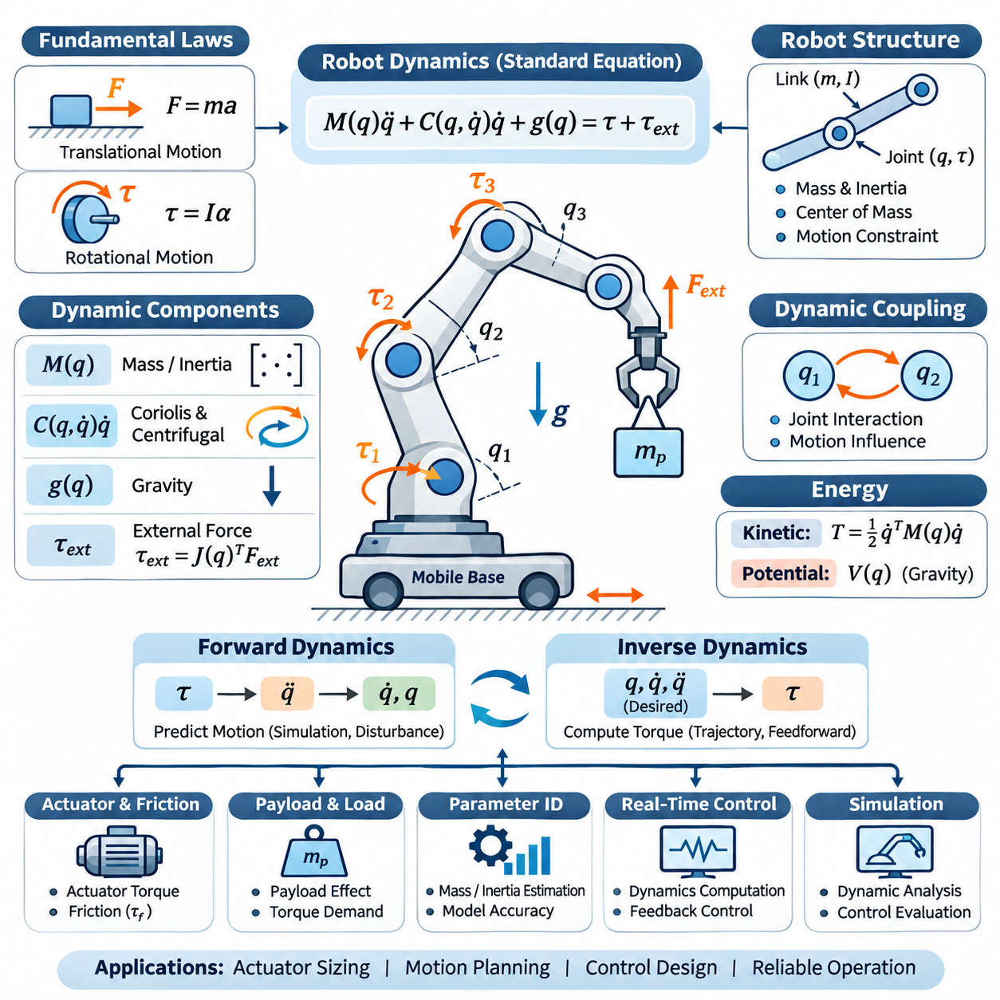
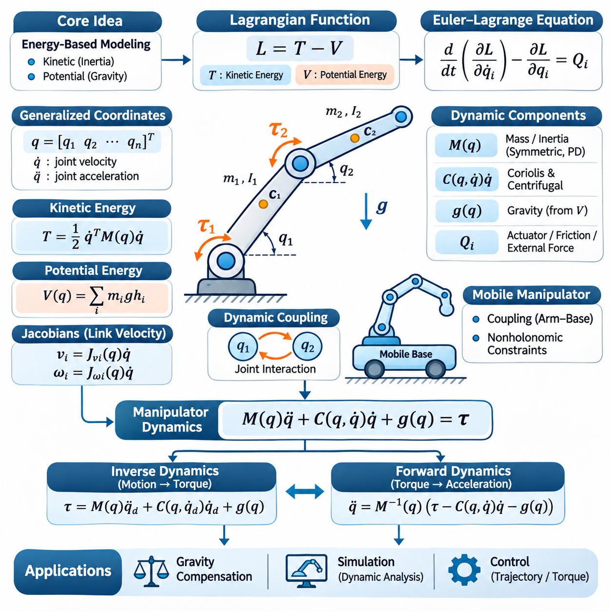
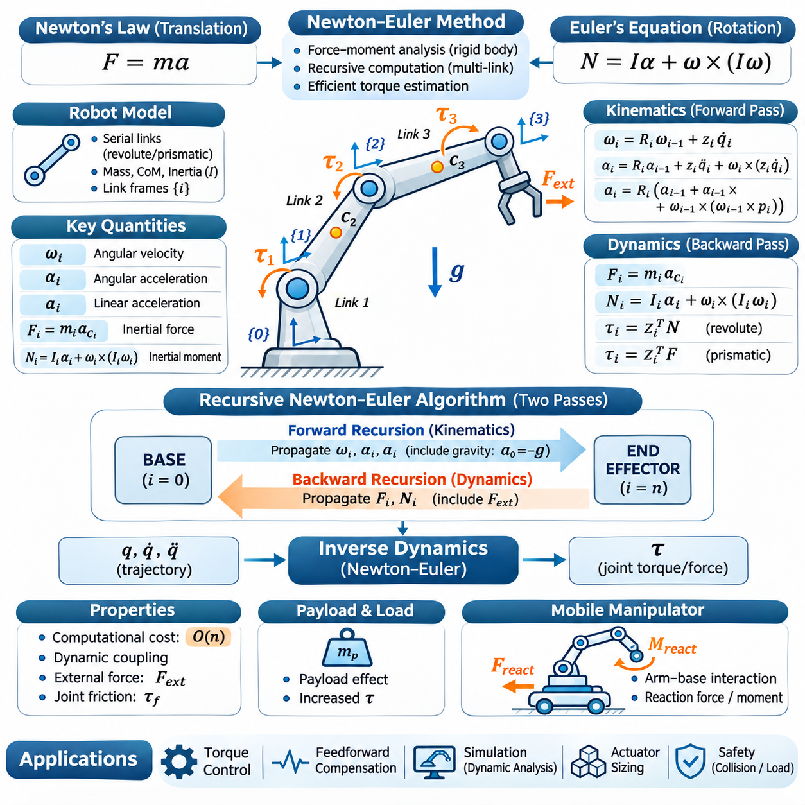
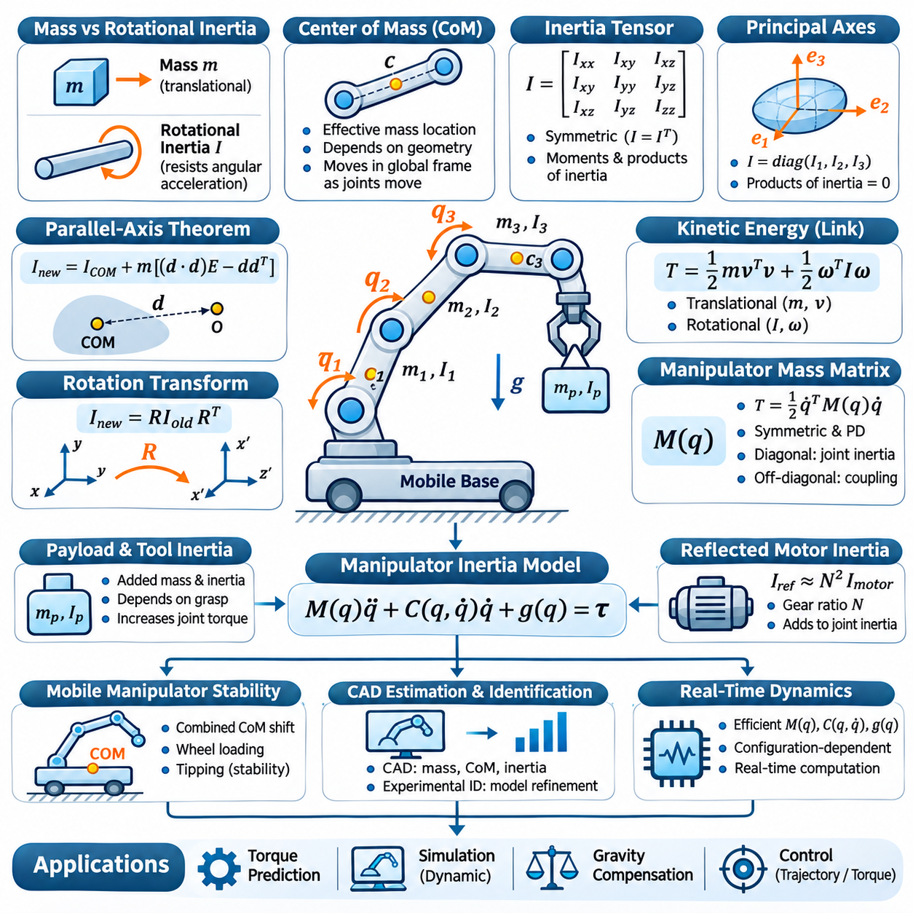
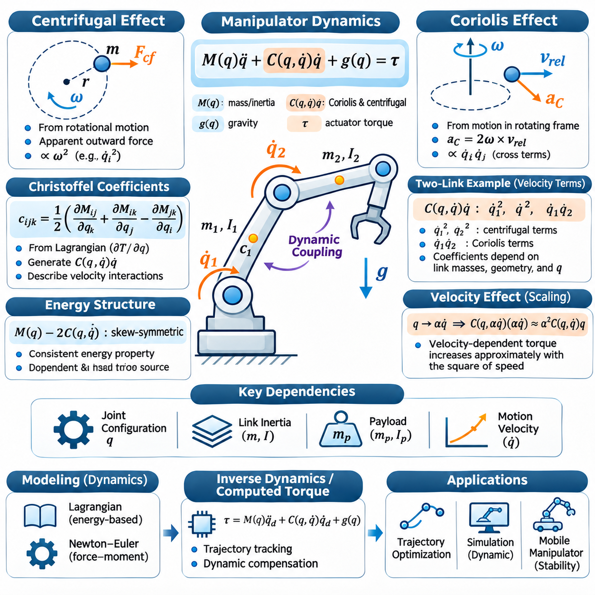
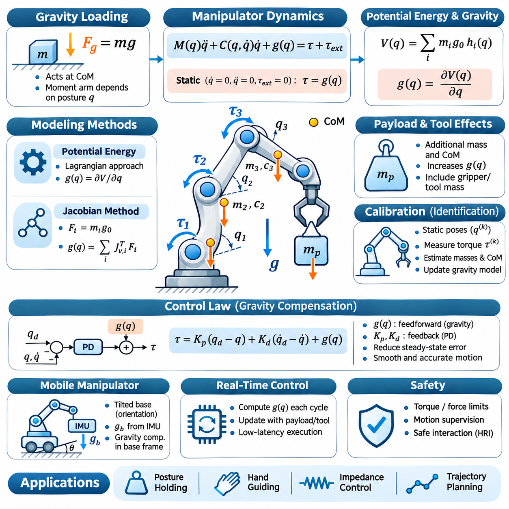
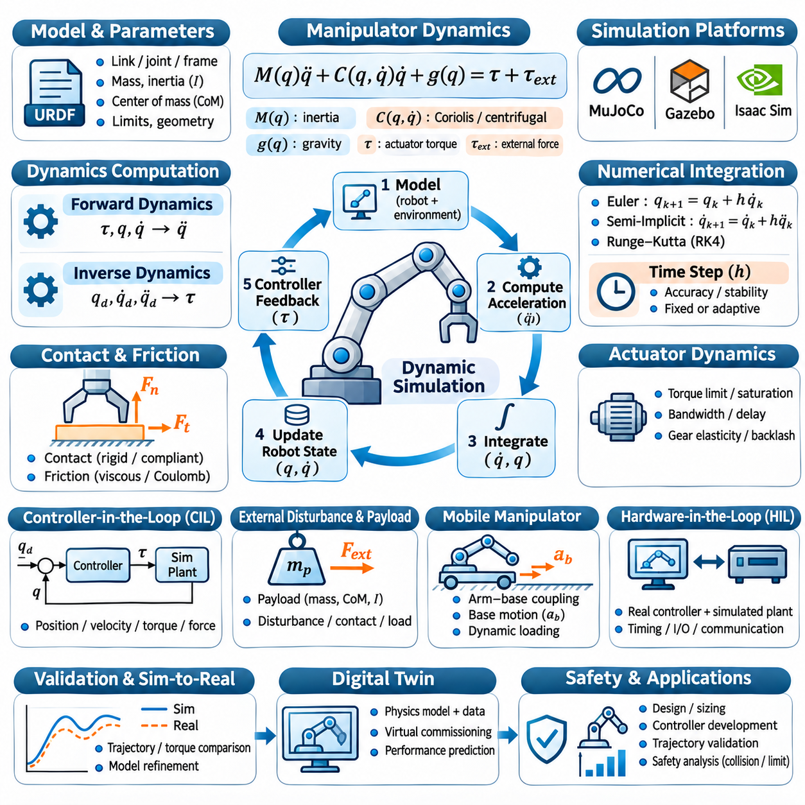
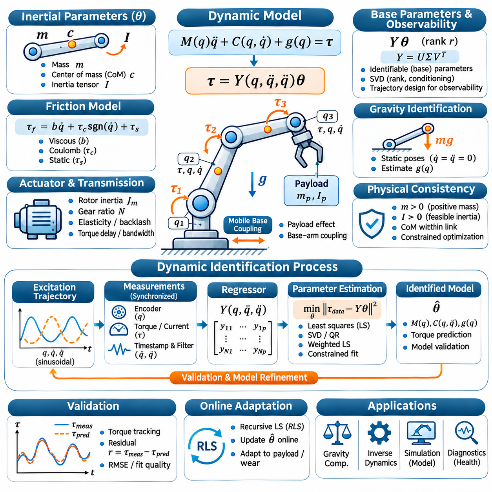
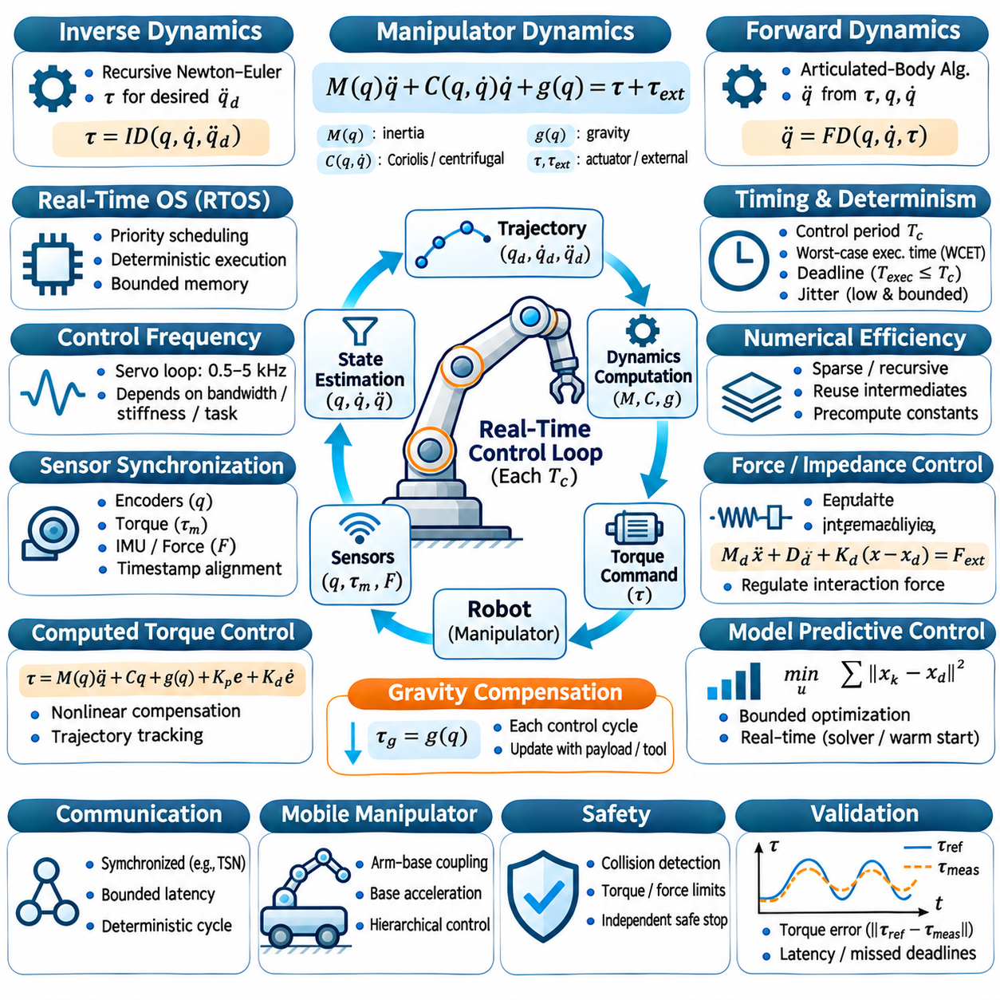

**Volume 02. Manipulator Mechanics and Control**

# Chapter 04. Dynamics

## 01 Dynamics Fundamentals

{width="7.268055555555556in" height="7.268055555555556in"}

Robot dynamics describes the relationship between motion and the forces or torques that produce it. While kinematics determines the position, orientation, velocity, and acceleration of a manipulator without considering their causes, dynamics explains how mass, inertia, gravity, and external interactions influence motion. Dynamic analysis is essential for predicting actuator requirements, designing control systems, and ensuring reliable robotic operation.

A robotic manipulator consists of interconnected rigid bodies or flexible structures connected through mechanical joints. Each link possesses mass, a center of mass, and rotational inertia, while each joint introduces constraints on relative motion. When actuators generate torque, these mechanical properties determine the resulting acceleration. Consequently, identical torque commands can produce different movements depending on robot configuration, payload, and operating conditions.

The fundamental principles of robot dynamics originate from Newton\'s laws of motion. Translational motion follows the relationship between force, mass, and acceleration, expressed as F = ma. Rotational motion follows the corresponding relationship between torque and angular momentum. For a rigid body rotating about a fixed principal axis, the simplified expression τ = Iα describes how rotational inertia resists angular acceleration.

In multi-joint manipulators, dynamic behavior becomes more complicated because the motion of one link influences the forces acting on other links. Accelerating a shoulder joint changes the motion of the elbow and wrist, even when their actuators receive no additional commands. These interactions are known as dynamic coupling and must be considered when designing controllers that coordinate multiple joints during high-speed or precision operations.

The standard rigid-body dynamic equation of a robotic manipulator is commonly expressed as M(q)q̈ + C(q,q̇)q̇ + g(q) = τ + τext. Here, q represents joint positions, q̇ represents joint velocities, and q̈ represents joint accelerations. The equation combines inertial effects, velocity-dependent interactions, gravity, actuator torque, and generalized external forces into a unified mathematical description of robot motion.

The mass matrix M(q) represents the configuration-dependent inertia of the manipulator. Its diagonal elements describe effective inertia associated with individual joints, while off-diagonal elements represent inertial coupling between joints. For a physically valid rigid-body model with independent generalized coordinates, this matrix is symmetric and positive definite. Its properties strongly influence acceleration, torque demand, and numerical stability.

The velocity-dependent term C(q,q̇)q̇ represents Coriolis and centrifugal effects generated by coordinated joint motion. Coriolis effects arise from interactions involving multiple velocities, whereas centrifugal effects are associated with rotational motion. These contributions become particularly important when manipulators operate at high speeds, perform rapid directional changes, or execute trajectories involving simultaneous movement of several joints.

Gravity introduces configuration-dependent joint torques because the centers of mass of robot links occupy different positions throughout the workspace. The gravity vector g(q) describes the torque required to balance gravitational loading at a given configuration. A horizontally extended manipulator may require substantially greater holding torque than the same arm positioned vertically, depending on its geometry and joint arrangement.

External forces influence manipulator dynamics whenever the robot interacts with objects, tools, surfaces, or humans. A force applied at the end effector can be transformed into generalized joint forces using the transpose of the Jacobian matrix. The relationship τext = J(q)ᵀFext provides a mathematical connection between Cartesian interaction forces and joint-space dynamics, assuming consistent coordinate frames and force representations.

Robot dynamics can be analyzed through two complementary approaches known as forward dynamics and inverse dynamics. Forward dynamics calculates joint accelerations from applied torques and the current robot state. Inverse dynamics calculates the torques required to produce specified joint positions, velocities, and accelerations. Both approaches are fundamental to simulation, motion planning, actuator sizing, and model-based control.

Forward dynamics is especially useful for predicting robot behavior under actuator commands and external disturbances. Given the current joint configuration, velocity, and applied torque, the dynamic equation can be solved for acceleration. Numerical integration then estimates subsequent velocities and positions. Repeating this process enables simulation of manipulator motion and evaluation of control strategies before physical deployment.

Inverse dynamics supports the generation of actuator commands for desired robot trajectories. When a trajectory specifies joint position, velocity, and acceleration over time, the dynamic model determines the corresponding torque requirements. This capability enables feedforward compensation, reduces tracking errors, and improves performance during rapid motion. However, accurate results depend on reliable mechanical parameters and appropriate modeling assumptions.

The kinetic energy of a manipulator represents the energy associated with the translational and rotational motion of its links. It can be expressed in joint coordinates as T = ½q̇ᵀM(q)q̇. Potential energy primarily represents gravitational energy associated with link positions. These energy quantities provide a systematic foundation for deriving dynamic equations and understanding how energy is transferred between interconnected mechanical components.

Energy conservation offers an important perspective on robot behavior. In an ideal mechanical system without friction, external work, or energy dissipation, total mechanical energy remains constant. Real manipulators experience energy losses through bearings, gear transmissions, electrical resistance, and structural deformation. Understanding these losses helps engineers evaluate efficiency, thermal behavior, and the practical limits of sustained robotic operation.

Actuator dynamics introduce additional characteristics beyond the ideal rigid-body model. Electric motors generate torque through electromagnetic interactions, while gearboxes modify the relationship between motor torque and joint torque. Motor rotor inertia, transmission efficiency, backlash, and mechanical compliance can affect the response of a joint. These factors become increasingly important in high-performance manipulators requiring precise torque regulation.

Friction is another major source of deviation between theoretical predictions and measured robot behavior. Joint friction may include viscous friction, Coulomb friction, static friction, and velocity-dependent nonlinear effects. Friction can produce tracking errors, oscillations, and unexpected resistance during low-speed motion. Accurate compensation requires identifying relevant friction characteristics without introducing instability or excessive control effort.

Payload variation changes the dynamic characteristics of a robotic manipulator. When a gripper acquires an object, the effective mass distribution, center of mass, and inertia of the robot change. These changes influence acceleration capability, joint torque requirements, and braking behavior. Dynamic models used in industrial manipulation must therefore account for different payload conditions, particularly during lifting, transportation, and rapid repositioning tasks.

In mobile manipulators, arm dynamics interact with the motion and stability of the mobile platform. Accelerating or extending the arm generates reaction forces and moments that can influence platform attitude, wheel loading, and traction. A mobile base may also introduce acceleration disturbances into the manipulator. Coordinated dynamic analysis is necessary when the arm operates while the platform moves or when heavy objects are handled near stability limits.

The combined dynamics of a mobile manipulator depend on whether the platform is stationary, moving, or mechanically constrained. When the platform remains fixed, conventional manipulator equations may provide an adequate approximation. During simultaneous base and arm motion, the generalized coordinates must include relevant platform degrees of freedom. Wheel constraints, ground contact, suspension behavior, and platform inertia can significantly influence the resulting equations.

Dynamic modeling also supports mechanical design by identifying maximum joint torques, acceleration limits, and structural loading conditions. Engineers can evaluate candidate link dimensions, actuator capacities, transmission ratios, and payload configurations before manufacturing. Dynamic simulations help identify operating conditions that produce excessive mechanical stress or demand torque beyond available actuator capabilities, reducing the risk of costly design revisions.

A practical dynamic model requires accurate estimates of link masses, centers of mass, inertia tensors, and joint characteristics. These parameters may be obtained from computer-aided design models, manufacturer specifications, or experimental measurements. However, nominal design values may differ from actual hardware because of manufacturing tolerances, wiring, attached equipment, and assembly variations. Experimental validation is therefore essential for reliable prediction.

Dynamic identification estimates mechanical parameters from observed robot motion and actuator measurements. By applying carefully designed excitation trajectories and recording joint positions, velocities, accelerations, and torques, engineers can estimate identifiable combinations of inertial and friction parameters. The quality of identification depends on measurement accuracy, trajectory excitation, sensor calibration, and the mathematical structure of the selected dynamic model.

Real-time dynamic computation is necessary for advanced control systems that continuously adjust actuator commands. A controller may evaluate gravity compensation, inverse dynamics, or disturbance estimates at every control cycle. Computational efficiency becomes critical as the number of joints increases. Recursive formulations and optimized numerical implementations help maintain predictable execution times while supporting high-frequency robotic control.

Dynamic models are never perfect representations of physical systems. Unmodeled flexibility, temperature-dependent friction, uncertain payloads, sensor noise, and external disturbances introduce discrepancies between predicted and actual behavior. Robust control methods, feedback correction, and online parameter adaptation can reduce the influence of these uncertainties. Effective engineering balances model accuracy against computational complexity and operational reliability.

The fundamental purpose of manipulator dynamics is to connect mechanical design, motion generation, and control into a consistent engineering framework. By understanding how inertia, gravity, velocity-dependent forces, actuator torque, and external interactions determine motion, engineers can develop manipulators that operate accurately and efficiently. These principles establish the foundation for advanced torque control, force regulation, dynamic simulation, and safe physical interaction.

## 02 Lagrangian Dynamics

{width="7.268055555555556in" height="7.268055555555556in"}

Lagrangian dynamics provides a systematic mathematical framework for describing the motion of robotic manipulators through energy relationships rather than directly analyzing individual forces. The method is particularly effective for interconnected mechanical systems with multiple degrees of freedom. By expressing kinetic and potential energy in generalized coordinates, engineers can derive equations of motion that capture inertia, gravitational loading, and dynamic coupling.

The foundation of Lagrangian dynamics is the Lagrangian function, defined as L = T − V, where T represents the total kinetic energy and V represents the total potential energy of the mechanical system. Kinetic energy depends on the velocities and inertial properties of moving links, while potential energy depends primarily on their positions within a gravitational field. This energy-based representation simplifies the mathematical description of complex robotic mechanisms.

Generalized coordinates describe the independent variables required to represent a robot\'s mechanical configuration. For a serial manipulator, these coordinates typically correspond to revolute joint angles or prismatic joint displacements. The generalized coordinate vector q contains all independent joint variables, while q̇ and q̈ represent their velocities and accelerations. This formulation accommodates different joint types without requiring separate force equations for every mechanical component.

The Euler-Lagrange equation establishes the relationship between the Lagrangian function and generalized forces. For each coordinate qi, the equation is written as d/dt(∂L/∂q̇i) − ∂L/∂qi = Qi, where Qi represents the corresponding generalized applied force or torque. Applying this equation to every independent coordinate produces a coupled system of differential equations describing the manipulator\'s motion under specified mechanical and external loading conditions.

The kinetic energy of a robotic manipulator includes translational and rotational contributions from every moving link. Translational kinetic energy depends on link mass and center-of-mass velocity, while rotational kinetic energy depends on angular velocity and inertia tensors. These contributions can be combined into T = ½q̇ᵀM(q)q̇, where M(q) is the configuration-dependent mass matrix representing the complete manipulator\'s inertial characteristics.

Link velocities can be calculated using Jacobian matrices that relate generalized joint velocities to Cartesian motion. The linear Jacobian determines the translational velocity of each link\'s center of mass, while the angular Jacobian determines its rotational velocity. Combining these relationships with link masses and inertia tensors produces individual contributions to the mass matrix. Summing the contributions of all links yields the complete manipulator inertia model.

The mass matrix is a central result of Lagrangian modeling because it describes how joint accelerations generate inertial forces. Its diagonal elements represent effective joint inertia, while off-diagonal elements describe inertial coupling between different joints. For a rigid manipulator expressed in independent generalized coordinates, the mass matrix is symmetric and positive definite. These properties are important for numerical computation, controller stability, and energy-based analysis.

Potential energy in conventional robotic manipulators is primarily associated with gravitational loading. Each link contributes gravitational potential energy according to its mass and the vertical position of its center of mass. The total potential energy is obtained by summing these contributions across all links. Differentiating this energy with respect to generalized coordinates produces the gravity vector g(q), which represents the torques required to balance gravitational effects.

The gravity vector changes continuously as the manipulator moves through different configurations. A horizontally extended arm may require substantial torque to maintain its position, whereas a vertically aligned configuration may produce different gravitational loading. Lagrangian dynamics captures these variations through the position-dependent potential energy function. This formulation provides a direct mathematical foundation for gravity compensation in robotic control systems.

Coriolis and centrifugal effects emerge naturally when the Euler-Lagrange equations are expanded. Because the mass matrix depends on joint configuration, differentiating kinetic energy with respect to time introduces terms involving products of joint velocities. These velocity-dependent terms describe dynamic interactions between moving links. They are commonly represented by C(q,q̇)q̇, where C is a matrix constructed to reproduce the required nonlinear velocity forces.

The resulting manipulator equation is commonly expressed as M(q)q̈ + C(q,q̇)q̇ + g(q) = τ, assuming an ideal rigid-body system without friction or external disturbances. Here, τ represents the generalized actuator torque vector. This compact equation combines inertial forces, velocity-dependent interactions, and gravitational loading. It provides the mathematical foundation for inverse dynamics, forward dynamics, trajectory tracking, and model-based torque control.

Nonconservative forces can be incorporated through generalized forces on the right-hand side of the Euler-Lagrange equations. These forces may include actuator torque, joint friction, damping, and external contact loading. For example, viscous damping can be modeled as a velocity-dependent resisting torque, while external Cartesian forces can be mapped into joint coordinates using the Jacobian transpose. This extension enables more realistic descriptions of industrial manipulators.

A two-link planar manipulator provides a useful example of Lagrangian modeling. Its generalized coordinates are the shoulder and elbow joint angles, and each link contributes translational and rotational kinetic energy. The potential energy depends on the vertical positions of the link centers of mass. Applying the Euler-Lagrange equations produces two coupled differential equations that describe how both actuator torques influence the acceleration of each joint.

Dynamic coupling becomes evident when the two-link equations are examined. Accelerating the shoulder joint influences the torque required at the elbow, while elbow motion changes the effective inertia experienced by the shoulder. These interactions depend on joint configuration and velocity. Lagrangian analysis captures them automatically through the total energy expressions, avoiding the need to calculate every internal reaction force between connected links.

One major advantage of the Lagrangian method is its ability to eliminate ideal constraint forces through the selection of independent generalized coordinates. Instead of explicitly calculating reaction forces at every joint, the formulation focuses on coordinates that satisfy the mechanical constraints. This approach reduces modeling complexity for serial manipulators and many constrained mechanisms. More complicated systems may require constraint equations and Lagrange multipliers.

Lagrange multipliers extend the energy formulation to systems containing additional holonomic constraints. Such constraints may describe closed kinematic chains, mechanically coupled joints, or prescribed geometric relationships. Introducing multipliers allows constraint forces to appear explicitly in the equations of motion. This capability is useful for parallel manipulators, cooperative manipulation mechanisms, and robotic systems involving multiple interconnected mechanical structures.

For mobile manipulators, Lagrangian dynamics can describe the combined motion of the robotic arm and mobile platform. Generalized coordinates may include platform position, orientation, and manipulator joint variables. The total kinetic energy then incorporates platform translation, platform rotation, and arm motion. Coupling terms describe how manipulator acceleration influences the base and how platform motion affects the dynamic behavior of the arm.

Mobile platforms with wheeled locomotion introduce additional modeling considerations because rolling constraints may be nonholonomic. These constraints restrict allowable velocities without necessarily reducing the system to independent position coordinates. Lagrange-d\'Alembert formulations with appropriate constraint forces can represent such systems. Accurate modeling must also consider wheel-ground interaction, platform inertia, and the assumptions used to describe traction and contact.

Lagrangian dynamics is particularly valuable for inverse dynamics calculations. Given desired joint positions, velocities, and accelerations, the dynamic model determines the actuator torques needed to execute the motion. These torque estimates can be incorporated into feedforward controllers to compensate for predictable mechanical loading. When combined with feedback control, model-based compensation can improve trajectory accuracy and reduce tracking errors during rapid manipulation.

The same equations support forward dynamics simulation by solving for joint acceleration. Given the current configuration, velocity, and applied torque, acceleration is calculated from the inverse of the mass matrix or an equivalent numerical solution. Numerical integration then updates joint velocity and position over time. Repeated calculations allow engineers to predict robot motion, evaluate actuator limits, and investigate the consequences of different control commands.

Lagrangian models also support energy-based stability analysis. The total mechanical energy can serve as a candidate Lyapunov function when analyzing certain controlled mechanical systems. Under appropriate assumptions, the relationship between the mass matrix and Coriolis terms provides useful structural properties for controller design. These properties help establish stability conditions for tracking controllers, adaptive control methods, and interaction control strategies.

The accuracy of Lagrangian dynamics depends on the mechanical parameters used to construct the energy functions. Link masses, centers of mass, inertia tensors, and geometric dimensions must be estimated reliably. Computer-aided design models provide initial parameter values, while experimental identification can improve agreement with physical hardware. Unmodeled friction, structural flexibility, gearbox dynamics, and uncertain payloads may still produce differences between predicted and measured behavior.

Symbolic computation tools can automate portions of Lagrangian model derivation, particularly for manipulators containing many joints. Symbolic differentiation generates equations from kinetic and potential energy expressions, while numerical implementations evaluate the resulting dynamics during simulation or control. However, symbolic expressions can become computationally expensive as system complexity increases. Efficient implementations often exploit matrix structure and recursive dynamic algorithms.

Lagrangian dynamics establishes a unified connection between mechanical energy, robot motion, and actuator requirements. Its mathematical structure makes it suitable for modeling serial manipulators, constrained mechanisms, and mobile manipulation systems. By deriving motion equations from kinetic and potential energy, engineers obtain consistent representations of inertia, gravitational effects, and dynamic coupling. These models form an essential foundation for advanced robotic control, simulation, and physical interaction.

## 03 Newton Euler Method

{width="7.268055555555556in" height="7.268055555555556in"}

The Newton-Euler method provides a systematic approach to deriving the equations of motion for robotic manipulators by applying Newton\'s laws of translational motion and Euler\'s equations of rotational motion. Unlike energy-based formulations, this method directly analyzes forces, moments, and accelerations acting on individual links. It is particularly suitable for multi-link robotic systems where computational efficiency and accurate torque estimation are essential.

Newton\'s second law establishes that the net external force acting on a rigid body equals its mass multiplied by the acceleration of its center of mass. Euler\'s rotational equation relates applied moments to angular momentum changes. Together, these principles describe the complete rigid-body motion of each manipulator link. By considering both translational and rotational dynamics, engineers can determine how actuator torques produce coordinated mechanical movement.

A robotic manipulator is represented as a sequence of rigid links connected by revolute or prismatic joints. Each link possesses mass, a center of mass, and an inertia tensor describing its resistance to rotational acceleration. Coordinate frames are attached to individual links to express motion and loading consistently. The Newton-Euler formulation uses these physical properties to calculate the forces and moments transmitted through the mechanical structure.

The Newton-Euler method commonly employs a recursive computational procedure consisting of forward and backward passes. The forward recursion propagates velocities and accelerations from the robot base toward the end effector. The backward recursion propagates forces and moments from the end effector toward the base. Combining these calculations produces the generalized joint forces or torques required to generate a specified manipulator trajectory.

During forward recursion, the angular velocity of each link is calculated using the angular velocity of its parent link and the relative motion introduced by the connecting joint. For revolute joints, joint velocity contributes directly to angular velocity. For prismatic joints, relative joint motion contributes to linear velocity instead. Coordinate transformations ensure that motion quantities are expressed consistently between neighboring link frames.

Angular acceleration is obtained by differentiating the angular velocity relationships while accounting for motion between rotating coordinate frames. The resulting expressions include contributions from parent-link acceleration, joint acceleration, and velocity-dependent cross-product terms. These terms capture the effects of coordinated joint movement. Accurate angular acceleration computation is essential for estimating rotational inertia forces and actuator torque requirements.

Linear acceleration propagates through the manipulator according to the geometric relationships between connected links. The acceleration of a link origin depends on the acceleration of its parent, angular acceleration, angular velocity, and relative joint motion. Centripetal and Coriolis terms appear naturally in these calculations. The acceleration of each link\'s center of mass is subsequently determined from its origin acceleration and rotational motion.

Gravity can be incorporated into the recursive formulation by assigning an appropriate initial acceleration to the base frame. This approach allows gravitational loading to propagate through the same equations used for inertial acceleration. The resulting link forces therefore include the effects of gravity without requiring a separate calculation for every joint. Consistent sign conventions and coordinate definitions are necessary to obtain physically correct torque results.

After computing link accelerations, the inertial force acting on each link is determined from its mass and center-of-mass acceleration. The corresponding inertial moment depends on the link inertia tensor, angular acceleration, and angular velocity. Euler\'s rotational equation includes the gyroscopic contribution associated with angular momentum. These quantities form the basis for calculating the internal forces and moments transmitted between connected links.

The rotational equation for a rigid link can be expressed as N = Iα + ω × (Iω), where N represents the net moment about the center of mass, I is the inertia tensor, α is angular acceleration, and ω is angular velocity. The cross-product term describes gyroscopic effects arising from rotation. This equation remains applicable to general rigid-body rotation when all quantities are expressed in a consistent coordinate frame.

Backward recursion begins at the terminal link and proceeds toward the robot base. Forces and moments transmitted from downstream links are combined with the inertial loading of each current link. The resulting quantities represent the mechanical effort required to support and accelerate the connected structure. External forces applied at the end effector or intermediate links can also be incorporated into the backward propagation process.

Joint torque is obtained by projecting the transmitted moment onto the corresponding revolute joint axis. For prismatic joints, the generalized joint force is obtained by projecting the transmitted force onto the translation axis. These projections connect spatial force calculations with actuator requirements. Repeating the process across all joints produces the complete torque or force vector needed to execute the specified motion.

The recursive Newton-Euler algorithm is especially valuable because its computational complexity grows approximately linearly with the number of links in a conventional serial manipulator. Rather than explicitly constructing large symbolic expressions, the algorithm evaluates local mechanical relationships and propagates their results. This efficiency makes it suitable for high-frequency inverse dynamics calculations in industrial robot controllers and embedded robotic systems.

Inverse dynamics represents the most common application of the recursive Newton-Euler method. Given joint positions, velocities, and accelerations, the algorithm calculates the corresponding actuator torques. These estimates support feedforward compensation, trajectory tracking, actuator sizing, and dynamic performance evaluation. When combined with feedback control, inverse dynamics can improve tracking accuracy during rapid movements and under varying gravitational loading.

The Newton-Euler formulation can also support forward dynamics, although direct recursive inverse dynamics does not independently provide the most efficient forward dynamics solution. Forward dynamics requires calculating joint accelerations from applied torques and the current robot state. Algorithms such as articulated-body dynamics exploit related recursive rigid-body principles to perform this calculation efficiently without explicitly inverting the complete manipulator mass matrix.

Dynamic coupling between joints emerges naturally through recursive force and acceleration propagation. When one joint accelerates, the resulting inertial loading influences neighboring links and changes the torques required at other joints. These interactions depend on robot configuration, joint velocity, and mass distribution. The Newton-Euler method captures these effects through the physical relationships between interconnected rigid bodies.

External loading is particularly important in manipulation tasks involving grasping, lifting, assembly, and contact with surrounding objects. A force or moment applied at the end effector changes the mechanical loads transmitted through the robot structure. Recursive calculations can incorporate these external wrenches to determine additional actuator requirements. This capability supports payload evaluation, force-sensitive manipulation, and mechanical safety analysis.

For mobile manipulators, Newton-Euler dynamics can describe the forces and moments generated by the robotic arm and their transmission to the mobile platform. Rapid arm acceleration may create reaction moments that influence platform stability and wheel loading. When the base is moving, its linear and angular accelerations must also be considered. Coordinated modeling helps engineers evaluate the dynamic interaction between arm motion and mobile-base behavior.

The method can be extended to complex robotic structures containing branched kinematic chains, multiple manipulators, or floating-base mechanisms. Each branch contributes forces and moments that must be combined at shared mechanical connections. Floating-base systems require additional treatment of base motion and external contact constraints. These extensions are relevant to humanoid robots, mobile manipulation platforms, and coordinated multi-arm systems.

Accurate Newton-Euler calculations require reliable mechanical parameters, including link masses, centers of mass, inertia tensors, joint axes, and geometric transformations. These parameters can be obtained from computer-aided design models, manufacturer specifications, or experimental identification. Errors in mass distribution or coordinate frame definitions can produce substantial torque prediction errors, particularly during high-speed motion or heavy-payload manipulation.

Practical implementations must also consider friction, transmission losses, actuator dynamics, and structural compliance. The ideal rigid-body Newton-Euler model does not automatically account for these effects. Additional models may represent viscous friction, Coulomb friction, gearbox efficiency, motor rotor inertia, or flexible joints. Incorporating these characteristics improves agreement between calculated torque requirements and measured actuator behavior.

Numerical stability and computational consistency are important when implementing recursive dynamics in real-time software. Coordinate transformations, rotation matrices, and spatial vector operations must follow consistent mathematical conventions. Efficient implementations minimize unnecessary calculations and memory allocation while maintaining deterministic execution times. These considerations are especially important for high-frequency robotic control and safety-critical motion applications.

The Newton-Euler and Lagrangian methods describe the same underlying rigid-body mechanics but emphasize different mathematical approaches. Lagrangian dynamics derives equations from kinetic and potential energy, while Newton-Euler dynamics directly propagates forces, moments, velocities, and accelerations. Both can produce equivalent manipulator equations under consistent assumptions. The preferred method depends on modeling objectives, system complexity, and computational requirements.

The Newton-Euler method establishes a practical connection between rigid-body mechanics and real-time robotic control. Its recursive structure enables efficient calculation of actuator torques while preserving the physical relationships between interconnected links. By accounting for translational motion, rotational motion, gravity, and external loading, engineers can develop accurate dynamic models for industrial manipulators and mobile robotic systems. These models support reliable motion control, simulation, and mechanical performance optimization.

## 04 Inertia Modeling

{width="7.268055555555556in" height="7.268055555555556in"}

Inertia modeling describes how the mass and spatial distribution of material within a robotic manipulator influence its resistance to acceleration. Unlike kinematic models, which describe motion without considering physical loading, inertia models quantify the mechanical effort required to change motion. Accurate inertia representation is essential for dynamic simulation, actuator selection, trajectory planning, and high-performance robotic control.

Mass represents resistance to translational acceleration, while rotational inertia describes resistance to changes in angular velocity. Two links with identical mass may exhibit significantly different rotational behavior because their material distributions differ. A long, slender link generally produces greater inertia about an axis perpendicular to its length than a compact link of equal mass. Consequently, link geometry must be considered alongside total mass.

The center of mass is the effective location at which the distributed mass of a rigid body can be represented for translational dynamics. Its position depends on the geometry, material density, and arrangement of internal components. In robotic manipulators, the center of mass changes in global coordinates as joints move, even though its location remains fixed within an ideal rigid link. Accurate center-of-mass estimation is critical for gravity compensation.

Rotational inertia is mathematically represented by the inertia tensor, a symmetric three-by-three matrix describing mass distribution relative to a selected coordinate frame. Its diagonal elements represent moments of inertia about coordinate axes, while off-diagonal elements describe products of inertia. These terms capture how rotation around one axis can influence angular momentum components along other axes, particularly in asymmetrical mechanical structures.

The inertia tensor about the center of mass can be expressed as I = ∫(rᵀrE − rrᵀ)dm, where r is the position vector from the center of mass to an infinitesimal mass element, and E is the identity matrix. This expression integrates the contribution of every mass element throughout the rigid body. It provides a general mathematical foundation for calculating rotational inertia from geometry and material density.

Principal moments of inertia are obtained by diagonalizing the inertia tensor. The corresponding eigenvectors define principal axes along which angular momentum and angular velocity are aligned for rotation about a single principal axis. These axes simplify mechanical analysis because the products of inertia vanish in the principal coordinate system. Principal inertia properties are commonly provided by computer-aided design software and mechanical simulation tools.

The parallel-axis theorem allows inertia to be transferred from the center of mass to another reference point. For a rigid body of mass m and displacement vector d between reference points, the transformed inertia is Inew = ICOM + m[(dᵀd)E − ddᵀ], assuming parallel coordinate axes. This relationship is essential when expressing link inertia about joint origins rather than individual centers of mass.

Coordinate transformations are required when inertia tensors are expressed in different orientations. If R represents the rotation matrix between coordinate frames, the transformed inertia tensor is Inew = R Iold Rᵀ. This operation preserves the physical inertia properties while changing their mathematical representation. Correct transformation is particularly important when assembling dynamic models from multiple links with independently defined local coordinate systems.

A robotic manipulator contains multiple links whose inertia contributions depend on joint configuration. Each link contributes translational and rotational kinetic energy, which can be expressed using its mass, center-of-mass Jacobian, and inertia tensor. Combining these contributions produces the manipulator mass matrix M(q). This matrix describes how the effective inertia experienced at each joint changes as the robot moves through its workspace.

The manipulator mass matrix is generally symmetric and positive definite when independent generalized coordinates describe a physically valid rigid-body system. Its diagonal elements represent effective joint inertia, while off-diagonal elements describe inertial coupling between joints. These coupling terms explain why accelerating one joint can generate torque requirements at other joints. Their magnitude depends on robot geometry, mass distribution, and current joint configuration.

Inertia modeling is closely related to kinetic energy. For a rigid link, translational kinetic energy is determined by its mass and center-of-mass velocity, while rotational kinetic energy depends on angular velocity and inertia tensor. The combined expression is T = ½mvᵀv + ½ωᵀIω. Summing these contributions across all links provides the energy representation used in Lagrangian dynamics and model-based control.

In Newton-Euler dynamics, inertia determines the forces and moments required to accelerate individual links. Translational inertial force is calculated from mass and center-of-mass acceleration, while rotational inertial moment includes angular acceleration and gyroscopic effects. These quantities propagate through the manipulator structure to determine joint torque requirements. Accurate inertia parameters therefore directly influence inverse dynamics predictions.

Payload inertia introduces additional loading when a manipulator grasps or carries an object. The payload contributes mass, center-of-mass displacement, and rotational inertia relative to the end effector. Its effective inertia depends on the grasp configuration and the object\'s geometry. A long object held far from the wrist may require substantially greater joint torque than a compact object of identical mass, particularly during rapid acceleration.

End effectors, grippers, cameras, and attached tools must be included in the inertia model when their contributions are significant. Even relatively lightweight components can produce considerable rotational inertia when mounted far from a joint axis. Ignoring these components may lead to inaccurate torque predictions and degraded trajectory tracking. Practical models should therefore represent the complete moving assembly rather than only the primary structural links.

Motor and transmission inertia also influence joint dynamics. A motor rotor possesses rotational inertia that contributes to the effective inertia observed at the joint through the transmission ratio. For an ideal rigid gearbox, reflected motor inertia scales approximately with the square of the gear ratio. This effect can become substantial in highly geared actuators and must be considered when evaluating acceleration performance and torque control bandwidth.

In mobile manipulators, inertia modeling must include both the robotic arm and the mobile platform when their motions are dynamically coupled. Platform mass, rotational inertia, and center-of-mass location influence acceleration, turning behavior, and stability. Arm motion can change the combined system\'s mass distribution and generate reaction moments. These effects become important when handling heavy payloads or operating with the arm extended beyond the platform footprint.

The combined center of mass of a mobile manipulator changes as the robotic arm moves. This variation influences wheel loading, ground contact forces, and resistance to tipping. Dynamic acceleration introduces additional inertial moments that may reduce stability margins. Accurate inertia models support stability analysis by predicting how arm configuration, payload location, and platform motion interact under different operating conditions.

Computer-aided design systems provide a practical starting point for inertia estimation. Three-dimensional mechanical models can calculate component mass, center of mass, and inertia tensors from geometry and assigned material density. However, model accuracy depends on correct material properties and complete representation of physical components. Wiring, fasteners, internal electronics, and manufacturing modifications may introduce discrepancies between nominal and actual inertia values.

Experimental inertia identification improves model accuracy by estimating inertial parameters from measured robot motion and actuator effort. Carefully designed excitation trajectories produce joint accelerations and dynamic interactions that reveal parameter sensitivity. Regression-based identification methods can estimate identifiable combinations of masses, centers of mass, and inertia components. Reliable identification requires accurate sensors, appropriate excitation, and careful treatment of friction.

Not every individual inertial parameter can necessarily be identified independently from joint measurements. Some parameters influence the equations of motion only through specific combinations, known as base inertial parameters. Identifiability depends on robot structure, available measurements, and excitation trajectories. Understanding these limitations prevents unrealistic expectations during parameter estimation and supports the construction of physically consistent dynamic models.

Uncertainty in inertia parameters can affect control performance, especially during rapid motion or heavy-payload manipulation. Incorrect mass or inertia estimates may cause feedforward torque errors, trajectory deviations, and unexpected actuator loading. Robust feedback control and adaptive estimation can reduce sensitivity to these uncertainties. Nevertheless, accurate baseline inertia models remain valuable for achieving predictable dynamic behavior and efficient control.

Inertia modeling also supports mechanical optimization by revealing how component placement influences actuator requirements. Reducing mass near the distal end of a manipulator can decrease the inertia experienced by upstream joints. Relocating heavy components toward the base may improve acceleration capability and reduce energy consumption. These design choices must be balanced against structural stiffness, workspace requirements, payload capacity, and manufacturing constraints.

Real-time control systems require efficient evaluation of configuration-dependent inertia properties. Rather than repeatedly constructing large symbolic expressions, practical implementations use optimized matrix operations or recursive rigid-body algorithms. These methods calculate mass matrices, inverse dynamics, and related quantities with predictable computational cost. Efficient inertia computation is especially important for high-frequency torque control and coordinated mobile manipulation.

Inertia modeling establishes the physical foundation connecting robot geometry, mass distribution, and dynamic behavior. By accurately representing link inertia tensors, centers of mass, payload effects, and configuration-dependent coupling, engineers can predict actuator loading and mechanical response. These models support reliable simulation, gravity compensation, inverse dynamics, stability evaluation, and advanced robotic control across industrial manipulators and mobile robotic systems.

## 05 Coriolis and Centrifugal Forces

{width="7.268055555555556in" height="7.268055555555556in"}

Coriolis and centrifugal forces describe velocity-dependent dynamic effects that arise when robotic manipulators move through interconnected rotational and translational motions. These effects influence the actuator torques required to maintain desired trajectories, particularly during rapid or coordinated joint movements. Understanding their mathematical origins is essential for accurate dynamic modeling, inverse dynamics computation, and high-performance robotic control.

Centrifugal effects are associated with rotational motion and the acceleration required to maintain curved trajectories. A mass moving along a circular path experiences centripetal acceleration directed toward the center of rotation. In a rotating reference frame, the corresponding centrifugal force appears to act outward. Robotic dynamics incorporates these effects when calculating the forces and torques associated with rotating links and moving mass distributions.

Coriolis effects arise when motion occurs within a rotating coordinate frame. A point moving relative to a rotating link experiences an additional acceleration determined by the interaction between frame angular velocity and relative linear velocity. This acceleration is expressed as aC = 2ω × vrel, where ω represents angular velocity and vrel represents relative velocity. The resulting dynamic terms become important when multiple manipulator joints move simultaneously.

In robotic manipulators, Coriolis and centrifugal effects are closely related to dynamic coupling between joints. Motion at one joint changes the velocities and accelerations experienced by downstream links, influencing the torque requirements of other joints. These interactions depend on joint configuration, velocity, link geometry, and mass distribution. Consequently, independent joint models may become insufficient for accurate prediction during coordinated high-speed movement.

The standard manipulator dynamic equation is expressed as M(q)q̈ + C(q,q̇)q̇ + g(q) = τ, where M(q) is the mass matrix, C(q,q̇) represents velocity-dependent dynamic interactions, and g(q) describes gravitational loading. The vector C(q,q̇)q̇ contains the combined Coriolis and centrifugal terms. These contributions are nonlinear functions of joint velocities and generally depend on the current manipulator configuration.

Centrifugal contributions commonly involve squared joint velocities, while Coriolis contributions involve products of different joint velocities. For example, a two-joint manipulator may contain terms proportional to q̇1², q̇2², and q̇1q̇2. Their coefficients depend on link masses, geometric dimensions, and joint angles. These relationships explain why velocity-dependent torque requirements change as the robot moves through different configurations.

The velocity-dependent terms can be derived systematically from the configuration-dependent mass matrix using Lagrangian dynamics. When kinetic energy is differentiated with respect to time, variations in the mass matrix generate products of joint velocities. These terms are commonly organized using Christoffel symbols, which describe how the inertia matrix changes with generalized coordinates. This formulation provides a consistent mathematical foundation for nonlinear manipulator dynamics.

For a mass matrix M(q), Christoffel coefficients may be defined as cijk = ½(∂Mij/∂qk + ∂Mik/∂qj − ∂Mjk/∂qi). The corresponding velocity-dependent generalized force is obtained by summing cijk q̇j q̇k over the joint indices. These coefficients describe interactions between configuration-dependent inertia and joint velocities. They are especially useful when deriving dynamic equations for manipulators with several coupled joints.

The matrix C(q,q̇) is not uniquely defined because different matrix representations can produce the same velocity-dependent force vector. However, a common construction based on Christoffel coefficients provides useful mathematical properties. In particular, the matrix Ṁ(q) − 2C(q,q̇) can be made skew-symmetric. This structural relationship is important for energy analysis, stability proofs, and the development of model-based robotic controllers.

Coriolis and centrifugal terms do not represent independent energy sources within an ideal rigid-body manipulator. Instead, they describe how kinetic energy is redistributed through coordinated motion and changing inertia. Their contribution satisfies important energy relationships when the dynamic model is constructed consistently. Understanding these properties helps distinguish velocity-dependent inertial effects from dissipative forces such as friction and mechanical damping.

A two-link planar manipulator illustrates these interactions clearly. When the shoulder and elbow joints rotate simultaneously, the motion of the second link changes the inertial loading experienced by the first joint. The resulting dynamic equations contain products of joint velocities multiplied by configuration-dependent coefficients. These terms become significant when the elbow moves rapidly while the shoulder rotates or when both joints undergo coordinated acceleration.

The direction and magnitude of velocity-dependent torques depend on joint angles and motion direction. Reversing one joint velocity can change the sign of certain Coriolis terms, while centrifugal contributions involving squared velocities may retain their sign for a fixed configuration. This behavior produces different torque requirements for trajectories that pass through identical positions with different velocity combinations.

At low joint velocities, Coriolis and centrifugal effects are often relatively small compared with gravitational and acceleration-dependent inertial loading. Their magnitude generally increases quadratically when all joint velocities are scaled by the same factor. Consequently, doubling the speed of a given coordinated motion can approximately quadruple its velocity-dependent dynamic terms at the same configuration. This relationship becomes important in high-speed industrial manipulation.

Velocity-dependent dynamic effects influence trajectory planning because actuator torque limits constrain achievable joint speeds and accelerations. A trajectory that is geometrically feasible may require excessive torque when executed too quickly. Dynamic trajectory optimization therefore evaluates inertia, gravity, and velocity-dependent loading together. Appropriate timing adjustments can reduce peak torque demand while maintaining acceptable task completion times.

Inverse dynamics algorithms incorporate Coriolis and centrifugal effects when calculating actuator torques for specified joint trajectories. Given joint positions, velocities, and accelerations, the dynamic model predicts the required torque contributions. Accurate compensation improves trajectory tracking by reducing systematic errors caused by nonlinear mechanical interactions. These benefits are particularly noticeable in manipulators performing rapid coordinated movements.

Computed torque control uses a dynamic model to compensate for nonlinear robot behavior. The controller calculates torque commands that account for inertia, gravity, and velocity-dependent terms while feedback corrects remaining tracking errors. When the model is accurate, this approach can approximately linearize the closed-loop joint dynamics. However, uncertain inertial parameters, friction, and external disturbances can reduce compensation accuracy.

The Newton-Euler method captures Coriolis and centrifugal effects through recursive velocity and acceleration calculations. Cross-product operations naturally generate the required rotational and translational coupling terms. Unlike symbolic Lagrangian derivation, recursive algorithms do not necessarily construct the Coriolis matrix explicitly. This computational structure is advantageous for real-time inverse dynamics in manipulators with many degrees of freedom.

For mobile manipulators, velocity-dependent effects extend beyond the robotic arm to interactions with the moving platform. Base rotation, translational motion, and arm joint velocities can generate additional coupling terms in the combined dynamic model. These interactions influence actuator loading and may affect platform stability. Accurate modeling is particularly important when the arm performs manipulation tasks while the mobile base is turning or accelerating.

Rotating mobile platforms introduce additional reference-frame effects that must be distinguished from physical contact forces. Coriolis and centrifugal terms arise naturally when motion is described in rotating coordinates, while wheel-ground forces enforce traction and motion constraints. A consistent dynamic formulation separates these contributions to avoid double counting. This distinction is important when modeling wheeled mobile manipulators and floating-base robotic systems.

Payload properties strongly influence velocity-dependent dynamic loading. Increasing payload mass or moving its center of mass farther from a joint axis changes the effective inertia and coupling coefficients. A long object carried by a robotic arm may therefore generate substantial additional torque during coordinated rotation. Payload-aware dynamic models are necessary when manipulating objects with different masses, dimensions, and grasp configurations.

Model accuracy depends on reliable link masses, inertia tensors, center-of-mass locations, and joint geometry. Errors in these parameters propagate into the predicted Coriolis and centrifugal terms. Experimental dynamic identification can estimate relevant inertial parameter combinations from measured trajectories and actuator torques. Carefully selected excitation motions are necessary to distinguish velocity-dependent effects from gravity, friction, and acceleration-related loading.

Numerical implementation requires consistent coordinate definitions, accurate joint velocity measurements, and efficient computation. Differentiating noisy position signals can introduce significant velocity estimation errors, which are amplified in quadratic dynamic terms. Filtering and state estimation can improve robustness, although excessive filtering introduces delay. Real-time controllers must balance estimation accuracy, computational efficiency, and control responsiveness.

Simulation environments use Coriolis and centrifugal models to predict realistic manipulator behavior during complex motion. Neglecting these terms may produce inaccurate torque estimates, especially at high speeds or under heavy payloads. Comparing simulated joint torques with experimental measurements helps validate the dynamic model. Such validation supports actuator selection, controller tuning, and the assessment of mechanical operating limits.

Coriolis and centrifugal effects are fundamental components of nonlinear robotic dynamics. They explain how joint velocities, changing inertia, and coordinated link motion influence actuator torque requirements. Accurate representation enables improved inverse dynamics, trajectory optimization, computed torque control, and dynamic simulation. These principles are essential for developing reliable industrial manipulators and mobile robotic systems operating under demanding motion conditions.

## 06 Gravity Compensation

{width="7.268055555555556in" height="7.268055555555556in"}

Gravity compensation is a fundamental technique in robotic manipulator control that counteracts the torques generated by gravitational forces acting on robot links and attached payloads. Without compensation, actuators must continuously resist gravity to maintain a desired posture. Accurate gravity compensation reduces steady-state positioning errors, improves motion smoothness, and supports precise manipulation across different joint configurations.

Gravity produces forces proportional to the mass of each link and the local gravitational acceleration. These forces act through the centers of mass and generate joint torques according to the geometry of the manipulator. Their magnitude changes as the robot moves because the moment arms between joint axes and centers of mass vary. Consequently, gravitational loading must be evaluated as a function of the current joint configuration.

The standard manipulator dynamics equation is M(q)q̈ + C(q,q̇)q̇ + g(q) = τ + τext, where M(q) represents the mass matrix, C(q,q̇) describes velocity-dependent effects, and g(q) is the gravity torque vector. When a manipulator remains stationary without external loading, joint velocities and accelerations are zero. The equilibrium condition becomes τ = g(q), indicating the actuator torques required to maintain a static posture.

Gravity compensation commonly uses a mathematical model to calculate the torque vector g(q) from measured joint positions. The controller applies these estimated torques as feedforward commands, reducing the corrective effort required from feedback control. Because gravitational torque depends primarily on configuration rather than joint velocity, it can be calculated independently of Coriolis and centrifugal effects in conventional rigid-body models.

The gravitational potential energy of a manipulator is determined by the masses and vertical positions of its links. For a system containing multiple rigid bodies, potential energy can be expressed as V(q) = Σ mi g0 hi(q), where mi is the mass of link i, g0 is gravitational acceleration, and hi(q) is its center-of-mass height. The gravity torque vector follows from the gradient g(q) = ∂V(q)/∂q, using consistent coordinate and sign conventions.

The potential-energy formulation provides a systematic method for deriving gravity torques in complex manipulators. Each joint contributes to changes in the vertical positions of downstream centers of mass. Differentiating the total potential energy with respect to joint coordinates reveals the gravitational loading associated with each actuator. This approach is particularly convenient when gravity compensation is integrated with Lagrangian dynamic modeling.

Gravity torque can also be calculated using link Jacobians. Each link experiences a gravitational force determined by its mass and the gravity vector, and its center-of-mass Jacobian maps this force into generalized joint coordinates. Summing the resulting contributions produces the complete gravity torque vector. This method is useful in numerical implementations because Jacobians are often already available for kinematic and dynamic calculations.

For a simple planar robotic arm, gravitational torque varies with the orientation of each link relative to the vertical direction. A horizontally extended arm generally requires substantial holding torque, while certain vertically aligned configurations produce smaller moments about selected joint axes. The exact relationship depends on joint definitions, link dimensions, and mass distribution. This configuration dependence makes fixed torque offsets inadequate for general gravity compensation.

Payload mass significantly influences gravity compensation requirements. When an object is grasped, its weight introduces additional forces and moments that must be supported by the manipulator joints. The resulting torque depends on payload mass, center-of-mass position, and grasp geometry. Controllers handling variable payloads should update their gravity models to avoid positioning errors and excessive actuator effort during lifting and holding operations.

End effectors, grippers, cameras, and mounted tools also contribute to gravitational loading. Although individual components may be relatively lightweight, their distance from upstream joint axes can produce substantial torque. Accurate compensation therefore requires a mechanical model that includes the complete moving assembly. Omitting attached equipment may cause systematic errors, especially when the manipulator operates with extended links.

Model-based gravity compensation is typically combined with proportional-derivative feedback control. The feedback controller corrects position and velocity errors, while the gravity feedforward term offsets the predicted gravitational torque. A representative control law is τ = Kp(qd − q) + Kd(q̇d − q̇) + g(q), where Kp and Kd are control gains. This structure improves posture regulation without requiring excessively high feedback gains.

Gravity compensation is particularly valuable in torque-controlled and collaborative robotic manipulators. By offsetting gravitational loading, the controller can make the arm easier to move through physical interaction while maintaining controlled mechanical behavior. This capability supports hand-guiding, teaching, and compliant manipulation. However, safe interaction also requires appropriate force limits, motion supervision, and independent safety mechanisms.

In impedance control, gravity compensation allows the desired mechanical response to be defined without the arm\'s weight dominating the interaction. The controller can regulate apparent stiffness and damping while compensating for predictable gravitational effects. Accurate compensation improves consistency across different postures. Residual modeling errors may still produce unintended motion, making feedback and safety constraints essential.

Mobile manipulators require additional consideration because the robotic arm is mounted on a platform that may move or tilt. Changes in platform orientation alter the direction of gravity expressed in the arm\'s base coordinate frame. Consequently, the gravity torque vector may change even when arm joint positions remain constant. Accurate compensation can incorporate platform orientation estimates obtained from inertial sensors and localization systems.

When a mobile platform operates on inclined surfaces, gravitational loading affects both the robotic arm and the platform itself. The arm controller must account for the gravity vector relative to its mounting frame, while the mobile base must manage slope-related forces and stability constraints. Coordinated modeling helps prevent unexpected arm motion and supports safe manipulation when the platform is stationary or moving on uneven terrain.

Gravity compensation accuracy depends on reliable estimates of link masses, centers of mass, joint geometry, and payload properties. Manufacturing tolerances, component replacements, and changing tool configurations may introduce discrepancies between nominal and actual parameters. These errors appear as residual gravitational torques. Calibration and dynamic parameter identification can improve compensation accuracy by adjusting the mechanical model to match observed behavior.

Experimental calibration commonly involves positioning the manipulator at several static configurations and measuring the actuator torques required to maintain equilibrium. The resulting measurements can be compared with model predictions to estimate gravitational parameters. Using multiple postures improves parameter observability and helps distinguish configuration-dependent gravitational effects from constant torque offsets. Friction and sensor bias must be considered during this process.

Friction complicates gravity compensation because static friction may partially support gravitational loading without measurable joint motion. Gearbox friction, motor cogging, and transmission hysteresis can obscure the true equilibrium torque. Measurements obtained while approaching the same posture from opposite directions may differ. Careful experimental procedures and appropriate friction models help separate these effects from gravitational loading.

Gravity compensation may be implemented through analytical equations, recursive dynamics algorithms, or numerical rigid-body libraries. For many manipulators, the gravity vector can be computed efficiently by evaluating inverse dynamics with zero joint velocities and accelerations. This approach reuses an existing dynamics implementation and avoids maintaining separate symbolic gravity equations. Consistent parameter definitions are essential for reliable results.

Real-time gravity compensation requires timely joint position measurements and predictable computation. Since gravitational torque varies with configuration, outdated position estimates may generate incorrect feedforward commands during rapid movement. Efficient algorithms and synchronized sensor updates reduce these errors. Compensation should operate within actuator torque limits and remain coordinated with the controller\'s feedback and safety functions.

Gravity compensation reduces unnecessary feedback effort but does not eliminate the need for active control. External disturbances, unmodeled payloads, friction, and mechanical flexibility can still produce positioning errors. Feedback regulation remains necessary to maintain accuracy and reject unexpected loading. In addition, gravity compensation cannot replace braking or mechanical holding devices when power loss or actuator failure must be considered.

Energy efficiency can improve when gravity compensation reduces repeated corrective motion and allows more appropriate feedback gains. However, maintaining a static posture against gravity may still require continuous motor current and electrical power. Gravity compensation does not remove the physical work required to lift a payload. Counterbalances, springs, and mechanical brakes may provide additional benefits by reducing sustained actuator loading.

Gravity compensation also supports trajectory planning and actuator sizing by identifying configuration-dependent holding torque requirements. Engineers can evaluate whether a manipulator can safely support its own weight and expected payload throughout the workspace. Combining gravitational torque predictions with inertial and velocity-dependent loading provides a more complete assessment of actuator capacity. This analysis is important for preventing overload during demanding manipulation tasks.

Gravity compensation connects mechanical modeling with practical robotic control by converting gravitational loading into predictable actuator torque commands. Accurate mass properties, coordinate transformations, and payload estimates enable reliable posture maintenance and improved tracking performance. When integrated with feedback control, safety supervision, and dynamic compensation, gravity modeling supports precise and efficient operation of industrial manipulators and mobile robotic systems.

## 07 Dynamic Simulation

{width="7.268055555555556in" height="7.268055555555556in"}

Dynamic simulation enables engineers to predict how robotic manipulators respond to forces, torques, and motion commands before physical execution. Unlike kinematic simulation, which describes geometric motion, dynamic simulation incorporates mass, inertia, gravity, friction, and external loading. This capability supports mechanical design, controller development, trajectory validation, and safety analysis while reducing dependence on expensive physical experiments.

The mathematical foundation of manipulator simulation is the rigid-body dynamics equation M(q)q̈ + C(q,q̇)q̇ + g(q) = τ + τext. The mass matrix represents configuration-dependent inertia, while Coriolis and centrifugal terms describe velocity-dependent interactions. Gravity and external forces introduce additional loading. Solving these equations over time predicts how joint positions and velocities evolve under specified actuator commands.

Forward dynamics is the primary computational operation in dynamic simulation. Given the current joint configuration, joint velocities, applied torques, and external loading, the simulator calculates joint accelerations. These accelerations are integrated over time to update velocities and positions. Repeating this process generates a simulated motion trajectory that reflects the mechanical behavior of the manipulator under the selected operating conditions.

Inverse dynamics complements forward simulation by calculating the actuator torques required to produce a specified trajectory. Engineers can use inverse dynamics to evaluate whether planned joint motions remain within motor and transmission limits. Comparing required torques with actuator capabilities helps identify infeasible trajectories. This analysis is particularly useful during robot design, motion planning, and controller performance evaluation.

A dynamic simulation model requires accurate descriptions of link geometry, mass, centers of mass, and inertia tensors. Joint types, coordinate frames, mechanical limits, and actuator characteristics must also be defined. These properties determine how forces propagate through the robotic structure. Incomplete or inaccurate parameters can produce unrealistic acceleration, torque, and stability predictions, reducing the reliability of simulation results.

Robot description formats such as URDF can represent links, joints, collision geometry, and inertial properties. Simulation environments interpret these descriptions to construct articulated rigid-body systems. However, a valid geometric model does not guarantee a physically accurate dynamic model. Engineers must verify inertia tensors, joint axes, mass distribution, and coordinate transformations before relying on simulated mechanical behavior.

Numerical integration converts continuous dynamic equations into discrete updates suitable for computer simulation. Common integration methods include explicit Euler, semi-implicit Euler, and Runge-Kutta techniques. Each method provides different tradeoffs between computational cost, numerical accuracy, and stability. Selecting an appropriate integration step is essential because excessively large steps can introduce unrealistic motion or numerical instability.

Simulation time steps must be chosen according to the fastest relevant system dynamics. High-stiffness contacts, rapid actuator responses, and tightly coupled joints may require smaller integration intervals. Smaller steps generally improve temporal resolution but increase computational demand. Adaptive integration methods can adjust step sizes automatically, although fixed-step integration is often preferred when deterministic execution timing is required.

Contact dynamics becomes important when manipulators interact with objects, fixtures, or surrounding surfaces. Contact models estimate normal forces, tangential friction, and collision responses. Rigid contact formulations use constraints or impulses, while compliant contact models approximate deformation through stiffness and damping. The selected model influences simulated grasping behavior, impact response, and contact stability.

Friction modeling affects the realism of both joint motion and environmental interaction. Joint friction may include viscous friction, Coulomb friction, and static friction, while surface friction determines resistance to sliding. Simplified friction models improve computational efficiency but may overlook complex transmission behavior. Accurate friction representation is particularly important for low-speed positioning, force control, and manipulation involving sustained contact.

Actuator dynamics should be included when motor and transmission behavior significantly influences system response. An ideal torque source assumes commanded torque is applied immediately, whereas realistic actuators exhibit current limits, torque saturation, bandwidth constraints, and delays. Gearbox elasticity and backlash may introduce additional nonlinear effects. Including these characteristics improves predictions of tracking performance and mechanical loading.

Controller-in-the-loop simulation allows control algorithms to operate against a simulated mechanical plant. Position, velocity, torque, impedance, and force controllers can be evaluated under repeatable conditions. Engineers can introduce disturbances, parameter uncertainty, and sensor noise to examine controller robustness. This approach helps identify unstable behavior or excessive actuator commands before deploying control software to physical hardware.

External disturbances can be introduced to represent unexpected contact, payload variation, or environmental loading. A simulated manipulator may encounter forces that alter its intended trajectory or challenge its control system. Evaluating these scenarios reveals sensitivity to model errors and disturbances. Such testing is valuable for developing robust controllers and defining safe operating envelopes for industrial manipulation tasks.

Dynamic simulation also supports payload analysis by evaluating how additional mass changes joint torque requirements and motion performance. Payload location and rotational inertia influence the loading experienced by upstream joints. Simulated lifting, acceleration, and braking maneuvers help identify peak torque conditions. These results support actuator sizing, payload capacity assessment, and trajectory optimization under realistic mechanical constraints.

For mobile manipulators, simulation must consider interactions between the robotic arm and mobile platform. Arm acceleration generates reaction forces and moments that can influence platform motion and stability. Base acceleration, turning, and uneven terrain introduce additional dynamic coupling. Integrated simulation helps engineers evaluate coordinated motion, wheel loading, tipping risk, and manipulation accuracy under moving-base conditions.

Simulation environments such as MuJoCo, Gazebo-based systems, and NVIDIA Isaac Sim provide tools for modeling articulated robots and physical interactions. Their capabilities differ in contact handling, solver architecture, rendering, and integration with robotics software. Selecting a simulator depends on required physical fidelity, computational resources, and development objectives. No simulator should be assumed accurate without validation against the target hardware.

Real-time simulation attempts to execute simulated dynamics at the same rate as physical time. This capability is useful for operator training, hardware-in-the-loop testing, and integration with external controllers. However, complex contact calculations and detailed mechanical models can increase computational demand. Engineers must balance model fidelity with execution speed while monitoring whether simulation deadlines are consistently satisfied.

Hardware-in-the-loop simulation connects real control hardware with a simulated robot or environment. The controller receives simulated sensor measurements and generates commands that influence the virtual mechanical system. This arrangement allows communication timing, control interfaces, and failure responses to be tested without exposing physical machinery to unnecessary risk. Accurate timing and interface behavior are essential for meaningful results.

Simulation validation requires comparing predicted behavior with measurements from physical robots. Joint positions, velocities, actuator torques, and contact forces provide useful comparison variables. Differences may reveal incorrect inertial parameters, friction assumptions, actuator models, or numerical settings. Systematic validation across multiple trajectories and payload conditions improves confidence in the simulation model.

Parameter sensitivity analysis examines how uncertainty in mass, inertia, friction, or actuator properties affects simulated performance. Repeating simulations with varied parameter values reveals which assumptions most strongly influence stability and tracking accuracy. This process supports robust mechanical design and controller tuning. It also helps prioritize experimental measurements when complete physical characterization is impractical.

Digital twin systems extend dynamic simulation by connecting virtual robot models with operational data from physical equipment. Sensor measurements and estimated parameters can update the simulated representation as operating conditions change. Such systems support performance monitoring, fault investigation, and predictive evaluation. Their usefulness depends on synchronization accuracy, model fidelity, and reliable data exchange between physical and virtual systems.

Dynamic simulation can accelerate reinforcement learning and data-driven controller development by generating repeated interactions in virtual environments. Randomized physical parameters, disturbances, and payload conditions expose learning algorithms to diverse operating scenarios. However, discrepancies between simulated and real dynamics can reduce transfer performance. Domain randomization and physical validation help address this simulation-to-reality gap.

Safety evaluation benefits from simulated testing of extreme operating conditions that may be difficult or hazardous to reproduce physically. Engineers can examine actuator saturation, unexpected contact, payload overload, and loss of control authority. Simulation results help identify potential failure mechanisms and improve protective control strategies. Nevertheless, simulation cannot replace physical safety testing, risk assessment, or compliance verification.

Dynamic simulation connects mathematical robot models with practical engineering decisions. By combining rigid-body dynamics, numerical integration, contact modeling, actuator behavior, and feedback control, engineers can evaluate complex robotic motion before deployment. Validated simulations improve design confidence, reduce development costs, and support reliable operation. These capabilities are essential for advanced industrial manipulators and integrated mobile robotic systems.

## 08 Dynamic Identification

{width="7.268055555555556in" height="7.268055555555556in"}

Dynamic identification is the process of estimating the physical parameters that govern a robotic manipulator\'s motion from experimental measurements. Unlike purely theoretical modeling, it uses observed joint positions, velocities, accelerations, and actuator efforts to characterize real mechanical behavior. Accurate identification improves dynamic simulation, torque prediction, gravity compensation, and model-based control while reducing discrepancies between nominal and actual robot properties.

A manipulator\'s dynamic behavior depends on link masses, centers of mass, inertia tensors, friction, and transmission characteristics. Computer-aided design models provide initial estimates, but manufacturing tolerances, assembly variations, and attached equipment introduce uncertainty. Dynamic identification adjusts these parameters using measured motion and torque data. The resulting model more accurately represents the physical system under practical operating conditions.

The standard rigid-body dynamics equation is M(q)q̈ + C(q,q̇)q̇ + g(q) = τ, where q represents joint positions and τ denotes generalized actuator forces. For identification, this equation can be rearranged into the linear parameter form τ = Y(q,q̇,q̈)θ. Here, Y is the dynamic regressor matrix and θ contains unknown inertial parameters. This representation enables parameter estimation using established numerical optimization methods.

The dynamic regressor describes how individual physical parameters influence actuator torque under specified motion conditions. Its columns represent contributions from masses, first mass moments, and inertia tensor components. Although robot dynamics is nonlinear in joint positions and velocities, it is linear in appropriately selected inertial parameters. This property allows complex mechanical identification problems to be formulated as linear regression tasks.

Not all inertial parameters can be independently determined from joint torque measurements. Some parameters affect the equations only through particular combinations, creating structural dependencies in the regressor matrix. These identifiable combinations are called base parameters. Identifying the base parameter set reduces redundant variables and improves numerical conditioning while preserving the dynamic behavior observable through available measurements.

Experimental excitation trajectories are designed to reveal the influence of unknown parameters. Effective trajectories vary joint positions, velocities, and accelerations across a sufficiently broad operating range. Motions that remain near a single posture may provide insufficient information about inertia coupling. Carefully designed excitation improves parameter observability while respecting joint limits, actuator torque constraints, and mechanical safety requirements.

Trajectory design often uses combinations of sinusoidal functions to produce smooth, repeatable joint motion. Frequencies, amplitudes, and phase relationships are selected to excite different dynamic effects without exceeding hardware limits. Optimization can improve the conditioning of the resulting regressor matrix. Well-conditioned experiments reduce sensitivity to measurement noise and make parameter estimates more reliable.

Data acquisition requires synchronized measurements of joint positions, velocities, accelerations, and actuator torques. Encoder signals provide accurate position information, while torque measurements may come from joint sensors or calibrated motor-current estimates. Timing errors between measurements can introduce substantial regression bias. Reliable identification therefore depends on consistent sampling intervals, accurate timestamps, and appropriate sensor calibration.

Joint velocities and accelerations are often estimated by differentiating measured positions. However, numerical differentiation amplifies high-frequency sensor noise, particularly when calculating acceleration. Filtering, smoothing splines, or state observers can improve signal quality. Excessive filtering may introduce phase delay and distort dynamic relationships. Identification pipelines must balance noise reduction against preservation of meaningful motion information.

The collected measurements are assembled into a regression system τdata = Ydataθ + ε, where ε represents measurement errors and unmodeled dynamics. Ordinary least squares estimates parameters by minimizing the squared torque prediction residuals. When the regressor has sufficient rank, the solution can be obtained through QR decomposition or singular value decomposition. These numerical methods are generally preferable to explicitly inverting normal equations.

Weighted least squares accounts for differences in measurement reliability across joints or operating conditions. Measurements with lower uncertainty can receive greater influence during parameter estimation. Regularization may also be introduced to reduce sensitivity to noise or poorly observable parameter directions. These techniques improve numerical robustness, although excessive regularization can bias the resulting physical parameter estimates.

Physical consistency is essential because unconstrained regression can produce impossible parameter values. Estimated link masses must remain positive, and inertia tensors must satisfy rigid-body feasibility conditions. Constrained optimization can enforce these requirements while fitting measured torque data. Physically consistent estimates improve the reliability of subsequent simulation and control calculations, especially outside the original identification trajectories.

Friction identification is often performed alongside inertial parameter estimation. Common models include viscous friction proportional to velocity, Coulomb friction dependent on motion direction, and static friction near zero velocity. Transmission hysteresis and temperature-dependent behavior may require more detailed models. Separating friction from inertial effects is important because both influence measured actuator torque during dynamic motion.

Gravity-related parameters can be estimated using measurements collected at multiple static configurations. When joint velocities and accelerations are approximately zero, gravitational loading dominates the ideal rigid-body torque equation. Comparing measured holding torques across postures reveals combinations of masses and center-of-mass locations. Friction, motor offsets, and external loading must be considered to prevent biased estimates.

Dynamic identification may also incorporate actuator and transmission properties. Motor rotor inertia, gearbox efficiency, elastic deformation, and torque-command delays can affect the measured relationship between motion and actuator effort. Simplified rigid-body models may not capture these effects completely. Extended identification models help distinguish mechanical inertia from actuator dynamics when high-accuracy torque prediction is required.

Parameter observability depends on robot structure, sensor availability, and the selected excitation motions. Singular value analysis of the regressor matrix reveals weakly observable parameter combinations. Small singular values indicate directions in parameter space that are difficult to estimate reliably. Engineers can use this information to redesign excitation trajectories, remove redundant parameters, or introduce additional measurements.

Validation must use trajectories that were not employed during parameter estimation. The identified model predicts joint torques from measured positions, velocities, and accelerations, and these predictions are compared with experimental torque measurements. Root mean square error and normalized prediction error provide useful performance indicators. Validation across different speeds, configurations, and payload conditions reveals whether the model generalizes.

Residual analysis examines the difference between predicted and measured actuator torques. Systematic residual patterns may indicate unmodeled friction, incorrect gravity parameters, structural flexibility, or sensor calibration errors. Residuals correlated with joint velocity suggest friction-related discrepancies, while configuration-dependent errors may indicate mass distribution problems. Such analysis guides iterative refinement of the dynamic model.

For mobile manipulators, identification becomes more complex because robotic arm motion interacts with the mobile platform. Base acceleration and rotation can introduce additional inertial effects, while platform compliance influences measured joint responses. Identification experiments may be conducted with the base stationary before extending the model to moving-base conditions. Coordinated measurements help characterize coupling between platform and arm dynamics.

Payload identification is important when robots manipulate objects with unknown mass properties. Changes in measured joint torque can reveal payload mass and center-of-mass location under suitable excitation conditions. More advanced methods estimate payload rotational inertia as well. Online payload estimation allows controllers to update gravity and dynamic compensation when tools or handled objects change during operation.

Online dynamic identification continuously or periodically updates parameter estimates using operational measurements. Recursive least squares and adaptive estimation algorithms can track changes in payload or mechanical characteristics. However, reliable adaptation requires sufficient excitation and protection against noisy or misleading measurements. Parameter bounds and update supervision help prevent unstable control behavior caused by incorrect estimates.

Identification accuracy is influenced by temperature, wear, lubrication, and mechanical aging. Friction characteristics may change as transmissions warm up, while backlash and compliance can evolve during long-term operation. Periodic identification can reveal these changes and support maintenance planning. Comparing parameter trends over time may help distinguish normal operating variation from emerging mechanical degradation.

Real-time controllers benefit from identified dynamic models through improved feedforward torque compensation and trajectory tracking. More accurate inertia, gravity, and friction estimates reduce systematic control errors and unnecessary corrective effort. Identified parameters also improve simulation fidelity and actuator loading predictions. Nevertheless, feedback control remains necessary because identification cannot eliminate all disturbances and modeling uncertainty.

Dynamic identification connects theoretical robot mechanics with experimentally observed behavior. By combining excitation trajectory design, synchronized data acquisition, regression analysis, physical constraints, and independent validation, engineers can construct reliable dynamic models. These models support accurate inverse dynamics, gravity compensation, adaptive control, and mechanical diagnostics, enabling more predictable operation of industrial manipulators and mobile robotic systems.

## 09 Real Time Dynamics

{width="7.268055555555556in" height="7.268055555555556in"}

Real-time dynamics enables robotic manipulators to calculate forces, torques, and motion responses within strict computational deadlines. Unlike offline analysis, real-time computation must deliver valid results before each control cycle expires. This capability supports precise trajectory tracking, force regulation, and disturbance rejection. Reliable execution requires efficient dynamic algorithms, predictable scheduling, and accurate sensor information.

The standard manipulator dynamics equation is M(q)q̈ + C(q,q̇)q̇ + g(q) = τ + τext. Real-time controllers evaluate its components using current joint positions, velocities, and estimated external loading. The mass matrix describes configuration-dependent inertia, while velocity-dependent terms and gravity contribute additional torques. Efficient evaluation is essential when many joints must be controlled simultaneously.

Inverse dynamics calculates actuator torques required to achieve specified joint accelerations. In real-time control, the algorithm processes desired trajectories and measured robot states to generate torque commands. Recursive Newton-Euler algorithms are widely used because their computational complexity grows approximately linearly with the number of joints in a serial chain. This efficiency makes them suitable for high-frequency manipulator control.

Forward dynamics predicts joint accelerations from applied torques and current mechanical states. Recursive algorithms such as the articulated-body algorithm avoid explicitly inverting large mass matrices. These methods support dynamic simulation, model predictive control, and state prediction. Their computational efficiency becomes particularly important for robots with many degrees of freedom or tightly constrained control periods.

A real-time control loop typically includes sensor acquisition, state estimation, trajectory processing, dynamic computation, and actuator command generation. Each operation must finish within the allocated cycle time. Delays in one stage can propagate through the control pipeline and degrade performance. Deterministic execution requires careful allocation of processing resources and clear separation between time-critical and background tasks.

Control frequency determines how often the robot updates its commands. Industrial manipulators commonly use high-frequency servo loops, although the required rate depends on actuator bandwidth, mechanical stiffness, and task dynamics. Faster updates can improve responsiveness but increase computational demand. Selecting a suitable frequency requires balancing control accuracy, processor capacity, communication latency, and scheduling reliability.

Real-time operating systems provide scheduling mechanisms designed to reduce unpredictable execution delays. Priority-based scheduling allows critical control tasks to execute ahead of lower-priority activities. However, real-time performance also depends on interrupt handling, memory allocation, device drivers, and communication interfaces. A fast processor alone does not guarantee that computational deadlines will consistently be satisfied.

Worst-case execution time is a key consideration in real-time dynamics. Average computation time may appear acceptable even when occasional delays violate control deadlines. Engineers must evaluate maximum execution latency under representative operating conditions. Profiling, bounded algorithms, and controlled resource access help reduce timing variability. Deadline monitoring provides evidence that the controller meets its required temporal constraints.

Numerical efficiency can be improved by exploiting the mathematical structure of robotic dynamics. Sparse matrices, recursive formulations, and reusable intermediate calculations reduce unnecessary operations. Precomputing constant transformations and fixed inertial parameters can further decrease runtime. Optimization must preserve numerical accuracy because small torque errors may become significant during precise or high-speed manipulation.

Sensor synchronization is essential because dynamic calculations combine measurements obtained from different sources. Joint encoders, torque sensors, inertial measurement units, and external force sensors may operate at different sampling rates. Timestamp alignment and state estimation help construct a consistent representation of robot motion. Unsynchronized measurements can introduce incorrect inertial and velocity-dependent torque estimates.

Velocity and acceleration estimates require particular attention in real-time implementations. Differentiating noisy position measurements amplifies sensor noise, while aggressive filtering introduces delay. Observers and model-based estimators can provide smoother state estimates with controlled latency. The estimation method must remain computationally efficient and stable under changing operating conditions. Accurate state information directly influences dynamic compensation quality.

Computed torque control uses inverse dynamics to compensate for nonlinear mechanical behavior. The controller combines desired acceleration, feedback corrections, and model-based torque predictions. Accurate compensation can improve trajectory tracking and reduce the burden on feedback control. However, uncertain inertial parameters, friction, and external disturbances create residual errors. Robust feedback remains necessary to maintain stability and performance.

Real-time gravity compensation calculates configuration-dependent holding torques during each control cycle. This reduces steady-state errors and supports smooth movement across changing postures. When payloads or tools change, the gravity model must reflect updated mass properties. Efficient implementation is particularly important for torque-controlled manipulators, where gravity compensation operates continuously alongside other dynamic control functions.

Force and impedance control require timely dynamic calculations to regulate physical interaction. Contact forces can change rapidly, especially during impact or transitions between free motion and constrained motion. Delayed compensation may increase tracking error or degrade interaction stability. Controllers must coordinate dynamic models, force measurements, and feedback gains while respecting actuator limits and safety requirements.

Model predictive control uses a dynamic model to forecast future robot behavior over a finite prediction horizon. An optimization problem determines control actions that satisfy motion objectives and mechanical constraints. Real-time implementation is challenging because optimization must finish before the next command deadline. Reduced-order models, warm starts, and efficient solvers can improve feasibility, although computation time must remain bounded.

Parallel processing can accelerate selected dynamic computations, particularly when evaluating multiple trajectories or optimization candidates. Multicore processors and graphics accelerators offer substantial computational resources, but communication and synchronization overhead can introduce unpredictable delays. Time-critical servo control often benefits from deterministic CPU execution, while less predictable workloads can run asynchronously on separate processing resources.

Communication timing influences real-time dynamics when sensors, controllers, and actuators are distributed across networked devices. Industrial communication systems may provide synchronized cycles and bounded transmission delays. Nevertheless, network congestion, packet loss, and clock misalignment can degrade control performance. Timestamped data, synchronized clocks, and appropriate fault handling improve the reliability of distributed robotic control.

Mobile manipulators introduce additional dynamic interactions between the robotic arm and moving platform. Base acceleration, rotation, and vibration affect the arm\'s inertial loading and control accuracy. A combined dynamic model can account for these effects, but its computational requirements may exceed those of a stationary manipulator. Hierarchical control architectures can separate fast joint regulation from slower platform coordination and mission planning.

Real-time collision response requires rapid detection of unexpected contact and appropriate adjustment of actuator commands. External torque observers can estimate disturbances from differences between measured and predicted dynamics. These estimates support collision monitoring and compliant responses. However, observer uncertainty and detection latency must be considered. Safety-critical stopping functions should not depend solely on general-purpose dynamic estimation algorithms.

Dynamic parameter uncertainty affects the reliability of real-time torque predictions. Link masses, payload inertia, friction, and transmission characteristics may differ from nominal values. Adaptive estimation can update selected parameters during operation, but parameter changes must be supervised to avoid destabilizing control. Combining identified models with robust feedback provides a practical balance between prediction accuracy and operational reliability.

Software architecture strongly influences deterministic dynamic computation. Time-critical control code should minimize blocking operations, uncontrolled memory allocation, and dependencies on unpredictable services. Preallocated buffers, bounded queues, and explicit task priorities help maintain consistent execution. Diagnostic logging and visualization should operate without delaying actuator command generation. This separation supports maintainability without sacrificing timing guarantees.

Validation of real-time dynamics requires both mechanical accuracy testing and timing analysis. Engineers compare predicted torques and motion responses with physical measurements while recording execution latency and deadline violations. Testing should cover rapid trajectories, heavy payloads, contact events, and communication disturbances. A controller is not fully validated merely because its average computation time is short or its simulated tracking error is small.

Real-time dynamics connects mathematical robot mechanics with dependable embedded control execution. Recursive algorithms, synchronized sensing, deterministic scheduling, and efficient numerical methods enable complex dynamic models to operate within strict timing constraints. When combined with feedback regulation, safety supervision, and experimental validation, these capabilities support precise and reliable operation of industrial manipulators and mobile robotic systems.
