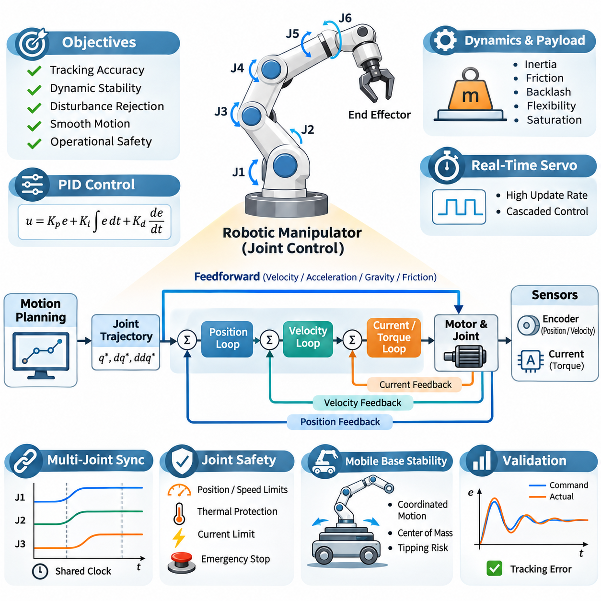
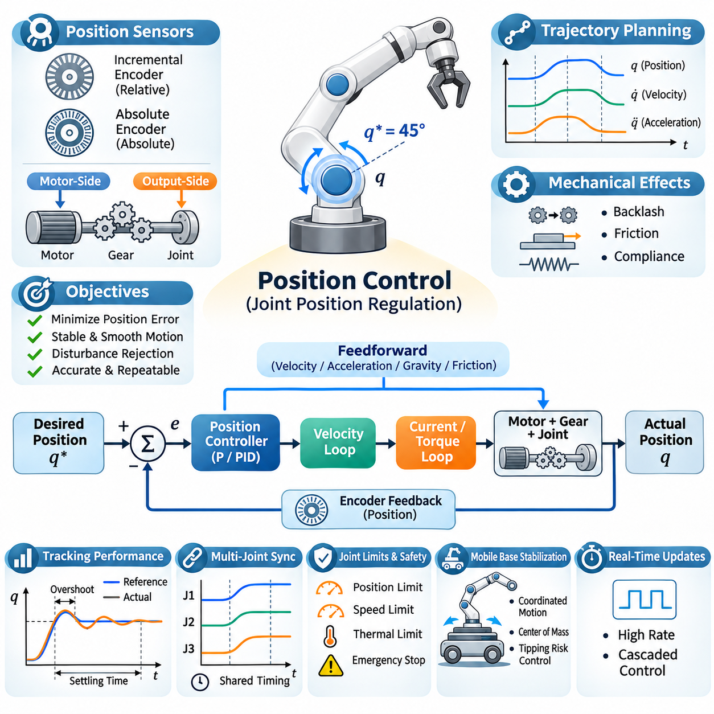
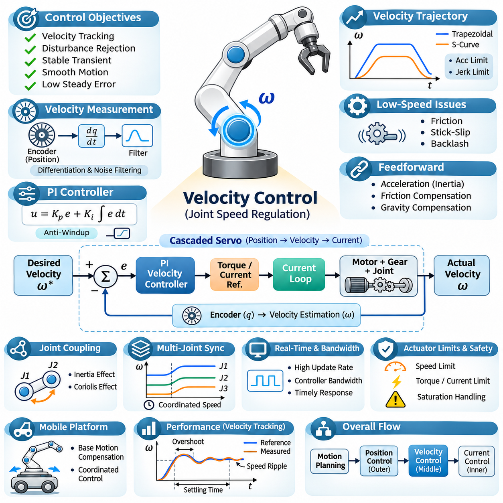
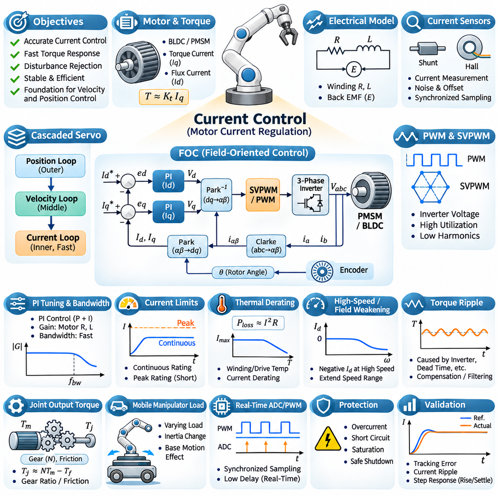
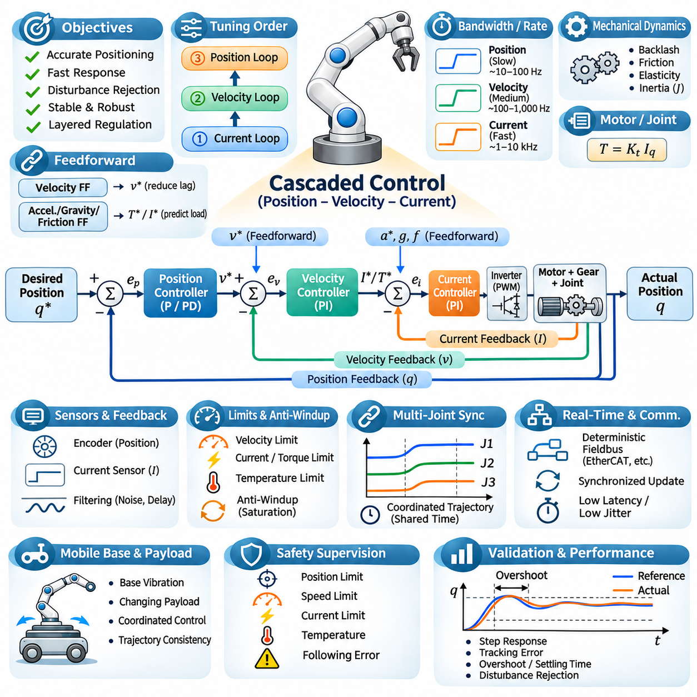
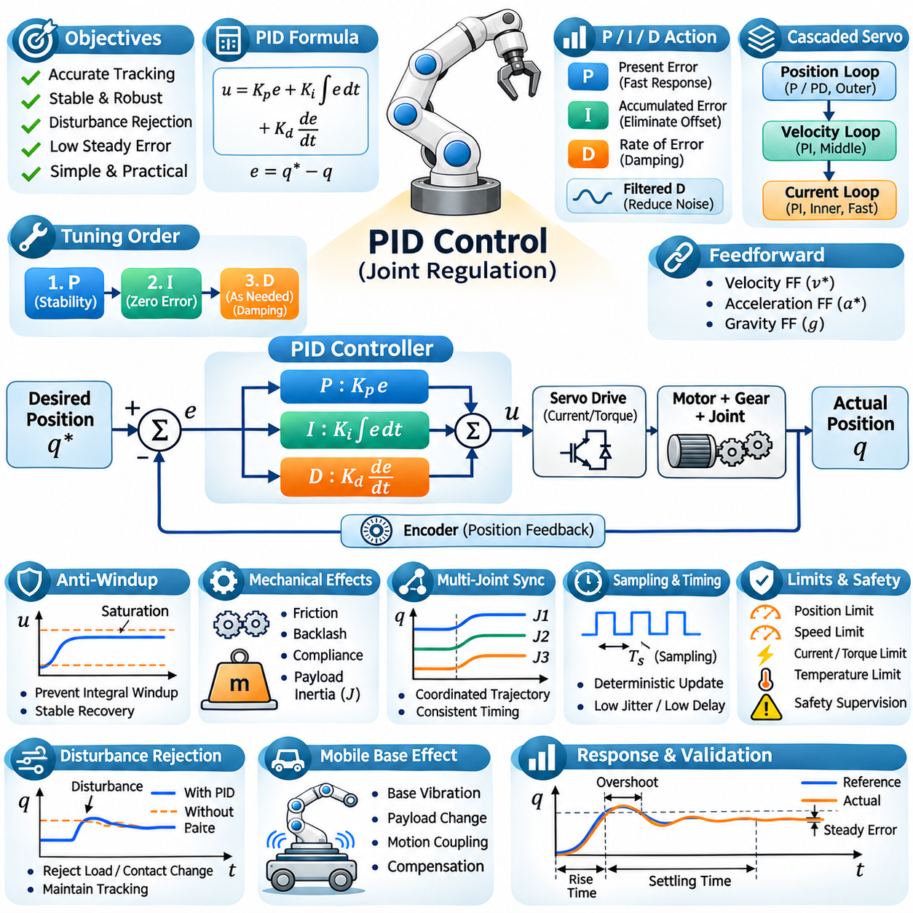
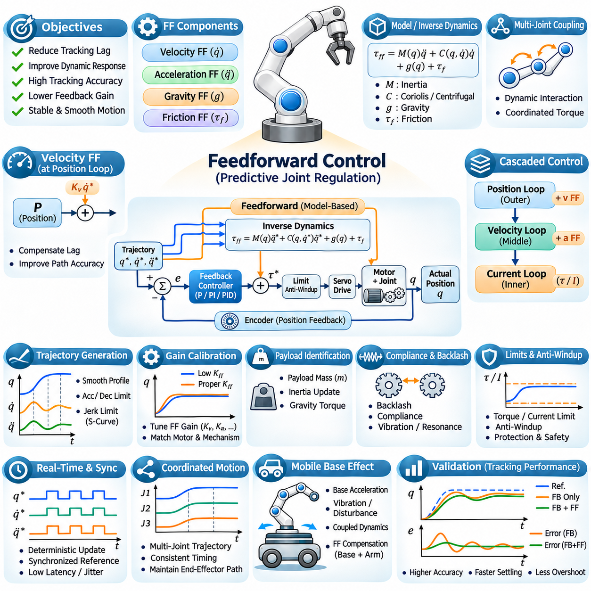
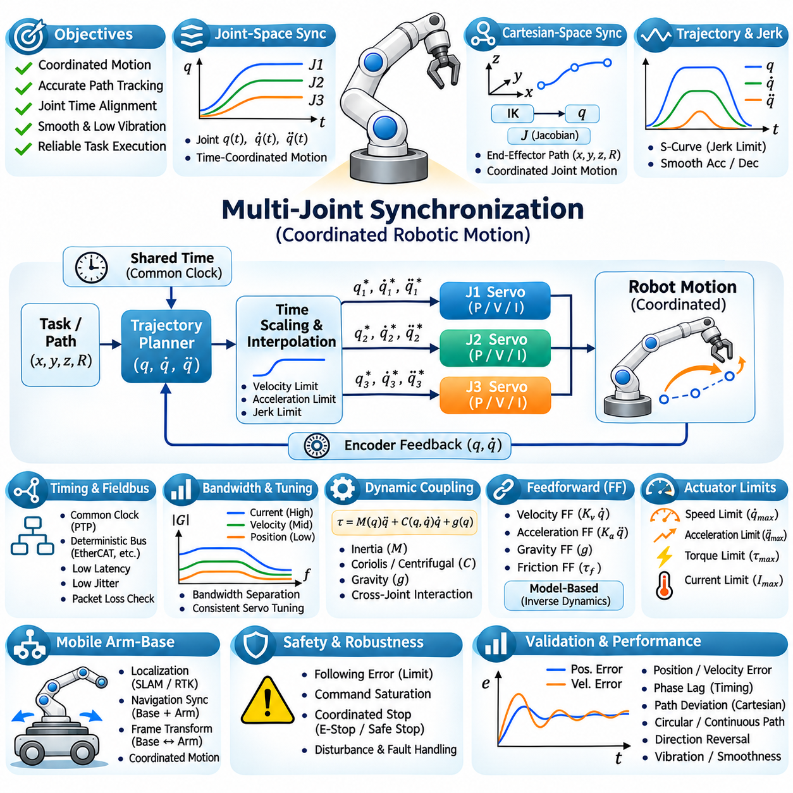
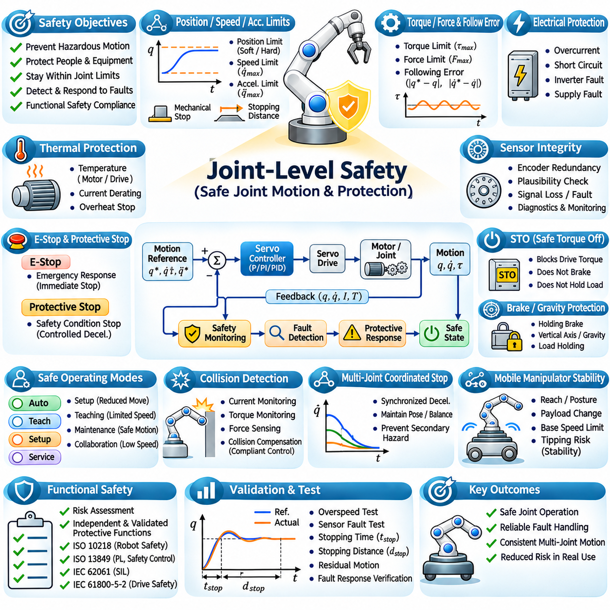

**Volume 02. Manipulator Mechanics and Control**


# Chapter 05. Joint Control

##  

## 01 Joint Control Overview

{width="7.268055555555556in" height="7.268055555555556in"}

Joint control is the fundamental mechanism through which a robotic manipulator regulates the motion of its individual joints to achieve accurate, stable, and repeatable movement. Each joint is driven by an actuator and monitored through sensors that measure position, velocity, or motor current. By continuously comparing commanded values with measured states, the controller adjusts actuator inputs to reduce errors and maintain the desired mechanical behavior.

In a serial robotic manipulator, coordinated joint movement determines the position and orientation of the end effector. Although task planning may specify motion in Cartesian space, the physical actuators operate through joint-level commands. Joint control therefore provides the essential connection between high-level motion planning and low-level motor execution, transforming desired trajectories into controlled mechanical movement.

The primary objectives of joint control include tracking accuracy, dynamic stability, disturbance rejection, smooth motion, and operational safety. A well-designed controller must respond quickly to changing commands while avoiding excessive oscillation or mechanical stress. These objectives become particularly important when manipulators carry variable payloads, accelerate rapidly, or operate near sensitive equipment and human workers.

Joint control systems typically regulate position, velocity, and motor current through interconnected feedback mechanisms. Position control determines where a joint should move, velocity control regulates its rotational or linear speed, and current control influences the electromagnetic torque produced by the motor. These control modes operate at different physical levels and are often combined within a hierarchical servo architecture.

Position control is widely used in industrial manipulators because many manufacturing operations require precise movement between predetermined configurations. The controller compares the desired joint angle with the measured angle and generates corrective commands. Position feedback commonly comes from rotary encoders or linear measurement devices, allowing the system to detect tracking errors and compensate for disturbances during movement.

Velocity control focuses on maintaining a desired joint speed rather than directly regulating its final position. This approach is important for smooth trajectory execution, continuous motion, and coordinated multi-axis operation. Velocity feedback allows the controller to respond to changes in load and friction. Accurate speed regulation also reduces abrupt acceleration and improves the mechanical consistency of robotic movements.

Motor current control operates closer to the electrical characteristics of the actuator. In many electric motor systems, the torque-producing current component is approximately proportional to generated electromagnetic torque. Current regulation therefore provides a fast mechanism for controlling actuator effort. Its performance depends on motor characteristics, power electronics, current sensing, and the electrical control algorithm.

Modern servo systems frequently employ cascaded control structures in which several feedback loops operate at different update rates. The outer position loop generates velocity references, the intermediate velocity loop produces current or torque references, and the inner current loop regulates motor electrical behavior. This arrangement separates control objectives according to their dynamic characteristics and supports systematic controller tuning.

Proportional, integral, and derivative control provides a widely adopted foundation for joint servo regulation. Proportional action responds to instantaneous tracking error, integral action compensates for persistent offsets, and derivative action can improve damping by responding to the rate of error change. Practical PID implementations require careful gain selection, filtering, and anti-windup mechanisms to maintain stable performance.

Feedback control alone may produce tracking delays when joints execute rapidly changing trajectories. Feedforward control addresses this limitation by anticipating the actuator effort required for planned motion. Velocity, acceleration, gravity, and friction compensation can be incorporated into the command structure. Combining predictive feedforward terms with feedback correction improves trajectory tracking without relying entirely on reactive error reduction.

The mechanical characteristics of robotic joints strongly influence controller behavior. Gear reduction, reflected inertia, friction, backlash, structural flexibility, and actuator saturation affect the relationship between commanded input and actual movement. A controller designed without considering these characteristics may exhibit overshoot, vibration, or inaccurate positioning. Mechanical modeling and experimental identification therefore support effective control design.

Joint dynamics are also influenced by interactions between different links of a manipulator. Accelerating one joint can generate inertial and Coriolis-related effects that influence other joints. Independent joint controllers may compensate for some interactions through feedback, but high-performance systems often incorporate dynamic compensation. Understanding these coupling effects is essential for accurate movement during rapid or complex multi-axis trajectories.

Multi-joint synchronization ensures that individual actuators follow coordinated trajectories while maintaining the intended end-effector path. A trajectory generator typically specifies joint positions, velocities, and accelerations over a shared time reference. Each servo controller tracks its assigned command while the overall system monitors timing consistency. Synchronization errors can reduce path accuracy even when individual joints remain stable.

Real-time execution is a critical requirement because joint control depends on predictable sampling and command updates. Control algorithms must process sensor measurements, calculate corrective actions, and transmit actuator commands within defined deadlines. Excessive latency or timing jitter can degrade stability and tracking performance. Industrial controllers therefore prioritize deterministic execution, synchronized communication, and reliable feedback acquisition.

Sensor quality directly affects the precision and robustness of joint control. Encoders provide position measurements, while velocity may be estimated from successive samples or obtained through dedicated sensing. Current sensors monitor electrical actuator behavior, and temperature measurements support equipment protection. Sensor noise, quantization, calibration errors, and communication delays must be considered when designing feedback algorithms.

Joint-level safety mechanisms protect both the manipulator and its surrounding environment. Typical protective functions include position limits, velocity limits, current restrictions, thermal monitoring, and detection of abnormal following errors. When unsafe conditions occur, the controller must initiate an appropriate protective response. Safety functions should be implemented through architectures suitable for the required risk reduction rather than relying exclusively on ordinary motion software.

Mobile manipulators introduce additional control challenges because the robotic arm operates on a movable platform. Base vibration, platform compliance, changing orientation, and disturbances during navigation can affect joint tracking performance. The controller must account for these influences when executing precision tasks. Coordinating base stabilization with arm movement helps maintain consistent end-effector behavior in changing operating conditions.

During manipulation, the payload can change significantly as objects are grasped, transported, or released. These variations alter joint loading, gravitational effects, and effective inertia. Controllers with insufficient robustness may experience increased tracking errors or oscillations. Adaptive gain adjustment, disturbance observers, and model-based compensation can improve performance, although their implementation requires reliable measurements and appropriate stability analysis.

The design of joint control systems involves balancing accuracy, response speed, energy consumption, and mechanical durability. Aggressive control gains may improve tracking under certain conditions but can amplify sensor noise or excite structural resonances. Conservative gains may produce smoother behavior but increase response delays. Engineering optimization therefore requires evaluating controller performance across representative trajectories, payloads, and operating conditions.

Validation of joint control begins with individual actuator testing and progresses toward coordinated manipulator operation. Engineers examine step responses, trajectory tracking errors, settling time, overshoot, and disturbance recovery. Additional experiments evaluate current consumption, thermal behavior, and sensitivity to payload variations. Testing under realistic operating conditions is necessary to confirm that laboratory performance translates into dependable industrial operation.

Joint control also forms the execution foundation for advanced robotic control strategies. Torque control, force regulation, impedance control, and compliant manipulation depend on reliable actuator behavior and accurate state feedback. Even sophisticated task-level algorithms cannot compensate fully for unstable or poorly calibrated joint servos. Consequently, joint control remains a central engineering discipline connecting mechanical design, electrical actuation, dynamic modeling, and intelligent robotic operation.

관절 제어(Joint Control)는 로봇 매니퓰레이터(Robotic Manipulator)의 개별 관절(Joint) 움직임을 조절하여 정확하고 안정적이며 반복 가능한 동작을 구현하는 핵심 메커니즘이다. 각 관절은 구동기(Actuator)에 의해 움직이며, 위치(Position), 속도(Velocity), 모터 전류(Motor Current)를 측정하는 센서(Sensor)를 통해 상태가 감시된다. 제어기(Controller)는 명령값(Commanded Value)과 측정 상태(Measured State)를 지속적으로 비교하고, 오차(Error)를 줄이기 위해 구동기 입력을 조정하여 원하는 기계적 동작을 유지한다.

직렬 로봇 매니퓰레이터(Serial Robotic Manipulator)에서는 여러 관절의 협조적인 움직임이 말단 효과기(End Effector)의 위치와 방향을 결정한다. 작업 계획(Task Planning)은 직교 좌표 공간(Cartesian Space)에서 움직임을 지정할 수 있지만, 실제 구동기(Actuator)는 관절 수준의 명령(Joint-Level Command)에 따라 동작한다. 따라서 관절 제어(Joint Control)는 상위 수준의 동작 계획(Motion Planning)과 하위 수준의 모터 실행(Motor Execution)을 연결하며, 목표 궤적(Desired Trajectory)을 제어된 기계적 움직임으로 변환하는 핵심 역할을 수행한다.

관절 제어(Joint Control)의 주요 목표에는 추종 정확도(Tracking Accuracy), 동적 안정성(Dynamic Stability), 외란 억제(Disturbance Rejection), 부드러운 움직임(Smooth Motion), 운용 안전성(Operational Safety)이 포함된다. 잘 설계된 제어기는 변화하는 명령에 신속하게 반응하면서 과도한 진동(Oscillation)이나 기계적 응력(Mechanical Stress)을 방지해야 한다. 이러한 요구사항은 매니퓰레이터가 가변 하중(Variable Payload)을 운반하거나 빠르게 가속하거나 민감한 장비 및 작업자 주변에서 동작할 때 특히 중요해진다.

관절 제어 시스템(Joint Control System)은 일반적으로 서로 연결된 피드백 메커니즘(Feedback Mechanism)을 통해 위치(Position), 속도(Velocity), 모터 전류(Motor Current)를 조절한다. 위치 제어(Position Control)는 관절이 이동해야 하는 목표 위치를 결정하고, 속도 제어(Velocity Control)는 회전 또는 직선 이동 속도를 조절하며, 전류 제어(Current Control)는 모터에서 발생하는 전자기 토크(Electromagnetic Torque)에 영향을 준다. 이러한 제어 방식은 서로 다른 물리적 수준에서 작동하며 계층적 서보 구조(Hierarchical Servo Architecture)로 결합되는 경우가 많다.

위치 제어(Position Control)는 많은 제조 공정에서 미리 정의된 자세(Configuration) 사이의 정밀한 이동이 요구되기 때문에 산업용 매니퓰레이터(Industrial Manipulator)에 널리 사용된다. 제어기는 목표 관절 각도(Desired Joint Angle)와 측정된 관절 각도(Measured Joint Angle)를 비교하여 보정 명령(Corrective Command)을 생성한다. 위치 피드백(Position Feedback)은 일반적으로 회전형 엔코더(Rotary Encoder) 또는 선형 측정 장치(Linear Measurement Device)에서 제공되며, 시스템은 이를 통해 추종 오차(Tracking Error)를 감지하고 움직임 중 발생하는 외란(Disturbance)을 보상할 수 있다.

속도 제어(Velocity Control)는 최종 위치를 직접 조절하기보다 목표 관절 속도(Desired Joint Speed)를 유지하는 데 초점을 맞춘다. 이러한 방식은 부드러운 궤적 실행(Smooth Trajectory Execution), 연속 동작(Continuous Motion), 다축 협조 운전(Coordinated Multi-Axis Operation)에 중요하다. 속도 피드백(Velocity Feedback)을 활용하면 제어기가 하중(Load)과 마찰(Friction)의 변화에 대응할 수 있다. 정확한 속도 조절은 급격한 가속을 줄이고 로봇 움직임의 기계적 일관성(Mechanical Consistency)을 향상시키는 데 기여한다.

모터 전류 제어(Motor Current Control)는 구동기(Actuator)의 전기적 특성(Electrical Characteristics)에 더 가까운 수준에서 작동한다. 많은 전기 모터 시스템(Electric Motor System)에서 토크를 생성하는 전류 성분(Torque-Producing Current Component)은 발생하는 전자기 토크(Electromagnetic Torque)에 대체로 비례한다. 따라서 전류 조절(Current Regulation)은 구동기 출력(Actuator Effort)을 빠르게 제어하는 수단을 제공한다. 제어 성능은 모터 특성(Motor Characteristics), 전력 전자 장치(Power Electronics), 전류 센싱(Current Sensing), 전기적 제어 알고리즘(Electrical Control Algorithm)에 따라 달라진다.

현대적인 서보 시스템(Servo System)은 여러 피드백 루프(Feedback Loop)가 서로 다른 갱신 주기(Update Rate)로 동작하는 계단식 제어 구조(Cascaded Control Structure)를 자주 사용한다. 외부 위치 루프(Outer Position Loop)는 속도 기준값(Velocity Reference)을 생성하고, 중간 속도 루프(Intermediate Velocity Loop)는 전류 또는 토크 기준값(Current or Torque Reference)을 생성하며, 내부 전류 루프(Inner Current Loop)는 모터의 전기적 동작을 조절한다. 이러한 구조는 동적 특성(Dynamic Characteristics)에 따라 제어 목표를 분리하고 체계적인 제어기 튜닝(Controller Tuning)을 지원한다.

비례·적분·미분 제어(Proportional-Integral-Derivative Control, PID Control)는 관절 서보 제어(Joint Servo Regulation)의 널리 사용되는 기본 구조를 제공한다. 비례 동작(Proportional Action)은 순간적인 추종 오차(Tracking Error)에 반응하고, 적분 동작(Integral Action)은 지속적인 정상상태 오차(Steady-State Error)를 보상하며, 미분 동작(Derivative Action)은 오차 변화율(Error Rate of Change)에 반응하여 감쇠(Damping)를 개선할 수 있다. 실제 PID 구현에서는 안정적인 성능을 유지하기 위해 적절한 이득 설정(Gain Selection), 필터링(Filtering), 적분 포화 방지(Anti-Windup) 메커니즘이 필요하다.

피드백 제어(Feedback Control)만 사용하는 경우 관절이 빠르게 변화하는 궤적(Trajectory)을 실행할 때 추종 지연(Tracking Delay)이 발생할 수 있다. 피드포워드 제어(Feedforward Control)는 계획된 움직임에 필요한 구동기 출력(Actuator Effort)을 미리 예측하여 이러한 한계를 보완한다. 속도(Velocity), 가속도(Acceleration), 중력 보상(Gravity Compensation), 마찰 보상(Friction Compensation)을 명령 구조(Command Structure)에 포함할 수 있다. 예측 기반 피드포워드 항(Predictive Feedforward Term)과 피드백 보정(Feedback Correction)을 결합하면 반응형 오차 감소에만 의존하지 않고 궤적 추종 성능을 향상시킬 수 있다.

로봇 관절(Robot Joint)의 기계적 특성(Mechanical Characteristics)은 제어기 동작에 큰 영향을 미친다. 감속비(Gear Reduction Ratio), 환산 관성(Reflected Inertia), 마찰(Friction), 백래시(Backlash), 구조적 유연성(Structural Flexibility), 구동기 포화(Actuator Saturation)는 명령 입력(Commanded Input)과 실제 움직임(Actual Movement) 사이의 관계를 변화시킨다. 이러한 특성을 고려하지 않고 설계된 제어기는 오버슈트(Overshoot), 진동(Vibration), 부정확한 위치 결정(Inaccurate Positioning)을 발생시킬 수 있다. 따라서 기계적 모델링(Mechanical Modeling)과 실험적 시스템 식별(Experimental Identification)은 효과적인 제어 설계(Control Design)를 지원한다.

관절 동역학(Joint Dynamics)은 매니퓰레이터(Manipulator)의 서로 다른 링크(Link) 사이의 상호작용에도 영향을 받는다. 하나의 관절을 가속하면 다른 관절에 영향을 주는 관성 효과(Inertial Effect)와 코리올리 관련 효과(Coriolis-Related Effect)가 발생할 수 있다. 독립 관절 제어기(Independent Joint Controller)는 피드백을 통해 일부 상호작용을 보상할 수 있지만, 고성능 시스템(High-Performance System)은 동역학 보상(Dynamic Compensation)을 추가로 적용하는 경우가 많다. 이러한 결합 효과(Coupling Effect)를 이해하는 것은 빠르거나 복잡한 다축 궤적(Multi-Axis Trajectory)을 정확하게 실행하는 데 필수적이다.

다관절 동기화(Multi-Joint Synchronization)는 개별 구동기(Actuator)가 협조적인 궤적(Coordinated Trajectory)을 추종하면서 의도한 말단 효과기 경로(End-Effector Path)를 유지하도록 한다. 궤적 생성기(Trajectory Generator)는 일반적으로 공통 시간 기준(Shared Time Reference)에 따라 관절 위치(Joint Position), 속도(Velocity), 가속도(Acceleration)를 지정한다. 각 서보 제어기(Servo Controller)는 할당된 명령을 추종하고 전체 시스템은 시간적 일관성(Timing Consistency)을 감시한다. 개별 관절이 안정적으로 동작하더라도 동기화 오차(Synchronization Error)가 발생하면 경로 정확도(Path Accuracy)가 저하될 수 있다.

실시간 실행(Real-Time Execution)은 관절 제어(Joint Control)가 예측 가능한 샘플링(Sampling)과 명령 갱신(Command Update)에 의존하기 때문에 중요한 요구사항이다. 제어 알고리즘(Control Algorithm)은 정해진 마감 시간(Deadline) 내에 센서 측정값(Sensor Measurement)을 처리하고 보정 동작(Corrective Action)을 계산하며 구동기 명령(Actuator Command)을 전송해야 한다. 과도한 지연 시간(Latency)이나 타이밍 지터(Timing Jitter)는 안정성과 추종 성능을 저하시킬 수 있다. 따라서 산업용 제어기(Industrial Controller)는 결정론적 실행(Deterministic Execution), 동기화된 통신(Synchronized Communication), 신뢰할 수 있는 피드백 획득(Reliable Feedback Acquisition)을 중요하게 고려한다.

센서 품질(Sensor Quality)은 관절 제어(Joint Control)의 정밀도(Precision)와 강건성(Robustness)에 직접적인 영향을 준다. 엔코더(Encoder)는 위치 측정값(Position Measurement)을 제공하며, 속도(Velocity)는 연속된 샘플에서 추정하거나 전용 센서를 통해 얻을 수 있다. 전류 센서(Current Sensor)는 구동기의 전기적 동작을 감시하고 온도 측정(Temperature Measurement)은 장비 보호(Equipment Protection)를 지원한다. 피드백 알고리즘(Feedback Algorithm)을 설계할 때는 센서 잡음(Sensor Noise), 양자화 오차(Quantization Error), 보정 오차(Calibration Error), 통신 지연(Communication Delay)을 고려해야 한다.

관절 수준의 안전 메커니즘(Joint-Level Safety Mechanism)은 매니퓰레이터(Manipulator)와 주변 환경을 보호한다. 일반적인 보호 기능(Protective Function)에는 위치 제한(Position Limit), 속도 제한(Velocity Limit), 전류 제한(Current Restriction), 열 상태 감시(Thermal Monitoring), 비정상 추종 오차(Abnormal Following Error) 감지가 포함된다. 위험한 상태가 발생하면 제어기는 적절한 보호 대응(Protective Response)을 시작해야 한다. 안전 기능(Safety Function)은 일반적인 동작 제어 소프트웨어(Motion Control Software)에만 의존하지 않고 요구되는 위험 감소 수준(Risk Reduction Level)에 적합한 아키텍처(Architecture)를 통해 구현되어야 한다.

모바일 매니퓰레이터(Mobile Manipulator)는 로봇 팔(Robot Arm)이 이동식 플랫폼(Mobile Platform) 위에서 작동하기 때문에 추가적인 제어 과제를 가진다. 베이스 진동(Base Vibration), 플랫폼 유연성(Platform Compliance), 변화하는 방향(Changing Orientation), 주행 중 외란(Disturbance)은 관절 추종 성능(Joint Tracking Performance)에 영향을 줄 수 있다. 제어기는 정밀 작업(Precision Task)을 수행할 때 이러한 영향을 고려해야 한다. 베이스 안정화(Base Stabilization)와 로봇 팔 움직임(Arm Movement)을 협조적으로 제어하면 변화하는 운용 조건에서도 일관된 말단 효과기 동작(End-Effector Behavior)을 유지하는 데 도움이 된다.

조작 작업(Manipulation) 중에는 물체를 파지(Grasping), 운반(Transporting), 해제(Releasing)하면서 탑재 하중(Payload)이 크게 변화할 수 있다. 이러한 변화는 관절 부하(Joint Loading), 중력 효과(Gravitational Effect), 유효 관성(Effective Inertia)을 변화시킨다. 강건성(Robustness)이 부족한 제어기는 추종 오차(Tracking Error)나 진동(Oscillation)이 증가할 수 있다. 적응형 이득 조정(Adaptive Gain Adjustment), 외란 관측기(Disturbance Observer), 모델 기반 보상(Model-Based Compensation)은 성능을 향상시킬 수 있지만, 구현을 위해서는 신뢰할 수 있는 측정값과 적절한 안정성 분석(Stability Analysis)이 필요하다.

관절 제어 시스템(Joint Control System)의 설계에서는 정확도(Accuracy), 응답 속도(Response Speed), 에너지 소비(Energy Consumption), 기계적 내구성(Mechanical Durability) 사이의 균형을 고려해야 한다. 공격적인 제어 이득(Aggressive Control Gain)은 특정 조건에서 추종 성능을 개선할 수 있지만 센서 잡음(Sensor Noise)을 증폭하거나 구조적 공진(Structural Resonance)을 유발할 수 있다. 보수적인 이득(Conservative Gain)은 더 부드러운 동작을 제공할 수 있지만 응답 지연(Response Delay)을 증가시킬 수 있다. 따라서 공학적 최적화(Engineering Optimization)는 대표적인 궤적(Trajectory), 하중(Payload), 운용 조건(Operating Condition)에서 제어 성능을 평가해야 한다.

관절 제어(Joint Control)의 검증(Validation)은 개별 구동기 시험(Individual Actuator Testing)에서 시작하여 협조적인 매니퓰레이터 운전(Coordinated Manipulator Operation)으로 확대된다. 엔지니어는 계단 응답(Step Response), 궤적 추종 오차(Trajectory Tracking Error), 정착 시간(Settling Time), 오버슈트(Overshoot), 외란 회복(Disturbance Recovery)을 분석한다. 추가 실험에서는 전류 소비(Current Consumption), 열적 동작(Thermal Behavior), 하중 변화 민감도(Sensitivity to Payload Variation)를 평가한다. 실제 운용 조건에서의 시험은 실험실 성능이 신뢰할 수 있는 산업 현장 운용으로 이어지는지 확인하는 데 필요하다.

관절 제어(Joint Control)는 고급 로봇 제어 전략(Advanced Robotic Control Strategy)의 실행 기반이기도 하다. 토크 제어(Torque Control), 힘 제어(Force Regulation), 임피던스 제어(Impedance Control), 순응 조작(Compliant Manipulation)은 신뢰할 수 있는 구동기 동작(Actuator Behavior)과 정확한 상태 피드백(State Feedback)에 의존한다. 정교한 작업 수준 알고리즘(Task-Level Algorithm)도 불안정하거나 보정이 부족한 관절 서보(Joint Servo)의 문제를 완전히 해결할 수는 없다. 따라서 관절 제어는 기계 설계(Mechanical Design), 전기 구동(Electrical Actuation), 동역학 모델링(Dynamic Modeling), 지능형 로봇 운용(Intelligent Robotic Operation)을 연결하는 핵심 공학 분야로 남아 있다.

##  

## 02 Position Control

{width="7.268055555555556in" height="7.268055555555556in"}

Position control is a fundamental technique in robotic manipulators that regulates the angular or linear displacement of individual joints to achieve commanded configurations. The controller continuously compares a desired position with the measured joint position and generates corrective actuator commands. This feedback process enables accurate positioning despite mechanical disturbances, changing loads, and uncertainties in actuator behavior.

The primary objective of position control is to minimize the difference between the reference position and the actual joint position. This difference, known as position error, provides the feedback signal used to determine corrective action. A properly designed controller reduces tracking error while maintaining stability, limiting overshoot, and ensuring that joint movement remains smooth throughout acceleration and deceleration.

Joint position is commonly measured using rotary encoders, absolute encoders, resolvers, or linear displacement sensors. Incremental encoders provide relative motion information through pulse counting, while absolute encoders represent position through encoded values. Accurate sensor calibration, sufficient measurement resolution, and reliable signal transmission are essential for maintaining consistent position feedback.

A basic position controller applies proportional feedback, where the corrective command increases with the magnitude of the position error. Large deviations generate stronger responses, while smaller deviations produce reduced corrections. The proportional gain determines the controller\'s sensitivity, but excessive gain may cause oscillation, overshoot, or excitation of mechanical resonance in flexible joints.

Proportional-integral-derivative control extends basic position regulation by combining proportional, integral, and derivative actions. The integral component compensates for persistent position offsets caused by disturbances, while derivative action can improve damping and transient response. Practical implementations must account for measurement noise, actuator saturation, and integral windup to avoid unstable or excessively aggressive behavior.

Industrial servo drives frequently implement position control through cascaded feedback loops. The outer position controller calculates a velocity reference from position error, while an inner velocity controller generates a torque or current reference. A faster current loop then regulates motor electrical behavior. This hierarchy allows each control loop to address a different dynamic timescale while supporting accurate and responsive positioning.

Position commands may be generated as discrete setpoints or continuous trajectories. A sudden position command can demand excessive acceleration and produce mechanical shock, particularly in systems with heavy payloads. Trajectory generators therefore create intermediate references that respect velocity, acceleration, and sometimes jerk limits. Smooth reference generation improves tracking performance and reduces stress on mechanical components.

Trajectory tracking differs from point-to-point positioning because the joint must follow a continuously changing reference rather than simply reach a final destination. Tracking performance depends on controller bandwidth, actuator capability, reference smoothness, and mechanical dynamics. A joint may reach its final position accurately while still exhibiting substantial errors during movement, making dynamic tracking evaluation essential.

Feedforward compensation improves position tracking by anticipating the actuator effort required for planned movement. Velocity feedforward can reduce lag associated with position-loop dynamics, while acceleration feedforward can compensate for inertial requirements. Gravity and friction compensation further improve performance when suitable models are available. Feedback remains necessary to correct modeling errors and unexpected disturbances.

Mechanical transmission characteristics significantly influence positioning accuracy. Gear backlash creates a region where motor movement may not immediately produce output motion, while friction can cause stick-slip behavior at low speeds. Structural flexibility and transmission compliance introduce additional dynamic effects. These characteristics may require compensation algorithms, appropriate gain tuning, or improved mechanical design.

The location of the position sensor determines which mechanical motion is directly observed. Motor-side encoders measure actuator shaft rotation, but they may not detect all deformation or backlash occurring after the transmission. Output-side encoders provide more direct information about joint displacement. Dual-encoder configurations can improve observability, although their control design must account for flexible transmission dynamics.

Position control performance is affected by disturbances such as changing payload mass, gravitational loading, external contact, and vibration. These disturbances can produce temporary tracking errors or persistent offsets. Integral feedback, disturbance observers, and model-based compensation may improve disturbance rejection. However, controller robustness must be evaluated across the expected operating range rather than under a single nominal condition.

Multi-joint manipulators require synchronized position references to maintain coordinated end-effector motion. Even when individual joints achieve accurate final positions, differences in response timing can distort the intended Cartesian trajectory. Shared trajectory timing and coordinated interpolation help maintain path consistency. Accurate synchronization becomes especially important during welding, assembly, inspection, and continuous-path operations.

Position control also interacts with inverse kinematics and motion planning. A Cartesian target is converted into joint coordinates through an inverse kinematics solution, and a trajectory planner generates feasible intermediate joint references. The position controller executes these commands within actuator and mechanical constraints. Errors in calibration, kinematic parameters, or joint tracking can propagate into end-effector positioning errors.

Real-time execution is essential for maintaining predictable position-control behavior. Sensor measurements must be acquired, feedback errors calculated, and actuator commands updated at consistent intervals. Communication delays, timing jitter, and irregular sampling can degrade tracking accuracy or reduce stability margins. Deterministic control scheduling and reliable fieldbus communication support consistent servo performance.

Controller tuning involves balancing response speed, damping, tracking accuracy, and mechanical limitations. Higher proportional gains can reduce position error but may amplify vibration or excite resonant modes. Integral gains must be selected carefully to prevent excessive overshoot, while derivative feedback requires appropriate filtering. Frequency-response analysis and experimental testing provide systematic methods for selecting suitable parameters.

Position-control systems must enforce joint travel limits and prevent unsafe motion. Software limits restrict commanded trajectories, while independent protective mechanisms may monitor actual position and actuator behavior. Following-error thresholds can detect situations where a joint cannot track its reference. Protective responses must account for stopping distance, mechanical constraints, and the safety requirements of the complete robotic system.

Mobile manipulators introduce additional positioning challenges because the arm is mounted on a platform that may experience vibration, compliance, or small changes in orientation. These effects alter the relationship between joint coordinates and the external workspace. Joint position control can maintain commanded angles, but accurate task-space positioning may also require base stabilization, localization feedback, and coordinated motion compensation.

Position-control validation includes step-response testing, point-to-point movement, continuous trajectory tracking, and repeated positioning experiments. Engineers evaluate settling time, overshoot, steady-state error, tracking error, and repeatability under different payloads. Additional tests examine low-speed motion, direction reversals, thermal variation, and disturbance recovery to identify limitations that may not appear during nominal operation.

Position control provides the foundation for reliable robotic manipulation by converting planned joint trajectories into precise physical movement. Its effectiveness depends on sensor accuracy, servo architecture, mechanical characteristics, trajectory generation, and real-time execution. When properly integrated with kinematics, dynamics, safety monitoring, and higher-level planning, position control enables repeatable and coordinated operation across industrial and mobile robotic applications.

위치 제어(Position Control)는 로봇 매니퓰레이터(Robotic Manipulator)의 개별 관절(Joint)이 명령된 자세(Commanded Configuration)에 도달하도록 각도 변위(Angular Displacement) 또는 선형 변위(Linear Displacement)를 조절하는 기본적인 제어 기술이다. 제어기(Controller)는 목표 위치(Desired Position)와 측정된 관절 위치(Measured Joint Position)를 지속적으로 비교하고, 이를 바탕으로 구동기 보정 명령(Corrective Actuator Command)을 생성한다. 이러한 피드백 과정(Feedback Process)을 통해 기계적 외란(Mechanical Disturbance), 하중 변화(Changing Load), 구동기 동작의 불확실성(Actuator Uncertainty)이 존재하더라도 정확한 위치 결정(Accurate Positioning)이 가능해진다.

위치 제어(Position Control)의 주요 목표는 기준 위치(Reference Position)와 실제 관절 위치(Actual Joint Position) 사이의 차이를 최소화하는 것이다. 이러한 차이를 위치 오차(Position Error)라고 하며, 보정 동작(Corrective Action)을 결정하는 피드백 신호(Feedback Signal)로 사용된다. 적절하게 설계된 제어기는 안정성(Stability)을 유지하면서 추종 오차(Tracking Error)를 줄이고, 오버슈트(Overshoot)를 제한하며, 가속(Acceleration)과 감속(Deceleration) 과정에서 관절 움직임이 부드럽게 유지되도록 한다.

관절 위치(Joint Position)는 일반적으로 회전형 엔코더(Rotary Encoder), 절대형 엔코더(Absolute Encoder), 리졸버(Resolver), 선형 변위 센서(Linear Displacement Sensor)를 사용하여 측정한다. 증분형 엔코더(Incremental Encoder)는 펄스 계수(Pulse Counting)를 통해 상대적인 움직임 정보를 제공하며, 절대형 엔코더(Absolute Encoder)는 부호화된 값(Encoded Value)을 통해 위치를 나타낸다. 일관된 위치 피드백(Position Feedback)을 유지하려면 정확한 센서 보정(Sensor Calibration), 충분한 측정 분해능(Measurement Resolution), 신뢰할 수 있는 신호 전송(Signal Transmission)이 필수적이다.

기본적인 위치 제어기(Position Controller)는 위치 오차(Position Error)의 크기에 비례하여 보정 명령(Corrective Command)이 증가하는 비례 피드백(Proportional Feedback)을 적용한다. 큰 위치 편차(Position Deviation)는 강한 제어 응답(Control Response)을 발생시키고, 작은 편차는 상대적으로 약한 보정을 생성한다. 비례 이득(Proportional Gain)은 제어기의 민감도(Controller Sensitivity)를 결정하지만, 지나치게 높은 이득은 유연한 관절(Flexible Joint)에서 진동(Oscillation), 오버슈트(Overshoot), 기계적 공진(Mechanical Resonance)을 유발할 수 있다.

비례·적분·미분 제어(Proportional-Integral-Derivative Control, PID Control)는 비례 동작(Proportional Action), 적분 동작(Integral Action), 미분 동작(Derivative Action)을 결합하여 기본적인 위치 조절(Position Regulation)을 확장한다. 적분 성분(Integral Component)은 외란(Disturbance)으로 발생하는 지속적인 위치 편차(Position Offset)를 보상하며, 미분 동작(Derivative Action)은 감쇠(Damping)와 과도 응답(Transient Response)을 개선할 수 있다. 실제 구현에서는 불안정하거나 지나치게 공격적인 동작을 방지하기 위해 측정 잡음(Measurement Noise), 구동기 포화(Actuator Saturation), 적분 누적 포화(Integral Windup)를 고려해야 한다.

산업용 서보 드라이브(Industrial Servo Drive)는 계단식 피드백 루프(Cascaded Feedback Loop)를 통해 위치 제어(Position Control)를 구현하는 경우가 많다. 외부 위치 제어기(Outer Position Controller)는 위치 오차(Position Error)로부터 속도 기준값(Velocity Reference)을 계산하고, 내부 속도 제어기(Inner Velocity Controller)는 토크 또는 전류 기준값(Torque or Current Reference)을 생성한다. 이후 더 빠른 전류 루프(Current Loop)가 모터의 전기적 동작(Electrical Behavior)을 조절한다. 이러한 계층 구조(Hierarchical Structure)는 각 제어 루프가 서로 다른 동적 시간 척도(Dynamic Timescale)를 처리하도록 하여 정확하고 신속한 위치 결정을 지원한다.

위치 명령(Position Command)은 개별 목표값(Discrete Setpoint) 또는 연속 궤적(Continuous Trajectory)의 형태로 생성될 수 있다. 갑작스러운 위치 명령은 과도한 가속도(Excessive Acceleration)를 요구하고, 특히 무거운 하중(Heavy Payload)을 운반하는 시스템에서 기계적 충격(Mechanical Shock)을 발생시킬 수 있다. 따라서 궤적 생성기(Trajectory Generator)는 속도 제한(Velocity Limit), 가속도 제한(Acceleration Limit), 경우에 따라 저크 제한(Jerk Limit)을 만족하는 중간 기준값(Intermediate Reference)을 생성한다. 부드러운 기준 궤적(Smooth Reference Trajectory)은 추종 성능(Tracking Performance)을 개선하고 기계 부품(Mechanical Component)에 가해지는 응력을 줄인다.

궤적 추종(Trajectory Tracking)은 관절이 최종 목적지(Final Destination)에 도달하는 것뿐 아니라 지속적으로 변화하는 기준값(Changing Reference)을 따라야 한다는 점에서 점대점 위치 결정(Point-to-Point Positioning)과 다르다. 추종 성능(Tracking Performance)은 제어기 대역폭(Controller Bandwidth), 구동기 성능(Actuator Capability), 기준 궤적의 부드러움(Reference Smoothness), 기계적 동역학(Mechanical Dynamics)에 영향을 받는다. 관절이 최종 위치에 정확하게 도달하더라도 이동 중 상당한 오차가 발생할 수 있으므로 동적 추종 평가(Dynamic Tracking Evaluation)가 필수적이다.

피드포워드 보상(Feedforward Compensation)은 계획된 움직임에 필요한 구동기 출력(Actuator Effort)을 미리 예측하여 위치 추종(Position Tracking) 성능을 개선한다. 속도 피드포워드(Velocity Feedforward)는 위치 루프 동역학(Position-Loop Dynamics)으로 발생하는 지연을 줄일 수 있으며, 가속도 피드포워드(Acceleration Feedforward)는 관성 요구량(Inertial Requirement)을 보상할 수 있다. 적절한 모델(Model)을 사용할 수 있다면 중력 보상(Gravity Compensation)과 마찰 보상(Friction Compensation)도 성능을 향상시킨다. 그러나 모델링 오차(Modeling Error)와 예상하지 못한 외란(Unexpected Disturbance)을 보정하기 위해서는 여전히 피드백 제어(Feedback Control)가 필요하다.

기계적 동력 전달 장치(Mechanical Transmission)의 특성은 위치 결정 정확도(Positioning Accuracy)에 큰 영향을 미친다. 기어 백래시(Gear Backlash)는 모터가 움직이더라도 출력축(Output Shaft)이 즉시 움직이지 않는 구간을 만들며, 마찰(Friction)은 저속에서 스틱슬립 현상(Stick-Slip Behavior)을 유발할 수 있다. 구조적 유연성(Structural Flexibility)과 전달계 순응성(Transmission Compliance)은 추가적인 동적 효과(Dynamic Effect)를 발생시킨다. 이러한 특성을 해결하기 위해 보상 알고리즘(Compensation Algorithm), 적절한 이득 튜닝(Gain Tuning), 개선된 기계 설계(Mechanical Design)가 필요할 수 있다.

위치 센서(Position Sensor)의 설치 위치는 어떤 기계적 움직임(Mechanical Motion)이 직접 관측되는지를 결정한다. 모터 측 엔코더(Motor-Side Encoder)는 구동축(Actuator Shaft)의 회전을 측정하지만, 동력 전달 장치(Transmission) 이후에 발생하는 모든 변형(Deformation)이나 백래시(Backlash)를 감지하지는 못할 수 있다. 출력축 측 엔코더(Output-Side Encoder)는 관절 변위(Joint Displacement)에 대한 보다 직접적인 정보를 제공한다. 이중 엔코더 구성(Dual-Encoder Configuration)은 관측 가능성(Observability)을 향상시킬 수 있지만, 제어 설계에서는 유연한 전달계 동역학(Flexible Transmission Dynamics)을 고려해야 한다.

위치 제어(Position Control)의 성능은 하중 질량 변화(Changing Payload Mass), 중력 부하(Gravitational Loading), 외부 접촉(External Contact), 진동(Vibration)과 같은 외란(Disturbance)의 영향을 받는다. 이러한 외란은 일시적인 추종 오차(Tracking Error)나 지속적인 위치 편차(Position Offset)를 발생시킬 수 있다. 적분 피드백(Integral Feedback), 외란 관측기(Disturbance Observer), 모델 기반 보상(Model-Based Compensation)은 외란 억제(Disturbance Rejection) 성능을 향상시킬 수 있다. 그러나 제어기의 강건성(Controller Robustness)은 단일 공칭 조건(Nominal Condition)이 아니라 예상되는 전체 운용 범위(Operating Range)에서 평가되어야 한다.

다관절 매니퓰레이터(Multi-Joint Manipulator)는 협조적인 말단 효과기 움직임(Coordinated End-Effector Motion)을 유지하기 위해 동기화된 위치 기준값(Synchronized Position Reference)이 필요하다. 개별 관절이 정확한 최종 위치(Final Position)에 도달하더라도 응답 시간(Response Timing)의 차이가 발생하면 의도한 직교 좌표 궤적(Cartesian Trajectory)이 왜곡될 수 있다. 공통 궤적 시간(Shared Trajectory Timing)과 협조 보간(Coordinated Interpolation)은 경로 일관성(Path Consistency)을 유지하는 데 도움이 된다. 정확한 동기화(Synchronization)는 용접(Welding), 조립(Assembly), 검사(Inspection), 연속 경로 작업(Continuous-Path Operation)에서 특히 중요하다.

위치 제어(Position Control)는 역기구학(Inverse Kinematics) 및 동작 계획(Motion Planning)과도 상호작용한다. 직교 좌표 목표(Cartesian Target)는 역기구학 해(Inverse Kinematics Solution)를 통해 관절 좌표(Joint Coordinate)로 변환되고, 궤적 계획기(Trajectory Planner)는 실행 가능한 중간 관절 기준값(Intermediate Joint Reference)을 생성한다. 위치 제어기(Position Controller)는 구동기 및 기계적 제약조건(Actuator and Mechanical Constraints) 내에서 이러한 명령을 실행한다. 보정 오차(Calibration Error), 기구학 파라미터 오차(Kinematic Parameter Error), 관절 추종 오차(Joint Tracking Error)는 말단 효과기 위치 오차(End-Effector Positioning Error)로 전파될 수 있다.

실시간 실행(Real-Time Execution)은 예측 가능한 위치 제어(Position Control) 동작을 유지하는 데 필수적이다. 센서 측정값(Sensor Measurement)을 획득하고 피드백 오차(Feedback Error)를 계산하며 구동기 명령(Actuator Command)을 일정한 주기로 갱신해야 한다. 통신 지연(Communication Delay), 타이밍 지터(Timing Jitter), 불규칙한 샘플링(Irregular Sampling)은 추종 정확도(Tracking Accuracy)를 저하시키거나 안정성 여유(Stability Margin)를 감소시킬 수 있다. 결정론적 제어 스케줄링(Deterministic Control Scheduling)과 신뢰할 수 있는 필드버스 통신(Fieldbus Communication)은 일관된 서보 성능(Servo Performance)을 지원한다.

제어기 튜닝(Controller Tuning)은 응답 속도(Response Speed), 감쇠(Damping), 추종 정확도(Tracking Accuracy), 기계적 한계(Mechanical Limitation) 사이의 균형을 조정하는 과정이다. 높은 비례 이득(Proportional Gain)은 위치 오차(Position Error)를 줄일 수 있지만 진동(Vibration)을 증폭하거나 공진 모드(Resonant Mode)를 자극할 수 있다. 적분 이득(Integral Gain)은 과도한 오버슈트(Overshoot)를 방지하도록 신중하게 선택해야 하며, 미분 피드백(Derivative Feedback)에는 적절한 필터링(Filtering)이 필요하다. 주파수 응답 분석(Frequency-Response Analysis)과 실험적 시험(Experimental Testing)은 적절한 제어 파라미터(Control Parameter)를 체계적으로 선택하는 방법을 제공한다.

위치 제어 시스템(Position-Control System)은 관절 이동 한계(Joint Travel Limit)를 적용하고 위험한 움직임(Unsafe Motion)을 방지해야 한다. 소프트웨어 제한(Software Limit)은 명령된 궤적(Commanded Trajectory)을 제한하며, 독립적인 보호 메커니즘(Independent Protective Mechanism)은 실제 위치(Actual Position)와 구동기 동작(Actuator Behavior)을 감시할 수 있다. 추종 오차 임계값(Following-Error Threshold)은 관절이 기준 궤적(Reference Trajectory)을 추종하지 못하는 상황을 감지할 수 있다. 보호 대응(Protective Response)은 정지 거리(Stopping Distance), 기계적 제약조건(Mechanical Constraint), 전체 로봇 시스템의 안전 요구사항(Safety Requirement)을 고려해야 한다.

모바일 매니퓰레이터(Mobile Manipulator)는 로봇 팔(Robot Arm)이 진동(Vibration), 유연성(Compliance), 작은 방향 변화(Orientation Change)가 발생할 수 있는 이동식 플랫폼(Mobile Platform)에 장착되므로 추가적인 위치 제어 과제를 가진다. 이러한 영향은 관절 좌표(Joint Coordinate)와 외부 작업 공간(External Workspace) 사이의 관계를 변화시킨다. 관절 위치 제어(Joint Position Control)는 명령된 관절 각도(Commanded Joint Angle)를 유지할 수 있지만, 정확한 작업 공간 위치 결정(Task-Space Positioning)을 위해서는 베이스 안정화(Base Stabilization), 위치 추정 피드백(Localization Feedback), 협조 동작 보상(Coordinated Motion Compensation)이 추가로 필요할 수 있다.

위치 제어 검증(Position-Control Validation)에는 계단 응답 시험(Step-Response Testing), 점대점 이동(Point-to-Point Movement), 연속 궤적 추종(Continuous Trajectory Tracking), 반복 위치 결정 시험(Repeated Positioning Experiment)이 포함된다. 엔지니어는 서로 다른 하중(Payload) 조건에서 정착 시간(Settling Time), 오버슈트(Overshoot), 정상상태 오차(Steady-State Error), 추종 오차(Tracking Error), 반복 정밀도(Repeatability)를 평가한다. 추가 시험에서는 저속 동작(Low-Speed Motion), 방향 반전(Direction Reversal), 온도 변화(Thermal Variation), 외란 회복(Disturbance Recovery)을 분석하여 정상 운용(Nominal Operation)에서 나타나지 않는 한계를 확인한다.

위치 제어(Position Control)는 계획된 관절 궤적(Planned Joint Trajectory)을 정밀한 물리적 움직임(Precise Physical Movement)으로 변환하여 신뢰할 수 있는 로봇 조작(Robotic Manipulation)의 기반을 제공한다. 그 효과는 센서 정확도(Sensor Accuracy), 서보 아키텍처(Servo Architecture), 기계적 특성(Mechanical Characteristics), 궤적 생성(Trajectory Generation), 실시간 실행(Real-Time Execution)에 따라 달라진다. 위치 제어가 기구학(Kinematics), 동역학(Dynamics), 안전 감시(Safety Monitoring), 상위 수준 계획(Higher-Level Planning)과 적절하게 통합되면 산업용 로봇(Industrial Robot)과 모바일 로봇(Mobile Robot)의 다양한 응용 분야에서 반복 가능하고 협조적인 운용을 실현할 수 있다.

##  

## 03 Velocity Control

{width="7.268055555555556in" height="7.268055555555556in"}

Velocity control is a fundamental component of robotic joint control that regulates the rotational or linear speed of an actuator according to a commanded reference. Unlike position control, which focuses on reaching a specified configuration, velocity control maintains a desired rate of motion. It enables smooth joint movement, predictable dynamic behavior, and coordinated execution of robotic trajectories under changing operating conditions.

The primary objective of velocity control is to minimize the difference between the commanded velocity and the measured joint velocity. This difference, called velocity error, determines the corrective action generated by the controller. Effective regulation requires rapid disturbance rejection, stable transient response, and minimal steady-state error while respecting actuator limitations and mechanical constraints.

Joint velocity can be measured directly through dedicated speed sensors or estimated from position measurements obtained using encoders. A common approach calculates velocity from changes in joint position over successive sampling intervals. However, numerical differentiation can amplify measurement noise, particularly at low speeds. Filtering and observer-based estimation techniques improve velocity feedback quality.

A basic velocity controller uses proportional feedback to generate an actuator command from the difference between desired and actual speed. Increasing proportional gain generally improves responsiveness but may also amplify measurement noise or introduce oscillations. The appropriate gain depends on motor dynamics, transmission characteristics, load inertia, and the bandwidth of the underlying actuator control system.

Proportional-integral control is widely used in industrial velocity servo systems because it combines responsive error correction with compensation for persistent disturbances. Proportional action responds to instantaneous velocity error, while integral action reduces steady-state deviations caused by friction or external loading. Anti-windup mechanisms are important when actuator commands reach current or torque saturation limits.

Velocity control commonly operates as the intermediate loop within a cascaded servo architecture. An outer position controller generates a desired velocity, and the velocity controller converts the resulting speed error into a torque or current reference. An inner current controller regulates motor electrical behavior at a higher update frequency. This separation supports stable operation across different dynamic timescales.

The bandwidth of a velocity controller determines how quickly it can respond to changing speed commands and external disturbances. Higher bandwidth improves tracking of rapidly varying references but may increase sensitivity to sensor noise and mechanical resonance. Controller design must therefore balance responsiveness with stability margins, actuator capability, and the dynamic characteristics of the joint mechanism.

Velocity references are typically generated by trajectory planners that consider acceleration, deceleration, and jerk constraints. Abrupt changes in commanded speed can create large torque demands and mechanical shocks. Smooth velocity profiles reduce structural vibration and improve trajectory consistency. Trapezoidal and S-curve motion profiles are commonly used to achieve controlled acceleration and deceleration.

Acceleration limiting is particularly important when manipulators transport heavy or fragile payloads. Rapid changes in velocity generate inertial forces that can disturb the end effector or increase joint loading. By constraining acceleration and jerk, the motion controller reduces mechanical stress and improves handling stability. These constraints must be coordinated with the available actuator torque and overall trajectory duration.

Motor and transmission characteristics significantly influence velocity regulation. Gear reduction changes the relationship between motor speed and joint speed, while friction introduces nonlinear resistance to motion. Backlash, compliance, and structural flexibility can produce oscillatory behavior during speed reversals. Accurate modeling and suitable feedback compensation help maintain smooth movement across the operating range.

Low-speed velocity control presents particular challenges because encoder quantization, static friction, and stick-slip behavior become more significant. Small commanded speeds may produce irregular motion when the actuator cannot overcome friction consistently. Improved velocity estimation, friction compensation, and carefully tuned control gains can reduce these effects and support precise slow movements.

Feedforward control can improve velocity tracking by anticipating the torque required to accelerate the joint or overcome predictable disturbances. Acceleration feedforward compensates for inertial loading, while friction compensation reduces resistance-related errors. Gravity compensation is also useful when joint orientation affects required torque. Feedback correction remains necessary because physical models cannot perfectly represent operating conditions.

Velocity control must also account for dynamic coupling between manipulator joints. Motion of one link can influence the torque required by another through inertial and Coriolis effects. Independent velocity loops can reject some coupling disturbances, but model-based compensation may improve performance during rapid coordinated movements. Such compensation becomes increasingly valuable in high-speed multi-axis manipulators.

Multi-joint synchronization depends on accurate velocity tracking as well as consistent position references. Differences in joint speed response can distort the intended end-effector path even when final positions are correct. Coordinated trajectory generation and synchronized command updates reduce these deviations. Continuous-path applications such as welding, polishing, and inspection particularly benefit from consistent velocity regulation.

Real-time implementation requires predictable sampling intervals and timely processing of velocity feedback. Delays in sensor acquisition, control computation, or actuator communication can reduce phase margin and degrade tracking performance. Deterministic scheduling, synchronized fieldbus communication, and appropriate filtering are essential for maintaining stable velocity control in industrial servo systems.

Velocity controllers must respect actuator torque, current, speed, and thermal limitations. When commanded acceleration exceeds available torque, the joint may fail to follow its velocity reference. Persistent saturation can cause integral windup and excessive heating. Saturation handling, command limiting, and thermal monitoring help preserve reliable operation while preventing unrealistic control demands.

Safety mechanisms are essential because uncontrolled joint velocity can create hazardous motion. Controllers may enforce maximum speed limits, monitor excessive velocity errors, and detect abnormal acceleration. Protective functions should initiate controlled deceleration or another appropriate safety response when hazardous conditions occur. Safety-related monitoring must be designed according to the risk requirements of the complete robotic system.

Mobile manipulators introduce additional disturbances because arm motion occurs on a platform that may vibrate, tilt, or move during operation. Base motion changes the relationship between joint velocity and end-effector velocity in the external reference frame. Coordinated control may therefore require platform velocity estimation, base stabilization, and compensation for relative motion between the arm and its environment.

Velocity control performance is evaluated through speed tracking experiments, step responses, disturbance rejection tests, and continuous trajectory execution. Important measurements include velocity error, response time, overshoot, settling behavior, and speed ripple. Testing should cover low-speed motion, rapid reversals, different payloads, and thermal conditions to identify weaknesses that may not appear during nominal operation.

Velocity control provides the dynamic foundation for smooth and coordinated robotic movement. Its effectiveness depends on accurate velocity estimation, appropriate feedback gains, actuator characteristics, trajectory generation, and real-time execution. When integrated with position regulation, current control, dynamic compensation, and safety monitoring, velocity control enables reliable joint motion across industrial and mobile manipulation applications.

속도 제어(Velocity Control)는 명령된 기준값(Commanded Reference)에 따라 구동기(Actuator)의 회전 속도(Rotational Speed) 또는 선형 속도(Linear Speed)를 조절하는 로봇 관절 제어(Robotic Joint Control)의 핵심 구성 요소이다. 특정 자세(Configuration)에 도달하는 데 초점을 맞추는 위치 제어(Position Control)와 달리, 속도 제어는 원하는 운동 속도(Desired Rate of Motion)를 유지하는 데 중점을 둔다. 이를 통해 변화하는 운용 조건(Operating Conditions)에서도 부드러운 관절 움직임(Smooth Joint Movement), 예측 가능한 동적 동작(Predictable Dynamic Behavior), 협조적인 로봇 궤적 실행(Coordinated Trajectory Execution)이 가능해진다.

속도 제어(Velocity Control)의 주요 목표는 명령 속도(Commanded Velocity)와 측정된 관절 속도(Measured Joint Velocity) 사이의 차이를 최소화하는 것이다. 이러한 차이를 속도 오차(Velocity Error)라고 하며, 제어기(Controller)가 생성하는 보정 동작(Corrective Action)을 결정한다. 효과적인 속도 조절(Velocity Regulation)을 위해서는 구동기 한계(Actuator Limitations)와 기계적 제약조건(Mechanical Constraints)을 준수하면서 신속한 외란 억제(Disturbance Rejection), 안정적인 과도 응답(Transient Response), 최소한의 정상상태 오차(Steady-State Error)를 확보해야 한다.

관절 속도(Joint Velocity)는 전용 속도 센서(Speed Sensor)를 통해 직접 측정하거나 엔코더(Encoder)에서 얻은 위치 측정값(Position Measurement)을 이용하여 추정할 수 있다. 일반적인 방법은 연속된 샘플링 구간(Sampling Interval)에서 관절 위치의 변화량을 계산하는 것이다. 그러나 수치 미분(Numerical Differentiation)은 특히 저속 영역(Low-Speed Region)에서 측정 잡음(Measurement Noise)을 증폭시킬 수 있다. 필터링(Filtering)과 관측기 기반 추정 기법(Observer-Based Estimation Technique)은 속도 피드백(Velocity Feedback)의 품질을 향상시킨다.

기본적인 속도 제어기(Velocity Controller)는 목표 속도(Desired Speed)와 실제 속도(Actual Speed)의 차이로부터 구동기 명령(Actuator Command)을 생성하기 위해 비례 피드백(Proportional Feedback)을 사용한다. 비례 이득(Proportional Gain)을 증가시키면 일반적으로 응답성(Responsiveness)이 향상되지만, 측정 잡음(Measurement Noise)이 증폭되거나 진동(Oscillation)이 발생할 수도 있다. 적절한 이득은 모터 동역학(Motor Dynamics), 동력 전달 특성(Transmission Characteristics), 부하 관성(Load Inertia), 하위 구동기 제어 시스템(Underlying Actuator Control System)의 대역폭(Bandwidth)에 따라 결정된다.

비례·적분 제어(Proportional-Integral Control, PI Control)는 신속한 오차 보정(Error Correction)과 지속적인 외란(Persistent Disturbance)에 대한 보상을 결합하기 때문에 산업용 속도 서보 시스템(Industrial Velocity Servo System)에서 널리 사용된다. 비례 동작(Proportional Action)은 순간적인 속도 오차(Velocity Error)에 반응하며, 적분 동작(Integral Action)은 마찰(Friction)이나 외부 부하(External Loading)로 발생하는 정상상태 편차(Steady-State Deviation)를 줄인다. 구동기 명령이 전류 또는 토크 포화 한계(Current or Torque Saturation Limit)에 도달하는 경우 적분 포화 방지 메커니즘(Anti-Windup Mechanism)이 중요하다.

속도 제어(Velocity Control)는 일반적으로 계단식 서보 아키텍처(Cascaded Servo Architecture)의 중간 제어 루프(Intermediate Control Loop)로 작동한다. 외부 위치 제어기(Outer Position Controller)는 목표 속도(Desired Velocity)를 생성하고, 속도 제어기(Velocity Controller)는 속도 오차(Speed Error)를 토크 또는 전류 기준값(Torque or Current Reference)으로 변환한다. 내부 전류 제어기(Inner Current Controller)는 더 높은 갱신 주파수(Update Frequency)에서 모터의 전기적 동작(Electrical Behavior)을 조절한다. 이러한 분리 구조는 서로 다른 동적 시간 척도(Dynamic Timescale)에서 안정적인 동작을 지원한다.

속도 제어기(Velocity Controller)의 대역폭(Bandwidth)은 변화하는 속도 명령(Speed Command)과 외부 외란(External Disturbance)에 얼마나 빠르게 반응할 수 있는지를 결정한다. 높은 대역폭(Higher Bandwidth)은 빠르게 변화하는 기준값(Reference)의 추종 성능을 향상시키지만, 센서 잡음(Sensor Noise)과 기계적 공진(Mechanical Resonance)에 대한 민감도를 증가시킬 수 있다. 따라서 제어기 설계(Controller Design)에서는 응답성(Responsiveness), 안정성 여유(Stability Margin), 구동기 성능(Actuator Capability), 관절 메커니즘(Joint Mechanism)의 동적 특성(Dynamic Characteristics) 사이의 균형을 고려해야 한다.

속도 기준값(Velocity Reference)은 일반적으로 가속도(Acceleration), 감속도(Deceleration), 저크(Jerk) 제약조건을 고려하는 궤적 계획기(Trajectory Planner)에 의해 생성된다. 명령 속도(Commanded Speed)가 갑자기 변화하면 큰 토크 요구량(Torque Demand)과 기계적 충격(Mechanical Shock)이 발생할 수 있다. 부드러운 속도 프로파일(Smooth Velocity Profile)은 구조적 진동(Structural Vibration)을 줄이고 궤적 일관성(Trajectory Consistency)을 향상시킨다. 사다리꼴 운동 프로파일(Trapezoidal Motion Profile)과 S자 곡선 운동 프로파일(S-Curve Motion Profile)은 제어된 가속 및 감속을 구현하는 데 일반적으로 사용된다.

가속도 제한(Acceleration Limiting)은 매니퓰레이터(Manipulator)가 무겁거나 깨지기 쉬운 하중(Heavy or Fragile Payload)을 운반할 때 특히 중요하다. 속도의 급격한 변화는 말단 효과기(End Effector)를 교란하거나 관절 부하(Joint Loading)를 증가시키는 관성력(Inertial Force)을 발생시킨다. 가속도(Acceleration)와 저크(Jerk)를 제한하면 동작 제어기(Motion Controller)는 기계적 응력(Mechanical Stress)을 줄이고 취급 안정성(Handling Stability)을 향상시킬 수 있다. 이러한 제약조건은 사용 가능한 구동기 토크(Actuator Torque)와 전체 궤적 실행 시간(Trajectory Duration)에 맞춰 조정되어야 한다.

모터 및 동력 전달 장치(Motor and Transmission)의 특성은 속도 조절(Velocity Regulation)에 상당한 영향을 미친다. 감속 기어(Gear Reduction)는 모터 속도(Motor Speed)와 관절 속도(Joint Speed) 사이의 관계를 변화시키며, 마찰(Friction)은 움직임에 대한 비선형 저항(Nonlinear Resistance)을 발생시킨다. 백래시(Backlash), 순응성(Compliance), 구조적 유연성(Structural Flexibility)은 속도 반전(Speed Reversal) 과정에서 진동성 동작(Oscillatory Behavior)을 유발할 수 있다. 정확한 모델링(Accurate Modeling)과 적절한 피드백 보상(Feedback Compensation)은 전체 운용 범위(Operating Range)에서 부드러운 움직임을 유지하는 데 도움이 된다.

저속 속도 제어(Low-Speed Velocity Control)는 엔코더 양자화(Encoder Quantization), 정지 마찰(Static Friction), 스틱슬립 현상(Stick-Slip Behavior)의 영향이 상대적으로 커지기 때문에 특별한 어려움이 있다. 작은 속도 명령(Speed Command)에서는 구동기(Actuator)가 마찰을 일정하게 극복하지 못해 불규칙한 움직임(Irregular Motion)이 발생할 수 있다. 개선된 속도 추정(Velocity Estimation), 마찰 보상(Friction Compensation), 정밀하게 조정된 제어 이득(Control Gain)은 이러한 영향을 줄이고 정확한 저속 움직임(Precise Slow Movement)을 지원할 수 있다.

피드포워드 제어(Feedforward Control)는 관절을 가속하거나 예측 가능한 외란(Predictable Disturbance)을 극복하는 데 필요한 토크(Torque)를 미리 예측하여 속도 추종(Velocity Tracking) 성능을 향상시킬 수 있다. 가속도 피드포워드(Acceleration Feedforward)는 관성 부하(Inertial Loading)를 보상하고, 마찰 보상(Friction Compensation)은 저항으로 발생하는 오차(Resistance-Related Error)를 줄인다. 관절 방향(Joint Orientation)이 필요한 토크에 영향을 주는 경우 중력 보상(Gravity Compensation)도 유용하다. 물리적 모델(Physical Model)이 운용 조건을 완벽하게 표현할 수는 없으므로 피드백 보정(Feedback Correction)은 여전히 필요하다.

속도 제어(Velocity Control)는 매니퓰레이터 관절(Manipulator Joint) 사이의 동적 결합(Dynamic Coupling)도 고려해야 한다. 하나의 링크(Link)가 움직이면 관성 효과(Inertial Effect)와 코리올리 효과(Coriolis Effect)를 통해 다른 링크에 필요한 토크가 변화할 수 있다. 독립 속도 루프(Independent Velocity Loop)는 일부 결합 외란(Coupling Disturbance)을 억제할 수 있지만, 모델 기반 보상(Model-Based Compensation)은 빠른 협조 동작(Coordinated Movement) 중 성능을 향상시킬 수 있다. 이러한 보상은 고속 다축 매니퓰레이터(High-Speed Multi-Axis Manipulator)에서 더욱 중요해진다.

다관절 동기화(Multi-Joint Synchronization)는 일관된 위치 기준값(Position Reference)뿐 아니라 정확한 속도 추종(Velocity Tracking)에도 의존한다. 관절 속도 응답(Joint Speed Response)에 차이가 발생하면 최종 위치(Final Position)가 정확하더라도 의도한 말단 효과기 경로(End-Effector Path)가 왜곡될 수 있다. 협조 궤적 생성(Coordinated Trajectory Generation)과 동기화된 명령 갱신(Synchronized Command Update)은 이러한 편차를 줄인다. 용접(Welding), 연마(Polishing), 검사(Inspection)와 같은 연속 경로 응용(Continuous-Path Application)은 일관된 속도 조절(Velocity Regulation)을 통해 특히 큰 이점을 얻는다.

실시간 구현(Real-Time Implementation)을 위해서는 예측 가능한 샘플링 간격(Sampling Interval)과 적시에 처리되는 속도 피드백(Velocity Feedback)이 필요하다. 센서 데이터 획득(Sensor Acquisition), 제어 연산(Control Computation), 구동기 통신(Actuator Communication)에서 발생하는 지연(Delay)은 위상 여유(Phase Margin)를 감소시키고 추종 성능(Tracking Performance)을 저하시킬 수 있다. 결정론적 스케줄링(Deterministic Scheduling), 동기화된 필드버스 통신(Synchronized Fieldbus Communication), 적절한 필터링(Filtering)은 산업용 서보 시스템(Industrial Servo System)의 안정적인 속도 제어를 유지하는 데 필수적이다.

속도 제어기(Velocity Controller)는 구동기 토크(Actuator Torque), 전류(Current), 속도(Speed), 열적 한계(Thermal Limitation)를 준수해야 한다. 명령된 가속도(Commanded Acceleration)가 사용 가능한 토크(Available Torque)를 초과하면 관절이 속도 기준값(Velocity Reference)을 추종하지 못할 수 있다. 지속적인 포화(Saturation)는 적분 누적 포화(Integral Windup)와 과도한 발열(Excessive Heating)을 발생시킬 수 있다. 포화 처리(Saturation Handling), 명령 제한(Command Limiting), 열 상태 감시(Thermal Monitoring)는 비현실적인 제어 요구(Control Demand)를 방지하면서 신뢰할 수 있는 동작을 유지하는 데 도움이 된다.

제어되지 않는 관절 속도(Uncontrolled Joint Velocity)는 위험한 움직임(Hazardous Motion)을 발생시킬 수 있으므로 안전 메커니즘(Safety Mechanism)이 필수적이다. 제어기(Controller)는 최대 속도 제한(Maximum Speed Limit)을 적용하고 과도한 속도 오차(Excessive Velocity Error)를 감시하며 비정상 가속도(Abnormal Acceleration)를 감지할 수 있다. 위험한 상태가 발생하면 보호 기능(Protective Function)은 제어된 감속(Controlled Deceleration) 또는 적절한 안전 대응(Safety Response)을 시작해야 한다. 안전 관련 감시(Safety-Related Monitoring)는 전체 로봇 시스템(Robotic System)의 위험 요구사항(Risk Requirement)에 따라 설계되어야 한다.

모바일 매니퓰레이터(Mobile Manipulator)는 로봇 팔(Robot Arm)이 진동(Vibration), 기울어짐(Tilting), 이동(Motion)이 발생할 수 있는 플랫폼(Platform) 위에서 작동하기 때문에 추가적인 외란(Disturbance)이 발생한다. 베이스 움직임(Base Motion)은 관절 속도(Joint Velocity)와 외부 기준 좌표계(External Reference Frame)에서의 말단 효과기 속도(End-Effector Velocity) 사이의 관계를 변화시킨다. 따라서 협조 제어(Coordinated Control)에는 플랫폼 속도 추정(Platform Velocity Estimation), 베이스 안정화(Base Stabilization), 로봇 팔과 주변 환경 사이의 상대 운동 보상(Relative Motion Compensation)이 필요할 수 있다.

속도 제어 성능(Velocity Control Performance)은 속도 추종 실험(Speed Tracking Experiment), 계단 응답(Step Response), 외란 억제 시험(Disturbance Rejection Test), 연속 궤적 실행(Continuous Trajectory Execution)을 통해 평가한다. 중요한 측정 항목에는 속도 오차(Velocity Error), 응답 시간(Response Time), 오버슈트(Overshoot), 정착 특성(Settling Behavior), 속도 리플(Speed Ripple)이 포함된다. 시험은 저속 움직임(Low-Speed Motion), 빠른 방향 반전(Rapid Reversal), 다양한 하중(Payload), 열적 조건(Thermal Condition)을 포함해야 하며, 이를 통해 정상 운용(Nominal Operation)에서 나타나지 않는 취약점을 확인할 수 있다.

속도 제어(Velocity Control)는 부드럽고 협조적인 로봇 움직임(Smooth and Coordinated Robotic Movement)을 위한 동적 기반(Dynamic Foundation)을 제공한다. 그 효과는 정확한 속도 추정(Velocity Estimation), 적절한 피드백 이득(Feedback Gain), 구동기 특성(Actuator Characteristics), 궤적 생성(Trajectory Generation), 실시간 실행(Real-Time Execution)에 따라 달라진다. 속도 제어가 위치 조절(Position Regulation), 전류 제어(Current Control), 동역학 보상(Dynamic Compensation), 안전 감시(Safety Monitoring)와 통합되면 산업용 및 모바일 조작 응용(Industrial and Mobile Manipulation Applications) 전반에서 신뢰할 수 있는 관절 움직임(Reliable Joint Motion)을 구현할 수 있다.

##  

## 04 Current Control

{width="7.268055555555556in" height="7.268055555555556in"}

Current control is a fundamental component of robotic joint actuation that regulates the electrical current flowing through motor windings. Because motor-generated electromagnetic torque is closely related to the torque-producing current, accurate current regulation enables precise actuator effort control. It provides the foundation for stable velocity regulation, position tracking, and advanced torque-based manipulation.

The primary objective of current control is to minimize the difference between a commanded current reference and the measured motor current. The controller continuously adjusts the applied motor voltage to reduce this error while respecting electrical and thermal constraints. Fast current regulation allows the actuator to respond predictably to changing torque demands, external disturbances, and dynamic loading.

Electric motors used in robotic manipulators include brushless DC motors, permanent magnet synchronous motors, and other servo motor configurations. Their electromagnetic characteristics determine how electrical current produces mechanical torque. In permanent magnet motors, torque is primarily associated with the quadrature-axis current, although the exact relationship depends on motor construction, magnetic saturation, and operating conditions.

Modern robotic servo drives commonly employ field-oriented control to regulate motor currents in a rotating reference frame. Three-phase currents are transformed into direct-axis and quadrature-axis components, allowing magnetic flux and torque-producing current to be controlled separately. This approach simplifies current regulation and supports efficient torque production across a broad operating range.

The direct-axis current is generally associated with magnetic flux control, while the quadrature-axis current primarily determines electromagnetic torque. For many surface-mounted permanent magnet motors, the direct-axis reference is maintained near zero during normal operation. Interior permanent magnet motors may use nonzero direct-axis current for efficiency optimization or field weakening, depending on their operating requirements.

Current feedback is obtained through sensors integrated into the motor drive, including shunt resistors, Hall-effect sensors, or isolated current measurement devices. Accurate sensing is essential because measurement errors directly influence torque regulation. Sensor offset, electrical noise, quantization, and sampling synchronization must be considered to maintain reliable feedback under rapidly changing switching conditions.

Current controllers commonly use proportional-integral regulation to minimize current tracking errors. Proportional action responds to instantaneous deviations, while integral action compensates for persistent offsets caused by motor resistance and applied voltage disturbances. Controller gains must be selected according to winding resistance, inductance, sampling frequency, and inverter characteristics to achieve stable electrical response.

The electrical dynamics of motor windings determine the achievable current-control bandwidth. Winding inductance resists rapid current changes, while resistance influences steady-state voltage requirements. Higher control bandwidth improves torque responsiveness but increases sensitivity to measurement noise, switching delays, and discretization effects. Practical designs balance dynamic performance with electrical stability.

Pulse-width modulation is widely used to generate the motor voltages required by current controllers. A power inverter switches semiconductor devices to approximate the commanded voltage through controlled switching patterns. The resulting phase currents depend on motor inductance, switching frequency, and modulation strategy. Space-vector modulation is frequently employed in three-phase servo drives to improve voltage utilization.

Current control typically forms the innermost feedback loop of a cascaded robotic servo architecture. An outer position loop generates velocity commands, and an intermediate velocity loop produces torque or current references. The inner current loop regulates electromagnetic actuator behavior at a higher update frequency. This hierarchy allows rapid torque response while maintaining coordinated position and velocity regulation.

Current references must be constrained by the motor\'s continuous and peak operating limits. Excessive current can cause winding overheating, magnetic saturation, or damage to power electronics. Continuous current ratings reflect sustained thermal capability, while peak ratings generally permit higher current for limited durations. Appropriate limiting strategies protect the actuator without unnecessarily restricting short-term dynamic performance.

Thermal behavior is particularly important because resistive losses increase approximately with the square of winding current. Repeated acceleration, heavy payload handling, and prolonged static torque generation can therefore produce substantial heating. Temperature sensors and thermal estimation models help monitor operating conditions. Current derating may be necessary when winding or inverter temperatures approach allowable limits.

Motor current regulation must also account for back electromotive force, which increases with rotational speed and opposes the applied voltage. At higher speeds, the available voltage margin for changing current becomes smaller. This limitation can reduce torque capability and current tracking performance. Field-weakening techniques may extend the operating speed range when supported by the motor and drive design.

Current-loop performance is affected by inverter dead time, semiconductor voltage drops, current measurement delays, and motor parameter uncertainty. These effects can introduce tracking errors and torque ripple, especially at low speeds or during rapid reversals. Compensation methods and accurate parameter identification improve regulation quality, although their effectiveness depends on reliable hardware characterization.

Torque ripple is an important consideration in precision robotic applications because variations in electromagnetic torque can produce vibration and positioning errors. Sources include current ripple, magnetic harmonics, cogging torque, and inverter nonlinearities. High-quality current regulation reduces electrically induced torque fluctuations, while mechanical design and specialized compensation address other sources of periodic disturbance.

Real-time implementation requires current measurements and control updates to be synchronized with inverter switching. Sampling at inappropriate moments can introduce switching noise into feedback signals. Digital controllers therefore coordinate analog-to-digital conversion, current regulation, and pulse-width modulation updates. Predictable execution timing is essential for achieving high-bandwidth control without sacrificing stability.

Current control must distinguish between commanded electromagnetic torque and actual joint output torque. Gear reduction, transmission efficiency, friction, and mechanical compliance influence how motor torque reaches the joint. Consequently, accurate current regulation does not automatically guarantee precise output torque. Joint torque sensors, calibrated transmission models, or disturbance observers may be required when direct mechanical torque accuracy is important.

Safety functions monitor abnormal current conditions, including overcurrent, short circuits, sensor failures, and excessive thermal loading. Hardware protection circuits must respond rapidly to electrical faults that ordinary software control cannot safely manage. Current limiting and fault detection should be coordinated with higher-level motion supervision to prevent hazardous actuator behavior and protect surrounding equipment.

In mobile manipulators, current control must accommodate changing arm loads, platform vibration, and dynamic interactions between the robotic arm and mobile base. Accelerating joints or lifting objects can create rapid variations in required motor torque. Stable current regulation supports predictable actuator response, while coordinated system control manages mechanical disturbances and power distribution across the complete platform.

Current-control performance is evaluated through reference tracking tests, current step responses, disturbance experiments, and thermal measurements. Important metrics include current tracking error, response time, bandwidth, overshoot, current ripple, and sustained operating temperature. Testing across different speeds, loads, and supply voltages helps verify that electrical regulation remains stable under realistic operating conditions.

Current control establishes the electrical foundation of precise robotic joint actuation by translating torque-related commands into regulated motor currents. Its effectiveness depends on motor modeling, sensor accuracy, inverter performance, feedback tuning, thermal management, and deterministic execution. When integrated with velocity, position, and torque control, reliable current regulation enables responsive and efficient manipulation in industrial and mobile robotic systems.

전류 제어(Current Control)는 모터 권선(Motor Winding)을 통해 흐르는 전류(Electrical Current)를 조절하는 로봇 관절 구동(Robotic Joint Actuation)의 핵심 구성 요소이다. 모터에서 발생하는 전자기 토크(Electromagnetic Torque)는 토크 생성 전류(Torque-Producing Current)와 밀접하게 관련되므로, 정확한 전류 조절(Current Regulation)은 정밀한 구동기 출력 제어(Actuator Effort Control)를 가능하게 한다. 이는 안정적인 속도 조절(Velocity Regulation), 위치 추종(Position Tracking), 고급 토크 기반 조작(Advanced Torque-Based Manipulation)의 기반을 제공한다.

전류 제어(Current Control)의 주요 목표는 명령된 전류 기준값(Commanded Current Reference)과 측정된 모터 전류(Measured Motor Current) 사이의 차이를 최소화하는 것이다. 제어기(Controller)는 전기적 및 열적 제약조건(Electrical and Thermal Constraints)을 준수하면서 오차를 줄이기 위해 모터에 인가되는 전압(Applied Motor Voltage)을 지속적으로 조정한다. 빠른 전류 조절(Fast Current Regulation)은 변화하는 토크 요구량(Torque Demand), 외부 외란(External Disturbance), 동적 부하(Dynamic Loading)에 대해 구동기가 예측 가능하게 반응하도록 한다.

로봇 매니퓰레이터(Robotic Manipulator)에 사용되는 전기 모터(Electric Motor)에는 브러시리스 직류 모터(Brushless DC Motor), 영구자석 동기 모터(Permanent Magnet Synchronous Motor), 기타 서보 모터 구성(Servo Motor Configuration)이 포함된다. 이러한 모터의 전자기적 특성(Electromagnetic Characteristics)은 전류가 기계적 토크(Mechanical Torque)를 생성하는 방식을 결정한다. 영구자석 모터(Permanent Magnet Motor)에서 토크는 주로 직교축 전류(Quadrature-Axis Current)와 관련되지만, 정확한 관계는 모터 구조(Motor Construction), 자기 포화(Magnetic Saturation), 운용 조건(Operating Conditions)에 따라 달라진다.

현대적인 로봇 서보 드라이브(Robotic Servo Drive)는 일반적으로 회전 기준 좌표계(Rotating Reference Frame)에서 모터 전류를 조절하기 위해 자속 기준 제어(Field-Oriented Control, FOC)를 사용한다. 3상 전류(Three-Phase Current)는 직축 성분(Direct-Axis Component)과 직교축 성분(Quadrature-Axis Component)으로 변환되어 자속(Magnetic Flux)과 토크 생성 전류(Torque-Producing Current)를 독립적으로 제어할 수 있다. 이러한 접근 방식은 전류 조절(Current Regulation)을 단순화하고 넓은 운용 범위(Operating Range)에서 효율적인 토크 생성(Efficient Torque Production)을 지원한다.

직축 전류(Direct-Axis Current)는 일반적으로 자속 제어(Magnetic Flux Control)와 관련되며, 직교축 전류(Quadrature-Axis Current)는 주로 전자기 토크(Electromagnetic Torque)를 결정한다. 많은 표면 부착형 영구자석 모터(Surface-Mounted Permanent Magnet Motor)에서는 정상 운전(Normal Operation) 중 직축 전류 기준값(Direct-Axis Current Reference)을 0에 가깝게 유지한다. 매입형 영구자석 모터(Interior Permanent Magnet Motor)는 운용 요구사항에 따라 효율 최적화(Efficiency Optimization) 또는 약계자 제어(Field Weakening)를 위해 0이 아닌 직축 전류를 사용할 수 있다.

전류 피드백(Current Feedback)은 션트 저항(Shunt Resistor), 홀 효과 센서(Hall-Effect Sensor), 절연형 전류 측정 장치(Isolated Current Measurement Device) 등 모터 드라이브(Motor Drive)에 통합된 센서를 통해 얻는다. 측정 오차(Measurement Error)는 토크 조절(Torque Regulation)에 직접적인 영향을 미치므로 정확한 전류 센싱(Current Sensing)이 필수적이다. 빠르게 변화하는 스위칭 조건(Switching Conditions)에서도 신뢰할 수 있는 피드백을 유지하려면 센서 오프셋(Sensor Offset), 전기적 잡음(Electrical Noise), 양자화(Quantization), 샘플링 동기화(Sampling Synchronization)를 고려해야 한다.

전류 제어기(Current Controller)는 일반적으로 전류 추종 오차(Current Tracking Error)를 최소화하기 위해 비례·적분 제어(Proportional-Integral Control, PI Control)를 사용한다. 비례 동작(Proportional Action)은 순간적인 편차(Instantaneous Deviation)에 반응하며, 적분 동작(Integral Action)은 모터 저항(Motor Resistance)과 인가 전압 외란(Applied Voltage Disturbance)으로 발생하는 지속적인 편차(Persistent Offset)를 보상한다. 안정적인 전기적 응답(Electrical Response)을 얻으려면 권선 저항(Winding Resistance), 인덕턴스(Inductance), 샘플링 주파수(Sampling Frequency), 인버터 특성(Inverter Characteristics)에 따라 제어 이득(Controller Gain)을 선택해야 한다.

모터 권선(Motor Winding)의 전기적 동역학(Electrical Dynamics)은 달성 가능한 전류 제어 대역폭(Current-Control Bandwidth)을 결정한다. 권선 인덕턴스(Winding Inductance)는 급격한 전류 변화(Current Change)를 억제하며, 저항(Resistance)은 정상상태 전압 요구량(Steady-State Voltage Requirement)에 영향을 준다. 높은 제어 대역폭(Control Bandwidth)은 토크 응답성(Torque Responsiveness)을 향상시키지만 측정 잡음(Measurement Noise), 스위칭 지연(Switching Delay), 이산화 효과(Discretization Effect)에 대한 민감도를 증가시킨다. 실제 설계에서는 동적 성능(Dynamic Performance)과 전기적 안정성(Electrical Stability) 사이의 균형을 고려한다.

펄스 폭 변조(Pulse-Width Modulation, PWM)는 전류 제어기(Current Controller)에 필요한 모터 전압(Motor Voltage)을 생성하는 데 널리 사용된다. 전력 인버터(Power Inverter)는 반도체 소자(Semiconductor Device)를 스위칭하여 제어된 스위칭 패턴(Switching Pattern)을 통해 명령 전압(Commanded Voltage)을 근사적으로 구현한다. 생성되는 상전류(Phase Current)는 모터 인덕턴스(Motor Inductance), 스위칭 주파수(Switching Frequency), 변조 전략(Modulation Strategy)에 따라 달라진다. 공간 벡터 변조(Space-Vector Modulation)는 전압 활용률(Voltage Utilization)을 향상시키기 위해 3상 서보 드라이브(Three-Phase Servo Drive)에서 자주 사용된다.

전류 제어(Current Control)는 일반적으로 계단식 로봇 서보 아키텍처(Cascaded Robotic Servo Architecture)의 가장 내부에 위치한 피드백 루프(Innermost Feedback Loop)를 구성한다. 외부 위치 루프(Outer Position Loop)는 속도 명령(Velocity Command)을 생성하고, 중간 속도 루프(Intermediate Velocity Loop)는 토크 또는 전류 기준값(Torque or Current Reference)을 생성한다. 내부 전류 루프(Inner Current Loop)는 더 높은 갱신 주파수(Update Frequency)에서 전자기적 구동기 동작(Electromagnetic Actuator Behavior)을 조절한다. 이러한 계층 구조(Hierarchical Structure)는 협조적인 위치 및 속도 조절(Position and Velocity Regulation)을 유지하면서 빠른 토크 응답(Torque Response)을 가능하게 한다.

전류 기준값(Current Reference)은 모터의 연속 운전 한계(Continuous Operating Limit)와 최대 운전 한계(Peak Operating Limit)에 따라 제한되어야 한다. 과도한 전류(Excessive Current)는 권선 과열(Winding Overheating), 자기 포화(Magnetic Saturation), 전력 전자 장치 손상(Power Electronics Damage)을 발생시킬 수 있다. 연속 전류 정격(Continuous Current Rating)은 지속적인 열적 허용 능력(Sustained Thermal Capability)을 나타내며, 최대 전류 정격(Peak Current Rating)은 일반적으로 제한된 시간 동안 더 높은 전류를 허용한다. 적절한 제한 전략(Limiting Strategy)은 단기적인 동적 성능(Short-Term Dynamic Performance)을 불필요하게 제한하지 않으면서 구동기를 보호한다.

열적 동작(Thermal Behavior)은 권선 전류(Winding Current)의 제곱에 대략 비례하여 저항 손실(Resistive Loss)이 증가하기 때문에 특히 중요하다. 반복적인 가속(Repeated Acceleration), 무거운 하중 취급(Heavy Payload Handling), 장시간 정적 토크 생성(Prolonged Static Torque Generation)은 상당한 발열(Heating)을 발생시킬 수 있다. 온도 센서(Temperature Sensor)와 열 추정 모델(Thermal Estimation Model)은 운용 조건(Operating Conditions)을 감시하는 데 도움이 된다. 권선 또는 인버터 온도(Winding or Inverter Temperature)가 허용 한계(Allowable Limit)에 접근하면 전류 디레이팅(Current Derating)이 필요할 수 있다.

모터 전류 조절(Motor Current Regulation)은 회전 속도(Rotational Speed)가 증가함에 따라 커지고 인가 전압(Applied Voltage)에 반대 방향으로 작용하는 역기전력(Back Electromotive Force)도 고려해야 한다. 고속 영역(High-Speed Region)에서는 전류를 변화시키는 데 사용할 수 있는 전압 여유(Voltage Margin)가 감소한다. 이러한 제한은 토크 출력 능력(Torque Capability)과 전류 추종 성능(Current Tracking Performance)을 저하시킬 수 있다. 모터 및 드라이브 설계(Motor and Drive Design)가 지원하는 경우 약계자 제어(Field-Weakening Technique)를 통해 운전 속도 범위(Operating Speed Range)를 확장할 수 있다.

전류 루프 성능(Current-Loop Performance)은 인버터 데드타임(Inverter Dead Time), 반도체 전압 강하(Semiconductor Voltage Drop), 전류 측정 지연(Current Measurement Delay), 모터 파라미터 불확실성(Motor Parameter Uncertainty)의 영향을 받는다. 이러한 요인은 특히 저속 영역(Low-Speed Region)이나 빠른 방향 반전(Rapid Reversal) 중 추종 오차(Tracking Error)와 토크 리플(Torque Ripple)을 발생시킬 수 있다. 보상 기법(Compensation Method)과 정확한 파라미터 식별(Parameter Identification)은 조절 품질(Regulation Quality)을 향상시키지만, 그 효과는 신뢰할 수 있는 하드웨어 특성 분석(Hardware Characterization)에 따라 달라진다.

토크 리플(Torque Ripple)은 전자기 토크(Electromagnetic Torque)의 변동이 진동(Vibration)과 위치 결정 오차(Positioning Error)를 발생시킬 수 있으므로 정밀 로봇 응용(Precision Robotic Application)에서 중요한 고려사항이다. 주요 원인에는 전류 리플(Current Ripple), 자기 고조파(Magnetic Harmonics), 코깅 토크(Cogging Torque), 인버터 비선형성(Inverter Nonlinearity)이 포함된다. 고품질 전류 조절(High-Quality Current Regulation)은 전기적으로 유발되는 토크 변동(Electrically Induced Torque Fluctuation)을 줄이며, 기계 설계(Mechanical Design)와 특수 보상 기법(Specialized Compensation)은 다른 주기적 외란(Periodic Disturbance)을 해결한다.

실시간 구현(Real-Time Implementation)을 위해서는 전류 측정(Current Measurement)과 제어 갱신(Control Update)이 인버터 스위칭(Inverter Switching)과 동기화되어야 한다. 부적절한 시점에 샘플링(Sampling)을 수행하면 스위칭 잡음(Switching Noise)이 피드백 신호(Feedback Signal)에 유입될 수 있다. 따라서 디지털 제어기(Digital Controller)는 아날로그-디지털 변환(Analog-to-Digital Conversion), 전류 조절(Current Regulation), 펄스 폭 변조 갱신(Pulse-Width Modulation Update)을 협조적으로 수행한다. 예측 가능한 실행 타이밍(Predictable Execution Timing)은 안정성을 유지하면서 높은 대역폭 제어(High-Bandwidth Control)를 구현하는 데 필수적이다.

전류 제어(Current Control)는 명령된 전자기 토크(Commanded Electromagnetic Torque)와 실제 관절 출력 토크(Actual Joint Output Torque)를 구분해야 한다. 감속비(Gear Reduction Ratio), 전달 효율(Transmission Efficiency), 마찰(Friction), 기계적 순응성(Mechanical Compliance)은 모터 토크(Motor Torque)가 관절에 전달되는 방식에 영향을 준다. 따라서 정확한 전류 조절(Current Regulation)이 반드시 정밀한 출력 토크(Output Torque)를 보장하는 것은 아니다. 직접적인 기계적 토크 정확도(Mechanical Torque Accuracy)가 중요한 경우 관절 토크 센서(Joint Torque Sensor), 보정된 전달계 모델(Calibrated Transmission Model), 외란 관측기(Disturbance Observer)가 필요할 수 있다.

안전 기능(Safety Function)은 과전류(Overcurrent), 단락(Short Circuit), 센서 고장(Sensor Failure), 과도한 열 부하(Excessive Thermal Loading)를 포함한 비정상 전류 상태(Abnormal Current Condition)를 감시한다. 하드웨어 보호 회로(Hardware Protection Circuit)는 일반적인 소프트웨어 제어(Software Control)만으로 안전하게 처리할 수 없는 전기적 고장(Electrical Fault)에 신속하게 대응해야 한다. 전류 제한(Current Limiting)과 고장 감지(Fault Detection)는 상위 수준의 동작 감독(Higher-Level Motion Supervision)과 연계되어 위험한 구동기 동작(Hazardous Actuator Behavior)을 방지하고 주변 장비를 보호해야 한다.

모바일 매니퓰레이터(Mobile Manipulator)에서 전류 제어(Current Control)는 변화하는 로봇 팔 하중(Arm Load), 플랫폼 진동(Platform Vibration), 로봇 팔과 이동 베이스(Mobile Base) 사이의 동적 상호작용(Dynamic Interaction)에 대응해야 한다. 관절 가속(Joint Acceleration)이나 물체 들어 올리기(Object Lifting)는 필요한 모터 토크(Motor Torque)를 빠르게 변화시킬 수 있다. 안정적인 전류 조절(Current Regulation)은 예측 가능한 구동기 응답(Actuator Response)을 지원하며, 협조적인 시스템 제어(Coordinated System Control)는 전체 플랫폼의 기계적 외란(Mechanical Disturbance)과 전력 분배(Power Distribution)를 관리한다.

전류 제어 성능(Current-Control Performance)은 기준값 추종 시험(Reference Tracking Test), 전류 계단 응답(Current Step Response), 외란 실험(Disturbance Experiment), 열 측정(Thermal Measurement)을 통해 평가한다. 주요 성능 지표(Performance Metric)에는 전류 추종 오차(Current Tracking Error), 응답 시간(Response Time), 대역폭(Bandwidth), 오버슈트(Overshoot), 전류 리플(Current Ripple), 지속 운전 온도(Sustained Operating Temperature)가 포함된다. 서로 다른 속도(Speed), 하중(Load), 공급 전압(Supply Voltage)에서 시험하면 실제 운용 조건(Realistic Operating Conditions)에서도 전기적 조절(Electrical Regulation)이 안정적으로 유지되는지 검증할 수 있다.

전류 제어(Current Control)는 토크 관련 명령(Torque-Related Command)을 조절된 모터 전류(Regulated Motor Current)로 변환함으로써 정밀한 로봇 관절 구동(Precise Robotic Joint Actuation)의 전기적 기반(Electrical Foundation)을 구축한다. 그 효과는 모터 모델링(Motor Modeling), 센서 정확도(Sensor Accuracy), 인버터 성능(Inverter Performance), 피드백 튜닝(Feedback Tuning), 열 관리(Thermal Management), 결정론적 실행(Deterministic Execution)에 따라 달라진다. 신뢰할 수 있는 전류 조절(Current Regulation)이 속도 제어(Velocity Control), 위치 제어(Position Control), 토크 제어(Torque Control)와 통합되면 산업용 및 모바일 로봇 시스템(Industrial and Mobile Robotic System)에서 응답성이 높고 효율적인 조작(Responsive and Efficient Manipulation)을 구현할 수 있다.

##  

## 05 Cascaded Control

{width="7.268055555555556in" height="7.268055555555556in"}

Cascaded control is a hierarchical feedback architecture widely used in robotic manipulators to regulate joint position, velocity, and motor current through interconnected control loops. Each loop addresses a different physical behavior and operates at an appropriate dynamic timescale. By separating motion regulation into coordinated layers, cascaded control improves responsiveness, disturbance rejection, and overall servo stability.

The fundamental principle of cascaded control is that an outer control loop generates the reference command for an inner loop. In a typical robotic servo system, the position controller produces a velocity reference, the velocity controller generates a torque or current reference, and the current controller regulates motor electrical behavior. This arrangement connects high-level motion objectives with low-level actuator execution.

The outer position loop determines how the joint should move toward a desired angular or linear position. It continuously compares the commanded position with measured feedback and calculates a suitable velocity reference. Because mechanical position changes relatively slowly, this loop generally operates with lower bandwidth than the inner loops. Its design emphasizes tracking accuracy, smooth movement, and stable positioning.

The intermediate velocity loop regulates joint speed according to the reference received from the position controller. It compares commanded and measured velocity and generates the actuator effort required to reduce the difference. This loop compensates for disturbances caused by friction, changing payloads, and mechanical loading. Its response must be sufficiently fast to support accurate position tracking.

The innermost current loop controls the electrical current flowing through the motor windings. Since electromagnetic torque is closely related to torque-producing current, rapid current regulation enables responsive actuator effort control. The current loop typically operates at the highest update frequency and bandwidth. Its performance establishes the electrical foundation for the outer velocity and position loops.

A central design requirement is maintaining appropriate bandwidth separation between successive control loops. The inner loop should respond substantially faster than the outer loop so that its dynamics can be approximated as sufficiently responsive during outer-loop design. However, excessive bandwidth may amplify sensor noise or excite mechanical resonance. Actual bandwidth ratios must be selected through modeling and stability analysis.

Controller tuning generally begins with the innermost current loop before progressing to velocity and position regulation. The current controller is adjusted to provide stable and rapid electrical response. Once its behavior is verified, the velocity controller is tuned using the established current-loop dynamics. Finally, the position controller is adjusted to achieve the desired tracking performance without destabilizing the underlying loops.

Proportional-integral control is commonly employed in current and velocity loops because it combines immediate error correction with compensation for persistent disturbances. Position loops frequently use proportional control or proportional-derivative structures, depending on system requirements. Integral action may also be incorporated where appropriate. Controller selection must account for actuator dynamics, noise, saturation, and mechanical characteristics.

The interaction between cascaded loops determines the overall closed-loop response of the joint. A poorly tuned inner loop can introduce delays or oscillations that propagate into higher control layers. Conversely, aggressive outer-loop gains may demand responses beyond the capabilities of inner loops. Successful design therefore requires evaluating both individual loop performance and the stability of the complete interconnected system.

Feedforward control can be incorporated into cascaded architectures to improve trajectory tracking. Velocity feedforward reduces position-loop tracking lag, while acceleration feedforward anticipates inertial torque requirements. Gravity and friction compensation can further reduce predictable disturbances. These predictive terms supplement feedback regulation and improve performance without requiring excessively high feedback gains.

Command saturation is an important consideration because each control layer operates within physical limits. Position controllers may generate velocity references beyond allowable speed, while velocity controllers may request more torque than the motor can provide. Current controllers must respect electrical and thermal ratings. Coordinated limiting and anti-windup mechanisms prevent accumulated errors and undesirable recovery behavior.

Sampling frequency and communication timing strongly influence cascaded control performance. Inner current loops generally require faster updates than velocity loops, while position loops can operate at comparatively slower rates. Deterministic scheduling ensures that references and measurements remain temporally consistent. Excessive latency, timing jitter, or unsynchronized updates can reduce stability margins and degrade tracking accuracy.

Sensor feedback is essential at every control layer. Position measurements typically come from encoders, while velocity may be estimated from position changes or obtained through dedicated sensors. Current sensors provide electrical feedback for torque-producing current regulation. Measurement noise, calibration errors, and filtering delays influence controller behavior and must be considered during system integration.

Mechanical transmission characteristics affect the relationship between motor-side control and actual joint movement. Gear backlash, friction, elasticity, and reflected inertia can introduce nonlinear behavior that is not fully represented by simple cascaded models. High-performance systems may incorporate dual encoders, disturbance observers, or model-based compensation to improve joint-level accuracy and robustness.

Cascaded control also supports coordinated multi-joint operation by providing consistent servo behavior across individual actuators. A trajectory planner generates synchronized position and velocity references for each joint, while local controllers execute the commands. Differences in bandwidth, tracking delay, or actuator saturation can distort the intended end-effector path. Coordinated tuning and timing reduce these deviations.

In mobile manipulators, cascaded joint control must operate under disturbances introduced by platform movement, vibration, and changing payload conditions. Although local servo loops regulate individual actuators, base motion can influence joint loading and end-effector accuracy. Coordinated control strategies may incorporate platform stabilization, motion compensation, and dynamic models to maintain reliable manipulation performance.

Safety supervision must monitor both individual loops and the complete actuator system. Position limits, velocity restrictions, current thresholds, and thermal protection prevent commands from exceeding acceptable operating conditions. Following-error monitoring detects situations where actual motion deviates excessively from the reference. Safety-critical protective functions should remain appropriately independent of ordinary servo regulation.

Validation of cascaded control begins with isolated loop testing and progresses toward integrated motion experiments. Engineers evaluate current response, velocity tracking, position accuracy, bandwidth, overshoot, and disturbance rejection. Testing should include changing payloads, rapid reversals, low-speed operation, and actuator saturation. These experiments reveal interactions that may remain hidden during individual controller tuning.

Practical implementation requires careful coordination between servo drives, real-time controllers, communication networks, and motion planning software. Industrial drives often execute current and velocity loops internally, while higher-level controllers provide position or velocity references. The division of responsibilities depends on hardware architecture and control interfaces. Clear timing and command ownership are essential for reliable integration.

Cascaded control provides a structured foundation for precise and responsive robotic joint operation. Its effectiveness depends on bandwidth separation, systematic tuning, accurate feedback, coordinated saturation handling, and deterministic execution. When integrated with trajectory planning, dynamic compensation, and safety supervision, cascaded architectures enable stable multi-joint manipulation across industrial and mobile robotic applications.

계단식 제어(Cascaded Control)는 상호 연결된 제어 루프(Control Loop)를 통해 관절 위치(Joint Position), 속도(Velocity), 모터 전류(Motor Current)를 조절하기 위해 로봇 매니퓰레이터(Robotic Manipulator)에서 널리 사용되는 계층적 피드백 아키텍처(Hierarchical Feedback Architecture)이다. 각 제어 루프는 서로 다른 물리적 동작(Physical Behavior)을 담당하며 적절한 동적 시간 척도(Dynamic Timescale)에서 작동한다. 동작 조절(Motion Regulation)을 협조적인 계층(Coordinated Layer)으로 분리함으로써 계단식 제어는 응답성(Responsiveness), 외란 억제(Disturbance Rejection), 전체 서보 안정성(Overall Servo Stability)을 향상시킨다.

계단식 제어(Cascaded Control)의 기본 원리는 외부 제어 루프(Outer Control Loop)가 내부 제어 루프(Inner Control Loop)의 기준 명령(Reference Command)을 생성하는 것이다. 일반적인 로봇 서보 시스템(Robotic Servo System)에서 위치 제어기(Position Controller)는 속도 기준값(Velocity Reference)을 생성하고, 속도 제어기(Velocity Controller)는 토크 또는 전류 기준값(Torque or Current Reference)을 생성하며, 전류 제어기(Current Controller)는 모터의 전기적 동작(Electrical Behavior)을 조절한다. 이러한 구성은 상위 수준의 동작 목표(High-Level Motion Objective)를 하위 수준의 구동기 실행(Low-Level Actuator Execution)과 연결한다.

외부 위치 루프(Outer Position Loop)는 관절이 목표 각도 위치(Desired Angular Position) 또는 선형 위치(Desired Linear Position)를 향해 어떻게 움직여야 하는지를 결정한다. 이 루프는 명령 위치(Commanded Position)와 측정된 피드백(Measured Feedback)을 지속적으로 비교하고 적절한 속도 기준값(Velocity Reference)을 계산한다. 기계적 위치(Mechanical Position)는 상대적으로 느리게 변화하므로 일반적으로 내부 루프(Inner Loop)보다 낮은 대역폭(Bandwidth)에서 작동한다. 설계의 주요 목표는 추종 정확도(Tracking Accuracy), 부드러운 움직임(Smooth Movement), 안정적인 위치 결정(Stable Positioning)이다.

중간 속도 루프(Intermediate Velocity Loop)는 위치 제어기(Position Controller)로부터 전달받은 기준값(Reference)에 따라 관절 속도(Joint Speed)를 조절한다. 명령 속도(Commanded Velocity)와 측정 속도(Measured Velocity)를 비교하고, 그 차이를 줄이기 위해 필요한 구동기 출력(Actuator Effort)을 생성한다. 이 루프는 마찰(Friction), 하중 변화(Changing Payload), 기계적 부하(Mechanical Loading)로 발생하는 외란(Disturbance)을 보상한다. 정확한 위치 추종(Position Tracking)을 지원하려면 충분히 빠른 응답(Response)이 필요하다.

가장 내부에 위치한 전류 루프(Innermost Current Loop)는 모터 권선(Motor Winding)을 통해 흐르는 전류(Electrical Current)를 제어한다. 전자기 토크(Electromagnetic Torque)는 토크 생성 전류(Torque-Producing Current)와 밀접하게 관련되므로 빠른 전류 조절(Current Regulation)은 신속한 구동기 출력 제어(Actuator Effort Control)를 가능하게 한다. 전류 루프는 일반적으로 가장 높은 갱신 주파수(Update Frequency)와 대역폭(Bandwidth)에서 작동한다. 이 루프의 성능은 외부 속도 및 위치 루프(Outer Velocity and Position Loop)의 전기적 기반(Electrical Foundation)을 형성한다.

계단식 제어(Cascaded Control)의 핵심 설계 요구사항은 연속된 제어 루프(Control Loop) 사이에 적절한 대역폭 분리(Bandwidth Separation)를 유지하는 것이다. 내부 루프(Inner Loop)는 외부 루프(Outer Loop)보다 충분히 빠르게 반응해야 하며, 이를 통해 외부 루프 설계(Outer-Loop Design)에서 내부 루프의 동역학(Inner-Loop Dynamics)을 충분히 빠른 응답으로 근사할 수 있다. 그러나 지나치게 높은 대역폭(Excessive Bandwidth)은 센서 잡음(Sensor Noise)을 증폭하거나 기계적 공진(Mechanical Resonance)을 유발할 수 있다. 실제 대역폭 비율(Bandwidth Ratio)은 모델링(Modeling)과 안정성 분석(Stability Analysis)을 통해 결정해야 한다.

제어기 튜닝(Controller Tuning)은 일반적으로 가장 내부의 전류 루프(Current Loop)에서 시작하여 속도 조절(Velocity Regulation)과 위치 조절(Position Regulation)로 진행한다. 전류 제어기(Current Controller)는 안정적이고 빠른 전기적 응답(Electrical Response)을 제공하도록 조정한다. 전류 루프의 동작이 검증되면 확립된 전류 루프 동역학(Current-Loop Dynamics)을 기반으로 속도 제어기(Velocity Controller)를 튜닝한다. 마지막으로 위치 제어기(Position Controller)를 조정하여 하위 루프(Underlying Loop)의 안정성을 저해하지 않으면서 원하는 추종 성능(Tracking Performance)을 확보한다.

비례·적분 제어(Proportional-Integral Control, PI Control)는 즉각적인 오차 보정(Error Correction)과 지속적인 외란(Persistent Disturbance)에 대한 보상을 결합하므로 전류 루프(Current Loop)와 속도 루프(Velocity Loop)에서 일반적으로 사용된다. 위치 루프(Position Loop)는 시스템 요구사항(System Requirement)에 따라 비례 제어(Proportional Control) 또는 비례·미분 제어(Proportional-Derivative Control, PD Control)를 자주 사용한다. 필요한 경우 적분 동작(Integral Action)을 추가할 수도 있다. 제어기 선택(Controller Selection)에서는 구동기 동역학(Actuator Dynamics), 잡음(Noise), 포화(Saturation), 기계적 특성(Mechanical Characteristics)을 고려해야 한다.

계단식 제어 루프(Cascaded Control Loop) 사이의 상호작용은 관절의 전체 폐루프 응답(Overall Closed-Loop Response)을 결정한다. 내부 루프(Inner Loop)의 튜닝이 부적절하면 지연(Delay)이나 진동(Oscillation)이 발생하여 상위 제어 계층(Higher Control Layer)으로 전파될 수 있다. 반대로 외부 루프(Outer Loop)의 이득(Gain)이 지나치게 높으면 내부 루프가 처리할 수 있는 능력을 초과하는 응답을 요구할 수 있다. 따라서 성공적인 설계를 위해서는 개별 루프 성능(Individual Loop Performance)과 전체 상호 연결 시스템(Interconnected System)의 안정성을 함께 평가해야 한다.

피드포워드 제어(Feedforward Control)는 궤적 추종(Trajectory Tracking)을 개선하기 위해 계단식 제어 아키텍처(Cascaded Control Architecture)에 통합될 수 있다. 속도 피드포워드(Velocity Feedforward)는 위치 루프의 추종 지연(Position-Loop Tracking Lag)을 줄이고, 가속도 피드포워드(Acceleration Feedforward)는 관성 토크 요구량(Inertial Torque Requirement)을 미리 예측한다. 중력 보상(Gravity Compensation)과 마찰 보상(Friction Compensation)은 예측 가능한 외란(Predictable Disturbance)을 추가로 줄일 수 있다. 이러한 예측 항(Predictive Term)은 피드백 조절(Feedback Regulation)을 보완하여 지나치게 높은 피드백 이득(Feedback Gain) 없이 성능을 개선한다.

명령 포화(Command Saturation)는 각 제어 계층(Control Layer)이 물리적 한계(Physical Limit) 내에서 작동하기 때문에 중요한 고려사항이다. 위치 제어기(Position Controller)는 허용 속도(Allowable Speed)를 초과하는 속도 기준값(Velocity Reference)을 생성할 수 있으며, 속도 제어기(Velocity Controller)는 모터가 제공할 수 있는 수준보다 높은 토크(Torque)를 요구할 수 있다. 전류 제어기(Current Controller)는 전기적 및 열적 정격(Electrical and Thermal Rating)을 준수해야 한다. 협조적인 제한 처리(Coordinated Limiting)와 적분 포화 방지 메커니즘(Anti-Windup Mechanism)은 오차 누적(Accumulated Error)과 바람직하지 않은 복귀 동작(Undesirable Recovery Behavior)을 방지한다.

샘플링 주파수(Sampling Frequency)와 통신 타이밍(Communication Timing)은 계단식 제어 성능(Cascaded Control Performance)에 큰 영향을 미친다. 내부 전류 루프(Inner Current Loop)는 일반적으로 속도 루프(Velocity Loop)보다 빠른 갱신이 필요하며, 위치 루프(Position Loop)는 상대적으로 느린 주기로 작동할 수 있다. 결정론적 스케줄링(Deterministic Scheduling)은 기준값(Reference)과 측정값(Measurement)의 시간적 일관성(Temporal Consistency)을 유지한다. 과도한 지연 시간(Latency), 타이밍 지터(Timing Jitter), 비동기식 갱신(Unsynchronized Update)은 안정성 여유(Stability Margin)를 감소시키고 추종 정확도(Tracking Accuracy)를 저하시킬 수 있다.

센서 피드백(Sensor Feedback)은 모든 제어 계층(Control Layer)에서 필수적이다. 위치 측정값(Position Measurement)은 일반적으로 엔코더(Encoder)에서 얻으며, 속도(Velocity)는 위치 변화(Position Change)로부터 추정하거나 전용 센서(Dedicated Sensor)를 통해 측정할 수 있다. 전류 센서(Current Sensor)는 토크 생성 전류 조절(Torque-Producing Current Regulation)을 위한 전기적 피드백(Electrical Feedback)을 제공한다. 측정 잡음(Measurement Noise), 보정 오차(Calibration Error), 필터링 지연(Filtering Delay)은 제어기 동작(Controller Behavior)에 영향을 미치므로 시스템 통합(System Integration) 과정에서 고려해야 한다.

기계적 동력 전달 특성(Mechanical Transmission Characteristics)은 모터 측 제어(Motor-Side Control)와 실제 관절 움직임(Actual Joint Movement) 사이의 관계에 영향을 미친다. 기어 백래시(Gear Backlash), 마찰(Friction), 탄성(Elasticity), 환산 관성(Reflected Inertia)은 단순한 계단식 모델(Simple Cascaded Model)로 완전히 표현하기 어려운 비선형 동작(Nonlinear Behavior)을 발생시킬 수 있다. 고성능 시스템(High-Performance System)은 관절 수준의 정확도(Joint-Level Accuracy)와 강건성(Robustness)을 향상시키기 위해 이중 엔코더(Dual Encoder), 외란 관측기(Disturbance Observer), 모델 기반 보상(Model-Based Compensation)을 적용할 수 있다.

계단식 제어(Cascaded Control)는 개별 구동기(Individual Actuator) 사이에서 일관된 서보 동작(Consistent Servo Behavior)을 제공함으로써 협조적인 다관절 운전(Coordinated Multi-Joint Operation)을 지원한다. 궤적 계획기(Trajectory Planner)는 각 관절에 대해 동기화된 위치 및 속도 기준값(Synchronized Position and Velocity Reference)을 생성하고, 로컬 제어기(Local Controller)는 해당 명령을 실행한다. 대역폭(Bandwidth), 추종 지연(Tracking Delay), 구동기 포화(Actuator Saturation)의 차이는 의도한 말단 효과기 경로(End-Effector Path)를 왜곡할 수 있다. 협조적인 튜닝(Coordinated Tuning)과 타이밍 관리(Timing Management)는 이러한 편차를 줄인다.

모바일 매니퓰레이터(Mobile Manipulator)에서 계단식 관절 제어(Cascaded Joint Control)는 플랫폼 움직임(Platform Movement), 진동(Vibration), 변화하는 하중 조건(Changing Payload Conditions)으로 발생하는 외란(Disturbance) 속에서도 작동해야 한다. 로컬 서보 루프(Local Servo Loop)가 개별 구동기(Individual Actuator)를 조절하더라도 베이스 움직임(Base Motion)은 관절 부하(Joint Loading)와 말단 효과기 정확도(End-Effector Accuracy)에 영향을 줄 수 있다. 협조 제어 전략(Coordinated Control Strategy)은 신뢰할 수 있는 조작 성능(Manipulation Performance)을 유지하기 위해 플랫폼 안정화(Platform Stabilization), 동작 보상(Motion Compensation), 동역학 모델(Dynamic Model)을 포함할 수 있다.

안전 감독(Safety Supervision)은 개별 제어 루프(Individual Control Loop)와 전체 구동기 시스템(Complete Actuator System)을 모두 감시해야 한다. 위치 제한(Position Limit), 속도 제한(Velocity Restriction), 전류 임계값(Current Threshold), 열 보호(Thermal Protection)는 명령이 허용 가능한 운용 조건(Acceptable Operating Condition)을 초과하지 않도록 한다. 추종 오차 감시(Following-Error Monitoring)는 실제 움직임(Actual Motion)이 기준값(Reference)에서 과도하게 벗어나는 상황을 감지한다. 안전 필수 보호 기능(Safety-Critical Protective Function)은 일반적인 서보 조절(Ordinary Servo Regulation)로부터 적절한 독립성을 유지해야 한다.

계단식 제어 검증(Cascaded Control Validation)은 분리된 루프 시험(Isolated Loop Testing)에서 시작하여 통합 동작 실험(Integrated Motion Experiment)으로 발전한다. 엔지니어는 전류 응답(Current Response), 속도 추종(Velocity Tracking), 위치 정확도(Position Accuracy), 대역폭(Bandwidth), 오버슈트(Overshoot), 외란 억제(Disturbance Rejection)를 평가한다. 시험에는 하중 변화(Changing Payload), 빠른 방향 반전(Rapid Reversal), 저속 운전(Low-Speed Operation), 구동기 포화(Actuator Saturation)가 포함되어야 한다. 이러한 실험은 개별 제어기 튜닝(Individual Controller Tuning) 과정에서 드러나지 않는 상호작용(Interaction)을 확인하는 데 도움이 된다.

실제 구현(Practical Implementation)에서는 서보 드라이브(Servo Drive), 실시간 제어기(Real-Time Controller), 통신 네트워크(Communication Network), 동작 계획 소프트웨어(Motion Planning Software) 사이의 세심한 협조가 필요하다. 산업용 드라이브(Industrial Drive)는 전류 루프(Current Loop)와 속도 루프(Velocity Loop)를 내부적으로 실행하고, 상위 제어기(Higher-Level Controller)는 위치 또는 속도 기준값(Position or Velocity Reference)을 제공하는 경우가 많다. 역할 분담(Division of Responsibilities)은 하드웨어 아키텍처(Hardware Architecture)와 제어 인터페이스(Control Interface)에 따라 달라진다. 명확한 타이밍 관리(Timing Management)와 명령 소유권(Command Ownership)은 신뢰할 수 있는 시스템 통합(System Integration)에 필수적이다.

계단식 제어(Cascaded Control)는 정밀하고 응답성이 높은 로봇 관절 운전(Robotic Joint Operation)을 위한 체계적인 기반을 제공한다. 그 효과는 대역폭 분리(Bandwidth Separation), 체계적인 튜닝(Systematic Tuning), 정확한 피드백(Accurate Feedback), 협조적인 포화 처리(Coordinated Saturation Handling), 결정론적 실행(Deterministic Execution)에 따라 달라진다. 계단식 아키텍처(Cascaded Architecture)가 궤적 계획(Trajectory Planning), 동역학 보상(Dynamic Compensation), 안전 감독(Safety Supervision)과 통합되면 산업용 및 모바일 로봇 응용(Industrial and Mobile Robotic Applications) 전반에서 안정적인 다관절 조작(Stable Multi-Joint Manipulation)을 구현할 수 있다.

##  

## 06 PID Control

{width="7.268055555555556in" height="7.268055555555556in"}

PID control is one of the most widely used feedback control methods in robotic joint systems because of its simplicity, flexibility, and practical effectiveness. It combines proportional, integral, and derivative actions to regulate position, velocity, or other measurable variables. By continuously correcting the difference between desired and actual behavior, PID control provides a foundation for stable and accurate robotic motion.

The proportional component generates a control effort directly related to the instantaneous tracking error. A larger proportional gain generally produces faster correction and stronger responsiveness. However, excessive gain can cause overshoot, oscillation, or instability, especially when mechanical resonance or communication delays are present. Proper proportional tuning balances tracking accuracy with adequate stability margins.

The integral component accumulates tracking error over time and generates corrective action against persistent deviations. It is particularly useful for eliminating steady-state errors caused by friction, constant external loads, or actuator characteristics. Excessive integral gain may produce slow oscillations, overshoot, and prolonged settling. Integral action must therefore be tuned carefully according to system dynamics.

The derivative component responds to the rate of change of tracking error and introduces predictive damping into the control response. It can reduce overshoot and improve transient stability when appropriately configured. However, numerical differentiation amplifies measurement noise, making filtering essential in many implementations. Derivative action is often applied to measured output rather than directly to error.

The mathematical structure of PID control combines three contributions into a single actuator command. Proportional action depends on present error, integral action represents accumulated past error, and derivative action reflects the error\'s rate of change. Their combined behavior allows the controller to address immediate deviations, persistent offsets, and rapid transitions within a unified feedback mechanism.

In robotic position control, PID algorithms regulate joint displacement by comparing commanded and measured angular or linear positions. Proportional action drives the joint toward its target, integral action compensates for sustained offsets, and derivative action provides damping. The resulting control signal may represent velocity, torque, or another actuator command depending on the servo architecture.

Velocity control frequently employs proportional-integral regulation because measured velocity already contains information related to position change. Adding derivative action may increase sensitivity to sensor noise without providing sufficient additional benefit. Nevertheless, PID structures can be useful when dynamic requirements justify their complexity. Controller selection should reflect the physical behavior and available feedback signals.

PID control is commonly integrated into cascaded servo architectures containing position, velocity, and current loops. Each loop regulates a different variable and may use a different controller structure. Current and velocity loops often employ PI control, while position loops may use P or PD control. Proper bandwidth separation ensures that inner loops respond faster than outer loops and supports stable overall operation.

Controller tuning determines how effectively PID gains interact with motor dynamics, joint inertia, friction, and transmission characteristics. Increasing proportional gain improves responsiveness, while integral gain reduces persistent errors and derivative gain modifies damping. These parameters are strongly coupled in their effects. Adjusting one gain may therefore require reevaluating the others under realistic operating conditions.

Manual PID tuning often begins with proportional control to establish a stable response before adding integral and derivative actions. Integral gain is introduced gradually to reduce steady-state error, while derivative gain is adjusted to improve damping when necessary. Systematic approaches such as frequency-response analysis and model-based tuning can provide more predictable results than trial-and-error adjustment alone.

Integral windup occurs when accumulated error continues increasing while the actuator is unable to deliver the requested control effort. This situation commonly arises during torque saturation, speed limiting, or prolonged motion restrictions. When the limitation disappears, the stored integral contribution may cause overshoot or delayed recovery. Anti-windup techniques constrain or correct the integral state during saturation.

Derivative filtering is essential when feedback measurements contain encoder quantization, electrical interference, or mechanical vibration. Direct differentiation can amplify high-frequency disturbances and produce irregular actuator commands. A filtered derivative term reduces this sensitivity while preserving useful damping behavior. Filter bandwidth must be selected to avoid introducing excessive phase delay into the control loop.

Sampling frequency and computational delay influence digital PID performance. Discrete implementations approximate integration and differentiation using measurements obtained at regular intervals. Long sampling periods can degrade tracking accuracy, while timing jitter introduces inconsistent controller behavior. Deterministic execution and appropriate numerical methods help maintain predictable performance in real-time robotic systems.

Mechanical nonlinearities limit the effectiveness of conventional PID control. Static friction, backlash, gear compliance, and variable payload inertia can produce behavior that changes across the operating range. A fixed set of PID gains may therefore perform well under one condition but poorly under another. Gain scheduling, friction compensation, and adaptive techniques can improve robustness when operating conditions vary significantly.

Feedforward compensation can supplement PID feedback by predicting the control effort required for planned motion. Velocity and acceleration feedforward reduce tracking lag during trajectory execution, while gravity compensation offsets predictable joint loading. PID feedback then corrects remaining modeling errors and disturbances. This combination often achieves better tracking performance than increasing feedback gains alone.

Multi-joint manipulators introduce dynamic coupling that independent PID controllers cannot always compensate effectively. Motion of one joint can alter the torque requirements of neighboring joints through inertial and Coriolis interactions. Local PID loops provide useful disturbance rejection, but coordinated trajectory planning and model-based dynamic compensation may be necessary for accurate high-speed manipulation.

PID controllers must operate within actuator current, torque, velocity, and position limits. Saturation handling prevents unrealistic commands from accumulating into unstable recovery behavior. Safety supervision should independently monitor excessive tracking error, abnormal motion, and thermal conditions. Ordinary PID regulation is not a substitute for safety-rated protective functions or emergency stopping mechanisms.

In mobile manipulators, PID control must tolerate disturbances arising from platform vibration, changing orientation, and interaction between the arm and mobile base. These effects may alter joint loading and tracking behavior during operation. Proper gain selection and disturbance compensation improve stability, while coordinated platform and arm control supports accurate end-effector motion in dynamic environments.

PID performance is evaluated through step responses, trajectory tracking experiments, disturbance rejection tests, and steady-state accuracy measurements. Important metrics include rise time, overshoot, settling time, residual error, and control effort. Tests should include changing payloads, low-speed motion, rapid reversals, and actuator saturation to reveal limitations that may not appear during nominal operation.

PID control remains a practical foundation of robotic joint regulation because it offers understandable behavior, efficient computation, and broad compatibility with servo hardware. Its success depends on appropriate gain tuning, feedback quality, anti-windup protection, derivative filtering, and real-time implementation. Combined with cascaded control and model-based compensation, PID enables reliable and precise robotic manipulation.

PID 제어(PID Control)는 단순성(Simplicity), 유연성(Flexibility), 실용적인 효과(Practical Effectiveness)로 인해 로봇 관절 시스템(Robotic Joint System)에서 가장 널리 사용되는 피드백 제어 방법(Feedback Control Method) 중 하나이다. 비례 동작(Proportional Action), 적분 동작(Integral Action), 미분 동작(Derivative Action)을 결합하여 위치(Position), 속도(Velocity), 기타 측정 가능한 변수(Measurable Variable)를 조절한다. 목표 동작(Desired Behavior)과 실제 동작(Actual Behavior) 사이의 차이를 지속적으로 보정함으로써 안정적이고 정확한 로봇 움직임(Robotic Motion)의 기반을 제공한다.

비례 성분(Proportional Component)은 순간적인 추종 오차(Instantaneous Tracking Error)에 직접 비례하는 제어 출력(Control Effort)을 생성한다. 비례 이득(Proportional Gain)이 커지면 일반적으로 오차 보정(Error Correction)이 빨라지고 응답성(Responsiveness)이 향상된다. 그러나 이득이 지나치게 높으면 특히 기계적 공진(Mechanical Resonance)이나 통신 지연(Communication Delay)이 존재할 때 오버슈트(Overshoot), 진동(Oscillation), 불안정성(Instability)이 발생할 수 있다. 적절한 비례 이득 튜닝(Proportional Tuning)은 추종 정확도(Tracking Accuracy)와 충분한 안정성 여유(Stability Margin) 사이의 균형을 유지한다.

적분 성분(Integral Component)은 시간에 따라 추종 오차(Tracking Error)를 누적하고 지속적인 편차(Persistent Deviation)에 대한 보정 동작(Corrective Action)을 생성한다. 마찰(Friction), 일정한 외부 부하(Constant External Load), 구동기 특성(Actuator Characteristics)으로 발생하는 정상상태 오차(Steady-State Error)를 제거하는 데 특히 유용하다. 적분 이득(Integral Gain)이 지나치게 높으면 느린 진동(Slow Oscillation), 오버슈트(Overshoot), 긴 정착 시간(Prolonged Settling Time)이 발생할 수 있다. 따라서 적분 동작(Integral Action)은 시스템 동역학(System Dynamics)에 따라 신중하게 튜닝해야 한다.

미분 성분(Derivative Component)은 추종 오차(Tracking Error)의 변화율(Rate of Change)에 반응하여 제어 응답(Control Response)에 예측적인 감쇠 효과(Predictive Damping)를 제공한다. 적절하게 구성하면 오버슈트(Overshoot)를 줄이고 과도 안정성(Transient Stability)을 향상시킬 수 있다. 그러나 수치 미분(Numerical Differentiation)은 측정 잡음(Measurement Noise)을 증폭시키므로 많은 구현에서 필터링(Filtering)이 필수적이다. 미분 동작(Derivative Action)은 오차(Error)에 직접 적용하기보다 측정 출력(Measured Output)에 적용하는 경우가 많다.

PID 제어(PID Control)의 수학적 구조(Mathematical Structure)는 세 가지 제어 성분(Control Contribution)을 하나의 구동기 명령(Actuator Command)으로 결합한다. 비례 동작(Proportional Action)은 현재 오차(Present Error)에 의존하고, 적분 동작(Integral Action)은 누적된 과거 오차(Accumulated Past Error)를 나타내며, 미분 동작(Derivative Action)은 오차 변화율(Error Rate of Change)을 반영한다. 이러한 결합 동작(Combined Behavior)을 통해 제어기는 단일 피드백 메커니즘(Unified Feedback Mechanism) 안에서 즉각적인 편차(Immediate Deviation), 지속적인 오프셋(Persistent Offset), 급격한 전이(Rapid Transition)에 대응할 수 있다.

로봇 위치 제어(Robotic Position Control)에서 PID 알고리즘(PID Algorithm)은 명령된 각도 또는 선형 위치(Commanded Angular or Linear Position)와 측정된 위치(Measured Position)를 비교하여 관절 변위(Joint Displacement)를 조절한다. 비례 동작(Proportional Action)은 관절을 목표 위치(Target Position)로 이동시키고, 적분 동작(Integral Action)은 지속적인 오프셋(Sustained Offset)을 보상하며, 미분 동작(Derivative Action)은 감쇠 효과(Damping)를 제공한다. 결과적으로 생성되는 제어 신호(Control Signal)는 서보 아키텍처(Servo Architecture)에 따라 속도(Velocity), 토크(Torque), 기타 구동기 명령(Actuator Command)을 나타낼 수 있다.

속도 제어(Velocity Control)는 측정 속도(Measured Velocity)에 이미 위치 변화(Position Change)와 관련된 정보가 포함되어 있으므로 비례·적분 조절(Proportional-Integral Regulation, PI Regulation)을 자주 사용한다. 미분 동작(Derivative Action)을 추가하면 충분한 추가 이점 없이 센서 잡음(Sensor Noise)에 대한 민감도만 증가할 수 있다. 그러나 동적 요구사항(Dynamic Requirement)이 복잡성을 정당화하는 경우 PID 구조(PID Structure)가 유용할 수 있다. 제어기 선택(Controller Selection)은 물리적 동작(Physical Behavior)과 사용 가능한 피드백 신호(Feedback Signal)를 반영해야 한다.

PID 제어(PID Control)는 일반적으로 위치 루프(Position Loop), 속도 루프(Velocity Loop), 전류 루프(Current Loop)로 구성된 계단식 서보 아키텍처(Cascaded Servo Architecture)에 통합된다. 각 루프는 서로 다른 변수(Variable)를 조절하며 서로 다른 제어기 구조(Controller Structure)를 사용할 수 있다. 전류 루프와 속도 루프는 주로 비례·적분 제어(PI Control)를 사용하고, 위치 루프는 비례 제어(Proportional Control, P Control) 또는 비례·미분 제어(Proportional-Derivative Control, PD Control)를 사용할 수 있다. 적절한 대역폭 분리(Bandwidth Separation)는 내부 루프(Inner Loop)가 외부 루프(Outer Loop)보다 빠르게 반응하도록 하여 전체 시스템의 안정적인 동작(Stable Overall Operation)을 지원한다.

제어기 튜닝(Controller Tuning)은 PID 이득(PID Gain)이 모터 동역학(Motor Dynamics), 관절 관성(Joint Inertia), 마찰(Friction), 동력 전달 특성(Transmission Characteristics)과 얼마나 효과적으로 상호작용하는지를 결정한다. 비례 이득(Proportional Gain)을 증가시키면 응답성(Responsiveness)이 향상되고, 적분 이득(Integral Gain)은 지속적인 오차(Persistent Error)를 줄이며, 미분 이득(Derivative Gain)은 감쇠 특성(Damping Characteristics)을 변화시킨다. 이러한 파라미터(Parameter)의 효과는 서로 강하게 결합되어 있다. 따라서 하나의 이득을 조정하면 실제 운용 조건(Realistic Operating Conditions)에서 다른 이득도 다시 평가해야 할 수 있다.

수동 PID 튜닝(Manual PID Tuning)은 일반적으로 비례 제어(Proportional Control)를 통해 안정적인 응답(Stable Response)을 확보한 후 적분 및 미분 동작(Integral and Derivative Actions)을 추가하는 방식으로 시작한다. 적분 이득(Integral Gain)은 정상상태 오차(Steady-State Error)를 줄이기 위해 점진적으로 증가시키며, 필요한 경우 미분 이득(Derivative Gain)을 조정하여 감쇠 성능(Damping Performance)을 향상시킨다. 주파수 응답 분석(Frequency-Response Analysis)과 모델 기반 튜닝(Model-Based Tuning) 같은 체계적인 접근 방식(Systematic Approach)은 단순한 시행착오 조정(Trial-and-Error Adjustment)보다 예측 가능한 결과를 제공할 수 있다.

적분 누적 포화(Integral Windup)는 구동기(Actuator)가 요구된 제어 출력(Requested Control Effort)을 제공할 수 없는 상황에서도 누적 오차(Accumulated Error)가 계속 증가할 때 발생한다. 이러한 상황은 일반적으로 토크 포화(Torque Saturation), 속도 제한(Speed Limiting), 장시간 동작 제한(Prolonged Motion Restriction) 중 발생한다. 제한이 해제되면 저장된 적분 성분(Stored Integral Contribution)이 오버슈트(Overshoot)나 복귀 지연(Delayed Recovery)을 유발할 수 있다. 적분 포화 방지 기법(Anti-Windup Technique)은 포화 상태(Saturation)에서 적분 상태(Integral State)를 제한하거나 보정한다.

미분 필터링(Derivative Filtering)은 피드백 측정값(Feedback Measurement)에 엔코더 양자화(Encoder Quantization), 전기적 간섭(Electrical Interference), 기계적 진동(Mechanical Vibration)이 포함된 경우 필수적이다. 직접 미분(Direct Differentiation)은 고주파 외란(High-Frequency Disturbance)을 증폭시켜 불규칙한 구동기 명령(Irregular Actuator Command)을 발생시킬 수 있다. 필터링된 미분 항(Filtered Derivative Term)은 유용한 감쇠 동작(Damping Behavior)을 유지하면서 이러한 민감도를 줄인다. 필터 대역폭(Filter Bandwidth)은 제어 루프(Control Loop)에 과도한 위상 지연(Phase Delay)이 발생하지 않도록 선택해야 한다.

샘플링 주파수(Sampling Frequency)와 연산 지연(Computational Delay)은 디지털 PID 성능(Digital PID Performance)에 영향을 미친다. 이산시간 구현(Discrete Implementation)은 일정한 간격으로 얻은 측정값(Measurement)을 사용하여 적분(Integration)과 미분(Differentiation)을 근사한다. 긴 샘플링 주기(Sampling Period)는 추종 정확도(Tracking Accuracy)를 저하시킬 수 있으며, 타이밍 지터(Timing Jitter)는 일관되지 않은 제어기 동작(Controller Behavior)을 발생시킨다. 결정론적 실행(Deterministic Execution)과 적절한 수치 계산 방법(Numerical Method)은 실시간 로봇 시스템(Real-Time Robotic System)에서 예측 가능한 성능(Predictable Performance)을 유지하는 데 도움이 된다.

기계적 비선형성(Mechanical Nonlinearity)은 기존 PID 제어(Conventional PID Control)의 효과를 제한한다. 정지 마찰(Static Friction), 백래시(Backlash), 기어 순응성(Gear Compliance), 가변 하중 관성(Variable Payload Inertia)은 운용 범위(Operating Range)에 따라 변화하는 동작을 발생시킬 수 있다. 따라서 고정된 PID 이득(Fixed PID Gain)은 특정 조건에서는 좋은 성능을 보이지만 다른 조건에서는 성능이 저하될 수 있다. 이득 스케줄링(Gain Scheduling), 마찰 보상(Friction Compensation), 적응형 기법(Adaptive Technique)은 운용 조건(Operating Conditions)이 크게 변화할 때 강건성(Robustness)을 향상시킬 수 있다.

피드포워드 보상(Feedforward Compensation)은 계획된 움직임(Planned Motion)에 필요한 제어 출력(Control Effort)을 예측하여 PID 피드백(PID Feedback)을 보완할 수 있다. 속도 피드포워드(Velocity Feedforward)와 가속도 피드포워드(Acceleration Feedforward)는 궤적 실행(Trajectory Execution) 중 추종 지연(Tracking Lag)을 줄이며, 중력 보상(Gravity Compensation)은 예측 가능한 관절 부하(Joint Loading)를 상쇄한다. 이후 PID 피드백은 남아 있는 모델링 오차(Modeling Error)와 외란(Disturbance)을 보정한다. 이러한 조합은 피드백 이득(Feedback Gain)만 증가시키는 것보다 더 나은 추종 성능(Tracking Performance)을 제공하는 경우가 많다.

다관절 매니퓰레이터(Multi-Joint Manipulator)에서는 독립적인 PID 제어기(Independent PID Controller)가 항상 효과적으로 보상할 수 없는 동적 결합(Dynamic Coupling)이 발생한다. 하나의 관절 움직임(Joint Motion)은 관성 상호작용(Inertial Interaction)과 코리올리 상호작용(Coriolis Interaction)을 통해 인접 관절(Neighboring Joint)의 토크 요구량(Torque Requirement)을 변화시킬 수 있다. 로컬 PID 루프(Local PID Loop)는 유용한 외란 억제(Disturbance Rejection)를 제공하지만, 정확한 고속 조작(High-Speed Manipulation)을 위해서는 협조적인 궤적 계획(Coordinated Trajectory Planning)과 모델 기반 동역학 보상(Model-Based Dynamic Compensation)이 필요할 수 있다.

PID 제어기(PID Controller)는 구동기의 전류(Current), 토크(Torque), 속도(Velocity), 위치(Position) 한계 내에서 작동해야 한다. 포화 처리(Saturation Handling)는 비현실적인 명령(Unrealistic Command)이 누적되어 불안정한 복귀 동작(Unstable Recovery Behavior)으로 이어지는 것을 방지한다. 안전 감독(Safety Supervision)은 과도한 추종 오차(Excessive Tracking Error), 비정상 움직임(Abnormal Motion), 열적 조건(Thermal Condition)을 독립적으로 감시해야 한다. 일반적인 PID 조절(Ordinary PID Regulation)은 안전 등급 보호 기능(Safety-Rated Protective Function)이나 비상 정지 메커니즘(Emergency Stopping Mechanism)을 대체할 수 없다.

모바일 매니퓰레이터(Mobile Manipulator)에서 PID 제어(PID Control)는 플랫폼 진동(Platform Vibration), 방향 변화(Changing Orientation), 로봇 팔과 이동 베이스(Arm and Mobile Base) 사이의 상호작용(Interaction)으로 발생하는 외란(Disturbance)을 견딜 수 있어야 한다. 이러한 영향은 운용 중 관절 부하(Joint Loading)와 추종 동작(Tracking Behavior)을 변화시킬 수 있다. 적절한 이득 선택(Gain Selection)과 외란 보상(Disturbance Compensation)은 안정성(Stability)을 향상시키며, 플랫폼과 로봇 팔의 협조 제어(Coordinated Platform and Arm Control)는 동적 환경(Dynamic Environment)에서 정확한 말단 효과기 움직임(End-Effector Motion)을 지원한다.

PID 성능(PID Performance)은 계단 응답(Step Response), 궤적 추종 실험(Trajectory Tracking Experiment), 외란 억제 시험(Disturbance Rejection Test), 정상상태 정확도 측정(Steady-State Accuracy Measurement)을 통해 평가한다. 주요 성능 지표(Performance Metric)에는 상승 시간(Rise Time), 오버슈트(Overshoot), 정착 시간(Settling Time), 잔류 오차(Residual Error), 제어 출력(Control Effort)이 포함된다. 시험에는 하중 변화(Changing Payload), 저속 움직임(Low-Speed Motion), 빠른 방향 반전(Rapid Reversal), 구동기 포화(Actuator Saturation)가 포함되어야 하며, 이를 통해 정상 운용(Nominal Operation)에서 나타나지 않는 한계를 확인할 수 있다.

PID 제어(PID Control)는 이해하기 쉬운 동작(Understandable Behavior), 효율적인 연산(Efficient Computation), 다양한 서보 하드웨어(Servo Hardware)와의 높은 호환성(Broad Compatibility)을 제공하므로 로봇 관절 조절(Robotic Joint Regulation)의 실용적인 기반으로 남아 있다. 성공적인 적용은 적절한 이득 튜닝(Gain Tuning), 피드백 품질(Feedback Quality), 적분 포화 방지(Anti-Windup Protection), 미분 필터링(Derivative Filtering), 실시간 구현(Real-Time Implementation)에 달려 있다. PID 제어가 계단식 제어(Cascaded Control) 및 모델 기반 보상(Model-Based Compensation)과 결합되면 신뢰할 수 있고 정밀한 로봇 조작(Reliable and Precise Robotic Manipulation)을 구현할 수 있다.

##  

## 07 Feedforward Control

{width="7.268055555555556in" height="7.268055555555556in"}

Feedforward control is an important technique in robotic joint control that improves motion tracking by anticipating the actuator effort required for a commanded trajectory. Unlike feedback control, which reacts to measured errors, feedforward control calculates corrective commands from known references and system models. This predictive approach reduces tracking delay, improves dynamic response, and complements conventional servo regulation.

The fundamental principle of feedforward control is to estimate the control input required to produce a desired motion before significant tracking error develops. Position, velocity, and acceleration references provide information about upcoming movement. By converting these references into appropriate actuator commands, feedforward control reduces the burden on feedback loops and improves trajectory execution under predictable operating conditions.

Feedback and feedforward control perform complementary functions within robotic servo systems. Feedback compensates for disturbances, modeling errors, and unexpected deviations, while feedforward addresses predictable motion requirements. A well-designed controller combines both contributions to achieve accurate tracking without relying exclusively on high feedback gains. This balance improves stability and reduces sensitivity to measurement noise.

Velocity feedforward is commonly used in position control systems to compensate for tracking lag during continuous motion. The desired joint velocity is multiplied by an appropriate gain and added to the position controller output. This allows the actuator to receive a motion command before substantial position error accumulates. Properly tuned velocity feedforward improves path accuracy during constant-speed and smoothly varying trajectories.

Acceleration feedforward estimates the actuator effort required to overcome joint inertia during changes in velocity. According to rotational dynamics, accelerating a joint requires torque related to its effective inertia and angular acceleration. By predicting this torque demand, the controller reduces acceleration-related tracking errors. Accurate inertia estimation becomes especially important when payload mass or configuration changes.

Gravity compensation is a specialized feedforward technique that counteracts gravitational torque acting on manipulator joints. The required compensation depends on joint configuration, link mass, center of gravity, and payload characteristics. By applying estimated gravity torque in advance, the controller reduces steady-state positioning effort and improves motion consistency. Feedback remains necessary to correct model inaccuracies.

Friction compensation addresses predictable resistance within motors, gears, bearings, and mechanical transmissions. Common models include viscous friction, Coulomb friction, and static friction effects. Feedforward commands can offset estimated friction torque according to motion direction and velocity. However, inaccurate compensation near zero speed may introduce discontinuities, making smooth transitions and careful calibration important.

Model-based feedforward control uses manipulator dynamics to estimate the torques required for planned joint trajectories. These calculations may incorporate inertia matrices, Coriolis and centrifugal effects, and gravitational loading. The resulting torque commands anticipate interactions among moving links. This approach is particularly valuable in multi-joint robots where independent actuator models cannot fully describe dynamic coupling.

Inverse dynamics provides a mathematical foundation for advanced feedforward control. Given desired joint positions, velocities, and accelerations, an inverse dynamics model calculates the joint torques needed to execute the trajectory. These predicted torques are supplied alongside feedback corrections. The effectiveness of this method depends on accurate mechanical parameters, payload estimates, and consistent coordinate conventions.

Feedforward control is frequently integrated into cascaded servo architectures containing position, velocity, and current loops. Velocity feedforward may supplement the outer position loop, while acceleration or torque feedforward can influence the inner actuator commands. The injection point determines how the compensation interacts with existing feedback controllers. Careful implementation prevents duplicated compensation and unintended command amplification.

Trajectory generation strongly influences feedforward performance because predictive commands depend on reference quality. Smooth trajectories provide continuous velocity and acceleration information, enabling stable compensation. Abrupt reference changes may produce unrealistic torque demands or excite mechanical resonance. Acceleration and jerk constraints therefore improve both physical motion quality and the effectiveness of feedforward control.

Feedforward gains must be calibrated to match actuator and mechanical characteristics. Excessive compensation can cause overshoot, oscillation, or motion ahead of the desired trajectory, while insufficient compensation leaves tracking errors largely unchanged. Calibration often involves repeated trajectory experiments and comparison of reference and measured motion. Gain selection should account for operating speed, payload variation, and transmission behavior.

Payload changes create additional challenges because joint inertia and gravitational loading vary with the attached object. A feedforward model calibrated for an unloaded manipulator may produce inaccurate torque predictions when handling heavy components. Payload identification and parameter adaptation improve compensation accuracy. Systems with uncertain loads may combine conservative feedforward commands with robust feedback regulation.

Mechanical compliance, backlash, and structural flexibility can limit feedforward accuracy. Even when motor torque is predicted correctly, elastic deformation may cause joint or end-effector motion to differ from the commanded trajectory. Rigid-body models cannot fully represent these effects. Flexible-joint modeling, vibration suppression, and appropriate feedback measurements may be required for high-precision applications.

Real-time implementation requires synchronized trajectory references and deterministic control execution. Feedforward commands must correspond to the same intended motion state as the feedback controller references. Communication delays or inconsistent timestamps can cause predictive torque to arrive too early or too late. Accurate scheduling, timestamp management, and coordinated servo updates are essential for reliable performance.

Actuator saturation must be considered because predicted torque or current demands may exceed physical limits. Feedforward commands should be constrained according to motor ratings, inverter capability, and thermal conditions. When saturation occurs, feedback controllers must avoid excessive integral accumulation. Coordinated command limiting ensures that predictive compensation does not compromise actuator protection or overall control stability.

Multi-joint synchronization benefits from feedforward compensation because differences in joint inertia and loading can produce unequal tracking delays. Model-based torque prediction helps individual joints follow coordinated trajectories more consistently. This improves end-effector path accuracy during welding, machining, inspection, and other continuous-motion tasks. Synchronization still requires consistent timing and feedback correction.

Mobile manipulators introduce additional complexity because platform motion changes the dynamic conditions experienced by the robotic arm. Base acceleration, vibration, and orientation changes can alter joint torque requirements and end-effector behavior. Feedforward strategies may incorporate estimated platform acceleration and coupled arm-base dynamics. Accurate compensation becomes particularly important during manipulation on moving platforms.

Feedforward performance is evaluated through trajectory tracking experiments, acceleration tests, disturbance measurements, and comparisons with feedback-only operation. Important metrics include position error, velocity error, torque demand, path deviation, and control effort. Testing should cover varying speeds, payloads, and joint configurations. These measurements reveal whether predictive compensation improves performance without introducing instability.

Feedforward control enhances robotic joint performance by anticipating predictable motion demands rather than waiting for tracking errors to develop. Its effectiveness depends on accurate models, smooth trajectory references, calibrated gains, synchronized execution, and actuator constraints. When combined with feedback control, cascaded servo regulation, and dynamic compensation, feedforward enables precise and responsive robotic manipulation.

피드포워드 제어(Feedforward Control)는 명령된 궤적(Commanded Trajectory)을 실행하는 데 필요한 구동기 출력(Actuator Effort)을 미리 예측하여 동작 추종(Motion Tracking) 성능을 향상시키는 중요한 로봇 관절 제어(Robotic Joint Control) 기법이다. 측정된 오차(Measured Error)에 반응하는 피드백 제어(Feedback Control)와 달리, 피드포워드 제어는 알려진 기준값(Reference)과 시스템 모델(System Model)을 이용하여 보정 명령(Corrective Command)을 계산한다. 이러한 예측적 접근 방식(Predictive Approach)은 추종 지연(Tracking Delay)을 줄이고 동적 응답(Dynamic Response)을 개선하며 기존 서보 조절(Servo Regulation)을 보완한다.

피드포워드 제어(Feedforward Control)의 기본 원리는 상당한 추종 오차(Tracking Error)가 발생하기 전에 원하는 움직임(Desired Motion)을 생성하는 데 필요한 제어 입력(Control Input)을 추정하는 것이다. 위치 기준값(Position Reference), 속도 기준값(Velocity Reference), 가속도 기준값(Acceleration Reference)은 앞으로 수행할 움직임에 대한 정보를 제공한다. 이러한 기준값을 적절한 구동기 명령(Actuator Command)으로 변환함으로써 피드포워드 제어는 피드백 루프(Feedback Loop)의 부담을 줄이고 예측 가능한 운용 조건(Predictable Operating Conditions)에서 궤적 실행(Trajectory Execution) 성능을 향상시킨다.

피드백 제어(Feedback Control)와 피드포워드 제어(Feedforward Control)는 로봇 서보 시스템(Robotic Servo System)에서 상호 보완적인 기능을 수행한다. 피드백 제어는 외란(Disturbance), 모델링 오차(Modeling Error), 예상하지 못한 편차(Unexpected Deviation)를 보상하는 반면, 피드포워드 제어는 예측 가능한 동작 요구사항(Predictable Motion Requirement)을 처리한다. 잘 설계된 제어기(Controller)는 높은 피드백 이득(Feedback Gain)에만 의존하지 않고 정확한 추종(Accurate Tracking)을 달성하기 위해 두 제어 성분(Control Contribution)을 결합한다. 이러한 균형은 안정성(Stability)을 향상시키고 측정 잡음(Measurement Noise)에 대한 민감도를 줄인다.

속도 피드포워드(Velocity Feedforward)는 연속적인 움직임(Continuous Motion) 중 발생하는 추종 지연(Tracking Lag)을 보상하기 위해 위치 제어 시스템(Position Control System)에서 일반적으로 사용된다. 목표 관절 속도(Desired Joint Velocity)에 적절한 이득(Gain)을 곱한 후 위치 제어기 출력(Position Controller Output)에 더한다. 이를 통해 상당한 위치 오차(Position Error)가 누적되기 전에 구동기(Actuator)에 동작 명령(Motion Command)을 전달할 수 있다. 적절하게 튜닝된 속도 피드포워드는 일정 속도(Constant Speed) 및 부드럽게 변화하는 궤적(Smoothly Varying Trajectory)에서 경로 정확도(Path Accuracy)를 향상시킨다.

가속도 피드포워드(Acceleration Feedforward)는 속도 변화(Velocity Change) 중 관절 관성(Joint Inertia)을 극복하는 데 필요한 구동기 출력(Actuator Effort)을 추정한다. 회전 동역학(Rotational Dynamics)에 따르면 관절을 가속하기 위해서는 유효 관성(Effective Inertia)과 각가속도(Angular Acceleration)에 관련된 토크(Torque)가 필요하다. 이러한 토크 요구량(Torque Demand)을 예측함으로써 제어기는 가속도 관련 추종 오차(Acceleration-Related Tracking Error)를 줄인다. 정확한 관성 추정(Inertia Estimation)은 특히 하중 질량(Payload Mass)이나 로봇 자세(Configuration)가 변화할 때 중요하다.

중력 보상(Gravity Compensation)은 매니퓰레이터 관절(Manipulator Joint)에 작용하는 중력 토크(Gravitational Torque)를 상쇄하는 특수한 피드포워드 기법(Feedforward Technique)이다. 필요한 보상량(Compensation)은 관절 자세(Joint Configuration), 링크 질량(Link Mass), 무게중심(Center of Gravity), 하중 특성(Payload Characteristics)에 따라 달라진다. 추정된 중력 토크(Gravity Torque)를 미리 적용하면 제어기는 정상상태 위치 유지에 필요한 제어 출력(Steady-State Positioning Effort)을 줄이고 동작 일관성(Motion Consistency)을 향상시킨다. 모델의 부정확성(Model Inaccuracy)을 보정하기 위해서는 여전히 피드백 제어(Feedback Control)가 필요하다.

마찰 보상(Friction Compensation)은 모터(Motor), 기어(Gear), 베어링(Bearing), 기계적 동력 전달 장치(Mechanical Transmission) 내부에서 발생하는 예측 가능한 저항(Predictable Resistance)을 처리한다. 일반적인 모델에는 점성 마찰(Viscous Friction), 쿨롱 마찰(Coulomb Friction), 정지 마찰(Static Friction) 효과가 포함된다. 피드포워드 명령(Feedforward Command)은 움직임 방향(Motion Direction)과 속도(Velocity)에 따라 추정된 마찰 토크(Friction Torque)를 상쇄할 수 있다. 그러나 영속도 부근(Near Zero Speed)에서 부정확한 보상(Inaccurate Compensation)은 불연속성(Discontinuity)을 유발할 수 있으므로 부드러운 전환(Smooth Transition)과 신중한 보정(Calibration)이 중요하다.

모델 기반 피드포워드 제어(Model-Based Feedforward Control)는 매니퓰레이터 동역학(Manipulator Dynamics)을 이용하여 계획된 관절 궤적(Planned Joint Trajectory)에 필요한 토크(Torque)를 추정한다. 이러한 계산에는 관성 행렬(Inertia Matrix), 코리올리 효과(Coriolis Effect), 원심력 효과(Centrifugal Effect), 중력 부하(Gravitational Loading)가 포함될 수 있다. 생성된 토크 명령(Torque Command)은 움직이는 링크(Moving Link) 사이의 상호작용(Interaction)을 미리 예측한다. 이러한 접근 방식은 독립적인 구동기 모델(Independent Actuator Model)만으로 동적 결합(Dynamic Coupling)을 완전히 설명할 수 없는 다관절 로봇(Multi-Joint Robot)에서 특히 유용하다.

역동역학(Inverse Dynamics)은 고급 피드포워드 제어(Advanced Feedforward Control)의 수학적 기반(Mathematical Foundation)을 제공한다. 목표 관절 위치(Desired Joint Position), 속도(Velocity), 가속도(Acceleration)가 주어지면 역동역학 모델(Inverse Dynamics Model)은 해당 궤적을 실행하는 데 필요한 관절 토크(Joint Torque)를 계산한다. 이렇게 예측된 토크(Predicted Torque)는 피드백 보정(Feedback Correction)과 함께 제공된다. 이 방법의 효과는 정확한 기계적 파라미터(Mechanical Parameter), 하중 추정(Payload Estimation), 일관된 좌표계 규약(Coordinate Convention)에 따라 달라진다.

피드포워드 제어(Feedforward Control)는 위치 루프(Position Loop), 속도 루프(Velocity Loop), 전류 루프(Current Loop)로 구성된 계단식 서보 아키텍처(Cascaded Servo Architecture)에 자주 통합된다. 속도 피드포워드(Velocity Feedforward)는 외부 위치 루프(Outer Position Loop)를 보완할 수 있으며, 가속도 또는 토크 피드포워드(Acceleration or Torque Feedforward)는 내부 구동기 명령(Inner Actuator Command)에 영향을 줄 수 있다. 보상 신호의 주입 위치(Injection Point)는 기존 피드백 제어기(Feedback Controller)와의 상호작용을 결정한다. 신중한 구현(Implementation)은 중복 보상(Duplicated Compensation)과 의도하지 않은 명령 증폭(Unintended Command Amplification)을 방지한다.

궤적 생성(Trajectory Generation)은 예측 명령(Predictive Command)이 기준값 품질(Reference Quality)에 의존하므로 피드포워드 성능(Feedforward Performance)에 큰 영향을 미친다. 부드러운 궤적(Smooth Trajectory)은 연속적인 속도(Velocity) 및 가속도(Acceleration) 정보를 제공하여 안정적인 보상(Stable Compensation)을 가능하게 한다. 급격한 기준값 변화(Abrupt Reference Change)는 비현실적인 토크 요구량(Unrealistic Torque Demand)을 발생시키거나 기계적 공진(Mechanical Resonance)을 유발할 수 있다. 따라서 가속도 및 저크 제약조건(Acceleration and Jerk Constraints)은 물리적 동작 품질(Physical Motion Quality)과 피드포워드 제어의 효과를 모두 향상시킨다.

피드포워드 이득(Feedforward Gain)은 구동기 및 기계적 특성(Actuator and Mechanical Characteristics)에 맞게 보정되어야 한다. 과도한 보상(Excessive Compensation)은 오버슈트(Overshoot), 진동(Oscillation), 목표 궤적(Desired Trajectory)보다 앞서는 움직임을 유발할 수 있으며, 보상이 부족하면 추종 오차(Tracking Error)가 거의 개선되지 않는다. 보정(Calibration)은 일반적으로 반복적인 궤적 실험(Trajectory Experiment)과 기준 움직임(Reference Motion) 및 측정 움직임(Measured Motion)의 비교를 통해 수행된다. 이득 선택(Gain Selection)에서는 운용 속도(Operating Speed), 하중 변화(Payload Variation), 동력 전달 특성(Transmission Behavior)을 고려해야 한다.

하중 변화(Payload Change)는 부착된 물체(Attached Object)에 따라 관절 관성(Joint Inertia)과 중력 부하(Gravitational Loading)가 달라지므로 추가적인 어려움을 발생시킨다. 무부하 매니퓰레이터(Unloaded Manipulator)에 맞춰 보정된 피드포워드 모델(Feedforward Model)은 무거운 부품(Heavy Component)을 취급할 때 부정확한 토크 예측(Torque Prediction)을 생성할 수 있다. 하중 식별(Payload Identification)과 파라미터 적응(Parameter Adaptation)은 보상 정확도(Compensation Accuracy)를 향상시킨다. 하중이 불확실한 시스템(System with Uncertain Loads)은 보수적인 피드포워드 명령(Conservative Feedforward Command)과 강건한 피드백 조절(Robust Feedback Regulation)을 결합할 수 있다.

기계적 순응성(Mechanical Compliance), 백래시(Backlash), 구조적 유연성(Structural Flexibility)은 피드포워드 정확도(Feedforward Accuracy)를 제한할 수 있다. 모터 토크(Motor Torque)가 정확하게 예측되더라도 탄성 변형(Elastic Deformation)으로 인해 관절 또는 말단 효과기 움직임(Joint or End-Effector Motion)이 명령된 궤적(Commanded Trajectory)과 달라질 수 있다. 강체 모델(Rigid-Body Model)은 이러한 효과를 완전히 표현할 수 없다. 고정밀 응용(High-Precision Application)에서는 유연 관절 모델링(Flexible-Joint Modeling), 진동 억제(Vibration Suppression), 적절한 피드백 측정(Feedback Measurement)이 필요할 수 있다.

실시간 구현(Real-Time Implementation)에는 동기화된 궤적 기준값(Synchronized Trajectory Reference)과 결정론적 제어 실행(Deterministic Control Execution)이 필요하다. 피드포워드 명령(Feedforward Command)은 피드백 제어기 기준값(Feedback Controller Reference)과 동일한 목표 운동 상태(Intended Motion State)에 대응해야 한다. 통신 지연(Communication Delay)이나 일관되지 않은 타임스탬프(Inconsistent Timestamp)는 예측 토크(Predictive Torque)가 너무 일찍 또는 늦게 적용되도록 만들 수 있다. 정확한 스케줄링(Scheduling), 타임스탬프 관리(Timestamp Management), 협조적인 서보 갱신(Coordinated Servo Update)은 신뢰할 수 있는 성능을 위해 필수적이다.

구동기 포화(Actuator Saturation)는 예측된 토크 또는 전류 요구량(Predicted Torque or Current Demand)이 물리적 한계(Physical Limit)를 초과할 수 있으므로 반드시 고려해야 한다. 피드포워드 명령(Feedforward Command)은 모터 정격(Motor Rating), 인버터 성능(Inverter Capability), 열적 조건(Thermal Condition)에 따라 제한되어야 한다. 포화(Saturation)가 발생하면 피드백 제어기(Feedback Controller)는 과도한 적분 누적(Excessive Integral Accumulation)을 방지해야 한다. 협조적인 명령 제한(Coordinated Command Limiting)은 예측 보상(Predictive Compensation)이 구동기 보호(Actuator Protection)나 전체 제어 안정성(Overall Control Stability)을 저해하지 않도록 한다.

다관절 동기화(Multi-Joint Synchronization)는 관절 관성(Joint Inertia)과 부하(Loading)의 차이로 인해 서로 다른 추종 지연(Tracking Delay)이 발생할 수 있으므로 피드포워드 보상(Feedforward Compensation)을 통해 이점을 얻는다. 모델 기반 토크 예측(Model-Based Torque Prediction)은 개별 관절(Individual Joint)이 협조 궤적(Coordinated Trajectory)을 더욱 일관되게 추종하도록 지원한다. 이는 용접(Welding), 기계 가공(Machining), 검사(Inspection), 기타 연속 동작 작업(Continuous-Motion Task)에서 말단 효과기 경로 정확도(End-Effector Path Accuracy)를 향상시킨다. 그러나 동기화(Synchronization)를 위해서는 여전히 일관된 타이밍(Consistent Timing)과 피드백 보정(Feedback Correction)이 필요하다.

모바일 매니퓰레이터(Mobile Manipulator)는 플랫폼 움직임(Platform Motion)이 로봇 팔(Robotic Arm)에 작용하는 동적 조건(Dynamic Condition)을 변화시키므로 추가적인 복잡성을 가진다. 베이스 가속도(Base Acceleration), 진동(Vibration), 방향 변화(Orientation Change)는 관절 토크 요구량(Joint Torque Requirement)과 말단 효과기 동작(End-Effector Behavior)을 변화시킬 수 있다. 피드포워드 전략(Feedforward Strategy)은 추정된 플랫폼 가속도(Estimated Platform Acceleration)와 로봇 팔·베이스 결합 동역학(Coupled Arm-Base Dynamics)을 포함할 수 있다. 정확한 보상(Accurate Compensation)은 이동 중인 플랫폼(Moving Platform)에서 조작 작업을 수행할 때 특히 중요하다.

피드포워드 성능(Feedforward Performance)은 궤적 추종 실험(Trajectory Tracking Experiment), 가속도 시험(Acceleration Test), 외란 측정(Disturbance Measurement), 피드백 전용 운전(Feedback-Only Operation)과의 비교를 통해 평가한다. 주요 성능 지표(Performance Metric)에는 위치 오차(Position Error), 속도 오차(Velocity Error), 토크 요구량(Torque Demand), 경로 편차(Path Deviation), 제어 출력(Control Effort)이 포함된다. 시험은 다양한 속도(Speed), 하중(Payload), 관절 자세(Joint Configuration)를 포함해야 한다. 이러한 측정은 예측 보상(Predictive Compensation)이 불안정성(Instability)을 유발하지 않으면서 성능을 개선하는지 확인하는 데 도움이 된다.

피드포워드 제어(Feedforward Control)는 추종 오차(Tracking Error)가 발생하기를 기다리는 대신 예측 가능한 동작 요구량(Predictable Motion Demand)을 미리 고려함으로써 로봇 관절 성능(Robotic Joint Performance)을 향상시킨다. 그 효과는 정확한 모델(Accurate Model), 부드러운 궤적 기준값(Smooth Trajectory Reference), 보정된 이득(Calibrated Gain), 동기화된 실행(Synchronized Execution), 구동기 제약조건(Actuator Constraint)에 따라 달라진다. 피드백 제어(Feedback Control), 계단식 서보 조절(Cascaded Servo Regulation), 동역학 보상(Dynamic Compensation)과 결합되면 피드포워드 제어는 정밀하고 응답성이 높은 로봇 조작(Precise and Responsive Robotic Manipulation)을 가능하게 한다.

##  

## 08 Multi Joint Synchronization

{width="7.268055555555556in" height="7.268055555555556in"}

Multi-joint synchronization is a fundamental requirement in robotic manipulators because coordinated motion depends on multiple joints following compatible trajectories at the correct times. Each actuator must execute its assigned movement while maintaining the intended relationship with other joints. Accurate synchronization preserves end-effector paths, reduces motion errors, and enables reliable execution of complex manipulation tasks.

The primary objective of multi-joint synchronization is to ensure that all joints progress through their commanded trajectories according to a common time reference. Individual joints may travel different distances and require different velocities or accelerations. Synchronization coordinates these differences so that the complete manipulator reaches intermediate configurations consistently rather than merely arriving at the final position together.

Trajectory planning provides the foundation for synchronized joint motion by generating position, velocity, and acceleration references for every actuator. A common trajectory parameter defines how each joint progresses over time. This shared representation ensures that individual movements remain coordinated. Smooth trajectory generation also prevents abrupt acceleration changes that could disturb the intended end-effector motion.

Time synchronization is essential because joint controllers may operate on separate processors, servo drives, or communication interfaces. Even small timing differences can produce inconsistent command execution during rapid movement. Distributed control systems therefore require synchronized clocks, deterministic communication, and coordinated update cycles. These mechanisms maintain consistent timing across all participating actuators.

Joint-space synchronization coordinates individual joint variables according to a shared motion schedule. Each joint follows its own position and velocity profile while maintaining temporal alignment with the others. This approach is computationally efficient and suitable for point-to-point movements. However, synchronized joint-space motion does not automatically guarantee a straight or otherwise specified end-effector path.

Cartesian-space synchronization focuses on maintaining the desired position and orientation of the end effector throughout motion. A Cartesian trajectory is converted into coordinated joint references through inverse kinematics. The resulting joint velocities must satisfy the manipulator Jacobian relationship. This approach is especially important for welding, inspection, polishing, and other continuous-path applications.

Velocity synchronization is necessary because differences in joint speed response can distort the intended trajectory. Even when joints eventually reach their target positions, temporary velocity errors may cause significant end-effector deviations. Coordinated velocity references and properly tuned servo loops reduce these effects. Accurate speed estimation and consistent controller bandwidth further improve synchronization quality.

Acceleration synchronization becomes important during rapid starts, stops, and changes in movement direction. Different joint inertias and actuator capabilities can produce unequal acceleration responses. Trajectory planners must account for joint acceleration limits and available torque. Coordinated acceleration profiles reduce mechanical stress, suppress vibration, and preserve the intended relationship between moving links.

Jerk limitation improves synchronization by controlling how rapidly acceleration changes across multiple joints. Sudden acceleration transitions can excite structural resonance and produce inconsistent actuator responses. Smooth S-curve trajectories distribute acceleration changes over time. When applied consistently across joints, jerk constraints improve motion quality and reduce disturbances during precision manipulation.

Multi-joint control must account for dynamic coupling because motion of one joint influences the forces and torques acting on others. Inertial interactions, Coriolis effects, and gravitational loading vary with configuration and speed. Independent servo loops can reject some disturbances, but model-based compensation improves coordinated tracking. Dynamic coupling becomes particularly significant during high-speed movements or heavy payload handling.

Cascaded servo control provides local regulation for each joint through position, velocity, and current loops. Although these loops operate independently at the actuator level, their references must remain synchronized at the system level. Differences in controller tuning, bandwidth, or response delay can create coordination errors. Consistent servo configuration and systematic calibration help minimize these discrepancies.

Feedforward compensation supports synchronization by anticipating the torque required for each joint\'s planned movement. Velocity and acceleration feedforward reduce tracking lag, while gravity and friction compensation address predictable loading effects. Model-based inverse dynamics can also account for coupling between joints. These techniques improve coordinated motion without relying exclusively on aggressive feedback gains.

Actuator constraints must be considered during synchronized trajectory generation. Each joint has maximum velocity, acceleration, torque, and current limits that may differ substantially. If one actuator cannot follow its reference, the complete trajectory may become inconsistent. Time scaling and coordinated constraint handling adjust motion duration so that all joints remain within feasible operating limits.

Communication architecture strongly influences synchronization accuracy in distributed robotic systems. Servo drives may receive commands through industrial Ethernet or other deterministic fieldbus networks. Clock synchronization and scheduled communication cycles help ensure that references are applied at consistent times. Network latency, packet loss, and timing jitter must be managed to prevent coordination errors during demanding motion tasks.

Interpolation is used when high-level trajectory commands are generated at a lower frequency than individual servo updates. Intermediate position and velocity references are calculated between planned trajectory points. Consistent interpolation methods preserve smooth movement and temporal alignment across joints. Poor interpolation or inconsistent timestamps can introduce discontinuities and degrade end-effector tracking accuracy.

Synchronization errors can be evaluated by comparing commanded and measured joint trajectories against a common time base. Position error, velocity error, phase lag, and timing deviation provide useful indicators of coordination quality. Cartesian path deviation reveals how joint-level errors affect the end effector. These measurements help distinguish trajectory planning problems from actuator response limitations.

Mobile manipulators require additional synchronization between the robotic arm and the mobile platform. Base translation and rotation influence end-effector motion relative to the environment. Coordinated control must account for platform velocity, arm joint motion, and reference-frame transformations. Accurate timing between localization, navigation, and manipulation controllers is essential when performing tasks while the base is moving.

Safety supervision must consider the collective behavior of multiple joints rather than monitoring each actuator in isolation. A single joint experiencing excessive following error or torque saturation can compromise the entire coordinated motion. Protective strategies may require synchronized deceleration, controlled stopping, or trajectory interruption. Safety responses should preserve mechanical integrity while satisfying system-level risk requirements.

Validation of multi-joint synchronization involves coordinated trajectory experiments under different speeds, payloads, and configurations. Tests may include circular Cartesian paths, rapid reversals, synchronized starts and stops, and continuous industrial motions. Engineers evaluate path accuracy, timing consistency, tracking errors, and vibration. Testing under realistic disturbances reveals weaknesses that may remain hidden during isolated joint experiments.

Multi-joint synchronization enables robotic manipulators to transform independent actuator movements into coherent and accurate system-level motion. Its effectiveness depends on shared trajectory timing, deterministic communication, consistent servo response, dynamic compensation, and coordinated constraint management. When integrated with motion planning and safety supervision, synchronization supports reliable precision manipulation in industrial and mobile robotic systems.

다관절 동기화(Multi-Joint Synchronization)는 여러 관절(Joint)이 정확한 시간에 서로 조화를 이루는 궤적(Trajectory)을 추종해야 협조적인 움직임(Coordinated Motion)이 가능하므로 로봇 매니퓰레이터(Robotic Manipulator)의 핵심 요구사항이다. 각 구동기(Actuator)는 다른 관절과 의도된 관계(Intended Relationship)를 유지하면서 할당된 움직임(Assigned Movement)을 실행해야 한다. 정확한 동기화(Accurate Synchronization)는 말단 효과기 경로(End-Effector Path)를 유지하고 동작 오차(Motion Error)를 줄이며 복잡한 조작 작업(Complex Manipulation Task)의 신뢰할 수 있는 실행을 가능하게 한다.

다관절 동기화(Multi-Joint Synchronization)의 주요 목표는 모든 관절이 공통 시간 기준(Common Time Reference)에 따라 명령된 궤적(Commanded Trajectory)을 진행하도록 보장하는 것이다. 개별 관절(Individual Joint)은 서로 다른 이동 거리(Travel Distance)를 가지며 서로 다른 속도(Velocity) 또는 가속도(Acceleration)를 필요로 할 수 있다. 동기화는 이러한 차이를 조정하여 전체 매니퓰레이터(Manipulator)가 단순히 최종 위치(Final Position)에 동시에 도달하는 것이 아니라 중간 자세(Intermediate Configuration)에도 일관되게 도달하도록 한다.

궤적 계획(Trajectory Planning)은 모든 구동기(Actuator)에 대한 위치 기준값(Position Reference), 속도 기준값(Velocity Reference), 가속도 기준값(Acceleration Reference)을 생성함으로써 동기화된 관절 움직임(Synchronized Joint Motion)의 기반을 제공한다. 공통 궤적 파라미터(Common Trajectory Parameter)는 각 관절이 시간에 따라 어떻게 진행하는지를 정의한다. 이러한 공유 표현(Shared Representation)은 개별 움직임이 협조적으로 유지되도록 한다. 부드러운 궤적 생성(Smooth Trajectory Generation)은 의도한 말단 효과기 움직임(End-Effector Motion)을 방해할 수 있는 급격한 가속도 변화(Abrupt Acceleration Change)도 방지한다.

시간 동기화(Time Synchronization)는 관절 제어기(Joint Controller)가 서로 다른 프로세서(Processor), 서보 드라이브(Servo Drive), 통신 인터페이스(Communication Interface)에서 작동할 수 있으므로 필수적이다. 작은 타이밍 차이(Timing Difference)라도 빠른 움직임(Rapid Movement) 중에는 일관되지 않은 명령 실행(Inconsistent Command Execution)을 발생시킬 수 있다. 따라서 분산 제어 시스템(Distributed Control System)에는 동기화된 클록(Synchronized Clock), 결정론적 통신(Deterministic Communication), 협조적인 갱신 주기(Coordinated Update Cycle)가 필요하다. 이러한 메커니즘은 모든 참여 구동기(Participating Actuator) 사이에서 일관된 타이밍(Consistent Timing)을 유지한다.

관절 공간 동기화(Joint-Space Synchronization)는 공유된 동작 일정(Shared Motion Schedule)에 따라 개별 관절 변수(Joint Variable)를 조정한다. 각 관절은 다른 관절과 시간적 정렬(Temporal Alignment)을 유지하면서 자체 위치 및 속도 프로파일(Position and Velocity Profile)을 추종한다. 이러한 접근 방식은 계산 효율성(Computational Efficiency)이 높고 점대점 움직임(Point-to-Point Movement)에 적합하다. 그러나 동기화된 관절 공간 움직임(Synchronized Joint-Space Motion)이 직선 또는 별도로 지정된 말단 효과기 경로(End-Effector Path)를 자동으로 보장하는 것은 아니다.

직교 좌표 공간 동기화(Cartesian-Space Synchronization)는 움직임 전체에서 말단 효과기(End Effector)의 목표 위치(Desired Position)와 방향(Desired Orientation)을 유지하는 데 중점을 둔다. 직교 좌표 궤적(Cartesian Trajectory)은 역기구학(Inverse Kinematics)을 통해 협조적인 관절 기준값(Coordinated Joint Reference)으로 변환된다. 생성된 관절 속도(Joint Velocity)는 매니퓰레이터 자코비안 관계(Manipulator Jacobian Relationship)를 만족해야 한다. 이러한 접근 방식은 용접(Welding), 검사(Inspection), 연마(Polishing), 기타 연속 경로 응용(Continuous-Path Application)에서 특히 중요하다.

속도 동기화(Velocity Synchronization)는 관절 속도 응답(Joint Speed Response)의 차이가 의도한 궤적(Intended Trajectory)을 왜곡할 수 있으므로 필요하다. 관절이 최종적으로 목표 위치(Target Position)에 도달하더라도 일시적인 속도 오차(Temporary Velocity Error)는 상당한 말단 효과기 편차(End-Effector Deviation)를 발생시킬 수 있다. 협조적인 속도 기준값(Coordinated Velocity Reference)과 적절하게 튜닝된 서보 루프(Servo Loop)는 이러한 영향을 줄인다. 정확한 속도 추정(Speed Estimation)과 일관된 제어기 대역폭(Controller Bandwidth)은 동기화 품질(Synchronization Quality)을 더욱 향상시킨다.

가속도 동기화(Acceleration Synchronization)는 빠른 출발(Rapid Start), 정지(Stop), 움직임 방향 변화(Change in Movement Direction) 중 중요해진다. 서로 다른 관절 관성(Joint Inertia)과 구동기 성능(Actuator Capability)은 불균일한 가속도 응답(Unequal Acceleration Response)을 발생시킬 수 있다. 궤적 계획기(Trajectory Planner)는 관절 가속도 한계(Joint Acceleration Limit)와 사용 가능한 토크(Available Torque)를 고려해야 한다. 협조적인 가속도 프로파일(Coordinated Acceleration Profile)은 기계적 응력(Mechanical Stress)을 줄이고 진동(Vibration)을 억제하며 움직이는 링크(Moving Link) 사이의 의도된 관계를 유지한다.

저크 제한(Jerk Limitation)은 여러 관절에서 가속도(Acceleration)가 얼마나 빠르게 변화하는지를 제어함으로써 동기화(Synchronization)를 향상시킨다. 급격한 가속도 전이(Sudden Acceleration Transition)는 구조적 공진(Structural Resonance)을 유발하고 일관되지 않은 구동기 응답(Inconsistent Actuator Response)을 발생시킬 수 있다. 부드러운 S자 곡선 궤적(S-Curve Trajectory)은 가속도 변화를 시간에 따라 분산시킨다. 저크 제약조건(Jerk Constraint)을 관절 전체에 일관되게 적용하면 동작 품질(Motion Quality)이 향상되고 정밀 조작(Precision Manipulation) 중 외란(Disturbance)이 감소한다.

다관절 제어(Multi-Joint Control)는 하나의 관절 움직임(Joint Motion)이 다른 관절에 작용하는 힘(Force)과 토크(Torque)에 영향을 미치므로 동적 결합(Dynamic Coupling)을 고려해야 한다. 관성 상호작용(Inertial Interaction), 코리올리 효과(Coriolis Effect), 중력 부하(Gravitational Loading)는 관절 자세(Configuration)와 속도(Speed)에 따라 변화한다. 독립적인 서보 루프(Independent Servo Loop)는 일부 외란(Disturbance)을 억제할 수 있지만 모델 기반 보상(Model-Based Compensation)은 협조적인 추종(Coordinated Tracking)을 향상시킨다. 동적 결합은 특히 고속 움직임(High-Speed Movement)이나 무거운 하중 취급(Heavy Payload Handling) 중 중요해진다.

계단식 서보 제어(Cascaded Servo Control)는 위치 루프(Position Loop), 속도 루프(Velocity Loop), 전류 루프(Current Loop)를 통해 각 관절에 대한 로컬 조절(Local Regulation)을 제공한다. 이러한 루프는 구동기 수준(Actuator Level)에서 독립적으로 작동하지만 기준값(Reference)은 시스템 수준(System Level)에서 동기화되어야 한다. 제어기 튜닝(Controller Tuning), 대역폭(Bandwidth), 응답 지연(Response Delay)의 차이는 협조 오차(Coordination Error)를 발생시킬 수 있다. 일관된 서보 구성(Consistent Servo Configuration)과 체계적인 보정(Systematic Calibration)은 이러한 불일치를 최소화하는 데 도움이 된다.

피드포워드 보상(Feedforward Compensation)은 각 관절의 계획된 움직임(Planned Movement)에 필요한 토크(Torque)를 미리 예측함으로써 동기화(Synchronization)를 지원한다. 속도 피드포워드(Velocity Feedforward)와 가속도 피드포워드(Acceleration Feedforward)는 추종 지연(Tracking Lag)을 줄이며, 중력 보상(Gravity Compensation)과 마찰 보상(Friction Compensation)은 예측 가능한 부하 효과(Predictable Loading Effect)를 처리한다. 모델 기반 역동역학(Model-Based Inverse Dynamics)은 관절 사이의 결합(Coupling)도 고려할 수 있다. 이러한 기법은 과도한 피드백 이득(Aggressive Feedback Gain)에만 의존하지 않고 협조적인 움직임(Coordinated Motion)을 향상시킨다.

구동기 제약조건(Actuator Constraint)은 동기화된 궤적 생성(Synchronized Trajectory Generation) 과정에서 고려되어야 한다. 각 관절에는 최대 속도(Maximum Velocity), 가속도(Acceleration), 토크(Torque), 전류(Current) 한계가 있으며 이러한 한계는 관절마다 상당히 다를 수 있다. 하나의 구동기(Actuator)가 기준값(Reference)을 추종하지 못하면 전체 궤적(Complete Trajectory)의 일관성이 손상될 수 있다. 시간 스케일링(Time Scaling)과 협조적인 제약조건 처리(Coordinated Constraint Handling)는 모든 관절이 실행 가능한 운용 한계(Feasible Operating Limit) 내에 있도록 동작 시간(Motion Duration)을 조정한다.

통신 아키텍처(Communication Architecture)는 분산 로봇 시스템(Distributed Robotic System)의 동기화 정확도(Synchronization Accuracy)에 큰 영향을 미친다. 서보 드라이브(Servo Drive)는 산업용 이더넷(Industrial Ethernet) 또는 기타 결정론적 필드버스 네트워크(Deterministic Fieldbus Network)를 통해 명령을 수신할 수 있다. 클록 동기화(Clock Synchronization)와 예약된 통신 주기(Scheduled Communication Cycle)는 기준값(Reference)이 일관된 시점에 적용되도록 지원한다. 까다로운 동작 작업(Demanding Motion Task) 중 협조 오차(Coordination Error)를 방지하려면 네트워크 지연(Network Latency), 패킷 손실(Packet Loss), 타이밍 지터(Timing Jitter)를 관리해야 한다.

보간(Interpolation)은 상위 수준의 궤적 명령(High-Level Trajectory Command)이 개별 서보 갱신(Individual Servo Update)보다 낮은 주파수(Frequency)에서 생성될 때 사용된다. 계획된 궤적 지점(Planned Trajectory Point) 사이에서 중간 위치 및 속도 기준값(Intermediate Position and Velocity Reference)을 계산한다. 일관된 보간 방법(Consistent Interpolation Method)은 관절 전체에서 부드러운 움직임(Smooth Movement)과 시간적 정렬(Temporal Alignment)을 유지한다. 부적절한 보간(Poor Interpolation)이나 일관되지 않은 타임스탬프(Inconsistent Timestamp)는 불연속성(Discontinuity)을 발생시키고 말단 효과기 추종 정확도(End-Effector Tracking Accuracy)를 저하시킬 수 있다.

동기화 오차(Synchronization Error)는 공통 시간 기준(Common Time Base)에 따라 명령된 관절 궤적(Commanded Joint Trajectory)과 측정된 관절 궤적(Measured Joint Trajectory)을 비교하여 평가할 수 있다. 위치 오차(Position Error), 속도 오차(Velocity Error), 위상 지연(Phase Lag), 타이밍 편차(Timing Deviation)는 협조 품질(Coordination Quality)을 나타내는 유용한 지표이다. 직교 좌표 경로 편차(Cartesian Path Deviation)는 관절 수준의 오차(Joint-Level Error)가 말단 효과기(End Effector)에 미치는 영향을 보여준다. 이러한 측정은 궤적 계획 문제(Trajectory Planning Problem)와 구동기 응답 한계(Actuator Response Limitation)를 구분하는 데 도움이 된다.

모바일 매니퓰레이터(Mobile Manipulator)는 로봇 팔(Robotic Arm)과 이동 플랫폼(Mobile Platform) 사이에 추가적인 동기화(Synchronization)가 필요하다. 베이스의 병진 운동(Base Translation)과 회전 운동(Base Rotation)은 환경(Environment)에 대한 말단 효과기 움직임(End-Effector Motion)에 영향을 미친다. 협조 제어(Coordinated Control)는 플랫폼 속도(Platform Velocity), 로봇 팔 관절 움직임(Arm Joint Motion), 기준 좌표계 변환(Reference-Frame Transformation)을 고려해야 한다. 베이스가 이동하는 동안 작업을 수행할 때는 위치 추정(Localization), 내비게이션(Navigation), 조작 제어기(Manipulation Controller) 사이의 정확한 타이밍(Accurate Timing)이 필수적이다.

안전 감독(Safety Supervision)은 각 구동기(Actuator)를 개별적으로 감시하는 것뿐 아니라 여러 관절의 집합적 동작(Collective Behavior)도 고려해야 한다. 하나의 관절에서 과도한 추종 오차(Excessive Following Error)나 토크 포화(Torque Saturation)가 발생하면 전체 협조 움직임(Coordinated Motion)이 손상될 수 있다. 보호 전략(Protective Strategy)에는 동기화된 감속(Synchronized Deceleration), 제어된 정지(Controlled Stopping), 궤적 중단(Trajectory Interruption)이 필요할 수 있다. 안전 대응(Safety Response)은 시스템 수준의 위험 요구사항(System-Level Risk Requirement)을 충족하면서 기계적 무결성(Mechanical Integrity)을 유지해야 한다.

다관절 동기화 검증(Multi-Joint Synchronization Validation)은 다양한 속도(Speed), 하중(Payload), 관절 자세(Configuration)에서 협조적인 궤적 실험(Coordinated Trajectory Experiment)을 수행하는 방식으로 이루어진다. 시험에는 원형 직교 좌표 경로(Circular Cartesian Path), 빠른 방향 반전(Rapid Reversal), 동기화된 출발 및 정지(Synchronized Start and Stop), 연속적인 산업용 움직임(Continuous Industrial Motion)이 포함될 수 있다. 엔지니어는 경로 정확도(Path Accuracy), 타이밍 일관성(Timing Consistency), 추종 오차(Tracking Error), 진동(Vibration)을 평가한다. 실제 외란(Realistic Disturbance) 조건에서의 시험은 개별 관절 실험(Isolated Joint Experiment)에서 드러나지 않는 취약점을 확인할 수 있다.

다관절 동기화(Multi-Joint Synchronization)는 로봇 매니퓰레이터(Robotic Manipulator)가 독립적인 구동기 움직임(Independent Actuator Movement)을 일관되고 정확한 시스템 수준의 움직임(Coherent and Accurate System-Level Motion)으로 변환할 수 있도록 한다. 그 효과는 공유된 궤적 타이밍(Shared Trajectory Timing), 결정론적 통신(Deterministic Communication), 일관된 서보 응답(Consistent Servo Response), 동역학 보상(Dynamic Compensation), 협조적인 제약조건 관리(Coordinated Constraint Management)에 따라 달라진다. 동작 계획(Motion Planning) 및 안전 감독(Safety Supervision)과 통합되면 동기화는 산업용 및 모바일 로봇 시스템(Industrial and Mobile Robotic System)에서 신뢰할 수 있는 정밀 조작(Reliable Precision Manipulation)을 지원한다.

##  

## 09 Joint Level Safety

{width="7.268055555555556in" height="7.268055555555556in"}

Joint-level safety is a fundamental requirement in robotic manipulators because each actuator can generate motion, torque, and mechanical forces capable of causing equipment damage or injury. Safety mechanisms must monitor joint behavior independently of normal motion objectives. By combining physical limits, electrical protection, fault detection, and coordinated supervision, robotic systems can reduce hazards during operation and abnormal conditions.

The primary objective of joint-level safety is to prevent hazardous motion while maintaining predictable system behavior. Each joint operates within defined position, velocity, acceleration, torque, and temperature limits. These constraints reflect mechanical design, actuator capability, and application requirements. Safety functions must detect violations and initiate appropriate protective responses before dangerous conditions develop.

Joint position limits define the allowable angular or linear travel of an actuator. Software limits can prevent normal motion commands from exceeding configured boundaries, while mechanical stops provide physical restrictions. Safety-rated position monitoring may offer additional protection where required by risk assessment. Proper limit configuration must consider transmission backlash, stopping distance, and potential overshoot.

Velocity monitoring protects against excessive joint speed that could produce dangerous kinetic energy or unexpected movement. Controllers compare measured velocity against allowable thresholds and identify abnormal acceleration or uncontrolled motion. Protective responses may include controlled deceleration or removal of drive torque. Speed limits should reflect payload conditions, human proximity, and the operating mode of the robot.

Torque and force limitations are important because excessive actuator effort can damage transmissions, deform structures, or create hazardous contact forces. Motor current provides an indirect estimate of electromagnetic torque, but joint output torque also depends on gearing and friction. Accurate safety monitoring may therefore require joint torque sensors, calibrated models, or additional force measurements.

Following-error monitoring detects differences between commanded and measured joint positions or velocities. Large deviations may indicate actuator saturation, mechanical obstruction, sensor failure, or controller instability. Error thresholds must distinguish normal transient behavior from hazardous faults. When excessive deviation persists, the system should initiate a defined protective response rather than continue executing unreliable commands.

Electrical protection addresses overcurrent, short circuits, inverter faults, and abnormal supply conditions. Servo drives commonly incorporate hardware protection capable of responding faster than ordinary software control loops. Current limits protect motor windings and power electronics from excessive loading. Safety-related electrical functions must be designed and validated according to the required level of risk reduction.

Thermal protection prevents damage caused by sustained motor loading, repeated acceleration, or inadequate cooling. Winding temperature, inverter temperature, and estimated thermal states can be monitored to detect overheating. Current derating may reduce available torque before critical temperatures are reached. Severe thermal faults may require controlled stopping or shutdown to prevent equipment damage.

Emergency stopping and protective stopping must be distinguished according to their intended functions. Emergency stopping provides a means to respond to an emergency, while protective stopping is initiated by safety-related conditions or safeguarding devices. The selected stopping behavior depends on risk assessment and mechanical requirements. Not every stop should immediately remove torque, especially when gravity could cause uncontrolled motion.

Safe Torque Off is a widely used drive safety function that prevents the motor from generating torque through the drive under specified conditions. However, it does not inherently provide controlled deceleration or mechanically hold a suspended load. Applications involving vertical axes may require suitable brakes or additional protective measures. Safe stopping functions must account for stored energy and gravity-induced movement.

Safe operating modes may restrict joint speed, position, or motion direction during setup, teaching, maintenance, and collaborative activities. Reduced-speed operation can improve controllability, but ordinary software speed limiting is not automatically a safety-rated function. Safety-related monitoring and control must meet the required integrity level. Mode selection and transitions should prevent unintended activation of hazardous motion.

Sensor integrity is essential because safety decisions depend on reliable position, velocity, and torque information. Encoder failures, signal loss, inconsistent measurements, and calibration errors can compromise protective monitoring. Redundant sensing, plausibility checks, and diagnostic coverage improve fault detection. Safety architectures should define how the robot responds when essential feedback becomes unavailable or unreliable.

Mechanical safety includes protection against brake failure, transmission damage, joint overtravel, and unexpected load movement. Vertical joints may require holding brakes or counterbalance mechanisms to prevent falling under gravity. Mechanical stops and structural strength must be evaluated for credible fault conditions. Brakes should not be assumed to provide safety-rated holding capability unless specifically designed and validated.

Joint-level safety must also account for interactions between multiple actuators. A fault in one joint can alter the loading or trajectory of neighboring joints and create unexpected end-effector motion. Coordinated protective stopping may be necessary to preserve mechanical stability. Safety supervision should consider the complete manipulator configuration rather than treating every actuator as an isolated component.

Collision detection can use motor current, estimated joint torque, force sensors, or dynamic observers to identify unexpected contact. However, normal acceleration, friction, and payload changes can produce similar signals. Reliable detection requires suitable thresholds and compensation models. Collision detection intended as a safety function must satisfy applicable safety requirements rather than relying solely on ordinary control algorithms.

Mobile manipulators introduce additional hazards because arm motion interacts with mobile base movement, platform stability, and changing environmental conditions. Joint acceleration can shift the combined center of mass and increase tipping risk. Safety supervision may coordinate arm reach, payload limits, base velocity, and stabilization conditions. Protective responses should consider both manipulator and platform dynamics.

Functional safety engineering provides a systematic framework for determining the required reliability of protective functions. Risk assessment identifies hazards, estimates exposure and severity, and establishes necessary risk reduction. Relevant standards may include ISO 10218, ISO 13849, IEC 62061, and IEC 61800-5-2, depending on the application. Compliance requires appropriate design, verification, validation, and documentation.

Safety-related control functions should remain sufficiently independent of ordinary motion regulation to avoid common failure mechanisms. A standard PID controller or trajectory planner cannot replace a validated protective function. Diagnostic monitoring, fault handling, and defined safe states are necessary components of a safety architecture. The required independence and redundancy depend on the assessed risks and selected safety integrity targets.

Validation of joint-level safety requires testing normal limits, foreseeable faults, and protective responses under realistic operating conditions. Experiments may include overspeed detection, excessive following error, sensor disconnection, thermal faults, and emergency stopping. Stopping time, stopping distance, residual movement, and fault reaction must be measured. Tests should cover different payloads, orientations, and operating modes.

Joint-level safety establishes the protective foundation for reliable robotic manipulation by controlling hazards associated with actuator motion and mechanical energy. Its effectiveness depends on accurate monitoring, appropriate physical constraints, validated safety functions, coordinated stopping, and systematic risk assessment. When integrated with system-level supervision, joint safety supports dependable operation in industrial and mobile robotic environments.

관절 수준 안전(Joint-Level Safety)은 각 구동기(Actuator)가 장비 손상이나 인명 피해를 유발할 수 있는 움직임(Motion), 토크(Torque), 기계적 힘(Mechanical Force)을 발생시킬 수 있으므로 로봇 매니퓰레이터(Robotic Manipulator)의 기본적인 요구사항이다. 안전 메커니즘(Safety Mechanism)은 정상적인 동작 목표(Normal Motion Objective)와 독립적으로 관절 동작(Joint Behavior)을 감시해야 한다. 물리적 제한(Physical Limit), 전기적 보호(Electrical Protection), 고장 감지(Fault Detection), 협조적인 안전 감독(Coordinated Supervision)을 결합함으로써 로봇 시스템(Robotic System)은 정상 운용 및 비정상 조건(Abnormal Condition)에서 발생할 수 있는 위험(Hazard)을 줄일 수 있다.

관절 수준 안전(Joint-Level Safety)의 주요 목표는 예측 가능한 시스템 동작(Predictable System Behavior)을 유지하면서 위험한 움직임(Hazardous Motion)을 방지하는 것이다. 각 관절(Joint)은 정의된 위치(Position), 속도(Velocity), 가속도(Acceleration), 토크(Torque), 온도(Temperature) 한계 내에서 작동한다. 이러한 제약조건(Constraint)은 기계적 설계(Mechanical Design), 구동기 성능(Actuator Capability), 응용 요구사항(Application Requirement)을 반영한다. 안전 기능(Safety Function)은 위험한 상황이 발생하기 전에 한계 위반(Limit Violation)을 감지하고 적절한 보호 대응(Protective Response)을 시작해야 한다.

관절 위치 제한(Joint Position Limit)은 구동기(Actuator)의 허용 가능한 회전 또는 직선 이동 범위(Angular or Linear Travel)를 정의한다. 소프트웨어 제한(Software Limit)은 정상적인 동작 명령(Motion Command)이 설정된 경계(Configured Boundary)를 초과하지 않도록 방지하며, 기계적 스토퍼(Mechanical Stop)는 물리적인 이동 제한(Physical Restriction)을 제공한다. 위험성 평가(Risk Assessment)에서 요구되는 경우 안전 등급 위치 감시(Safety-Rated Position Monitoring)가 추가적인 보호 기능을 제공할 수 있다. 적절한 위치 제한 설정(Limit Configuration)은 동력 전달 장치의 백래시(Transmission Backlash), 정지 거리(Stopping Distance), 잠재적인 오버슈트(Potential Overshoot)를 고려해야 한다.

속도 감시(Velocity Monitoring)는 위험한 운동 에너지(Kinetic Energy)나 예상하지 못한 움직임(Unexpected Movement)을 발생시킬 수 있는 과도한 관절 속도(Excessive Joint Speed)로부터 시스템을 보호한다. 제어기(Controller)는 측정된 속도(Measured Velocity)를 허용 임계값(Allowable Threshold)과 비교하고 비정상 가속도(Abnormal Acceleration) 또는 제어되지 않는 움직임(Uncontrolled Motion)을 식별한다. 보호 대응(Protective Response)에는 제어된 감속(Controlled Deceleration)이나 구동 토크 제거(Removal of Drive Torque)가 포함될 수 있다. 속도 제한(Speed Limit)은 하중 조건(Payload Condition), 사람과의 근접성(Human Proximity), 로봇의 운용 모드(Operating Mode)를 반영해야 한다.

토크 및 힘 제한(Torque and Force Limitation)은 과도한 구동기 출력(Actuator Effort)이 동력 전달 장치(Transmission)를 손상시키거나 구조물(Structure)을 변형시키고 위험한 접촉력(Hazardous Contact Force)을 발생시킬 수 있으므로 중요하다. 모터 전류(Motor Current)는 전자기 토크(Electromagnetic Torque)의 간접적인 추정값을 제공하지만 관절 출력 토크(Joint Output Torque)는 기어 감속비(Gear Ratio)와 마찰(Friction)의 영향도 받는다. 따라서 정확한 안전 감시(Safety Monitoring)를 위해서는 관절 토크 센서(Joint Torque Sensor), 보정된 모델(Calibrated Model), 추가적인 힘 측정(Force Measurement)이 필요할 수 있다.

추종 오차 감시(Following-Error Monitoring)는 명령된 관절 위치 또는 속도(Commanded Joint Position or Velocity)와 측정된 값(Measured Value) 사이의 차이를 감지한다. 큰 편차(Large Deviation)는 구동기 포화(Actuator Saturation), 기계적 장애(Mechanical Obstruction), 센서 고장(Sensor Failure), 제어기 불안정성(Controller Instability)을 나타낼 수 있다. 오차 임계값(Error Threshold)은 정상적인 과도 동작(Normal Transient Behavior)과 위험한 고장(Hazardous Fault)을 구분해야 한다. 과도한 편차가 지속되면 시스템은 신뢰할 수 없는 명령(Unreliable Command)을 계속 실행하는 대신 정의된 보호 대응(Defined Protective Response)을 시작해야 한다.

전기적 보호(Electrical Protection)는 과전류(Overcurrent), 단락(Short Circuit), 인버터 고장(Inverter Fault), 비정상 전원 공급 조건(Abnormal Supply Condition)을 처리한다. 서보 드라이브(Servo Drive)는 일반적으로 일반적인 소프트웨어 제어 루프(Software Control Loop)보다 빠르게 대응할 수 있는 하드웨어 보호 기능(Hardware Protection)을 포함한다. 전류 제한(Current Limit)은 과도한 부하(Excessive Loading)로부터 모터 권선(Motor Winding)과 전력 전자 장치(Power Electronics)를 보호한다. 안전 관련 전기 기능(Safety-Related Electrical Function)은 요구되는 위험 감소 수준(Required Level of Risk Reduction)에 따라 설계되고 검증되어야 한다.

열 보호(Thermal Protection)는 지속적인 모터 부하(Sustained Motor Loading), 반복적인 가속(Repeated Acceleration), 불충분한 냉각(Inadequate Cooling)으로 발생하는 손상을 방지한다. 권선 온도(Winding Temperature), 인버터 온도(Inverter Temperature), 추정 열 상태(Estimated Thermal State)를 감시하여 과열(Overheating)을 감지할 수 있다. 전류 디레이팅(Current Derating)은 임계 온도(Critical Temperature)에 도달하기 전에 사용 가능한 토크(Available Torque)를 줄일 수 있다. 심각한 열적 고장(Severe Thermal Fault)이 발생하면 장비 손상(Equipment Damage)을 방지하기 위해 제어된 정지(Controlled Stopping) 또는 시스템 종료(Shutdown)가 필요할 수 있다.

비상 정지(Emergency Stopping)와 보호 정지(Protective Stopping)는 각각의 의도된 기능(Intended Function)에 따라 구분해야 한다. 비상 정지는 비상 상황(Emergency)에 대응하기 위한 수단을 제공하는 반면, 보호 정지는 안전 관련 조건(Safety-Related Condition)이나 안전 보호 장치(Safeguarding Device)에 의해 시작된다. 선택되는 정지 동작(Stopping Behavior)은 위험성 평가(Risk Assessment)와 기계적 요구사항(Mechanical Requirement)에 따라 달라진다. 특히 중력(Gravity)으로 인해 제어되지 않는 움직임(Uncontrolled Motion)이 발생할 수 있는 경우 모든 정지 상황에서 즉시 토크(Torque)를 제거해서는 안 된다.

안전 토크 차단(Safe Torque Off, STO)은 지정된 조건(Specified Condition)에서 드라이브(Drive)를 통한 모터 토크(Motor Torque) 발생을 방지하는 널리 사용되는 드라이브 안전 기능(Drive Safety Function)이다. 그러나 이 기능 자체가 제어된 감속(Controlled Deceleration)을 제공하거나 매달린 하중(Suspended Load)을 기계적으로 유지하는 것은 아니다. 수직축(Vertical Axis)을 포함하는 응용에서는 적절한 브레이크(Brake)나 추가적인 보호 조치(Protective Measure)가 필요할 수 있다. 안전 정지 기능(Safe Stopping Function)은 저장 에너지(Stored Energy)와 중력에 의한 움직임(Gravity-Induced Movement)을 고려해야 한다.

안전 운용 모드(Safe Operating Mode)는 설정(Setup), 교시(Teaching), 유지보수(Maintenance), 협업 활동(Collaborative Activity) 중 관절 속도(Joint Speed), 위치(Position), 움직임 방향(Motion Direction)을 제한할 수 있다. 감속 운전(Reduced-Speed Operation)은 제어 가능성(Controllability)을 향상시킬 수 있지만 일반적인 소프트웨어 속도 제한(Software Speed Limiting)이 자동으로 안전 등급 기능(Safety-Rated Function)이 되는 것은 아니다. 안전 관련 감시 및 제어(Safety-Related Monitoring and Control)는 요구되는 안전 무결성 수준(Required Integrity Level)을 충족해야 한다. 모드 선택(Mode Selection)과 모드 전환(Mode Transition)은 위험한 움직임(Hazardous Motion)이 의도하지 않게 활성화되는 것을 방지해야 한다.

센서 무결성(Sensor Integrity)은 안전 판단(Safety Decision)이 신뢰할 수 있는 위치(Position), 속도(Velocity), 토크(Torque) 정보에 의존하므로 필수적이다. 엔코더 고장(Encoder Failure), 신호 손실(Signal Loss), 일관되지 않은 측정값(Inconsistent Measurement), 보정 오차(Calibration Error)는 보호 감시(Protective Monitoring)의 신뢰성을 저하시킬 수 있다. 중복 센싱(Redundant Sensing), 타당성 검사(Plausibility Check), 진단 범위(Diagnostic Coverage)는 고장 감지(Fault Detection) 성능을 향상시킨다. 안전 아키텍처(Safety Architecture)는 필수적인 피드백(Essential Feedback)을 사용할 수 없거나 신뢰할 수 없게 되었을 때 로봇이 어떻게 대응해야 하는지를 정의해야 한다.

기계적 안전(Mechanical Safety)에는 브레이크 고장(Brake Failure), 동력 전달 장치 손상(Transmission Damage), 관절 이동 범위 초과(Joint Overtravel), 예상하지 못한 하중 이동(Unexpected Load Movement)에 대한 보호가 포함된다. 수직 관절(Vertical Joint)은 중력으로 인한 낙하(Falling Under Gravity)를 방지하기 위해 유지 브레이크(Holding Brake)나 평형 유지 장치(Counterbalance Mechanism)가 필요할 수 있다. 기계적 스토퍼(Mechanical Stop)와 구조 강도(Structural Strength)는 발생 가능한 고장 조건(Credible Fault Condition)을 고려하여 평가해야 한다. 브레이크는 안전 등급 유지 기능(Safety-Rated Holding Capability)을 제공하도록 특별히 설계되고 검증되지 않은 경우 안전한 하중 유지 기능을 보장한다고 가정해서는 안 된다.

관절 수준 안전(Joint-Level Safety)은 여러 구동기(Multiple Actuator) 사이의 상호작용(Interaction)도 고려해야 한다. 하나의 관절에서 발생한 고장(Fault)은 인접 관절(Neighboring Joint)의 부하(Loading)나 궤적(Trajectory)을 변화시키고 예상하지 못한 말단 효과기 움직임(Unexpected End-Effector Motion)을 발생시킬 수 있다. 기계적 안정성(Mechanical Stability)을 유지하기 위해 협조적인 보호 정지(Coordinated Protective Stopping)가 필요할 수 있다. 안전 감독(Safety Supervision)은 모든 구동기를 독립적인 구성요소(Isolated Component)로 취급하기보다 전체 매니퓰레이터 자세(Complete Manipulator Configuration)를 고려해야 한다.

충돌 감지(Collision Detection)는 모터 전류(Motor Current), 추정 관절 토크(Estimated Joint Torque), 힘 센서(Force Sensor), 동역학 관측기(Dynamic Observer)를 이용하여 예상하지 못한 접촉(Unexpected Contact)을 식별할 수 있다. 그러나 정상적인 가속(Normal Acceleration), 마찰(Friction), 하중 변화(Payload Change)도 유사한 신호(Signal)를 발생시킬 수 있다. 신뢰할 수 있는 감지(Reliable Detection)를 위해서는 적절한 임계값(Threshold)과 보상 모델(Compensation Model)이 필요하다. 안전 기능(Safety Function)으로 사용되는 충돌 감지는 일반적인 제어 알고리즘(Ordinary Control Algorithm)에만 의존하지 않고 적용 가능한 안전 요구사항(Applicable Safety Requirement)을 충족해야 한다.

모바일 매니퓰레이터(Mobile Manipulator)는 로봇 팔 움직임(Arm Motion)이 이동 베이스 움직임(Mobile Base Movement), 플랫폼 안정성(Platform Stability), 변화하는 환경 조건(Changing Environmental Condition)과 상호작용하므로 추가적인 위험(Hazard)을 가진다. 관절 가속도(Joint Acceleration)는 결합 시스템의 무게중심(Combined Center of Mass)을 이동시켜 전복 위험(Tipping Risk)을 증가시킬 수 있다. 안전 감독(Safety Supervision)은 로봇 팔 도달 범위(Arm Reach), 하중 제한(Payload Limit), 베이스 속도(Base Velocity), 안정화 조건(Stabilization Condition)을 협조적으로 관리할 수 있다. 보호 대응(Protective Response)은 매니퓰레이터와 플랫폼의 동역학(Manipulator and Platform Dynamics)을 모두 고려해야 한다.

기능 안전 공학(Functional Safety Engineering)은 보호 기능(Protective Function)에 필요한 신뢰성(Reliability)을 결정하기 위한 체계적인 프레임워크(Systematic Framework)를 제공한다. 위험성 평가(Risk Assessment)는 위험요소(Hazard)를 식별하고 노출 가능성(Exposure)과 심각도(Severity)를 추정하며 필요한 위험 감소 수준(Necessary Risk Reduction)을 설정한다. 응용 분야(Application)에 따라 관련 표준(Relevant Standard)에는 ISO 10218, ISO 13849, IEC 62061, IEC 61800-5-2가 포함될 수 있다. 규정 준수(Compliance)를 위해서는 적절한 설계(Design), 검증(Verification), 유효성 확인(Validation), 문서화(Documentation)가 필요하다.

안전 관련 제어 기능(Safety-Related Control Function)은 공통 고장 메커니즘(Common Failure Mechanism)을 방지하기 위해 일반적인 동작 조절(Ordinary Motion Regulation)과 충분히 독립적으로 유지되어야 한다. 일반적인 PID 제어기(PID Controller)나 궤적 계획기(Trajectory Planner)는 검증된 보호 기능(Validated Protective Function)을 대체할 수 없다. 진단 감시(Diagnostic Monitoring), 고장 처리(Fault Handling), 정의된 안전 상태(Defined Safe State)는 안전 아키텍처(Safety Architecture)의 필수 구성요소이다. 필요한 독립성(Independence)과 중복성(Redundancy)은 평가된 위험(Assessed Risk)과 선택된 안전 무결성 목표(Safety Integrity Target)에 따라 달라진다.

관절 수준 안전 검증(Joint-Level Safety Validation)은 실제 운용 조건(Realistic Operating Condition)에서 정상적인 한계(Normal Limit), 예측 가능한 고장(Foreseeable Fault), 보호 대응(Protective Response)을 시험해야 한다. 시험에는 과속 감지(Overspeed Detection), 과도한 추종 오차(Excessive Following Error), 센서 연결 해제(Sensor Disconnection), 열적 고장(Thermal Fault), 비상 정지(Emergency Stopping)가 포함될 수 있다. 정지 시간(Stopping Time), 정지 거리(Stopping Distance), 잔류 움직임(Residual Movement), 고장 대응(Fault Reaction)을 측정해야 한다. 시험은 서로 다른 하중(Payload), 방향(Orientation), 운용 모드(Operating Mode)를 포함해야 한다.

관절 수준 안전(Joint-Level Safety)은 구동기 움직임(Actuator Motion)과 기계적 에너지(Mechanical Energy)에 관련된 위험(Hazard)을 제어함으로써 신뢰할 수 있는 로봇 조작(Reliable Robotic Manipulation)의 보호 기반(Protective Foundation)을 확립한다. 그 효과는 정확한 감시(Accurate Monitoring), 적절한 물리적 제약조건(Physical Constraint), 검증된 안전 기능(Validated Safety Function), 협조적인 정지(Coordinated Stopping), 체계적인 위험성 평가(Systematic Risk Assessment)에 따라 달라진다. 시스템 수준 안전 감독(System-Level Supervision)과 통합되면 관절 안전(Joint Safety)은 산업용 및 모바일 로봇 환경(Industrial and Mobile Robotic Environment)에서 신뢰성 높은 운용(Dependable Operation)을 지원한다.
