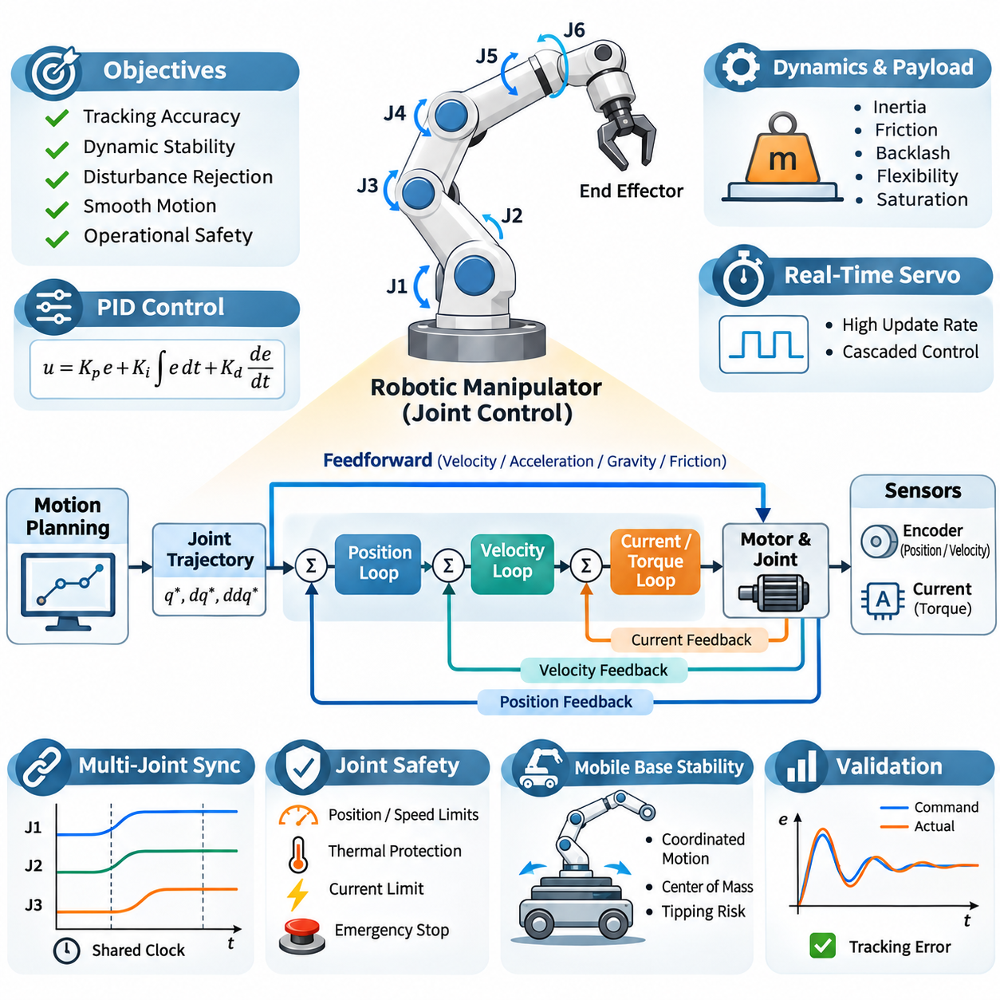
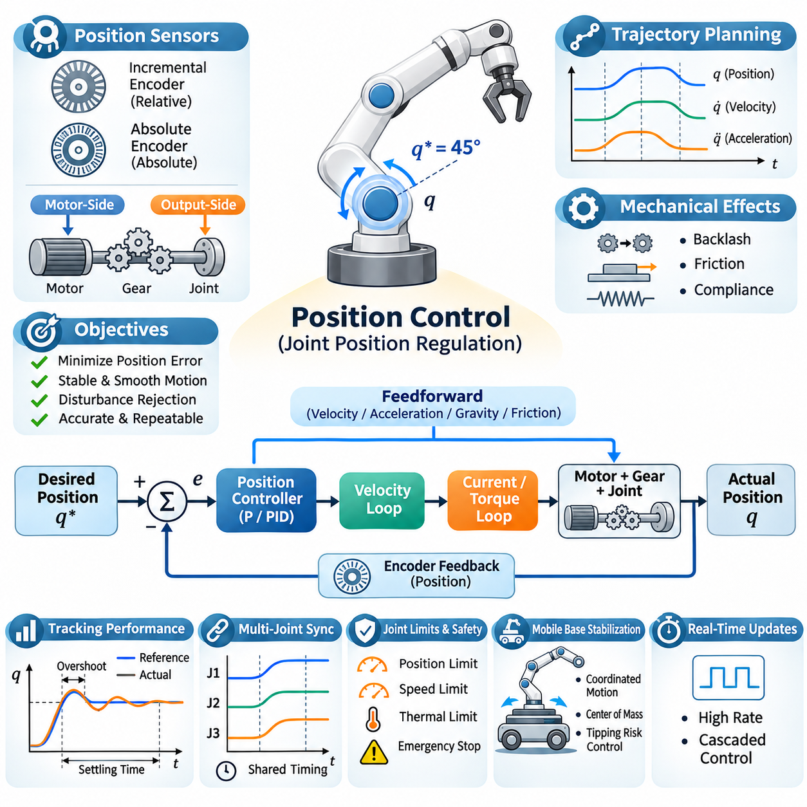
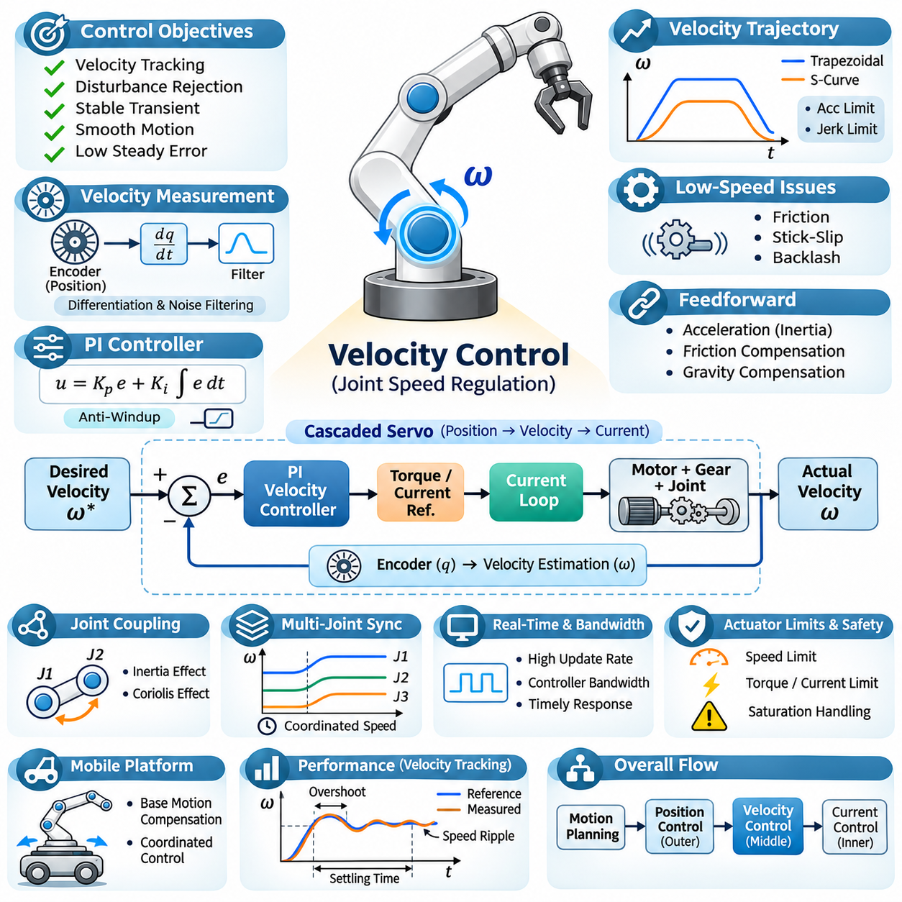
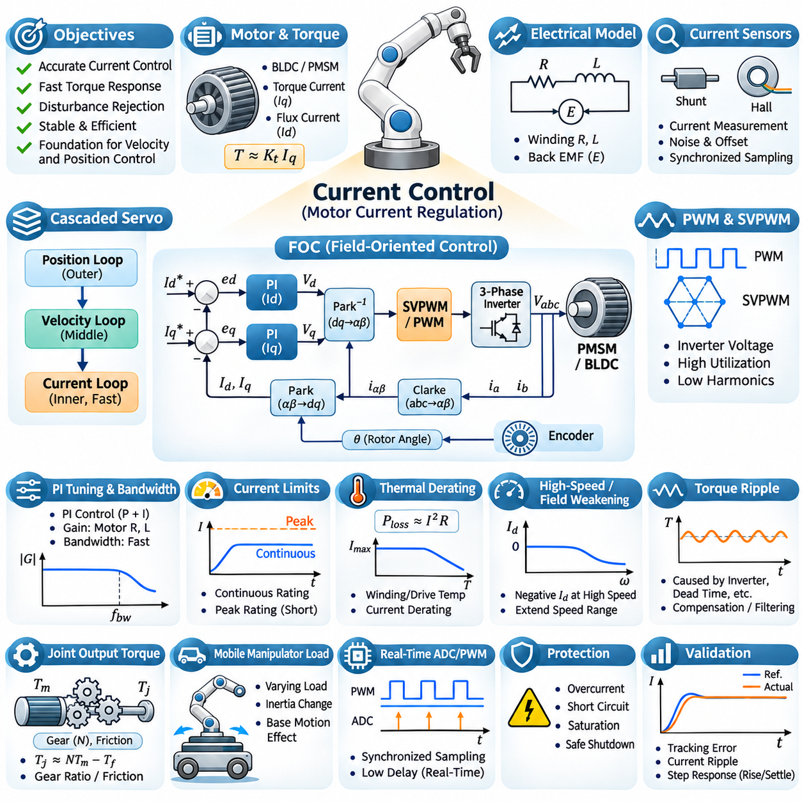
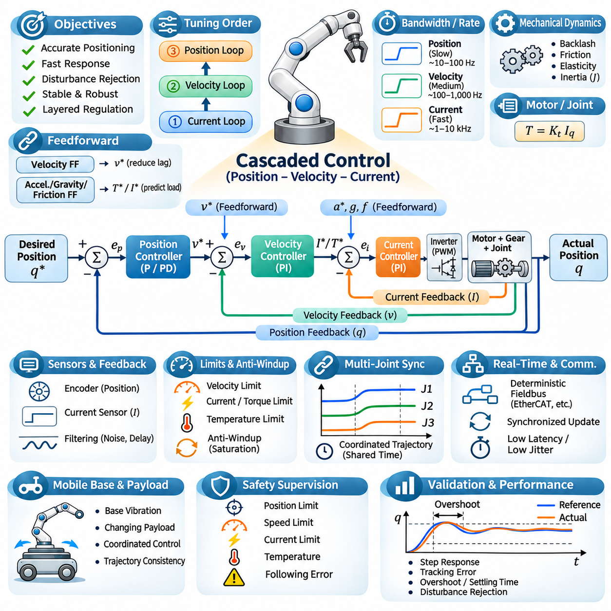
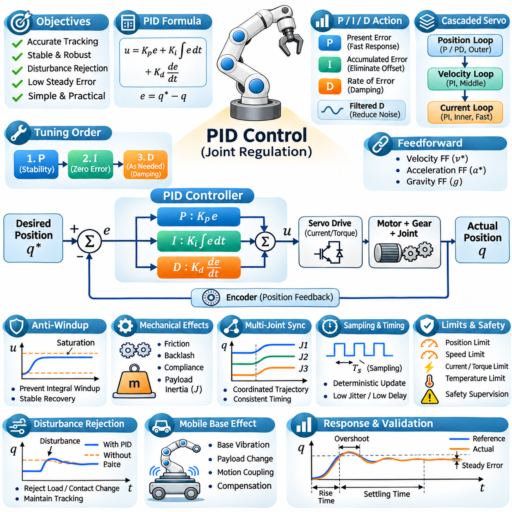
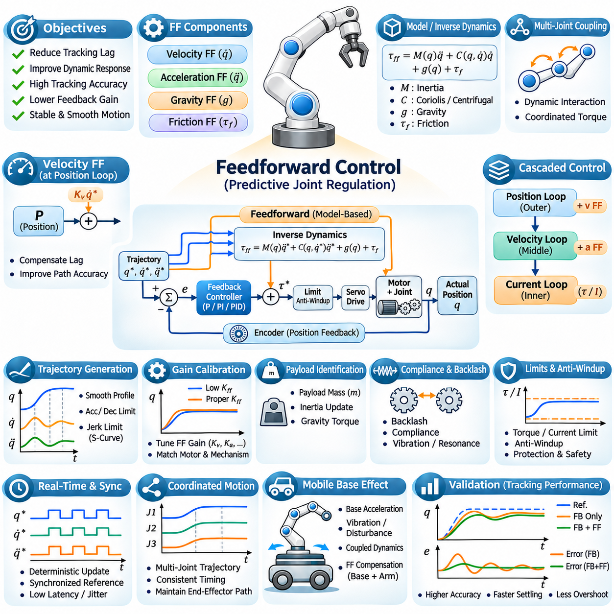
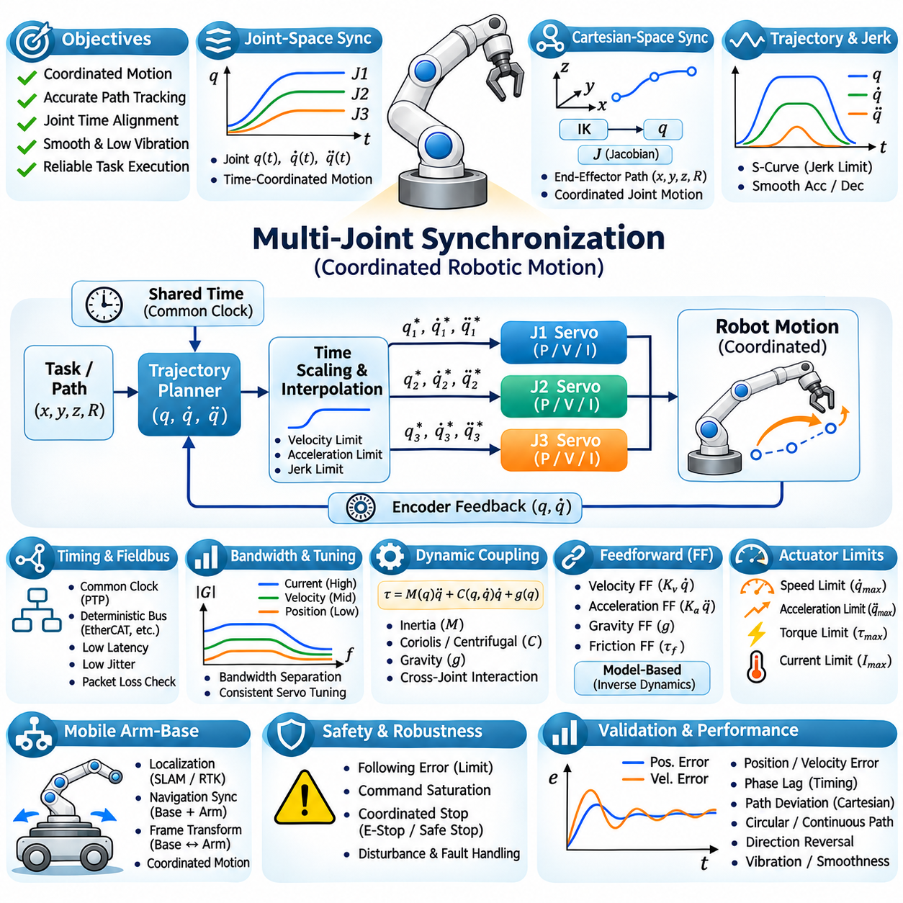
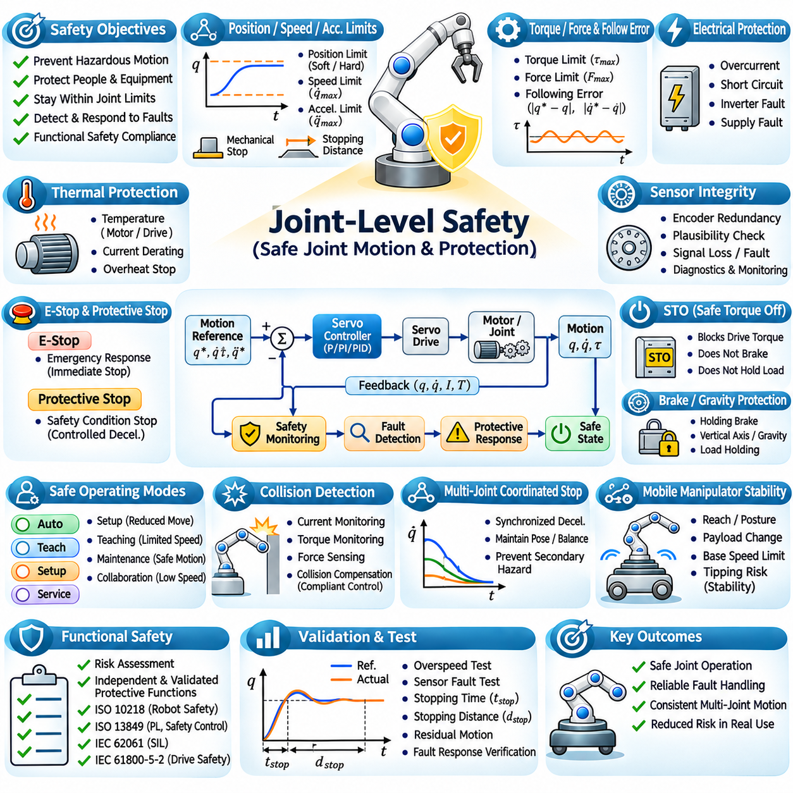

**Volume 02. Manipulator Mechanics and Control**

# Chapter 05. Joint Control

## 01 Joint Control Overview

{width="7.268055555555556in" height="7.268055555555556in"}

Joint control is the fundamental mechanism through which a robotic manipulator regulates the motion of its individual joints to achieve accurate, stable, and repeatable movement. Each joint is driven by an actuator and monitored through sensors that measure position, velocity, or motor current. By continuously comparing commanded values with measured states, the controller adjusts actuator inputs to reduce errors and maintain the desired mechanical behavior.

In a serial robotic manipulator, coordinated joint movement determines the position and orientation of the end effector. Although task planning may specify motion in Cartesian space, the physical actuators operate through joint-level commands. Joint control therefore provides the essential connection between high-level motion planning and low-level motor execution, transforming desired trajectories into controlled mechanical movement.

The primary objectives of joint control include tracking accuracy, dynamic stability, disturbance rejection, smooth motion, and operational safety. A well-designed controller must respond quickly to changing commands while avoiding excessive oscillation or mechanical stress. These objectives become particularly important when manipulators carry variable payloads, accelerate rapidly, or operate near sensitive equipment and human workers.

Joint control systems typically regulate position, velocity, and motor current through interconnected feedback mechanisms. Position control determines where a joint should move, velocity control regulates its rotational or linear speed, and current control influences the electromagnetic torque produced by the motor. These control modes operate at different physical levels and are often combined within a hierarchical servo architecture.

Position control is widely used in industrial manipulators because many manufacturing operations require precise movement between predetermined configurations. The controller compares the desired joint angle with the measured angle and generates corrective commands. Position feedback commonly comes from rotary encoders or linear measurement devices, allowing the system to detect tracking errors and compensate for disturbances during movement.

Velocity control focuses on maintaining a desired joint speed rather than directly regulating its final position. This approach is important for smooth trajectory execution, continuous motion, and coordinated multi-axis operation. Velocity feedback allows the controller to respond to changes in load and friction. Accurate speed regulation also reduces abrupt acceleration and improves the mechanical consistency of robotic movements.

Motor current control operates closer to the electrical characteristics of the actuator. In many electric motor systems, the torque-producing current component is approximately proportional to generated electromagnetic torque. Current regulation therefore provides a fast mechanism for controlling actuator effort. Its performance depends on motor characteristics, power electronics, current sensing, and the electrical control algorithm.

Modern servo systems frequently employ cascaded control structures in which several feedback loops operate at different update rates. The outer position loop generates velocity references, the intermediate velocity loop produces current or torque references, and the inner current loop regulates motor electrical behavior. This arrangement separates control objectives according to their dynamic characteristics and supports systematic controller tuning.

Proportional, integral, and derivative control provides a widely adopted foundation for joint servo regulation. Proportional action responds to instantaneous tracking error, integral action compensates for persistent offsets, and derivative action can improve damping by responding to the rate of error change. Practical PID implementations require careful gain selection, filtering, and anti-windup mechanisms to maintain stable performance.

Feedback control alone may produce tracking delays when joints execute rapidly changing trajectories. Feedforward control addresses this limitation by anticipating the actuator effort required for planned motion. Velocity, acceleration, gravity, and friction compensation can be incorporated into the command structure. Combining predictive feedforward terms with feedback correction improves trajectory tracking without relying entirely on reactive error reduction.

The mechanical characteristics of robotic joints strongly influence controller behavior. Gear reduction, reflected inertia, friction, backlash, structural flexibility, and actuator saturation affect the relationship between commanded input and actual movement. A controller designed without considering these characteristics may exhibit overshoot, vibration, or inaccurate positioning. Mechanical modeling and experimental identification therefore support effective control design.

Joint dynamics are also influenced by interactions between different links of a manipulator. Accelerating one joint can generate inertial and Coriolis-related effects that influence other joints. Independent joint controllers may compensate for some interactions through feedback, but high-performance systems often incorporate dynamic compensation. Understanding these coupling effects is essential for accurate movement during rapid or complex multi-axis trajectories.

Multi-joint synchronization ensures that individual actuators follow coordinated trajectories while maintaining the intended end-effector path. A trajectory generator typically specifies joint positions, velocities, and accelerations over a shared time reference. Each servo controller tracks its assigned command while the overall system monitors timing consistency. Synchronization errors can reduce path accuracy even when individual joints remain stable.

Real-time execution is a critical requirement because joint control depends on predictable sampling and command updates. Control algorithms must process sensor measurements, calculate corrective actions, and transmit actuator commands within defined deadlines. Excessive latency or timing jitter can degrade stability and tracking performance. Industrial controllers therefore prioritize deterministic execution, synchronized communication, and reliable feedback acquisition.

Sensor quality directly affects the precision and robustness of joint control. Encoders provide position measurements, while velocity may be estimated from successive samples or obtained through dedicated sensing. Current sensors monitor electrical actuator behavior, and temperature measurements support equipment protection. Sensor noise, quantization, calibration errors, and communication delays must be considered when designing feedback algorithms.

Joint-level safety mechanisms protect both the manipulator and its surrounding environment. Typical protective functions include position limits, velocity limits, current restrictions, thermal monitoring, and detection of abnormal following errors. When unsafe conditions occur, the controller must initiate an appropriate protective response. Safety functions should be implemented through architectures suitable for the required risk reduction rather than relying exclusively on ordinary motion software.

Mobile manipulators introduce additional control challenges because the robotic arm operates on a movable platform. Base vibration, platform compliance, changing orientation, and disturbances during navigation can affect joint tracking performance. The controller must account for these influences when executing precision tasks. Coordinating base stabilization with arm movement helps maintain consistent end-effector behavior in changing operating conditions.

During manipulation, the payload can change significantly as objects are grasped, transported, or released. These variations alter joint loading, gravitational effects, and effective inertia. Controllers with insufficient robustness may experience increased tracking errors or oscillations. Adaptive gain adjustment, disturbance observers, and model-based compensation can improve performance, although their implementation requires reliable measurements and appropriate stability analysis.

The design of joint control systems involves balancing accuracy, response speed, energy consumption, and mechanical durability. Aggressive control gains may improve tracking under certain conditions but can amplify sensor noise or excite structural resonances. Conservative gains may produce smoother behavior but increase response delays. Engineering optimization therefore requires evaluating controller performance across representative trajectories, payloads, and operating conditions.

Validation of joint control begins with individual actuator testing and progresses toward coordinated manipulator operation. Engineers examine step responses, trajectory tracking errors, settling time, overshoot, and disturbance recovery. Additional experiments evaluate current consumption, thermal behavior, and sensitivity to payload variations. Testing under realistic operating conditions is necessary to confirm that laboratory performance translates into dependable industrial operation.

Joint control also forms the execution foundation for advanced robotic control strategies. Torque control, force regulation, impedance control, and compliant manipulation depend on reliable actuator behavior and accurate state feedback. Even sophisticated task-level algorithms cannot compensate fully for unstable or poorly calibrated joint servos. Consequently, joint control remains a central engineering discipline connecting mechanical design, electrical actuation, dynamic modeling, and intelligent robotic operation.

## 02 Position Control

{width="7.268055555555556in" height="7.268055555555556in"}

Position control is a fundamental technique in robotic manipulators that regulates the angular or linear displacement of individual joints to achieve commanded configurations. The controller continuously compares a desired position with the measured joint position and generates corrective actuator commands. This feedback process enables accurate positioning despite mechanical disturbances, changing loads, and uncertainties in actuator behavior.

The primary objective of position control is to minimize the difference between the reference position and the actual joint position. This difference, known as position error, provides the feedback signal used to determine corrective action. A properly designed controller reduces tracking error while maintaining stability, limiting overshoot, and ensuring that joint movement remains smooth throughout acceleration and deceleration.

Joint position is commonly measured using rotary encoders, absolute encoders, resolvers, or linear displacement sensors. Incremental encoders provide relative motion information through pulse counting, while absolute encoders represent position through encoded values. Accurate sensor calibration, sufficient measurement resolution, and reliable signal transmission are essential for maintaining consistent position feedback.

A basic position controller applies proportional feedback, where the corrective command increases with the magnitude of the position error. Large deviations generate stronger responses, while smaller deviations produce reduced corrections. The proportional gain determines the controller\'s sensitivity, but excessive gain may cause oscillation, overshoot, or excitation of mechanical resonance in flexible joints.

Proportional-integral-derivative control extends basic position regulation by combining proportional, integral, and derivative actions. The integral component compensates for persistent position offsets caused by disturbances, while derivative action can improve damping and transient response. Practical implementations must account for measurement noise, actuator saturation, and integral windup to avoid unstable or excessively aggressive behavior.

Industrial servo drives frequently implement position control through cascaded feedback loops. The outer position controller calculates a velocity reference from position error, while an inner velocity controller generates a torque or current reference. A faster current loop then regulates motor electrical behavior. This hierarchy allows each control loop to address a different dynamic timescale while supporting accurate and responsive positioning.

Position commands may be generated as discrete setpoints or continuous trajectories. A sudden position command can demand excessive acceleration and produce mechanical shock, particularly in systems with heavy payloads. Trajectory generators therefore create intermediate references that respect velocity, acceleration, and sometimes jerk limits. Smooth reference generation improves tracking performance and reduces stress on mechanical components.

Trajectory tracking differs from point-to-point positioning because the joint must follow a continuously changing reference rather than simply reach a final destination. Tracking performance depends on controller bandwidth, actuator capability, reference smoothness, and mechanical dynamics. A joint may reach its final position accurately while still exhibiting substantial errors during movement, making dynamic tracking evaluation essential.

Feedforward compensation improves position tracking by anticipating the actuator effort required for planned movement. Velocity feedforward can reduce lag associated with position-loop dynamics, while acceleration feedforward can compensate for inertial requirements. Gravity and friction compensation further improve performance when suitable models are available. Feedback remains necessary to correct modeling errors and unexpected disturbances.

Mechanical transmission characteristics significantly influence positioning accuracy. Gear backlash creates a region where motor movement may not immediately produce output motion, while friction can cause stick-slip behavior at low speeds. Structural flexibility and transmission compliance introduce additional dynamic effects. These characteristics may require compensation algorithms, appropriate gain tuning, or improved mechanical design.

The location of the position sensor determines which mechanical motion is directly observed. Motor-side encoders measure actuator shaft rotation, but they may not detect all deformation or backlash occurring after the transmission. Output-side encoders provide more direct information about joint displacement. Dual-encoder configurations can improve observability, although their control design must account for flexible transmission dynamics.

Position control performance is affected by disturbances such as changing payload mass, gravitational loading, external contact, and vibration. These disturbances can produce temporary tracking errors or persistent offsets. Integral feedback, disturbance observers, and model-based compensation may improve disturbance rejection. However, controller robustness must be evaluated across the expected operating range rather than under a single nominal condition.

Multi-joint manipulators require synchronized position references to maintain coordinated end-effector motion. Even when individual joints achieve accurate final positions, differences in response timing can distort the intended Cartesian trajectory. Shared trajectory timing and coordinated interpolation help maintain path consistency. Accurate synchronization becomes especially important during welding, assembly, inspection, and continuous-path operations.

Position control also interacts with inverse kinematics and motion planning. A Cartesian target is converted into joint coordinates through an inverse kinematics solution, and a trajectory planner generates feasible intermediate joint references. The position controller executes these commands within actuator and mechanical constraints. Errors in calibration, kinematic parameters, or joint tracking can propagate into end-effector positioning errors.

Real-time execution is essential for maintaining predictable position-control behavior. Sensor measurements must be acquired, feedback errors calculated, and actuator commands updated at consistent intervals. Communication delays, timing jitter, and irregular sampling can degrade tracking accuracy or reduce stability margins. Deterministic control scheduling and reliable fieldbus communication support consistent servo performance.

Controller tuning involves balancing response speed, damping, tracking accuracy, and mechanical limitations. Higher proportional gains can reduce position error but may amplify vibration or excite resonant modes. Integral gains must be selected carefully to prevent excessive overshoot, while derivative feedback requires appropriate filtering. Frequency-response analysis and experimental testing provide systematic methods for selecting suitable parameters.

Position-control systems must enforce joint travel limits and prevent unsafe motion. Software limits restrict commanded trajectories, while independent protective mechanisms may monitor actual position and actuator behavior. Following-error thresholds can detect situations where a joint cannot track its reference. Protective responses must account for stopping distance, mechanical constraints, and the safety requirements of the complete robotic system.

Mobile manipulators introduce additional positioning challenges because the arm is mounted on a platform that may experience vibration, compliance, or small changes in orientation. These effects alter the relationship between joint coordinates and the external workspace. Joint position control can maintain commanded angles, but accurate task-space positioning may also require base stabilization, localization feedback, and coordinated motion compensation.

Position-control validation includes step-response testing, point-to-point movement, continuous trajectory tracking, and repeated positioning experiments. Engineers evaluate settling time, overshoot, steady-state error, tracking error, and repeatability under different payloads. Additional tests examine low-speed motion, direction reversals, thermal variation, and disturbance recovery to identify limitations that may not appear during nominal operation.

Position control provides the foundation for reliable robotic manipulation by converting planned joint trajectories into precise physical movement. Its effectiveness depends on sensor accuracy, servo architecture, mechanical characteristics, trajectory generation, and real-time execution. When properly integrated with kinematics, dynamics, safety monitoring, and higher-level planning, position control enables repeatable and coordinated operation across industrial and mobile robotic applications.

## 03 Velocity Control

{width="7.268055555555556in" height="7.268055555555556in"}

Velocity control is a fundamental component of robotic joint control that regulates the rotational or linear speed of an actuator according to a commanded reference. Unlike position control, which focuses on reaching a specified configuration, velocity control maintains a desired rate of motion. It enables smooth joint movement, predictable dynamic behavior, and coordinated execution of robotic trajectories under changing operating conditions.

The primary objective of velocity control is to minimize the difference between the commanded velocity and the measured joint velocity. This difference, called velocity error, determines the corrective action generated by the controller. Effective regulation requires rapid disturbance rejection, stable transient response, and minimal steady-state error while respecting actuator limitations and mechanical constraints.

Joint velocity can be measured directly through dedicated speed sensors or estimated from position measurements obtained using encoders. A common approach calculates velocity from changes in joint position over successive sampling intervals. However, numerical differentiation can amplify measurement noise, particularly at low speeds. Filtering and observer-based estimation techniques improve velocity feedback quality.

A basic velocity controller uses proportional feedback to generate an actuator command from the difference between desired and actual speed. Increasing proportional gain generally improves responsiveness but may also amplify measurement noise or introduce oscillations. The appropriate gain depends on motor dynamics, transmission characteristics, load inertia, and the bandwidth of the underlying actuator control system.

Proportional-integral control is widely used in industrial velocity servo systems because it combines responsive error correction with compensation for persistent disturbances. Proportional action responds to instantaneous velocity error, while integral action reduces steady-state deviations caused by friction or external loading. Anti-windup mechanisms are important when actuator commands reach current or torque saturation limits.

Velocity control commonly operates as the intermediate loop within a cascaded servo architecture. An outer position controller generates a desired velocity, and the velocity controller converts the resulting speed error into a torque or current reference. An inner current controller regulates motor electrical behavior at a higher update frequency. This separation supports stable operation across different dynamic timescales.

The bandwidth of a velocity controller determines how quickly it can respond to changing speed commands and external disturbances. Higher bandwidth improves tracking of rapidly varying references but may increase sensitivity to sensor noise and mechanical resonance. Controller design must therefore balance responsiveness with stability margins, actuator capability, and the dynamic characteristics of the joint mechanism.

Velocity references are typically generated by trajectory planners that consider acceleration, deceleration, and jerk constraints. Abrupt changes in commanded speed can create large torque demands and mechanical shocks. Smooth velocity profiles reduce structural vibration and improve trajectory consistency. Trapezoidal and S-curve motion profiles are commonly used to achieve controlled acceleration and deceleration.

Acceleration limiting is particularly important when manipulators transport heavy or fragile payloads. Rapid changes in velocity generate inertial forces that can disturb the end effector or increase joint loading. By constraining acceleration and jerk, the motion controller reduces mechanical stress and improves handling stability. These constraints must be coordinated with the available actuator torque and overall trajectory duration.

Motor and transmission characteristics significantly influence velocity regulation. Gear reduction changes the relationship between motor speed and joint speed, while friction introduces nonlinear resistance to motion. Backlash, compliance, and structural flexibility can produce oscillatory behavior during speed reversals. Accurate modeling and suitable feedback compensation help maintain smooth movement across the operating range.

Low-speed velocity control presents particular challenges because encoder quantization, static friction, and stick-slip behavior become more significant. Small commanded speeds may produce irregular motion when the actuator cannot overcome friction consistently. Improved velocity estimation, friction compensation, and carefully tuned control gains can reduce these effects and support precise slow movements.

Feedforward control can improve velocity tracking by anticipating the torque required to accelerate the joint or overcome predictable disturbances. Acceleration feedforward compensates for inertial loading, while friction compensation reduces resistance-related errors. Gravity compensation is also useful when joint orientation affects required torque. Feedback correction remains necessary because physical models cannot perfectly represent operating conditions.

Velocity control must also account for dynamic coupling between manipulator joints. Motion of one link can influence the torque required by another through inertial and Coriolis effects. Independent velocity loops can reject some coupling disturbances, but model-based compensation may improve performance during rapid coordinated movements. Such compensation becomes increasingly valuable in high-speed multi-axis manipulators.

Multi-joint synchronization depends on accurate velocity tracking as well as consistent position references. Differences in joint speed response can distort the intended end-effector path even when final positions are correct. Coordinated trajectory generation and synchronized command updates reduce these deviations. Continuous-path applications such as welding, polishing, and inspection particularly benefit from consistent velocity regulation.

Real-time implementation requires predictable sampling intervals and timely processing of velocity feedback. Delays in sensor acquisition, control computation, or actuator communication can reduce phase margin and degrade tracking performance. Deterministic scheduling, synchronized fieldbus communication, and appropriate filtering are essential for maintaining stable velocity control in industrial servo systems.

Velocity controllers must respect actuator torque, current, speed, and thermal limitations. When commanded acceleration exceeds available torque, the joint may fail to follow its velocity reference. Persistent saturation can cause integral windup and excessive heating. Saturation handling, command limiting, and thermal monitoring help preserve reliable operation while preventing unrealistic control demands.

Safety mechanisms are essential because uncontrolled joint velocity can create hazardous motion. Controllers may enforce maximum speed limits, monitor excessive velocity errors, and detect abnormal acceleration. Protective functions should initiate controlled deceleration or another appropriate safety response when hazardous conditions occur. Safety-related monitoring must be designed according to the risk requirements of the complete robotic system.

Mobile manipulators introduce additional disturbances because arm motion occurs on a platform that may vibrate, tilt, or move during operation. Base motion changes the relationship between joint velocity and end-effector velocity in the external reference frame. Coordinated control may therefore require platform velocity estimation, base stabilization, and compensation for relative motion between the arm and its environment.

Velocity control performance is evaluated through speed tracking experiments, step responses, disturbance rejection tests, and continuous trajectory execution. Important measurements include velocity error, response time, overshoot, settling behavior, and speed ripple. Testing should cover low-speed motion, rapid reversals, different payloads, and thermal conditions to identify weaknesses that may not appear during nominal operation.

Velocity control provides the dynamic foundation for smooth and coordinated robotic movement. Its effectiveness depends on accurate velocity estimation, appropriate feedback gains, actuator characteristics, trajectory generation, and real-time execution. When integrated with position regulation, current control, dynamic compensation, and safety monitoring, velocity control enables reliable joint motion across industrial and mobile manipulation applications.

## 04 Current Control

{width="7.268055555555556in" height="7.268055555555556in"}

Current control is a fundamental component of robotic joint actuation that regulates the electrical current flowing through motor windings. Because motor-generated electromagnetic torque is closely related to the torque-producing current, accurate current regulation enables precise actuator effort control. It provides the foundation for stable velocity regulation, position tracking, and advanced torque-based manipulation.

The primary objective of current control is to minimize the difference between a commanded current reference and the measured motor current. The controller continuously adjusts the applied motor voltage to reduce this error while respecting electrical and thermal constraints. Fast current regulation allows the actuator to respond predictably to changing torque demands, external disturbances, and dynamic loading.

Electric motors used in robotic manipulators include brushless DC motors, permanent magnet synchronous motors, and other servo motor configurations. Their electromagnetic characteristics determine how electrical current produces mechanical torque. In permanent magnet motors, torque is primarily associated with the quadrature-axis current, although the exact relationship depends on motor construction, magnetic saturation, and operating conditions.

Modern robotic servo drives commonly employ field-oriented control to regulate motor currents in a rotating reference frame. Three-phase currents are transformed into direct-axis and quadrature-axis components, allowing magnetic flux and torque-producing current to be controlled separately. This approach simplifies current regulation and supports efficient torque production across a broad operating range.

The direct-axis current is generally associated with magnetic flux control, while the quadrature-axis current primarily determines electromagnetic torque. For many surface-mounted permanent magnet motors, the direct-axis reference is maintained near zero during normal operation. Interior permanent magnet motors may use nonzero direct-axis current for efficiency optimization or field weakening, depending on their operating requirements.

Current feedback is obtained through sensors integrated into the motor drive, including shunt resistors, Hall-effect sensors, or isolated current measurement devices. Accurate sensing is essential because measurement errors directly influence torque regulation. Sensor offset, electrical noise, quantization, and sampling synchronization must be considered to maintain reliable feedback under rapidly changing switching conditions.

Current controllers commonly use proportional-integral regulation to minimize current tracking errors. Proportional action responds to instantaneous deviations, while integral action compensates for persistent offsets caused by motor resistance and applied voltage disturbances. Controller gains must be selected according to winding resistance, inductance, sampling frequency, and inverter characteristics to achieve stable electrical response.

The electrical dynamics of motor windings determine the achievable current-control bandwidth. Winding inductance resists rapid current changes, while resistance influences steady-state voltage requirements. Higher control bandwidth improves torque responsiveness but increases sensitivity to measurement noise, switching delays, and discretization effects. Practical designs balance dynamic performance with electrical stability.

Pulse-width modulation is widely used to generate the motor voltages required by current controllers. A power inverter switches semiconductor devices to approximate the commanded voltage through controlled switching patterns. The resulting phase currents depend on motor inductance, switching frequency, and modulation strategy. Space-vector modulation is frequently employed in three-phase servo drives to improve voltage utilization.

Current control typically forms the innermost feedback loop of a cascaded robotic servo architecture. An outer position loop generates velocity commands, and an intermediate velocity loop produces torque or current references. The inner current loop regulates electromagnetic actuator behavior at a higher update frequency. This hierarchy allows rapid torque response while maintaining coordinated position and velocity regulation.

Current references must be constrained by the motor\'s continuous and peak operating limits. Excessive current can cause winding overheating, magnetic saturation, or damage to power electronics. Continuous current ratings reflect sustained thermal capability, while peak ratings generally permit higher current for limited durations. Appropriate limiting strategies protect the actuator without unnecessarily restricting short-term dynamic performance.

Thermal behavior is particularly important because resistive losses increase approximately with the square of winding current. Repeated acceleration, heavy payload handling, and prolonged static torque generation can therefore produce substantial heating. Temperature sensors and thermal estimation models help monitor operating conditions. Current derating may be necessary when winding or inverter temperatures approach allowable limits.

Motor current regulation must also account for back electromotive force, which increases with rotational speed and opposes the applied voltage. At higher speeds, the available voltage margin for changing current becomes smaller. This limitation can reduce torque capability and current tracking performance. Field-weakening techniques may extend the operating speed range when supported by the motor and drive design.

Current-loop performance is affected by inverter dead time, semiconductor voltage drops, current measurement delays, and motor parameter uncertainty. These effects can introduce tracking errors and torque ripple, especially at low speeds or during rapid reversals. Compensation methods and accurate parameter identification improve regulation quality, although their effectiveness depends on reliable hardware characterization.

Torque ripple is an important consideration in precision robotic applications because variations in electromagnetic torque can produce vibration and positioning errors. Sources include current ripple, magnetic harmonics, cogging torque, and inverter nonlinearities. High-quality current regulation reduces electrically induced torque fluctuations, while mechanical design and specialized compensation address other sources of periodic disturbance.

Real-time implementation requires current measurements and control updates to be synchronized with inverter switching. Sampling at inappropriate moments can introduce switching noise into feedback signals. Digital controllers therefore coordinate analog-to-digital conversion, current regulation, and pulse-width modulation updates. Predictable execution timing is essential for achieving high-bandwidth control without sacrificing stability.

Current control must distinguish between commanded electromagnetic torque and actual joint output torque. Gear reduction, transmission efficiency, friction, and mechanical compliance influence how motor torque reaches the joint. Consequently, accurate current regulation does not automatically guarantee precise output torque. Joint torque sensors, calibrated transmission models, or disturbance observers may be required when direct mechanical torque accuracy is important.

Safety functions monitor abnormal current conditions, including overcurrent, short circuits, sensor failures, and excessive thermal loading. Hardware protection circuits must respond rapidly to electrical faults that ordinary software control cannot safely manage. Current limiting and fault detection should be coordinated with higher-level motion supervision to prevent hazardous actuator behavior and protect surrounding equipment.

In mobile manipulators, current control must accommodate changing arm loads, platform vibration, and dynamic interactions between the robotic arm and mobile base. Accelerating joints or lifting objects can create rapid variations in required motor torque. Stable current regulation supports predictable actuator response, while coordinated system control manages mechanical disturbances and power distribution across the complete platform.

Current-control performance is evaluated through reference tracking tests, current step responses, disturbance experiments, and thermal measurements. Important metrics include current tracking error, response time, bandwidth, overshoot, current ripple, and sustained operating temperature. Testing across different speeds, loads, and supply voltages helps verify that electrical regulation remains stable under realistic operating conditions.

Current control establishes the electrical foundation of precise robotic joint actuation by translating torque-related commands into regulated motor currents. Its effectiveness depends on motor modeling, sensor accuracy, inverter performance, feedback tuning, thermal management, and deterministic execution. When integrated with velocity, position, and torque control, reliable current regulation enables responsive and efficient manipulation in industrial and mobile robotic systems.

## 05 Cascaded Control

{width="7.268055555555556in" height="7.268055555555556in"}

Cascaded control is a hierarchical feedback architecture widely used in robotic manipulators to regulate joint position, velocity, and motor current through interconnected control loops. Each loop addresses a different physical behavior and operates at an appropriate dynamic timescale. By separating motion regulation into coordinated layers, cascaded control improves responsiveness, disturbance rejection, and overall servo stability.

The fundamental principle of cascaded control is that an outer control loop generates the reference command for an inner loop. In a typical robotic servo system, the position controller produces a velocity reference, the velocity controller generates a torque or current reference, and the current controller regulates motor electrical behavior. This arrangement connects high-level motion objectives with low-level actuator execution.

The outer position loop determines how the joint should move toward a desired angular or linear position. It continuously compares the commanded position with measured feedback and calculates a suitable velocity reference. Because mechanical position changes relatively slowly, this loop generally operates with lower bandwidth than the inner loops. Its design emphasizes tracking accuracy, smooth movement, and stable positioning.

The intermediate velocity loop regulates joint speed according to the reference received from the position controller. It compares commanded and measured velocity and generates the actuator effort required to reduce the difference. This loop compensates for disturbances caused by friction, changing payloads, and mechanical loading. Its response must be sufficiently fast to support accurate position tracking.

The innermost current loop controls the electrical current flowing through the motor windings. Since electromagnetic torque is closely related to torque-producing current, rapid current regulation enables responsive actuator effort control. The current loop typically operates at the highest update frequency and bandwidth. Its performance establishes the electrical foundation for the outer velocity and position loops.

A central design requirement is maintaining appropriate bandwidth separation between successive control loops. The inner loop should respond substantially faster than the outer loop so that its dynamics can be approximated as sufficiently responsive during outer-loop design. However, excessive bandwidth may amplify sensor noise or excite mechanical resonance. Actual bandwidth ratios must be selected through modeling and stability analysis.

Controller tuning generally begins with the innermost current loop before progressing to velocity and position regulation. The current controller is adjusted to provide stable and rapid electrical response. Once its behavior is verified, the velocity controller is tuned using the established current-loop dynamics. Finally, the position controller is adjusted to achieve the desired tracking performance without destabilizing the underlying loops.

Proportional-integral control is commonly employed in current and velocity loops because it combines immediate error correction with compensation for persistent disturbances. Position loops frequently use proportional control or proportional-derivative structures, depending on system requirements. Integral action may also be incorporated where appropriate. Controller selection must account for actuator dynamics, noise, saturation, and mechanical characteristics.

The interaction between cascaded loops determines the overall closed-loop response of the joint. A poorly tuned inner loop can introduce delays or oscillations that propagate into higher control layers. Conversely, aggressive outer-loop gains may demand responses beyond the capabilities of inner loops. Successful design therefore requires evaluating both individual loop performance and the stability of the complete interconnected system.

Feedforward control can be incorporated into cascaded architectures to improve trajectory tracking. Velocity feedforward reduces position-loop tracking lag, while acceleration feedforward anticipates inertial torque requirements. Gravity and friction compensation can further reduce predictable disturbances. These predictive terms supplement feedback regulation and improve performance without requiring excessively high feedback gains.

Command saturation is an important consideration because each control layer operates within physical limits. Position controllers may generate velocity references beyond allowable speed, while velocity controllers may request more torque than the motor can provide. Current controllers must respect electrical and thermal ratings. Coordinated limiting and anti-windup mechanisms prevent accumulated errors and undesirable recovery behavior.

Sampling frequency and communication timing strongly influence cascaded control performance. Inner current loops generally require faster updates than velocity loops, while position loops can operate at comparatively slower rates. Deterministic scheduling ensures that references and measurements remain temporally consistent. Excessive latency, timing jitter, or unsynchronized updates can reduce stability margins and degrade tracking accuracy.

Sensor feedback is essential at every control layer. Position measurements typically come from encoders, while velocity may be estimated from position changes or obtained through dedicated sensors. Current sensors provide electrical feedback for torque-producing current regulation. Measurement noise, calibration errors, and filtering delays influence controller behavior and must be considered during system integration.

Mechanical transmission characteristics affect the relationship between motor-side control and actual joint movement. Gear backlash, friction, elasticity, and reflected inertia can introduce nonlinear behavior that is not fully represented by simple cascaded models. High-performance systems may incorporate dual encoders, disturbance observers, or model-based compensation to improve joint-level accuracy and robustness.

Cascaded control also supports coordinated multi-joint operation by providing consistent servo behavior across individual actuators. A trajectory planner generates synchronized position and velocity references for each joint, while local controllers execute the commands. Differences in bandwidth, tracking delay, or actuator saturation can distort the intended end-effector path. Coordinated tuning and timing reduce these deviations.

In mobile manipulators, cascaded joint control must operate under disturbances introduced by platform movement, vibration, and changing payload conditions. Although local servo loops regulate individual actuators, base motion can influence joint loading and end-effector accuracy. Coordinated control strategies may incorporate platform stabilization, motion compensation, and dynamic models to maintain reliable manipulation performance.

Safety supervision must monitor both individual loops and the complete actuator system. Position limits, velocity restrictions, current thresholds, and thermal protection prevent commands from exceeding acceptable operating conditions. Following-error monitoring detects situations where actual motion deviates excessively from the reference. Safety-critical protective functions should remain appropriately independent of ordinary servo regulation.

Validation of cascaded control begins with isolated loop testing and progresses toward integrated motion experiments. Engineers evaluate current response, velocity tracking, position accuracy, bandwidth, overshoot, and disturbance rejection. Testing should include changing payloads, rapid reversals, low-speed operation, and actuator saturation. These experiments reveal interactions that may remain hidden during individual controller tuning.

Practical implementation requires careful coordination between servo drives, real-time controllers, communication networks, and motion planning software. Industrial drives often execute current and velocity loops internally, while higher-level controllers provide position or velocity references. The division of responsibilities depends on hardware architecture and control interfaces. Clear timing and command ownership are essential for reliable integration.

Cascaded control provides a structured foundation for precise and responsive robotic joint operation. Its effectiveness depends on bandwidth separation, systematic tuning, accurate feedback, coordinated saturation handling, and deterministic execution. When integrated with trajectory planning, dynamic compensation, and safety supervision, cascaded architectures enable stable multi-joint manipulation across industrial and mobile robotic applications.

## 06 PID Control

{width="7.268055555555556in" height="7.268055555555556in"}

PID control is one of the most widely used feedback control methods in robotic joint systems because of its simplicity, flexibility, and practical effectiveness. It combines proportional, integral, and derivative actions to regulate position, velocity, or other measurable variables. By continuously correcting the difference between desired and actual behavior, PID control provides a foundation for stable and accurate robotic motion.

The proportional component generates a control effort directly related to the instantaneous tracking error. A larger proportional gain generally produces faster correction and stronger responsiveness. However, excessive gain can cause overshoot, oscillation, or instability, especially when mechanical resonance or communication delays are present. Proper proportional tuning balances tracking accuracy with adequate stability margins.

The integral component accumulates tracking error over time and generates corrective action against persistent deviations. It is particularly useful for eliminating steady-state errors caused by friction, constant external loads, or actuator characteristics. Excessive integral gain may produce slow oscillations, overshoot, and prolonged settling. Integral action must therefore be tuned carefully according to system dynamics.

The derivative component responds to the rate of change of tracking error and introduces predictive damping into the control response. It can reduce overshoot and improve transient stability when appropriately configured. However, numerical differentiation amplifies measurement noise, making filtering essential in many implementations. Derivative action is often applied to measured output rather than directly to error.

The mathematical structure of PID control combines three contributions into a single actuator command. Proportional action depends on present error, integral action represents accumulated past error, and derivative action reflects the error\'s rate of change. Their combined behavior allows the controller to address immediate deviations, persistent offsets, and rapid transitions within a unified feedback mechanism.

In robotic position control, PID algorithms regulate joint displacement by comparing commanded and measured angular or linear positions. Proportional action drives the joint toward its target, integral action compensates for sustained offsets, and derivative action provides damping. The resulting control signal may represent velocity, torque, or another actuator command depending on the servo architecture.

Velocity control frequently employs proportional-integral regulation because measured velocity already contains information related to position change. Adding derivative action may increase sensitivity to sensor noise without providing sufficient additional benefit. Nevertheless, PID structures can be useful when dynamic requirements justify their complexity. Controller selection should reflect the physical behavior and available feedback signals.

PID control is commonly integrated into cascaded servo architectures containing position, velocity, and current loops. Each loop regulates a different variable and may use a different controller structure. Current and velocity loops often employ PI control, while position loops may use P or PD control. Proper bandwidth separation ensures that inner loops respond faster than outer loops and supports stable overall operation.

Controller tuning determines how effectively PID gains interact with motor dynamics, joint inertia, friction, and transmission characteristics. Increasing proportional gain improves responsiveness, while integral gain reduces persistent errors and derivative gain modifies damping. These parameters are strongly coupled in their effects. Adjusting one gain may therefore require reevaluating the others under realistic operating conditions.

Manual PID tuning often begins with proportional control to establish a stable response before adding integral and derivative actions. Integral gain is introduced gradually to reduce steady-state error, while derivative gain is adjusted to improve damping when necessary. Systematic approaches such as frequency-response analysis and model-based tuning can provide more predictable results than trial-and-error adjustment alone.

Integral windup occurs when accumulated error continues increasing while the actuator is unable to deliver the requested control effort. This situation commonly arises during torque saturation, speed limiting, or prolonged motion restrictions. When the limitation disappears, the stored integral contribution may cause overshoot or delayed recovery. Anti-windup techniques constrain or correct the integral state during saturation.

Derivative filtering is essential when feedback measurements contain encoder quantization, electrical interference, or mechanical vibration. Direct differentiation can amplify high-frequency disturbances and produce irregular actuator commands. A filtered derivative term reduces this sensitivity while preserving useful damping behavior. Filter bandwidth must be selected to avoid introducing excessive phase delay into the control loop.

Sampling frequency and computational delay influence digital PID performance. Discrete implementations approximate integration and differentiation using measurements obtained at regular intervals. Long sampling periods can degrade tracking accuracy, while timing jitter introduces inconsistent controller behavior. Deterministic execution and appropriate numerical methods help maintain predictable performance in real-time robotic systems.

Mechanical nonlinearities limit the effectiveness of conventional PID control. Static friction, backlash, gear compliance, and variable payload inertia can produce behavior that changes across the operating range. A fixed set of PID gains may therefore perform well under one condition but poorly under another. Gain scheduling, friction compensation, and adaptive techniques can improve robustness when operating conditions vary significantly.

Feedforward compensation can supplement PID feedback by predicting the control effort required for planned motion. Velocity and acceleration feedforward reduce tracking lag during trajectory execution, while gravity compensation offsets predictable joint loading. PID feedback then corrects remaining modeling errors and disturbances. This combination often achieves better tracking performance than increasing feedback gains alone.

Multi-joint manipulators introduce dynamic coupling that independent PID controllers cannot always compensate effectively. Motion of one joint can alter the torque requirements of neighboring joints through inertial and Coriolis interactions. Local PID loops provide useful disturbance rejection, but coordinated trajectory planning and model-based dynamic compensation may be necessary for accurate high-speed manipulation.

PID controllers must operate within actuator current, torque, velocity, and position limits. Saturation handling prevents unrealistic commands from accumulating into unstable recovery behavior. Safety supervision should independently monitor excessive tracking error, abnormal motion, and thermal conditions. Ordinary PID regulation is not a substitute for safety-rated protective functions or emergency stopping mechanisms.

In mobile manipulators, PID control must tolerate disturbances arising from platform vibration, changing orientation, and interaction between the arm and mobile base. These effects may alter joint loading and tracking behavior during operation. Proper gain selection and disturbance compensation improve stability, while coordinated platform and arm control supports accurate end-effector motion in dynamic environments.

PID performance is evaluated through step responses, trajectory tracking experiments, disturbance rejection tests, and steady-state accuracy measurements. Important metrics include rise time, overshoot, settling time, residual error, and control effort. Tests should include changing payloads, low-speed motion, rapid reversals, and actuator saturation to reveal limitations that may not appear during nominal operation.

PID control remains a practical foundation of robotic joint regulation because it offers understandable behavior, efficient computation, and broad compatibility with servo hardware. Its success depends on appropriate gain tuning, feedback quality, anti-windup protection, derivative filtering, and real-time implementation. Combined with cascaded control and model-based compensation, PID enables reliable and precise robotic manipulation.

## 07 Feedforward Control

{width="7.268055555555556in" height="7.268055555555556in"}

Feedforward control is an important technique in robotic joint control that improves motion tracking by anticipating the actuator effort required for a commanded trajectory. Unlike feedback control, which reacts to measured errors, feedforward control calculates corrective commands from known references and system models. This predictive approach reduces tracking delay, improves dynamic response, and complements conventional servo regulation.

The fundamental principle of feedforward control is to estimate the control input required to produce a desired motion before significant tracking error develops. Position, velocity, and acceleration references provide information about upcoming movement. By converting these references into appropriate actuator commands, feedforward control reduces the burden on feedback loops and improves trajectory execution under predictable operating conditions.

Feedback and feedforward control perform complementary functions within robotic servo systems. Feedback compensates for disturbances, modeling errors, and unexpected deviations, while feedforward addresses predictable motion requirements. A well-designed controller combines both contributions to achieve accurate tracking without relying exclusively on high feedback gains. This balance improves stability and reduces sensitivity to measurement noise.

Velocity feedforward is commonly used in position control systems to compensate for tracking lag during continuous motion. The desired joint velocity is multiplied by an appropriate gain and added to the position controller output. This allows the actuator to receive a motion command before substantial position error accumulates. Properly tuned velocity feedforward improves path accuracy during constant-speed and smoothly varying trajectories.

Acceleration feedforward estimates the actuator effort required to overcome joint inertia during changes in velocity. According to rotational dynamics, accelerating a joint requires torque related to its effective inertia and angular acceleration. By predicting this torque demand, the controller reduces acceleration-related tracking errors. Accurate inertia estimation becomes especially important when payload mass or configuration changes.

Gravity compensation is a specialized feedforward technique that counteracts gravitational torque acting on manipulator joints. The required compensation depends on joint configuration, link mass, center of gravity, and payload characteristics. By applying estimated gravity torque in advance, the controller reduces steady-state positioning effort and improves motion consistency. Feedback remains necessary to correct model inaccuracies.

Friction compensation addresses predictable resistance within motors, gears, bearings, and mechanical transmissions. Common models include viscous friction, Coulomb friction, and static friction effects. Feedforward commands can offset estimated friction torque according to motion direction and velocity. However, inaccurate compensation near zero speed may introduce discontinuities, making smooth transitions and careful calibration important.

Model-based feedforward control uses manipulator dynamics to estimate the torques required for planned joint trajectories. These calculations may incorporate inertia matrices, Coriolis and centrifugal effects, and gravitational loading. The resulting torque commands anticipate interactions among moving links. This approach is particularly valuable in multi-joint robots where independent actuator models cannot fully describe dynamic coupling.

Inverse dynamics provides a mathematical foundation for advanced feedforward control. Given desired joint positions, velocities, and accelerations, an inverse dynamics model calculates the joint torques needed to execute the trajectory. These predicted torques are supplied alongside feedback corrections. The effectiveness of this method depends on accurate mechanical parameters, payload estimates, and consistent coordinate conventions.

Feedforward control is frequently integrated into cascaded servo architectures containing position, velocity, and current loops. Velocity feedforward may supplement the outer position loop, while acceleration or torque feedforward can influence the inner actuator commands. The injection point determines how the compensation interacts with existing feedback controllers. Careful implementation prevents duplicated compensation and unintended command amplification.

Trajectory generation strongly influences feedforward performance because predictive commands depend on reference quality. Smooth trajectories provide continuous velocity and acceleration information, enabling stable compensation. Abrupt reference changes may produce unrealistic torque demands or excite mechanical resonance. Acceleration and jerk constraints therefore improve both physical motion quality and the effectiveness of feedforward control.

Feedforward gains must be calibrated to match actuator and mechanical characteristics. Excessive compensation can cause overshoot, oscillation, or motion ahead of the desired trajectory, while insufficient compensation leaves tracking errors largely unchanged. Calibration often involves repeated trajectory experiments and comparison of reference and measured motion. Gain selection should account for operating speed, payload variation, and transmission behavior.

Payload changes create additional challenges because joint inertia and gravitational loading vary with the attached object. A feedforward model calibrated for an unloaded manipulator may produce inaccurate torque predictions when handling heavy components. Payload identification and parameter adaptation improve compensation accuracy. Systems with uncertain loads may combine conservative feedforward commands with robust feedback regulation.

Mechanical compliance, backlash, and structural flexibility can limit feedforward accuracy. Even when motor torque is predicted correctly, elastic deformation may cause joint or end-effector motion to differ from the commanded trajectory. Rigid-body models cannot fully represent these effects. Flexible-joint modeling, vibration suppression, and appropriate feedback measurements may be required for high-precision applications.

Real-time implementation requires synchronized trajectory references and deterministic control execution. Feedforward commands must correspond to the same intended motion state as the feedback controller references. Communication delays or inconsistent timestamps can cause predictive torque to arrive too early or too late. Accurate scheduling, timestamp management, and coordinated servo updates are essential for reliable performance.

Actuator saturation must be considered because predicted torque or current demands may exceed physical limits. Feedforward commands should be constrained according to motor ratings, inverter capability, and thermal conditions. When saturation occurs, feedback controllers must avoid excessive integral accumulation. Coordinated command limiting ensures that predictive compensation does not compromise actuator protection or overall control stability.

Multi-joint synchronization benefits from feedforward compensation because differences in joint inertia and loading can produce unequal tracking delays. Model-based torque prediction helps individual joints follow coordinated trajectories more consistently. This improves end-effector path accuracy during welding, machining, inspection, and other continuous-motion tasks. Synchronization still requires consistent timing and feedback correction.

Mobile manipulators introduce additional complexity because platform motion changes the dynamic conditions experienced by the robotic arm. Base acceleration, vibration, and orientation changes can alter joint torque requirements and end-effector behavior. Feedforward strategies may incorporate estimated platform acceleration and coupled arm-base dynamics. Accurate compensation becomes particularly important during manipulation on moving platforms.

Feedforward performance is evaluated through trajectory tracking experiments, acceleration tests, disturbance measurements, and comparisons with feedback-only operation. Important metrics include position error, velocity error, torque demand, path deviation, and control effort. Testing should cover varying speeds, payloads, and joint configurations. These measurements reveal whether predictive compensation improves performance without introducing instability.

Feedforward control enhances robotic joint performance by anticipating predictable motion demands rather than waiting for tracking errors to develop. Its effectiveness depends on accurate models, smooth trajectory references, calibrated gains, synchronized execution, and actuator constraints. When combined with feedback control, cascaded servo regulation, and dynamic compensation, feedforward enables precise and responsive robotic manipulation.

## 08 Multi Joint Synchronization

{width="7.268055555555556in" height="7.268055555555556in"}

Multi-joint synchronization is a fundamental requirement in robotic manipulators because coordinated motion depends on multiple joints following compatible trajectories at the correct times. Each actuator must execute its assigned movement while maintaining the intended relationship with other joints. Accurate synchronization preserves end-effector paths, reduces motion errors, and enables reliable execution of complex manipulation tasks.

The primary objective of multi-joint synchronization is to ensure that all joints progress through their commanded trajectories according to a common time reference. Individual joints may travel different distances and require different velocities or accelerations. Synchronization coordinates these differences so that the complete manipulator reaches intermediate configurations consistently rather than merely arriving at the final position together.

Trajectory planning provides the foundation for synchronized joint motion by generating position, velocity, and acceleration references for every actuator. A common trajectory parameter defines how each joint progresses over time. This shared representation ensures that individual movements remain coordinated. Smooth trajectory generation also prevents abrupt acceleration changes that could disturb the intended end-effector motion.

Time synchronization is essential because joint controllers may operate on separate processors, servo drives, or communication interfaces. Even small timing differences can produce inconsistent command execution during rapid movement. Distributed control systems therefore require synchronized clocks, deterministic communication, and coordinated update cycles. These mechanisms maintain consistent timing across all participating actuators.

Joint-space synchronization coordinates individual joint variables according to a shared motion schedule. Each joint follows its own position and velocity profile while maintaining temporal alignment with the others. This approach is computationally efficient and suitable for point-to-point movements. However, synchronized joint-space motion does not automatically guarantee a straight or otherwise specified end-effector path.

Cartesian-space synchronization focuses on maintaining the desired position and orientation of the end effector throughout motion. A Cartesian trajectory is converted into coordinated joint references through inverse kinematics. The resulting joint velocities must satisfy the manipulator Jacobian relationship. This approach is especially important for welding, inspection, polishing, and other continuous-path applications.

Velocity synchronization is necessary because differences in joint speed response can distort the intended trajectory. Even when joints eventually reach their target positions, temporary velocity errors may cause significant end-effector deviations. Coordinated velocity references and properly tuned servo loops reduce these effects. Accurate speed estimation and consistent controller bandwidth further improve synchronization quality.

Acceleration synchronization becomes important during rapid starts, stops, and changes in movement direction. Different joint inertias and actuator capabilities can produce unequal acceleration responses. Trajectory planners must account for joint acceleration limits and available torque. Coordinated acceleration profiles reduce mechanical stress, suppress vibration, and preserve the intended relationship between moving links.

Jerk limitation improves synchronization by controlling how rapidly acceleration changes across multiple joints. Sudden acceleration transitions can excite structural resonance and produce inconsistent actuator responses. Smooth S-curve trajectories distribute acceleration changes over time. When applied consistently across joints, jerk constraints improve motion quality and reduce disturbances during precision manipulation.

Multi-joint control must account for dynamic coupling because motion of one joint influences the forces and torques acting on others. Inertial interactions, Coriolis effects, and gravitational loading vary with configuration and speed. Independent servo loops can reject some disturbances, but model-based compensation improves coordinated tracking. Dynamic coupling becomes particularly significant during high-speed movements or heavy payload handling.

Cascaded servo control provides local regulation for each joint through position, velocity, and current loops. Although these loops operate independently at the actuator level, their references must remain synchronized at the system level. Differences in controller tuning, bandwidth, or response delay can create coordination errors. Consistent servo configuration and systematic calibration help minimize these discrepancies.

Feedforward compensation supports synchronization by anticipating the torque required for each joint\'s planned movement. Velocity and acceleration feedforward reduce tracking lag, while gravity and friction compensation address predictable loading effects. Model-based inverse dynamics can also account for coupling between joints. These techniques improve coordinated motion without relying exclusively on aggressive feedback gains.

Actuator constraints must be considered during synchronized trajectory generation. Each joint has maximum velocity, acceleration, torque, and current limits that may differ substantially. If one actuator cannot follow its reference, the complete trajectory may become inconsistent. Time scaling and coordinated constraint handling adjust motion duration so that all joints remain within feasible operating limits.

Communication architecture strongly influences synchronization accuracy in distributed robotic systems. Servo drives may receive commands through industrial Ethernet or other deterministic fieldbus networks. Clock synchronization and scheduled communication cycles help ensure that references are applied at consistent times. Network latency, packet loss, and timing jitter must be managed to prevent coordination errors during demanding motion tasks.

Interpolation is used when high-level trajectory commands are generated at a lower frequency than individual servo updates. Intermediate position and velocity references are calculated between planned trajectory points. Consistent interpolation methods preserve smooth movement and temporal alignment across joints. Poor interpolation or inconsistent timestamps can introduce discontinuities and degrade end-effector tracking accuracy.

Synchronization errors can be evaluated by comparing commanded and measured joint trajectories against a common time base. Position error, velocity error, phase lag, and timing deviation provide useful indicators of coordination quality. Cartesian path deviation reveals how joint-level errors affect the end effector. These measurements help distinguish trajectory planning problems from actuator response limitations.

Mobile manipulators require additional synchronization between the robotic arm and the mobile platform. Base translation and rotation influence end-effector motion relative to the environment. Coordinated control must account for platform velocity, arm joint motion, and reference-frame transformations. Accurate timing between localization, navigation, and manipulation controllers is essential when performing tasks while the base is moving.

Safety supervision must consider the collective behavior of multiple joints rather than monitoring each actuator in isolation. A single joint experiencing excessive following error or torque saturation can compromise the entire coordinated motion. Protective strategies may require synchronized deceleration, controlled stopping, or trajectory interruption. Safety responses should preserve mechanical integrity while satisfying system-level risk requirements.

Validation of multi-joint synchronization involves coordinated trajectory experiments under different speeds, payloads, and configurations. Tests may include circular Cartesian paths, rapid reversals, synchronized starts and stops, and continuous industrial motions. Engineers evaluate path accuracy, timing consistency, tracking errors, and vibration. Testing under realistic disturbances reveals weaknesses that may remain hidden during isolated joint experiments.

Multi-joint synchronization enables robotic manipulators to transform independent actuator movements into coherent and accurate system-level motion. Its effectiveness depends on shared trajectory timing, deterministic communication, consistent servo response, dynamic compensation, and coordinated constraint management. When integrated with motion planning and safety supervision, synchronization supports reliable precision manipulation in industrial and mobile robotic systems.

## 09 Joint Level Safety

{width="7.268055555555556in" height="7.268055555555556in"}

Joint-level safety is a fundamental requirement in robotic manipulators because each actuator can generate motion, torque, and mechanical forces capable of causing equipment damage or injury. Safety mechanisms must monitor joint behavior independently of normal motion objectives. By combining physical limits, electrical protection, fault detection, and coordinated supervision, robotic systems can reduce hazards during operation and abnormal conditions.

The primary objective of joint-level safety is to prevent hazardous motion while maintaining predictable system behavior. Each joint operates within defined position, velocity, acceleration, torque, and temperature limits. These constraints reflect mechanical design, actuator capability, and application requirements. Safety functions must detect violations and initiate appropriate protective responses before dangerous conditions develop.

Joint position limits define the allowable angular or linear travel of an actuator. Software limits can prevent normal motion commands from exceeding configured boundaries, while mechanical stops provide physical restrictions. Safety-rated position monitoring may offer additional protection where required by risk assessment. Proper limit configuration must consider transmission backlash, stopping distance, and potential overshoot.

Velocity monitoring protects against excessive joint speed that could produce dangerous kinetic energy or unexpected movement. Controllers compare measured velocity against allowable thresholds and identify abnormal acceleration or uncontrolled motion. Protective responses may include controlled deceleration or removal of drive torque. Speed limits should reflect payload conditions, human proximity, and the operating mode of the robot.

Torque and force limitations are important because excessive actuator effort can damage transmissions, deform structures, or create hazardous contact forces. Motor current provides an indirect estimate of electromagnetic torque, but joint output torque also depends on gearing and friction. Accurate safety monitoring may therefore require joint torque sensors, calibrated models, or additional force measurements.

Following-error monitoring detects differences between commanded and measured joint positions or velocities. Large deviations may indicate actuator saturation, mechanical obstruction, sensor failure, or controller instability. Error thresholds must distinguish normal transient behavior from hazardous faults. When excessive deviation persists, the system should initiate a defined protective response rather than continue executing unreliable commands.

Electrical protection addresses overcurrent, short circuits, inverter faults, and abnormal supply conditions. Servo drives commonly incorporate hardware protection capable of responding faster than ordinary software control loops. Current limits protect motor windings and power electronics from excessive loading. Safety-related electrical functions must be designed and validated according to the required level of risk reduction.

Thermal protection prevents damage caused by sustained motor loading, repeated acceleration, or inadequate cooling. Winding temperature, inverter temperature, and estimated thermal states can be monitored to detect overheating. Current derating may reduce available torque before critical temperatures are reached. Severe thermal faults may require controlled stopping or shutdown to prevent equipment damage.

Emergency stopping and protective stopping must be distinguished according to their intended functions. Emergency stopping provides a means to respond to an emergency, while protective stopping is initiated by safety-related conditions or safeguarding devices. The selected stopping behavior depends on risk assessment and mechanical requirements. Not every stop should immediately remove torque, especially when gravity could cause uncontrolled motion.

Safe Torque Off is a widely used drive safety function that prevents the motor from generating torque through the drive under specified conditions. However, it does not inherently provide controlled deceleration or mechanically hold a suspended load. Applications involving vertical axes may require suitable brakes or additional protective measures. Safe stopping functions must account for stored energy and gravity-induced movement.

Safe operating modes may restrict joint speed, position, or motion direction during setup, teaching, maintenance, and collaborative activities. Reduced-speed operation can improve controllability, but ordinary software speed limiting is not automatically a safety-rated function. Safety-related monitoring and control must meet the required integrity level. Mode selection and transitions should prevent unintended activation of hazardous motion.

Sensor integrity is essential because safety decisions depend on reliable position, velocity, and torque information. Encoder failures, signal loss, inconsistent measurements, and calibration errors can compromise protective monitoring. Redundant sensing, plausibility checks, and diagnostic coverage improve fault detection. Safety architectures should define how the robot responds when essential feedback becomes unavailable or unreliable.

Mechanical safety includes protection against brake failure, transmission damage, joint overtravel, and unexpected load movement. Vertical joints may require holding brakes or counterbalance mechanisms to prevent falling under gravity. Mechanical stops and structural strength must be evaluated for credible fault conditions. Brakes should not be assumed to provide safety-rated holding capability unless specifically designed and validated.

Joint-level safety must also account for interactions between multiple actuators. A fault in one joint can alter the loading or trajectory of neighboring joints and create unexpected end-effector motion. Coordinated protective stopping may be necessary to preserve mechanical stability. Safety supervision should consider the complete manipulator configuration rather than treating every actuator as an isolated component.

Collision detection can use motor current, estimated joint torque, force sensors, or dynamic observers to identify unexpected contact. However, normal acceleration, friction, and payload changes can produce similar signals. Reliable detection requires suitable thresholds and compensation models. Collision detection intended as a safety function must satisfy applicable safety requirements rather than relying solely on ordinary control algorithms.

Mobile manipulators introduce additional hazards because arm motion interacts with mobile base movement, platform stability, and changing environmental conditions. Joint acceleration can shift the combined center of mass and increase tipping risk. Safety supervision may coordinate arm reach, payload limits, base velocity, and stabilization conditions. Protective responses should consider both manipulator and platform dynamics.

Functional safety engineering provides a systematic framework for determining the required reliability of protective functions. Risk assessment identifies hazards, estimates exposure and severity, and establishes necessary risk reduction. Relevant standards may include ISO 10218, ISO 13849, IEC 62061, and IEC 61800-5-2, depending on the application. Compliance requires appropriate design, verification, validation, and documentation.

Safety-related control functions should remain sufficiently independent of ordinary motion regulation to avoid common failure mechanisms. A standard PID controller or trajectory planner cannot replace a validated protective function. Diagnostic monitoring, fault handling, and defined safe states are necessary components of a safety architecture. The required independence and redundancy depend on the assessed risks and selected safety integrity targets.

Validation of joint-level safety requires testing normal limits, foreseeable faults, and protective responses under realistic operating conditions. Experiments may include overspeed detection, excessive following error, sensor disconnection, thermal faults, and emergency stopping. Stopping time, stopping distance, residual movement, and fault reaction must be measured. Tests should cover different payloads, orientations, and operating modes.

Joint-level safety establishes the protective foundation for reliable robotic manipulation by controlling hazards associated with actuator motion and mechanical energy. Its effectiveness depends on accurate monitoring, appropriate physical constraints, validated safety functions, coordinated stopping, and systematic risk assessment. When integrated with system-level supervision, joint safety supports dependable operation in industrial and mobile robotic environments.
