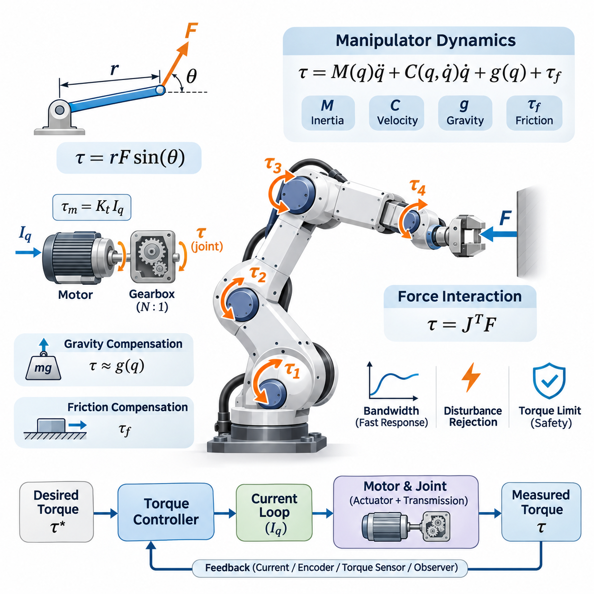
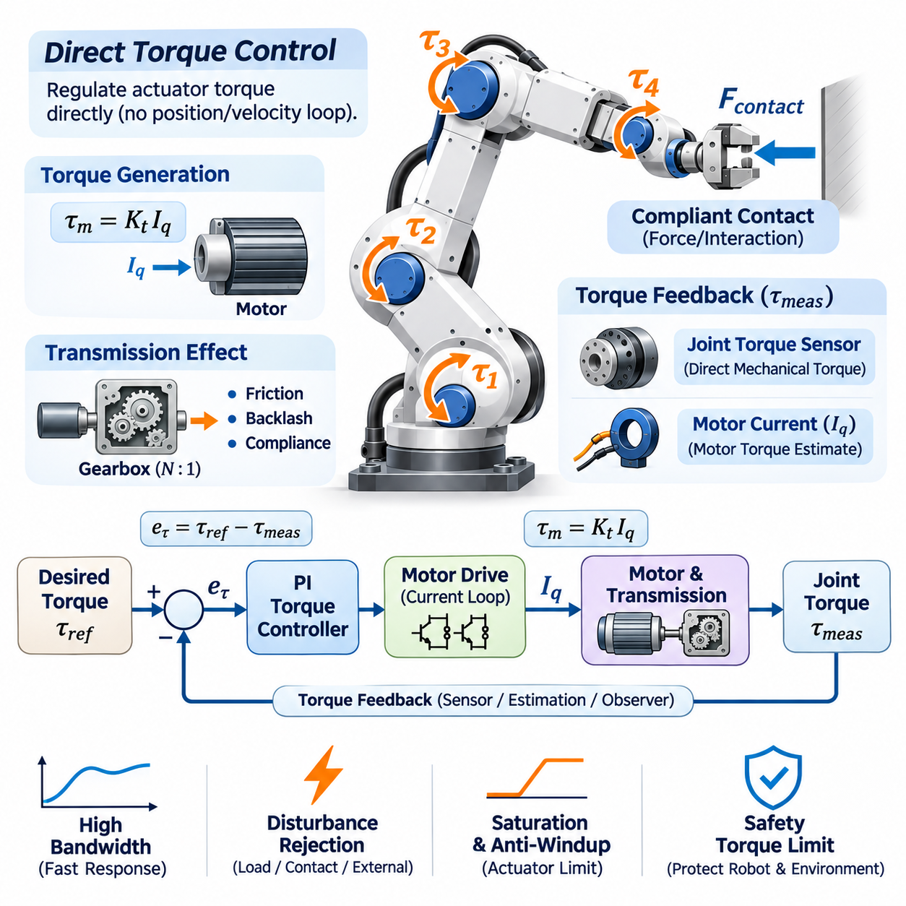
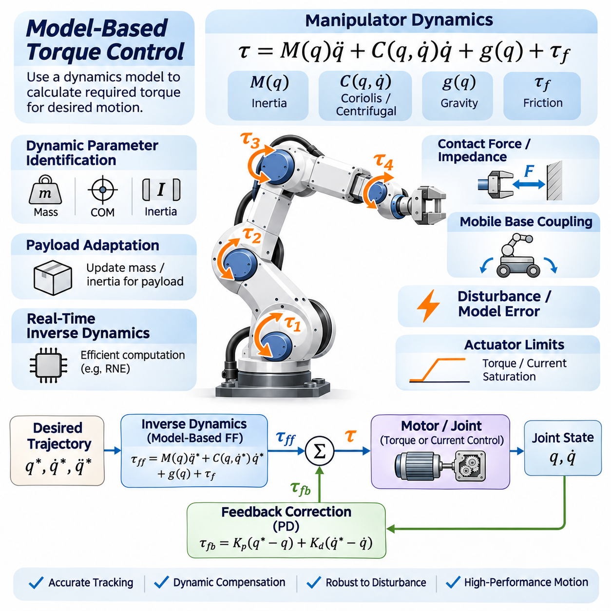
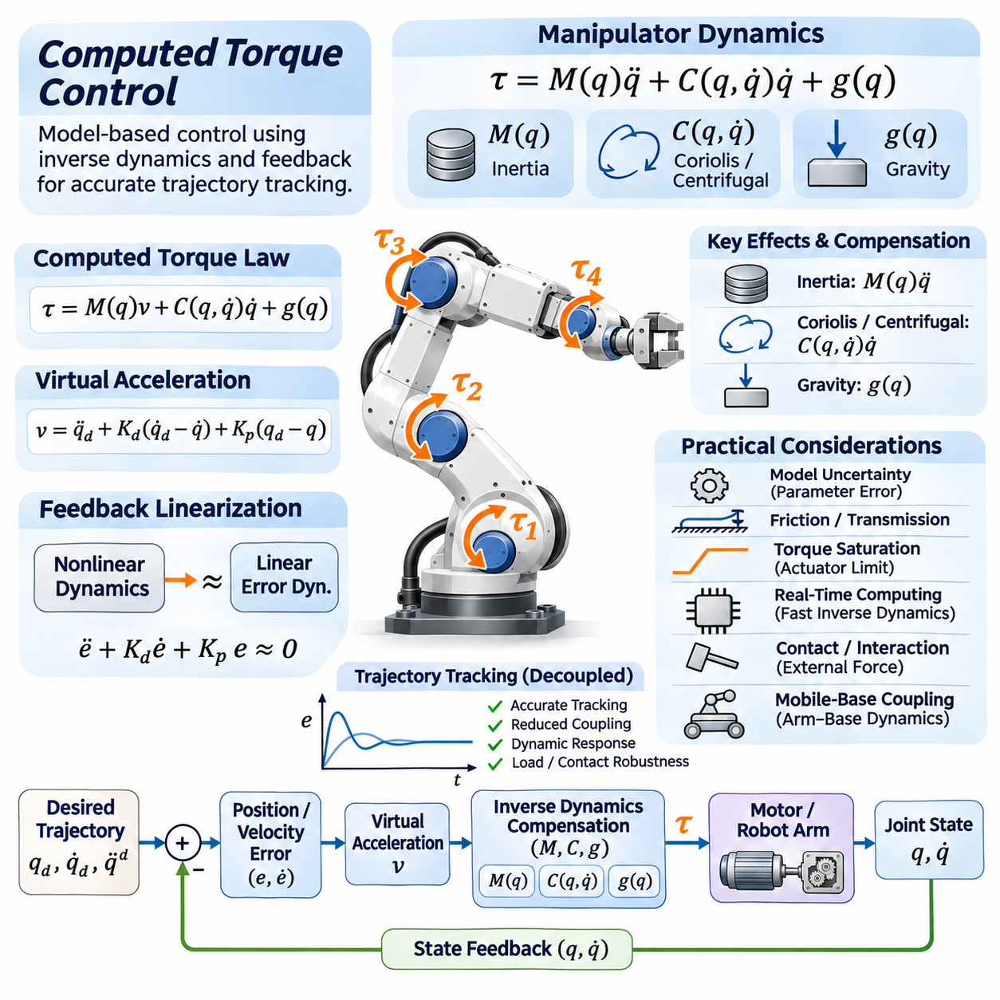
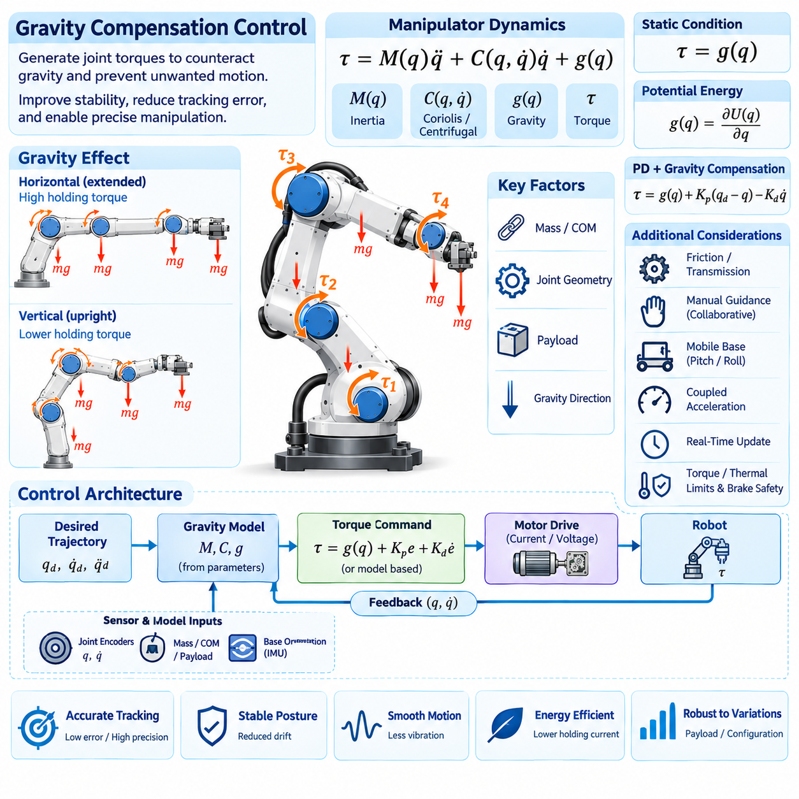
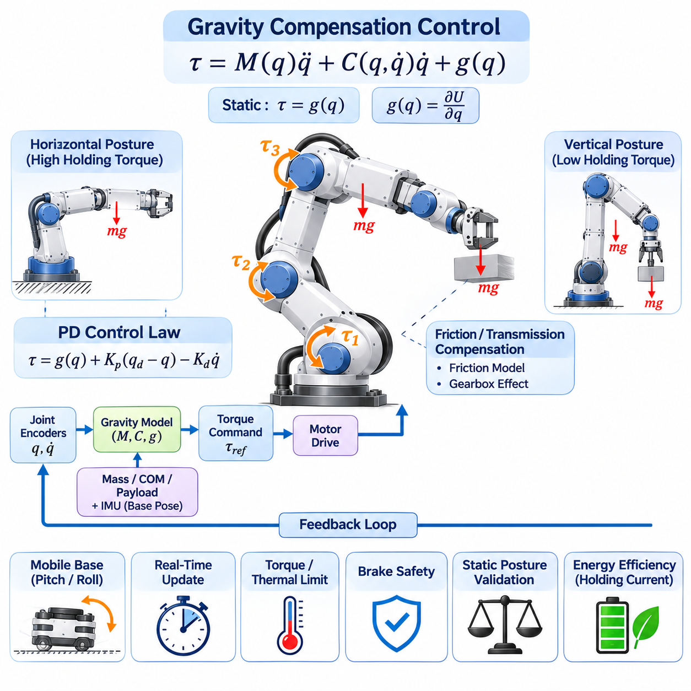
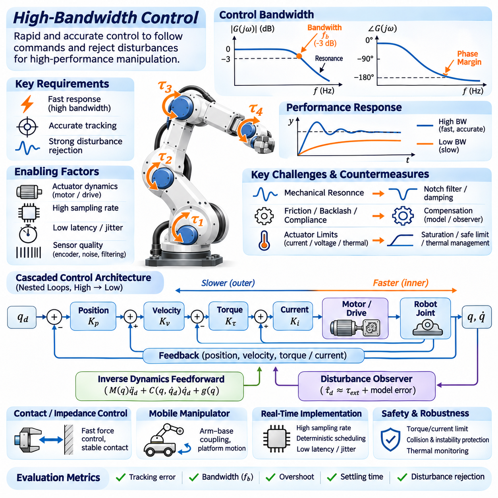
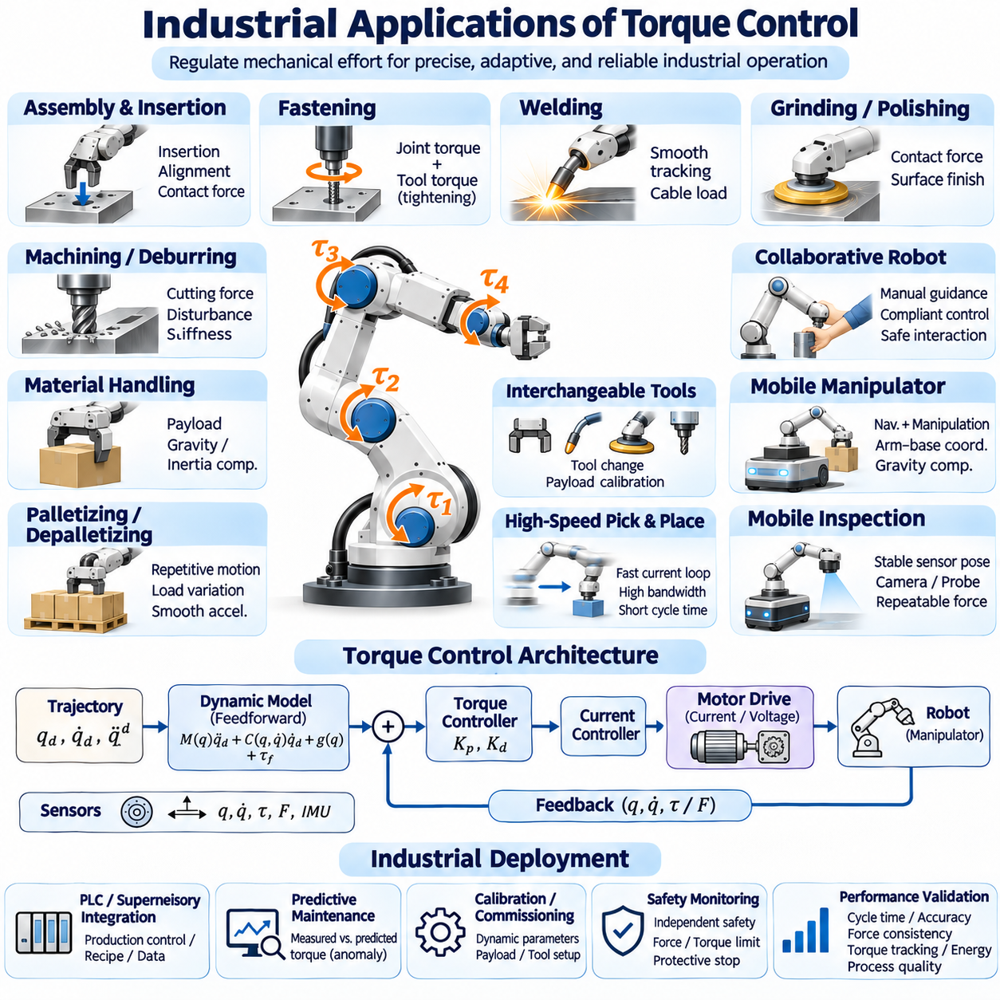
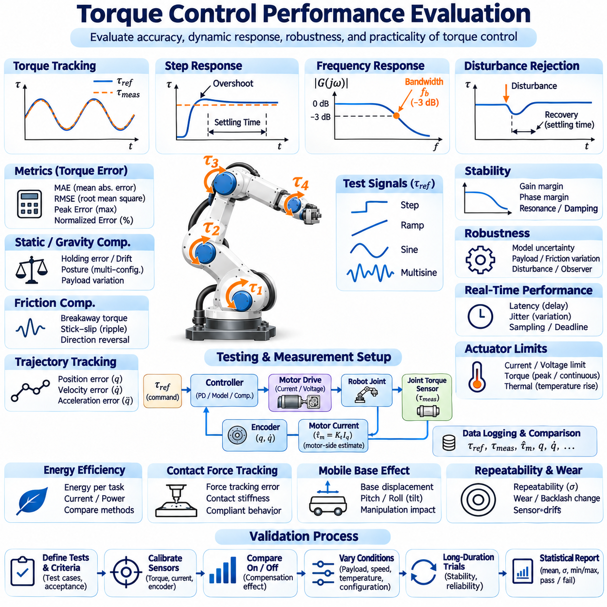

**Volume 02. Manipulator Mechanics and Control**


# Chapter 06. Torque Control

##  

## 01 Torque Control Fundamentals

{width="7.268055555555556in" height="7.268055555555556in"}

Torque control is a fundamental technique in robotic manipulation that regulates the rotational effort generated by joint actuators rather than controlling position or velocity alone. Torque determines how a robot accelerates, supports external loads, and responds to physical interaction. By directly influencing joint forces, torque control provides the foundation for precise motion, compliant behavior, and dynamic manipulation in industrial and mobile robotic systems.

In mechanical systems, torque represents the rotational effect of a force acting around an axis. Its magnitude depends on the applied force, the distance from the rotation axis, and the angle between the force and lever arm. The relationship is expressed as τ = rF sin(θ), where τ denotes torque, r represents lever-arm length, and F indicates applied force. Torque is measured in newton-meters and determines the rotational acceleration produced under given mechanical conditions.

Robot manipulators contain multiple interconnected joints, each requiring torque to overcome inertia, gravity, friction, and external disturbances. During acceleration, actuators generate torque to change joint velocity, while during deceleration they produce opposing torque to reduce motion. Even when a manipulator remains stationary, its joints may require continuous torque to support the weight of links, tools, and payloads against gravitational forces.

The relationship between torque and robot motion is described through manipulator dynamics. A common mathematical representation is τ = M(q)q̈ + C(q,q̇)q̇ + g(q) + τf, where M represents the inertia matrix, C describes velocity-dependent effects, g denotes gravitational torque, and τf represents friction. This equation connects actuator effort with joint acceleration and provides the theoretical foundation for dynamic control algorithms.

Unlike position control, which attempts to minimize differences between commanded and measured joint angles, torque control directly regulates the effort delivered by actuators. This distinction becomes important when robots interact with uncertain environments or manipulate objects requiring controlled contact. Torque-controlled systems can respond to external forces more naturally, although stable and accurate operation requires suitable feedback, actuator characteristics, and control algorithms.

Electric motors generate torque through electromagnetic interactions between their magnetic fields and current-carrying conductors. In many permanent-magnet servo motors, torque is approximately proportional to the torque-producing current under appropriate operating conditions. The relationship can be expressed as τm = Kt Iq, where Kt is the motor torque constant and Iq is the corresponding current component. Accurate current regulation therefore forms an essential part of electric torque control.

The torque delivered to a robot joint differs from the torque generated directly by its motor because transmissions modify mechanical output. Gearboxes increase available joint torque while reducing rotational speed, but introduce friction, backlash, compliance, and efficiency losses. For an ideal transmission, output torque scales with the gear ratio. Practical implementations must account for mechanical losses and transmission dynamics to estimate actual joint torque accurately.

Torque control systems commonly employ feedback from motor current sensors, joint encoders, torque sensors, or disturbance observers. Current measurements provide indirect estimates of electromagnetic motor torque, while dedicated joint torque sensors can measure transmitted mechanical effort more directly. Combining these measurements with dynamic models improves estimation accuracy and enables controllers to distinguish commanded actuator effort from unexpected external disturbances.

A typical torque control architecture contains a high-level motion controller, a joint torque controller, and a motor current regulation loop. The high-level controller calculates desired joint torques according to task requirements and robot dynamics. The torque controller converts these commands into actuator references, while the motor drive regulates electrical current. This hierarchical arrangement separates mechanical control objectives from the faster electrical dynamics of motor actuation.

Control bandwidth determines how quickly a torque controller can respond to changing commands and disturbances. High bandwidth improves dynamic tracking and disturbance rejection, particularly during rapid manipulation and contact transitions. However, excessive controller gains may excite mechanical resonances, amplify sensor noise, or destabilize flexible transmissions. Effective torque control therefore requires careful coordination between actuator response, sampling frequency, structural dynamics, and feedback filtering.

Gravity compensation is an important application of torque control because robot joints must continuously counteract gravitational loading. The required compensation torque depends on joint configuration, link masses, centers of mass, and payload characteristics. By applying estimated gravitational torque, a controller reduces the effort needed to maintain a posture and allows additional control commands to focus on motion or interaction. Modeling errors may nevertheless produce residual drift or positioning errors.

Friction introduces nonlinear behavior that complicates accurate torque regulation, especially during slow movement and direction reversal. Static friction, Coulomb friction, and viscous friction can prevent small torque commands from producing the expected motion. Controllers may use friction models, feedforward compensation, or adaptive estimation to reduce these effects. Compensation must remain conservative because inaccurate friction estimates can introduce oscillations or unintended movement.

External disturbances represent another major challenge for torque-controlled manipulators. Unexpected payload changes, collisions, cable forces, and contact with surrounding objects can alter the relationship between commanded torque and observed motion. Disturbance observers estimate unmodeled joint efforts using sensor measurements and dynamic predictions. These estimates can improve robustness, support contact detection, and provide information for supervisory safety mechanisms.

Torque control is closely related to force control because joint torques generate forces and moments at the robot end effector. The manipulator Jacobian establishes the relationship between joint torques and Cartesian forces through τ = JᵀF for the corresponding generalized external wrench. This mapping enables task-space interaction strategies, including controlled pushing, insertion, and surface contact. Its effectiveness depends on robot configuration, kinematic accuracy, and proximity to singularities.

Mobile manipulators introduce additional torque control requirements because arm motion interacts dynamically with the mobile base. Rapid arm acceleration can transfer reaction forces and moments into the platform, affecting stability and localization. When the base is stationary, torque limits may need adjustment according to support geometry and payload distribution. During coordinated movement, the controller must consider coupled dynamics, base acceleration, and changing contact conditions.

Safety considerations are essential because torque-controlled robots can generate substantial mechanical forces even when commanded motion appears small. Joint torque limits, velocity constraints, emergency stopping functions, and independent protective mechanisms help reduce operational risks. Torque monitoring can contribute to collision detection, but measurement uncertainty and dynamic disturbances must be considered. Safety-critical functions require validated architectures rather than relying exclusively on ordinary software control loops.

Successful torque control depends on accurate actuator characterization and dynamic parameter identification. Motor constants, gear ratios, joint inertia, friction coefficients, and sensor offsets influence the relationship between commands and actual mechanical effort. Engineers typically validate these parameters through controlled experiments involving static loading, low-speed motion, and dynamic excitation. Reliable calibration improves torque tracking and reduces systematic errors across different operating conditions.

Performance evaluation examines how accurately commanded torque is reproduced under realistic operating conditions. Important characteristics include steady-state error, transient response, bandwidth, torque ripple, disturbance rejection, and thermal stability. Experiments should investigate different joint positions, motion speeds, payloads, and contact conditions. Comparing commanded torque, measured torque, motor current, and resulting motion helps identify limitations in sensing, actuation, and control design.

Torque control provides a mechanical foundation for advanced manipulation strategies such as impedance control, compliant interaction, and dynamically coordinated motion. Its principal advantage is the ability to regulate actuator effort while allowing higher-level controllers to determine how the robot should respond to movement and contact. Achieving this capability requires integration of accurate dynamics, responsive motor drives, reliable sensing, and robust safety mechanisms throughout the manipulator system.

토크 제어(Torque Control)는 위치(Position)나 속도(Velocity)만을 제어하는 대신 관절 구동기(Joint Actuator)에서 발생하는 회전력(Rotational Effort)을 조절하는 로봇 조작(Robotic Manipulation)의 핵심 기술이다. 토크(Torque)는 로봇의 가속, 외부 하중 지지, 물리적 상호작용에 대한 반응을 결정한다. 관절에 작용하는 힘을 직접 조절함으로써 정밀 운동(Precise Motion), 유연한 동작(Compliant Behavior), 동적 조작(Dynamic Manipulation)을 구현하는 기반을 제공한다.

기계 시스템(Mechanical System)에서 토크(Torque)는 회전축(Rotation Axis)을 중심으로 작용하는 힘의 회전 효과를 의미한다. 토크의 크기는 작용하는 힘(Applied Force), 회전축으로부터의 거리, 힘과 지레 팔(Lever Arm) 사이의 각도에 따라 결정된다. 이러한 관계는 τ = rF sin(θ)로 표현하며, τ는 토크, r은 지레 팔 길이, F는 작용하는 힘을 나타낸다. 토크의 단위는 뉴턴미터(Newton-Meter)이며, 주어진 기계적 조건에서 발생하는 회전 가속도(Rotational Acceleration)를 결정한다.

로봇 매니퓰레이터(Robot Manipulator)는 여러 개의 연결된 관절(Joint)로 구성되며, 각 관절은 관성(Inertia), 중력(Gravity), 마찰(Friction), 외부 교란(External Disturbance)을 극복하기 위한 토크를 필요로 한다. 가속 과정에서는 관절 속도를 변화시키기 위한 토크를 생성하고, 감속 과정에서는 운동을 줄이기 위한 반대 방향의 토크를 발생시킨다. 매니퓰레이터가 정지한 상태에서도 링크(Link), 도구(Tool), 탑재 하중(Payload)의 무게를 지지하기 위해 지속적인 토크가 필요할 수 있다.

토크와 로봇 운동 사이의 관계는 매니퓰레이터 동역학(Manipulator Dynamics)을 통해 설명된다. 일반적인 수학적 표현은 τ = M(q)q̈ + C(q,q̇)q̇ + g(q) + τf이며, M은 관성 행렬(Inertia Matrix), C는 속도 의존 효과(Velocity-Dependent Effects), g는 중력 토크(Gravity Torque), τf는 마찰 토크(Friction Torque)를 나타낸다. 이 방정식은 구동기 출력(Actuator Effort)과 관절 가속도(Joint Acceleration)를 연결하며 동적 제어 알고리즘(Dynamic Control Algorithm)의 이론적 기반을 제공한다.

위치 제어(Position Control)가 명령된 관절 각도와 측정된 관절 각도 사이의 오차를 최소화하는 데 중점을 두는 것과 달리, 토크 제어(Torque Control)는 구동기(Actuator)가 전달하는 힘의 효과를 직접 조절한다. 이러한 차이는 로봇이 불확실한 환경(Uncertain Environment)과 상호작용하거나 접촉력을 정밀하게 제어해야 하는 물체를 조작할 때 중요하다. 토크 제어 시스템은 외력(External Force)에 더욱 자연스럽게 반응할 수 있지만, 안정적이고 정확한 동작을 위해 적절한 피드백(Feedback), 구동기 특성, 제어 알고리즘이 필요하다.

전기 모터(Electric Motor)는 자기장(Magnetic Field)과 전류가 흐르는 도체(Current-Carrying Conductor) 사이의 전자기적 상호작용(Electromagnetic Interaction)을 통해 토크를 생성한다. 많은 영구자석 서보 모터(Permanent-Magnet Servo Motor)에서는 적절한 운전 조건에서 토크가 토크 생성 전류(Torque-Producing Current)에 거의 비례한다. 이러한 관계는 τm = Kt Iq로 표현되며, Kt는 모터 토크 상수(Motor Torque Constant), Iq는 해당 전류 성분(Current Component)을 의미한다. 따라서 정확한 전류 제어(Current Regulation)는 전기식 토크 제어의 필수 요소이다.

로봇 관절에 전달되는 토크는 동력 전달 장치(Transmission)가 기계적 출력을 변화시키기 때문에 모터에서 직접 발생하는 토크와 다르다. 감속기(Gearbox)는 회전 속도를 감소시키면서 사용 가능한 관절 토크를 증가시키지만, 마찰(Friction), 백래시(Backlash), 유연성(Compliance), 효율 손실(Efficiency Loss)을 발생시킨다. 이상적인 동력 전달 시스템에서는 출력 토크가 기어비(Gear Ratio)에 비례한다. 실제 구현에서는 관절 토크를 정확하게 추정하기 위해 기계적 손실과 전달계 동역학(Transmission Dynamics)을 고려해야 한다.

토크 제어 시스템(Torque Control System)은 일반적으로 모터 전류 센서(Motor Current Sensor), 관절 엔코더(Joint Encoder), 토크 센서(Torque Sensor), 외란 관측기(Disturbance Observer)에서 얻은 피드백을 활용한다. 전류 측정값은 전자기적 모터 토크(Electromagnetic Motor Torque)를 간접적으로 추정하며, 전용 관절 토크 센서는 전달되는 기계적 힘의 효과를 더욱 직접적으로 측정할 수 있다. 이러한 측정값을 동역학 모델(Dynamic Model)과 결합하면 추정 정확도를 높이고 명령된 구동기 출력과 예상하지 못한 외부 교란을 구분할 수 있다.

일반적인 토크 제어 구조(Torque Control Architecture)는 상위 운동 제어기(High-Level Motion Controller), 관절 토크 제어기(Joint Torque Controller), 모터 전류 제어 루프(Motor Current Regulation Loop)로 구성된다. 상위 제어기는 작업 요구사항과 로봇 동역학을 기반으로 목표 관절 토크(Desired Joint Torque)를 계산한다. 토크 제어기는 이를 구동기 기준 명령(Actuator Reference)으로 변환하고, 모터 드라이브(Motor Drive)는 전류를 조절한다. 이러한 계층적 구조(Hierarchical Architecture)는 기계적 제어 목표와 빠르게 변화하는 모터의 전기적 동특성을 분리한다.

제어 대역폭(Control Bandwidth)은 토크 제어기가 변화하는 명령과 교란에 얼마나 빠르게 반응할 수 있는지를 결정한다. 높은 대역폭(High Bandwidth)은 특히 빠른 조작과 접촉 전환(Contact Transition) 과정에서 동적 추종 성능(Dynamic Tracking Performance)과 외란 억제(Disturbance Rejection)를 향상시킨다. 그러나 지나치게 높은 제어 이득(Control Gain)은 기계적 공진(Mechanical Resonance)을 유발하거나 센서 잡음(Sensor Noise)을 증폭하고 유연한 전달계(Flexible Transmission)를 불안정하게 만들 수 있다. 따라서 효과적인 토크 제어를 위해서는 구동기 응답, 샘플링 주파수(Sampling Frequency), 구조 동역학(Structural Dynamics), 피드백 필터링(Feedback Filtering)의 조정이 필요하다.

중력 보상(Gravity Compensation)은 로봇 관절이 중력 하중(Gravitational Loading)에 지속적으로 대응해야 하므로 토크 제어의 중요한 응용 분야이다. 필요한 보상 토크(Compensation Torque)는 관절 구성(Joint Configuration), 링크 질량(Link Mass), 질량 중심(Center of Mass), 탑재 하중 특성(Payload Characteristics)에 따라 달라진다. 추정된 중력 토크를 적용하면 자세 유지(Posture Maintenance)에 필요한 제어 부담이 감소하고 추가 제어 명령을 운동이나 상호작용에 집중할 수 있다. 그러나 모델링 오차(Modeling Error)는 잔류 드리프트(Residual Drift)나 위치 오차(Positioning Error)를 발생시킬 수 있다.

마찰(Friction)은 특히 저속 운동(Low-Speed Motion)과 방향 전환(Direction Reversal) 과정에서 정확한 토크 제어를 어렵게 만드는 비선형 동작(Nonlinear Behavior)을 유발한다. 정지 마찰(Static Friction), 쿨롱 마찰(Coulomb Friction), 점성 마찰(Viscous Friction)은 작은 토크 명령이 예상한 운동으로 이어지지 못하게 할 수 있다. 제어기는 이러한 영향을 줄이기 위해 마찰 모델(Friction Model), 피드포워드 보상(Feedforward Compensation), 적응형 추정(Adaptive Estimation)을 활용할 수 있다. 부정확한 마찰 추정은 진동이나 의도하지 않은 움직임을 유발할 수 있으므로 보상은 신중하게 수행해야 한다.

외부 교란(External Disturbance)은 토크 제어 매니퓰레이터(Torque-Controlled Manipulator)의 또 다른 주요 과제이다. 예상하지 못한 탑재 하중 변화(Payload Change), 충돌(Collision), 케이블 힘(Cable Force), 주변 물체와의 접촉은 명령 토크(Commanded Torque)와 실제 운동 사이의 관계를 변화시킬 수 있다. 외란 관측기(Disturbance Observer)는 센서 측정값과 동역학 예측(Dynamic Prediction)을 이용해 모델에 포함되지 않은 관절 작용력을 추정한다. 이러한 추정은 강인성(Robustness)을 향상시키고 접촉 감지(Contact Detection)와 상위 안전 관리 기능(Supervisory Safety Mechanism)에 필요한 정보를 제공한다.

토크 제어(Torque Control)는 관절 토크가 로봇 말단장치(End Effector)에서 힘과 모멘트(Force and Moment)를 생성하기 때문에 힘 제어(Force Control)와 밀접하게 연결된다. 매니퓰레이터 자코비안(Manipulator Jacobian)은 τ = JᵀF 관계를 통해 관절 토크와 직교좌표계 힘(Cartesian Force) 사이의 대응 관계를 정의하며, 여기서 F는 해당 일반화 외력(Generalized External Wrench)을 나타낸다. 이러한 변환은 제어된 밀기(Pushing), 삽입(Insertion), 표면 접촉(Surface Contact)과 같은 작업 공간 상호작용(Task-Space Interaction)을 가능하게 한다. 제어 효과는 로봇 구성, 운동학적 정확도(Kinematic Accuracy), 특이점(Singularity)에 대한 근접 정도에 따라 달라진다.

모바일 매니퓰레이터(Mobile Manipulator)는 로봇 팔의 운동이 이동 베이스(Mobile Base)와 동적으로 상호작용하므로 추가적인 토크 제어 요구사항을 가진다. 빠른 로봇 팔 가속은 반작용 힘과 모멘트(Reaction Force and Moment)를 이동 플랫폼에 전달하여 안정성(Stability)과 위치 추정(Localization)에 영향을 줄 수 있다. 베이스가 정지한 경우에도 지지 형상(Support Geometry)과 하중 분포(Payload Distribution)에 따라 토크 제한(Torque Limit)을 조정해야 할 수 있다. 협조 운동(Coordinated Motion) 중에는 결합 동역학(Coupled Dynamics), 베이스 가속도(Base Acceleration), 변화하는 접촉 조건(Contact Condition)을 고려해야 한다.

안전 고려사항(Safety Considerations)은 토크 제어 로봇이 작은 운동 명령에서도 상당한 기계적 힘(Mechanical Force)을 발생시킬 수 있기 때문에 필수적이다. 관절 토크 제한(Joint Torque Limit), 속도 제한(Velocity Constraint), 비상 정지 기능(Emergency Stopping Function), 독립적인 보호 장치(Independent Protective Mechanism)는 운용 위험을 줄이는 데 도움이 된다. 토크 모니터링(Torque Monitoring)은 충돌 감지에 기여할 수 있지만 측정 불확실성(Measurement Uncertainty)과 동적 교란을 고려해야 한다. 안전 필수 기능(Safety-Critical Function)은 일반적인 소프트웨어 제어 루프에만 의존하지 않고 검증된 안전 구조(Validated Safety Architecture)를 필요로 한다.

성공적인 토크 제어는 정확한 구동기 특성 분석(Actuator Characterization)과 동역학 매개변수 식별(Dynamic Parameter Identification)에 달려 있다. 모터 상수(Motor Constant), 기어비(Gear Ratio), 관절 관성(Joint Inertia), 마찰 계수(Friction Coefficient), 센서 오프셋(Sensor Offset)은 명령과 실제 기계적 출력 사이의 관계에 영향을 준다. 엔지니어는 일반적으로 정적 하중(Static Loading), 저속 운동(Low-Speed Motion), 동적 가진(Dynamic Excitation)을 포함한 제어된 실험을 통해 이러한 매개변수를 검증한다. 신뢰할 수 있는 보정(Calibration)은 토크 추종 성능(Torque Tracking Performance)을 향상시키고 다양한 운전 조건에서 발생하는 체계적 오차(Systematic Error)를 감소시킨다.

성능 평가(Performance Evaluation)는 실제 운전 조건에서 명령된 토크가 얼마나 정확하게 재현되는지를 분석한다. 주요 평가 특성에는 정상상태 오차(Steady-State Error), 과도 응답(Transient Response), 대역폭(Bandwidth), 토크 리플(Torque Ripple), 외란 억제(Disturbance Rejection), 열적 안정성(Thermal Stability)이 포함된다. 실험에서는 다양한 관절 위치, 운동 속도, 탑재 하중, 접촉 조건을 조사해야 한다. 명령 토크, 측정 토크, 모터 전류, 실제 운동을 비교하면 센싱(Sensing), 구동(Actuation), 제어 설계(Control Design)의 한계를 파악할 수 있다.

토크 제어(Torque Control)는 임피던스 제어(Impedance Control), 유연한 상호작용(Compliant Interaction), 동적으로 조정된 운동(Dynamically Coordinated Motion)과 같은 고급 조작 전략(Advanced Manipulation Strategy)의 기계적 기반을 제공한다. 핵심 장점은 구동기 출력(Actuator Effort)을 조절하면서 상위 제어기가 로봇의 운동과 접촉 반응을 결정할 수 있도록 한다는 점이다. 이러한 기능을 구현하려면 정확한 동역학 모델(Accurate Dynamic Model), 응답성이 높은 모터 드라이브(Responsive Motor Drive), 신뢰할 수 있는 센싱(Reliable Sensing), 강인한 안전 메커니즘(Robust Safety Mechanism)을 매니퓰레이터 시스템 전반에 통합해야 한다.

##  

## 02 Direct Torque Control

{width="7.268055555555556in" height="7.268055555555556in"}

Direct torque control is a control strategy that regulates the torque produced by robotic actuators according to commanded values, without requiring an outer position or velocity loop to define the primary control objective. It enables manipulators to control mechanical effort directly and respond to changing loads or physical contact. This capability is particularly important in robotic systems requiring dynamic motion, controlled interaction, and precise force generation.

The fundamental objective of direct torque control is to minimize the difference between desired torque and actual actuator torque. A torque reference is generated by a supervisory controller and compared with measured or estimated torque. The resulting error is processed by a feedback controller to adjust actuator commands. Accurate torque tracking allows the robot to generate predictable mechanical effort despite variations in operating conditions.

In electric robotic actuators, torque generation is closely associated with motor current. For a permanent-magnet synchronous motor, electromagnetic torque is commonly controlled through the quadrature-axis current component. Under suitable operating assumptions, the relationship can be approximated by τm = Kt Iq, where τm is motor torque, Kt is the torque constant, and Iq represents torque-producing current. This relationship enables current regulation to serve as an effective torque control mechanism.

Direct torque control can be implemented using motor current feedback, dedicated torque sensors, or model-based torque estimation. Current-based control is relatively economical because modern servo drives already measure phase currents for motor regulation. However, current measurements estimate electromagnetic torque rather than actual joint output torque. Gearbox friction, transmission compliance, and mechanical losses must therefore be considered when precise joint torque regulation is required.

A typical direct torque control architecture consists of a torque command generator, feedback processing, torque regulation, and actuator drive electronics. The command generator determines the desired mechanical effort, while the feedback subsystem estimates actual torque. The regulator calculates corrective commands and sends them to the motor drive. Fast electrical control loops then adjust current or voltage to achieve the requested torque response.

Torque feedback may be obtained through strain gauges, joint torque transducers, series elastic elements, or motor current measurements. Dedicated torque sensors provide information about transmitted mechanical effort, while current sensors primarily describe motor electromagnetic behavior. Sensor selection influences measurement bandwidth, noise sensitivity, cost, and mechanical integration. High-quality feedback is essential for stable operation and accurate disturbance rejection.

In a feedback-based implementation, torque error is defined as eτ = τref − τmeas, where τref represents commanded torque and τmeas denotes measured or estimated torque. A proportional-integral controller may process this error to generate an actuator command. Proportional action provides immediate correction, while integral action reduces persistent tracking error. Controller gains must be selected according to actuator dynamics, sensor characteristics, and stability requirements.

Direct torque control differs from conventional position control because torque commands do not inherently determine a unique joint position. Instead, the resulting motion depends on inertia, gravity, friction, external loading, and environmental constraints. A joint receiving constant torque may accelerate, remain stationary, or move against resistance depending on mechanical conditions. Higher-level control functions must therefore manage motion objectives and operating limits.

Control bandwidth is a critical performance characteristic because torque commands may change rapidly during acceleration, deceleration, and contact transitions. A responsive controller can reproduce these changes with limited delay and tracking error. However, excessive bandwidth may amplify measurement noise or excite mechanical resonances. The achievable response depends on motor electrical dynamics, transmission stiffness, sensor bandwidth, and computational latency.

Transmission mechanisms significantly influence the effectiveness of direct torque control. High-ratio gearboxes increase output torque but introduce friction, backlash, and reflected inertia that complicate precise regulation. Harmonic drives and other compact transmissions may also exhibit nonlinear stiffness and hysteresis. These effects can cause differences between motor-side torque estimates and actual joint torque, particularly during low-speed movement and direction reversal.

Direct-drive actuators reduce transmission-related uncertainty by coupling motors more directly to robotic joints. Eliminating high-ratio gearboxes can improve backdrivability, torque transparency, and mechanical responsiveness. Nevertheless, direct-drive systems often require larger motors to produce sufficient joint torque. Their design must balance continuous torque capacity, thermal performance, actuator mass, and available installation space.

Disturbance rejection is another important function of direct torque control. External contact forces, payload variations, and mechanical disturbances can produce deviations between commanded and measured torque. Feedback regulation compensates for these deviations within the actuator\'s available authority. Disturbance observers may supplement sensor measurements by estimating unmodeled mechanical effects, improving robustness when direct torque sensing is unavailable or limited.

Torque saturation occurs when a requested command exceeds the actuator\'s available output. Motor current limits, supply voltage, thermal conditions, and transmission ratings constrain achievable torque. Controllers must enforce these limits to prevent overheating, excessive mechanical stress, or unstable behavior. Anti-windup mechanisms are particularly important when integral control is used because accumulated error can otherwise cause undesirable responses after saturation ends.

Direct torque control supports compliant robotic interaction by allowing higher-level algorithms to regulate mechanical effort instead of enforcing rigid position trajectories. When combined with impedance or force control, it enables robots to respond to environmental constraints and contact forces. Nevertheless, torque control alone does not guarantee safe compliance. Interaction behavior depends on the complete control architecture, mechanical design, and safety supervision.

Mobile manipulators introduce additional considerations because actuator torques can generate reaction forces and moments on the mobile platform. Rapid arm movements may influence platform stability, wheel loading, and localization accuracy. Direct torque control can support coordinated manipulation when combined with base dynamics and motion planning. Supervisory controllers must account for payload distribution, support conditions, and coupled arm-base behavior.

Practical implementation requires deterministic communication between controllers, motor drives, and feedback devices. Torque commands must be updated at suitable intervals, while measurements require consistent timing and reliable synchronization. Communication delays and sampling jitter can degrade tracking accuracy or reduce stability margins. Real-time operating systems and dedicated servo interfaces help maintain predictable control behavior under demanding operating conditions.

Safety mechanisms must operate independently of ordinary torque regulation whenever hazardous actuator behavior is possible. Torque limits, joint velocity monitoring, position boundaries, emergency stopping functions, and protective control states reduce operational risks. Unexpected sensor failures or communication interruptions must trigger defined responses. Torque-controlled manipulators require particular attention because uncontrolled mechanical effort may produce motion even without explicit position commands.

Performance evaluation focuses on torque tracking accuracy, response time, bandwidth, steady-state error, torque ripple, and disturbance rejection. Engineers typically apply controlled torque references under different loading and motion conditions. Comparing commanded torque with independently measured output torque reveals actuator and transmission limitations. Thermal tests and sustained-load experiments are also necessary to establish reliable continuous operating capability.

Direct torque control provides a foundational actuator interface for advanced robotic manipulation. Its effectiveness depends on accurate sensing, responsive motor regulation, suitable mechanical transmissions, and carefully tuned feedback algorithms. By exposing mechanical effort as a controllable variable, it enables sophisticated motion and interaction strategies while supporting modular control architectures. Reliable deployment requires coordinated consideration of dynamics, real-time execution, actuator constraints, and functional safety.

직접 토크 제어(Direct Torque Control)는 외부 위치 제어 루프(Position Control Loop)나 속도 제어 루프(Velocity Control Loop)를 주요 제어 목표로 사용하지 않고, 명령값에 따라 로봇 구동기(Robotic Actuator)에서 발생하는 토크(Torque)를 직접 조절하는 제어 전략(Control Strategy)이다. 이를 통해 매니퓰레이터(Manipulator)는 기계적 출력(Mechanical Effort)을 직접 제어하고 변화하는 하중이나 물리적 접촉에 대응할 수 있다. 이러한 기능은 동적 운동(Dynamic Motion), 제어된 상호작용(Controlled Interaction), 정밀한 힘 생성(Precise Force Generation)이 필요한 로봇 시스템에서 특히 중요하다.

직접 토크 제어(Direct Torque Control)의 기본 목표는 목표 토크(Desired Torque)와 실제 구동기 토크(Actual Actuator Torque) 사이의 차이를 최소화하는 것이다. 상위 제어기(Supervisory Controller)에서 토크 기준값(Torque Reference)을 생성하고 이를 측정 또는 추정된 토크와 비교한다. 그 결과 발생하는 오차(Error)는 피드백 제어기(Feedback Controller)에서 처리되어 구동기 명령(Actuator Command)을 조정한다. 정확한 토크 추종(Torque Tracking)은 운전 조건이 변화하더라도 로봇이 예측 가능한 기계적 출력을 생성하도록 한다.

전기식 로봇 구동기(Electric Robotic Actuator)에서 토크 생성은 모터 전류(Motor Current)와 밀접하게 관련된다. 영구자석 동기 모터(Permanent-Magnet Synchronous Motor)에서는 일반적으로 직교축 전류 성분(Quadrature-Axis Current Component)을 통해 전자기 토크(Electromagnetic Torque)를 제어한다. 적절한 운전 조건에서는 τm = Kt Iq로 근사할 수 있으며, τm은 모터 토크(Motor Torque), Kt는 토크 상수(Torque Constant), Iq는 토크 생성 전류(Torque-Producing Current)를 나타낸다. 이러한 관계를 통해 전류 조절(Current Regulation)을 효과적인 토크 제어 수단으로 활용할 수 있다.

직접 토크 제어는 모터 전류 피드백(Motor Current Feedback), 전용 토크 센서(Dedicated Torque Sensor), 모델 기반 토크 추정(Model-Based Torque Estimation)을 이용하여 구현할 수 있다. 전류 기반 제어(Current-Based Control)는 최신 서보 드라이브(Servo Drive)가 이미 모터 제어를 위해 상전류(Phase Current)를 측정하므로 비교적 경제적이다. 그러나 전류 측정값은 실제 관절 출력 토크(Joint Output Torque)가 아니라 전자기 토크를 추정한다. 따라서 정밀한 관절 토크 제어를 위해서는 감속기 마찰(Gearbox Friction), 전달계 유연성(Transmission Compliance), 기계적 손실(Mechanical Loss)을 고려해야 한다.

일반적인 직접 토크 제어 구조(Direct Torque Control Architecture)는 토크 명령 생성기(Torque Command Generator), 피드백 처리(Feedback Processing), 토크 조절(Torque Regulation), 구동기 구동 전자장치(Actuator Drive Electronics)로 구성된다. 명령 생성기는 목표 기계적 출력(Desired Mechanical Effort)을 결정하고, 피드백 하위 시스템(Feedback Subsystem)은 실제 토크를 추정한다. 조절기(Regulator)는 보정 명령(Corrective Command)을 계산하여 모터 드라이브(Motor Drive)에 전달한다. 이후 빠른 전기적 제어 루프(Electrical Control Loop)가 전류 또는 전압을 조정하여 요구된 토크 응답(Torque Response)을 구현한다.

토크 피드백(Torque Feedback)은 스트레인 게이지(Strain Gauge), 관절 토크 변환기(Joint Torque Transducer), 직렬 탄성 요소(Series Elastic Element), 모터 전류 측정(Motor Current Measurement)을 통해 얻을 수 있다. 전용 토크 센서는 전달되는 기계적 출력(Transmitted Mechanical Effort)에 관한 정보를 제공하며, 전류 센서는 주로 모터의 전자기적 동작(Electromagnetic Behavior)을 나타낸다. 센서 선택(Sensor Selection)은 측정 대역폭(Measurement Bandwidth), 잡음 민감도(Noise Sensitivity), 비용(Cost), 기계적 통합(Mechanical Integration)에 영향을 준다. 안정적인 동작과 정확한 외란 억제(Disturbance Rejection)를 위해서는 고품질 피드백이 필수적이다.

피드백 기반 구현(Feedback-Based Implementation)에서 토크 오차(Torque Error)는 eτ = τref − τmeas로 정의하며, τref는 명령 토크(Commanded Torque), τmeas는 측정 또는 추정된 토크(Measured or Estimated Torque)를 의미한다. 비례 적분 제어기(Proportional-Integral Controller)는 이러한 오차를 처리하여 구동기 명령을 생성할 수 있다. 비례 동작(Proportional Action)은 즉각적인 보정을 제공하고 적분 동작(Integral Action)은 지속적인 추종 오차(Tracking Error)를 감소시킨다. 제어기 이득(Controller Gain)은 구동기 동역학(Actuator Dynamics), 센서 특성(Sensor Characteristics), 안정성 요구사항(Stability Requirements)에 따라 설정해야 한다.

직접 토크 제어는 토크 명령이 특정 관절 위치(Joint Position)를 본질적으로 결정하지 않는다는 점에서 기존 위치 제어(Conventional Position Control)와 다르다. 실제 운동은 관성(Inertia), 중력(Gravity), 마찰(Friction), 외부 하중(External Loading), 환경적 제약(Environmental Constraint)에 따라 결정된다. 일정한 토크를 받는 관절은 기계적 조건에 따라 가속하거나 정지 상태를 유지하거나 저항을 받으며 움직일 수 있다. 따라서 상위 제어 기능(Higher-Level Control Function)은 운동 목표(Motion Objective)와 운전 제한(Operating Limit)을 관리해야 한다.

제어 대역폭(Control Bandwidth)은 가속(Acceleration), 감속(Deceleration), 접촉 전환(Contact Transition) 과정에서 토크 명령이 빠르게 변화할 수 있으므로 중요한 성능 특성(Performance Characteristic)이다. 응답성이 높은 제어기(Responsive Controller)는 제한된 지연(Delay)과 추종 오차(Tracking Error)로 이러한 변화를 재현할 수 있다. 그러나 과도한 대역폭은 측정 잡음(Measurement Noise)을 증폭하거나 기계적 공진(Mechanical Resonance)을 유발할 수 있다. 달성 가능한 응답 성능은 모터 전기 동역학(Motor Electrical Dynamics), 전달계 강성(Transmission Stiffness), 센서 대역폭(Sensor Bandwidth), 계산 지연(Computational Latency)에 따라 달라진다.

동력 전달 기구(Transmission Mechanism)는 직접 토크 제어의 효과에 상당한 영향을 미친다. 높은 감속비(High Gear Ratio)를 가진 감속기(Gearbox)는 출력 토크를 증가시키지만 마찰(Friction), 백래시(Backlash), 반사 관성(Reflected Inertia)을 발생시켜 정밀한 제어를 어렵게 한다. 하모닉 드라이브(Harmonic Drive)와 기타 소형 전달 장치(Compact Transmission)에서도 비선형 강성(Nonlinear Stiffness)과 히스테리시스(Hysteresis)가 나타날 수 있다. 이러한 현상은 특히 저속 운동과 방향 전환 과정에서 모터 측 토크 추정값(Motor-Side Torque Estimate)과 실제 관절 토크 사이의 차이를 유발한다.

직접 구동 구동기(Direct-Drive Actuator)는 모터를 로봇 관절에 더욱 직접적으로 연결하여 전달계와 관련된 불확실성(Transmission-Related Uncertainty)을 줄인다. 높은 감속비의 감속기를 제거하면 역구동성(Backdrivability), 토크 투명성(Torque Transparency), 기계적 응답성(Mechanical Responsiveness)을 향상시킬 수 있다. 그러나 직접 구동 시스템(Direct-Drive System)은 충분한 관절 토크를 생성하기 위해 더 큰 모터가 필요한 경우가 많다. 따라서 설계 과정에서는 연속 토크 용량(Continuous Torque Capacity), 열적 성능(Thermal Performance), 구동기 질량(Actuator Mass), 설치 공간(Installation Space) 사이의 균형을 고려해야 한다.

외란 억제(Disturbance Rejection)는 직접 토크 제어의 또 다른 중요한 기능이다. 외부 접촉력(External Contact Force), 탑재 하중 변화(Payload Variation), 기계적 교란(Mechanical Disturbance)은 명령 토크와 측정 토크 사이의 편차를 발생시킬 수 있다. 피드백 조절(Feedback Regulation)은 구동기가 제공할 수 있는 제어 능력 범위 내에서 이러한 편차를 보상한다. 외란 관측기(Disturbance Observer)는 모델에 포함되지 않은 기계적 영향을 추정하여 센서 측정을 보완할 수 있으며, 직접 토크 센싱(Direct Torque Sensing)이 불가능하거나 제한적인 경우 강인성(Robustness)을 향상시킨다.

토크 포화(Torque Saturation)는 요구된 토크 명령이 구동기의 가용 출력(Available Output)을 초과할 때 발생한다. 모터 전류 제한(Motor Current Limit), 공급 전압(Supply Voltage), 열적 조건(Thermal Condition), 전달계 정격(Transmission Rating)은 달성 가능한 토크를 제한한다. 제어기는 과열(Overheating), 과도한 기계적 응력(Excessive Mechanical Stress), 불안정한 동작(Unstable Behavior)을 방지하기 위해 이러한 제한을 적용해야 한다. 특히 적분 제어(Integral Control)를 사용하는 경우에는 오차 누적(Accumulated Error)이 포화 해제 이후 바람직하지 않은 응답을 유발할 수 있으므로 적분 포화 방지(Anti-Windup) 메커니즘이 중요하다.

직접 토크 제어는 상위 알고리즘(Higher-Level Algorithm)이 강제적인 위치 궤적(Rigid Position Trajectory)을 유지하는 대신 기계적 출력을 조절할 수 있도록 하여 유연한 로봇 상호작용(Compliant Robotic Interaction)을 지원한다. 임피던스 제어(Impedance Control) 또는 힘 제어(Force Control)와 결합하면 로봇이 환경적 제약과 접촉력에 대응할 수 있다. 그러나 토크 제어만으로 안전한 유연성(Safe Compliance)이 보장되는 것은 아니다. 실제 상호작용 동작(Interaction Behavior)은 전체 제어 구조(Control Architecture), 기계 설계(Mechanical Design), 안전 감독(Safety Supervision)에 따라 결정된다.

모바일 매니퓰레이터(Mobile Manipulator)는 구동기 토크가 이동 플랫폼(Mobile Platform)에 반작용 힘과 모멘트(Reaction Force and Moment)를 발생시킬 수 있으므로 추가적인 고려사항이 필요하다. 빠른 로봇 팔 운동(Arm Movement)은 플랫폼 안정성(Platform Stability), 바퀴 하중(Wheel Loading), 위치 추정 정확도(Localization Accuracy)에 영향을 줄 수 있다. 직접 토크 제어는 베이스 동역학(Base Dynamics)과 운동 계획(Motion Planning)을 결합하여 협조 조작(Coordinated Manipulation)을 지원할 수 있다. 상위 제어기(Supervisory Controller)는 하중 분포(Payload Distribution), 지지 조건(Support Condition), 로봇 팔과 베이스의 결합 동작(Coupled Arm-Base Behavior)을 고려해야 한다.

실제 구현(Practical Implementation)에서는 제어기(Controller), 모터 드라이브(Motor Drive), 피드백 장치(Feedback Device) 사이의 결정론적 통신(Deterministic Communication)이 필요하다. 토크 명령은 적절한 주기로 갱신해야 하며, 측정값은 일관된 타이밍(Timing)과 신뢰할 수 있는 동기화(Synchronization)를 필요로 한다. 통신 지연(Communication Delay)과 샘플링 지터(Sampling Jitter)는 추종 정확도(Tracking Accuracy)를 저하시키거나 안정성 여유(Stability Margin)를 감소시킬 수 있다. 실시간 운영체제(Real-Time Operating System)와 전용 서보 인터페이스(Dedicated Servo Interface)는 높은 제어 성능이 요구되는 운전 조건에서 예측 가능한 제어 동작을 유지하는 데 도움이 된다.

위험한 구동기 동작(Hazardous Actuator Behavior)이 발생할 가능성이 있는 경우 안전 메커니즘(Safety Mechanism)은 일반적인 토크 조절 기능과 독립적으로 작동해야 한다. 토크 제한(Torque Limit), 관절 속도 모니터링(Joint Velocity Monitoring), 위치 경계(Position Boundary), 비상 정지 기능(Emergency Stopping Function), 보호 제어 상태(Protective Control State)는 운용 위험(Operational Risk)을 줄인다. 예상하지 못한 센서 고장(Sensor Failure)이나 통신 중단(Communication Interruption)이 발생하면 사전에 정의된 대응(Defined Response)이 실행되어야 한다. 토크 제어 매니퓰레이터는 명시적인 위치 명령이 없어도 제어되지 않은 기계적 출력이 운동을 발생시킬 수 있으므로 특별한 주의가 필요하다.

성능 평가(Performance Evaluation)는 토크 추종 정확도(Torque Tracking Accuracy), 응답 시간(Response Time), 대역폭(Bandwidth), 정상상태 오차(Steady-State Error), 토크 리플(Torque Ripple), 외란 억제(Disturbance Rejection)에 중점을 둔다. 엔지니어는 일반적으로 다양한 하중 및 운동 조건에서 제어된 토크 기준값(Controlled Torque Reference)을 적용한다. 명령 토크와 독립적으로 측정된 출력 토크(Independently Measured Output Torque)를 비교하면 구동기와 전달계의 한계를 파악할 수 있다. 신뢰할 수 있는 연속 운전 능력(Continuous Operating Capability)을 확인하기 위해서는 열 시험(Thermal Test)과 지속 하중 실험(Sustained-Load Experiment)도 필요하다.

직접 토크 제어(Direct Torque Control)는 고급 로봇 조작(Advanced Robotic Manipulation)을 위한 기본적인 구동기 인터페이스(Actuator Interface)를 제공한다. 그 효과는 정확한 센싱(Accurate Sensing), 응답성이 높은 모터 조절(Responsive Motor Regulation), 적절한 기계적 전달 장치(Mechanical Transmission), 정밀하게 조정된 피드백 알고리즘(Feedback Algorithm)에 달려 있다. 기계적 출력(Mechanical Effort)을 제어 가능한 변수(Controllable Variable)로 제공함으로써 정교한 운동 및 상호작용 전략(Motion and Interaction Strategy)을 구현하고 모듈형 제어 구조(Modular Control Architecture)를 지원한다. 신뢰할 수 있는 실제 적용을 위해서는 동역학(Dynamics), 실시간 실행(Real-Time Execution), 구동기 제약(Actuator Constraint), 기능 안전(Functional Safety)을 통합적으로 고려해야 한다.

##  

## 03 Model Based Torque Control

{width="7.268055555555556in" height="7.268055555555556in"}

Model-based torque control is an advanced robotic control strategy that uses a mathematical representation of manipulator dynamics to calculate the torque required for desired motion. Unlike approaches relying exclusively on feedback error, it predicts the mechanical effort needed to overcome inertia, gravity, velocity-dependent forces, and friction. This predictive capability improves motion accuracy, dynamic responsiveness, and coordinated control across multiple robotic joints.

The fundamental principle of model-based torque control is to establish a relationship between joint motion and actuator effort. A manipulator dynamics model is commonly expressed as τ = M(q)q̈ + C(q,q̇)q̇ + g(q) + τf, where M represents the inertia matrix, C describes Coriolis and centrifugal effects, g denotes gravitational torque, and τf represents friction. This equation provides the mathematical foundation for estimating the torque required under different operating conditions.

The inertia matrix describes how the manipulator resists changes in joint acceleration. Its elements depend on link masses, mass distributions, joint configurations, and mechanical geometry. Because the inertia matrix changes as the robot moves, identical acceleration commands may require different torque levels at different configurations. Model-based controllers account for these variations to produce more consistent motion and reduce errors caused by configuration-dependent dynamics.

Coriolis and centrifugal effects arise from the interaction of moving links and rotating joints. These velocity-dependent forces become increasingly important during rapid or coordinated manipulation. A controller that ignores them may experience tracking errors, unwanted coupling between joints, or degraded performance at higher speeds. By predicting these effects, model-based torque control improves dynamic compensation and supports synchronized movement across complex robotic mechanisms.

Gravity compensation represents another essential component of model-based torque control. The gravitational torque acting on each joint depends on link orientation, mass distribution, payload weight, and the direction of gravity. A dynamics model calculates the effort needed to counteract these loads throughout the workspace. Accurate gravity compensation reduces steady-state positioning errors, improves holding performance, and decreases the corrective effort required from feedback controllers.

Friction modeling improves torque prediction by accounting for mechanical resistance within motors, bearings, gears, and transmissions. Common models describe viscous friction, Coulomb friction, and static friction, although practical systems may exhibit more complex nonlinear behavior. Incorporating friction estimates reduces tracking errors during low-speed movement and direction reversal. However, inaccurate compensation can introduce oscillations, particularly near zero velocity.

A typical model-based torque controller receives desired joint positions, velocities, and accelerations from a trajectory generator. It combines these references with measured joint states and estimated dynamic parameters to calculate actuator torque commands. The resulting commands are transmitted to lower-level torque or current controllers. Feedback correction is commonly included to compensate for disturbances, modeling errors, and deviations between predicted and actual behavior.

Inverse dynamics is a central computational technique in model-based torque control. Given a desired joint trajectory, inverse dynamics calculates the torques required to generate the corresponding motion under the assumed dynamic model. Efficient algorithms, including recursive Newton-Euler formulations, enable these calculations for manipulators with many degrees of freedom. Their computational efficiency makes inverse dynamics suitable for real-time robotic control applications.

Model-based feedforward control uses predicted torque to compensate for known dynamic effects before significant tracking errors occur. Rather than waiting for feedback to detect deviations, the controller anticipates the mechanical effort associated with planned acceleration, velocity, and configuration. Feedforward compensation improves trajectory tracking and reduces the burden on feedback regulation. Nevertheless, it cannot independently correct unknown disturbances or inaccurate model parameters.

Feedback control complements model-based prediction by correcting residual motion errors. Proportional-derivative or other feedback laws may generate corrective torque according to differences between desired and measured joint states. Combining predictive compensation with feedback improves robustness against parameter uncertainty and external disturbances. Controller gains must be selected carefully because aggressive correction can excite structural vibration or amplify measurement noise.

Dynamic parameter identification is essential for obtaining an accurate manipulator model. Important parameters include link masses, centers of mass, inertia tensors, friction coefficients, and transmission characteristics. Engineers estimate these values using mechanical design data, calibration experiments, and measured responses to controlled motion. Reliable identification improves torque prediction, while poorly estimated parameters can produce systematic compensation errors throughout the robot workspace.

Payload variation introduces additional uncertainty because grasped objects change the effective mass and inertia of the manipulator. A model calibrated for an unloaded arm may become inaccurate when carrying heavy or irregularly shaped objects. Payload estimation techniques update dynamic parameters using force measurements, motor torque observations, or motion responses. Adaptive parameter updates can improve performance when payload characteristics change during operation.

Model-based torque control must also consider actuator and transmission limitations. Motor torque capacity, current saturation, gearbox efficiency, joint flexibility, and thermal constraints influence whether calculated torque commands can be executed. A theoretically correct inverse dynamics solution may exceed available actuator capability. Practical controllers therefore apply torque limits, trajectory adjustments, and supervisory monitoring to maintain feasible and safe operation.

Real-time execution is particularly important because model-based torque calculations must remain synchronized with joint measurements and actuator commands. Control algorithms operate at fixed sampling intervals, requiring predictable computational latency and reliable communication. Recursive dynamics algorithms and optimized numerical implementations help reduce processing overhead. Excessive delays or inconsistent sampling can degrade tracking accuracy and reduce closed-loop stability margins.

Mobile manipulators require extended dynamic models because robotic arm motion interacts with the supporting mobile platform. Arm acceleration generates reaction forces and moments that can influence wheel loading, platform stability, and localization accuracy. When the base moves simultaneously with the arm, coupled dynamics become more significant. Model-based control can account for these interactions to improve coordinated motion and reduce disturbances transmitted between the manipulator and mobile base.

Contact-rich manipulation introduces additional challenges because environmental forces influence joint dynamics. During assembly, surface following, or object handling, contact forces may not be known precisely in advance. Model-based torque control can compensate for predictable internal dynamics while force or impedance controllers regulate interaction behavior. This separation allows the robot to maintain accurate motion compensation while responding appropriately to uncertain environmental constraints.

Model uncertainty remains a fundamental limitation of model-based torque control. Manufacturing tolerances, temperature-dependent friction, structural flexibility, and unmodeled disturbances can cause differences between predicted and actual torque requirements. Robust control methods, disturbance observers, and adaptive estimation techniques help reduce sensitivity to these uncertainties. Effective systems balance model accuracy with feedback responsiveness rather than assuming that mathematical predictions are exact.

Performance evaluation examines trajectory tracking accuracy, torque prediction error, disturbance rejection, computational latency, and robustness under varying payloads. Experiments typically compare predicted torques with measured actuator or joint torques across different motions and configurations. Testing should include rapid acceleration, low-speed movement, gravity-loaded postures, and contact transitions. These conditions reveal weaknesses in dynamic modeling and controller tuning.

Model-based torque control provides a foundation for advanced robotic motion strategies, including computed torque control, operational-space control, and whole-body coordination. Its principal advantage is the ability to anticipate mechanical effort using the physical structure and dynamics of the robot. Successful implementation requires accurate modeling, efficient computation, reliable state estimation, and appropriately designed feedback mechanisms. Together, these elements enable precise, responsive, and robust manipulation in complex robotic systems.

모델 기반 토크 제어(Model-Based Torque Control)는 매니퓰레이터 동역학(Manipulator Dynamics)의 수학적 모델(Mathematical Model)을 활용하여 목표 운동(Desired Motion)에 필요한 토크(Torque)를 계산하는 고급 로봇 제어 전략(Advanced Robotic Control Strategy)이다. 피드백 오차(Feedback Error)에만 의존하는 방식과 달리 관성(Inertia), 중력(Gravity), 속도 의존 힘(Velocity-Dependent Force), 마찰(Friction)을 극복하는 데 필요한 기계적 출력(Mechanical Effort)을 예측한다. 이러한 예측 능력(Predictive Capability)은 운동 정확도(Motion Accuracy), 동적 응답성(Dynamic Responsiveness), 다관절 협조 제어(Coordinated Multi-Joint Control)를 향상시킨다.

모델 기반 토크 제어의 기본 원리는 관절 운동(Joint Motion)과 구동기 출력(Actuator Effort) 사이의 관계를 수립하는 것이다. 매니퓰레이터 동역학 모델(Manipulator Dynamics Model)은 일반적으로 τ = M(q)q̈ + C(q,q̇)q̇ + g(q) + τf로 표현되며, M은 관성 행렬(Inertia Matrix), C는 코리올리 및 원심 효과(Coriolis and Centrifugal Effects), g는 중력 토크(Gravitational Torque), τf는 마찰(Friction)을 나타낸다. 이 방정식은 다양한 운전 조건에서 필요한 토크를 추정하기 위한 수학적 기반(Mathematical Foundation)을 제공한다.

관성 행렬(Inertia Matrix)은 매니퓰레이터가 관절 가속도(Joint Acceleration)의 변화에 얼마나 저항하는지를 나타낸다. 행렬의 각 요소는 링크 질량(Link Mass), 질량 분포(Mass Distribution), 관절 구성(Joint Configuration), 기계적 형상(Mechanical Geometry)에 따라 결정된다. 로봇이 움직이면서 관성 행렬이 변화하므로 동일한 가속도 명령(Acceleration Command)이라도 관절 구성에 따라 서로 다른 토크가 필요할 수 있다. 모델 기반 제어기(Model-Based Controller)는 이러한 변화를 고려하여 더욱 일관된 운동을 생성하고 구성 의존 동역학(Configuration-Dependent Dynamics)으로 인한 오차를 줄인다.

코리올리 및 원심 효과(Coriolis and Centrifugal Effects)는 움직이는 링크(Moving Link)와 회전하는 관절(Rotating Joint) 사이의 상호작용에서 발생한다. 이러한 속도 의존 힘(Velocity-Dependent Force)은 빠른 조작이나 협조 운동(Coordinated Motion)에서 더욱 중요해진다. 이를 무시하는 제어기는 추종 오차(Tracking Error), 관절 간 원하지 않는 결합(Unwanted Joint Coupling), 고속 영역에서의 성능 저하(Performance Degradation)를 경험할 수 있다. 모델 기반 토크 제어는 이러한 효과를 예측하여 동적 보상(Dynamic Compensation)을 개선하고 복잡한 로봇 기구(Robotic Mechanism)의 동기화된 운동(Synchronized Motion)을 지원한다.

중력 보상(Gravity Compensation)은 모델 기반 토크 제어의 또 다른 필수 구성요소이다. 각 관절에 작용하는 중력 토크(Gravitational Torque)는 링크 방향(Link Orientation), 질량 분포(Mass Distribution), 탑재 하중(Payload Weight), 중력 방향(Gravity Direction)에 따라 달라진다. 동역학 모델(Dynamics Model)은 작업 공간(Workspace) 전반에서 이러한 하중에 대응하는 데 필요한 출력을 계산한다. 정확한 중력 보상은 정상상태 위치 오차(Steady-State Positioning Error)를 줄이고 자세 유지 성능(Holding Performance)을 향상시키며 피드백 제어기(Feedback Controller)에 필요한 보정 출력(Corrective Effort)을 감소시킨다.

마찰 모델링(Friction Modeling)은 모터(Motor), 베어링(Bearing), 기어(Gear), 동력 전달 장치(Transmission) 내부의 기계적 저항(Mechanical Resistance)을 고려하여 토크 예측(Torque Prediction)을 개선한다. 일반적인 모델은 점성 마찰(Viscous Friction), 쿨롱 마찰(Coulomb Friction), 정지 마찰(Static Friction)을 설명하지만 실제 시스템에서는 더욱 복잡한 비선형 동작(Nonlinear Behavior)이 나타날 수 있다. 마찰 추정값(Friction Estimate)을 포함하면 저속 운동(Low-Speed Motion)과 방향 전환(Direction Reversal) 과정의 추종 오차를 줄일 수 있다. 그러나 부정확한 보상은 특히 영속도(Zero Velocity) 부근에서 진동(Oscillation)을 유발할 수 있다.

일반적인 모델 기반 토크 제어기(Model-Based Torque Controller)는 궤적 생성기(Trajectory Generator)로부터 목표 관절 위치(Desired Joint Position), 속도(Velocity), 가속도(Acceleration)를 입력받는다. 이러한 기준값(Reference)을 측정된 관절 상태(Measured Joint State) 및 추정된 동역학 매개변수(Estimated Dynamic Parameter)와 결합하여 구동기 토크 명령(Actuator Torque Command)을 계산한다. 계산된 명령은 하위 토크 또는 전류 제어기(Lower-Level Torque or Current Controller)로 전달된다. 일반적으로 교란(Disturbance), 모델링 오차(Modeling Error), 예측 동작과 실제 동작 사이의 편차를 보상하기 위해 피드백 보정(Feedback Correction)을 함께 사용한다.

역동역학(Inverse Dynamics)은 모델 기반 토크 제어의 핵심 계산 기법(Computational Technique)이다. 목표 관절 궤적(Desired Joint Trajectory)이 주어지면 역동역학은 가정된 동역학 모델(Dynamic Model)에 따라 해당 운동을 생성하는 데 필요한 토크를 계산한다. 재귀 뉴턴-오일러 공식(Recursive Newton-Euler Formulation)을 포함한 효율적인 알고리즘은 자유도(Degrees of Freedom)가 많은 매니퓰레이터에서도 이러한 계산을 수행할 수 있다. 계산 효율성(Computational Efficiency)이 높기 때문에 역동역학은 실시간 로봇 제어(Real-Time Robotic Control)에 적합하다.

모델 기반 피드포워드 제어(Model-Based Feedforward Control)는 예측된 토크를 이용하여 큰 추종 오차(Tracking Error)가 발생하기 전에 알려진 동적 효과(Dynamic Effect)를 보상한다. 피드백이 편차를 감지할 때까지 기다리는 대신 제어기는 계획된 가속도(Planned Acceleration), 속도(Velocity), 관절 구성(Joint Configuration)에 따른 기계적 출력을 미리 예측한다. 피드포워드 보상(Feedforward Compensation)은 궤적 추종(Trajectory Tracking)을 개선하고 피드백 조절(Feedback Regulation)의 부담을 줄인다. 그러나 알려지지 않은 교란(Unknown Disturbance)이나 부정확한 모델 매개변수(Inaccurate Model Parameter)를 독립적으로 보정할 수는 없다.

피드백 제어(Feedback Control)는 잔류 운동 오차(Residual Motion Error)를 보정하여 모델 기반 예측(Model-Based Prediction)을 보완한다. 비례 미분 제어(Proportional-Derivative Control) 또는 다른 피드백 제어 법칙(Feedback Control Law)은 목표 관절 상태와 측정된 관절 상태 사이의 차이에 따라 보정 토크(Corrective Torque)를 생성할 수 있다. 예측 보상(Predictive Compensation)과 피드백을 결합하면 매개변수 불확실성(Parameter Uncertainty)과 외부 교란(External Disturbance)에 대한 강인성(Robustness)이 향상된다. 그러나 지나치게 공격적인 보정은 구조 진동(Structural Vibration)을 유발하거나 측정 잡음(Measurement Noise)을 증폭할 수 있으므로 제어기 이득(Controller Gain)을 신중하게 설정해야 한다.

동역학 매개변수 식별(Dynamic Parameter Identification)은 정확한 매니퓰레이터 모델(Manipulator Model)을 확보하기 위해 필수적이다. 주요 매개변수에는 링크 질량(Link Mass), 질량 중심(Center of Mass), 관성 텐서(Inertia Tensor), 마찰 계수(Friction Coefficient), 전달계 특성(Transmission Characteristics)이 포함된다. 엔지니어는 기계 설계 데이터(Mechanical Design Data), 보정 실험(Calibration Experiment), 제어된 운동에 대한 측정 응답(Measured Motion Response)을 이용하여 이러한 값을 추정한다. 신뢰할 수 있는 매개변수 식별은 토크 예측 정확도(Torque Prediction Accuracy)를 향상시키며, 부정확한 추정값은 로봇 작업 공간 전반에서 체계적인 보상 오차(Systematic Compensation Error)를 발생시킬 수 있다.

탑재 하중 변화(Payload Variation)는 파지된 물체(Grasped Object)가 매니퓰레이터의 유효 질량(Effective Mass)과 관성(Inertia)을 변화시키기 때문에 추가적인 불확실성(Uncertainty)을 유발한다. 무부하 로봇 팔(Unloaded Arm)을 기준으로 보정된 모델은 무겁거나 불규칙한 형상의 물체를 운반할 때 부정확해질 수 있다. 탑재 하중 추정(Payload Estimation) 기술은 힘 측정(Force Measurement), 모터 토크 관측(Motor Torque Observation), 운동 응답(Motion Response)을 이용하여 동역학 매개변수를 갱신한다. 적응형 매개변수 갱신(Adaptive Parameter Update)은 운용 중 탑재 하중 특성이 변화할 때 제어 성능을 향상시킬 수 있다.

모델 기반 토크 제어는 구동기 및 전달계 제한(Actuator and Transmission Limitations)도 고려해야 한다. 모터 토크 용량(Motor Torque Capacity), 전류 포화(Current Saturation), 감속기 효율(Gearbox Efficiency), 관절 유연성(Joint Flexibility), 열적 제약(Thermal Constraint)은 계산된 토크 명령을 실제로 실행할 수 있는지에 영향을 준다. 이론적으로 정확한 역동역학 해(Inverse Dynamics Solution)라도 사용 가능한 구동기 출력(Available Actuator Capability)을 초과할 수 있다. 따라서 실제 제어기는 토크 제한(Torque Limit), 궤적 조정(Trajectory Adjustment), 상위 감독 모니터링(Supervisory Monitoring)을 적용하여 실행 가능하고 안전한 운전을 유지한다.

실시간 실행(Real-Time Execution)은 모델 기반 토크 계산이 관절 측정값(Joint Measurement) 및 구동기 명령(Actuator Command)과 동기화되어야 하므로 특히 중요하다. 제어 알고리즘(Control Algorithm)은 고정된 샘플링 주기(Fixed Sampling Interval)에서 동작하며 예측 가능한 계산 지연(Computational Latency)과 신뢰할 수 있는 통신(Reliable Communication)이 필요하다. 재귀 동역학 알고리즘(Recursive Dynamics Algorithm)과 최적화된 수치 구현(Optimized Numerical Implementation)은 계산 부담(Processing Overhead)을 줄이는 데 도움이 된다. 과도한 지연이나 불규칙한 샘플링은 추종 정확도(Tracking Accuracy)를 저하시키고 폐루프 안정성 여유(Closed-Loop Stability Margin)를 감소시킬 수 있다.

모바일 매니퓰레이터(Mobile Manipulator)는 로봇 팔 운동이 이를 지지하는 이동 플랫폼(Mobile Platform)과 상호작용하므로 확장된 동역학 모델(Extended Dynamic Model)이 필요하다. 로봇 팔 가속도(Arm Acceleration)는 반작용 힘과 모멘트(Reaction Force and Moment)를 생성하여 바퀴 하중(Wheel Loading), 플랫폼 안정성(Platform Stability), 위치 추정 정확도(Localization Accuracy)에 영향을 줄 수 있다. 베이스(Base)와 로봇 팔이 동시에 움직일 때 결합 동역학(Coupled Dynamics)은 더욱 중요해진다. 모델 기반 제어는 이러한 상호작용을 고려하여 협조 운동(Coordinated Motion)을 개선하고 매니퓰레이터와 이동 베이스 사이에 전달되는 교란을 줄일 수 있다.

접촉 중심 조작(Contact-Rich Manipulation)은 환경적 힘(Environmental Force)이 관절 동역학(Joint Dynamics)에 영향을 주기 때문에 추가적인 과제를 발생시킨다. 조립(Assembly), 표면 추종(Surface Following), 물체 취급(Object Handling) 과정에서는 접촉력(Contact Force)을 사전에 정확하게 알기 어려울 수 있다. 모델 기반 토크 제어는 예측 가능한 내부 동역학(Internal Dynamics)을 보상하고, 힘 제어기(Force Controller) 또는 임피던스 제어기(Impedance Controller)는 상호작용 동작(Interaction Behavior)을 조절할 수 있다. 이러한 역할 분리는 로봇이 정확한 운동 보상(Motion Compensation)을 유지하면서 불확실한 환경적 제약(Environmental Constraint)에 적절하게 대응하도록 한다.

모델 불확실성(Model Uncertainty)은 모델 기반 토크 제어의 근본적인 한계이다. 제조 공차(Manufacturing Tolerance), 온도 의존 마찰(Temperature-Dependent Friction), 구조적 유연성(Structural Flexibility), 모델에 포함되지 않은 교란(Unmodeled Disturbance)은 예측 토크(Predicted Torque)와 실제 토크 요구량(Actual Torque Requirement) 사이의 차이를 발생시킬 수 있다. 강인 제어(Robust Control), 외란 관측기(Disturbance Observer), 적응형 추정(Adaptive Estimation)은 이러한 불확실성에 대한 민감도를 줄이는 데 도움이 된다. 효과적인 시스템은 수학적 예측이 완벽하다고 가정하지 않고 모델 정확도(Model Accuracy)와 피드백 응답성(Feedback Responsiveness) 사이의 균형을 유지한다.

성능 평가(Performance Evaluation)는 궤적 추종 정확도(Trajectory Tracking Accuracy), 토크 예측 오차(Torque Prediction Error), 외란 억제(Disturbance Rejection), 계산 지연(Computational Latency), 다양한 탑재 하중 조건에서의 강인성(Robustness)을 분석한다. 실험에서는 일반적으로 서로 다른 운동과 관절 구성에서 예측 토크(Predicted Torque)를 측정된 구동기 또는 관절 토크(Measured Actuator or Joint Torque)와 비교한다. 시험에는 급가속(Rapid Acceleration), 저속 운동(Low-Speed Movement), 중력 부하 자세(Gravity-Loaded Posture), 접촉 전환(Contact Transition)이 포함되어야 한다. 이러한 조건은 동역학 모델링과 제어기 튜닝(Controller Tuning)의 취약점을 드러낸다.

모델 기반 토크 제어(Model-Based Torque Control)는 계산 토크 제어(Computed Torque Control), 작업 공간 제어(Operational-Space Control), 전신 협조 제어(Whole-Body Coordination)를 포함한 고급 로봇 운동 전략(Advanced Robotic Motion Strategy)의 기반을 제공한다. 주요 장점은 로봇의 물리적 구조(Physical Structure)와 동역학(Dynamics)을 활용하여 필요한 기계적 출력(Mechanical Effort)을 사전에 예측할 수 있다는 점이다. 성공적인 구현을 위해서는 정확한 모델링(Accurate Modeling), 효율적인 계산(Efficient Computation), 신뢰할 수 있는 상태 추정(Reliable State Estimation), 적절하게 설계된 피드백 메커니즘(Feedback Mechanism)이 필요하다. 이러한 요소들은 복잡한 로봇 시스템에서 정밀하고 응답성이 높으며 강인한 조작(Precise, Responsive, and Robust Manipulation)을 가능하게 한다.

##  

## 04 Computed Torque Control

{width="7.268055555555556in" height="7.268055555555556in"}

Computed torque control is a model-based robotic control technique that uses manipulator dynamics to calculate actuator torques required for accurate trajectory tracking. It combines inverse dynamics compensation with feedback correction to reduce nonlinear effects and improve motion performance. By accounting for inertia, Coriolis forces, centrifugal forces, and gravity, the controller enables predictable joint behavior during complex movements and changing operating conditions.

The fundamental principle of computed torque control is to transform nonlinear manipulator dynamics into approximately linear error dynamics through feedback linearization. A robotic arm is commonly described by τ = M(q)q̈ + C(q,q̇)q̇ + g(q), where M is the inertia matrix, C represents velocity-dependent effects, and g denotes gravitational torque. The controller uses these terms to compensate for nonlinear mechanical behavior while regulating the desired joint acceleration.

A typical computed torque controller generates actuator commands using τ = M(q)v + C(q,q̇)q̇ + g(q), where v represents a virtual acceleration command. This command combines desired trajectory acceleration with position and velocity error correction. When the dynamic model is accurate and actuator torque tracking is sufficiently fast, the nonlinear terms are compensated, allowing the closed-loop system to behave approximately like a set of decoupled linear systems.

The virtual acceleration command is commonly defined as v = q̈d + Kd(q̇d − q̇) + Kp(qd − q), where qd represents desired joint position and Kp and Kd are proportional and derivative gain matrices. The acceleration reference anticipates planned motion, while feedback terms correct deviations. Properly selected gains determine tracking speed, damping, and transient response, enabling accurate motion without excessive oscillation.

Feedback linearization is central to computed torque control because robotic manipulators naturally exhibit nonlinear and coupled dynamics. Joint acceleration depends on configuration, velocity, and torque applied at multiple joints. By compensating for these relationships, the controller reduces dynamic coupling and simplifies feedback design. However, the resulting linear behavior is approximate when parameter uncertainty, actuator limitations, or unmodeled disturbances are present.

The inertia matrix plays an essential role because it determines the torque required to produce joint acceleration. As the manipulator changes configuration, its effective inertia varies according to link geometry and mass distribution. Computed torque control continuously updates inertia compensation using the measured joint configuration. This allows similar tracking behavior across different arm postures, provided the dynamic parameters remain sufficiently accurate.

Coriolis and centrifugal compensation reduces velocity-dependent interactions between moving joints. These effects become significant during rapid motion, especially when several joints accelerate or rotate simultaneously. Without compensation, one joint\'s movement may influence another joint\'s tracking accuracy. Computed torque control predicts these interactions and incorporates the corresponding torque components, improving coordinated motion and reducing unwanted dynamic coupling.

Gravity compensation provides the torque necessary to counteract the weight of manipulator links and attached payloads. The required gravitational torque changes with joint orientation and load distribution. By including gravity in the control law, computed torque control reduces the feedback effort needed to maintain posture or follow slow trajectories. Accurate compensation is particularly valuable for vertically articulated arms operating with varying payloads.

The feedback gains Kp and Kd determine the dynamic characteristics of the tracking error. Higher proportional gains generally increase corrective stiffness, while derivative gains introduce damping that reduces oscillation. Excessive gains may amplify measurement noise, excite structural flexibility, or demand unavailable actuator torque. Gain selection must therefore consider desired response speed, mechanical resonance, sensor quality, and actuator bandwidth.

Accurate state estimation is necessary because computed torque control depends on joint position and velocity measurements. Encoders provide joint position information, while velocity may be measured directly or estimated through numerical differentiation and filtering. Measurement noise and estimation delays influence feedback accuracy, particularly at high control frequencies. Reliable synchronization between sensing, computation, and actuation is essential for maintaining stable trajectory tracking.

Dynamic parameter identification strongly influences controller performance. Link masses, centers of mass, inertia tensors, and payload characteristics determine the accuracy of inverse dynamics calculations. Parameters may be obtained from mechanical design models or estimated through experimental excitation. Errors in these values create residual nonlinear effects that feedback must correct, potentially reducing tracking accuracy during high-speed movement or substantial payload changes.

Friction and transmission dynamics introduce additional deviations from ideal computed torque control. Gearbox friction, backlash, joint compliance, and motor dynamics may not be represented fully by rigid-body equations. Friction compensation or disturbance estimation can improve tracking performance, especially during low-speed motion and direction reversal. Nevertheless, aggressive compensation may cause instability when friction models are inaccurate.

Actuator saturation is a practical limitation because computed torque commands may exceed motor current, torque, or thermal limits. Large acceleration demands and aggressive feedback corrections can produce commands that cannot be executed. Saturation disrupts the intended feedback linearization and may cause tracking errors or oscillation. Controllers must enforce torque limits and use feasible trajectory planning to maintain stable operation under physical constraints.

Real-time implementation requires repeated evaluation of manipulator dynamics at every control cycle. Efficient inverse dynamics algorithms, including recursive Newton-Euler methods, reduce computational complexity for multi-joint robots. Deterministic execution and consistent sampling intervals are important because delayed torque commands degrade compensation accuracy. The control architecture must coordinate trajectory generation, state estimation, dynamic computation, and low-level actuator regulation.

Mobile manipulators require additional consideration because robotic arm motion can influence the supporting mobile platform. Rapid joint acceleration generates reaction forces and moments that may affect wheel loading, base stability, and localization. Computed torque control can compensate for arm dynamics, while coordinated controllers account for interactions with the mobile base. Accurate modeling becomes particularly important when the platform and manipulator move simultaneously.

Contact-rich manipulation presents challenges because external forces modify the manipulator dynamics. During assembly, surface following, or constrained motion, computed torque control alone may not produce appropriate interaction behavior. Force control or impedance control can provide higher-level contact objectives while computed torque compensation handles predictable internal dynamics. This combination supports accurate motion and controlled physical interaction with the environment.

Robustness depends on how effectively the controller handles differences between the mathematical model and the actual robot. Manufacturing tolerances, payload uncertainty, structural flexibility, and temperature-dependent friction introduce modeling errors. Disturbance observers, adaptive parameter estimation, and robust feedback strategies can reduce their effects. However, computed torque control cannot guarantee exact linearization when the assumed dynamics differ substantially from reality.

Performance evaluation focuses on trajectory tracking error, transient response, control effort, disturbance rejection, and sensitivity to parameter uncertainty. Engineers test the controller across different joint configurations, speeds, accelerations, and payload conditions. Comparing measured motion and actuator torque with predicted behavior reveals compensation errors and implementation limitations. Experimental validation should also examine actuator saturation, thermal behavior, and stability under disturbances.

Computed torque control provides an important foundation for high-performance robotic manipulation by combining nonlinear dynamics compensation with conventional feedback regulation. Its effectiveness depends on accurate physical models, reliable state measurements, efficient computation, and sufficient actuator capability. When these requirements are satisfied, the method improves trajectory tracking and coordinated joint motion while supporting advanced control architectures for industrial and mobile manipulators.

계산 토크 제어(Computed Torque Control)는 매니퓰레이터 동역학(Manipulator Dynamics)을 활용하여 정확한 궤적 추종(Trajectory Tracking)에 필요한 구동기 토크(Actuator Torque)를 계산하는 모델 기반 로봇 제어 기법(Model-Based Robotic Control Technique)이다. 역동역학 보상(Inverse Dynamics Compensation)과 피드백 보정(Feedback Correction)을 결합하여 비선형 효과(Nonlinear Effects)를 줄이고 운동 성능(Motion Performance)을 향상시킨다. 관성(Inertia), 코리올리 힘(Coriolis Force), 원심력(Centrifugal Force), 중력(Gravity)을 고려함으로써 복잡한 운동과 변화하는 운전 조건에서도 예측 가능한 관절 동작(Joint Behavior)을 구현한다.

계산 토크 제어의 기본 원리는 피드백 선형화(Feedback Linearization)를 통해 비선형 매니퓰레이터 동역학(Nonlinear Manipulator Dynamics)을 근사적인 선형 오차 동역학(Linear Error Dynamics)으로 변환하는 것이다. 로봇 팔(Robotic Arm)은 일반적으로 τ = M(q)q̈ + C(q,q̇)q̇ + g(q)로 표현되며, M은 관성 행렬(Inertia Matrix), C는 속도 의존 효과(Velocity-Dependent Effects), g는 중력 토크(Gravitational Torque)를 나타낸다. 제어기는 이러한 항을 이용하여 비선형 기계적 동작(Nonlinear Mechanical Behavior)을 보상하면서 목표 관절 가속도(Desired Joint Acceleration)를 조절한다.

일반적인 계산 토크 제어기(Computed Torque Controller)는 τ = M(q)v + C(q,q̇)q̇ + g(q)를 이용하여 구동기 명령(Actuator Command)을 생성하며, 여기서 v는 가상 가속도 명령(Virtual Acceleration Command)을 나타낸다. 이 명령은 목표 궤적 가속도(Desired Trajectory Acceleration)와 위치 및 속도 오차 보정(Position and Velocity Error Correction)을 결합한다. 동역학 모델(Dynamic Model)이 정확하고 구동기 토크 추종(Actuator Torque Tracking)이 충분히 빠르면 비선형 항이 보상되어 폐루프 시스템(Closed-Loop System)이 서로 분리된 선형 시스템(Decoupled Linear System)의 집합처럼 근사적으로 동작한다.

가상 가속도 명령(Virtual Acceleration Command)은 일반적으로 v = q̈d + Kd(q̇d − q̇) + Kp(qd − q)로 정의하며, qd는 목표 관절 위치(Desired Joint Position), Kp와 Kd는 각각 비례 및 미분 이득 행렬(Proportional and Derivative Gain Matrices)을 나타낸다. 가속도 기준값(Acceleration Reference)은 계획된 운동을 예측하고, 피드백 항(Feedback Term)은 편차를 보정한다. 적절하게 설정된 이득(Gain)은 추종 속도(Tracking Speed), 감쇠(Damping), 과도 응답(Transient Response)을 결정하여 과도한 진동 없이 정확한 운동을 가능하게 한다.

피드백 선형화(Feedback Linearization)는 로봇 매니퓰레이터가 본질적으로 비선형 및 결합 동역학(Nonlinear and Coupled Dynamics)을 가지므로 계산 토크 제어의 핵심 요소이다. 관절 가속도(Joint Acceleration)는 관절 구성(Joint Configuration), 속도(Velocity), 여러 관절에 작용하는 토크에 따라 달라진다. 제어기는 이러한 관계를 보상하여 동적 결합(Dynamic Coupling)을 줄이고 피드백 설계(Feedback Design)를 단순화한다. 그러나 매개변수 불확실성(Parameter Uncertainty), 구동기 제한(Actuator Limitation), 모델에 포함되지 않은 교란(Unmodeled Disturbance)이 존재하면 선형 동작은 근사적으로만 구현된다.

관성 행렬(Inertia Matrix)은 관절 가속도를 생성하는 데 필요한 토크를 결정하므로 중요한 역할을 한다. 매니퓰레이터의 관절 구성이 변화하면 유효 관성(Effective Inertia)도 링크 형상(Link Geometry)과 질량 분포(Mass Distribution)에 따라 달라진다. 계산 토크 제어는 측정된 관절 구성(Measured Joint Configuration)을 이용하여 관성 보상(Inertia Compensation)을 지속적으로 갱신한다. 동역학 매개변수(Dynamic Parameter)가 충분히 정확하다면 서로 다른 로봇 팔 자세(Arm Posture)에서도 유사한 추종 동작(Tracking Behavior)을 구현할 수 있다.

코리올리 및 원심력 보상(Coriolis and Centrifugal Compensation)은 움직이는 관절 사이에서 발생하는 속도 의존 상호작용(Velocity-Dependent Interaction)을 줄인다. 이러한 효과는 여러 관절이 동시에 가속하거나 회전하는 빠른 운동(Rapid Motion)에서 특히 중요하다. 보상이 없으면 한 관절의 운동이 다른 관절의 추종 정확도(Tracking Accuracy)에 영향을 줄 수 있다. 계산 토크 제어는 이러한 상호작용을 예측하고 해당 토크 성분(Torque Component)을 포함하여 협조 운동(Coordinated Motion)을 개선하고 원하지 않는 동적 결합을 감소시킨다.

중력 보상(Gravity Compensation)은 매니퓰레이터 링크(Manipulator Link)와 부착된 탑재 하중(Attached Payload)의 무게에 대응하는 데 필요한 토크를 제공한다. 요구되는 중력 토크(Gravitational Torque)는 관절 방향(Joint Orientation)과 하중 분포(Load Distribution)에 따라 변화한다. 계산 토크 제어는 제어 법칙(Control Law)에 중력 항(Gravity Term)을 포함하여 자세 유지(Posture Maintenance)나 저속 궤적 추종(Slow Trajectory Tracking)에 필요한 피드백 출력을 줄인다. 정확한 보상은 다양한 탑재 하중을 취급하는 수직 다관절 로봇 팔(Vertically Articulated Arm)에서 특히 유용하다.

피드백 이득(Feedback Gain) Kp와 Kd는 추종 오차(Tracking Error)의 동적 특성(Dynamic Characteristics)을 결정한다. 일반적으로 비례 이득(Proportional Gain)이 높아지면 보정 강성(Corrective Stiffness)이 증가하고, 미분 이득(Derivative Gain)은 감쇠(Damping)를 제공하여 진동(Oscillation)을 감소시킨다. 그러나 과도한 이득은 측정 잡음(Measurement Noise)을 증폭하거나 구조적 유연성(Structural Flexibility)을 가진 시스템의 진동을 유발하고 가용 구동기 토크(Available Actuator Torque)를 초과하는 명령을 요구할 수 있다. 따라서 이득 설정(Gain Selection)에서는 목표 응답 속도(Desired Response Speed), 기계적 공진(Mechanical Resonance), 센서 품질(Sensor Quality), 구동기 대역폭(Actuator Bandwidth)을 고려해야 한다.

계산 토크 제어는 관절 위치(Joint Position)와 속도(Velocity) 측정값에 의존하므로 정확한 상태 추정(State Estimation)이 필요하다. 엔코더(Encoder)는 관절 위치 정보를 제공하며, 속도는 직접 측정하거나 수치 미분(Numerical Differentiation)과 필터링(Filtering)을 통해 추정할 수 있다. 측정 잡음(Measurement Noise)과 추정 지연(Estimation Delay)은 특히 높은 제어 주파수(Control Frequency)에서 피드백 정확도(Feedback Accuracy)에 영향을 준다. 안정적인 궤적 추종을 유지하려면 센싱(Sensing), 계산(Computation), 구동(Actuation) 사이의 신뢰할 수 있는 동기화(Synchronization)가 필수적이다.

동역학 매개변수 식별(Dynamic Parameter Identification)은 제어기 성능에 큰 영향을 미친다. 링크 질량(Link Mass), 질량 중심(Center of Mass), 관성 텐서(Inertia Tensor), 탑재 하중 특성(Payload Characteristics)은 역동역학 계산(Inverse Dynamics Calculation)의 정확도를 결정한다. 이러한 매개변수는 기계 설계 모델(Mechanical Design Model)에서 얻거나 실험적 가진(Experimental Excitation)을 통해 추정할 수 있다. 매개변수 오차(Parameter Error)는 피드백으로 보정해야 하는 잔류 비선형 효과(Residual Nonlinear Effect)를 발생시키며, 고속 운동이나 큰 탑재 하중 변화에서 추종 정확도를 저하시킬 수 있다.

마찰(Friction)과 전달계 동역학(Transmission Dynamics)은 이상적인 계산 토크 제어(Ideal Computed Torque Control)에서 추가적인 편차를 발생시킨다. 감속기 마찰(Gearbox Friction), 백래시(Backlash), 관절 유연성(Joint Compliance), 모터 동역학(Motor Dynamics)은 강체 동역학 방정식(Rigid-Body Dynamics Equation)에 완전히 표현되지 않을 수 있다. 마찰 보상(Friction Compensation)이나 외란 추정(Disturbance Estimation)은 특히 저속 운동(Low-Speed Motion)과 방향 전환(Direction Reversal) 과정에서 추종 성능을 향상시킬 수 있다. 그러나 마찰 모델(Friction Model)이 부정확하면 과도한 보상(Aggressive Compensation)이 불안정성(Instability)을 유발할 수 있다.

구동기 포화(Actuator Saturation)는 계산 토크 명령이 모터 전류(Motor Current), 토크(Torque), 열적 제한(Thermal Limit)을 초과할 수 있기 때문에 실제적인 제약 조건이다. 큰 가속도 요구(Large Acceleration Demand)와 공격적인 피드백 보정(Aggressive Feedback Correction)은 실행할 수 없는 명령을 발생시킬 수 있다. 포화 현상(Saturation)은 의도된 피드백 선형화(Feedback Linearization)를 방해하여 추종 오차(Tracking Error)나 진동(Oscillation)을 유발할 수 있다. 제어기는 물리적 제약(Physical Constraint) 아래에서 안정적인 동작을 유지하도록 토크 제한(Torque Limit)을 적용하고 실행 가능한 궤적 계획(Feasible Trajectory Planning)을 사용해야 한다.

실시간 구현(Real-Time Implementation)에서는 매 제어 주기(Control Cycle)마다 매니퓰레이터 동역학(Manipulator Dynamics)을 반복적으로 계산해야 한다. 재귀 뉴턴-오일러 방법(Recursive Newton-Euler Method)을 포함한 효율적인 역동역학 알고리즘(Inverse Dynamics Algorithm)은 다관절 로봇(Multi-Joint Robot)의 계산 복잡도(Computational Complexity)를 줄인다. 지연된 토크 명령(Delayed Torque Command)은 보상 정확도(Compensation Accuracy)를 저하시키므로 결정론적 실행(Deterministic Execution)과 일관된 샘플링 주기(Consistent Sampling Interval)가 중요하다. 제어 구조(Control Architecture)는 궤적 생성(Trajectory Generation), 상태 추정(State Estimation), 동역학 계산(Dynamic Computation), 하위 구동기 조절(Low-Level Actuator Regulation)을 조정해야 한다.

모바일 매니퓰레이터(Mobile Manipulator)는 로봇 팔 운동(Robotic Arm Motion)이 이를 지지하는 이동 플랫폼(Mobile Platform)에 영향을 줄 수 있으므로 추가적인 고려가 필요하다. 빠른 관절 가속도(Rapid Joint Acceleration)는 반작용 힘과 모멘트(Reaction Force and Moment)를 생성하여 바퀴 하중(Wheel Loading), 베이스 안정성(Base Stability), 위치 추정(Localization)에 영향을 줄 수 있다. 계산 토크 제어는 로봇 팔 동역학(Arm Dynamics)을 보상하고 협조 제어기(Coordinated Controller)는 이동 베이스와의 상호작용을 고려할 수 있다. 플랫폼과 매니퓰레이터가 동시에 움직일 때 정확한 모델링(Accurate Modeling)은 더욱 중요해진다.

접촉 중심 조작(Contact-Rich Manipulation)은 외력(External Force)이 매니퓰레이터 동역학을 변화시키기 때문에 추가적인 과제를 발생시킨다. 조립(Assembly), 표면 추종(Surface Following), 구속 운동(Constrained Motion) 과정에서는 계산 토크 제어만으로 적절한 상호작용 동작(Interaction Behavior)을 구현하기 어려울 수 있다. 힘 제어(Force Control) 또는 임피던스 제어(Impedance Control)는 상위 접촉 목표(Higher-Level Contact Objective)를 제공하고 계산 토크 보상(Computed Torque Compensation)은 예측 가능한 내부 동역학(Internal Dynamics)을 처리할 수 있다. 이러한 결합은 정확한 운동과 환경과의 제어된 물리적 상호작용(Controlled Physical Interaction)을 지원한다.

강인성(Robustness)은 수학적 모델(Mathematical Model)과 실제 로봇(Actual Robot) 사이의 차이를 제어기가 얼마나 효과적으로 처리하는지에 따라 결정된다. 제조 공차(Manufacturing Tolerance), 탑재 하중 불확실성(Payload Uncertainty), 구조적 유연성(Structural Flexibility), 온도 의존 마찰(Temperature-Dependent Friction)은 모델링 오차(Modeling Error)를 발생시킨다. 외란 관측기(Disturbance Observer), 적응형 매개변수 추정(Adaptive Parameter Estimation), 강인 피드백 전략(Robust Feedback Strategy)은 이러한 영향을 줄일 수 있다. 그러나 가정된 동역학(Assumed Dynamics)이 실제 시스템과 크게 다르면 계산 토크 제어는 정확한 선형화(Exact Linearization)를 보장할 수 없다.

성능 평가(Performance Evaluation)는 궤적 추종 오차(Trajectory Tracking Error), 과도 응답(Transient Response), 제어 출력(Control Effort), 외란 억제(Disturbance Rejection), 매개변수 불확실성에 대한 민감도(Sensitivity to Parameter Uncertainty)에 중점을 둔다. 엔지니어는 다양한 관절 구성(Joint Configuration), 속도(Speed), 가속도(Acceleration), 탑재 하중 조건(Payload Condition)에서 제어기를 시험한다. 측정된 운동(Measured Motion)과 구동기 토크(Actuator Torque)를 예측 동작(Predicted Behavior)과 비교하면 보상 오차(Compensation Error)와 구현상의 한계(Implementation Limitation)를 파악할 수 있다. 실험적 검증(Experimental Validation)에서는 구동기 포화, 열적 동작(Thermal Behavior), 교란 조건에서의 안정성(Stability)도 평가해야 한다.

계산 토크 제어(Computed Torque Control)는 비선형 동역학 보상(Nonlinear Dynamics Compensation)과 기존 피드백 조절(Conventional Feedback Regulation)을 결합하여 고성능 로봇 조작(High-Performance Robotic Manipulation)의 중요한 기반을 제공한다. 그 효과는 정확한 물리 모델(Accurate Physical Model), 신뢰할 수 있는 상태 측정(Reliable State Measurement), 효율적인 계산(Efficient Computation), 충분한 구동기 성능(Sufficient Actuator Capability)에 달려 있다. 이러한 요구사항이 충족되면 궤적 추종(Trajectory Tracking)과 협조 관절 운동(Coordinated Joint Motion)을 개선하면서 산업용 및 모바일 매니퓰레이터(Industrial and Mobile Manipulator)를 위한 고급 제어 구조(Advanced Control Architecture)를 지원할 수 있다.

##  

## 05 Gravity Compensation Control

{width="7.268055555555556in" height="7.268055555555556in"}

{width="7.268055555555556in" height="7.268055555555556in"}

Gravity compensation control is a fundamental robotic control technique that generates joint torques to counteract gravitational forces acting on manipulator links and payloads. Its primary objective is to prevent unwanted joint movement caused by the weight of the robotic structure. By compensating for gravitational loading, the controller improves posture stability, reduces tracking errors, and supports precise manipulation across different configurations and operating conditions.

Gravitational torque depends on the mass distribution, center of mass, joint geometry, and orientation of each manipulator link relative to gravity. As the robot changes posture, the moment arms of gravitational forces change, producing different torque requirements. A joint supporting an extended horizontal link may require substantial holding torque, while the same link in a vertical configuration may generate significantly less torque around that joint axis.

The mathematical foundation of gravity compensation originates from manipulator dynamics, commonly expressed as τ = M(q)q̈ + C(q,q̇)q̇ + g(q). Here, M represents the inertia matrix, C describes velocity-dependent effects, and g(q) represents the gravitational torque vector. Under static conditions with zero joint velocity and acceleration, the required holding torque becomes τ = g(q), assuming negligible friction and external loading.

The gravitational torque vector can be derived from the robot\'s potential energy. If U(q) represents gravitational potential energy as a function of joint configuration, the gravity term is obtained from g(q) = ∂U(q)/∂q. This relationship connects mechanical geometry and mass properties to joint torque requirements. Accurate potential energy modeling allows gravity compensation to adapt continuously as the manipulator changes its configuration.

A gravity compensation controller calculates the required torque using measured joint positions and an estimated dynamic model. The resulting torque command is applied through the actuator control system to oppose gravitational loading. Unlike trajectory tracking controllers, pure gravity compensation does not directly regulate joint position or velocity. It primarily removes the gravitational contribution, allowing other control functions or external forces to determine the resulting motion.

Gravity compensation is often combined with proportional-derivative feedback to maintain a desired posture. A representative control law is τ = g(q) + Kp(qd − q) − Kd q̇, where qd denotes the desired joint configuration and Kp and Kd represent feedback gains. The gravity term supports the manipulator\'s weight, while proportional and derivative actions correct position errors and damp motion. This combination improves stability and holding accuracy.

Accurate gravity compensation requires reliable estimates of link masses, centers of mass, and joint configurations. These parameters determine the gravitational moments acting around each joint axis. Mechanical design models can provide initial estimates, while experimental identification improves accuracy. Errors in mass distribution or center-of-mass location produce residual torques that may cause posture drift, increased feedback effort, or inaccurate force interaction.

Payload handling introduces additional gravitational loading because grasped objects change the effective mass distribution of the manipulator. A controller calibrated for an unloaded arm may underestimate the torque required to support a heavy object. Payload estimation can use force sensors, motor current measurements, or known object properties to update compensation parameters. Accurate payload modeling improves stability and reduces unnecessary corrective action during manipulation.

Gravity compensation performance depends on the characteristics of motors, gearboxes, and mechanical transmissions. High-ratio gearboxes may provide substantial holding capability but introduce friction and limited backdrivability. Direct-drive and low-friction actuators generally provide more transparent torque behavior, making accurate compensation particularly important. Transmission efficiency, backlash, and compliance can create differences between commanded motor torque and actual joint output.

Friction compensation may complement gravity compensation when mechanical resistance significantly affects joint behavior. Static friction can temporarily prevent movement even when gravitational torque is not fully balanced, masking modeling errors. Once motion begins, the resulting imbalance may produce unexpected acceleration. Combining gravity and friction models can improve smoothness, but excessive compensation may introduce oscillations or undesirable movement near zero velocity.

Gravity compensation is particularly valuable for manually guided robots and collaborative manipulators. When gravitational loading is accurately balanced, an operator can reposition the robot with relatively small external effort. This behavior supports teaching by demonstration, manual positioning, and intuitive human-robot interaction. However, safe manual guidance also requires appropriate damping, motion limits, collision monitoring, and independently validated protective functions.

Mobile manipulators introduce additional complexity because the orientation of the robotic arm relative to gravity may change with the mobile platform. Platform pitch and roll alter the gravitational moments acting on individual joints, even when joint encoder readings remain unchanged. Gravity compensation can incorporate base orientation measurements from an inertial measurement unit to update the gravity vector expressed in the manipulator coordinate frame.

When a mobile platform accelerates or rotates, inertial forces can influence the manipulator in addition to gravity. A controller that compensates only for gravitational loading cannot fully cancel these dynamic effects. Coordinated arm-base control may therefore incorporate platform acceleration, angular velocity, and coupled dynamics. This distinction is important when mobile manipulators perform precision tasks while moving or operating on uneven surfaces.

Real-time implementation requires continuous updates of gravitational torque according to measured joint configuration. The computational burden is generally lower than full inverse dynamics because velocity-dependent and acceleration-dependent terms are not required for gravity calculation. Nevertheless, sensor latency, communication delays, and inconsistent sampling can degrade performance. Efficient dynamic algorithms and deterministic control execution help maintain predictable compensation behavior.

Gravity compensation must respect actuator torque limits and thermal operating constraints. Supporting heavy payloads in extended configurations may require sustained motor current, producing significant heat even when the manipulator remains stationary. Controllers should monitor continuous torque capacity, motor temperature, and transmission loading. Mechanical brakes or counterbalance mechanisms may be necessary when prolonged static holding exceeds practical actuator capabilities.

Safety considerations are essential because incorrect gravity compensation can cause unexpected joint motion or uncontrolled lowering of a payload. Sensor failures, inaccurate payload estimates, or power interruptions may remove the torque needed to support the manipulator. Protective mechanisms can include mechanical brakes, torque monitoring, controlled stopping, and safe power-loss behavior. Gravity compensation should not be treated as a substitute for independent safety functions.

Experimental validation typically begins with static posture tests across representative joint configurations. Engineers compare predicted gravitational torque with measured actuator effort and observe whether the manipulator maintains its position without excessive feedback correction. Additional tests evaluate different payloads, extended configurations, and slow movements. Residual drift, holding error, current consumption, and torque estimation accuracy provide useful performance indicators.

Gravity compensation can also improve energy management by reducing unnecessary corrective motion and allowing feedback controllers to operate with lower gains. However, it does not eliminate the electrical power required to generate sustained holding torque. Energy consumption depends on motor efficiency, transmission characteristics, mechanical counterbalancing, and operating posture. Optimizing robot configuration can therefore reduce gravitational loading and improve continuous operating efficiency.

Gravity compensation control provides an essential foundation for model-based torque control, computed torque control, impedance control, and compliant manipulation. Its effectiveness depends on accurate mass properties, reliable joint measurements, appropriate actuator capabilities, and robust safety mechanisms. By compensating for predictable gravitational forces, it simplifies higher-level control tasks and enables stable, responsive, and precise robotic manipulation in industrial and mobile systems.

중력 보상 제어(Gravity Compensation Control)는 매니퓰레이터 링크(Manipulator Link)와 탑재 하중(Payload)에 작용하는 중력(Gravitational Force)에 대응하기 위해 관절 토크(Joint Torque)를 생성하는 기본적인 로봇 제어 기법(Robotic Control Technique)이다. 주요 목적은 로봇 구조물의 무게로 인해 발생하는 의도하지 않은 관절 운동(Unwanted Joint Movement)을 방지하는 것이다. 중력 하중(Gravitational Loading)을 보상함으로써 자세 안정성(Posture Stability)을 향상시키고 추종 오차(Tracking Error)를 줄이며 다양한 관절 구성(Joint Configuration)과 운전 조건(Operating Condition)에서 정밀한 조작(Precise Manipulation)을 지원한다.

중력 토크(Gravitational Torque)는 각 매니퓰레이터 링크의 질량 분포(Mass Distribution), 질량 중심(Center of Mass), 관절 형상(Joint Geometry), 중력에 대한 방향(Orientation Relative to Gravity)에 따라 결정된다. 로봇의 자세(Posture)가 변화하면 중력이 작용하는 모멘트 암(Moment Arm)도 변화하여 필요한 토크가 달라진다. 수평으로 뻗은 링크(Extended Horizontal Link)를 지지하는 관절은 상당한 유지 토크(Holding Torque)가 필요할 수 있지만, 동일한 링크가 수직으로 배치되면 해당 관절축(Joint Axis)을 중심으로 발생하는 토크는 크게 감소할 수 있다.

중력 보상의 수학적 기반(Mathematical Foundation)은 매니퓰레이터 동역학(Manipulator Dynamics)에서 출발하며, 일반적으로 τ = M(q)q̈ + C(q,q̇)q̇ + g(q)로 표현된다. 여기서 M은 관성 행렬(Inertia Matrix), C는 속도 의존 효과(Velocity-Dependent Effects), g(q)는 중력 토크 벡터(Gravitational Torque Vector)를 나타낸다. 관절 속도(Joint Velocity)와 가속도(Joint Acceleration)가 모두 0인 정적 조건(Static Condition)에서는 마찰(Friction)과 외부 하중(External Loading)을 무시할 경우 필요한 유지 토크가 τ = g(q)가 된다.

중력 토크 벡터(Gravitational Torque Vector)는 로봇의 위치 에너지(Potential Energy)로부터 유도할 수 있다. U(q)가 관절 구성(Joint Configuration)에 따른 중력 위치 에너지(Gravitational Potential Energy)를 나타낸다면 중력 항(Gravity Term)은 g(q) = ∂U(q)/∂q로 계산된다. 이러한 관계는 기계적 형상(Mechanical Geometry)과 질량 특성(Mass Properties)을 관절 토크 요구량(Joint Torque Requirement)에 연결한다. 정확한 위치 에너지 모델링(Potential Energy Modeling)은 매니퓰레이터의 관절 구성이 변화할 때 중력 보상이 지속적으로 적응하도록 한다.

중력 보상 제어기(Gravity Compensation Controller)는 측정된 관절 위치(Measured Joint Position)와 추정된 동역학 모델(Estimated Dynamic Model)을 이용하여 필요한 토크를 계산한다. 계산된 토크 명령(Torque Command)은 구동기 제어 시스템(Actuator Control System)을 통해 적용되어 중력 하중에 대응한다. 궤적 추종 제어기(Trajectory Tracking Controller)와 달리 순수 중력 보상(Pure Gravity Compensation)은 관절 위치나 속도를 직접 조절하지 않는다. 주로 중력의 영향을 제거하여 다른 제어 기능이나 외력(External Force)이 실제 운동을 결정하도록 한다.

중력 보상은 목표 자세(Desired Posture)를 유지하기 위해 비례 미분 피드백(Proportional-Derivative Feedback)과 결합되는 경우가 많다. 대표적인 제어 법칙(Control Law)은 τ = g(q) + Kp(qd − q) − Kd q̇이며, qd는 목표 관절 구성(Desired Joint Configuration), Kp와 Kd는 피드백 이득(Feedback Gain)을 나타낸다. 중력 항(Gravity Term)은 매니퓰레이터의 무게를 지지하고 비례 및 미분 동작(Proportional and Derivative Action)은 위치 오차(Position Error)를 보정하고 운동을 감쇠시킨다. 이러한 결합은 안정성(Stability)과 자세 유지 정확도(Holding Accuracy)를 향상시킨다.

정확한 중력 보상을 위해서는 링크 질량(Link Mass), 질량 중심(Center of Mass), 관절 구성(Joint Configuration)에 대한 신뢰할 수 있는 추정값이 필요하다. 이러한 매개변수(Parameter)는 각 관절축(Joint Axis)을 중심으로 작용하는 중력 모멘트(Gravitational Moment)를 결정한다. 기계 설계 모델(Mechanical Design Model)은 초기 추정값을 제공하며 실험적 식별(Experimental Identification)은 정확도를 향상시킨다. 질량 분포나 질량 중심 위치의 오차는 잔류 토크(Residual Torque)를 발생시켜 자세 드리프트(Posture Drift), 피드백 출력 증가(Increased Feedback Effort), 부정확한 힘 상호작용(Inaccurate Force Interaction)을 유발할 수 있다.

탑재 하중 취급(Payload Handling)은 파지된 물체(Grasped Object)가 매니퓰레이터의 유효 질량 분포(Effective Mass Distribution)를 변화시키므로 추가적인 중력 하중(Gravitational Loading)을 발생시킨다. 무부하 로봇 팔(Unloaded Arm)을 기준으로 보정된 제어기는 무거운 물체를 지지하는 데 필요한 토크를 과소평가할 수 있다. 탑재 하중 추정(Payload Estimation)은 힘 센서(Force Sensor), 모터 전류 측정(Motor Current Measurement), 알려진 물체 특성(Known Object Properties)을 활용하여 보상 매개변수를 갱신할 수 있다. 정확한 탑재 하중 모델링(Payload Modeling)은 조작 중 안정성을 향상시키고 불필요한 보정 동작(Corrective Action)을 줄인다.

중력 보상 성능(Gravity Compensation Performance)은 모터(Motor), 감속기(Gearbox), 기계적 동력 전달 장치(Mechanical Transmission)의 특성에 따라 달라진다. 높은 감속비(High Gear Ratio)를 가진 감속기는 상당한 유지 능력(Holding Capability)을 제공할 수 있지만 마찰(Friction)을 발생시키고 역구동성(Backdrivability)을 제한한다. 직접 구동(Direct Drive) 및 저마찰 구동기(Low-Friction Actuator)는 일반적으로 더욱 투명한 토크 동작(Torque Transparency)을 제공하므로 정확한 보상이 특히 중요하다. 전달 효율(Transmission Efficiency), 백래시(Backlash), 유연성(Compliance)은 명령된 모터 토크(Commanded Motor Torque)와 실제 관절 출력(Actual Joint Output) 사이의 차이를 발생시킬 수 있다.

마찰 보상(Friction Compensation)은 기계적 저항(Mechanical Resistance)이 관절 동작(Joint Behavior)에 상당한 영향을 미치는 경우 중력 보상을 보완할 수 있다. 정지 마찰(Static Friction)은 중력 토크가 완전히 균형을 이루지 못한 상태에서도 일시적으로 운동을 방지하여 모델링 오차(Modeling Error)를 감출 수 있다. 운동이 시작되면 이러한 불균형(Imbalance)이 예상하지 못한 가속도(Unexpected Acceleration)를 발생시킬 수 있다. 중력 모델(Gravity Model)과 마찰 모델(Friction Model)을 결합하면 운동의 부드러움(Smoothness)을 향상시킬 수 있지만, 과도한 보상은 영속도(Zero Velocity) 부근에서 진동(Oscillation)이나 바람직하지 않은 운동을 유발할 수 있다.

중력 보상은 수동 안내 로봇(Manually Guided Robot)과 협동 매니퓰레이터(Collaborative Manipulator)에서 특히 유용하다. 중력 하중이 정확하게 균형을 이루면 작업자(Operator)는 비교적 작은 외력(External Effort)으로 로봇의 위치를 변경할 수 있다. 이러한 동작은 시연 기반 교시(Teaching by Demonstration), 수동 위치 조정(Manual Positioning), 직관적인 인간-로봇 상호작용(Intuitive Human-Robot Interaction)을 지원한다. 그러나 안전한 수동 안내(Manual Guidance)를 위해서는 적절한 감쇠(Damping), 운동 제한(Motion Limit), 충돌 모니터링(Collision Monitoring), 독립적으로 검증된 보호 기능(Protective Function)도 필요하다.

모바일 매니퓰레이터(Mobile Manipulator)는 이동 플랫폼(Mobile Platform)의 자세에 따라 로봇 팔(Robotic Arm)의 중력에 대한 방향이 변화할 수 있으므로 추가적인 복잡성이 발생한다. 플랫폼의 피치(Pitch)와 롤(Roll)은 관절 엔코더(Joint Encoder)의 측정값이 변하지 않더라도 개별 관절에 작용하는 중력 모멘트(Gravitational Moment)를 변화시킨다. 중력 보상은 관성 측정 장치(Inertial Measurement Unit, IMU)에서 얻은 베이스 자세 측정값(Base Orientation Measurement)을 활용하여 매니퓰레이터 좌표계(Manipulator Coordinate Frame)에서 표현되는 중력 벡터(Gravity Vector)를 갱신할 수 있다.

이동 플랫폼이 가속하거나 회전하면 중력 외에도 관성력(Inertial Force)이 매니퓰레이터에 영향을 줄 수 있다. 중력 하중만을 보상하는 제어기는 이러한 동적 효과(Dynamic Effect)를 완전히 상쇄할 수 없다. 따라서 로봇 팔과 베이스의 협조 제어(Coordinated Arm-Base Control)는 플랫폼 가속도(Platform Acceleration), 각속도(Angular Velocity), 결합 동역학(Coupled Dynamics)을 포함할 수 있다. 이러한 구분은 모바일 매니퓰레이터가 이동 중이거나 고르지 않은 표면(Uneven Surface)에서 정밀 작업(Precision Task)을 수행할 때 중요하다.

실시간 구현(Real-Time Implementation)에서는 측정된 관절 구성(Measured Joint Configuration)에 따라 중력 토크(Gravitational Torque)를 지속적으로 갱신해야 한다. 중력 계산(Gravity Calculation)에는 속도 의존 항(Velocity-Dependent Term)과 가속도 의존 항(Acceleration-Dependent Term)이 필요하지 않으므로 일반적으로 전체 역동역학(Full Inverse Dynamics)보다 계산 부담(Computational Burden)이 작다. 그러나 센서 지연(Sensor Latency), 통신 지연(Communication Delay), 불규칙한 샘플링(Inconsistent Sampling)은 성능을 저하시킬 수 있다. 효율적인 동역학 알고리즘(Efficient Dynamic Algorithm)과 결정론적 제어 실행(Deterministic Control Execution)은 예측 가능한 보상 동작(Compensation Behavior)을 유지하는 데 도움이 된다.

중력 보상은 구동기 토크 제한(Actuator Torque Limit)과 열적 운전 제약(Thermal Operating Constraint)을 준수해야 한다. 로봇 팔이 뻗은 자세(Extended Configuration)에서 무거운 탑재 하중(Heavy Payload)을 지지하려면 지속적인 모터 전류(Sustained Motor Current)가 필요할 수 있으며, 매니퓰레이터가 정지한 상태에서도 상당한 열이 발생할 수 있다. 제어기는 연속 토크 용량(Continuous Torque Capacity), 모터 온도(Motor Temperature), 전달계 하중(Transmission Loading)을 모니터링해야 한다. 장시간 정적 유지(Prolonged Static Holding)가 실제 구동기 능력을 초과하는 경우 기계식 브레이크(Mechanical Brake)나 평형 유지 장치(Counterbalance Mechanism)가 필요할 수 있다.

안전 고려사항(Safety Considerations)은 부정확한 중력 보상이 예상하지 못한 관절 운동(Unexpected Joint Motion)이나 탑재 하중의 제어되지 않은 하강(Uncontrolled Lowering)을 유발할 수 있으므로 필수적이다. 센서 고장(Sensor Failure), 부정확한 탑재 하중 추정(Inaccurate Payload Estimation), 전원 중단(Power Interruption)은 매니퓰레이터를 지지하는 데 필요한 토크를 제거할 수 있다. 보호 메커니즘(Protective Mechanism)에는 기계식 브레이크(Mechanical Brake), 토크 모니터링(Torque Monitoring), 제어된 정지(Controlled Stopping), 안전한 전원 상실 대응(Safe Power-Loss Behavior)이 포함될 수 있다. 중력 보상은 독립적인 안전 기능(Independent Safety Function)을 대체하는 수단으로 취급해서는 안 된다.

실험적 검증(Experimental Validation)은 일반적으로 대표적인 관절 구성(Representative Joint Configuration)에서 정적 자세 시험(Static Posture Test)으로 시작한다. 엔지니어는 예측된 중력 토크(Predicted Gravitational Torque)를 측정된 구동기 출력(Measured Actuator Effort)과 비교하고, 과도한 피드백 보정(Excessive Feedback Correction) 없이 매니퓰레이터가 위치를 유지하는지 관찰한다. 추가 시험에서는 다양한 탑재 하중(Payload), 로봇 팔이 뻗은 자세(Extended Configuration), 저속 운동(Slow Movement)을 평가한다. 잔류 드리프트(Residual Drift), 유지 오차(Holding Error), 전류 소비(Current Consumption), 토크 추정 정확도(Torque Estimation Accuracy)는 유용한 성능 지표(Performance Indicator)를 제공한다.

중력 보상은 불필요한 보정 운동(Unnecessary Corrective Motion)을 줄이고 피드백 제어기(Feedback Controller)가 더 낮은 이득(Lower Gain)으로 동작하도록 하여 에너지 관리(Energy Management)를 개선할 수도 있다. 그러나 지속적인 유지 토크(Sustained Holding Torque)를 생성하는 데 필요한 전력(Electrical Power)을 제거하는 것은 아니다. 에너지 소비(Energy Consumption)는 모터 효율(Motor Efficiency), 전달계 특성(Transmission Characteristics), 기계적 평형 유지(Mechanical Counterbalancing), 운전 자세(Operating Posture)에 따라 달라진다. 따라서 로봇 관절 구성의 최적화(Configuration Optimization)는 중력 하중을 줄이고 연속 운전 효율(Continuous Operating Efficiency)을 향상시킬 수 있다.

중력 보상 제어(Gravity Compensation Control)는 모델 기반 토크 제어(Model-Based Torque Control), 계산 토크 제어(Computed Torque Control), 임피던스 제어(Impedance Control), 유연한 조작(Compliant Manipulation)의 필수적인 기반을 제공한다. 그 효과는 정확한 질량 특성(Accurate Mass Properties), 신뢰할 수 있는 관절 측정(Reliable Joint Measurement), 적절한 구동기 성능(Actuator Capability), 강인한 안전 메커니즘(Robust Safety Mechanism)에 달려 있다. 예측 가능한 중력(Gravitational Force)을 보상함으로써 상위 제어 작업(Higher-Level Control Task)을 단순화하고 산업용 및 모바일 로봇 시스템(Industrial and Mobile Robotic System)에서 안정적이고 응답성이 높으며 정밀한 로봇 조작(Stable, Responsive, and Precise Robotic Manipulation)을 가능하게 한다.

##  

## 06 Friction Compensation

{width="7.268055555555556in" height="7.268055555555556in"}

Friction compensation is an essential technique in robotic torque control that reduces the influence of mechanical resistance on joint motion. Friction occurs in motors, bearings, gears, seals, and transmission mechanisms, producing forces that oppose relative movement. These effects can degrade positioning accuracy, trajectory tracking, and force regulation. By estimating and compensating for friction torque, robotic controllers improve motion smoothness, responsiveness, and precision.

Friction in robotic joints is commonly classified into static friction, Coulomb friction, and viscous friction. Static friction resists the initiation of movement, while Coulomb friction produces approximately constant resistance during sliding. Viscous friction increases with velocity and is often associated with lubrication and mechanical damping. Real robotic transmissions exhibit combinations of these behaviors, making accurate friction modeling important for high-performance control.

A simplified friction model can be expressed as τf = Fc sign(q̇) + Bq̇, where Fc represents Coulomb friction, B denotes the viscous friction coefficient, and q̇ is joint velocity. This model captures basic resistance during motion but does not accurately describe behavior near zero velocity. More advanced models include static friction, velocity-dependent transitions, and nonlinear effects to improve compensation during slow movement and direction reversal.

The Stribeck effect describes how friction decreases from a higher breakaway level toward a lower sliding friction level as velocity increases from zero. This nonlinear transition is particularly important in precision manipulation, where small commanded movements may encounter substantial resistance. Controllers that ignore the Stribeck effect can experience stick-slip motion, oscillation, and positioning errors during low-speed operation.

Stick-slip behavior occurs when a joint alternates between remaining stationary and moving because of changing friction conditions. During the sticking phase, actuator torque increases until it exceeds the breakaway threshold. The joint then moves, often with a sudden reduction in friction resistance. This behavior can produce jerky movement and limit precision. Effective friction compensation reduces these transitions while avoiding excessive corrective torque.

Friction compensation is commonly implemented through model-based feedforward control. The controller estimates friction torque from joint velocity and other operating variables, then adds the predicted compensation to the commanded actuator torque. A representative expression is τcmd = τmotion + τf, where τmotion represents the torque required for desired motion. Accurate feedforward compensation reduces the corrective effort required from feedback controllers.

Friction modeling becomes particularly challenging near zero velocity because the direction of impending motion may be uncertain. A discontinuous sign function can generate abrupt torque changes when measured velocity crosses zero. Practical controllers may use smooth approximations, dead zones, or motion-direction prediction to avoid switching instability. These techniques improve numerical behavior but may introduce small residual friction errors.

Dynamic friction models describe internal friction states that evolve during motion rather than relying exclusively on instantaneous velocity. The LuGre model, for example, represents microscopic contact deformation through an internal state variable. Such models can capture presliding displacement, hysteresis, and velocity-dependent friction transitions. Their increased accuracy can improve precision control, although parameter identification and real-time computation become more demanding.

Friction parameter identification is necessary because resistance characteristics vary among actuators and mechanical assemblies. Engineers estimate friction coefficients by applying controlled torque or velocity commands and measuring the resulting joint response. Experiments may include constant-speed motion, velocity sweeps, and repeated direction reversals. Reliable identification requires separating friction effects from gravity, inertia, and external disturbances.

Temperature significantly influences friction because lubricant viscosity, material properties, and contact conditions change during operation. A transmission may exhibit different friction characteristics immediately after startup and after prolonged movement. Fixed compensation parameters may therefore become inaccurate as temperature changes. Temperature-dependent models or adaptive estimation techniques can improve consistency across different thermal operating conditions.

Gearboxes introduce additional friction effects associated with gear meshing, bearing loading, lubrication, and transmission efficiency. High-ratio reducers may exhibit substantial friction and limited backdrivability, especially under heavy loads. Friction can also depend on transmitted torque and motion direction. Compensation strategies must account for these characteristics when translating motor torque commands into effective joint torque.

Friction compensation is closely related to gravity compensation and computed torque control. The manipulator dynamics equation may be extended as τ = M(q)q̈ + C(q,q̇)q̇ + g(q) + τf. In this representation, friction torque is included alongside inertia, velocity-dependent forces, and gravity. Combining these compensation terms improves dynamic prediction and reduces tracking errors caused by mechanical resistance.

Feedback-based friction compensation can complement mathematical friction models when operating conditions are uncertain. Disturbance observers estimate unmodeled torque contributions from measured motion and actuator commands. These estimates may contain friction, external contact forces, and modeling errors, so they cannot always isolate friction directly. Proper observer design and filtering are necessary to prevent noise amplification and unstable compensation.

Adaptive friction compensation updates model parameters during operation to account for wear, temperature variation, and changing mechanical conditions. Adaptation algorithms compare predicted behavior with measured joint responses and adjust friction estimates accordingly. However, parameter updates must remain bounded and sufficiently slow to avoid destabilizing the control loop. Reliable adaptation also requires informative motion and appropriate disturbance handling.

Friction compensation is especially important for force control and impedance control because unmodeled resistance can distort the relationship between commanded torque and actual interaction force. Excessive joint friction may reduce sensitivity to small external forces and impair compliant behavior. Accurate compensation improves mechanical transparency and allows the manipulator to respond more naturally to environmental contact and human interaction.

Mobile manipulators experience friction in both robotic arm joints and mobile platform drive mechanisms. Wheel bearings, steering assemblies, gear reducers, and ground contact introduce additional resistance. Although wheel-ground friction is essential for traction, uncontrolled drivetrain friction can reduce velocity tracking accuracy. Coordinated control should distinguish useful traction forces from parasitic mechanical resistance and avoid compensation that compromises stability.

Real-time friction compensation requires reliable velocity estimation and predictable actuator response. Encoder noise, sampling delays, and low-resolution measurements can make friction direction estimation difficult at very low speeds. Filtering improves measurement quality but introduces latency that may reduce compensation effectiveness. Controller design must balance estimation accuracy, computational complexity, and closed-loop stability.

Excessive friction compensation can be dangerous because overestimated friction torque may cause unintended acceleration or sustained motion. Abrupt compensation changes near velocity reversal can also excite mechanical vibration. Safety mechanisms should enforce torque limits, monitor joint velocity, and detect abnormal motion. Compensation should be reduced or disabled when estimates become unreliable, particularly during contact-sensitive operations.

Performance evaluation examines low-speed tracking accuracy, breakaway torque, motion smoothness, reversal behavior, and disturbance rejection. Engineers compare joint responses with compensation enabled and disabled under representative operating conditions. Testing should include different payloads, temperatures, velocities, and movement directions. Improvements should be assessed alongside control effort, oscillation, and stability rather than tracking error alone.

Friction compensation provides an important foundation for accurate torque regulation and advanced robotic manipulation. Its effectiveness depends on suitable friction models, reliable parameter identification, stable feedback integration, and careful handling of low-speed nonlinearities. When implemented correctly, it reduces mechanical resistance effects, improves trajectory tracking, and enhances compliant interaction while supporting robust operation in industrial and mobile manipulators.

마찰 보상(Friction Compensation)은 관절 운동(Joint Motion)에 대한 기계적 저항(Mechanical Resistance)의 영향을 줄이는 로봇 토크 제어(Robotic Torque Control)의 필수 기술이다. 마찰(Friction)은 모터(Motor), 베어링(Bearing), 기어(Gear), 씰(Seal), 동력 전달 기구(Transmission Mechanism)에서 발생하며 상대 운동(Relative Movement)을 방해하는 힘을 생성한다. 이러한 영향은 위치 결정 정확도(Positioning Accuracy), 궤적 추종(Trajectory Tracking), 힘 조절(Force Regulation)의 성능을 저하시킬 수 있다. 마찰 토크(Friction Torque)를 추정하고 보상함으로써 로봇 제어기는 운동의 부드러움(Motion Smoothness), 응답성(Responsiveness), 정밀도(Precision)를 향상시킨다.

로봇 관절(Robotic Joint)의 마찰은 일반적으로 정지 마찰(Static Friction), 쿨롱 마찰(Coulomb Friction), 점성 마찰(Viscous Friction)로 분류된다. 정지 마찰은 운동이 시작되는 것을 방해하고, 쿨롱 마찰은 미끄럼 운동(Sliding Motion) 중 거의 일정한 저항을 발생시킨다. 점성 마찰은 속도(Velocity)에 따라 증가하며 윤활(Lubrication) 및 기계적 감쇠(Mechanical Damping)와 관련된다. 실제 로봇 전달계(Robotic Transmission)는 이러한 특성이 복합적으로 나타나므로 고성능 제어(High-Performance Control)를 위해 정확한 마찰 모델링(Friction Modeling)이 중요하다.

단순화된 마찰 모델(Simplified Friction Model)은 τf = Fc sign(q̇) + Bq̇로 표현할 수 있으며, 여기서 Fc는 쿨롱 마찰(Coulomb Friction), B는 점성 마찰 계수(Viscous Friction Coefficient), q̇는 관절 속도(Joint Velocity)를 나타낸다. 이 모델은 운동 중 기본적인 저항을 표현하지만 영속도(Zero Velocity) 부근의 동작을 정확하게 설명하지 못한다. 더욱 발전된 모델(Advanced Model)은 정지 마찰, 속도 의존 전이(Velocity-Dependent Transition), 비선형 효과(Nonlinear Effect)를 포함하여 저속 운동(Low-Speed Motion)과 방향 전환(Direction Reversal) 과정의 보상 성능을 향상시킨다.

스트리벡 효과(Stribeck Effect)는 속도가 0에서 증가할 때 마찰이 높은 운동 개시 수준(Breakaway Level)에서 낮은 미끄럼 마찰 수준(Sliding Friction Level)으로 감소하는 현상을 설명한다. 이러한 비선형 전이(Nonlinear Transition)는 작은 운동 명령(Small Motion Command)이 상당한 저항을 받을 수 있는 정밀 조작(Precision Manipulation)에서 특히 중요하다. 스트리벡 효과를 무시하는 제어기는 저속 운전(Low-Speed Operation) 중 스틱-슬립 운동(Stick-Slip Motion), 진동(Oscillation), 위치 결정 오차(Positioning Error)를 경험할 수 있다.

스틱-슬립 현상(Stick-Slip Behavior)은 마찰 조건(Friction Condition)의 변화로 인해 관절이 정지 상태와 운동 상태를 반복적으로 전환할 때 발생한다. 고착 단계(Sticking Phase)에서는 구동기 토크(Actuator Torque)가 운동 개시 임계값(Breakaway Threshold)을 초과할 때까지 증가한다. 이후 관절이 움직이기 시작하면서 마찰 저항(Friction Resistance)이 갑자기 감소할 수 있다. 이러한 현상은 불연속적인 운동(Jerky Movement)을 발생시키고 정밀도를 제한한다. 효과적인 마찰 보상은 과도한 보정 토크(Corrective Torque)를 방지하면서 이러한 전이를 줄인다.

마찰 보상은 일반적으로 모델 기반 피드포워드 제어(Model-Based Feedforward Control)를 통해 구현된다. 제어기는 관절 속도(Joint Velocity)와 기타 운전 변수(Operating Variable)를 이용하여 마찰 토크(Friction Torque)를 추정한 다음 예측된 보상값을 구동기 토크 명령(Actuator Torque Command)에 추가한다. 대표적인 표현은 τcmd = τmotion + τf이며, 여기서 τmotion은 목표 운동(Desired Motion)에 필요한 토크를 나타낸다. 정확한 피드포워드 보상(Feedforward Compensation)은 피드백 제어기(Feedback Controller)에 필요한 보정 출력(Corrective Effort)을 감소시킨다.

마찰 모델링은 영속도(Zero Velocity) 부근에서 특히 어려워지는데, 이는 앞으로 발생할 운동의 방향(Direction of Impending Motion)이 불확실할 수 있기 때문이다. 불연속 부호 함수(Discontinuous Sign Function)는 측정 속도(Measured Velocity)가 0을 통과할 때 급격한 토크 변화를 발생시킬 수 있다. 실제 제어기는 전환 불안정성(Switching Instability)을 방지하기 위해 부드러운 근사 함수(Smooth Approximation), 데드존(Dead Zone), 운동 방향 예측(Motion-Direction Prediction)을 사용할 수 있다. 이러한 기법은 수치적 동작(Numerical Behavior)을 개선하지만 작은 잔류 마찰 오차(Residual Friction Error)를 발생시킬 수 있다.

동적 마찰 모델(Dynamic Friction Model)은 순간 속도(Instantaneous Velocity)에만 의존하지 않고 운동 중 변화하는 내부 마찰 상태(Internal Friction State)를 설명한다. 예를 들어 루그레 모델(LuGre Model)은 내부 상태 변수(Internal State Variable)를 통해 미세 접촉 변형(Microscopic Contact Deformation)을 표현한다. 이러한 모델은 미끄럼 이전 변위(Presliding Displacement), 히스테리시스(Hysteresis), 속도 의존 마찰 전이(Velocity-Dependent Friction Transition)를 표현할 수 있다. 정확도가 높아지면 정밀 제어(Precision Control)가 개선될 수 있지만 매개변수 식별(Parameter Identification)과 실시간 계산(Real-Time Computation)의 부담도 증가한다.

마찰 매개변수 식별(Friction Parameter Identification)은 구동기(Actuator)와 기계 조립체(Mechanical Assembly)에 따라 저항 특성(Resistance Characteristics)이 달라지므로 필요하다. 엔지니어는 제어된 토크 또는 속도 명령(Controlled Torque or Velocity Command)을 적용하고 관절 응답(Joint Response)을 측정하여 마찰 계수(Friction Coefficient)를 추정한다. 실험에는 일정 속도 운동(Constant-Speed Motion), 속도 스윕(Velocity Sweep), 반복적인 방향 전환(Repeated Direction Reversal)이 포함될 수 있다. 신뢰할 수 있는 식별을 위해서는 마찰 효과를 중력(Gravity), 관성(Inertia), 외부 교란(External Disturbance)과 구분해야 한다.

온도(Temperature)는 운전 중 윤활제 점도(Lubricant Viscosity), 재료 특성(Material Properties), 접촉 조건(Contact Condition)이 변화하기 때문에 마찰에 상당한 영향을 미친다. 전달계(Transmission)는 시동 직후와 장시간 운동한 이후에 서로 다른 마찰 특성(Friction Characteristics)을 나타낼 수 있다. 따라서 고정된 보상 매개변수(Fixed Compensation Parameter)는 온도가 변화하면서 부정확해질 수 있다. 온도 의존 모델(Temperature-Dependent Model)이나 적응형 추정 기법(Adaptive Estimation Technique)은 다양한 열적 운전 조건(Thermal Operating Condition)에서 일관성을 향상시킬 수 있다.

감속기(Gearbox)는 기어 맞물림(Gear Meshing), 베어링 하중(Bearing Loading), 윤활(Lubrication), 전달 효율(Transmission Efficiency)과 관련된 추가적인 마찰 효과(Friction Effect)를 발생시킨다. 높은 감속비(High Reduction Ratio)를 가진 감속기는 특히 무거운 하중(Heavy Load)에서 상당한 마찰과 제한된 역구동성(Limited Backdrivability)을 나타낼 수 있다. 마찰은 전달 토크(Transmitted Torque)와 운동 방향(Motion Direction)에 따라서도 달라질 수 있다. 보상 전략(Compensation Strategy)은 모터 토크 명령(Motor Torque Command)을 유효 관절 토크(Effective Joint Torque)로 변환할 때 이러한 특성을 고려해야 한다.

마찰 보상(Friction Compensation)은 중력 보상(Gravity Compensation) 및 계산 토크 제어(Computed Torque Control)와 밀접하게 관련된다. 매니퓰레이터 동역학 방정식(Manipulator Dynamics Equation)은 τ = M(q)q̈ + C(q,q̇)q̇ + g(q) + τf로 확장할 수 있다. 이 표현에서 마찰 토크(Friction Torque)는 관성(Inertia), 속도 의존 힘(Velocity-Dependent Force), 중력(Gravity)과 함께 포함된다. 이러한 보상 항(Compensation Term)을 결합하면 동적 예측(Dynamic Prediction)이 개선되고 기계적 저항으로 인한 추종 오차(Tracking Error)가 감소한다.

피드백 기반 마찰 보상(Feedback-Based Friction Compensation)은 운전 조건(Operating Condition)이 불확실할 때 수학적 마찰 모델(Mathematical Friction Model)을 보완할 수 있다. 외란 관측기(Disturbance Observer)는 측정된 운동(Measured Motion)과 구동기 명령(Actuator Command)을 이용하여 모델에 포함되지 않은 토크 성분(Unmodeled Torque Contribution)을 추정한다. 이러한 추정값에는 마찰(Friction), 외부 접촉력(External Contact Force), 모델링 오차(Modeling Error)가 포함될 수 있으므로 항상 마찰만을 직접 분리할 수 있는 것은 아니다. 잡음 증폭(Noise Amplification)과 불안정한 보상을 방지하려면 적절한 관측기 설계(Observer Design)와 필터링(Filtering)이 필요하다.

적응형 마찰 보상(Adaptive Friction Compensation)은 마모(Wear), 온도 변화(Temperature Variation), 변화하는 기계적 조건(Mechanical Condition)을 고려하기 위해 운전 중 모델 매개변수(Model Parameter)를 갱신한다. 적응 알고리즘(Adaptation Algorithm)은 예측 동작(Predicted Behavior)과 측정된 관절 응답(Measured Joint Response)을 비교하고 그 결과에 따라 마찰 추정값(Friction Estimate)을 조정한다. 그러나 제어 루프(Control Loop)의 불안정화를 방지하기 위해 매개변수 갱신(Parameter Update)은 제한된 범위 내에서 충분히 느리게 수행되어야 한다. 신뢰할 수 있는 적응을 위해서는 충분한 정보를 제공하는 운동(Informative Motion)과 적절한 외란 처리(Disturbance Handling)도 필요하다.

마찰 보상은 모델에 포함되지 않은 저항(Unmodeled Resistance)이 명령 토크(Commanded Torque)와 실제 상호작용 힘(Actual Interaction Force) 사이의 관계를 왜곡할 수 있으므로 힘 제어(Force Control)와 임피던스 제어(Impedance Control)에서 특히 중요하다. 과도한 관절 마찰(Joint Friction)은 작은 외력(External Force)에 대한 민감도를 감소시키고 유연한 동작(Compliant Behavior)을 저해할 수 있다. 정확한 보상은 기계적 투명성(Mechanical Transparency)을 향상시키고 매니퓰레이터가 환경 접촉(Environmental Contact)과 인간 상호작용(Human Interaction)에 더욱 자연스럽게 반응하도록 한다.

모바일 매니퓰레이터(Mobile Manipulator)는 로봇 팔 관절(Robotic Arm Joint)과 이동 플랫폼 구동 기구(Mobile Platform Drive Mechanism) 모두에서 마찰이 발생한다. 바퀴 베어링(Wheel Bearing), 조향 장치(Steering Assembly), 감속기(Gear Reducer), 지면 접촉(Ground Contact)은 추가적인 저항을 발생시킨다. 바퀴와 지면 사이의 마찰(Wheel-Ground Friction)은 견인력(Traction)에 필수적이지만 제어되지 않은 구동계 마찰(Drivetrain Friction)은 속도 추종 정확도(Velocity Tracking Accuracy)를 감소시킬 수 있다. 협조 제어(Coordinated Control)는 유용한 견인력과 기생 기계적 저항(Parasitic Mechanical Resistance)을 구분하고 안정성을 저해하는 보상을 피해야 한다.

실시간 마찰 보상(Real-Time Friction Compensation)을 위해서는 신뢰할 수 있는 속도 추정(Velocity Estimation)과 예측 가능한 구동기 응답(Actuator Response)이 필요하다. 엔코더 잡음(Encoder Noise), 샘플링 지연(Sampling Delay), 낮은 분해능의 측정(Low-Resolution Measurement)은 매우 낮은 속도에서 마찰 방향(Friction Direction)을 추정하기 어렵게 만들 수 있다. 필터링(Filtering)은 측정 품질(Measurement Quality)을 향상시키지만 지연(Latency)을 발생시켜 보상 효과(Compensation Effectiveness)를 감소시킬 수 있다. 제어기 설계(Controller Design)는 추정 정확도(Estimation Accuracy), 계산 복잡도(Computational Complexity), 폐루프 안정성(Closed-Loop Stability) 사이의 균형을 유지해야 한다.

과도한 마찰 보상(Excessive Friction Compensation)은 과대 추정된 마찰 토크(Overestimated Friction Torque)가 의도하지 않은 가속도(Unintended Acceleration)나 지속적인 운동(Sustained Motion)을 유발할 수 있으므로 위험하다. 속도 반전(Velocity Reversal) 부근에서 급격한 보상 변화(Compensation Change)는 기계적 진동(Mechanical Vibration)을 유발할 수도 있다. 안전 메커니즘(Safety Mechanism)은 토크 제한(Torque Limit)을 적용하고 관절 속도(Joint Velocity)를 감시하며 비정상 운동(Abnormal Motion)을 감지해야 한다. 특히 접촉에 민감한 작업(Contact-Sensitive Operation)에서는 추정값의 신뢰성이 떨어질 경우 보상을 줄이거나 비활성화해야 한다.

성능 평가(Performance Evaluation)는 저속 추종 정확도(Low-Speed Tracking Accuracy), 운동 개시 토크(Breakaway Torque), 운동의 부드러움(Motion Smoothness), 방향 전환 동작(Reversal Behavior), 외란 억제(Disturbance Rejection)를 분석한다. 엔지니어는 대표적인 운전 조건(Representative Operating Condition)에서 보상을 활성화한 경우와 비활성화한 경우의 관절 응답(Joint Response)을 비교한다. 시험에는 다양한 탑재 하중(Payload), 온도(Temperature), 속도(Velocity), 운동 방향(Movement Direction)이 포함되어야 한다. 개선 효과는 추종 오차뿐만 아니라 제어 출력(Control Effort), 진동(Oscillation), 안정성(Stability)을 함께 고려하여 평가해야 한다.

마찰 보상(Friction Compensation)은 정확한 토크 조절(Torque Regulation)과 고급 로봇 조작(Advanced Robotic Manipulation)을 위한 중요한 기반을 제공한다. 그 효과는 적절한 마찰 모델(Friction Model), 신뢰할 수 있는 매개변수 식별(Parameter Identification), 안정적인 피드백 통합(Stable Feedback Integration), 저속 비선형성(Low-Speed Nonlinearity)에 대한 신중한 처리에 달려 있다. 올바르게 구현하면 기계적 저항의 영향을 줄이고 궤적 추종(Trajectory Tracking)을 개선하며 유연한 상호작용(Compliant Interaction)을 향상시키는 동시에 산업용 및 모바일 매니퓰레이터(Industrial and Mobile Manipulator)의 강인한 운전(Robust Operation)을 지원한다.

##  

## 07 High Bandwidth Control

{width="7.268055555555556in" height="7.268055555555556in"}

High-bandwidth control is an advanced robotic control approach designed to respond rapidly to changes in joint motion, external disturbances, and commanded torque. Control bandwidth represents the frequency range over which a system can accurately follow reference signals or reject disturbances. Higher bandwidth generally improves responsiveness and tracking performance, but it also increases sensitivity to sensor noise, structural vibration, and actuator limitations.

In robotic manipulators, high-bandwidth control is particularly important for precise trajectory tracking, dynamic force regulation, and rapid disturbance rejection. Industrial robots performing high-speed assembly or precision positioning require controllers capable of correcting errors before they significantly affect motion. The achievable bandwidth depends on actuator dynamics, mechanical stiffness, sensor quality, computational latency, and the stability of the overall feedback system.

Control bandwidth is commonly evaluated through the frequency response of a closed-loop system. The bandwidth is often associated with the frequency at which the response magnitude decreases by approximately three decibels relative to its low-frequency value. This definition is most useful for well-behaved tracking responses and does not fully describe disturbance rejection. Engineers therefore examine gain, phase, resonance, and sensitivity characteristics when assessing control performance.

High-bandwidth torque control requires actuators capable of producing rapid and accurately regulated changes in torque. Electric motors typically generate torque through controlled current, making current-loop dynamics essential to overall performance. A fast inner current loop allows an outer torque controller to respond more effectively. However, motor inductance, inverter switching behavior, current measurement quality, and voltage limits constrain the achievable response speed.

Cascaded control architectures are widely used to organize robotic motion regulation into nested feedback loops. The innermost loop typically regulates motor current, while outer loops control torque, velocity, and position as appropriate to the actuator architecture. Inner loops generally require higher bandwidth than outer loops to preserve separation between their dynamics. Poorly coordinated bandwidths can introduce oscillation, excessive phase lag, or unstable interactions.

Sampling frequency strongly influences the implementation of high-bandwidth controllers. Digital control systems measure signals and update commands at discrete intervals, creating delays and limiting the frequencies that can be regulated effectively. Although sampling must exceed twice the highest relevant signal frequency to avoid aliasing under suitable assumptions, practical control requires a substantially higher sampling rate than the desired closed-loop bandwidth.

Communication latency and timing jitter can reduce effective control bandwidth even when computational resources are sufficient. Delayed sensor measurements and actuator commands introduce phase lag, reducing stability margins. Real-time communication networks, deterministic scheduling, and synchronized timestamps help maintain predictable execution. Distributed robotic systems must account for delays across controllers, drives, sensors, and communication interfaces.

Sensor quality is critical because high-bandwidth feedback amplifies the influence of measurement noise and quantization. Encoders provide joint position information, while velocity and acceleration may require estimation or additional sensing. Numerical differentiation can amplify high-frequency noise, particularly when position resolution is limited. Filtering reduces noise but introduces delay, creating a tradeoff between measurement smoothness and controller responsiveness.

Mechanical resonance imposes a fundamental limitation on achievable control bandwidth. Robotic joints, gearboxes, shafts, and structural links exhibit flexibility that can generate resonant vibration. Increasing feedback gains near these resonances may amplify oscillation rather than improve tracking. Frequency-response identification helps locate resonant modes, while notch filters, damping strategies, and flexible-joint models can reduce their influence.

Torque control bandwidth is also affected by friction, backlash, and transmission compliance. Friction introduces nonlinear resistance, while backlash creates regions in which motor movement does not immediately produce corresponding joint movement. Compliance allows elastic deformation between actuator and load. These effects complicate high-frequency torque regulation and may require joint-side torque sensing, disturbance observers, or specialized compensation strategies.

Model-based feedforward control can improve rapid motion tracking without relying exclusively on aggressive feedback gains. Inverse dynamics predicts torque contributions from inertia, gravity, and velocity-dependent forces. By compensating for these predictable effects, the feedback controller can focus on residual errors and disturbances. This approach may improve practical tracking performance without requiring an equally large increase in feedback bandwidth.

Disturbance observers are frequently incorporated into high-bandwidth control systems to estimate unknown external torques and modeling errors. They use actuator commands and measured motion to infer disturbances that affect joint behavior. Observer bandwidth must be selected carefully because faster estimation increases sensitivity to measurement noise and model uncertainty. Excessive observer gains can produce oscillation or undesirable interaction with mechanical resonance.

Force control and impedance control benefit from rapid torque response because contact conditions can change abruptly during manipulation. High-bandwidth torque regulation enables more accurate force tracking and responsive interaction with surfaces or objects. However, contact introduces additional dynamics, including environmental stiffness and sensor delay. Excessively aggressive control can destabilize interaction with rigid environments, making appropriate damping and passivity considerations important.

High-bandwidth control is especially challenging in mobile manipulators because robotic arm motion interacts with the mobile platform. Rapid arm acceleration can generate reaction forces that disturb platform orientation, wheel loading, and localization. The mobile base usually has slower mechanical dynamics than individual arm actuators. Coordinated control must therefore accommodate different bandwidth requirements while preventing fast manipulator actions from destabilizing the supporting platform.

Real-time computing infrastructure is essential for maintaining high-bandwidth performance. Control calculations must execute within predictable deadlines, with limited variation in processing time. Real-time operating systems, dedicated motor controllers, and optimized numerical algorithms help reduce latency. Monitoring execution time, missed deadlines, and communication jitter is necessary because occasional timing violations can significantly affect high-frequency feedback stability.

Actuator saturation and thermal limitations constrain sustained high-bandwidth operation. Rapid torque changes may demand high current, while repeated acceleration and deceleration generate electrical and mechanical losses. Voltage saturation can limit current slew rate, reducing the ability to track fast torque commands. Controllers must respect current, voltage, torque, and temperature constraints while avoiding unstable behavior when requested commands exceed available capability.

Safety mechanisms must remain effective when control systems operate at high bandwidth. Rapid actuator response can produce substantial forces before higher-level supervisory software reacts. Hardware current limits, independent safety monitoring, emergency stopping functions, and appropriate mechanical protection are therefore important. High-bandwidth performance should be validated within defined operating limits rather than pursued at the expense of predictable and safe behavior.

Performance evaluation typically includes frequency-response measurements, step responses, trajectory tracking tests, and disturbance rejection experiments. Engineers examine bandwidth, phase margin, gain margin, overshoot, settling time, and torque tracking error. Tests should cover different payloads, joint configurations, temperatures, and operating speeds. Measurements near mechanical resonances and actuator limits are particularly valuable for identifying unstable or poorly damped behavior.

High-bandwidth control provides an important foundation for precise and responsive robotic manipulation, especially when rapid torque regulation and disturbance rejection are required. Successful implementation depends on coordinated actuator design, sensor quality, mechanical stiffness, real-time execution, and carefully tuned feedback loops. By balancing responsiveness with stability, robustness, and safety, high-bandwidth control enables reliable performance in industrial and mobile robotic systems.

고대역폭 제어(High-Bandwidth Control)는 관절 운동(Joint Motion), 외부 교란(External Disturbance), 토크 명령(Commanded Torque)의 변화에 신속하게 대응하도록 설계된 고급 로봇 제어 방식(Advanced Robotic Control Approach)이다. 제어 대역폭(Control Bandwidth)은 시스템이 기준 신호(Reference Signal)를 정확하게 추종하거나 교란을 억제할 수 있는 주파수 범위(Frequency Range)를 나타낸다. 대역폭이 높아지면 일반적으로 응답성(Responsiveness)과 추종 성능(Tracking Performance)이 향상되지만 센서 잡음(Sensor Noise), 구조 진동(Structural Vibration), 구동기 제한(Actuator Limitation)에 대한 민감도도 증가한다.

로봇 매니퓰레이터(Robotic Manipulator)에서 고대역폭 제어는 정밀 궤적 추종(Precise Trajectory Tracking), 동적 힘 조절(Dynamic Force Regulation), 신속한 외란 억제(Rapid Disturbance Rejection)에 특히 중요하다. 고속 조립(High-Speed Assembly)이나 정밀 위치 결정(Precision Positioning)을 수행하는 산업용 로봇(Industrial Robot)은 운동에 큰 영향을 미치기 전에 오차를 보정할 수 있는 제어기가 필요하다. 달성 가능한 대역폭(Achievable Bandwidth)은 구동기 동역학(Actuator Dynamics), 기계적 강성(Mechanical Stiffness), 센서 품질(Sensor Quality), 계산 지연(Computational Latency), 전체 피드백 시스템(Feedback System)의 안정성에 따라 결정된다.

제어 대역폭(Control Bandwidth)은 일반적으로 폐루프 시스템(Closed-Loop System)의 주파수 응답(Frequency Response)을 통해 평가한다. 대역폭은 흔히 저주파 응답(Low-Frequency Response)을 기준으로 응답 크기(Response Magnitude)가 약 3데시벨(Decibel) 감소하는 주파수와 관련된다. 이러한 정의는 정상적인 추종 응답(Tracking Response)을 보이는 시스템에서 가장 유용하며 외란 억제(Disturbance Rejection) 특성을 완전히 설명하지는 못한다. 따라서 엔지니어는 제어 성능을 평가할 때 이득(Gain), 위상(Phase), 공진(Resonance), 민감도 특성(Sensitivity Characteristics)을 함께 분석한다.

고대역폭 토크 제어(High-Bandwidth Torque Control)를 위해서는 빠르고 정확하게 조절되는 토크 변화(Torque Change)를 생성할 수 있는 구동기(Actuator)가 필요하다. 전기 모터(Electric Motor)는 일반적으로 제어된 전류(Controlled Current)를 통해 토크를 생성하므로 전류 루프 동역학(Current-Loop Dynamics)이 전체 성능에 중요하다. 빠른 내부 전류 루프(Inner Current Loop)는 외부 토크 제어기(Outer Torque Controller)가 더욱 효과적으로 응답하도록 한다. 그러나 모터 인덕턴스(Motor Inductance), 인버터 스위칭 동작(Inverter Switching Behavior), 전류 측정 품질(Current Measurement Quality), 전압 제한(Voltage Limit)은 달성 가능한 응답 속도를 제약한다.

계단식 제어 구조(Cascaded Control Architecture)는 로봇 운동 조절(Robotic Motion Regulation)을 중첩된 피드백 루프(Nested Feedback Loop)로 구성하기 위해 널리 사용된다. 가장 내부의 루프(Innermost Loop)는 일반적으로 모터 전류(Motor Current)를 조절하고 외부 루프(Outer Loop)는 구동기 구조(Actuator Architecture)에 따라 토크(Torque), 속도(Velocity), 위치(Position)를 제어한다. 내부 루프는 동역학적 분리(Dynamic Separation)를 유지하기 위해 일반적으로 외부 루프보다 높은 대역폭이 필요하다. 대역폭이 적절하게 조정되지 않으면 진동(Oscillation), 과도한 위상 지연(Excessive Phase Lag), 불안정한 상호작용(Unstable Interaction)이 발생할 수 있다.

샘플링 주파수(Sampling Frequency)는 고대역폭 제어기의 구현에 큰 영향을 미친다. 디지털 제어 시스템(Digital Control System)은 이산 시간 간격(Discrete Interval)으로 신호를 측정하고 명령을 갱신하므로 지연(Delay)이 발생하고 효과적으로 제어할 수 있는 주파수에 제한이 생긴다. 적절한 가정 아래 에일리어싱(Aliasing)을 방지하려면 샘플링 주파수가 관련 신호의 최고 주파수보다 두 배 이상 높아야 하지만 실제 제어에서는 목표 폐루프 대역폭(Desired Closed-Loop Bandwidth)보다 상당히 높은 샘플링 속도(Sampling Rate)가 필요하다.

통신 지연(Communication Latency)과 타이밍 지터(Timing Jitter)는 계산 자원(Computational Resource)이 충분하더라도 유효 제어 대역폭(Effective Control Bandwidth)을 감소시킬 수 있다. 지연된 센서 측정값(Sensor Measurement)과 구동기 명령(Actuator Command)은 위상 지연(Phase Lag)을 발생시켜 안정성 여유(Stability Margin)를 감소시킨다. 실시간 통신 네트워크(Real-Time Communication Network), 결정론적 스케줄링(Deterministic Scheduling), 동기화된 타임스탬프(Synchronized Timestamp)는 예측 가능한 실행(Predictable Execution)을 유지하는 데 도움이 된다. 분산 로봇 시스템(Distributed Robotic System)은 제어기, 드라이브, 센서, 통신 인터페이스 사이의 지연을 고려해야 한다.

센서 품질(Sensor Quality)은 고대역폭 피드백(High-Bandwidth Feedback)이 측정 잡음(Measurement Noise)과 양자화(Quantization)의 영향을 증폭시키므로 매우 중요하다. 엔코더(Encoder)는 관절 위치(Joint Position) 정보를 제공하며 속도(Velocity)와 가속도(Acceleration)는 추정 또는 추가적인 센싱(Additional Sensing)이 필요할 수 있다. 수치 미분(Numerical Differentiation)은 특히 위치 분해능(Position Resolution)이 제한된 경우 고주파 잡음(High-Frequency Noise)을 증폭시킬 수 있다. 필터링(Filtering)은 잡음을 줄이지만 지연을 발생시키므로 측정값의 평활성(Measurement Smoothness)과 제어기 응답성(Controller Responsiveness) 사이에 절충 관계(Tradeoff)가 형성된다.

기계적 공진(Mechanical Resonance)은 달성 가능한 제어 대역폭에 근본적인 제한을 부과한다. 로봇 관절(Robotic Joint), 감속기(Gearbox), 축(Shaft), 구조 링크(Structural Link)는 공진 진동(Resonant Vibration)을 발생시킬 수 있는 유연성(Flexibility)을 가진다. 이러한 공진 주파수(Resonance Frequency) 부근에서 피드백 이득(Feedback Gain)을 증가시키면 추종 성능이 개선되기보다 진동이 증폭될 수 있다. 주파수 응답 식별(Frequency-Response Identification)은 공진 모드(Resonant Mode)를 찾는 데 도움이 되며 노치 필터(Notch Filter), 감쇠 전략(Damping Strategy), 유연 관절 모델(Flexible-Joint Model)은 그 영향을 줄일 수 있다.

토크 제어 대역폭(Torque Control Bandwidth)은 마찰(Friction), 백래시(Backlash), 전달계 유연성(Transmission Compliance)의 영향도 받는다. 마찰은 비선형 저항(Nonlinear Resistance)을 발생시키고 백래시는 모터가 움직여도 관절이 즉시 대응하여 움직이지 않는 구간을 형성한다. 유연성(Compliance)은 구동기(Actuator)와 하중(Load) 사이에서 탄성 변형(Elastic Deformation)을 허용한다. 이러한 효과는 고주파 토크 조절(High-Frequency Torque Regulation)을 복잡하게 만들며 관절측 토크 센싱(Joint-Side Torque Sensing), 외란 관측기(Disturbance Observer), 특수 보상 전략(Specialized Compensation Strategy)이 필요할 수 있다.

모델 기반 피드포워드 제어(Model-Based Feedforward Control)는 공격적인 피드백 이득(Aggressive Feedback Gain)에만 의존하지 않고 빠른 운동 추종(Rapid Motion Tracking)을 개선할 수 있다. 역동역학(Inverse Dynamics)은 관성(Inertia), 중력(Gravity), 속도 의존 힘(Velocity-Dependent Force)에 따른 토크 성분(Torque Component)을 예측한다. 이러한 예측 가능한 효과를 보상하면 피드백 제어기(Feedback Controller)는 잔류 오차(Residual Error)와 교란(Disturbance)에 집중할 수 있다. 이 방식은 피드백 대역폭(Feedback Bandwidth)을 동일한 수준으로 크게 증가시키지 않고도 실제 추종 성능(Practical Tracking Performance)을 향상시킬 수 있다.

외란 관측기(Disturbance Observer)는 알려지지 않은 외부 토크(Unknown External Torque)와 모델링 오차(Modeling Error)를 추정하기 위해 고대역폭 제어 시스템에 자주 통합된다. 외란 관측기는 구동기 명령(Actuator Command)과 측정된 운동(Measured Motion)을 이용하여 관절 동작에 영향을 미치는 교란을 추정한다. 관측기 대역폭(Observer Bandwidth)이 높아질수록 측정 잡음(Measurement Noise)과 모델 불확실성(Model Uncertainty)에 대한 민감도가 증가하므로 신중하게 설정해야 한다. 과도한 관측기 이득(Observer Gain)은 진동이나 기계적 공진(Mechanical Resonance)과의 바람직하지 않은 상호작용을 발생시킬 수 있다.

힘 제어(Force Control)와 임피던스 제어(Impedance Control)는 조작 중 접촉 조건(Contact Condition)이 갑자기 변화할 수 있으므로 빠른 토크 응답(Rapid Torque Response)의 이점을 얻는다. 고대역폭 토크 조절(High-Bandwidth Torque Regulation)은 더욱 정확한 힘 추종(Force Tracking)과 표면 또는 물체와의 신속한 상호작용(Responsive Interaction)을 가능하게 한다. 그러나 접촉(Contact)은 환경 강성(Environmental Stiffness)과 센서 지연(Sensor Delay)을 포함한 추가적인 동역학(Dynamics)을 발생시킨다. 지나치게 공격적인 제어는 강체 환경(Rigid Environment)과의 상호작용을 불안정하게 만들 수 있으므로 적절한 감쇠(Damping)와 수동성(Passivity)을 고려하는 것이 중요하다.

고대역폭 제어는 로봇 팔 운동(Robotic Arm Motion)이 이동 플랫폼(Mobile Platform)과 상호작용하기 때문에 모바일 매니퓰레이터(Mobile Manipulator)에서 특히 어렵다. 빠른 로봇 팔 가속도(Rapid Arm Acceleration)는 반작용 힘(Reaction Force)을 생성하여 플랫폼 자세(Platform Orientation), 바퀴 하중(Wheel Loading), 위치 추정(Localization)을 교란할 수 있다. 이동 베이스(Mobile Base)는 일반적으로 개별 로봇 팔 구동기(Arm Actuator)보다 느린 기계적 동역학(Mechanical Dynamics)을 가진다. 따라서 협조 제어(Coordinated Control)는 서로 다른 대역폭 요구사항(Bandwidth Requirement)을 수용하면서 빠른 매니퓰레이터 동작이 지지 플랫폼(Supporting Platform)을 불안정하게 만들지 않도록 해야 한다.

실시간 컴퓨팅 인프라(Real-Time Computing Infrastructure)는 고대역폭 성능(High-Bandwidth Performance)을 유지하는 데 필수적이다. 제어 계산(Control Calculation)은 처리 시간(Processing Time)의 변동을 최소화하면서 예측 가능한 마감 시간(Predictable Deadline) 내에 실행되어야 한다. 실시간 운영체제(Real-Time Operating System), 전용 모터 제어기(Dedicated Motor Controller), 최적화된 수치 알고리즘(Optimized Numerical Algorithm)은 지연을 줄이는 데 도움이 된다. 간헐적인 타이밍 위반(Timing Violation)도 고주파 피드백 안정성(High-Frequency Feedback Stability)에 상당한 영향을 미칠 수 있으므로 실행 시간(Execution Time), 마감 시간 초과(Missed Deadline), 통신 지터(Communication Jitter)를 모니터링해야 한다.

구동기 포화(Actuator Saturation)와 열적 제한(Thermal Limitation)은 지속적인 고대역폭 운전(Sustained High-Bandwidth Operation)을 제약한다. 빠른 토크 변화(Rapid Torque Change)는 높은 전류(High Current)를 요구할 수 있으며 반복적인 가속과 감속(Acceleration and Deceleration)은 전기적 및 기계적 손실(Electrical and Mechanical Loss)을 발생시킨다. 전압 포화(Voltage Saturation)는 전류 변화율(Current Slew Rate)을 제한하여 빠른 토크 명령(Fast Torque Command)을 추종하는 능력을 감소시킬 수 있다. 제어기는 요구 명령이 가용 성능(Available Capability)을 초과할 때 불안정한 동작을 방지하면서 전류, 전압, 토크, 온도 제약(Current, Voltage, Torque, and Temperature Constraints)을 준수해야 한다.

안전 메커니즘(Safety Mechanism)은 제어 시스템이 높은 대역폭에서 동작할 때도 효과적으로 유지되어야 한다. 빠른 구동기 응답(Rapid Actuator Response)은 상위 감독 소프트웨어(Higher-Level Supervisory Software)가 반응하기 전에 상당한 힘을 발생시킬 수 있다. 따라서 하드웨어 전류 제한(Hardware Current Limit), 독립적인 안전 모니터링(Independent Safety Monitoring), 비상 정지 기능(Emergency Stopping Function), 적절한 기계적 보호(Mechanical Protection)가 중요하다. 고대역폭 성능은 예측 가능하고 안전한 동작을 희생하면서 추구해서는 안 되며 정의된 운전 한계(Defined Operating Limit) 내에서 검증되어야 한다.

성능 평가(Performance Evaluation)에는 일반적으로 주파수 응답 측정(Frequency-Response Measurement), 계단 응답(Step Response), 궤적 추종 시험(Trajectory Tracking Test), 외란 억제 실험(Disturbance Rejection Experiment)이 포함된다. 엔지니어는 대역폭(Bandwidth), 위상 여유(Phase Margin), 이득 여유(Gain Margin), 오버슈트(Overshoot), 정착 시간(Settling Time), 토크 추종 오차(Torque Tracking Error)를 분석한다. 시험은 다양한 탑재 하중(Payload), 관절 구성(Joint Configuration), 온도(Temperature), 운전 속도(Operating Speed)를 포함해야 한다. 기계적 공진과 구동기 한계 부근에서의 측정은 불안정하거나 감쇠가 부족한 동작(Poorly Damped Behavior)을 식별하는 데 특히 유용하다.

고대역폭 제어(High-Bandwidth Control)는 특히 빠른 토크 조절(Rapid Torque Regulation)과 외란 억제(Disturbance Rejection)가 필요한 상황에서 정밀하고 응답성이 높은 로봇 조작(Precise and Responsive Robotic Manipulation)의 중요한 기반을 제공한다. 성공적인 구현은 조정된 구동기 설계(Coordinated Actuator Design), 센서 품질(Sensor Quality), 기계적 강성(Mechanical Stiffness), 실시간 실행(Real-Time Execution), 신중하게 조정된 피드백 루프(Carefully Tuned Feedback Loop)에 달려 있다. 응답성(Responsiveness)과 안정성(Stability), 강인성(Robustness), 안전성(Safety) 사이의 균형을 유지함으로써 고대역폭 제어는 산업용 및 모바일 로봇 시스템(Industrial and Mobile Robotic System)에서 신뢰할 수 있는 성능을 가능하게 한다.

##  

## 08 Industrial Applications

{width="7.268055555555556in" height="7.268055555555556in"}

Industrial applications of torque control extend across manufacturing, assembly, material handling, inspection, and collaborative robotics. Unlike position-only control, torque-based strategies regulate mechanical effort while accounting for dynamic loads and environmental interaction. This capability improves precision, adaptability, and operational reliability. Industrial implementations combine torque regulation with motion planning, safety monitoring, and production automation systems.

Automated assembly is a major application where controlled torque and contact forces determine process quality. Tasks such as component insertion, fastening, and connector engagement require accurate movement combined with compliant interaction. Excessive force can damage parts, while insufficient force may prevent successful assembly. Torque control enables robots to regulate mechanical effort and respond to resistance changes during contact-sensitive operations.

Precision insertion tasks frequently use torque control together with force sensing and impedance control. When inserting pins, shafts, or electrical connectors, small alignment errors can generate substantial contact forces. The controller adjusts joint effort to maintain controlled interaction while higher-level algorithms correct alignment. This approach reduces jamming, component deformation, and assembly failures while improving repeatability across production cycles.

Robotic fastening applications require coordinated control of manipulator motion and tool torque. Screwdriving and bolt tightening depend on appropriate contact pressure, tool alignment, and tightening profiles. Joint torque control stabilizes the robot arm during fastening, while a dedicated fastening tool regulates the applied tightening torque. Separating these functions improves process consistency and prevents confusion between joint actuator torque and fastener torque.

Industrial welding robots benefit from torque control when maintaining stable tool positioning under dynamic loads. During arc welding, smooth trajectory tracking and compensation for cable forces improve weld consistency. Contact-based welding processes may additionally require regulated interaction forces. Model-based torque control compensates for manipulator inertia and gravity, helping maintain predictable motion during acceleration, deceleration, and changes in arm configuration.

Grinding, polishing, and surface finishing require controlled contact between a tool and a workpiece. Surface geometry variations can produce changing interaction forces that affect material removal and finish quality. Torque control supports force or impedance regulation by providing responsive actuator behavior. Combining accurate motion tracking with contact-force feedback allows robots to follow complex surfaces while limiting excessive pressure and tool vibration.

Robotic machining and deburring involve disturbances generated by cutting forces and changing tool engagement. These disturbances can produce joint deflection, vibration, and tracking errors. Torque control improves disturbance rejection and supports compensation for predictable mechanical loads. However, structural stiffness and actuator bandwidth remain important limitations, particularly when machining forces approach the mechanical capacity of the robot.

Material handling systems use torque control to manage changing payloads during lifting, transfer, and placement. Heavy or irregularly shaped objects alter manipulator inertia and gravitational loading. Model-based compensation reduces tracking errors and improves controlled acceleration. Payload estimation and torque monitoring help detect unexpected loads, while motion planning ensures that actuator limits and stability constraints are respected throughout handling operations.

Palletizing and depalletizing robots operate through repetitive movements involving substantial acceleration and variable payload conditions. Torque control can improve cycle consistency by compensating for inertia and gravity across different arm configurations. Smooth acceleration profiles reduce mechanical stress and product movement. Monitoring torque demand also supports detection of abnormal gripping conditions, collisions, or changes in load distribution.

Collaborative robots rely on responsive torque control to support physical interaction with human operators. Low-friction actuation, gravity compensation, and compliant control allow robots to respond to externally applied forces. These capabilities support manual guidance, shared workspaces, and flexible assembly tasks. Nevertheless, collaborative operation requires independently validated safety functions, appropriate force limits, and application-specific risk assessment.

Industrial mobile manipulators combine autonomous navigation with robotic arm operations at multiple workstations. Torque control becomes important when the arm performs precision assembly, inspection, or material handling after the mobile base reaches a target location. Gravity compensation and model-based torque regulation improve arm stability, while coordinated control addresses reaction forces transmitted to the mobile platform during manipulation.

Mobile inspection systems use torque control to maintain accurate sensor positioning while robotic arms move around large industrial products. Cameras, laser scanners, and measurement probes require stable orientation and predictable motion. Dynamic compensation reduces tracking deviations caused by changing arm configurations and sensor payloads. When contact probes are used, controlled joint effort also supports repeatable measurement forces and reduces the risk of damaging inspected surfaces.

Industrial robots operating with interchangeable end effectors require torque controllers that accommodate changing mass and inertia properties. Grippers, welding torches, polishing tools, and inspection sensors introduce different dynamic loads. Tool identification and payload calibration allow the controller to update compensation parameters. Without these adjustments, identical trajectories may produce different tracking errors, vibration levels, or actuator demands.

High-speed production lines place demanding requirements on torque-control bandwidth and computational responsiveness. Rapid pick-and-place movements involve frequent acceleration, deceleration, and direction changes. Model-based feedforward compensation reduces dynamic tracking errors, while fast current regulation supports timely torque generation. Controller tuning must balance cycle time, positioning accuracy, vibration suppression, and actuator thermal limits.

Torque monitoring also supports industrial condition monitoring and predictive maintenance. Changes in required actuator effort may indicate increased friction, gearbox wear, bearing degradation, or unexpected mechanical loading. Comparing measured torque with model-based predictions helps identify abnormal behavior. However, diagnostic algorithms must distinguish equipment deterioration from legitimate changes in payload, trajectory, temperature, and operating conditions.

Integration with industrial automation infrastructure is essential for deploying torque-controlled robots in production environments. Robot controllers exchange operating states, task commands, and diagnostic information with programmable logic controllers and supervisory systems. Real-time torque regulation normally remains within dedicated motion controllers, while higher-level systems coordinate production sequences. Clear separation of control responsibilities improves reliability and maintainability.

Industrial safety requirements influence torque-control architecture and operational limits. Excessive actuator torque can create hazardous contact forces, damage equipment, or destabilize handled loads. Torque limits, collision detection, protective stopping, and monitored operating modes reduce these risks. Safety-related functions must be designed and validated independently of ordinary performance control, especially in collaborative or contact-intensive applications.

Performance validation in industrial environments must reflect actual production conditions rather than isolated laboratory demonstrations. Engineers evaluate cycle time, positioning accuracy, force consistency, torque tracking, energy consumption, and process quality. Tests should include representative payloads, tool changes, temperature variations, and repeated operating cycles. Long-duration validation reveals thermal limitations, mechanical wear, and performance drift that short tests may overlook.

Successful industrial deployment also depends on calibration procedures, maintenance accessibility, and operational diagnostics. Accurate dynamic models require periodic verification when tooling, payloads, or mechanical components change. Recorded torque profiles and controller status information support troubleshooting and process optimization. Standardized commissioning procedures help maintain consistent performance across multiple robots and production sites.

Industrial torque control provides a practical foundation for precise motion, compliant interaction, and reliable automated production. Its value emerges from combining accurate dynamic compensation, responsive actuators, suitable feedback strategies, and validated safety mechanisms. As manufacturing systems become more flexible and mobile, torque-based control will remain essential for robots that must adapt to changing tasks, payloads, and physical environments.

토크 제어(Torque Control)의 산업적 응용(Industrial Applications)은 제조(Manufacturing), 조립(Assembly), 자재 취급(Material Handling), 검사(Inspection), 협동 로봇(Collaborative Robotics) 전반에 걸쳐 확대되고 있다. 위치 전용 제어(Position-Only Control)와 달리 토크 기반 제어 전략(Torque-Based Control Strategy)은 동적 하중(Dynamic Load)과 환경 상호작용(Environmental Interaction)을 고려하면서 기계적 출력(Mechanical Effort)을 조절한다. 이러한 능력은 정밀도(Precision), 적응성(Adaptability), 운용 신뢰성(Operational Reliability)을 향상시킨다. 산업용 구현에서는 토크 조절(Torque Regulation)을 운동 계획(Motion Planning), 안전 모니터링(Safety Monitoring), 생산 자동화 시스템(Production Automation System)과 결합한다.

자동화 조립(Automated Assembly)은 제어된 토크(Controlled Torque)와 접촉력(Contact Force)이 공정 품질(Process Quality)을 결정하는 주요 응용 분야이다. 부품 삽입(Component Insertion), 체결(Fastening), 커넥터 결합(Connector Engagement)과 같은 작업에는 정확한 운동과 유연한 상호작용(Compliant Interaction)이 함께 필요하다. 과도한 힘(Excessive Force)은 부품을 손상시킬 수 있으며, 부족한 힘(Insufficient Force)은 조립 실패를 유발할 수 있다. 토크 제어는 로봇이 기계적 출력을 조절하고 접촉에 민감한 작업(Contact-Sensitive Operation) 중 저항 변화(Resistance Change)에 대응하도록 한다.

정밀 삽입 작업(Precision Insertion Task)에서는 토크 제어를 힘 센싱(Force Sensing) 및 임피던스 제어(Impedance Control)와 함께 사용하는 경우가 많다. 핀(Pin), 샤프트(Shaft), 전기 커넥터(Electrical Connector)를 삽입할 때 작은 정렬 오차(Alignment Error)도 상당한 접촉력을 발생시킬 수 있다. 제어기는 상위 알고리즘(Higher-Level Algorithm)이 정렬을 보정하는 동안 관절 출력(Joint Effort)을 조절하여 제어된 상호작용을 유지한다. 이러한 접근 방식은 끼임(Jamming), 부품 변형(Component Deformation), 조립 실패(Assembly Failure)를 줄이고 생산 주기(Production Cycle) 전반에서 반복 정밀도(Repeatability)를 향상시킨다.

로봇 체결 작업(Robotic Fastening Application)에서는 매니퓰레이터 운동(Manipulator Motion)과 공구 토크(Tool Torque)의 협조 제어(Coordinated Control)가 필요하다. 나사 체결(Screwdriving)과 볼트 조임(Bolt Tightening)은 적절한 접촉 압력(Contact Pressure), 공구 정렬(Tool Alignment), 체결 프로파일(Tightening Profile)에 따라 달라진다. 관절 토크 제어(Joint Torque Control)는 체결 중 로봇 팔(Robot Arm)을 안정화하고, 전용 체결 공구(Dedicated Fastening Tool)는 실제 체결 토크(Tightening Torque)를 조절한다. 이러한 기능을 분리하면 공정 일관성(Process Consistency)이 향상되고 관절 구동기 토크(Joint Actuator Torque)와 체결 토크(Fastener Torque)를 혼동하는 문제를 방지할 수 있다.

산업용 용접 로봇(Industrial Welding Robot)은 동적 하중(Dynamic Load) 아래에서 안정적인 공구 위치(Tool Positioning)를 유지할 때 토크 제어의 이점을 얻는다. 아크 용접(Arc Welding)에서는 부드러운 궤적 추종(Smooth Trajectory Tracking)과 케이블 힘 보상(Cable Force Compensation)이 용접 일관성(Weld Consistency)을 향상시킨다. 접촉 기반 용접 공정(Contact-Based Welding Process)에서는 추가적으로 제어된 상호작용 힘(Regulated Interaction Force)이 필요할 수 있다. 모델 기반 토크 제어(Model-Based Torque Control)는 매니퓰레이터 관성(Manipulator Inertia)과 중력(Gravity)을 보상하여 가속(Acceleration), 감속(Deceleration), 로봇 팔 구성 변화(Arm Configuration Change) 중 예측 가능한 운동을 유지하도록 지원한다.

연삭(Grinding), 연마(Polishing), 표면 마감(Surface Finishing)은 공구(Tool)와 공작물(Workpiece) 사이의 제어된 접촉이 필요하다. 표면 형상 변화(Surface Geometry Variation)는 재료 제거(Material Removal)와 마감 품질(Finish Quality)에 영향을 미치는 상호작용 힘(Interaction Force)의 변화를 발생시킬 수 있다. 토크 제어는 응답성이 높은 구동기 동작(Responsive Actuator Behavior)을 제공하여 힘 제어(Force Control) 또는 임피던스 조절(Impedance Regulation)을 지원한다. 정확한 운동 추종(Motion Tracking)과 접촉력 피드백(Contact-Force Feedback)을 결합하면 로봇이 복잡한 표면을 따라 이동하면서 과도한 압력(Excessive Pressure)과 공구 진동(Tool Vibration)을 제한할 수 있다.

로봇 가공(Robotic Machining)과 디버링(Deburring)은 절삭력(Cutting Force)과 공구 접촉 상태(Tool Engagement)의 변화로 발생하는 교란(Disturbance)을 수반한다. 이러한 교란은 관절 변형(Joint Deflection), 진동(Vibration), 추종 오차(Tracking Error)를 발생시킬 수 있다. 토크 제어는 외란 억제(Disturbance Rejection)를 개선하고 예측 가능한 기계적 하중(Mechanical Load)에 대한 보상을 지원한다. 그러나 구조적 강성(Structural Stiffness)과 구동기 대역폭(Actuator Bandwidth)은 특히 가공력(Machining Force)이 로봇의 기계적 용량(Mechanical Capacity)에 근접할 때 중요한 제한 요소로 남는다.

자재 취급 시스템(Material Handling System)은 인양(Lifting), 이송(Transfer), 배치(Placement) 과정에서 변화하는 탑재 하중(Payload)을 관리하기 위해 토크 제어를 사용한다. 무겁거나 불규칙한 형상의 물체는 매니퓰레이터 관성(Manipulator Inertia)과 중력 하중(Gravitational Loading)을 변화시킨다. 모델 기반 보상(Model-Based Compensation)은 추종 오차를 줄이고 제어된 가속(Controlled Acceleration)을 개선한다. 탑재 하중 추정(Payload Estimation)과 토크 모니터링(Torque Monitoring)은 예상하지 못한 하중을 감지하는 데 도움이 되며, 운동 계획(Motion Planning)은 취급 작업 전반에서 구동기 제한(Actuator Limit)과 안정성 제약(Stability Constraint)이 준수되도록 한다.

팔레타이징(Palletizing)과 디팔레타이징(Depalletizing) 로봇은 상당한 가속도(Substantial Acceleration)와 가변적인 탑재 하중 조건(Variable Payload Condition)을 수반하는 반복 운동(Repetitive Movement)을 수행한다. 토크 제어는 다양한 로봇 팔 구성에서 관성(Inertia)과 중력(Gravity)을 보상하여 작업 주기 일관성(Cycle Consistency)을 향상시킬 수 있다. 부드러운 가속 프로파일(Smooth Acceleration Profile)은 기계적 응력(Mechanical Stress)과 제품의 움직임(Product Movement)을 줄인다. 토크 요구량(Torque Demand)을 모니터링하면 비정상적인 파지 상태(Abnormal Gripping Condition), 충돌(Collision), 하중 분포 변화(Load Distribution Change)를 감지하는 데에도 도움이 된다.

협동 로봇(Collaborative Robot)은 작업자(Human Operator)와의 물리적 상호작용(Physical Interaction)을 지원하기 위해 응답성이 높은 토크 제어(Responsive Torque Control)에 의존한다. 저마찰 구동(Low-Friction Actuation), 중력 보상(Gravity Compensation), 유연 제어(Compliant Control)는 로봇이 외력(Externally Applied Force)에 반응하도록 한다. 이러한 기능은 수동 안내(Manual Guidance), 공유 작업 공간(Shared Workspace), 유연한 조립 작업(Flexible Assembly Task)을 지원한다. 그러나 협동 운전(Collaborative Operation)에는 독립적으로 검증된 안전 기능(Independently Validated Safety Function), 적절한 힘 제한(Force Limit), 응용 분야별 위험성 평가(Application-Specific Risk Assessment)가 필요하다.

산업용 모바일 매니퓰레이터(Industrial Mobile Manipulator)는 자율 주행(Autonomous Navigation)과 여러 작업장(Workstation)에서의 로봇 팔 작업(Robotic Arm Operation)을 결합한다. 이동 베이스(Mobile Base)가 목표 위치(Target Location)에 도달한 후 로봇 팔이 정밀 조립(Precision Assembly), 검사(Inspection), 자재 취급(Material Handling)을 수행할 때 토크 제어가 중요해진다. 중력 보상과 모델 기반 토크 조절(Model-Based Torque Regulation)은 로봇 팔 안정성(Arm Stability)을 향상시키며, 협조 제어(Coordinated Control)는 조작 중 이동 플랫폼에 전달되는 반작용 힘(Reaction Force)을 처리한다.

모바일 검사 시스템(Mobile Inspection System)은 대형 산업 제품(Large Industrial Product) 주변에서 로봇 팔이 움직이는 동안 정확한 센서 위치(Sensor Positioning)를 유지하기 위해 토크 제어를 사용한다. 카메라(Camera), 레이저 스캐너(Laser Scanner), 측정 프로브(Measurement Probe)는 안정적인 방향(Stable Orientation)과 예측 가능한 운동(Predictable Motion)이 필요하다. 동적 보상(Dynamic Compensation)은 로봇 팔 구성과 센서 탑재 하중(Sensor Payload)의 변화로 발생하는 추종 편차(Tracking Deviation)를 줄인다. 접촉식 프로브(Contact Probe)를 사용하는 경우 제어된 관절 출력(Controlled Joint Effort)은 반복 가능한 측정력(Repeatable Measurement Force)을 지원하고 검사 표면(Inspected Surface)의 손상 위험을 줄인다.

교체 가능한 엔드 이펙터(Interchangeable End Effector)를 사용하는 산업용 로봇은 변화하는 질량 및 관성 특성(Mass and Inertia Properties)을 수용할 수 있는 토크 제어기가 필요하다. 그리퍼(Gripper), 용접 토치(Welding Torch), 연마 공구(Polishing Tool), 검사 센서(Inspection Sensor)는 서로 다른 동적 하중(Dynamic Load)을 발생시킨다. 공구 식별(Tool Identification)과 탑재 하중 보정(Payload Calibration)을 통해 제어기는 보상 매개변수(Compensation Parameter)를 갱신할 수 있다. 이러한 조정이 없으면 동일한 궤적에서도 서로 다른 추종 오차, 진동 수준(Vibration Level), 구동기 요구량(Actuator Demand)이 발생할 수 있다.

고속 생산 라인(High-Speed Production Line)은 토크 제어 대역폭(Torque-Control Bandwidth)과 계산 응답성(Computational Responsiveness)에 높은 요구사항을 부과한다. 빠른 픽앤플레이스 운동(Pick-and-Place Movement)은 빈번한 가속, 감속, 방향 전환(Direction Change)을 수반한다. 모델 기반 피드포워드 보상(Model-Based Feedforward Compensation)은 동적 추종 오차(Dynamic Tracking Error)를 줄이고 빠른 전류 조절(Fast Current Regulation)은 적시에 토크를 생성하도록 지원한다. 제어기 튜닝(Controller Tuning)은 작업 주기 시간(Cycle Time), 위치 결정 정확도(Positioning Accuracy), 진동 억제(Vibration Suppression), 구동기 열적 제한(Actuator Thermal Limit) 사이의 균형을 유지해야 한다.

토크 모니터링(Torque Monitoring)은 산업 설비 상태 모니터링(Industrial Condition Monitoring)과 예지 보전(Predictive Maintenance)도 지원한다. 필요한 구동기 출력(Actuator Effort)의 변화는 마찰 증가(Increased Friction), 감속기 마모(Gearbox Wear), 베어링 성능 저하(Bearing Degradation), 예상하지 못한 기계적 하중(Unexpected Mechanical Loading)을 나타낼 수 있다. 측정 토크(Measured Torque)를 모델 기반 예측(Model-Based Prediction)과 비교하면 비정상 동작(Abnormal Behavior)을 식별하는 데 도움이 된다. 그러나 진단 알고리즘(Diagnostic Algorithm)은 장비 열화(Equipment Deterioration)를 탑재 하중, 궤적, 온도, 운전 조건의 정상적인 변화와 구분해야 한다.

산업 자동화 인프라(Industrial Automation Infrastructure)와의 통합은 토크 제어 로봇(Torque-Controlled Robot)을 생산 환경(Production Environment)에 배치하는 데 필수적이다. 로봇 제어기(Robot Controller)는 프로그래머블 로직 컨트롤러(Programmable Logic Controller, PLC) 및 상위 감독 시스템(Supervisory System)과 운전 상태(Operating State), 작업 명령(Task Command), 진단 정보(Diagnostic Information)를 교환한다. 실시간 토크 조절(Real-Time Torque Regulation)은 일반적으로 전용 운동 제어기(Dedicated Motion Controller) 내부에서 수행되며, 상위 시스템(Higher-Level System)은 생산 순서(Production Sequence)를 조정한다. 명확한 제어 책임 분리(Separation of Control Responsibilities)는 신뢰성(Reliability)과 유지보수성(Maintainability)을 향상시킨다.

산업 안전 요구사항(Industrial Safety Requirement)은 토크 제어 구조(Torque-Control Architecture)와 운전 한계(Operational Limit)에 영향을 미친다. 과도한 구동기 토크(Excessive Actuator Torque)는 위험한 접촉력(Hazardous Contact Force)을 발생시키거나 장비를 손상시키고 취급 중인 하중(Handled Load)을 불안정하게 만들 수 있다. 토크 제한(Torque Limit), 충돌 감지(Collision Detection), 보호 정지(Protective Stopping), 감시 운전 모드(Monitored Operating Mode)는 이러한 위험을 줄인다. 특히 협동 작업(Collaborative Application)이나 접촉이 많은 작업(Contact-Intensive Application)에서는 안전 관련 기능(Safety-Related Function)을 일반 성능 제어(Ordinary Performance Control)와 독립적으로 설계하고 검증해야 한다.

산업 환경에서의 성능 검증(Performance Validation)은 독립적인 실험실 시연(Isolated Laboratory Demonstration)이 아니라 실제 생산 조건(Actual Production Condition)을 반영해야 한다. 엔지니어는 작업 주기 시간(Cycle Time), 위치 결정 정확도(Positioning Accuracy), 힘 일관성(Force Consistency), 토크 추종(Torque Tracking), 에너지 소비(Energy Consumption), 공정 품질(Process Quality)을 평가한다. 시험에는 대표적인 탑재 하중(Representative Payload), 공구 교체(Tool Change), 온도 변화(Temperature Variation), 반복 운전 주기(Repeated Operating Cycle)가 포함되어야 한다. 장시간 검증(Long-Duration Validation)은 단기 시험에서 놓칠 수 있는 열적 제한(Thermal Limitation), 기계적 마모(Mechanical Wear), 성능 드리프트(Performance Drift)를 드러낸다.

성공적인 산업 현장 배치(Industrial Deployment)는 보정 절차(Calibration Procedure), 유지보수 접근성(Maintenance Accessibility), 운전 진단(Operational Diagnostics)에도 달려 있다. 정확한 동역학 모델(Dynamic Model)은 공구(Tooling), 탑재 하중(Payload), 기계 부품(Mechanical Component)이 변경될 때 주기적인 검증(Periodic Verification)이 필요하다. 기록된 토크 프로파일(Recorded Torque Profile)과 제어기 상태 정보(Controller Status Information)는 문제 해결(Troubleshooting)과 공정 최적화(Process Optimization)를 지원한다. 표준화된 시운전 절차(Standardized Commissioning Procedure)는 여러 로봇과 생산 현장(Production Site)에서 일관된 성능을 유지하는 데 도움이 된다.

산업용 토크 제어(Industrial Torque Control)는 정밀 운동(Precise Motion), 유연한 상호작용(Compliant Interaction), 신뢰할 수 있는 자동화 생산(Reliable Automated Production)을 위한 실용적인 기반을 제공한다. 그 가치는 정확한 동적 보상(Accurate Dynamic Compensation), 응답성이 높은 구동기(Responsive Actuator), 적절한 피드백 전략(Feedback Strategy), 검증된 안전 메커니즘(Validated Safety Mechanism)을 결합하는 데서 나타난다. 제조 시스템(Manufacturing System)이 더욱 유연하고 이동 가능하게 발전함에 따라 토크 기반 제어(Torque-Based Control)는 변화하는 작업(Task), 탑재 하중(Payload), 물리적 환경(Physical Environment)에 적응해야 하는 로봇의 필수 기술로 계속 활용될 것이다.

##  

## 09 Performance Evaluation

{width="7.268055555555556in" height="7.268055555555556in"}

Performance evaluation of robotic torque control determines how accurately, rapidly, and reliably a manipulator produces commanded joint torques under different operating conditions. Unlike position control assessment, torque evaluation examines actuator effort, dynamic compensation, and interaction behavior. A comprehensive evaluation considers tracking accuracy, bandwidth, disturbance rejection, stability, energy efficiency, and robustness to mechanical uncertainty.

Torque tracking accuracy is a primary indicator of control performance. It measures the difference between commanded torque and actual joint torque during static and dynamic operation. Common metrics include mean absolute error, root mean square error, maximum error, and normalized tracking error. These measurements reveal whether the controller can reproduce desired torque profiles consistently across different joint configurations, speeds, and payload conditions.

Accurate torque measurement is essential for meaningful evaluation. Joint torque sensors provide direct measurements of transmitted mechanical effort, while motor current can estimate torque using calibrated motor constants. However, motor-side estimates may differ from joint output because of gearbox friction, transmission losses, and compliance. Evaluation procedures must distinguish measured joint torque from estimated actuator torque and account for sensor calibration uncertainty.

Static torque performance is evaluated by applying constant torque commands or maintaining representative postures under gravitational loading. Engineers examine steady-state torque error, holding stability, current consumption, and temperature rise. These tests reveal compensation inaccuracies and actuator limitations that may remain hidden during short movements. Static evaluation is particularly important for manipulators supporting heavy payloads or operating in extended configurations.

Dynamic torque tracking tests assess controller behavior during changing torque demands. Step, ramp, sinusoidal, and multisine reference signals reveal response speed, overshoot, settling time, and frequency-dependent tracking errors. Abrupt commands should remain within actuator limits to avoid misleading saturation effects. Comparing commanded and measured torque profiles helps identify control delays, insufficient damping, and nonlinear transmission behavior.

Control bandwidth is commonly determined through frequency-response analysis. Engineers apply sinusoidal torque references across a range of frequencies and measure the amplitude and phase of the resulting torque response. The tracking bandwidth is often identified near the frequency where response magnitude falls by three decibels relative to low-frequency behavior. Resonance peaks and phase lag must also be examined because bandwidth alone does not establish stability.

Disturbance rejection evaluates how effectively torque control maintains desired behavior when unexpected external forces or load variations occur. Controlled disturbances may be introduced through calibrated loading devices or repeatable contact experiments. Performance indicators include peak deviation, recovery time, residual error, and required corrective torque. Testing across different disturbance frequencies helps reveal limitations in feedback control and observer design.

Trajectory tracking provides an additional measure of torque-control effectiveness because torque regulation influences the resulting joint motion. Position, velocity, and acceleration errors are recorded during representative trajectories. Model-based torque control should reduce deviations associated with inertia, gravity, and joint coupling. However, improved torque tracking does not automatically guarantee better positioning when mechanical flexibility or external contact dominates system behavior.

Gravity compensation performance is assessed by measuring residual joint torque and posture drift across different arm configurations. Horizontal, vertical, and extended postures produce different gravitational moments and reveal errors in mass or center-of-mass estimates. Payload variation tests determine whether compensation remains accurate when tools or grasped objects change. Effective compensation reduces unnecessary feedback correction while maintaining predictable holding behavior.

Friction compensation evaluation focuses on low-speed motion, breakaway behavior, and direction reversal. Engineers examine stick-slip oscillation, velocity ripple, residual tracking error, and the torque required to initiate movement. Repeated experiments at different temperatures help characterize friction variation. Compensation should improve motion smoothness without causing unintended acceleration, excessive torque injection, or unstable behavior near zero velocity.

Stability evaluation examines whether the control system maintains bounded and well-damped responses under expected operating conditions. Frequency-domain analysis may estimate gain margin and phase margin, while time-domain experiments reveal oscillation and overshoot. Mechanical resonance, sensor delay, and actuator saturation can reduce stability margins. Tests should include representative payloads and joint configurations rather than relying on a single nominal operating point.

Robustness testing measures sensitivity to modeling errors and changing physical parameters. Engineers deliberately vary payload estimates, friction coefficients, or controller parameters within safe limits to observe performance degradation. Disturbance observers and adaptive compensation can be evaluated under similar conditions. A robust controller should preserve acceptable tracking and stability without requiring perfectly accurate dynamic models.

Real-time performance evaluation examines computational latency, sampling consistency, and communication reliability. Control-cycle execution time should remain below the available scheduling deadline, including worst-case computational conditions. Timing jitter, missed deadlines, and delayed sensor updates can degrade high-bandwidth control. Logging synchronized timestamps allows engineers to correlate timing irregularities with torque tracking errors and transient instability.

Actuator limitations must be included in performance testing because current saturation, voltage constraints, and thermal loading influence achievable torque response. Continuous torque capacity differs from short-duration peak capability. Repeated acceleration cycles and sustained holding tests reveal heating and efficiency losses. Controllers should maintain predictable behavior when torque commands approach physical limits, including appropriate saturation handling and protective responses.

Energy efficiency is evaluated by measuring electrical input power, mechanical output, and energy consumed during representative tasks. Torque control influences energy use through acceleration profiles, friction compensation, and unnecessary corrective motion. Lower tracking error does not necessarily imply lower energy consumption. Comparisons should use equivalent payloads, trajectories, cycle times, and environmental conditions to ensure meaningful results.

Contact interaction tests are important for force-controlled and impedance-controlled manipulators. Engineers evaluate force tracking accuracy, contact overshoot, settling behavior, and response to changes in environmental stiffness. Torque sensing and compensation affect how accurately commanded interaction forces are realized. Contact stability must be assessed carefully because rigid surfaces, communication delays, and aggressive feedback gains can produce oscillation.

Mobile manipulators require additional evaluation because arm torque control can influence mobile-base stability and positioning. Rapid arm movements generate reaction forces that may disturb wheel loading, platform orientation, and localization accuracy. Tests should compare stationary-base operation with coordinated arm-base motion. Relevant metrics include arm tracking error, base displacement, orientation disturbance, and recovery after dynamic manipulation.

Repeatability and long-duration reliability are essential for industrial deployment. Repeated torque profiles reveal variation caused by temperature changes, mechanical wear, sensor drift, and transmission characteristics. Statistical analysis should report performance distributions rather than isolated best-case results. Extended testing can identify gradual degradation, intermittent communication faults, and thermal effects that are not apparent during brief laboratory demonstrations.

A structured evaluation protocol should define test configurations, payloads, reference trajectories, sampling rates, and acceptance criteria before experiments begin. Calibration records, controller parameters, firmware versions, and environmental conditions should be documented. Baseline comparisons with compensation enabled and disabled help isolate performance improvements. Reproducible procedures support meaningful comparisons between controllers, actuators, and robotic platforms.

Performance evaluation provides the evidence required to validate torque-control accuracy, responsiveness, stability, and practical suitability. No single metric can represent the complete behavior of a robotic manipulator, so static, dynamic, frequency-domain, and task-level tests must be combined. Reliable evaluation integrates calibrated measurements, realistic operating conditions, and transparent reporting to support safe and effective torque control in industrial and mobile robotic systems.

로봇 토크 제어(Robotic Torque Control)의 성능 평가(Performance Evaluation)는 다양한 운전 조건(Operating Condition)에서 매니퓰레이터(Manipulator)가 명령된 관절 토크(Commanded Joint Torque)를 얼마나 정확하고 신속하며 신뢰성 있게 생성하는지를 판단한다. 위치 제어 평가(Position Control Assessment)와 달리 토크 평가(Torque Evaluation)는 구동기 출력(Actuator Effort), 동적 보상(Dynamic Compensation), 상호작용 동작(Interaction Behavior)을 분석한다. 종합적인 평가는 추종 정확도(Tracking Accuracy), 대역폭(Bandwidth), 외란 억제(Disturbance Rejection), 안정성(Stability), 에너지 효율(Energy Efficiency), 기계적 불확실성(Mechanical Uncertainty)에 대한 강인성(Robustness)을 고려한다.

토크 추종 정확도(Torque Tracking Accuracy)는 제어 성능(Control Performance)을 나타내는 주요 지표이다. 이는 정적 및 동적 운전(Static and Dynamic Operation) 중 명령 토크(Commanded Torque)와 실제 관절 토크(Actual Joint Torque) 사이의 차이를 측정한다. 일반적인 평가 지표에는 평균 절대 오차(Mean Absolute Error), 평균 제곱근 오차(Root Mean Square Error), 최대 오차(Maximum Error), 정규화 추종 오차(Normalized Tracking Error)가 포함된다. 이러한 측정값은 제어기가 다양한 관절 구성(Joint Configuration), 속도(Speed), 탑재 하중 조건(Payload Condition)에서 목표 토크 프로파일(Desired Torque Profile)을 일관되게 재현할 수 있는지를 보여준다.

정확한 토크 측정(Torque Measurement)은 의미 있는 성능 평가를 위해 필수적이다. 관절 토크 센서(Joint Torque Sensor)는 전달되는 기계적 출력(Transmitted Mechanical Effort)을 직접 측정하며, 모터 전류(Motor Current)는 보정된 모터 상수(Calibrated Motor Constant)를 이용하여 토크를 추정할 수 있다. 그러나 모터측 추정값(Motor-Side Estimate)은 감속기 마찰(Gearbox Friction), 전달 손실(Transmission Loss), 유연성(Compliance)으로 인해 관절 출력(Joint Output)과 다를 수 있다. 평가 절차(Evaluation Procedure)는 측정된 관절 토크(Measured Joint Torque)와 추정된 구동기 토크(Estimated Actuator Torque)를 구분하고 센서 보정 불확실성(Sensor Calibration Uncertainty)을 고려해야 한다.

정적 토크 성능(Static Torque Performance)은 일정한 토크 명령(Constant Torque Command)을 적용하거나 중력 하중(Gravitational Loading)이 작용하는 대표적인 자세(Representative Posture)를 유지하면서 평가한다. 엔지니어는 정상 상태 토크 오차(Steady-State Torque Error), 자세 유지 안정성(Holding Stability), 전류 소비(Current Consumption), 온도 상승(Temperature Rise)을 분석한다. 이러한 시험은 짧은 운동 중에는 드러나지 않을 수 있는 보상 부정확성(Compensation Inaccuracy)과 구동기 제한(Actuator Limitation)을 확인하는 데 도움이 된다. 정적 평가는 특히 무거운 탑재 하중(Heavy Payload)을 지지하거나 확장된 자세(Extended Configuration)에서 동작하는 매니퓰레이터에 중요하다.

동적 토크 추종 시험(Dynamic Torque Tracking Test)은 변화하는 토크 요구량(Torque Demand)에 대한 제어기 동작(Controller Behavior)을 평가한다. 계단형(Step), 램프형(Ramp), 정현파형(Sinusoidal), 다중 정현파형(Multisine) 기준 신호(Reference Signal)는 응답 속도(Response Speed), 오버슈트(Overshoot), 정착 시간(Settling Time), 주파수 의존 추종 오차(Frequency-Dependent Tracking Error)를 보여준다. 급격한 명령(Abrupt Command)은 포화 효과(Saturation Effect)로 인한 잘못된 평가를 방지하기 위해 구동기 제한(Actuator Limit) 내에서 유지되어야 한다. 명령 토크와 측정 토크 프로파일을 비교하면 제어 지연(Control Delay), 불충분한 감쇠(Insufficient Damping), 비선형 전달계 동작(Nonlinear Transmission Behavior)을 식별하는 데 도움이 된다.

제어 대역폭(Control Bandwidth)은 일반적으로 주파수 응답 분석(Frequency-Response Analysis)을 통해 결정한다. 엔지니어는 다양한 주파수 범위(Frequency Range)에 걸쳐 정현파 토크 기준 신호(Sinusoidal Torque Reference)를 적용하고 그에 따른 토크 응답(Torque Response)의 진폭(Amplitude)과 위상(Phase)을 측정한다. 추종 대역폭(Tracking Bandwidth)은 흔히 저주파 동작(Low-Frequency Behavior)을 기준으로 응답 크기(Response Magnitude)가 3데시벨(Decibel) 감소하는 주파수 부근에서 식별된다. 그러나 대역폭만으로 안정성을 판단할 수 없으므로 공진 피크(Resonance Peak)와 위상 지연(Phase Lag)도 함께 분석해야 한다.

외란 억제(Disturbance Rejection)는 예상하지 못한 외력(External Force)이나 하중 변화(Load Variation)가 발생했을 때 토크 제어가 목표 동작(Desired Behavior)을 얼마나 효과적으로 유지하는지를 평가한다. 제어된 외란(Controlled Disturbance)은 보정된 하중 장치(Calibrated Loading Device)나 반복 가능한 접촉 실험(Repeatable Contact Experiment)을 통해 가할 수 있다. 성능 지표(Performance Indicator)에는 최대 편차(Peak Deviation), 회복 시간(Recovery Time), 잔류 오차(Residual Error), 필요한 보정 토크(Corrective Torque)가 포함된다. 서로 다른 외란 주파수(Disturbance Frequency)에서 시험하면 피드백 제어(Feedback Control)와 관측기 설계(Observer Design)의 한계를 파악할 수 있다.

궤적 추종(Trajectory Tracking)은 토크 조절(Torque Regulation)이 실제 관절 운동(Joint Motion)에 영향을 미치므로 토크 제어 효과(Torque-Control Effectiveness)를 평가하는 추가적인 지표가 된다. 대표적인 궤적(Representative Trajectory)을 수행하는 동안 위치 오차(Position Error), 속도 오차(Velocity Error), 가속도 오차(Acceleration Error)를 기록한다. 모델 기반 토크 제어(Model-Based Torque Control)는 관성(Inertia), 중력(Gravity), 관절 간 결합(Joint Coupling)과 관련된 편차를 줄여야 한다. 그러나 기계적 유연성(Mechanical Flexibility)이나 외부 접촉(External Contact)이 시스템 동작을 지배하는 경우 토크 추종 성능의 향상이 반드시 위치 결정 성능(Positioning Performance)의 향상을 보장하지는 않는다.

중력 보상 성능(Gravity Compensation Performance)은 다양한 로봇 팔 구성(Arm Configuration)에서 잔류 관절 토크(Residual Joint Torque)와 자세 드리프트(Posture Drift)를 측정하여 평가한다. 수평 자세(Horizontal Posture), 수직 자세(Vertical Posture), 확장 자세(Extended Posture)는 서로 다른 중력 모멘트(Gravitational Moment)를 발생시키며 질량(Mass)이나 질량 중심(Center of Mass) 추정의 오차를 드러낸다. 탑재 하중 변화 시험(Payload Variation Test)은 공구(Tool)나 파지 물체(Grasped Object)가 변경될 때 보상 정확도가 유지되는지를 판단한다. 효과적인 보상은 예측 가능한 자세 유지 동작(Holding Behavior)을 유지하면서 불필요한 피드백 보정(Feedback Correction)을 줄인다.

마찰 보상 평가(Friction Compensation Evaluation)는 저속 운동(Low-Speed Motion), 운동 개시 동작(Breakaway Behavior), 방향 반전(Direction Reversal)에 초점을 맞춘다. 엔지니어는 스틱-슬립 진동(Stick-Slip Oscillation), 속도 리플(Velocity Ripple), 잔류 추종 오차(Residual Tracking Error), 운동을 시작하는 데 필요한 토크를 분석한다. 서로 다른 온도(Temperature)에서 반복 실험을 수행하면 마찰 변화(Friction Variation)의 특성을 파악할 수 있다. 보상은 의도하지 않은 가속(Unintended Acceleration), 과도한 토크 주입(Excessive Torque Injection), 영속도(Zero Velocity) 부근의 불안정한 동작을 발생시키지 않으면서 운동의 부드러움(Motion Smoothness)을 향상시켜야 한다.

안정성 평가(Stability Evaluation)는 예상되는 운전 조건에서 제어 시스템(Control System)이 유계 응답(Bounded Response)과 충분히 감쇠된 응답(Well-Damped Response)을 유지하는지를 분석한다. 주파수 영역 분석(Frequency-Domain Analysis)은 이득 여유(Gain Margin)와 위상 여유(Phase Margin)를 추정할 수 있으며, 시간 영역 실험(Time-Domain Experiment)은 진동(Oscillation)과 오버슈트(Overshoot)를 보여준다. 기계적 공진(Mechanical Resonance), 센서 지연(Sensor Delay), 구동기 포화(Actuator Saturation)는 안정성 여유(Stability Margin)를 감소시킬 수 있다. 시험은 단일 공칭 운전점(Nominal Operating Point)에만 의존하지 않고 대표적인 탑재 하중과 관절 구성을 포함해야 한다.

강인성 시험(Robustness Testing)은 모델링 오차(Modeling Error)와 변화하는 물리적 매개변수(Physical Parameter)에 대한 민감도를 측정한다. 엔지니어는 안전한 범위 내에서 탑재 하중 추정값(Payload Estimate), 마찰 계수(Friction Coefficient), 제어기 매개변수(Controller Parameter)를 의도적으로 변경하여 성능 저하(Performance Degradation)를 관찰한다. 외란 관측기(Disturbance Observer)와 적응형 보상(Adaptive Compensation)도 유사한 조건에서 평가할 수 있다. 강인한 제어기(Robust Controller)는 완벽하게 정확한 동역학 모델(Dynamic Model)이 없어도 허용 가능한 추종 성능과 안정성을 유지해야 한다.

실시간 성능 평가(Real-Time Performance Evaluation)는 계산 지연(Computational Latency), 샘플링 일관성(Sampling Consistency), 통신 신뢰성(Communication Reliability)을 분석한다. 제어 주기 실행 시간(Control-Cycle Execution Time)은 최악 조건의 계산 상황(Worst-Case Computational Condition)을 포함하여 주어진 스케줄링 마감 시간(Scheduling Deadline)보다 짧아야 한다. 타이밍 지터(Timing Jitter), 마감 시간 초과(Missed Deadline), 지연된 센서 갱신(Delayed Sensor Update)은 고대역폭 제어(High-Bandwidth Control)의 성능을 저하시킬 수 있다. 동기화된 타임스탬프(Synchronized Timestamp)를 기록하면 타이밍 불규칙성(Timing Irregularity)과 토크 추종 오차 및 일시적인 불안정성(Transient Instability) 사이의 관계를 분석할 수 있다.

구동기 제한(Actuator Limitation)은 전류 포화(Current Saturation), 전압 제약(Voltage Constraint), 열적 부하(Thermal Loading)가 달성 가능한 토크 응답(Achievable Torque Response)에 영향을 미치므로 성능 시험에 포함되어야 한다. 연속 토크 용량(Continuous Torque Capacity)은 단시간 최대 토크 능력(Short-Duration Peak Capability)과 다르다. 반복적인 가속 주기(Repeated Acceleration Cycle)와 지속적인 자세 유지 시험(Sustained Holding Test)은 발열(Heating)과 효율 손실(Efficiency Loss)을 보여준다. 제어기는 토크 명령이 물리적 한계(Physical Limit)에 근접할 때 적절한 포화 처리(Saturation Handling)와 보호 응답(Protective Response)을 포함하여 예측 가능한 동작을 유지해야 한다.

에너지 효율(Energy Efficiency)은 대표적인 작업(Representative Task) 중 전기 입력 전력(Electrical Input Power), 기계적 출력(Mechanical Output), 소비 에너지(Energy Consumption)를 측정하여 평가한다. 토크 제어는 가속 프로파일(Acceleration Profile), 마찰 보상(Friction Compensation), 불필요한 보정 운동(Unnecessary Corrective Motion)을 통해 에너지 사용량에 영향을 미친다. 추종 오차(Tracking Error)가 낮다고 해서 반드시 에너지 소비가 감소하는 것은 아니다. 의미 있는 결과를 얻으려면 동일한 탑재 하중(Payload), 궤적(Trajectory), 작업 주기 시간(Cycle Time), 환경 조건(Environmental Condition)을 사용하여 비교해야 한다.

접촉 상호작용 시험(Contact Interaction Test)은 힘 제어 매니퓰레이터(Force-Controlled Manipulator)와 임피던스 제어 매니퓰레이터(Impedance-Controlled Manipulator)에서 중요하다. 엔지니어는 힘 추종 정확도(Force Tracking Accuracy), 접촉 오버슈트(Contact Overshoot), 정착 동작(Settling Behavior), 환경 강성(Environmental Stiffness) 변화에 대한 응답을 평가한다. 토크 센싱(Torque Sensing)과 보상(Compensation)은 명령된 상호작용 힘(Commanded Interaction Force)이 얼마나 정확하게 구현되는지에 영향을 미친다. 단단한 표면(Rigid Surface), 통신 지연(Communication Delay), 공격적인 피드백 이득(Aggressive Feedback Gain)은 진동을 발생시킬 수 있으므로 접촉 안정성(Contact Stability)을 신중하게 평가해야 한다.

모바일 매니퓰레이터(Mobile Manipulator)는 로봇 팔 토크 제어(Arm Torque Control)가 이동 베이스 안정성(Mobile-Base Stability)과 위치 결정(Positioning)에 영향을 미칠 수 있으므로 추가적인 평가가 필요하다. 빠른 로봇 팔 운동(Rapid Arm Movement)은 반작용 힘(Reaction Force)을 발생시켜 바퀴 하중(Wheel Loading), 플랫폼 자세(Platform Orientation), 위치 추정 정확도(Localization Accuracy)를 교란할 수 있다. 시험에서는 정지 베이스 운전(Stationary-Base Operation)과 로봇 팔-베이스 협조 운동(Coordinated Arm-Base Motion)을 비교해야 한다. 관련 평가 지표에는 로봇 팔 추종 오차(Arm Tracking Error), 베이스 변위(Base Displacement), 자세 교란(Orientation Disturbance), 동적 조작(Dynamic Manipulation) 이후의 회복 특성이 포함된다.

반복 정밀도(Repeatability)와 장시간 신뢰성(Long-Duration Reliability)은 산업 현장 배치(Industrial Deployment)에 필수적이다. 반복적인 토크 프로파일(Repeated Torque Profile)은 온도 변화(Temperature Change), 기계적 마모(Mechanical Wear), 센서 드리프트(Sensor Drift), 전달계 특성(Transmission Characteristics)으로 발생하는 변동을 보여준다. 통계 분석(Statistical Analysis)은 개별적인 최상의 결과(Isolated Best-Case Result)가 아니라 성능 분포(Performance Distribution)를 보고해야 한다. 장시간 시험(Extended Testing)은 짧은 실험실 시연(Laboratory Demonstration)에서는 나타나지 않는 점진적인 성능 저하(Gradual Degradation), 간헐적인 통신 오류(Intermittent Communication Fault), 열적 영향(Thermal Effect)을 식별할 수 있다.

체계적인 평가 프로토콜(Structured Evaluation Protocol)은 실험을 시작하기 전에 시험 구성(Test Configuration), 탑재 하중(Payload), 기준 궤적(Reference Trajectory), 샘플링 속도(Sampling Rate), 합격 기준(Acceptance Criteria)을 정의해야 한다. 보정 기록(Calibration Record), 제어기 매개변수(Controller Parameter), 펌웨어 버전(Firmware Version), 환경 조건(Environmental Condition)을 문서화해야 한다. 보상을 활성화한 경우와 비활성화한 경우의 기준 성능 비교(Baseline Comparison)는 성능 개선 효과를 분리하여 평가하는 데 도움이 된다. 재현 가능한 절차(Reproducible Procedure)는 서로 다른 제어기, 구동기, 로봇 플랫폼(Robotic Platform) 사이의 의미 있는 비교를 지원한다.

성능 평가(Performance Evaluation)는 토크 제어의 정확도(Accuracy), 응답성(Responsiveness), 안정성(Stability), 실제 적용 적합성(Practical Suitability)을 검증하는 데 필요한 근거를 제공한다. 단일 지표(Single Metric)만으로는 로봇 매니퓰레이터의 전체 동작을 표현할 수 없으므로 정적 시험(Static Test), 동적 시험(Dynamic Test), 주파수 영역 시험(Frequency-Domain Test), 작업 수준 시험(Task-Level Test)을 결합해야 한다. 신뢰할 수 있는 평가는 보정된 측정값(Calibrated Measurement), 현실적인 운전 조건(Realistic Operating Condition), 투명한 결과 보고(Transparent Reporting)를 통합하여 산업용 및 모바일 로봇 시스템(Industrial and Mobile Robotic System)에서 안전하고 효과적인 토크 제어를 지원한다.
