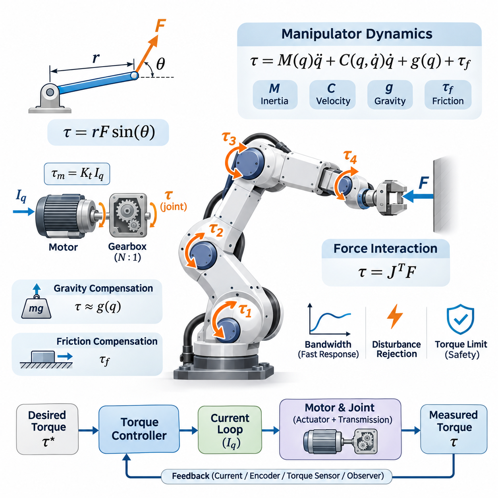
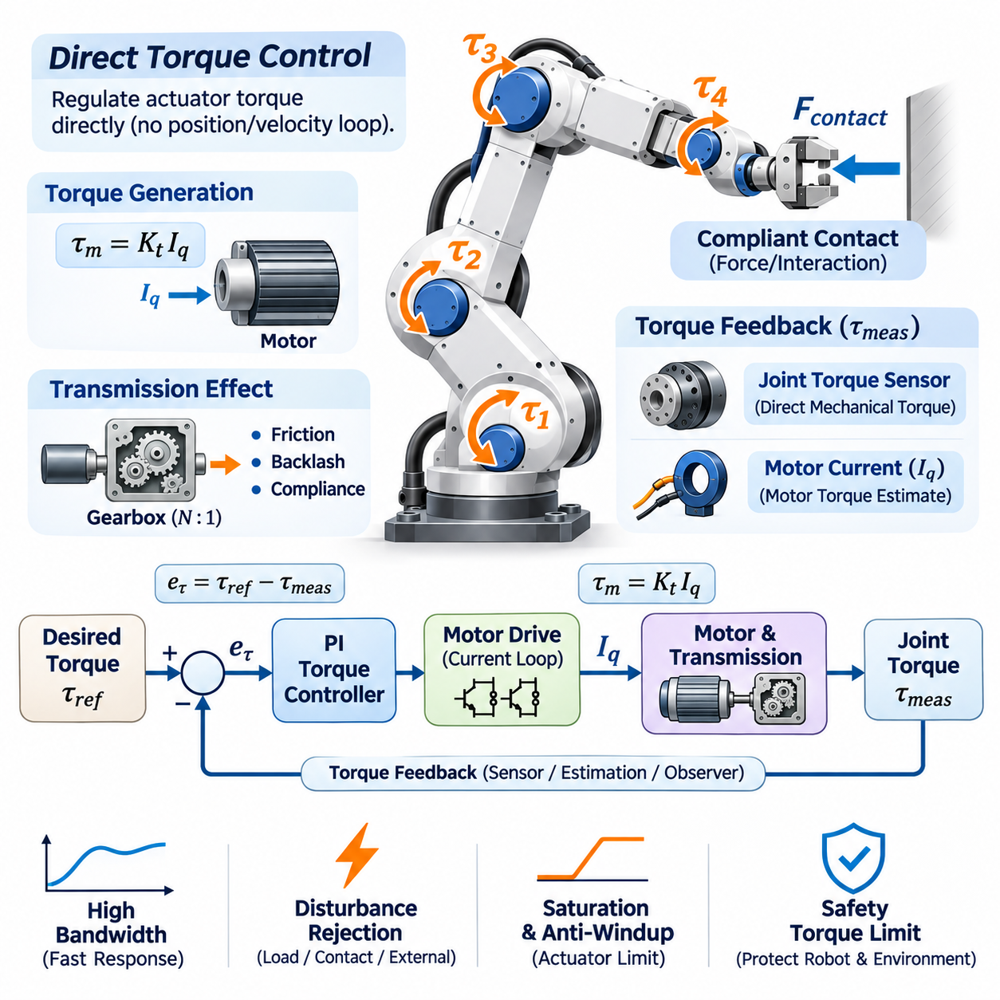
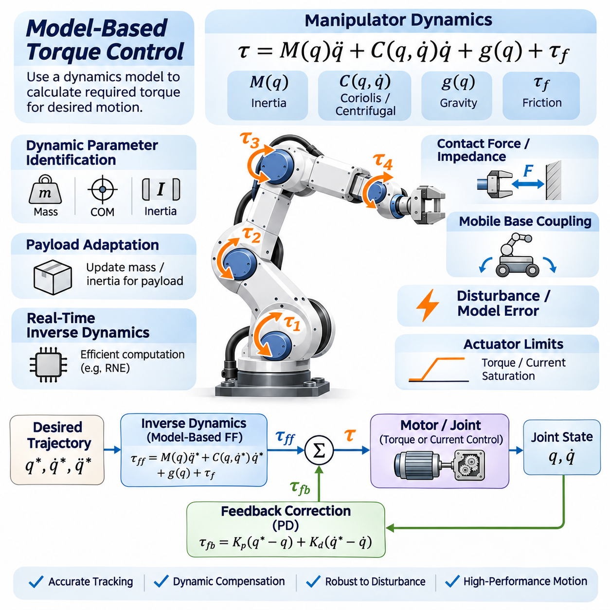
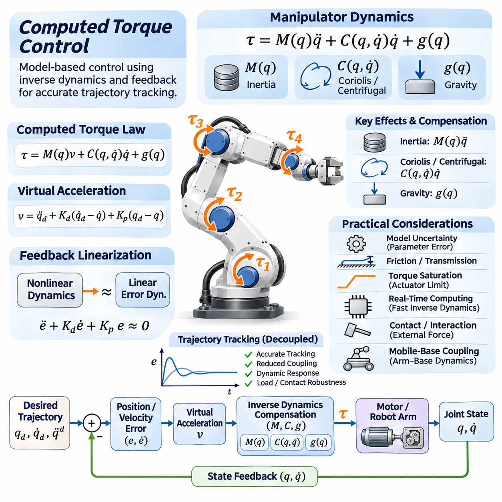
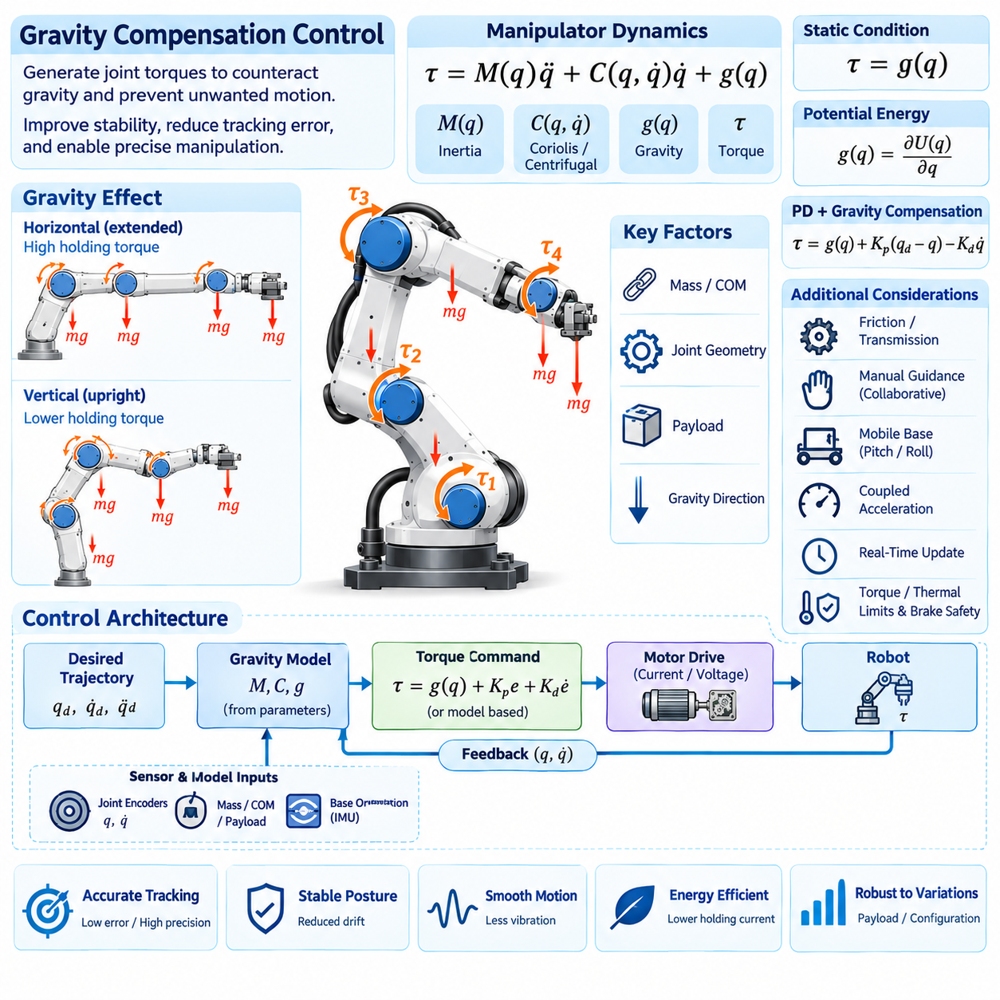
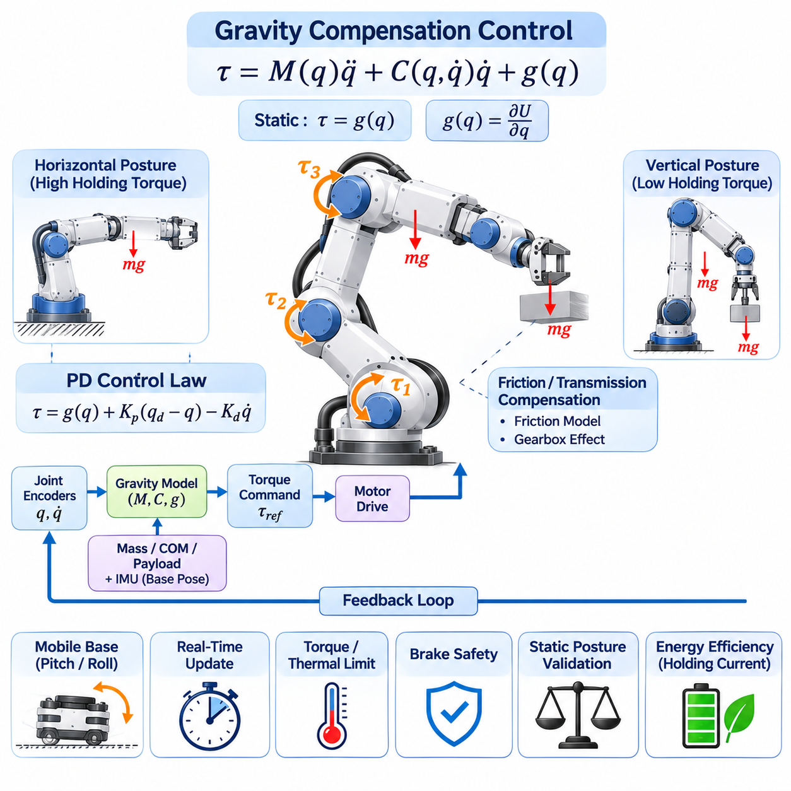
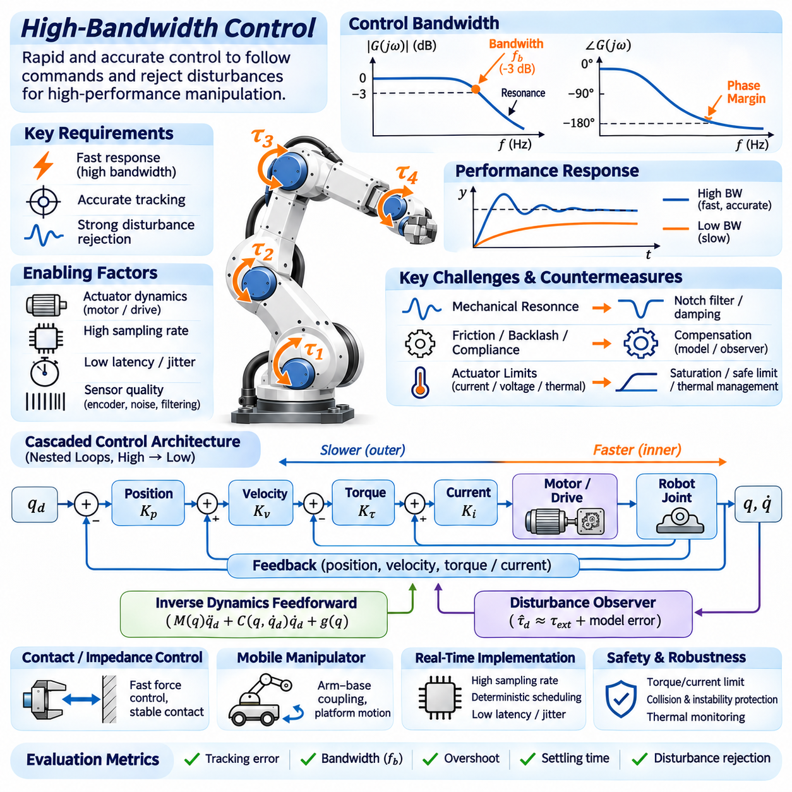
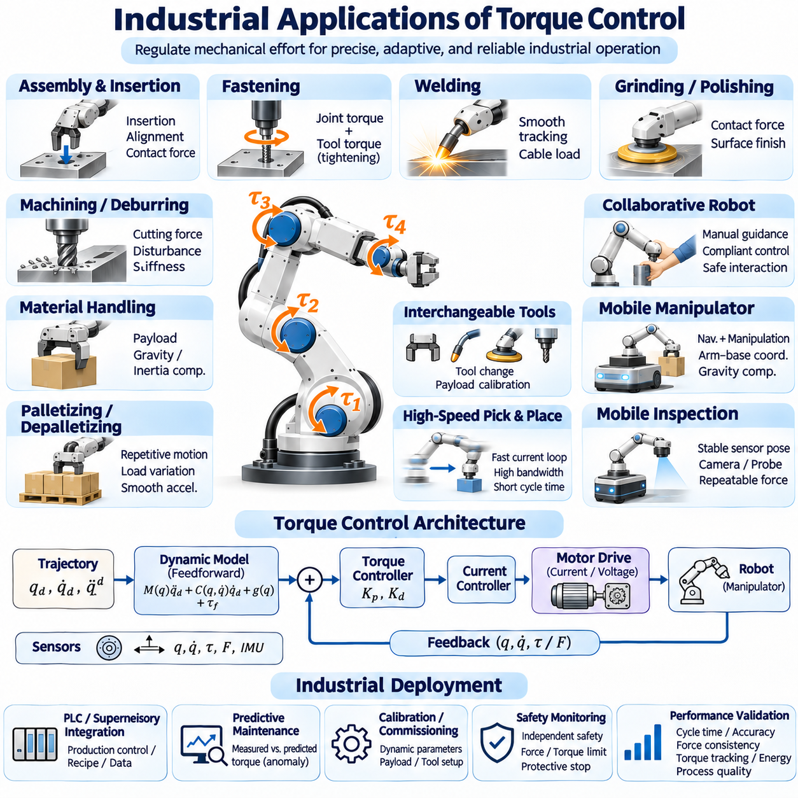
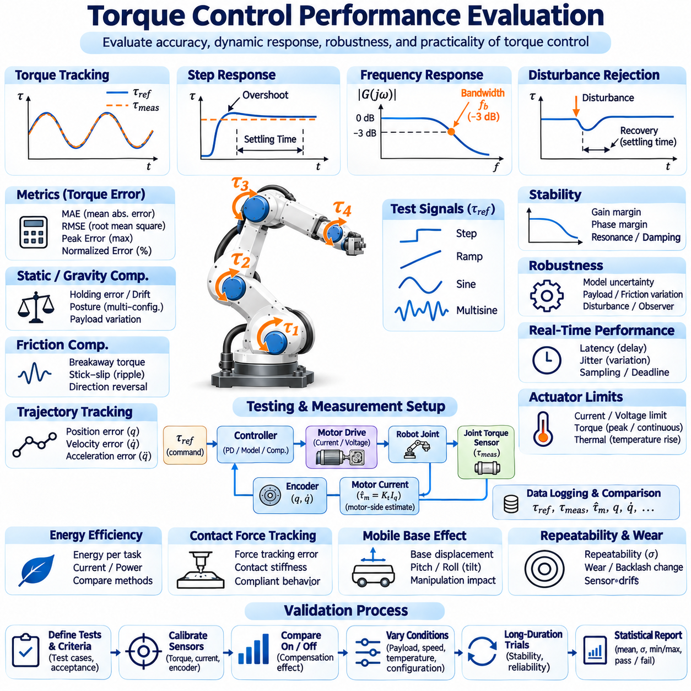

**Volume 02. Manipulator Mechanics and Control**

# Chapter 06. Torque Control

## 01 Torque Control Fundamentals

{width="7.268055555555556in" height="7.268055555555556in"}

Torque control is a fundamental technique in robotic manipulation that regulates the rotational effort generated by joint actuators rather than controlling position or velocity alone. Torque determines how a robot accelerates, supports external loads, and responds to physical interaction. By directly influencing joint forces, torque control provides the foundation for precise motion, compliant behavior, and dynamic manipulation in industrial and mobile robotic systems.

In mechanical systems, torque represents the rotational effect of a force acting around an axis. Its magnitude depends on the applied force, the distance from the rotation axis, and the angle between the force and lever arm. The relationship is expressed as τ = rF sin(θ), where τ denotes torque, r represents lever-arm length, and F indicates applied force. Torque is measured in newton-meters and determines the rotational acceleration produced under given mechanical conditions.

Robot manipulators contain multiple interconnected joints, each requiring torque to overcome inertia, gravity, friction, and external disturbances. During acceleration, actuators generate torque to change joint velocity, while during deceleration they produce opposing torque to reduce motion. Even when a manipulator remains stationary, its joints may require continuous torque to support the weight of links, tools, and payloads against gravitational forces.

The relationship between torque and robot motion is described through manipulator dynamics. A common mathematical representation is τ = M(q)q̈ + C(q,q̇)q̇ + g(q) + τf, where M represents the inertia matrix, C describes velocity-dependent effects, g denotes gravitational torque, and τf represents friction. This equation connects actuator effort with joint acceleration and provides the theoretical foundation for dynamic control algorithms.

Unlike position control, which attempts to minimize differences between commanded and measured joint angles, torque control directly regulates the effort delivered by actuators. This distinction becomes important when robots interact with uncertain environments or manipulate objects requiring controlled contact. Torque-controlled systems can respond to external forces more naturally, although stable and accurate operation requires suitable feedback, actuator characteristics, and control algorithms.

Electric motors generate torque through electromagnetic interactions between their magnetic fields and current-carrying conductors. In many permanent-magnet servo motors, torque is approximately proportional to the torque-producing current under appropriate operating conditions. The relationship can be expressed as τm = Kt Iq, where Kt is the motor torque constant and Iq is the corresponding current component. Accurate current regulation therefore forms an essential part of electric torque control.

The torque delivered to a robot joint differs from the torque generated directly by its motor because transmissions modify mechanical output. Gearboxes increase available joint torque while reducing rotational speed, but introduce friction, backlash, compliance, and efficiency losses. For an ideal transmission, output torque scales with the gear ratio. Practical implementations must account for mechanical losses and transmission dynamics to estimate actual joint torque accurately.

Torque control systems commonly employ feedback from motor current sensors, joint encoders, torque sensors, or disturbance observers. Current measurements provide indirect estimates of electromagnetic motor torque, while dedicated joint torque sensors can measure transmitted mechanical effort more directly. Combining these measurements with dynamic models improves estimation accuracy and enables controllers to distinguish commanded actuator effort from unexpected external disturbances.

A typical torque control architecture contains a high-level motion controller, a joint torque controller, and a motor current regulation loop. The high-level controller calculates desired joint torques according to task requirements and robot dynamics. The torque controller converts these commands into actuator references, while the motor drive regulates electrical current. This hierarchical arrangement separates mechanical control objectives from the faster electrical dynamics of motor actuation.

Control bandwidth determines how quickly a torque controller can respond to changing commands and disturbances. High bandwidth improves dynamic tracking and disturbance rejection, particularly during rapid manipulation and contact transitions. However, excessive controller gains may excite mechanical resonances, amplify sensor noise, or destabilize flexible transmissions. Effective torque control therefore requires careful coordination between actuator response, sampling frequency, structural dynamics, and feedback filtering.

Gravity compensation is an important application of torque control because robot joints must continuously counteract gravitational loading. The required compensation torque depends on joint configuration, link masses, centers of mass, and payload characteristics. By applying estimated gravitational torque, a controller reduces the effort needed to maintain a posture and allows additional control commands to focus on motion or interaction. Modeling errors may nevertheless produce residual drift or positioning errors.

Friction introduces nonlinear behavior that complicates accurate torque regulation, especially during slow movement and direction reversal. Static friction, Coulomb friction, and viscous friction can prevent small torque commands from producing the expected motion. Controllers may use friction models, feedforward compensation, or adaptive estimation to reduce these effects. Compensation must remain conservative because inaccurate friction estimates can introduce oscillations or unintended movement.

External disturbances represent another major challenge for torque-controlled manipulators. Unexpected payload changes, collisions, cable forces, and contact with surrounding objects can alter the relationship between commanded torque and observed motion. Disturbance observers estimate unmodeled joint efforts using sensor measurements and dynamic predictions. These estimates can improve robustness, support contact detection, and provide information for supervisory safety mechanisms.

Torque control is closely related to force control because joint torques generate forces and moments at the robot end effector. The manipulator Jacobian establishes the relationship between joint torques and Cartesian forces through τ = JᵀF for the corresponding generalized external wrench. This mapping enables task-space interaction strategies, including controlled pushing, insertion, and surface contact. Its effectiveness depends on robot configuration, kinematic accuracy, and proximity to singularities.

Mobile manipulators introduce additional torque control requirements because arm motion interacts dynamically with the mobile base. Rapid arm acceleration can transfer reaction forces and moments into the platform, affecting stability and localization. When the base is stationary, torque limits may need adjustment according to support geometry and payload distribution. During coordinated movement, the controller must consider coupled dynamics, base acceleration, and changing contact conditions.

Safety considerations are essential because torque-controlled robots can generate substantial mechanical forces even when commanded motion appears small. Joint torque limits, velocity constraints, emergency stopping functions, and independent protective mechanisms help reduce operational risks. Torque monitoring can contribute to collision detection, but measurement uncertainty and dynamic disturbances must be considered. Safety-critical functions require validated architectures rather than relying exclusively on ordinary software control loops.

Successful torque control depends on accurate actuator characterization and dynamic parameter identification. Motor constants, gear ratios, joint inertia, friction coefficients, and sensor offsets influence the relationship between commands and actual mechanical effort. Engineers typically validate these parameters through controlled experiments involving static loading, low-speed motion, and dynamic excitation. Reliable calibration improves torque tracking and reduces systematic errors across different operating conditions.

Performance evaluation examines how accurately commanded torque is reproduced under realistic operating conditions. Important characteristics include steady-state error, transient response, bandwidth, torque ripple, disturbance rejection, and thermal stability. Experiments should investigate different joint positions, motion speeds, payloads, and contact conditions. Comparing commanded torque, measured torque, motor current, and resulting motion helps identify limitations in sensing, actuation, and control design.

Torque control provides a mechanical foundation for advanced manipulation strategies such as impedance control, compliant interaction, and dynamically coordinated motion. Its principal advantage is the ability to regulate actuator effort while allowing higher-level controllers to determine how the robot should respond to movement and contact. Achieving this capability requires integration of accurate dynamics, responsive motor drives, reliable sensing, and robust safety mechanisms throughout the manipulator system.

## 02 Direct Torque Control

{width="7.268055555555556in" height="7.268055555555556in"}

Direct torque control is a control strategy that regulates the torque produced by robotic actuators according to commanded values, without requiring an outer position or velocity loop to define the primary control objective. It enables manipulators to control mechanical effort directly and respond to changing loads or physical contact. This capability is particularly important in robotic systems requiring dynamic motion, controlled interaction, and precise force generation.

The fundamental objective of direct torque control is to minimize the difference between desired torque and actual actuator torque. A torque reference is generated by a supervisory controller and compared with measured or estimated torque. The resulting error is processed by a feedback controller to adjust actuator commands. Accurate torque tracking allows the robot to generate predictable mechanical effort despite variations in operating conditions.

In electric robotic actuators, torque generation is closely associated with motor current. For a permanent-magnet synchronous motor, electromagnetic torque is commonly controlled through the quadrature-axis current component. Under suitable operating assumptions, the relationship can be approximated by τm = Kt Iq, where τm is motor torque, Kt is the torque constant, and Iq represents torque-producing current. This relationship enables current regulation to serve as an effective torque control mechanism.

Direct torque control can be implemented using motor current feedback, dedicated torque sensors, or model-based torque estimation. Current-based control is relatively economical because modern servo drives already measure phase currents for motor regulation. However, current measurements estimate electromagnetic torque rather than actual joint output torque. Gearbox friction, transmission compliance, and mechanical losses must therefore be considered when precise joint torque regulation is required.

A typical direct torque control architecture consists of a torque command generator, feedback processing, torque regulation, and actuator drive electronics. The command generator determines the desired mechanical effort, while the feedback subsystem estimates actual torque. The regulator calculates corrective commands and sends them to the motor drive. Fast electrical control loops then adjust current or voltage to achieve the requested torque response.

Torque feedback may be obtained through strain gauges, joint torque transducers, series elastic elements, or motor current measurements. Dedicated torque sensors provide information about transmitted mechanical effort, while current sensors primarily describe motor electromagnetic behavior. Sensor selection influences measurement bandwidth, noise sensitivity, cost, and mechanical integration. High-quality feedback is essential for stable operation and accurate disturbance rejection.

In a feedback-based implementation, torque error is defined as eτ = τref − τmeas, where τref represents commanded torque and τmeas denotes measured or estimated torque. A proportional-integral controller may process this error to generate an actuator command. Proportional action provides immediate correction, while integral action reduces persistent tracking error. Controller gains must be selected according to actuator dynamics, sensor characteristics, and stability requirements.

Direct torque control differs from conventional position control because torque commands do not inherently determine a unique joint position. Instead, the resulting motion depends on inertia, gravity, friction, external loading, and environmental constraints. A joint receiving constant torque may accelerate, remain stationary, or move against resistance depending on mechanical conditions. Higher-level control functions must therefore manage motion objectives and operating limits.

Control bandwidth is a critical performance characteristic because torque commands may change rapidly during acceleration, deceleration, and contact transitions. A responsive controller can reproduce these changes with limited delay and tracking error. However, excessive bandwidth may amplify measurement noise or excite mechanical resonances. The achievable response depends on motor electrical dynamics, transmission stiffness, sensor bandwidth, and computational latency.

Transmission mechanisms significantly influence the effectiveness of direct torque control. High-ratio gearboxes increase output torque but introduce friction, backlash, and reflected inertia that complicate precise regulation. Harmonic drives and other compact transmissions may also exhibit nonlinear stiffness and hysteresis. These effects can cause differences between motor-side torque estimates and actual joint torque, particularly during low-speed movement and direction reversal.

Direct-drive actuators reduce transmission-related uncertainty by coupling motors more directly to robotic joints. Eliminating high-ratio gearboxes can improve backdrivability, torque transparency, and mechanical responsiveness. Nevertheless, direct-drive systems often require larger motors to produce sufficient joint torque. Their design must balance continuous torque capacity, thermal performance, actuator mass, and available installation space.

Disturbance rejection is another important function of direct torque control. External contact forces, payload variations, and mechanical disturbances can produce deviations between commanded and measured torque. Feedback regulation compensates for these deviations within the actuator\'s available authority. Disturbance observers may supplement sensor measurements by estimating unmodeled mechanical effects, improving robustness when direct torque sensing is unavailable or limited.

Torque saturation occurs when a requested command exceeds the actuator\'s available output. Motor current limits, supply voltage, thermal conditions, and transmission ratings constrain achievable torque. Controllers must enforce these limits to prevent overheating, excessive mechanical stress, or unstable behavior. Anti-windup mechanisms are particularly important when integral control is used because accumulated error can otherwise cause undesirable responses after saturation ends.

Direct torque control supports compliant robotic interaction by allowing higher-level algorithms to regulate mechanical effort instead of enforcing rigid position trajectories. When combined with impedance or force control, it enables robots to respond to environmental constraints and contact forces. Nevertheless, torque control alone does not guarantee safe compliance. Interaction behavior depends on the complete control architecture, mechanical design, and safety supervision.

Mobile manipulators introduce additional considerations because actuator torques can generate reaction forces and moments on the mobile platform. Rapid arm movements may influence platform stability, wheel loading, and localization accuracy. Direct torque control can support coordinated manipulation when combined with base dynamics and motion planning. Supervisory controllers must account for payload distribution, support conditions, and coupled arm-base behavior.

Practical implementation requires deterministic communication between controllers, motor drives, and feedback devices. Torque commands must be updated at suitable intervals, while measurements require consistent timing and reliable synchronization. Communication delays and sampling jitter can degrade tracking accuracy or reduce stability margins. Real-time operating systems and dedicated servo interfaces help maintain predictable control behavior under demanding operating conditions.

Safety mechanisms must operate independently of ordinary torque regulation whenever hazardous actuator behavior is possible. Torque limits, joint velocity monitoring, position boundaries, emergency stopping functions, and protective control states reduce operational risks. Unexpected sensor failures or communication interruptions must trigger defined responses. Torque-controlled manipulators require particular attention because uncontrolled mechanical effort may produce motion even without explicit position commands.

Performance evaluation focuses on torque tracking accuracy, response time, bandwidth, steady-state error, torque ripple, and disturbance rejection. Engineers typically apply controlled torque references under different loading and motion conditions. Comparing commanded torque with independently measured output torque reveals actuator and transmission limitations. Thermal tests and sustained-load experiments are also necessary to establish reliable continuous operating capability.

Direct torque control provides a foundational actuator interface for advanced robotic manipulation. Its effectiveness depends on accurate sensing, responsive motor regulation, suitable mechanical transmissions, and carefully tuned feedback algorithms. By exposing mechanical effort as a controllable variable, it enables sophisticated motion and interaction strategies while supporting modular control architectures. Reliable deployment requires coordinated consideration of dynamics, real-time execution, actuator constraints, and functional safety.

## 03 Model Based Torque Control

{width="7.268055555555556in" height="7.268055555555556in"}

Model-based torque control is an advanced robotic control strategy that uses a mathematical representation of manipulator dynamics to calculate the torque required for desired motion. Unlike approaches relying exclusively on feedback error, it predicts the mechanical effort needed to overcome inertia, gravity, velocity-dependent forces, and friction. This predictive capability improves motion accuracy, dynamic responsiveness, and coordinated control across multiple robotic joints.

The fundamental principle of model-based torque control is to establish a relationship between joint motion and actuator effort. A manipulator dynamics model is commonly expressed as τ = M(q)q̈ + C(q,q̇)q̇ + g(q) + τf, where M represents the inertia matrix, C describes Coriolis and centrifugal effects, g denotes gravitational torque, and τf represents friction. This equation provides the mathematical foundation for estimating the torque required under different operating conditions.

The inertia matrix describes how the manipulator resists changes in joint acceleration. Its elements depend on link masses, mass distributions, joint configurations, and mechanical geometry. Because the inertia matrix changes as the robot moves, identical acceleration commands may require different torque levels at different configurations. Model-based controllers account for these variations to produce more consistent motion and reduce errors caused by configuration-dependent dynamics.

Coriolis and centrifugal effects arise from the interaction of moving links and rotating joints. These velocity-dependent forces become increasingly important during rapid or coordinated manipulation. A controller that ignores them may experience tracking errors, unwanted coupling between joints, or degraded performance at higher speeds. By predicting these effects, model-based torque control improves dynamic compensation and supports synchronized movement across complex robotic mechanisms.

Gravity compensation represents another essential component of model-based torque control. The gravitational torque acting on each joint depends on link orientation, mass distribution, payload weight, and the direction of gravity. A dynamics model calculates the effort needed to counteract these loads throughout the workspace. Accurate gravity compensation reduces steady-state positioning errors, improves holding performance, and decreases the corrective effort required from feedback controllers.

Friction modeling improves torque prediction by accounting for mechanical resistance within motors, bearings, gears, and transmissions. Common models describe viscous friction, Coulomb friction, and static friction, although practical systems may exhibit more complex nonlinear behavior. Incorporating friction estimates reduces tracking errors during low-speed movement and direction reversal. However, inaccurate compensation can introduce oscillations, particularly near zero velocity.

A typical model-based torque controller receives desired joint positions, velocities, and accelerations from a trajectory generator. It combines these references with measured joint states and estimated dynamic parameters to calculate actuator torque commands. The resulting commands are transmitted to lower-level torque or current controllers. Feedback correction is commonly included to compensate for disturbances, modeling errors, and deviations between predicted and actual behavior.

Inverse dynamics is a central computational technique in model-based torque control. Given a desired joint trajectory, inverse dynamics calculates the torques required to generate the corresponding motion under the assumed dynamic model. Efficient algorithms, including recursive Newton-Euler formulations, enable these calculations for manipulators with many degrees of freedom. Their computational efficiency makes inverse dynamics suitable for real-time robotic control applications.

Model-based feedforward control uses predicted torque to compensate for known dynamic effects before significant tracking errors occur. Rather than waiting for feedback to detect deviations, the controller anticipates the mechanical effort associated with planned acceleration, velocity, and configuration. Feedforward compensation improves trajectory tracking and reduces the burden on feedback regulation. Nevertheless, it cannot independently correct unknown disturbances or inaccurate model parameters.

Feedback control complements model-based prediction by correcting residual motion errors. Proportional-derivative or other feedback laws may generate corrective torque according to differences between desired and measured joint states. Combining predictive compensation with feedback improves robustness against parameter uncertainty and external disturbances. Controller gains must be selected carefully because aggressive correction can excite structural vibration or amplify measurement noise.

Dynamic parameter identification is essential for obtaining an accurate manipulator model. Important parameters include link masses, centers of mass, inertia tensors, friction coefficients, and transmission characteristics. Engineers estimate these values using mechanical design data, calibration experiments, and measured responses to controlled motion. Reliable identification improves torque prediction, while poorly estimated parameters can produce systematic compensation errors throughout the robot workspace.

Payload variation introduces additional uncertainty because grasped objects change the effective mass and inertia of the manipulator. A model calibrated for an unloaded arm may become inaccurate when carrying heavy or irregularly shaped objects. Payload estimation techniques update dynamic parameters using force measurements, motor torque observations, or motion responses. Adaptive parameter updates can improve performance when payload characteristics change during operation.

Model-based torque control must also consider actuator and transmission limitations. Motor torque capacity, current saturation, gearbox efficiency, joint flexibility, and thermal constraints influence whether calculated torque commands can be executed. A theoretically correct inverse dynamics solution may exceed available actuator capability. Practical controllers therefore apply torque limits, trajectory adjustments, and supervisory monitoring to maintain feasible and safe operation.

Real-time execution is particularly important because model-based torque calculations must remain synchronized with joint measurements and actuator commands. Control algorithms operate at fixed sampling intervals, requiring predictable computational latency and reliable communication. Recursive dynamics algorithms and optimized numerical implementations help reduce processing overhead. Excessive delays or inconsistent sampling can degrade tracking accuracy and reduce closed-loop stability margins.

Mobile manipulators require extended dynamic models because robotic arm motion interacts with the supporting mobile platform. Arm acceleration generates reaction forces and moments that can influence wheel loading, platform stability, and localization accuracy. When the base moves simultaneously with the arm, coupled dynamics become more significant. Model-based control can account for these interactions to improve coordinated motion and reduce disturbances transmitted between the manipulator and mobile base.

Contact-rich manipulation introduces additional challenges because environmental forces influence joint dynamics. During assembly, surface following, or object handling, contact forces may not be known precisely in advance. Model-based torque control can compensate for predictable internal dynamics while force or impedance controllers regulate interaction behavior. This separation allows the robot to maintain accurate motion compensation while responding appropriately to uncertain environmental constraints.

Model uncertainty remains a fundamental limitation of model-based torque control. Manufacturing tolerances, temperature-dependent friction, structural flexibility, and unmodeled disturbances can cause differences between predicted and actual torque requirements. Robust control methods, disturbance observers, and adaptive estimation techniques help reduce sensitivity to these uncertainties. Effective systems balance model accuracy with feedback responsiveness rather than assuming that mathematical predictions are exact.

Performance evaluation examines trajectory tracking accuracy, torque prediction error, disturbance rejection, computational latency, and robustness under varying payloads. Experiments typically compare predicted torques with measured actuator or joint torques across different motions and configurations. Testing should include rapid acceleration, low-speed movement, gravity-loaded postures, and contact transitions. These conditions reveal weaknesses in dynamic modeling and controller tuning.

Model-based torque control provides a foundation for advanced robotic motion strategies, including computed torque control, operational-space control, and whole-body coordination. Its principal advantage is the ability to anticipate mechanical effort using the physical structure and dynamics of the robot. Successful implementation requires accurate modeling, efficient computation, reliable state estimation, and appropriately designed feedback mechanisms. Together, these elements enable precise, responsive, and robust manipulation in complex robotic systems.

## 04 Computed Torque Control

{width="7.268055555555556in" height="7.268055555555556in"}

Computed torque control is a model-based robotic control technique that uses manipulator dynamics to calculate actuator torques required for accurate trajectory tracking. It combines inverse dynamics compensation with feedback correction to reduce nonlinear effects and improve motion performance. By accounting for inertia, Coriolis forces, centrifugal forces, and gravity, the controller enables predictable joint behavior during complex movements and changing operating conditions.

The fundamental principle of computed torque control is to transform nonlinear manipulator dynamics into approximately linear error dynamics through feedback linearization. A robotic arm is commonly described by τ = M(q)q̈ + C(q,q̇)q̇ + g(q), where M is the inertia matrix, C represents velocity-dependent effects, and g denotes gravitational torque. The controller uses these terms to compensate for nonlinear mechanical behavior while regulating the desired joint acceleration.

A typical computed torque controller generates actuator commands using τ = M(q)v + C(q,q̇)q̇ + g(q), where v represents a virtual acceleration command. This command combines desired trajectory acceleration with position and velocity error correction. When the dynamic model is accurate and actuator torque tracking is sufficiently fast, the nonlinear terms are compensated, allowing the closed-loop system to behave approximately like a set of decoupled linear systems.

The virtual acceleration command is commonly defined as v = q̈d + Kd(q̇d − q̇) + Kp(qd − q), where qd represents desired joint position and Kp and Kd are proportional and derivative gain matrices. The acceleration reference anticipates planned motion, while feedback terms correct deviations. Properly selected gains determine tracking speed, damping, and transient response, enabling accurate motion without excessive oscillation.

Feedback linearization is central to computed torque control because robotic manipulators naturally exhibit nonlinear and coupled dynamics. Joint acceleration depends on configuration, velocity, and torque applied at multiple joints. By compensating for these relationships, the controller reduces dynamic coupling and simplifies feedback design. However, the resulting linear behavior is approximate when parameter uncertainty, actuator limitations, or unmodeled disturbances are present.

The inertia matrix plays an essential role because it determines the torque required to produce joint acceleration. As the manipulator changes configuration, its effective inertia varies according to link geometry and mass distribution. Computed torque control continuously updates inertia compensation using the measured joint configuration. This allows similar tracking behavior across different arm postures, provided the dynamic parameters remain sufficiently accurate.

Coriolis and centrifugal compensation reduces velocity-dependent interactions between moving joints. These effects become significant during rapid motion, especially when several joints accelerate or rotate simultaneously. Without compensation, one joint\'s movement may influence another joint\'s tracking accuracy. Computed torque control predicts these interactions and incorporates the corresponding torque components, improving coordinated motion and reducing unwanted dynamic coupling.

Gravity compensation provides the torque necessary to counteract the weight of manipulator links and attached payloads. The required gravitational torque changes with joint orientation and load distribution. By including gravity in the control law, computed torque control reduces the feedback effort needed to maintain posture or follow slow trajectories. Accurate compensation is particularly valuable for vertically articulated arms operating with varying payloads.

The feedback gains Kp and Kd determine the dynamic characteristics of the tracking error. Higher proportional gains generally increase corrective stiffness, while derivative gains introduce damping that reduces oscillation. Excessive gains may amplify measurement noise, excite structural flexibility, or demand unavailable actuator torque. Gain selection must therefore consider desired response speed, mechanical resonance, sensor quality, and actuator bandwidth.

Accurate state estimation is necessary because computed torque control depends on joint position and velocity measurements. Encoders provide joint position information, while velocity may be measured directly or estimated through numerical differentiation and filtering. Measurement noise and estimation delays influence feedback accuracy, particularly at high control frequencies. Reliable synchronization between sensing, computation, and actuation is essential for maintaining stable trajectory tracking.

Dynamic parameter identification strongly influences controller performance. Link masses, centers of mass, inertia tensors, and payload characteristics determine the accuracy of inverse dynamics calculations. Parameters may be obtained from mechanical design models or estimated through experimental excitation. Errors in these values create residual nonlinear effects that feedback must correct, potentially reducing tracking accuracy during high-speed movement or substantial payload changes.

Friction and transmission dynamics introduce additional deviations from ideal computed torque control. Gearbox friction, backlash, joint compliance, and motor dynamics may not be represented fully by rigid-body equations. Friction compensation or disturbance estimation can improve tracking performance, especially during low-speed motion and direction reversal. Nevertheless, aggressive compensation may cause instability when friction models are inaccurate.

Actuator saturation is a practical limitation because computed torque commands may exceed motor current, torque, or thermal limits. Large acceleration demands and aggressive feedback corrections can produce commands that cannot be executed. Saturation disrupts the intended feedback linearization and may cause tracking errors or oscillation. Controllers must enforce torque limits and use feasible trajectory planning to maintain stable operation under physical constraints.

Real-time implementation requires repeated evaluation of manipulator dynamics at every control cycle. Efficient inverse dynamics algorithms, including recursive Newton-Euler methods, reduce computational complexity for multi-joint robots. Deterministic execution and consistent sampling intervals are important because delayed torque commands degrade compensation accuracy. The control architecture must coordinate trajectory generation, state estimation, dynamic computation, and low-level actuator regulation.

Mobile manipulators require additional consideration because robotic arm motion can influence the supporting mobile platform. Rapid joint acceleration generates reaction forces and moments that may affect wheel loading, base stability, and localization. Computed torque control can compensate for arm dynamics, while coordinated controllers account for interactions with the mobile base. Accurate modeling becomes particularly important when the platform and manipulator move simultaneously.

Contact-rich manipulation presents challenges because external forces modify the manipulator dynamics. During assembly, surface following, or constrained motion, computed torque control alone may not produce appropriate interaction behavior. Force control or impedance control can provide higher-level contact objectives while computed torque compensation handles predictable internal dynamics. This combination supports accurate motion and controlled physical interaction with the environment.

Robustness depends on how effectively the controller handles differences between the mathematical model and the actual robot. Manufacturing tolerances, payload uncertainty, structural flexibility, and temperature-dependent friction introduce modeling errors. Disturbance observers, adaptive parameter estimation, and robust feedback strategies can reduce their effects. However, computed torque control cannot guarantee exact linearization when the assumed dynamics differ substantially from reality.

Performance evaluation focuses on trajectory tracking error, transient response, control effort, disturbance rejection, and sensitivity to parameter uncertainty. Engineers test the controller across different joint configurations, speeds, accelerations, and payload conditions. Comparing measured motion and actuator torque with predicted behavior reveals compensation errors and implementation limitations. Experimental validation should also examine actuator saturation, thermal behavior, and stability under disturbances.

Computed torque control provides an important foundation for high-performance robotic manipulation by combining nonlinear dynamics compensation with conventional feedback regulation. Its effectiveness depends on accurate physical models, reliable state measurements, efficient computation, and sufficient actuator capability. When these requirements are satisfied, the method improves trajectory tracking and coordinated joint motion while supporting advanced control architectures for industrial and mobile manipulators.

## 05 Gravity Compensation Control

{width="7.268055555555556in" height="7.268055555555556in"}

{width="7.268055555555556in" height="7.268055555555556in"}

Gravity compensation control is a fundamental robotic control technique that generates joint torques to counteract gravitational forces acting on manipulator links and payloads. Its primary objective is to prevent unwanted joint movement caused by the weight of the robotic structure. By compensating for gravitational loading, the controller improves posture stability, reduces tracking errors, and supports precise manipulation across different configurations and operating conditions.

Gravitational torque depends on the mass distribution, center of mass, joint geometry, and orientation of each manipulator link relative to gravity. As the robot changes posture, the moment arms of gravitational forces change, producing different torque requirements. A joint supporting an extended horizontal link may require substantial holding torque, while the same link in a vertical configuration may generate significantly less torque around that joint axis.

The mathematical foundation of gravity compensation originates from manipulator dynamics, commonly expressed as τ = M(q)q̈ + C(q,q̇)q̇ + g(q). Here, M represents the inertia matrix, C describes velocity-dependent effects, and g(q) represents the gravitational torque vector. Under static conditions with zero joint velocity and acceleration, the required holding torque becomes τ = g(q), assuming negligible friction and external loading.

The gravitational torque vector can be derived from the robot\'s potential energy. If U(q) represents gravitational potential energy as a function of joint configuration, the gravity term is obtained from g(q) = ∂U(q)/∂q. This relationship connects mechanical geometry and mass properties to joint torque requirements. Accurate potential energy modeling allows gravity compensation to adapt continuously as the manipulator changes its configuration.

A gravity compensation controller calculates the required torque using measured joint positions and an estimated dynamic model. The resulting torque command is applied through the actuator control system to oppose gravitational loading. Unlike trajectory tracking controllers, pure gravity compensation does not directly regulate joint position or velocity. It primarily removes the gravitational contribution, allowing other control functions or external forces to determine the resulting motion.

Gravity compensation is often combined with proportional-derivative feedback to maintain a desired posture. A representative control law is τ = g(q) + Kp(qd − q) − Kd q̇, where qd denotes the desired joint configuration and Kp and Kd represent feedback gains. The gravity term supports the manipulator\'s weight, while proportional and derivative actions correct position errors and damp motion. This combination improves stability and holding accuracy.

Accurate gravity compensation requires reliable estimates of link masses, centers of mass, and joint configurations. These parameters determine the gravitational moments acting around each joint axis. Mechanical design models can provide initial estimates, while experimental identification improves accuracy. Errors in mass distribution or center-of-mass location produce residual torques that may cause posture drift, increased feedback effort, or inaccurate force interaction.

Payload handling introduces additional gravitational loading because grasped objects change the effective mass distribution of the manipulator. A controller calibrated for an unloaded arm may underestimate the torque required to support a heavy object. Payload estimation can use force sensors, motor current measurements, or known object properties to update compensation parameters. Accurate payload modeling improves stability and reduces unnecessary corrective action during manipulation.

Gravity compensation performance depends on the characteristics of motors, gearboxes, and mechanical transmissions. High-ratio gearboxes may provide substantial holding capability but introduce friction and limited backdrivability. Direct-drive and low-friction actuators generally provide more transparent torque behavior, making accurate compensation particularly important. Transmission efficiency, backlash, and compliance can create differences between commanded motor torque and actual joint output.

Friction compensation may complement gravity compensation when mechanical resistance significantly affects joint behavior. Static friction can temporarily prevent movement even when gravitational torque is not fully balanced, masking modeling errors. Once motion begins, the resulting imbalance may produce unexpected acceleration. Combining gravity and friction models can improve smoothness, but excessive compensation may introduce oscillations or undesirable movement near zero velocity.

Gravity compensation is particularly valuable for manually guided robots and collaborative manipulators. When gravitational loading is accurately balanced, an operator can reposition the robot with relatively small external effort. This behavior supports teaching by demonstration, manual positioning, and intuitive human-robot interaction. However, safe manual guidance also requires appropriate damping, motion limits, collision monitoring, and independently validated protective functions.

Mobile manipulators introduce additional complexity because the orientation of the robotic arm relative to gravity may change with the mobile platform. Platform pitch and roll alter the gravitational moments acting on individual joints, even when joint encoder readings remain unchanged. Gravity compensation can incorporate base orientation measurements from an inertial measurement unit to update the gravity vector expressed in the manipulator coordinate frame.

When a mobile platform accelerates or rotates, inertial forces can influence the manipulator in addition to gravity. A controller that compensates only for gravitational loading cannot fully cancel these dynamic effects. Coordinated arm-base control may therefore incorporate platform acceleration, angular velocity, and coupled dynamics. This distinction is important when mobile manipulators perform precision tasks while moving or operating on uneven surfaces.

Real-time implementation requires continuous updates of gravitational torque according to measured joint configuration. The computational burden is generally lower than full inverse dynamics because velocity-dependent and acceleration-dependent terms are not required for gravity calculation. Nevertheless, sensor latency, communication delays, and inconsistent sampling can degrade performance. Efficient dynamic algorithms and deterministic control execution help maintain predictable compensation behavior.

Gravity compensation must respect actuator torque limits and thermal operating constraints. Supporting heavy payloads in extended configurations may require sustained motor current, producing significant heat even when the manipulator remains stationary. Controllers should monitor continuous torque capacity, motor temperature, and transmission loading. Mechanical brakes or counterbalance mechanisms may be necessary when prolonged static holding exceeds practical actuator capabilities.

Safety considerations are essential because incorrect gravity compensation can cause unexpected joint motion or uncontrolled lowering of a payload. Sensor failures, inaccurate payload estimates, or power interruptions may remove the torque needed to support the manipulator. Protective mechanisms can include mechanical brakes, torque monitoring, controlled stopping, and safe power-loss behavior. Gravity compensation should not be treated as a substitute for independent safety functions.

Experimental validation typically begins with static posture tests across representative joint configurations. Engineers compare predicted gravitational torque with measured actuator effort and observe whether the manipulator maintains its position without excessive feedback correction. Additional tests evaluate different payloads, extended configurations, and slow movements. Residual drift, holding error, current consumption, and torque estimation accuracy provide useful performance indicators.

Gravity compensation can also improve energy management by reducing unnecessary corrective motion and allowing feedback controllers to operate with lower gains. However, it does not eliminate the electrical power required to generate sustained holding torque. Energy consumption depends on motor efficiency, transmission characteristics, mechanical counterbalancing, and operating posture. Optimizing robot configuration can therefore reduce gravitational loading and improve continuous operating efficiency.

Gravity compensation control provides an essential foundation for model-based torque control, computed torque control, impedance control, and compliant manipulation. Its effectiveness depends on accurate mass properties, reliable joint measurements, appropriate actuator capabilities, and robust safety mechanisms. By compensating for predictable gravitational forces, it simplifies higher-level control tasks and enables stable, responsive, and precise robotic manipulation in industrial and mobile systems.

## 06 Friction Compensation

{width="7.268055555555556in" height="7.268055555555556in"}

Friction compensation is an essential technique in robotic torque control that reduces the influence of mechanical resistance on joint motion. Friction occurs in motors, bearings, gears, seals, and transmission mechanisms, producing forces that oppose relative movement. These effects can degrade positioning accuracy, trajectory tracking, and force regulation. By estimating and compensating for friction torque, robotic controllers improve motion smoothness, responsiveness, and precision.

Friction in robotic joints is commonly classified into static friction, Coulomb friction, and viscous friction. Static friction resists the initiation of movement, while Coulomb friction produces approximately constant resistance during sliding. Viscous friction increases with velocity and is often associated with lubrication and mechanical damping. Real robotic transmissions exhibit combinations of these behaviors, making accurate friction modeling important for high-performance control.

A simplified friction model can be expressed as τf = Fc sign(q̇) + Bq̇, where Fc represents Coulomb friction, B denotes the viscous friction coefficient, and q̇ is joint velocity. This model captures basic resistance during motion but does not accurately describe behavior near zero velocity. More advanced models include static friction, velocity-dependent transitions, and nonlinear effects to improve compensation during slow movement and direction reversal.

The Stribeck effect describes how friction decreases from a higher breakaway level toward a lower sliding friction level as velocity increases from zero. This nonlinear transition is particularly important in precision manipulation, where small commanded movements may encounter substantial resistance. Controllers that ignore the Stribeck effect can experience stick-slip motion, oscillation, and positioning errors during low-speed operation.

Stick-slip behavior occurs when a joint alternates between remaining stationary and moving because of changing friction conditions. During the sticking phase, actuator torque increases until it exceeds the breakaway threshold. The joint then moves, often with a sudden reduction in friction resistance. This behavior can produce jerky movement and limit precision. Effective friction compensation reduces these transitions while avoiding excessive corrective torque.

Friction compensation is commonly implemented through model-based feedforward control. The controller estimates friction torque from joint velocity and other operating variables, then adds the predicted compensation to the commanded actuator torque. A representative expression is τcmd = τmotion + τf, where τmotion represents the torque required for desired motion. Accurate feedforward compensation reduces the corrective effort required from feedback controllers.

Friction modeling becomes particularly challenging near zero velocity because the direction of impending motion may be uncertain. A discontinuous sign function can generate abrupt torque changes when measured velocity crosses zero. Practical controllers may use smooth approximations, dead zones, or motion-direction prediction to avoid switching instability. These techniques improve numerical behavior but may introduce small residual friction errors.

Dynamic friction models describe internal friction states that evolve during motion rather than relying exclusively on instantaneous velocity. The LuGre model, for example, represents microscopic contact deformation through an internal state variable. Such models can capture presliding displacement, hysteresis, and velocity-dependent friction transitions. Their increased accuracy can improve precision control, although parameter identification and real-time computation become more demanding.

Friction parameter identification is necessary because resistance characteristics vary among actuators and mechanical assemblies. Engineers estimate friction coefficients by applying controlled torque or velocity commands and measuring the resulting joint response. Experiments may include constant-speed motion, velocity sweeps, and repeated direction reversals. Reliable identification requires separating friction effects from gravity, inertia, and external disturbances.

Temperature significantly influences friction because lubricant viscosity, material properties, and contact conditions change during operation. A transmission may exhibit different friction characteristics immediately after startup and after prolonged movement. Fixed compensation parameters may therefore become inaccurate as temperature changes. Temperature-dependent models or adaptive estimation techniques can improve consistency across different thermal operating conditions.

Gearboxes introduce additional friction effects associated with gear meshing, bearing loading, lubrication, and transmission efficiency. High-ratio reducers may exhibit substantial friction and limited backdrivability, especially under heavy loads. Friction can also depend on transmitted torque and motion direction. Compensation strategies must account for these characteristics when translating motor torque commands into effective joint torque.

Friction compensation is closely related to gravity compensation and computed torque control. The manipulator dynamics equation may be extended as τ = M(q)q̈ + C(q,q̇)q̇ + g(q) + τf. In this representation, friction torque is included alongside inertia, velocity-dependent forces, and gravity. Combining these compensation terms improves dynamic prediction and reduces tracking errors caused by mechanical resistance.

Feedback-based friction compensation can complement mathematical friction models when operating conditions are uncertain. Disturbance observers estimate unmodeled torque contributions from measured motion and actuator commands. These estimates may contain friction, external contact forces, and modeling errors, so they cannot always isolate friction directly. Proper observer design and filtering are necessary to prevent noise amplification and unstable compensation.

Adaptive friction compensation updates model parameters during operation to account for wear, temperature variation, and changing mechanical conditions. Adaptation algorithms compare predicted behavior with measured joint responses and adjust friction estimates accordingly. However, parameter updates must remain bounded and sufficiently slow to avoid destabilizing the control loop. Reliable adaptation also requires informative motion and appropriate disturbance handling.

Friction compensation is especially important for force control and impedance control because unmodeled resistance can distort the relationship between commanded torque and actual interaction force. Excessive joint friction may reduce sensitivity to small external forces and impair compliant behavior. Accurate compensation improves mechanical transparency and allows the manipulator to respond more naturally to environmental contact and human interaction.

Mobile manipulators experience friction in both robotic arm joints and mobile platform drive mechanisms. Wheel bearings, steering assemblies, gear reducers, and ground contact introduce additional resistance. Although wheel-ground friction is essential for traction, uncontrolled drivetrain friction can reduce velocity tracking accuracy. Coordinated control should distinguish useful traction forces from parasitic mechanical resistance and avoid compensation that compromises stability.

Real-time friction compensation requires reliable velocity estimation and predictable actuator response. Encoder noise, sampling delays, and low-resolution measurements can make friction direction estimation difficult at very low speeds. Filtering improves measurement quality but introduces latency that may reduce compensation effectiveness. Controller design must balance estimation accuracy, computational complexity, and closed-loop stability.

Excessive friction compensation can be dangerous because overestimated friction torque may cause unintended acceleration or sustained motion. Abrupt compensation changes near velocity reversal can also excite mechanical vibration. Safety mechanisms should enforce torque limits, monitor joint velocity, and detect abnormal motion. Compensation should be reduced or disabled when estimates become unreliable, particularly during contact-sensitive operations.

Performance evaluation examines low-speed tracking accuracy, breakaway torque, motion smoothness, reversal behavior, and disturbance rejection. Engineers compare joint responses with compensation enabled and disabled under representative operating conditions. Testing should include different payloads, temperatures, velocities, and movement directions. Improvements should be assessed alongside control effort, oscillation, and stability rather than tracking error alone.

Friction compensation provides an important foundation for accurate torque regulation and advanced robotic manipulation. Its effectiveness depends on suitable friction models, reliable parameter identification, stable feedback integration, and careful handling of low-speed nonlinearities. When implemented correctly, it reduces mechanical resistance effects, improves trajectory tracking, and enhances compliant interaction while supporting robust operation in industrial and mobile manipulators.

## 07 High Bandwidth Control

{width="7.268055555555556in" height="7.268055555555556in"}

High-bandwidth control is an advanced robotic control approach designed to respond rapidly to changes in joint motion, external disturbances, and commanded torque. Control bandwidth represents the frequency range over which a system can accurately follow reference signals or reject disturbances. Higher bandwidth generally improves responsiveness and tracking performance, but it also increases sensitivity to sensor noise, structural vibration, and actuator limitations.

In robotic manipulators, high-bandwidth control is particularly important for precise trajectory tracking, dynamic force regulation, and rapid disturbance rejection. Industrial robots performing high-speed assembly or precision positioning require controllers capable of correcting errors before they significantly affect motion. The achievable bandwidth depends on actuator dynamics, mechanical stiffness, sensor quality, computational latency, and the stability of the overall feedback system.

Control bandwidth is commonly evaluated through the frequency response of a closed-loop system. The bandwidth is often associated with the frequency at which the response magnitude decreases by approximately three decibels relative to its low-frequency value. This definition is most useful for well-behaved tracking responses and does not fully describe disturbance rejection. Engineers therefore examine gain, phase, resonance, and sensitivity characteristics when assessing control performance.

High-bandwidth torque control requires actuators capable of producing rapid and accurately regulated changes in torque. Electric motors typically generate torque through controlled current, making current-loop dynamics essential to overall performance. A fast inner current loop allows an outer torque controller to respond more effectively. However, motor inductance, inverter switching behavior, current measurement quality, and voltage limits constrain the achievable response speed.

Cascaded control architectures are widely used to organize robotic motion regulation into nested feedback loops. The innermost loop typically regulates motor current, while outer loops control torque, velocity, and position as appropriate to the actuator architecture. Inner loops generally require higher bandwidth than outer loops to preserve separation between their dynamics. Poorly coordinated bandwidths can introduce oscillation, excessive phase lag, or unstable interactions.

Sampling frequency strongly influences the implementation of high-bandwidth controllers. Digital control systems measure signals and update commands at discrete intervals, creating delays and limiting the frequencies that can be regulated effectively. Although sampling must exceed twice the highest relevant signal frequency to avoid aliasing under suitable assumptions, practical control requires a substantially higher sampling rate than the desired closed-loop bandwidth.

Communication latency and timing jitter can reduce effective control bandwidth even when computational resources are sufficient. Delayed sensor measurements and actuator commands introduce phase lag, reducing stability margins. Real-time communication networks, deterministic scheduling, and synchronized timestamps help maintain predictable execution. Distributed robotic systems must account for delays across controllers, drives, sensors, and communication interfaces.

Sensor quality is critical because high-bandwidth feedback amplifies the influence of measurement noise and quantization. Encoders provide joint position information, while velocity and acceleration may require estimation or additional sensing. Numerical differentiation can amplify high-frequency noise, particularly when position resolution is limited. Filtering reduces noise but introduces delay, creating a tradeoff between measurement smoothness and controller responsiveness.

Mechanical resonance imposes a fundamental limitation on achievable control bandwidth. Robotic joints, gearboxes, shafts, and structural links exhibit flexibility that can generate resonant vibration. Increasing feedback gains near these resonances may amplify oscillation rather than improve tracking. Frequency-response identification helps locate resonant modes, while notch filters, damping strategies, and flexible-joint models can reduce their influence.

Torque control bandwidth is also affected by friction, backlash, and transmission compliance. Friction introduces nonlinear resistance, while backlash creates regions in which motor movement does not immediately produce corresponding joint movement. Compliance allows elastic deformation between actuator and load. These effects complicate high-frequency torque regulation and may require joint-side torque sensing, disturbance observers, or specialized compensation strategies.

Model-based feedforward control can improve rapid motion tracking without relying exclusively on aggressive feedback gains. Inverse dynamics predicts torque contributions from inertia, gravity, and velocity-dependent forces. By compensating for these predictable effects, the feedback controller can focus on residual errors and disturbances. This approach may improve practical tracking performance without requiring an equally large increase in feedback bandwidth.

Disturbance observers are frequently incorporated into high-bandwidth control systems to estimate unknown external torques and modeling errors. They use actuator commands and measured motion to infer disturbances that affect joint behavior. Observer bandwidth must be selected carefully because faster estimation increases sensitivity to measurement noise and model uncertainty. Excessive observer gains can produce oscillation or undesirable interaction with mechanical resonance.

Force control and impedance control benefit from rapid torque response because contact conditions can change abruptly during manipulation. High-bandwidth torque regulation enables more accurate force tracking and responsive interaction with surfaces or objects. However, contact introduces additional dynamics, including environmental stiffness and sensor delay. Excessively aggressive control can destabilize interaction with rigid environments, making appropriate damping and passivity considerations important.

High-bandwidth control is especially challenging in mobile manipulators because robotic arm motion interacts with the mobile platform. Rapid arm acceleration can generate reaction forces that disturb platform orientation, wheel loading, and localization. The mobile base usually has slower mechanical dynamics than individual arm actuators. Coordinated control must therefore accommodate different bandwidth requirements while preventing fast manipulator actions from destabilizing the supporting platform.

Real-time computing infrastructure is essential for maintaining high-bandwidth performance. Control calculations must execute within predictable deadlines, with limited variation in processing time. Real-time operating systems, dedicated motor controllers, and optimized numerical algorithms help reduce latency. Monitoring execution time, missed deadlines, and communication jitter is necessary because occasional timing violations can significantly affect high-frequency feedback stability.

Actuator saturation and thermal limitations constrain sustained high-bandwidth operation. Rapid torque changes may demand high current, while repeated acceleration and deceleration generate electrical and mechanical losses. Voltage saturation can limit current slew rate, reducing the ability to track fast torque commands. Controllers must respect current, voltage, torque, and temperature constraints while avoiding unstable behavior when requested commands exceed available capability.

Safety mechanisms must remain effective when control systems operate at high bandwidth. Rapid actuator response can produce substantial forces before higher-level supervisory software reacts. Hardware current limits, independent safety monitoring, emergency stopping functions, and appropriate mechanical protection are therefore important. High-bandwidth performance should be validated within defined operating limits rather than pursued at the expense of predictable and safe behavior.

Performance evaluation typically includes frequency-response measurements, step responses, trajectory tracking tests, and disturbance rejection experiments. Engineers examine bandwidth, phase margin, gain margin, overshoot, settling time, and torque tracking error. Tests should cover different payloads, joint configurations, temperatures, and operating speeds. Measurements near mechanical resonances and actuator limits are particularly valuable for identifying unstable or poorly damped behavior.

High-bandwidth control provides an important foundation for precise and responsive robotic manipulation, especially when rapid torque regulation and disturbance rejection are required. Successful implementation depends on coordinated actuator design, sensor quality, mechanical stiffness, real-time execution, and carefully tuned feedback loops. By balancing responsiveness with stability, robustness, and safety, high-bandwidth control enables reliable performance in industrial and mobile robotic systems.

## 08 Industrial Applications

{width="7.268055555555556in" height="7.268055555555556in"}

Industrial applications of torque control extend across manufacturing, assembly, material handling, inspection, and collaborative robotics. Unlike position-only control, torque-based strategies regulate mechanical effort while accounting for dynamic loads and environmental interaction. This capability improves precision, adaptability, and operational reliability. Industrial implementations combine torque regulation with motion planning, safety monitoring, and production automation systems.

Automated assembly is a major application where controlled torque and contact forces determine process quality. Tasks such as component insertion, fastening, and connector engagement require accurate movement combined with compliant interaction. Excessive force can damage parts, while insufficient force may prevent successful assembly. Torque control enables robots to regulate mechanical effort and respond to resistance changes during contact-sensitive operations.

Precision insertion tasks frequently use torque control together with force sensing and impedance control. When inserting pins, shafts, or electrical connectors, small alignment errors can generate substantial contact forces. The controller adjusts joint effort to maintain controlled interaction while higher-level algorithms correct alignment. This approach reduces jamming, component deformation, and assembly failures while improving repeatability across production cycles.

Robotic fastening applications require coordinated control of manipulator motion and tool torque. Screwdriving and bolt tightening depend on appropriate contact pressure, tool alignment, and tightening profiles. Joint torque control stabilizes the robot arm during fastening, while a dedicated fastening tool regulates the applied tightening torque. Separating these functions improves process consistency and prevents confusion between joint actuator torque and fastener torque.

Industrial welding robots benefit from torque control when maintaining stable tool positioning under dynamic loads. During arc welding, smooth trajectory tracking and compensation for cable forces improve weld consistency. Contact-based welding processes may additionally require regulated interaction forces. Model-based torque control compensates for manipulator inertia and gravity, helping maintain predictable motion during acceleration, deceleration, and changes in arm configuration.

Grinding, polishing, and surface finishing require controlled contact between a tool and a workpiece. Surface geometry variations can produce changing interaction forces that affect material removal and finish quality. Torque control supports force or impedance regulation by providing responsive actuator behavior. Combining accurate motion tracking with contact-force feedback allows robots to follow complex surfaces while limiting excessive pressure and tool vibration.

Robotic machining and deburring involve disturbances generated by cutting forces and changing tool engagement. These disturbances can produce joint deflection, vibration, and tracking errors. Torque control improves disturbance rejection and supports compensation for predictable mechanical loads. However, structural stiffness and actuator bandwidth remain important limitations, particularly when machining forces approach the mechanical capacity of the robot.

Material handling systems use torque control to manage changing payloads during lifting, transfer, and placement. Heavy or irregularly shaped objects alter manipulator inertia and gravitational loading. Model-based compensation reduces tracking errors and improves controlled acceleration. Payload estimation and torque monitoring help detect unexpected loads, while motion planning ensures that actuator limits and stability constraints are respected throughout handling operations.

Palletizing and depalletizing robots operate through repetitive movements involving substantial acceleration and variable payload conditions. Torque control can improve cycle consistency by compensating for inertia and gravity across different arm configurations. Smooth acceleration profiles reduce mechanical stress and product movement. Monitoring torque demand also supports detection of abnormal gripping conditions, collisions, or changes in load distribution.

Collaborative robots rely on responsive torque control to support physical interaction with human operators. Low-friction actuation, gravity compensation, and compliant control allow robots to respond to externally applied forces. These capabilities support manual guidance, shared workspaces, and flexible assembly tasks. Nevertheless, collaborative operation requires independently validated safety functions, appropriate force limits, and application-specific risk assessment.

Industrial mobile manipulators combine autonomous navigation with robotic arm operations at multiple workstations. Torque control becomes important when the arm performs precision assembly, inspection, or material handling after the mobile base reaches a target location. Gravity compensation and model-based torque regulation improve arm stability, while coordinated control addresses reaction forces transmitted to the mobile platform during manipulation.

Mobile inspection systems use torque control to maintain accurate sensor positioning while robotic arms move around large industrial products. Cameras, laser scanners, and measurement probes require stable orientation and predictable motion. Dynamic compensation reduces tracking deviations caused by changing arm configurations and sensor payloads. When contact probes are used, controlled joint effort also supports repeatable measurement forces and reduces the risk of damaging inspected surfaces.

Industrial robots operating with interchangeable end effectors require torque controllers that accommodate changing mass and inertia properties. Grippers, welding torches, polishing tools, and inspection sensors introduce different dynamic loads. Tool identification and payload calibration allow the controller to update compensation parameters. Without these adjustments, identical trajectories may produce different tracking errors, vibration levels, or actuator demands.

High-speed production lines place demanding requirements on torque-control bandwidth and computational responsiveness. Rapid pick-and-place movements involve frequent acceleration, deceleration, and direction changes. Model-based feedforward compensation reduces dynamic tracking errors, while fast current regulation supports timely torque generation. Controller tuning must balance cycle time, positioning accuracy, vibration suppression, and actuator thermal limits.

Torque monitoring also supports industrial condition monitoring and predictive maintenance. Changes in required actuator effort may indicate increased friction, gearbox wear, bearing degradation, or unexpected mechanical loading. Comparing measured torque with model-based predictions helps identify abnormal behavior. However, diagnostic algorithms must distinguish equipment deterioration from legitimate changes in payload, trajectory, temperature, and operating conditions.

Integration with industrial automation infrastructure is essential for deploying torque-controlled robots in production environments. Robot controllers exchange operating states, task commands, and diagnostic information with programmable logic controllers and supervisory systems. Real-time torque regulation normally remains within dedicated motion controllers, while higher-level systems coordinate production sequences. Clear separation of control responsibilities improves reliability and maintainability.

Industrial safety requirements influence torque-control architecture and operational limits. Excessive actuator torque can create hazardous contact forces, damage equipment, or destabilize handled loads. Torque limits, collision detection, protective stopping, and monitored operating modes reduce these risks. Safety-related functions must be designed and validated independently of ordinary performance control, especially in collaborative or contact-intensive applications.

Performance validation in industrial environments must reflect actual production conditions rather than isolated laboratory demonstrations. Engineers evaluate cycle time, positioning accuracy, force consistency, torque tracking, energy consumption, and process quality. Tests should include representative payloads, tool changes, temperature variations, and repeated operating cycles. Long-duration validation reveals thermal limitations, mechanical wear, and performance drift that short tests may overlook.

Successful industrial deployment also depends on calibration procedures, maintenance accessibility, and operational diagnostics. Accurate dynamic models require periodic verification when tooling, payloads, or mechanical components change. Recorded torque profiles and controller status information support troubleshooting and process optimization. Standardized commissioning procedures help maintain consistent performance across multiple robots and production sites.

Industrial torque control provides a practical foundation for precise motion, compliant interaction, and reliable automated production. Its value emerges from combining accurate dynamic compensation, responsive actuators, suitable feedback strategies, and validated safety mechanisms. As manufacturing systems become more flexible and mobile, torque-based control will remain essential for robots that must adapt to changing tasks, payloads, and physical environments.

## 09 Performance Evaluation

{width="7.268055555555556in" height="7.268055555555556in"}

Performance evaluation of robotic torque control determines how accurately, rapidly, and reliably a manipulator produces commanded joint torques under different operating conditions. Unlike position control assessment, torque evaluation examines actuator effort, dynamic compensation, and interaction behavior. A comprehensive evaluation considers tracking accuracy, bandwidth, disturbance rejection, stability, energy efficiency, and robustness to mechanical uncertainty.

Torque tracking accuracy is a primary indicator of control performance. It measures the difference between commanded torque and actual joint torque during static and dynamic operation. Common metrics include mean absolute error, root mean square error, maximum error, and normalized tracking error. These measurements reveal whether the controller can reproduce desired torque profiles consistently across different joint configurations, speeds, and payload conditions.

Accurate torque measurement is essential for meaningful evaluation. Joint torque sensors provide direct measurements of transmitted mechanical effort, while motor current can estimate torque using calibrated motor constants. However, motor-side estimates may differ from joint output because of gearbox friction, transmission losses, and compliance. Evaluation procedures must distinguish measured joint torque from estimated actuator torque and account for sensor calibration uncertainty.

Static torque performance is evaluated by applying constant torque commands or maintaining representative postures under gravitational loading. Engineers examine steady-state torque error, holding stability, current consumption, and temperature rise. These tests reveal compensation inaccuracies and actuator limitations that may remain hidden during short movements. Static evaluation is particularly important for manipulators supporting heavy payloads or operating in extended configurations.

Dynamic torque tracking tests assess controller behavior during changing torque demands. Step, ramp, sinusoidal, and multisine reference signals reveal response speed, overshoot, settling time, and frequency-dependent tracking errors. Abrupt commands should remain within actuator limits to avoid misleading saturation effects. Comparing commanded and measured torque profiles helps identify control delays, insufficient damping, and nonlinear transmission behavior.

Control bandwidth is commonly determined through frequency-response analysis. Engineers apply sinusoidal torque references across a range of frequencies and measure the amplitude and phase of the resulting torque response. The tracking bandwidth is often identified near the frequency where response magnitude falls by three decibels relative to low-frequency behavior. Resonance peaks and phase lag must also be examined because bandwidth alone does not establish stability.

Disturbance rejection evaluates how effectively torque control maintains desired behavior when unexpected external forces or load variations occur. Controlled disturbances may be introduced through calibrated loading devices or repeatable contact experiments. Performance indicators include peak deviation, recovery time, residual error, and required corrective torque. Testing across different disturbance frequencies helps reveal limitations in feedback control and observer design.

Trajectory tracking provides an additional measure of torque-control effectiveness because torque regulation influences the resulting joint motion. Position, velocity, and acceleration errors are recorded during representative trajectories. Model-based torque control should reduce deviations associated with inertia, gravity, and joint coupling. However, improved torque tracking does not automatically guarantee better positioning when mechanical flexibility or external contact dominates system behavior.

Gravity compensation performance is assessed by measuring residual joint torque and posture drift across different arm configurations. Horizontal, vertical, and extended postures produce different gravitational moments and reveal errors in mass or center-of-mass estimates. Payload variation tests determine whether compensation remains accurate when tools or grasped objects change. Effective compensation reduces unnecessary feedback correction while maintaining predictable holding behavior.

Friction compensation evaluation focuses on low-speed motion, breakaway behavior, and direction reversal. Engineers examine stick-slip oscillation, velocity ripple, residual tracking error, and the torque required to initiate movement. Repeated experiments at different temperatures help characterize friction variation. Compensation should improve motion smoothness without causing unintended acceleration, excessive torque injection, or unstable behavior near zero velocity.

Stability evaluation examines whether the control system maintains bounded and well-damped responses under expected operating conditions. Frequency-domain analysis may estimate gain margin and phase margin, while time-domain experiments reveal oscillation and overshoot. Mechanical resonance, sensor delay, and actuator saturation can reduce stability margins. Tests should include representative payloads and joint configurations rather than relying on a single nominal operating point.

Robustness testing measures sensitivity to modeling errors and changing physical parameters. Engineers deliberately vary payload estimates, friction coefficients, or controller parameters within safe limits to observe performance degradation. Disturbance observers and adaptive compensation can be evaluated under similar conditions. A robust controller should preserve acceptable tracking and stability without requiring perfectly accurate dynamic models.

Real-time performance evaluation examines computational latency, sampling consistency, and communication reliability. Control-cycle execution time should remain below the available scheduling deadline, including worst-case computational conditions. Timing jitter, missed deadlines, and delayed sensor updates can degrade high-bandwidth control. Logging synchronized timestamps allows engineers to correlate timing irregularities with torque tracking errors and transient instability.

Actuator limitations must be included in performance testing because current saturation, voltage constraints, and thermal loading influence achievable torque response. Continuous torque capacity differs from short-duration peak capability. Repeated acceleration cycles and sustained holding tests reveal heating and efficiency losses. Controllers should maintain predictable behavior when torque commands approach physical limits, including appropriate saturation handling and protective responses.

Energy efficiency is evaluated by measuring electrical input power, mechanical output, and energy consumed during representative tasks. Torque control influences energy use through acceleration profiles, friction compensation, and unnecessary corrective motion. Lower tracking error does not necessarily imply lower energy consumption. Comparisons should use equivalent payloads, trajectories, cycle times, and environmental conditions to ensure meaningful results.

Contact interaction tests are important for force-controlled and impedance-controlled manipulators. Engineers evaluate force tracking accuracy, contact overshoot, settling behavior, and response to changes in environmental stiffness. Torque sensing and compensation affect how accurately commanded interaction forces are realized. Contact stability must be assessed carefully because rigid surfaces, communication delays, and aggressive feedback gains can produce oscillation.

Mobile manipulators require additional evaluation because arm torque control can influence mobile-base stability and positioning. Rapid arm movements generate reaction forces that may disturb wheel loading, platform orientation, and localization accuracy. Tests should compare stationary-base operation with coordinated arm-base motion. Relevant metrics include arm tracking error, base displacement, orientation disturbance, and recovery after dynamic manipulation.

Repeatability and long-duration reliability are essential for industrial deployment. Repeated torque profiles reveal variation caused by temperature changes, mechanical wear, sensor drift, and transmission characteristics. Statistical analysis should report performance distributions rather than isolated best-case results. Extended testing can identify gradual degradation, intermittent communication faults, and thermal effects that are not apparent during brief laboratory demonstrations.

A structured evaluation protocol should define test configurations, payloads, reference trajectories, sampling rates, and acceptance criteria before experiments begin. Calibration records, controller parameters, firmware versions, and environmental conditions should be documented. Baseline comparisons with compensation enabled and disabled help isolate performance improvements. Reproducible procedures support meaningful comparisons between controllers, actuators, and robotic platforms.

Performance evaluation provides the evidence required to validate torque-control accuracy, responsiveness, stability, and practical suitability. No single metric can represent the complete behavior of a robotic manipulator, so static, dynamic, frequency-domain, and task-level tests must be combined. Reliable evaluation integrates calibrated measurements, realistic operating conditions, and transparent reporting to support safe and effective torque control in industrial and mobile robotic systems.
