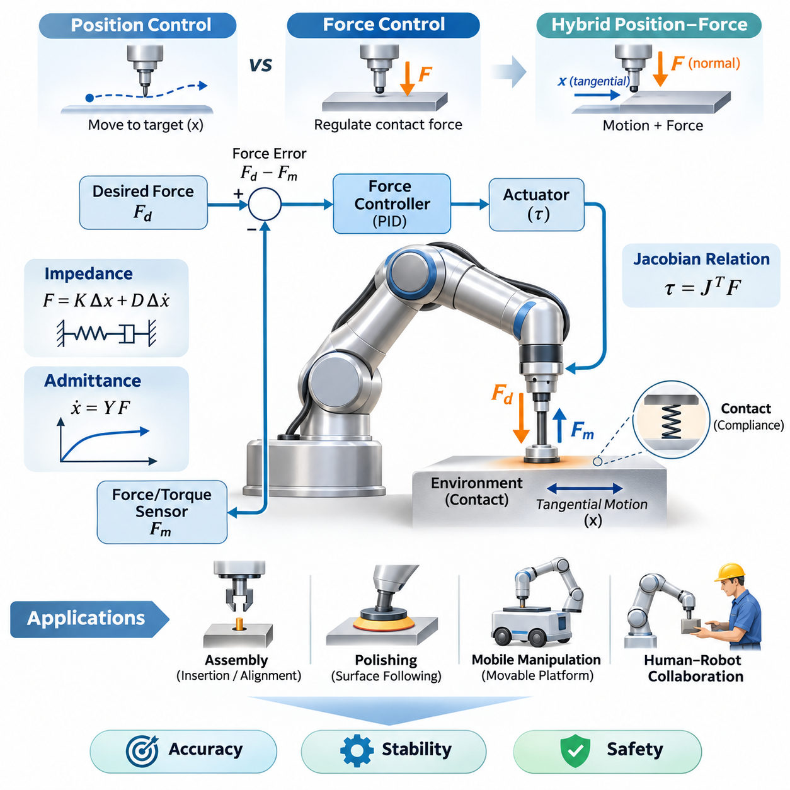
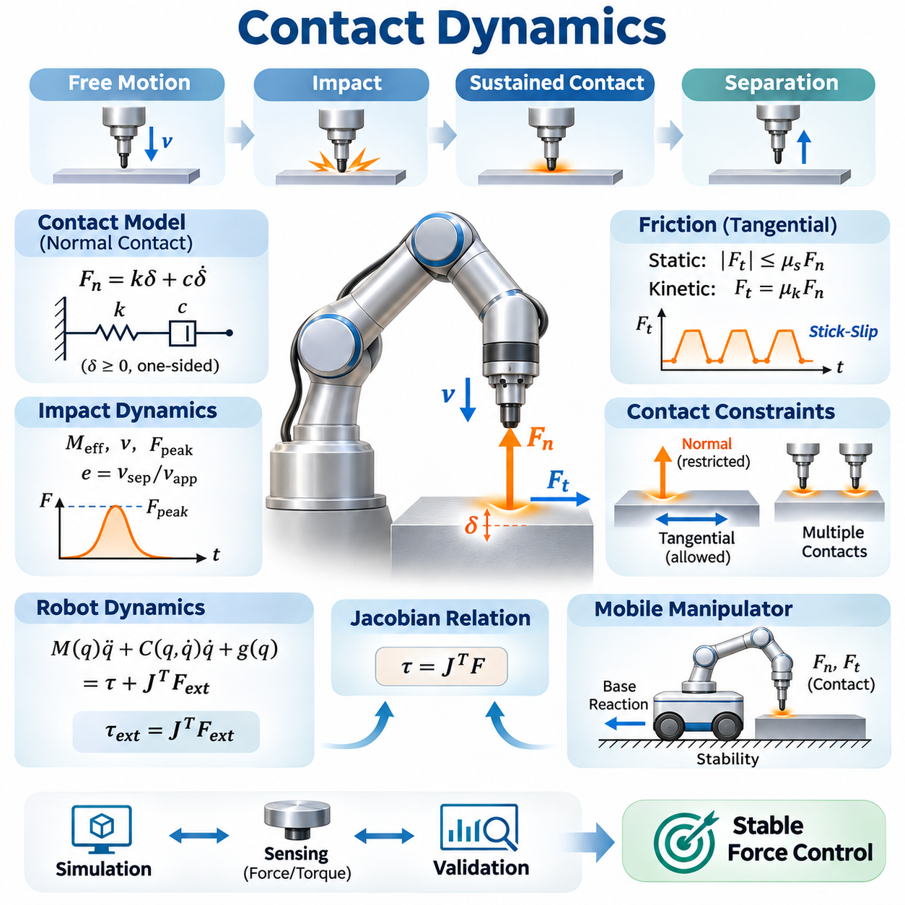
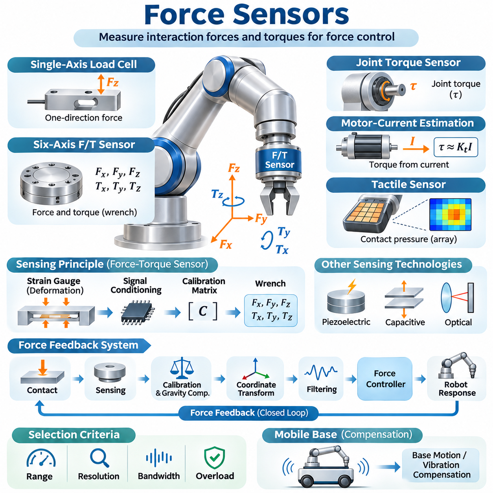
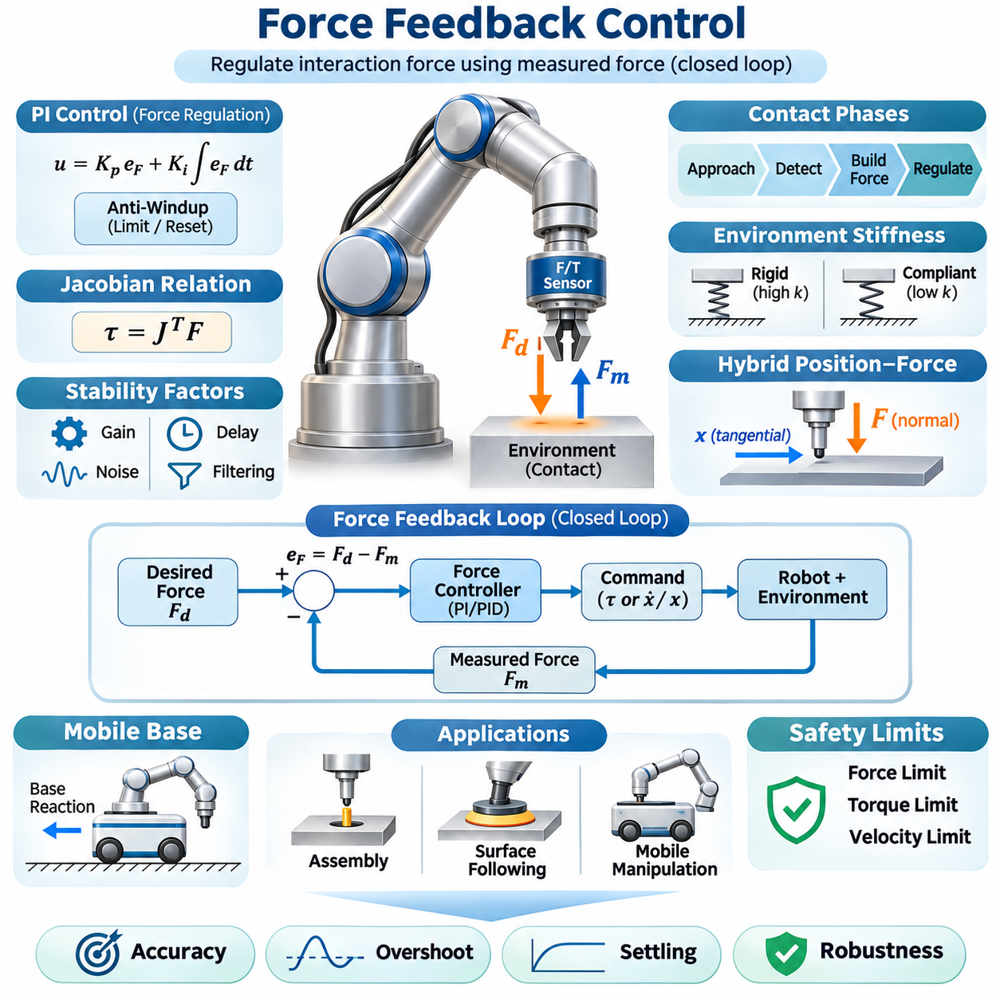
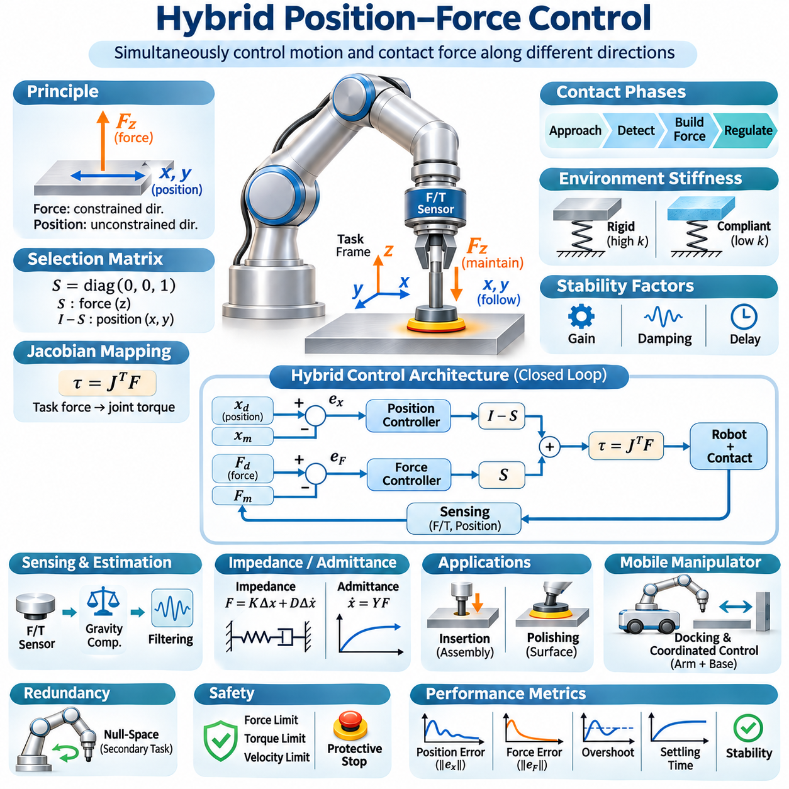
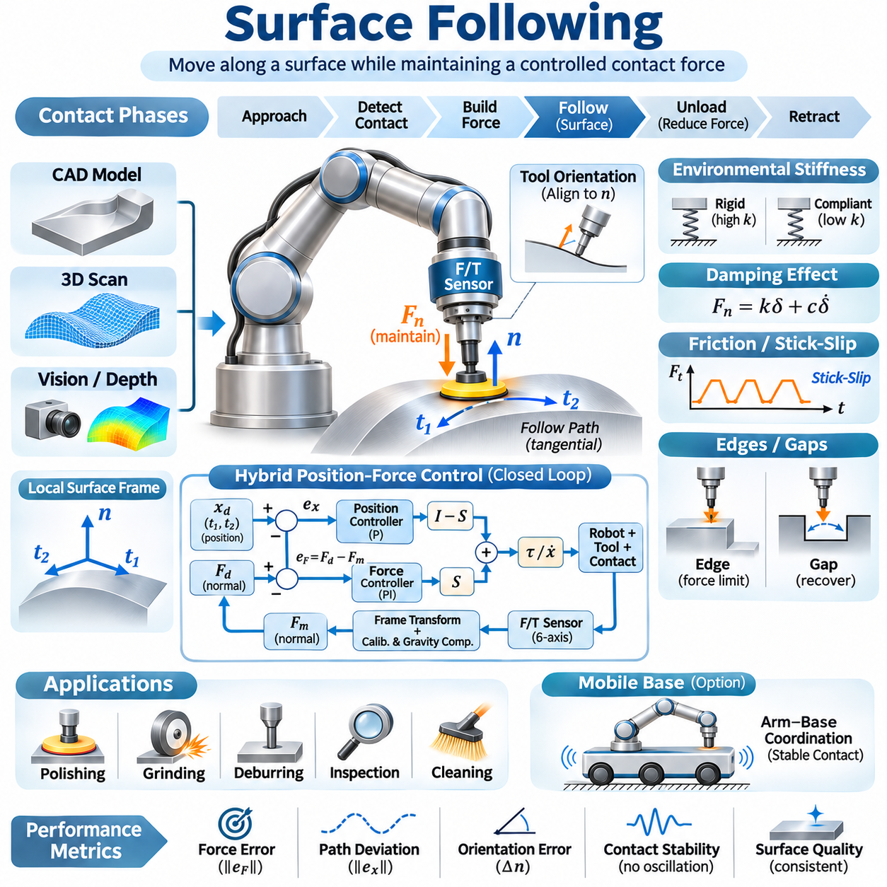
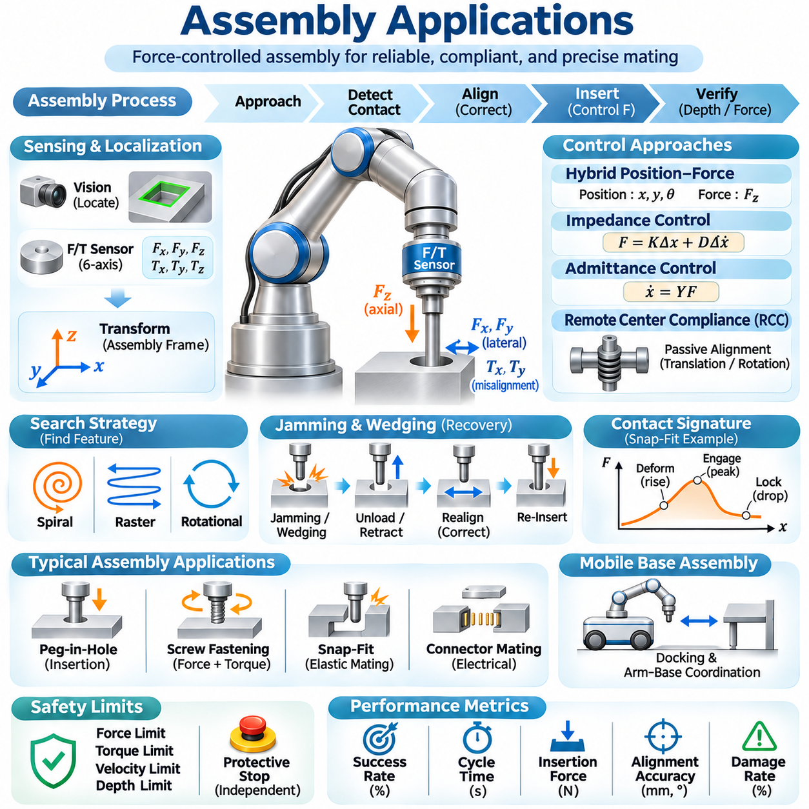
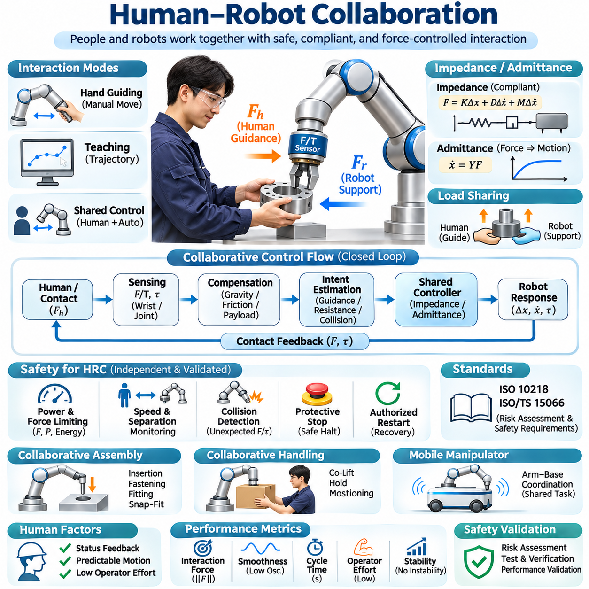
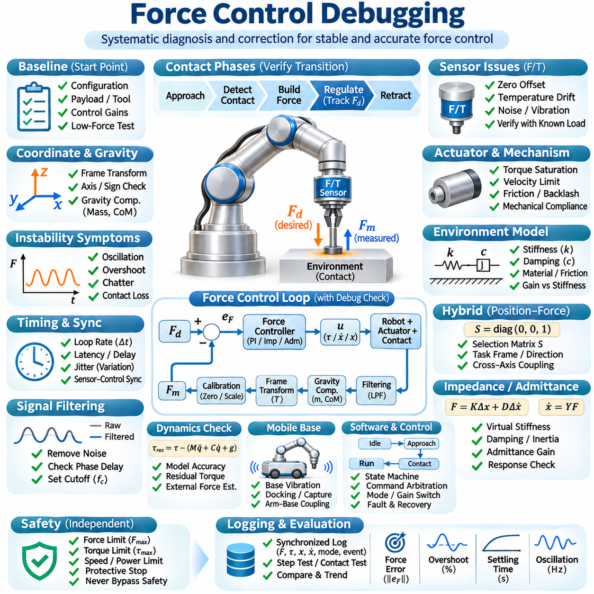

**Volume 02. Manipulator Mechanics and Control**

# Chapter 07. Force Control

## 01 Force Control Overview

{width="7.268055555555556in" height="7.268055555555556in"}

Force control is a fundamental capability in robotic manipulation that enables a robot to regulate physical interaction with objects, surfaces, and surrounding environments. Unlike conventional position control, which primarily determines where a robot moves, force control determines how strongly the robot interacts with its environment. This distinction becomes essential when contact conditions influence task accuracy, equipment reliability, and operational safety.

Traditional position-controlled manipulators follow predefined trajectories based on joint coordinates or Cartesian poses. Such control is effective in free space, where environmental constraints are predictable and physical contact is limited. However, when a robot encounters a rigid surface, even a small positioning error can generate substantial contact forces. Force control addresses this limitation by adjusting robot behavior according to measured or estimated interaction forces.

The central objective of force control is to maintain a desired interaction force while accommodating changes in environmental geometry, stiffness, and contact conditions. A controller continuously compares the target force with the actual force and generates corrective commands to reduce the difference. These corrections may influence joint torque, Cartesian motion, or actuator behavior, depending on the robot architecture and the selected control strategy.

Force control is closely related to robot dynamics because interaction forces directly affect the mechanical behavior of a manipulator. Joint torques, link inertia, gravitational loading, friction, and external disturbances collectively determine the robot\'s response. Accurate dynamic models help distinguish commanded actuator effort from forces generated through environmental contact, allowing controllers to compensate for internal mechanical effects.

The relationship between joint torque and Cartesian force is commonly described through the manipulator Jacobian. Under appropriate static or quasistatic assumptions, the external joint torque associated with an end-effector wrench is expressed as τ = JᵀF, where J represents the Jacobian and F represents the Cartesian wrench. This relationship provides a mathematical foundation for translating desired contact forces into joint-level control commands.

Force control systems generally rely on force sensing, actuator feedback, or model-based estimation to determine interaction conditions. Six-axis force-torque sensors measure three-dimensional forces and moments, while joint torque sensors provide information about mechanical loading. Motor current measurements can also support indirect force estimation, although transmission friction, actuator characteristics, and modeling uncertainty may reduce accuracy.

A typical force feedback controller calculates the difference between the desired and measured contact forces. This force error is processed through a control law that generates corrective motion or torque commands. Proportional, integral, and derivative mechanisms may be employed, but controller design must consider sensor noise, contact stiffness, actuator bandwidth, and delays that can influence closed-loop stability.

Contact dynamics introduce challenges that are less prominent during free-space motion. When a robot touches an object, the interaction may involve elastic deformation, damping, friction, and sudden changes in mechanical constraints. Hard surfaces can produce rapid force variations, while compliant materials exhibit deformation-dependent behavior. Effective force control must account for these differences to prevent oscillation, excessive loading, and unstable contact.

Position control and force control are not mutually exclusive approaches. Many manipulation tasks require simultaneous regulation of motion and interaction forces along different directions. During surface polishing, for example, the robot may follow a prescribed tangential trajectory while maintaining a specified normal contact force. Hybrid position-force control provides a framework for coordinating these objectives according to task constraints.

Force control also provides a foundation for impedance and admittance control, although these approaches regulate interaction behavior differently. Impedance control establishes a desired dynamic relationship between motion deviations and interaction forces. Admittance control converts measured forces into commanded motion. Both approaches support compliant interaction, while direct force regulation focuses more explicitly on tracking a desired contact force.

In industrial assembly, force control improves the reliability of insertion, alignment, fastening, and mating operations. Components frequently exhibit dimensional tolerances, positioning uncertainty, and small geometric deviations. A position-only controller may force misaligned parts together, potentially damaging surfaces or mechanisms. Force feedback enables the robot to recognize resistance, adjust its movement, and maintain acceptable contact loads.

Surface-following applications demonstrate another important advantage of force regulation. Grinding, polishing, deburring, and inspection processes often require consistent pressure against irregular workpieces. A force-controlled manipulator can accommodate moderate geometric variations while maintaining the intended contact condition. This capability improves process consistency and reduces dependence on highly accurate geometric models.

For mobile manipulators, force control becomes particularly challenging because the robotic arm operates on a movable platform. Base positioning errors, structural compliance, suspension behavior, and platform vibration can influence contact forces. During manipulation, reaction forces may also affect the mobile base. Coordinated control must therefore consider the mechanical interaction between the arm, platform, payload, and environment.

Human-robot collaboration introduces additional requirements for controlled physical interaction. Robots operating near people must limit potentially hazardous forces and respond appropriately to unexpected contact. Force feedback can support contact detection and responsive behavior, but safe collaboration also requires suitable mechanical design, risk assessment, protective functions, and compliance with applicable safety standards.

The performance of force control depends on several interconnected factors, including force tracking accuracy, response time, stability, and disturbance rejection. Sensor resolution, calibration quality, controller sampling frequency, actuator characteristics, and mechanical stiffness all influence achievable performance. A controller that performs well against a compliant surface may require different tuning when interacting with a rigid industrial fixture.

Practical implementation requires careful management of sensor offsets, gravitational compensation, coordinate transformations, and signal filtering. Force measurements obtained at a wrist-mounted sensor may include the weight and inertial effects of attached tooling. These contributions must be considered when estimating actual contact forces. Incorrect compensation can produce misleading feedback and cause unintended corrective motion.

Force control is therefore a key enabling technology for robots that must interact physically with uncertain environments. It extends manipulation beyond geometric trajectory execution toward controlled mechanical interaction. By combining dynamic modeling, reliable sensing, feedback regulation, and appropriate safety mechanisms, force-controlled manipulators can perform contact-intensive operations with greater adaptability, consistency, and robustness.

## 02 Contact Dynamics

{width="7.268055555555556in" height="7.268055555555556in"}

Contact dynamics describes the physical behavior that occurs when a robotic manipulator interacts with an object or environmental surface. Unlike free-space motion, contact introduces mechanical constraints and interaction forces that directly influence robot movement. Understanding these effects is essential for designing force controllers capable of maintaining stable contact, regulating applied pressure, and preventing damage during manipulation tasks.

The transition from free-space motion to physical contact represents a fundamental change in robot dynamics. Before contact, the manipulator moves according to actuator commands and its internal mechanical properties. Once contact occurs, environmental reaction forces modify the system behavior. These forces depend on relative velocity, surface geometry, material stiffness, damping characteristics, and the direction of interaction.

Contact mechanics provides the theoretical foundation for describing how forces develop between interacting bodies. When two surfaces touch, microscopic or macroscopic deformation may occur even when the materials appear rigid. The resulting contact force depends on deformation magnitude and material properties. Accurate modeling of this relationship allows robotic controllers to predict mechanical responses and adjust actuator commands during interaction.

A commonly used approximation represents normal contact through a spring-damper model. In this formulation, the contact force is expressed as F = kδ + cδ̇, where k represents contact stiffness, δ represents penetration or compression, and c represents damping. This model is generally applied only during active compression and must enforce nonnegative normal force for unilateral contact conditions.

Contact stiffness determines how strongly the interaction force changes in response to surface deformation. High-stiffness materials generate substantial forces from small displacements, making precise motion control and rapid feedback particularly important. Low-stiffness materials permit greater deformation before producing comparable forces. Controllers must accommodate these differences to avoid excessive loading or unstable behavior.

Damping describes the energy dissipation associated with relative motion during contact. It influences how quickly vibrations decay and how the robot responds to sudden changes in interaction force. Insufficient damping can produce oscillation and repeated impacts, while excessive damping may reduce responsiveness. Appropriate damping characteristics help maintain stable force regulation during continuous contact.

Impact dynamics becomes important when a moving manipulator first encounters an object. At the moment of collision, momentum changes over a short interval, potentially producing large transient forces. Impact severity depends on effective mass, approach velocity, material compliance, and energy dissipation. Reducing approach speed and introducing compliant elements can limit peak contact forces and improve mechanical safety.

The coefficient of restitution characterizes the relative separation velocity following an impact compared with the approach velocity under simplified collision assumptions. A value near zero indicates a highly inelastic collision, while a value near one represents approximately elastic behavior. Although useful for basic impact analysis, this coefficient alone cannot describe complex contact involving deformation, friction, and multiple interacting surfaces.

Normal and tangential contact forces represent distinct components of physical interaction. Normal forces act perpendicular to the contact surface and primarily determine compression or separation behavior. Tangential forces act along the surface and are associated with friction, sliding, and resistance to lateral movement. Force control strategies frequently regulate these components independently according to task requirements.

Friction introduces nonlinear behavior that complicates contact modeling and control. Static friction resists the initiation of sliding, while kinetic friction influences motion after sliding begins. The Coulomb friction model approximates tangential resistance using the normal force and a friction coefficient. However, real contact may exhibit velocity dependence, stick-slip transitions, surface wear, and changing lubrication conditions.

Stick-slip behavior occurs when contacting surfaces alternate between sticking and sliding. This phenomenon can generate vibration, irregular motion, and fluctuations in measured contact force. It is particularly relevant to polishing, insertion, and surface-following operations. Effective controllers may use velocity regulation, damping, friction compensation, and suitable trajectory planning to reduce undesirable stick-slip effects.

The manipulator Jacobian provides a relationship between Cartesian contact forces and equivalent joint torques. For an external wrench F applied at the end effector, the associated joint torque contribution is represented by τ = JᵀF. This relationship allows interaction forces to be incorporated into joint-space dynamic equations and supports model-based compensation, contact estimation, and force regulation.

A general manipulator dynamic model can be expressed as M(q)q̈ + C(q,q̇)q̇ + g(q) = τ + JᵀFext, where M represents inertia, C represents velocity-dependent effects, g represents gravity, and Fext represents an externally applied wrench. The equation illustrates how environmental contact modifies joint acceleration and actuator requirements. Consistent force directions and coordinate conventions are essential.

Contact constraints can be represented mathematically through geometric relationships between the robot and its environment. During rigid contact, motion in the constrained normal direction may be restricted, while tangential movement remains possible. These constraints influence the allowable velocities and accelerations of the manipulator. Constraint-based formulations are especially useful for hybrid position-force control.

Unilateral contact means that ordinary surfaces can transmit compressive normal forces but cannot pull objects together without adhesion or mechanical attachment. Consequently, contact models must distinguish between separation and compression. Complementarity conditions can express this behavior by preventing simultaneous positive separation and compressive contact force, forming an important foundation for rigid-body contact simulation.

Multiple simultaneous contacts introduce additional complexity because forces must satisfy geometric constraints, friction limits, and mechanical equilibrium conditions. During grasping or assembly, several contact points may share external loads. The resulting force distribution depends on contact locations, surface properties, and object geometry. Poorly managed contact forces can cause slipping, jamming, or excessive internal loading.

In mobile manipulation, contact dynamics also involve the interaction between the robotic arm and its mobile base. Forces applied at the end effector generate reaction forces and moments that may influence platform stability, wheel loading, and structural vibration. A mobile manipulator must therefore consider base compliance, support geometry, and possible movement during contact-intensive operations.

Contact dynamics models are essential for simulation, controller development, and experimental validation. Simulation environments approximate collision detection, penetration constraints, friction, and impact responses using numerical methods. However, simulated contact behavior may differ from physical systems because material properties and friction parameters are uncertain. Experimental measurements remain necessary for validating contact models.

Reliable contact control ultimately depends on understanding how mechanical constraints, deformation, impact, and friction interact with robot dynamics. Accurate contact models improve force prediction, controller tuning, and disturbance compensation. By combining theoretical modeling with sensor feedback and experimental validation, robotic manipulators can perform assembly, surface processing, and physical interaction tasks with greater stability and reliability.

## 03 Force Sensors

{width="7.268055555555556in" height="7.268055555555556in"}

Force sensors are essential components of robotic manipulation systems because they provide information about physical interactions between a robot and its environment. While position encoders measure joint displacement and motion sensors estimate velocity or acceleration, force sensors detect mechanical loads generated during contact. These measurements enable manipulators to regulate interaction forces, recognize unexpected resistance, and perform contact-sensitive operations with improved accuracy.

Force sensing is particularly important when robotic tasks involve uncertain object geometry, variable material properties, or changing environmental conditions. A position-controlled robot may continue moving despite encountering unexpected resistance, potentially damaging the workpiece or end effector. Force measurements provide an additional feedback channel that allows the controller to detect contact, adjust motion commands, and maintain desired interaction conditions.

Robotic force sensors can be classified according to the physical quantities they measure and the sensing principles they employ. Common categories include single-axis load cells, multi-axis force-torque sensors, joint torque sensors, and tactile sensing devices. Some robotic systems also estimate external forces indirectly from motor currents or dynamic models. Each approach offers different measurement capabilities, installation requirements, accuracy characteristics, and operational limitations.

Single-axis force sensors measure mechanical loading along one designated direction. They are commonly used in pressing, gripping, weighing, and linear insertion applications where the dominant force direction is known. Their relatively simple mechanical structure can provide high sensitivity and straightforward calibration. However, they cannot independently measure forces acting along multiple axes or moments generated by complex contact conditions.

Six-axis force-torque sensors are widely used in advanced robotic manipulation because they measure three orthogonal force components and three corresponding torque components. These measurements are typically represented as Fx, Fy, Fz, Tx, Ty, and Tz. The combined measurement is called a wrench, which describes the mechanical loading at a specified reference frame. Such sensors are commonly installed between the robot wrist and the end effector.

The operating principle of many industrial force-torque sensors is based on elastic deformation of a mechanical sensing structure. Applied forces produce small strains in carefully designed metal elements, and strain gauges convert these deformations into electrical signals. Signal conditioning circuits amplify and process the measurements. A calibration matrix then transforms sensor outputs into estimated forces and moments across the measurement axes.

Strain gauge technology offers reliable measurements and is widely adopted in industrial robotic applications. Its performance depends on mechanical design, gauge placement, temperature compensation, and electronic signal quality. Although strain gauges can provide excellent sensitivity, their outputs may be affected by thermal drift, electrical noise, and mechanical hysteresis. Proper calibration and environmental compensation are therefore important for maintaining measurement accuracy.

Other sensing technologies include piezoelectric, capacitive, optical, and fiber-optic approaches. Piezoelectric sensors are particularly suitable for dynamic force measurements but generally require special arrangements for sustained static loading. Capacitive sensors detect changes in electrical capacitance caused by deformation. Optical sensing methods can provide electrical isolation and resistance to electromagnetic interference, although their integration requirements vary.

Joint torque sensors measure the torque transmitted through individual robot joints rather than directly measuring Cartesian contact forces. These sensors may be integrated into actuators, transmission components, or compliant mechanical structures. Joint torque measurements support torque control, gravity compensation, collision detection, and external force estimation. Their effectiveness depends on sensor placement, transmission characteristics, and the accuracy of the robot\'s dynamic model.

Motor current sensing provides another method for estimating actuator torque and external mechanical loading. In many electric motors, generated torque is approximately proportional to current under appropriate operating conditions. However, current-based estimation includes uncertainty caused by gearbox friction, motor parameter variations, transmission efficiency, and acceleration effects. Consequently, it is generally less direct than dedicated force or torque sensing.

Tactile sensors measure localized contact conditions across a robotic finger, gripper, or artificial skin. Unlike wrist-mounted force-torque sensors, tactile sensing arrays can reveal spatial pressure distributions and contact locations. These measurements support grasp stabilization, slip detection, object handling, and manipulation of fragile materials. Advanced tactile systems may combine pressure, shear force, vibration, and deformation measurements.

Sensor selection requires careful consideration of measurement range, resolution, accuracy, sensitivity, and overload capacity. A sensor designed for large industrial forces may lack sufficient resolution for delicate assembly operations. Conversely, a highly sensitive sensor may be damaged by unexpected impacts or excessive loading. Engineers must balance measurement performance against expected contact forces, environmental disturbances, and mechanical safety requirements.

Measurement bandwidth determines how quickly a sensor can respond to changing forces. High-bandwidth sensing is valuable for detecting impacts, vibration, and rapid contact transitions. However, usable bandwidth depends on the sensing structure, electronics, filtering, communication delays, and controller sampling frequency. Increasing bandwidth without appropriate noise management may introduce unstable or excessively sensitive feedback behavior.

Calibration establishes the relationship between raw sensor signals and physical force measurements. Multi-axis sensors require calibration procedures that account for cross-axis coupling, scale factors, offsets, and mechanical alignment. Calibration matrices convert measured electrical responses into force and torque components. Periodic verification is necessary because mechanical loading, temperature changes, aging, and installation conditions can influence sensor characteristics.

Coordinate transformations are essential when force measurements must be interpreted in robot base, tool, or world coordinate frames. A wrist-mounted sensor reports forces relative to its own reference frame, which changes orientation as the manipulator moves. Force and torque transformations must therefore account for rotation and reference-point displacement. Incorrect transformations can produce misleading contact estimates and inappropriate controller responses.

Gravity compensation is particularly important when a force-torque sensor supports a heavy end effector or attached payload. The measured wrench includes gravitational loading in addition to external contact forces. As the robot changes orientation, the gravity contribution expressed in sensor coordinates also changes. Accurate compensation requires knowledge of tool mass, center of gravity, sensor orientation, and relevant inertial properties.

Force sensor signals often require filtering to suppress electrical interference, structural vibration, and measurement noise. Low-pass filters can improve signal stability, but excessive filtering introduces delays that reduce control responsiveness. Engineers must select filtering parameters according to contact dynamics and control bandwidth. Signal processing should preserve important transient information while preventing noise from generating unnecessary actuator commands.

In mobile manipulators, force sensing must also account for platform movement, structural compliance, and vibration generated by the mobile base. Acceleration and oscillation can influence measured forces even when the end effector is not contacting an external object. Reliable interpretation may require synchronization with joint encoders, inertial sensors, and platform motion estimates. This integration supports more accurate force regulation during mobile manipulation.

Force sensors ultimately connect physical interaction with intelligent robotic control. Their measurements enable contact detection, force feedback, compliant manipulation, assembly monitoring, and safety-related diagnostics. Successful implementation requires appropriate sensor technology, mechanical integration, calibration, compensation, and real-time signal processing. Together, these capabilities allow robotic manipulators to interact with uncertain environments more precisely and reliably.

## 04 Force Feedback Control

{width="7.268055555555556in" height="7.268055555555556in"}

Force feedback control is a fundamental technique in robotic manipulation that regulates physical interaction by continuously measuring contact forces and adjusting actuator commands. Unlike open-loop force application, feedback control responds to differences between desired and actual forces. This capability enables manipulators to maintain controlled contact with objects and surfaces despite variations in geometry, stiffness, friction, and environmental conditions.

The primary objective of force feedback control is to minimize force tracking error while preserving stable interaction. The controller compares a desired force reference with the force measured by sensors or estimated through robot dynamics. The resulting error determines corrective actions that modify joint torques or end-effector motion. Effective regulation requires accurate sensing, appropriate control gains, and sufficient actuator responsiveness.

A basic force feedback loop consists of a reference force, a force measurement mechanism, a controller, and the robotic plant interacting with its environment. The reference defines the intended contact force, while the sensor reports the actual interaction. The controller processes the difference and generates commands. This closed-loop structure continuously compensates for disturbances and deviations from the desired contact condition.

Force tracking error is commonly expressed as eF = Fd − Fm, where Fd represents the desired force and Fm represents the measured force. A proportional controller generates a correction proportional to this error, while integral action compensates for persistent deviations. Derivative action may improve transient behavior when appropriately filtered. Controller gains must be selected carefully because aggressive corrections can destabilize contact with stiff surfaces.

Proportional-integral control is frequently applied to force regulation because it combines immediate correction with steady-state error reduction. The proportional term responds to the current force difference, while the integral term accumulates persistent error. However, excessive integral gain can cause overshoot and oscillation, especially during contact transitions. Anti-windup mechanisms and output limits help prevent excessive actuator commands.

Force feedback can be implemented through different actuator command interfaces. In torque-controlled manipulators, the controller may convert desired Cartesian forces into joint torques using the Jacobian transpose. In position-controlled systems, force errors may generate small position or velocity corrections. The selected approach depends on actuator capabilities, transmission characteristics, control bandwidth, and the robot manufacturer\'s supported interfaces.

The relationship between Cartesian force and joint torque is commonly represented as τ = JᵀF, where J is the manipulator Jacobian and F is the Cartesian wrench. This transformation enables force commands to influence joint-level actuation. However, accurate force control also requires consideration of gravity, friction, inertia, and external disturbances. Model-based compensation can improve tracking performance when dynamic effects become significant.

Environmental stiffness strongly influences force feedback behavior because contact force changes according to surface deformation. A rigid environment may generate large force variations from very small movements, while a compliant surface permits greater displacement. Controllers tuned for soft materials may become unstable against rigid fixtures. Adaptive gain selection or environment-aware control strategies can improve robustness across changing contact conditions.

Contact transitions represent one of the most challenging operating conditions for force feedback controllers. Before contact, the measured interaction force is approximately zero, even when the reference force is nonzero. A controller that immediately attempts to eliminate this error may command excessive motion. Practical systems therefore separate approach, contact detection, force buildup, and steady-contact regulation into coordinated operating phases.

Force control stability depends on the interaction between robot dynamics, environmental impedance, sensor characteristics, and control delays. High feedback gains can improve responsiveness but may amplify measurement noise or excite mechanical resonance. Communication latency and filtering delays further reduce stability margins. Controller design must balance tracking accuracy, response speed, and robustness rather than maximizing gain alone.

Sensor filtering is necessary because force measurements may contain electrical noise, vibration, and transient disturbances. Low-pass filters suppress unwanted fluctuations but introduce phase delay that can reduce control stability. Excessive filtering may also conceal rapid impacts or contact transitions. Filter cutoff frequencies should therefore be selected according to sensor bandwidth, mechanical dynamics, and the intended force control loop frequency.

Force feedback control frequently operates together with position and velocity regulation. During surface processing, position control may guide the tool along a predefined path while force feedback maintains normal pressure. During insertion, motion commands may establish the approach direction while measured contact forces indicate misalignment. Coordinating these control objectives prevents unnecessary conflicts between geometric motion and contact regulation.

Hybrid position-force control provides a structured approach for assigning different control objectives to constrained and unconstrained directions. Force regulation is applied along selected contact directions, while position regulation controls motion along complementary directions. The selection depends on contact geometry and task constraints. Proper coordinate transformations are essential because force and motion directions may change as the robot moves.

Force feedback also supports compliant interaction when combined with impedance or admittance control. Impedance control establishes a desired relationship between motion deviations and interaction forces, while admittance control converts measured forces into motion commands. These approaches differ from direct force tracking but can be integrated with force regulation. Their combined use enables controlled contact without requiring perfectly rigid positioning.

In industrial assembly, force feedback helps detect contact conditions that cannot be reliably inferred from position measurements alone. During peg insertion, increasing lateral forces may indicate misalignment or jamming. The controller can respond by reducing insertion force, modifying the approach direction, or initiating recovery. Such behavior improves assembly reliability and reduces the risk of damaging precision components.

For mobile manipulators, force feedback must account for motion and compliance of the mobile platform. Contact forces generated by the arm produce reaction forces that may disturb the base or alter end-effector positioning. Platform vibration and acceleration can also influence sensor measurements. Coordinated estimation and control of arm and base dynamics are therefore important for maintaining stable contact during mobile manipulation tasks.

Safety mechanisms are essential because force feedback controllers actively generate commands in response to mechanical interaction. Maximum force limits, torque saturation, contact monitoring, and emergency stopping functions help prevent hazardous behavior. Unexpected force spikes may indicate collision, tool failure, or environmental changes. Safety-related protective functions must remain effective independently of ordinary force regulation performance.

Performance evaluation typically considers force tracking accuracy, steady-state error, overshoot, settling time, and disturbance rejection. Experiments should include different surface stiffness values, contact orientations, and operating speeds. Repeated trials help identify sensor drift, controller instability, and sensitivity to mechanical variation. Reliable validation requires both controlled laboratory testing and representative application conditions.

Force feedback control transforms robotic manipulation from predetermined motion execution into responsive physical interaction. Its effectiveness depends on reliable force sensing, accurate coordinate transformations, suitable control laws, and stable integration with actuator dynamics. By continuously correcting interaction errors, robotic systems can perform assembly, surface following, and contact-intensive operations with improved precision, adaptability, and operational reliability.

## 05 Hybrid Position Force Control

{width="7.268055555555556in" height="7.268055555555556in"}

Hybrid position-force control is a robotic manipulation strategy that regulates motion and interaction forces simultaneously along different task directions. Conventional position control determines where a manipulator moves, while force control determines how strongly it interacts with the environment. Hybrid control combines these objectives, enabling robots to follow prescribed trajectories while maintaining controlled contact with surfaces, fixtures, and workpieces.

The fundamental principle of hybrid position-force control is that environmental constraints determine which motion directions should be position-controlled and which should be force-controlled. During contact with a rigid surface, motion normal to the surface is constrained, while tangential movement may remain available. Force regulation is therefore assigned to the constrained direction, while position regulation governs motion along the unconstrained directions.

A typical example involves a robotic tool moving across a flat surface while maintaining constant contact pressure. The controller regulates tangential position to follow the desired processing trajectory and adjusts normal force to maintain consistent loading. This separation allows the robot to accommodate small geometric variations without sacrificing path accuracy. Applications include polishing, grinding, deburring, inspection, and surface finishing.

Hybrid control relies on a task coordinate frame that represents the geometry of the contact interaction. The frame is commonly aligned with the surface normal and tangential directions, allowing force and position objectives to be expressed independently. Accurate frame definition is essential because incorrect orientation can cause the controller to regulate force along an unintended direction or command motion against a mechanical constraint.

Selection matrices are commonly used to distinguish force-controlled and position-controlled task directions. A diagonal selection matrix S identifies the directions assigned to force regulation, while I − S identifies complementary position-controlled directions. For an ideal orthogonal task frame, each diagonal entry may be zero or one. More general constraints require appropriate coordinate transformations and projection operators.

The mathematical formulation typically separates position error and force error before generating control commands. Position error represents the difference between desired and measured task-space motion, while force error represents the difference between desired and measured interaction forces. Independent control laws process these errors, and their outputs are combined through task-space selection operators before being transformed into actuator commands.

The manipulator Jacobian connects task-space control objectives with joint-level actuation. Cartesian wrench commands can be mapped into equivalent joint torques through the Jacobian transpose, expressed as τ = JᵀF. Position or velocity commands may instead be transformed using inverse kinematics or Jacobian-based methods. Dynamic compensation can improve performance by accounting for inertia, gravity, friction, and coupling between joints.

Although force and position objectives are separated conceptually, their physical behavior remains coupled through robot dynamics and environmental contact. Joint motion along one direction may influence forces in another, particularly near kinematic singularities or under significant structural compliance. Effective hybrid controllers therefore require suitable dynamic modeling, accurate coordinate transformations, and careful consideration of cross-axis interactions.

Contact detection is an important prerequisite for reliable hybrid position-force control. Before contact, the environment cannot provide the reaction force required for force regulation. Attempting to track a nonzero contact force during free-space motion may generate excessive displacement commands. Practical systems commonly use a controlled approach phase, followed by contact confirmation, gradual force buildup, and steady-contact operation.

Environmental stiffness strongly influences the stability and responsiveness of hybrid control. A rigid surface produces large force changes from small displacements, while a compliant surface allows greater deformation. Force feedback gains that work effectively with soft materials may produce oscillation against rigid fixtures. Controller tuning must therefore account for contact stiffness, damping, actuator bandwidth, and sensor delays.

Force sensing is typically performed using wrist-mounted force-torque sensors, joint torque sensors, or model-based external force estimation. Measurements must be transformed into the task coordinate frame before evaluating force errors. Gravity compensation is also necessary when sensor readings include tool weight or payload effects. Filtering can suppress measurement noise, but excessive filtering introduces delays that reduce contact stability.

Hybrid position-force control is closely related to impedance and admittance control, although their objectives differ. Hybrid control explicitly assigns force and position regulation to complementary task directions. Impedance control specifies a dynamic relationship between force and motion, while admittance control converts measured interaction forces into motion responses. These approaches can be combined when contact conditions require both directional regulation and compliant behavior.

Industrial assembly provides important applications for hybrid position-force control. During insertion operations, a robot may regulate insertion motion while limiting lateral contact forces caused by alignment errors. Contact feedback can indicate interference, jamming, or unexpected resistance. The controller can then modify the insertion trajectory, reduce applied force, or initiate a recovery procedure to protect precision components.

Surface-following operations benefit from the ability to maintain normal contact force while controlling tangential motion. During grinding or polishing, variations in workpiece geometry can otherwise cause inconsistent pressure and material removal. Hybrid control compensates for moderate surface deviations while preserving the intended processing path. Accurate surface-normal estimation is particularly important when operating on curved or irregular geometries.

For mobile manipulators, hybrid position-force control must consider the interaction between the robotic arm and its mobile platform. Contact forces generate reaction loads that may influence base positioning, structural vibration, and overall stability. Small platform movements can also change the contact geometry and task coordinate frame. Coordinated arm-base control or stable docking conditions may therefore be necessary for precision contact operations.

Redundant manipulators introduce additional opportunities for optimizing hybrid control performance. When multiple joint configurations can achieve the same end-effector task, null-space motion may improve manipulability, avoid joint limits, or reduce collision risks. However, secondary objectives must not interfere with the primary contact constraints. Proper redundancy resolution helps maintain force regulation while improving overall robot configuration.

Safety considerations are essential because hybrid controllers actively regulate forces while commanding motion. Excessive contact force, unexpected collisions, sensor failures, or incorrect task-frame definitions can create hazardous conditions. Practical implementations require force limits, velocity constraints, actuator saturation handling, contact monitoring, and protective stopping mechanisms. Safety-related functions should remain independent of ordinary task-level control performance.

Performance evaluation should consider both motion tracking and force regulation rather than assessing either objective independently. Relevant metrics include position error, force tracking error, overshoot, settling time, contact stability, and disturbance rejection. Experiments should cover different surface orientations, stiffness values, approach velocities, and contact transitions. Repeated testing helps reveal coupling effects, sensor drift, and sensitivity to controller parameters.

Hybrid position-force control provides a systematic foundation for robotic tasks that require simultaneous geometric accuracy and controlled physical interaction. Its effectiveness depends on correct task-space decomposition, reliable force measurements, stable feedback design, and accurate robot-environment modeling. By coordinating motion and contact regulation, robotic manipulators can perform assembly, surface processing, and other constrained operations with greater precision, adaptability, and reliability.

## 06 Surface Following

{width="7.268055555555556in" height="7.268055555555556in"}

Surface following is a robotic manipulation technique that enables an end effector to move along an object\'s surface while maintaining controlled contact conditions. Unlike conventional trajectory tracking, which assumes accurate knowledge of surface geometry, surface following continuously adapts to geometric variations and positioning uncertainty. This capability is essential for polishing, grinding, deburring, inspection, cleaning, and other contact-intensive industrial operations.

The fundamental objective of surface following is to coordinate tangential motion with normal contact force regulation. Tangential motion determines how the tool travels across the workpiece, while normal force determines the pressure applied to the surface. By controlling these components simultaneously, a manipulator can preserve the intended processing trajectory while accommodating moderate deviations in surface height, orientation, and mechanical properties.

Surface geometry plays a central role in determining robot motion and contact behavior. Flat surfaces provide relatively constant normal directions, whereas curved or irregular surfaces require continuous adjustment of tool position and orientation. The controller must estimate the local surface normal and tangent directions to maintain appropriate contact. Incorrect geometric estimates may produce uneven pressure, tool misalignment, or unintended lateral loading.

A task coordinate frame is commonly established using the local surface normal and two orthogonal tangent directions. The normal axis defines the direction of force regulation, while the tangent axes define the desired motion path. As the tool moves across curved surfaces, this coordinate frame must be updated to reflect changing geometry. Accurate coordinate transformations allow the controller to maintain consistent interaction objectives throughout the operation.

Hybrid position-force control provides a natural framework for implementing surface following. Position control regulates motion along the tangential directions, while force feedback controls interaction along the surface normal. This separation reduces conflicts between geometric tracking and contact regulation. However, physical coupling between directions remains possible because of friction, robot dynamics, and changing surface orientation.

Force feedback is typically obtained from a wrist-mounted force-torque sensor, joint torque sensors, or model-based external force estimation. The measured wrench is transformed into the task coordinate frame to identify normal and tangential components. The controller compares measured normal force with a desired reference and generates corrective commands. Gravity compensation and sensor calibration are necessary for reliable measurements.

A simple force regulation strategy uses proportional-integral feedback to correct deviations from the desired contact force. When the measured force falls below the target, the controller may command additional motion toward the surface. When the force exceeds the target, the controller reduces compression or moves slightly away. Correction direction and magnitude depend on coordinate conventions, actuator capabilities, and environmental stiffness.

Environmental stiffness significantly influences surface-following performance. A rigid workpiece may produce large force changes from small position errors, while a compliant surface allows greater deformation. Controller gains must therefore reflect contact stiffness and damping characteristics. Excessively aggressive feedback can produce oscillation, chatter, or unstable contact, particularly during rapid motion over uneven surfaces.

Surface-following trajectories may be generated from CAD models, three-dimensional scans, or online perception systems. Offline planning provides nominal tool paths based on known geometry, while online sensing compensates for deviations between the model and the actual workpiece. Combining geometric planning with force feedback allows robots to tolerate manufacturing variations, fixture errors, and moderate localization uncertainty.

Vision and depth sensing can improve surface-following accuracy by estimating local geometry before physical contact. Cameras, structured-light sensors, and laser scanners can identify surface boundaries, curvature, and orientation. However, optical measurements may be affected by reflections, occlusions, and material appearance. Force sensing complements visual perception by providing direct information about the mechanical interaction occurring at the tool.

Tool orientation is as important as tool position during surface processing. Grinding wheels, polishing pads, and inspection probes often require specific alignment relative to the local surface normal. Orientation errors can change the contact area and pressure distribution, reducing process consistency. Coordinated position and orientation control helps maintain appropriate tool engagement while following complex three-dimensional surfaces.

Friction introduces tangential forces that may interfere with normal force regulation. During sliding contact, friction depends on material properties, surface conditions, normal loading, and relative velocity. Stick-slip behavior can generate vibration and irregular motion, especially at low speeds. Controllers may use velocity smoothing, friction compensation, and damping adjustments to reduce these effects and maintain stable surface interaction.

Contact transitions require careful management because force regulation cannot operate normally before physical contact is established. A typical sequence begins with a controlled approach, followed by contact detection and gradual force buildup. Once stable contact is confirmed, the controller initiates tangential movement. At the end of the operation, contact force is reduced before the tool retracts to prevent abrupt separation or surface damage.

Surface discontinuities such as edges, gaps, corners, and sudden curvature changes create additional control challenges. A tool may lose contact when crossing a gap or experience a force spike when encountering a sharp transition. Robust systems monitor force changes and geometric estimates to detect abnormal conditions. Depending on the task, the controller may reduce speed, modify orientation, suspend processing, or initiate recovery.

In mobile manipulation, surface following must account for the interaction between the robotic arm and its mobile base. Platform vibration, docking errors, structural compliance, and small base movements can influence tool positioning and contact force. Stable docking or coordinated arm-base control may be necessary for precision operations. Force feedback can compensate for limited disturbances, but it cannot replace adequate mechanical stability.

Surface following is particularly valuable in automated polishing and grinding because consistent contact conditions influence material removal and surface quality. Excessive force may cause overheating, tool wear, or workpiece damage, while insufficient force may produce incomplete processing. Maintaining a controlled normal force and appropriate tangential velocity improves repeatability, although actual material removal also depends on tool characteristics and process conditions.

Inspection applications may require a probe to maintain light, stable contact while moving across a workpiece. Examples include contact-based dimensional measurement, surface roughness evaluation, and certain nondestructive inspection methods. These tasks often prioritize low contact force and precise positioning over material removal. Surface-following control must therefore accommodate different force references, motion speeds, and measurement requirements.

Performance evaluation considers force tracking accuracy, trajectory deviation, tool orientation error, contact stability, and processing consistency. Experiments should include flat, curved, and irregular surfaces with different stiffness and friction characteristics. Measurements of force fluctuations, vibration, and task completion quality help identify controller limitations. Repeated testing under realistic operating conditions supports reliable parameter tuning and validation.

Surface following combines geometric perception, motion planning, force feedback, and robot dynamics into a coordinated manipulation capability. Its effectiveness depends on accurate surface estimation, stable contact regulation, appropriate tool orientation, and reliable handling of environmental uncertainty. By adapting motion to physical contact conditions, robotic manipulators can perform complex surface-processing and inspection tasks with greater precision, consistency, and operational robustness.

## 07 Assembly Applications

{width="7.268055555555556in" height="7.268055555555556in"}

Assembly applications represent one of the most important uses of force control in robotic manipulation. Unlike free-space motion, assembly requires physical interaction between components with geometric constraints, friction, and uncertain alignment. Force feedback allows robots to detect contact conditions and adjust their behavior during insertion, fastening, fitting, and positioning. This capability improves reliability when precise geometric models alone cannot guarantee successful assembly.

The primary challenge in robotic assembly is managing contact between parts whose actual positions and dimensions differ slightly from nominal specifications. Manufacturing tolerances, fixture errors, and robot positioning uncertainty can produce misalignment. Even small deviations may generate large contact forces when components are rigid. Force-controlled assembly compensates for these variations by adapting motion according to measured interaction forces.

Peg-in-hole insertion is a fundamental example of force-controlled assembly. A robot must align a cylindrical peg with a corresponding hole and insert it without excessive lateral loading. Position control alone may cause jamming when the peg axis is slightly misaligned. Force feedback detects abnormal contact forces and moments, allowing the controller to adjust position or orientation before continuing insertion.

Assembly operations commonly involve several distinct contact phases. The robot first approaches the target using position control, then detects initial contact through force measurements. After contact confirmation, the controller performs alignment and controlled insertion. Completion is verified using insertion depth, force signatures, or other sensor information. Separating these phases improves stability and reduces the risk of uncontrolled contact.

Force-torque sensors provide valuable information about contact conditions during assembly. Axial forces indicate insertion resistance, while lateral forces and bending moments can reveal misalignment or interference. A six-axis force-torque sensor measures three force components and three torque components. These measurements must be transformed into the assembly coordinate frame to support meaningful interpretation and corrective control.

Hybrid position-force control enables assembly robots to regulate motion and contact forces along different task directions. During insertion, the robot may control axial displacement while limiting lateral forces that indicate alignment errors. In other operations, a desired axial contact force may be maintained while tangential motion is controlled. The appropriate assignment depends on contact geometry, mechanical constraints, and the current assembly phase.

Impedance control provides compliant behavior by defining a relationship between interaction forces and motion deviations. When unexpected resistance occurs, the manipulator can yield rather than maintaining a rigid trajectory. This reduces peak contact forces and protects components. Impedance parameters must be selected according to part stiffness, assembly tolerances, actuator capabilities, and the expected contact conditions.

Admittance control is particularly useful for robots that primarily accept position or velocity commands. Measured forces are converted into corrective motion, allowing the manipulator to respond to contact without direct joint torque control. The controller may shift the tool laterally or adjust orientation when contact forces indicate misalignment. Proper filtering and gain selection are necessary to avoid oscillation and excessive corrective movement.

Remote center compliance is a mechanical strategy that supports passive alignment during insertion. A compliant mechanism is designed to produce favorable translation and rotation under contact loads, helping a peg align with a hole. Passive compliance can reduce the complexity of active control, especially in repetitive assembly. Combining mechanical compliance with force feedback provides additional adaptability when tolerances or part geometries vary.

Search strategies are often required when the exact location of an assembly feature is uncertain. A robot may perform spiral, raster, or rotational search motions while monitoring contact forces. These motions help locate openings, mating features, or alignment positions without relying entirely on visual measurements. Search parameters must limit contact loading and displacement to prevent scratching, deformation, or damage to delicate components.

Jamming and wedging are common failure modes in precision insertion. Jamming occurs when contact forces prevent continued motion, while wedging involves geometric interference that can lock components together. Excessive insertion force may worsen these conditions rather than resolve them. Force-aware controllers detect abnormal force patterns and respond by reducing loading, retracting, adjusting alignment, or initiating a controlled recovery sequence.

Fastening operations also benefit from force and torque feedback. During screw insertion, the robot must maintain appropriate axial pressure while controlling rotational motion. Torque measurements can indicate thread engagement, tightening progress, or abnormal resistance. Excessive torque may damage threads, while insufficient tightening may compromise joint integrity. Reliable fastening requires coordinated motion, force regulation, and process-specific completion criteria.

Snap-fit assembly introduces additional challenges because elastic components deform before reaching their final locked configuration. The insertion force often increases during deformation and decreases after successful engagement. Force-displacement signatures can therefore provide evidence of assembly completion. However, variations in material properties and component geometry require calibrated thresholds to distinguish successful engagement from partial insertion or component damage.

Connector mating is another important application of force-controlled assembly. Electrical and mechanical connectors may contain delicate pins, seals, or locking mechanisms that are sensitive to misalignment. The robot must maintain appropriate orientation and insertion force while monitoring resistance. Force feedback helps detect bent pins, incorrect engagement, or unexpected obstructions before excessive loading damages the connector.

Precision assembly often requires combining force sensing with vision and geometric localization. Vision systems estimate component poses and provide initial alignment, while force feedback handles residual errors during physical contact. This combination reduces dependence on extremely accurate fixtures or robot positioning. Sensor fusion can improve robustness, although calibration errors, measurement delays, and inconsistent coordinate frames must be carefully managed.

Mobile manipulators introduce additional uncertainty because the robotic arm operates from a movable platform. Base positioning errors, structural compliance, and vibration can influence assembly alignment and contact forces. Stable docking and accurate localization help establish a reliable manipulation reference. During precision insertion, coordinated arm-base control or temporary base stabilization may be necessary to maintain acceptable assembly tolerances.

Safety and component protection are essential in force-controlled assembly. Controllers should enforce force limits, torque limits, velocity constraints, and maximum insertion depths. Unexpected force spikes may indicate collision, fixture interference, or incorrect part placement. Protective responses can include slowing motion, stopping insertion, or retracting the tool. Safety-related stopping functions should remain independent of ordinary assembly control logic.

Assembly performance is evaluated using success rate, cycle time, insertion force, alignment accuracy, and component damage frequency. Repeated experiments should include realistic variations in part tolerances, fixture positioning, and surface friction. Force and motion recordings help identify recurring failure patterns and improve controller parameters. Reliable validation also requires distinguishing successful assembly from incomplete or mechanically damaged connections.

Force-controlled assembly transforms robotic manipulation from rigid trajectory execution into adaptive contact-based operation. By integrating force sensing, compliant control, geometric planning, and recovery strategies, robots can handle uncertainty during insertion, fastening, fitting, and connector mating. Effective implementation improves assembly repeatability, reduces component damage, and supports more flexible automation in manufacturing environments with varying products and tolerances.

## 08 Human Robot Collaboration

{width="7.268055555555556in" height="7.268055555555556in"}

Human-robot collaboration enables people and robotic manipulators to share tasks, workspaces, and physical interactions while combining human judgment with robotic precision. Force control plays a central role because collaborative operations often involve contact, guidance, and shared manipulation. Unlike isolated industrial automation, collaborative systems must respond appropriately to human motion, unexpected resistance, and changing task conditions while maintaining safe operation.

Physical human-robot interaction occurs when a person directly applies forces to a robot or jointly manipulates an object with it. The robot must distinguish intentional guidance from environmental disturbances and unintended collisions. Force-torque sensors, joint torque measurements, and external force estimation provide information about these interactions. Reliable interpretation enables the controller to respond smoothly without generating excessive resistance or unexpected movement.

Hand guiding is a common collaborative operation in which an operator physically moves a robotic arm to demonstrate a trajectory or position a tool. The controller reduces apparent resistance by compensating for gravity and selected dynamic effects. Admittance or impedance control allows the robot to follow applied forces while maintaining predictable motion. This approach supports intuitive programming, manual positioning, and interactive task teaching.

Impedance control establishes a desired dynamic relationship between external forces and robot motion. By adjusting virtual stiffness, damping, and inertia, the controller determines how strongly the manipulator resists displacement. Low stiffness permits compliant movement during human guidance, while higher stiffness supports accurate positioning. Parameter selection must balance responsiveness, stability, task requirements, and interaction safety.

Admittance control converts measured external forces into commanded position or velocity changes. This method is particularly suitable for robots with conventional position-controlled actuators. A virtual mass-damper-spring model can generate smooth responses to human-applied forces. However, excessive admittance gains or communication delays may cause oscillation, so motion limits, filtering, and stability analysis remain necessary.

Force sensing is essential for interpreting physical collaboration. Wrist-mounted force-torque sensors measure interaction wrenches near the end effector, while joint torque sensors provide information distributed across the manipulator. Sensor readings may include gravity, acceleration, friction, and payload effects. Compensation and estimation techniques help isolate external interaction forces, although uncertainty must be considered when making control decisions.

Collaborative manipulation often requires humans and robots to coordinate their actions while handling the same object. The robot may support an object\'s weight while the operator determines its direction or final placement. Force feedback can reveal the operator\'s intended motion and regulate load sharing. Successful coordination requires predictable robot behavior, stable grasping, and careful management of internal forces that could damage the object.

Intent recognition improves collaboration by estimating whether measured forces represent deliberate guidance, task resistance, or abnormal contact. Simple approaches use force thresholds and motion direction, while advanced methods combine force sensing with vision, motion history, and probabilistic estimation. However, human intention cannot always be inferred reliably from force measurements alone. Controllers should therefore avoid aggressive responses to ambiguous signals.

Safety is a fundamental requirement of human-robot collaboration because people may operate close to moving manipulators. Risk assessment must consider contact location, effective robot mass, speed, tool geometry, and potential crushing or trapping hazards. Force feedback can support collision detection and compliant behavior, but ordinary control software alone does not establish safety. Protective functions require appropriate safety-rated hardware and validated system integration.

Power and force limiting is a collaborative operating method intended to restrict mechanical interaction hazards. Robot design and control may limit speed, force, pressure, and transferred energy according to the application risk assessment. Applicable safety requirements depend on the complete robot system, including tooling and workpieces. Relevant guidance includes ISO 10218 and ISO/TS 15066, together with applicable national requirements and validated risk-reduction measures.

Speed and separation monitoring provides another approach to collaborative safety. Sensors monitor the distance between humans and hazardous robot motion, allowing the system to reduce speed or initiate a protective stop when necessary. Force control may support task execution after safe interaction conditions are established, but it does not replace separation monitoring. Sensor coverage, stopping distance, and detection reliability must be validated.

Collision detection uses measured or estimated external forces to identify unexpected mechanical contact. A sudden torque increase or force residual may indicate interference with a person, fixture, or object. Detection thresholds must account for normal task forces, model uncertainty, and sensor noise. Excessively sensitive thresholds produce unnecessary stops, while insensitive thresholds may delay detection. Safety-critical detection requires independently validated protective measures.

Shared control allows human operators and autonomous controllers to contribute simultaneously to robot motion. The human may specify a general movement direction while the robot maintains tool orientation, avoids obstacles, or regulates contact force. Control authority can vary according to task conditions and operator input. Smooth transitions between manual and autonomous behavior are important for preventing abrupt motion and maintaining operator confidence.

Collaborative assembly illustrates the practical benefits of force-aware interaction. A robot may hold a heavy component while a worker performs alignment or fastening. The manipulator can maintain supportive force while yielding to intentional adjustments. During insertion, force feedback can detect excessive resistance and assist alignment. Such cooperation reduces physical workload while preserving human judgment for difficult or variable assembly conditions.

Mobile manipulators extend collaboration by combining robotic arms with movable platforms. Human interaction may occur during navigation, object transfer, or stationary manipulation. Contact forces can influence platform stability and arm positioning, especially when the base is not rigidly anchored. Coordinated arm-base control, reliable localization, and appropriate mobility safety functions are necessary to maintain predictable behavior in shared environments.

Human factors strongly influence collaborative system performance. Operators must understand how the robot responds to applied forces, when autonomous motion may occur, and how protective stops are triggered. Unexpected acceleration or inconsistent compliance can reduce trust even when the robot remains within nominal operating limits. Clear status feedback, intuitive interaction modes, and consistent response characteristics improve usability and operational acceptance.

Control transitions require particular attention when switching between autonomous execution, hand guiding, and protective stopping. Abrupt changes in stiffness, force references, or commanded velocity may generate undesirable motion. Smooth parameter interpolation and controlled state transitions reduce these effects. Restarting after a protective stop requires appropriate checks and deliberate authorization rather than automatically resuming hazardous movement.

Performance evaluation considers interaction force, motion smoothness, task completion time, operator effort, and control stability. Collaborative experiments should examine different users, payloads, contact conditions, and task transitions. Objective measurements can be complemented by structured usability assessments. Safety validation must remain distinct from productivity testing and should address foreseeable misuse, component failures, and abnormal operating conditions.

Human-robot collaboration integrates force sensing, compliant control, motion planning, and safety engineering to support effective shared work. Its success depends on predictable interaction behavior, appropriate allocation of control authority, reliable external force estimation, and validated protective functions. By combining human adaptability with robotic strength and precision, collaborative manipulators can improve assembly, material handling, and other physically interactive operations.

## 09 Force Control Debugging

{width="7.268055555555556in" height="7.268055555555556in"}

Force control debugging is the systematic process of identifying and correcting problems that affect contact stability, force tracking accuracy, and robotic manipulation performance. Unlike conventional motion control, force control involves continuous interaction with uncertain environments. Small errors in sensing, coordinate transformations, actuator behavior, or controller parameters can produce significant contact disturbances. Effective debugging therefore requires coordinated analysis of mechanical, electrical, and software components.

The first step in debugging is to establish a reliable baseline for the force control system. Sensor calibration, robot configuration, payload information, controller parameters, and communication settings should be documented before testing. A repeatable reference experiment helps distinguish new problems from existing limitations. Initial tests should use low forces, limited velocities, and controlled contact conditions to reduce the risk of equipment damage.

Force sensor errors are among the most common causes of unstable or inaccurate force regulation. Incorrect zero offsets, temperature drift, electrical noise, and calibration errors can distort measured interaction forces. A sensor may report nonzero force even when no external contact exists. Debugging should begin by examining unloaded measurements, checking sensor status, and verifying that force readings change consistently when known loads are applied.

Coordinate transformation errors can cause particularly dangerous behavior because the controller may apply corrections in the wrong direction. Force measurements are often expressed in the sensor frame, while control commands use tool, base, or task coordinates. Incorrect rotation matrices, transformation order, or sign conventions can reverse feedback responses. Each coordinate axis should be verified independently using small, controlled forces and movements.

Gravity compensation must be checked whenever a force-torque sensor supports a tool or payload. Incorrect tool mass, center-of-mass position, or orientation estimates can create apparent contact forces that vary with robot posture. These errors may be mistaken for environmental resistance. Testing measurements across several unloaded orientations helps identify compensation problems and distinguish gravitational effects from genuine external forces.

Force control instability frequently appears as oscillation, chatter, or repeated contact loss. Excessive proportional gain may generate aggressive corrections, while high integral gain can cause overshoot and accumulated control error. Mechanical compliance and environmental stiffness also influence stability. Debugging should examine force error, commanded motion, and actuator response together rather than adjusting controller gains without supporting measurements.

Control loop timing is another critical debugging consideration. Force feedback depends on consistent sensor acquisition, computation, and actuator command updates. Variable sampling intervals, communication latency, and scheduling delays can introduce phase lag and reduce stability margins. Timestamped measurements should be used to identify delayed signals, irregular update rates, and synchronization problems between sensing and actuation.

Signal filtering can improve force measurement quality but may also conceal important contact events. Low-pass filters reduce high-frequency noise while introducing response delays. Excessive filtering may cause the controller to react too slowly to sudden force changes or impacts. Debugging should compare raw and filtered measurements, evaluate frequency characteristics, and select filtering parameters that preserve sufficient control bandwidth.

Actuator limitations can prevent the controller from achieving its desired force response. Torque saturation, velocity limits, friction, backlash, and transmission compliance may cause discrepancies between commanded and actual motion. Integral controllers can accumulate error when actuators reach their limits. Debugging should monitor command saturation, motor current, joint velocity, and tracking error to identify whether performance limitations originate in the actuator system.

Contact modeling errors become important when the robot interacts with materials of different stiffness and damping. A controller tuned for a compliant surface may become unstable against a rigid fixture. Unexpected friction or nonlinear deformation can also change the measured force response. Controlled experiments with known contact materials help separate environmental effects from controller defects and support more reliable gain selection.

Contact transitions should be examined separately from steady-state force regulation. During free-space approach, the measured contact force remains near zero, even when a nonzero force reference is specified. Activating force feedback too early may produce excessive movement. Debugging should verify contact detection thresholds, approach velocity, force buildup profiles, and transitions between approach, contact, and retraction states.

Hybrid position-force control introduces additional debugging challenges because position and force objectives operate along different task directions. Incorrect selection matrices or task-frame definitions may cause competing commands. Cross-axis coupling can also produce unexpected forces during tangential motion. Debugging should verify controlled directions, coordinate transformations, and the relationship between position tracking errors and measured contact forces.

Impedance and admittance controllers require careful examination of their virtual dynamic parameters. Excessive virtual stiffness can produce rigid and uncomfortable contact, while insufficient damping may cause oscillation. Large admittance gains can generate excessive motion in response to sensor noise. Debugging should evaluate the relationship between external force, commanded displacement, velocity, and resulting contact behavior under controlled conditions.

Robot dynamics and model compensation can introduce systematic force errors. Incorrect inertia parameters, friction estimates, or gravity models may produce residual torques that resemble external contact. These errors become more significant during acceleration and rapid movement. Comparing measured joint torques with model predictions across different trajectories helps identify inaccurate parameters and determine whether dynamic compensation requires refinement.

Mobile manipulators require additional debugging because platform motion influences arm positioning and force measurements. Base vibration, docking uncertainty, wheel compliance, and structural deformation can introduce disturbances during contact. Errors in arm-base coordinate transformations may further distort force regulation. Tests should compare stationary and mobile operating conditions while monitoring platform pose, arm motion, and interaction forces.

Software architecture can contribute to force control failures through incorrect state handling, inconsistent command priorities, or unexpected controller transitions. Multiple control modules may issue conflicting position, velocity, or torque commands. Debugging should inspect state-machine transitions, command arbitration, fault handling, and controller activation sequences. Clear ownership of actuator commands helps prevent unintended interactions between control components.

Safety-related debugging must be performed independently of ordinary performance tuning. Force limits, torque limits, protective stops, and collision detection functions should be verified using approved procedures and appropriate test equipment. Unexpected force spikes may indicate mechanical interference or sensor failure. Protective functions must not be disabled merely to simplify debugging, and tests involving hazardous contact require controlled conditions.

Effective debugging relies on synchronized logging and reproducible experiments. Useful records include desired force, measured force, force error, joint positions, velocities, actuator commands, controller states, and timestamps. Comparing these signals reveals relationships between disturbances and control responses. Automated analysis can identify oscillation frequencies, force overshoot, settling time, and recurring faults across repeated test runs.

Force control debugging is most effective when problems are isolated systematically rather than addressed through uncontrolled parameter changes. Reliable sensing, correct coordinate frames, stable timing, appropriate controller gains, and validated safety functions form the foundation of dependable operation. By combining structured experiments, synchronized measurements, and model-based reasoning, engineers can improve contact stability, force accuracy, and the reliability of robotic manipulation systems.
