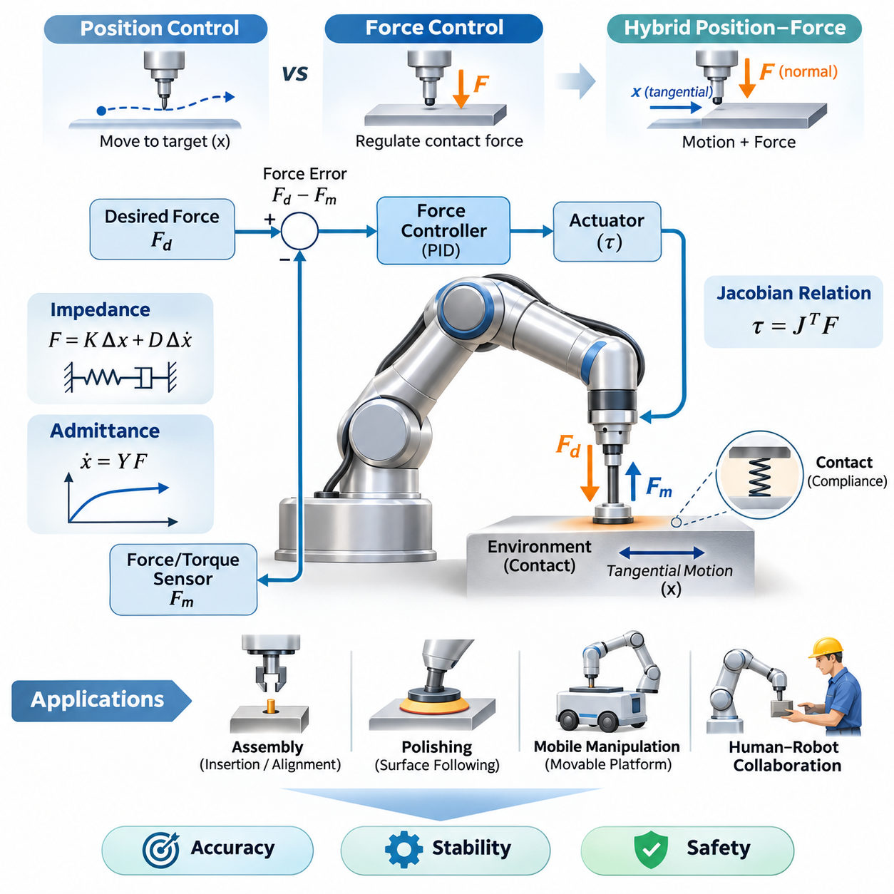
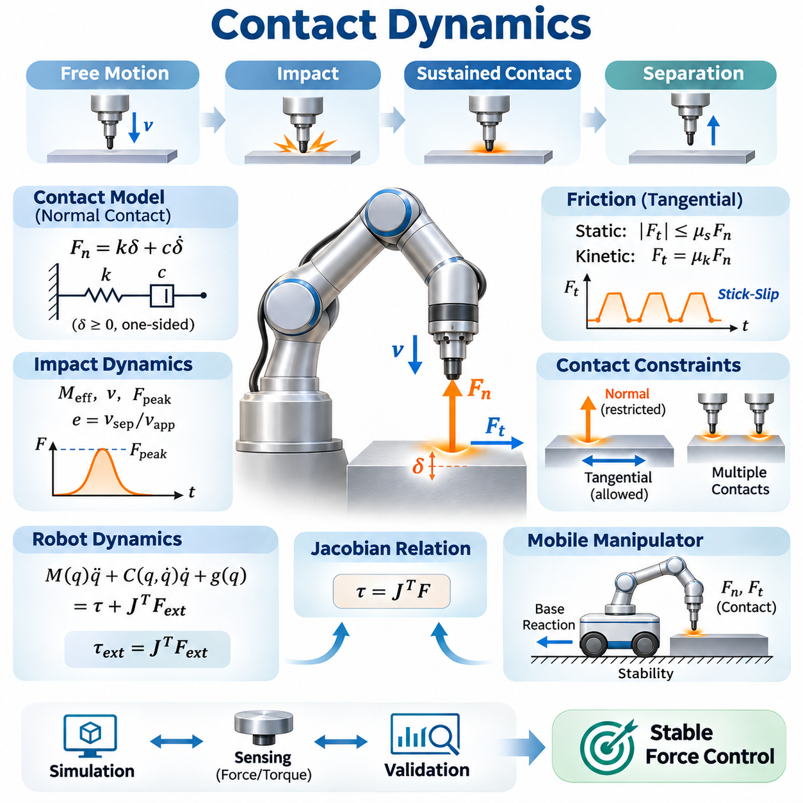
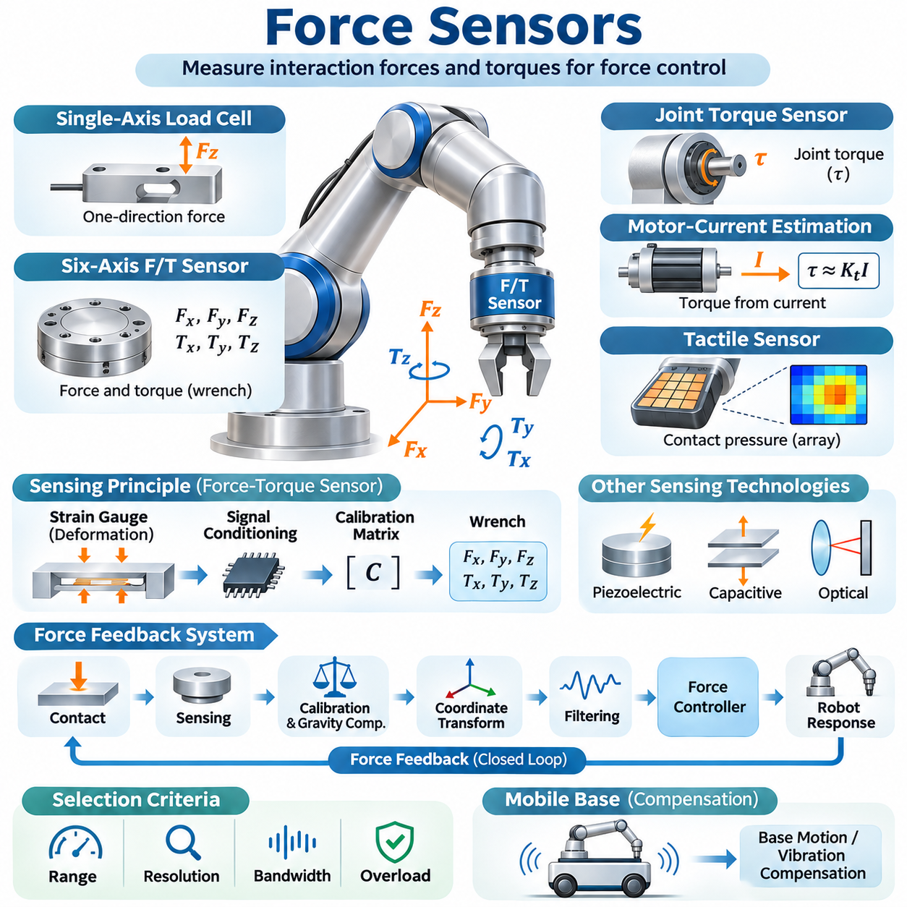
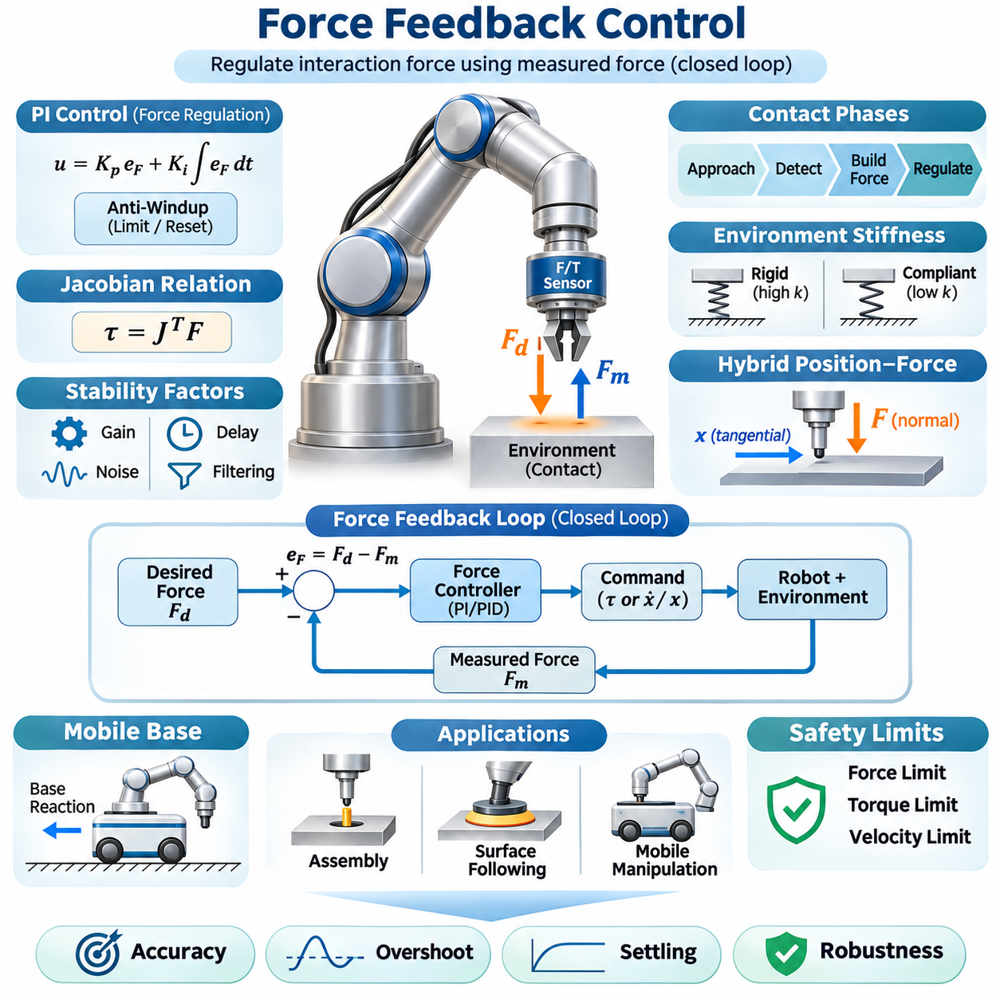
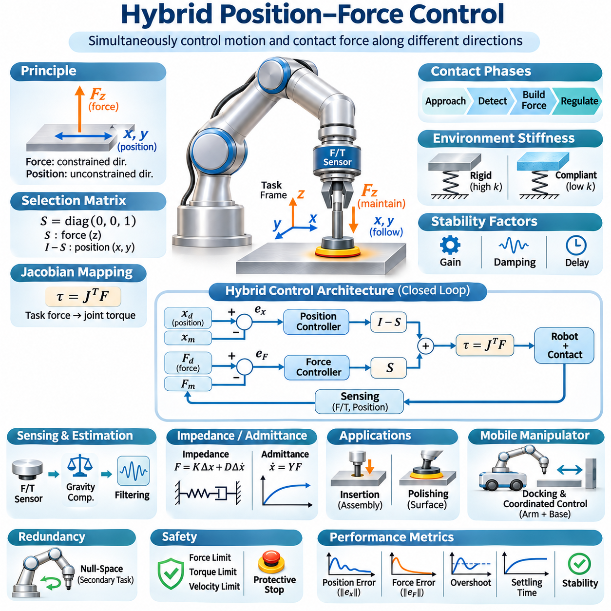
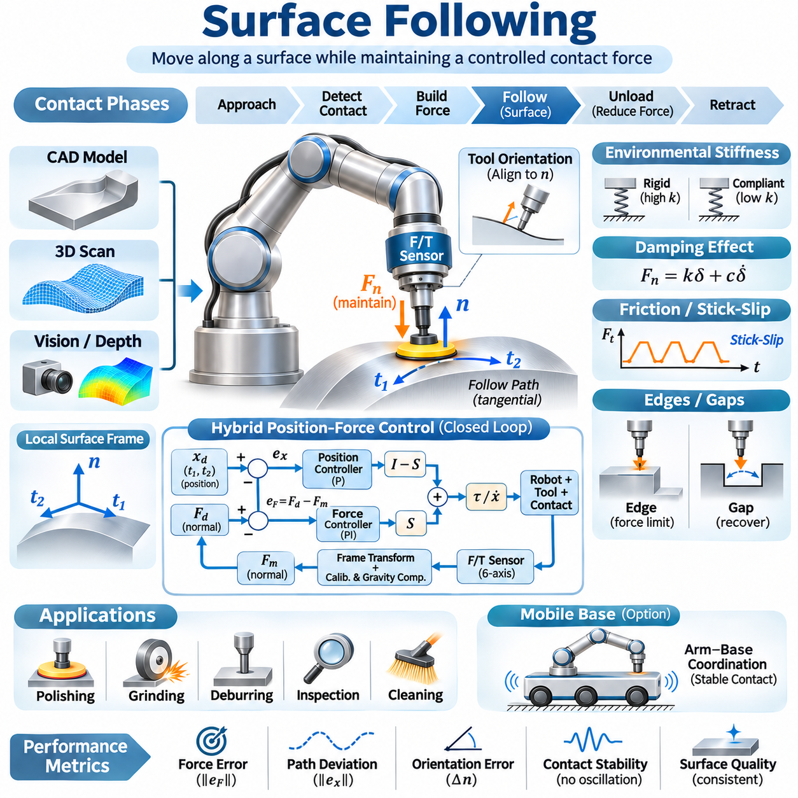
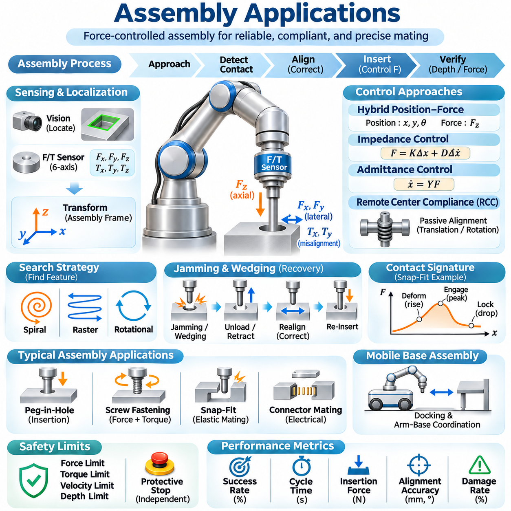
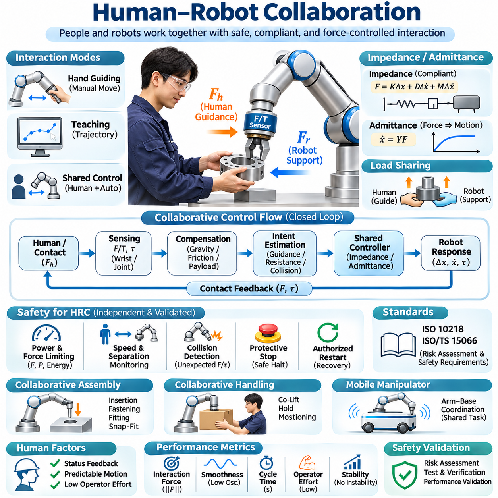
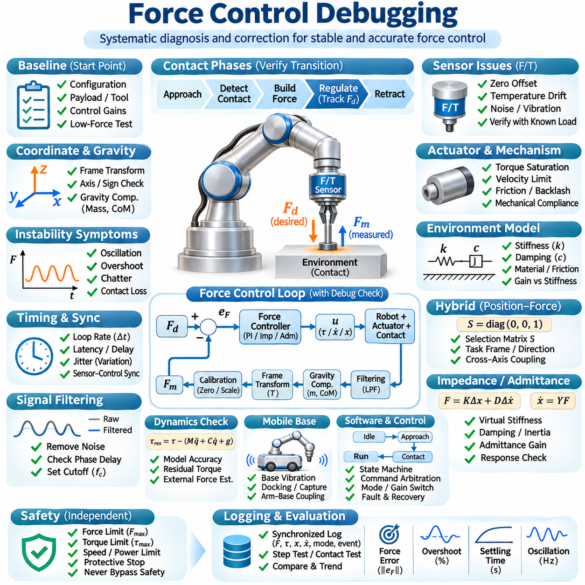

# Chapter 07. Force Control

## 01 Force Control Overview

{width="7.268055555555556in" height="7.268055555555556in"}

힘 제어(Force Control)는 로봇 조작(Robotic Manipulation)의 핵심 기능으로, 로봇이 물체, 표면 및 주변 환경과 물리적으로 상호작용하는 힘을 조절할 수 있도록 한다. 기존 위치 제어(Position Control)가 로봇의 이동 위치를 결정하는 데 중점을 두는 반면, 힘 제어는 로봇이 환경과 얼마나 강하게 상호작용하는지를 결정한다. 이러한 차이는 접촉 조건이 작업 정확도, 장비 신뢰성 및 운용 안전성에 영향을 미치는 상황에서 특히 중요하다.

기존 위치 제어 기반 매니퓰레이터(Position-Controlled Manipulator)는 관절 좌표(Joint Coordinates) 또는 직교 좌표계 자세(Cartesian Pose)를 기반으로 사전에 정의된 궤적(Trajectory)을 추종한다. 이러한 제어는 환경 제약이 예측 가능하고 물리적 접촉이 제한적인 자유 공간(Free Space)에서 효과적이다. 그러나 로봇이 강체 표면(Rigid Surface)에 접촉하면 작은 위치 오차만으로도 상당한 접촉력(Contact Force)이 발생할 수 있다. 힘 제어는 측정되거나 추정된 상호작용 힘에 따라 로봇의 동작을 조정함으로써 이러한 한계를 해결한다.

힘 제어의 핵심 목적은 환경의 형상(Geometry), 강성(Stiffness) 및 접촉 조건(Contact Conditions)이 변화하더라도 목표 상호작용 힘(Desired Interaction Force)을 유지하는 것이다. 제어기(Controller)는 목표 힘(Target Force)과 실제 힘(Actual Force)을 지속적으로 비교하고, 그 차이를 줄이기 위한 보정 명령(Corrective Command)을 생성한다. 이러한 보정은 로봇 구조와 선택된 제어 전략(Control Strategy)에 따라 관절 토크(Joint Torque), 직교 좌표계 운동(Cartesian Motion) 또는 구동기 동작(Actuator Behavior)에 영향을 미칠 수 있다.

힘 제어는 상호작용 힘이 매니퓰레이터의 기계적 동작에 직접적인 영향을 미치기 때문에 로봇 동역학(Robot Dynamics)과 밀접하게 관련된다. 관절 토크(Joint Torque), 링크 관성(Link Inertia), 중력 하중(Gravitational Loading), 마찰(Friction) 및 외부 교란(External Disturbance)은 로봇의 응답을 종합적으로 결정한다. 정확한 동역학 모델(Dynamic Model)은 명령된 구동기 작용과 환경 접촉으로 발생한 힘을 구분하고, 제어기가 내부 기계적 영향을 보상할 수 있도록 지원한다.

관절 토크(Joint Torque)와 직교 좌표계 힘(Cartesian Force)의 관계는 일반적으로 매니퓰레이터 자코비안(Manipulator Jacobian)을 통해 표현된다. 적절한 정적 또는 준정적 가정(Static or Quasistatic Assumptions)에서 엔드 이펙터 렌치(End-Effector Wrench)에 대응하는 외부 관절 토크는 τ = JᵀF로 표현되며, 여기서 J는 자코비안(Jacobian), F는 직교 좌표계 렌치(Cartesian Wrench)를 의미한다. 이러한 관계는 목표 접촉력을 관절 수준의 제어 명령으로 변환하기 위한 수학적 기반을 제공한다.

힘 제어 시스템(Force Control System)은 일반적으로 힘 센싱(Force Sensing), 구동기 피드백(Actuator Feedback) 또는 모델 기반 추정(Model-Based Estimation)을 활용하여 상호작용 조건을 파악한다. 6축 힘·토크 센서(Six-Axis Force-Torque Sensor)는 3차원 힘과 모멘트를 측정하며, 관절 토크 센서(Joint Torque Sensor)는 기계적 하중에 관한 정보를 제공한다. 모터 전류 측정(Motor Current Measurement)도 간접적인 힘 추정을 지원하지만, 전달계 마찰, 구동기 특성 및 모델링 불확실성으로 인해 정확도가 저하될 수 있다.

일반적인 힘 피드백 제어기(Force Feedback Controller)는 목표 접촉력(Desired Contact Force)과 측정된 접촉력(Measured Contact Force)의 차이를 계산한다. 이러한 힘 오차(Force Error)는 제어 법칙(Control Law)을 통해 처리되어 보정 운동 명령 또는 토크 명령을 생성한다. 비례(Proportional), 적분(Integral) 및 미분(Derivative) 제어 기법을 적용할 수 있지만, 제어기 설계에서는 폐루프 안정성(Closed-Loop Stability)에 영향을 미치는 센서 잡음(Sensor Noise), 접촉 강성(Contact Stiffness), 구동기 대역폭(Actuator Bandwidth) 및 지연(Delay)을 고려해야 한다.

접촉 동역학(Contact Dynamics)은 자유 공간 운동(Free-Space Motion)에서는 상대적으로 중요성이 낮은 여러 문제를 발생시킨다. 로봇이 물체에 접촉하면 탄성 변형(Elastic Deformation), 감쇠(Damping), 마찰(Friction) 및 기계적 구속 조건(Mechanical Constraints)의 급격한 변화가 발생할 수 있다. 단단한 표면은 빠른 힘 변화를 유발하는 반면, 유연한 재료는 변형에 따라 달라지는 특성을 나타낸다. 효과적인 힘 제어는 진동, 과도한 하중 및 불안정한 접촉을 방지하기 위해 이러한 차이를 고려해야 한다.

위치 제어(Position Control)와 힘 제어(Force Control)는 상호 배타적인 접근 방식이 아니다. 많은 로봇 조작 작업에서는 서로 다른 방향에 대해 운동과 상호작용 힘을 동시에 조절해야 한다. 예를 들어 표면 연마(Surface Polishing) 작업에서 로봇은 지정된 접선 방향 궤적(Tangential Trajectory)을 추종하면서 일정한 법선 방향 접촉력(Normal Contact Force)을 유지할 수 있다. 하이브리드 위치·힘 제어(Hybrid Position-Force Control)는 작업 제약 조건에 따라 이러한 목표를 조정하는 체계를 제공한다.

힘 제어는 임피던스 제어(Impedance Control)와 어드미턴스 제어(Admittance Control)의 기반을 제공하지만, 두 접근 방식은 상호작용 동작을 서로 다르게 조절한다. 임피던스 제어는 운동 편차(Motion Deviation)와 상호작용 힘(Interaction Force) 사이에 원하는 동적 관계를 설정한다. 어드미턴스 제어는 측정된 힘을 운동 명령으로 변환한다. 두 방식 모두 유연한 상호작용(Compliant Interaction)을 지원하지만, 직접 힘 제어(Direct Force Control)는 목표 접촉력의 추종에 더욱 명시적으로 초점을 맞춘다.

산업용 조립(Industrial Assembly)에서 힘 제어는 삽입(Insertion), 정렬(Alignment), 체결(Fastening) 및 결합(Mating) 작업의 신뢰성을 향상시킨다. 부품에는 치수 공차(Dimensional Tolerance), 위치 불확실성(Positioning Uncertainty) 및 미세한 형상 편차(Geometric Deviation)가 존재하는 경우가 많다. 위치 제어만 사용하는 제어기는 정렬되지 않은 부품을 강제로 결합하여 표면이나 기구를 손상시킬 수 있다. 힘 피드백(Force Feedback)은 로봇이 저항을 감지하고 움직임을 조정하며 허용 가능한 접촉 하중을 유지하도록 한다.

표면 추종(Surface Following) 작업은 힘 조절의 또 다른 중요한 장점을 보여준다. 연삭(Grinding), 연마(Polishing), 디버링(Deburring) 및 검사(Inspection) 공정에서는 불규칙한 작업물 표면에 일정한 압력을 유지해야 하는 경우가 많다. 힘 제어 매니퓰레이터(Force-Controlled Manipulator)는 목표 접촉 조건을 유지하면서 일정 범위의 형상 변화를 수용할 수 있다. 이러한 기능은 공정 일관성(Process Consistency)을 향상시키고 매우 정확한 형상 모델(Geometric Model)에 대한 의존도를 줄인다.

모바일 매니퓰레이터(Mobile Manipulator)에서는 로봇 팔(Robot Arm)이 이동 플랫폼(Mobile Platform) 위에서 동작하기 때문에 힘 제어가 더욱 복잡해진다. 베이스 위치 오차(Base Positioning Error), 구조적 유연성(Structural Compliance), 서스펜션 동작(Suspension Behavior) 및 플랫폼 진동(Platform Vibration)은 접촉력에 영향을 미칠 수 있다. 또한 조작 과정에서 발생하는 반력(Reaction Force)은 이동 베이스에도 영향을 줄 수 있다. 따라서 협조 제어(Coordinated Control)는 로봇 팔, 플랫폼, 탑재 하중 및 환경 사이의 기계적 상호작용을 고려해야 한다.

인간·로봇 협업(Human-Robot Collaboration)은 제어된 물리적 상호작용에 대한 추가적인 요구사항을 발생시킨다. 사람 가까이에서 동작하는 로봇은 잠재적으로 위험한 힘을 제한하고 예상하지 못한 접촉에 적절히 대응해야 한다. 힘 피드백(Force Feedback)은 접촉 감지(Contact Detection)와 반응형 동작(Responsive Behavior)을 지원할 수 있지만, 안전한 협업을 위해서는 적절한 기계 설계(Mechanical Design), 위험성 평가(Risk Assessment), 보호 기능(Protective Functions) 및 관련 안전 표준(Safety Standards)의 준수도 필요하다.

힘 제어의 성능은 힘 추종 정확도(Force Tracking Accuracy), 응답 시간(Response Time), 안정성(Stability) 및 외란 억제(Disturbance Rejection)를 포함한 여러 요소에 의해 결정된다. 센서 분해능(Sensor Resolution), 교정 품질(Calibration Quality), 제어기 샘플링 주파수(Controller Sampling Frequency), 구동기 특성(Actuator Characteristics) 및 기계적 강성(Mechanical Stiffness)은 모두 달성 가능한 성능에 영향을 미친다. 유연한 표면에서 우수하게 동작하는 제어기도 단단한 산업용 고정구와 접촉할 때는 다른 튜닝(Tuning)이 필요할 수 있다.

실제 구현에서는 센서 오프셋(Sensor Offset), 중력 보상(Gravity Compensation), 좌표 변환(Coordinate Transformation) 및 신호 필터링(Signal Filtering)을 신중하게 관리해야 한다. 손목 장착형 센서(Wrist-Mounted Sensor)에서 측정한 힘에는 부착된 공구의 무게와 관성 효과(Inertial Effects)가 포함될 수 있다. 실제 접촉력을 추정할 때는 이러한 요소를 고려해야 한다. 잘못된 보상(Incorrect Compensation)은 부정확한 피드백을 발생시키고 의도하지 않은 보정 운동(Corrective Motion)을 유발할 수 있다.

따라서 힘 제어(Force Control)는 불확실한 환경과 물리적으로 상호작용해야 하는 로봇을 위한 핵심 기반 기술(Enabling Technology)이다. 힘 제어는 로봇 조작을 기하학적 궤적 실행(Geometric Trajectory Execution)에서 제어된 기계적 상호작용(Controlled Mechanical Interaction)으로 확장한다. 동역학 모델링(Dynamic Modeling), 신뢰성 있는 센싱(Reliable Sensing), 피드백 조절(Feedback Regulation) 및 적절한 안전 메커니즘(Safety Mechanisms)을 결합하면 힘 제어 매니퓰레이터는 접촉 중심 작업(Contact-Intensive Operations)을 더욱 높은 적응성(Adaptability), 일관성(Consistency) 및 강건성(Robustness)으로 수행할 수 있다.

## 02 Contact Dynamics

{width="7.268055555555556in" height="7.268055555555556in"}

접촉 동역학(Contact Dynamics)은 로봇 매니퓰레이터(Robotic Manipulator)가 물체 또는 환경 표면과 상호작용할 때 발생하는 물리적 거동을 설명한다. 자유 공간 운동(Free-Space Motion)과 달리 접촉은 로봇의 움직임에 직접적인 영향을 미치는 기계적 구속 조건(Mechanical Constraints)과 상호작용 힘(Interaction Forces)을 발생시킨다. 이러한 영향을 이해하는 것은 안정적인 접촉을 유지하고, 가해지는 압력을 조절하며, 조작 작업 중 손상을 방지할 수 있는 힘 제어기(Force Controller)를 설계하는 데 필수적이다.

자유 공간 운동(Free-Space Motion)에서 물리적 접촉(Physical Contact)으로 전환되는 과정은 로봇 동역학(Robot Dynamics)의 근본적인 변화를 의미한다. 접촉 이전에는 매니퓰레이터가 구동기 명령(Actuator Commands)과 내부 기계적 특성에 따라 움직인다. 그러나 접촉이 발생하면 환경 반력(Environmental Reaction Forces)이 시스템의 거동을 변화시킨다. 이러한 힘은 상대 속도(Relative Velocity), 표면 형상(Surface Geometry), 재료 강성(Material Stiffness), 감쇠 특성(Damping Characteristics) 및 상호작용 방향에 따라 달라진다.

접촉 역학(Contact Mechanics)은 상호작용하는 물체 사이에서 힘이 발생하는 과정을 설명하기 위한 이론적 기반을 제공한다. 두 표면이 접촉하면 재료가 단단해 보이더라도 미시적 또는 거시적 변형(Microscopic or Macroscopic Deformation)이 발생할 수 있다. 이때 발생하는 접촉력(Contact Force)은 변형 크기(Deformation Magnitude)와 재료 특성(Material Properties)에 따라 결정된다. 이러한 관계를 정확하게 모델링하면 로봇 제어기가 기계적 응답을 예측하고 접촉 중 구동기 명령을 조정할 수 있다.

일반적으로 사용되는 근사 모델은 법선 방향 접촉(Normal Contact)을 스프링-댐퍼 모델(Spring-Damper Model)로 표현한다. 이 모델에서 접촉력은 F = kδ + cδ̇로 표현되며, k는 접촉 강성(Contact Stiffness), δ는 침투 또는 압축량(Penetration or Compression), c는 감쇠 계수(Damping Coefficient)를 의미한다. 이 모델은 일반적으로 압축 접촉이 활성화된 경우에만 적용되며, 단방향 접촉 조건(Unilateral Contact Conditions)에서는 법선 접촉력이 음수가 되지 않도록 제한해야 한다.

접촉 강성(Contact Stiffness)은 표면 변형에 따라 상호작용 힘이 얼마나 크게 변화하는지를 결정한다. 강성이 높은 재료(High-Stiffness Materials)는 작은 변위에서도 상당한 힘을 발생시키므로 정밀한 운동 제어(Precise Motion Control)와 빠른 피드백(Fast Feedback)이 특히 중요하다. 강성이 낮은 재료(Low-Stiffness Materials)는 비슷한 힘이 발생하기 전에 더 큰 변형을 허용한다. 제어기는 과도한 하중이나 불안정한 거동을 방지하기 위해 이러한 차이를 수용해야 한다.

감쇠(Damping)는 접촉 중 상대 운동(Relative Motion)과 관련된 에너지 소산(Energy Dissipation)을 설명한다. 감쇠는 진동(Vibration)이 얼마나 빠르게 감소하는지와 로봇이 상호작용 힘의 급격한 변화에 어떻게 반응하는지에 영향을 미친다. 감쇠가 부족하면 진동과 반복적인 충격(Repeated Impacts)이 발생할 수 있으며, 감쇠가 지나치게 크면 응답성(Responsiveness)이 저하될 수 있다. 적절한 감쇠 특성은 연속 접촉(Continuous Contact) 중 안정적인 힘 조절을 유지하는 데 도움이 된다.

충격 동역학(Impact Dynamics)은 움직이는 매니퓰레이터가 물체에 처음 접촉할 때 중요해진다. 충돌 순간에는 짧은 시간 동안 운동량(Momentum)이 변화하면서 큰 과도 힘(Transient Forces)이 발생할 수 있다. 충격의 심각도는 유효 질량(Effective Mass), 접근 속도(Approach Velocity), 재료 유연성(Material Compliance) 및 에너지 소산(Energy Dissipation)에 따라 달라진다. 접근 속도를 낮추고 유연한 요소(Compliant Elements)를 도입하면 최대 접촉력을 제한하고 기계적 안전성을 향상시킬 수 있다.

반발 계수(Coefficient of Restitution)는 단순화된 충돌 가정에서 충격 이후 상대 분리 속도(Relative Separation Velocity)를 충돌 이전 접근 속도(Approach Velocity)와 비교하여 나타낸다. 반발 계수가 0에 가까우면 비탄성 충돌(Highly Inelastic Collision)을 의미하며, 1에 가까우면 거의 탄성적인 거동(Approximately Elastic Behavior)을 나타낸다. 이 계수는 기본적인 충격 해석(Impact Analysis)에 유용하지만, 변형, 마찰 및 여러 접촉 표면이 포함된 복잡한 접촉 현상을 단독으로 설명할 수는 없다.

법선 접촉력(Normal Contact Force)과 접선 접촉력(Tangential Contact Force)은 물리적 상호작용의 서로 다른 성분을 나타낸다. 법선력(Normal Force)은 접촉 표면에 수직으로 작용하며 주로 압축 또는 분리 거동을 결정한다. 접선력(Tangential Force)은 표면을 따라 작용하며 마찰(Friction), 미끄러짐(Sliding) 및 횡방향 운동 저항(Lateral Movement Resistance)과 관련된다. 힘 제어 전략(Force Control Strategy)은 작업 요구사항에 따라 이러한 성분을 독립적으로 조절하는 경우가 많다.

마찰(Friction)은 접촉 모델링과 제어를 복잡하게 만드는 비선형 거동(Nonlinear Behavior)을 발생시킨다. 정지 마찰(Static Friction)은 미끄러짐이 시작되는 것을 방해하며, 운동 마찰(Kinetic Friction)은 미끄러짐이 시작된 이후의 운동에 영향을 미친다. 쿨롱 마찰 모델(Coulomb Friction Model)은 법선력과 마찰 계수(Friction Coefficient)를 이용하여 접선 방향 저항을 근사한다. 그러나 실제 접촉에서는 속도 의존성(Velocity Dependence), 스틱-슬립 전이(Stick-Slip Transitions), 표면 마모(Surface Wear) 및 윤활 조건(Lubrication Conditions)의 변화가 나타날 수 있다.

스틱-슬립 거동(Stick-Slip Behavior)은 접촉 표면이 정지 상태(Sticking)와 미끄러짐 상태(Sliding)를 반복적으로 전환할 때 발생한다. 이러한 현상은 진동(Vibration), 불규칙한 운동(Irregular Motion) 및 측정된 접촉력의 변동을 유발할 수 있다. 특히 연마(Polishing), 삽입(Insertion) 및 표면 추종(Surface Following) 작업에서 중요하다. 효과적인 제어기는 속도 조절(Velocity Regulation), 감쇠(Damping), 마찰 보상(Friction Compensation) 및 적절한 궤적 계획(Trajectory Planning)을 활용하여 바람직하지 않은 스틱-슬립 현상을 줄일 수 있다.

매니퓰레이터 자코비안(Manipulator Jacobian)은 직교 좌표계 접촉력(Cartesian Contact Forces)과 이에 대응하는 관절 토크(Joint Torques) 사이의 관계를 제공한다. 엔드 이펙터(End Effector)에 외부 렌치(External Wrench) F가 작용할 때, 이에 대응하는 관절 토크 성분은 τ = JᵀF로 표현된다. 이러한 관계를 통해 상호작용 힘을 관절 공간 동역학 방정식(Joint-Space Dynamic Equations)에 반영할 수 있으며, 모델 기반 보상(Model-Based Compensation), 접촉 추정(Contact Estimation) 및 힘 조절(Force Regulation)을 지원한다.

일반적인 매니퓰레이터 동역학 모델(Manipulator Dynamic Model)은 M(q)q̈ + C(q,q̇)q̇ + g(q) = τ + JᵀFext로 표현할 수 있다. 여기서 M은 관성(Inertia), C는 속도 의존 효과(Velocity-Dependent Effects), g는 중력(Gravity), Fext는 외부에서 가해지는 렌치(Externally Applied Wrench)를 의미한다. 이 방정식은 환경 접촉(Environmental Contact)이 관절 가속도(Joint Acceleration)와 구동기 요구사항(Actuator Requirements)을 어떻게 변화시키는지 보여준다. 일관된 힘 방향(Force Directions)과 좌표계 규약(Coordinate Conventions)을 적용하는 것이 필수적이다.

접촉 구속 조건(Contact Constraints)은 로봇과 환경 사이의 기하학적 관계(Geometric Relationships)를 통해 수학적으로 표현할 수 있다. 강체 접촉(Rigid Contact) 중에는 구속된 법선 방향(Constrained Normal Direction)의 운동이 제한될 수 있지만, 접선 방향 운동(Tangential Movement)은 허용될 수 있다. 이러한 구속 조건은 매니퓰레이터의 허용 속도(Allowable Velocities)와 가속도(Accelerations)에 영향을 미친다. 구속 조건 기반 정식화(Constraint-Based Formulations)는 특히 하이브리드 위치·힘 제어(Hybrid Position-Force Control)에 유용하다.

단방향 접촉(Unilateral Contact)은 일반적인 표면이 압축 법선력(Compressive Normal Force)은 전달할 수 있지만, 접착(Adhesion)이나 기계적 결합(Mechanical Attachment)이 없으면 물체를 서로 끌어당길 수 없다는 것을 의미한다. 따라서 접촉 모델(Contact Model)은 분리(Separation)와 압축(Compression)을 구분해야 한다. 상보성 조건(Complementarity Conditions)은 양의 분리 간격과 압축 접촉력이 동시에 존재하지 않도록 이러한 거동을 표현할 수 있으며, 강체 접촉 시뮬레이션(Rigid-Body Contact Simulation)의 중요한 기반을 형성한다.

다중 동시 접촉(Multiple Simultaneous Contacts)은 접촉력이 기하학적 구속 조건(Geometric Constraints), 마찰 한계(Friction Limits) 및 기계적 평형 조건(Mechanical Equilibrium Conditions)을 만족해야 하므로 추가적인 복잡성을 발생시킨다. 파지(Grasping) 또는 조립(Assembly) 과정에서는 여러 접촉점(Contact Points)이 외부 하중(External Loads)을 분담할 수 있다. 이때 힘 분포(Force Distribution)는 접촉 위치(Contact Locations), 표면 특성(Surface Properties) 및 물체 형상(Object Geometry)에 따라 달라진다. 접촉력을 적절하게 관리하지 못하면 미끄러짐(Slipping), 끼임(Jamming) 또는 과도한 내부 하중(Excessive Internal Loading)이 발생할 수 있다.

모바일 매니퓰레이션(Mobile Manipulation)에서는 접촉 동역학(Contact Dynamics)에 로봇 팔(Robotic Arm)과 이동 베이스(Mobile Base) 사이의 상호작용도 포함된다. 엔드 이펙터(End Effector)에 가해지는 힘은 반력(Reaction Forces)과 모멘트(Moments)를 발생시키며, 이는 플랫폼 안정성(Platform Stability), 바퀴 하중(Wheel Loading) 및 구조적 진동(Structural Vibration)에 영향을 미칠 수 있다. 따라서 모바일 매니퓰레이터(Mobile Manipulator)는 접촉 중심 작업(Contact-Intensive Operations) 중 베이스 유연성(Base Compliance), 지지 형상(Support Geometry) 및 발생 가능한 움직임을 고려해야 한다.

접촉 동역학 모델(Contact Dynamics Model)은 시뮬레이션(Simulation), 제어기 개발(Controller Development) 및 실험적 검증(Experimental Validation)에 필수적이다. 시뮬레이션 환경(Simulation Environment)은 수치 해석 기법(Numerical Methods)을 사용하여 충돌 감지(Collision Detection), 침투 구속 조건(Penetration Constraints), 마찰(Friction) 및 충격 응답(Impact Responses)을 근사한다. 그러나 재료 특성과 마찰 매개변수(Friction Parameters)에 불확실성이 존재하기 때문에 시뮬레이션된 접촉 거동은 실제 물리 시스템과 다를 수 있다. 따라서 접촉 모델의 검증에는 실험적 측정(Experimental Measurements)이 여전히 필요하다.

신뢰성 있는 접촉 제어(Reliable Contact Control)는 궁극적으로 기계적 구속 조건(Mechanical Constraints), 변형(Deformation), 충격(Impact) 및 마찰(Friction)이 로봇 동역학(Robot Dynamics)과 어떻게 상호작용하는지를 이해하는 데 달려 있다. 정확한 접촉 모델(Contact Model)은 힘 예측(Force Prediction), 제어기 튜닝(Controller Tuning) 및 외란 보상(Disturbance Compensation)을 향상시킨다. 이론적 모델링(Theoretical Modeling)을 센서 피드백(Sensor Feedback) 및 실험적 검증(Experimental Validation)과 결합하면 로봇 매니퓰레이터는 조립, 표면 가공 및 물리적 상호작용 작업을 더욱 높은 안정성(Stability)과 신뢰성(Reliability)으로 수행할 수 있다.

## 03 Force Sensors

{width="7.268055555555556in" height="7.268055555555556in"}

힘 센서(Force Sensors)는 로봇과 환경 사이의 물리적 상호작용(Physical Interaction)에 관한 정보를 제공하기 때문에 로봇 조작 시스템(Robotic Manipulation Systems)의 필수 구성 요소이다. 위치 엔코더(Position Encoder)가 관절 변위(Joint Displacement)를 측정하고 운동 센서(Motion Sensor)가 속도 또는 가속도를 추정하는 반면, 힘 센서는 접촉 중 발생하는 기계적 하중(Mechanical Loads)을 감지한다. 이러한 측정값을 통해 매니퓰레이터(Manipulator)는 상호작용 힘을 조절하고, 예상하지 못한 저항을 인식하며, 접촉에 민감한 작업(Contact-Sensitive Operations)을 더욱 높은 정확도로 수행할 수 있다.

힘 센싱(Force Sensing)은 로봇 작업에 불확실한 물체 형상(Uncertain Object Geometry), 가변적인 재료 특성(Variable Material Properties) 또는 변화하는 환경 조건(Changing Environmental Conditions)이 포함될 때 특히 중요하다. 위치 제어 로봇(Position-Controlled Robot)은 예상하지 못한 저항을 만나더라도 계속 움직여 작업물(Workpiece)이나 엔드 이펙터(End Effector)를 손상시킬 수 있다. 힘 측정(Force Measurement)은 제어기가 접촉을 감지하고 운동 명령을 조정하며 원하는 상호작용 조건을 유지할 수 있도록 추가적인 피드백 채널(Feedback Channel)을 제공한다.

로봇 힘 센서(Robotic Force Sensors)는 측정하는 물리량(Physical Quantities)과 적용하는 센싱 원리(Sensing Principles)에 따라 분류할 수 있다. 일반적인 유형에는 단축 로드셀(Single-Axis Load Cell), 다축 힘·토크 센서(Multi-Axis Force-Torque Sensor), 관절 토크 센서(Joint Torque Sensor) 및 촉각 센싱 장치(Tactile Sensing Device)가 포함된다. 일부 로봇 시스템은 모터 전류(Motor Current) 또는 동역학 모델(Dynamic Model)을 이용하여 외력을 간접적으로 추정하기도 한다. 각 방식은 측정 능력, 설치 요구사항, 정확도 특성 및 운용상의 한계가 서로 다르다.

단축 힘 센서(Single-Axis Force Sensor)는 지정된 하나의 방향을 따라 작용하는 기계적 하중(Mechanical Loading)을 측정한다. 이러한 센서는 주요 힘의 방향이 알려진 가압(Pressing), 파지(Gripping), 계량(Weighing) 및 선형 삽입(Linear Insertion) 작업에 일반적으로 사용된다. 비교적 단순한 기계적 구조(Mechanical Structure)를 통해 높은 감도(Sensitivity)와 간단한 교정(Calibration)이 가능하다. 그러나 여러 축을 따라 작용하는 힘이나 복잡한 접촉 조건에서 발생하는 모멘트(Moments)를 독립적으로 측정할 수는 없다.

6축 힘·토크 센서(Six-Axis Force-Torque Sensor)는 서로 직교하는 세 방향의 힘 성분(Force Components)과 이에 대응하는 세 방향의 토크 성분(Torque Components)을 측정하기 때문에 고급 로봇 조작(Advanced Robotic Manipulation)에 널리 사용된다. 이러한 측정값은 일반적으로 Fx, Fy, Fz, Tx, Ty, Tz로 표현된다. 결합된 측정값은 지정된 기준 좌표계(Reference Frame)에서의 기계적 하중을 나타내는 렌치(Wrench)라고 한다. 이러한 센서는 일반적으로 로봇 손목(Robot Wrist)과 엔드 이펙터(End Effector) 사이에 설치된다.

많은 산업용 힘·토크 센서(Industrial Force-Torque Sensors)의 동작 원리는 기계적 센싱 구조(Mechanical Sensing Structure)의 탄성 변형(Elastic Deformation)을 기반으로 한다. 외력이 가해지면 정밀하게 설계된 금속 요소(Metal Elements)에 미세한 변형률(Strain)이 발생하며, 스트레인 게이지(Strain Gauge)는 이러한 변형을 전기 신호(Electrical Signals)로 변환한다. 신호 조절 회로(Signal Conditioning Circuits)는 측정 신호를 증폭하고 처리한다. 이후 교정 행렬(Calibration Matrix)은 센서 출력을 각 측정 축의 힘과 모멘트 추정값으로 변환한다.

스트레인 게이지 기술(Strain Gauge Technology)은 신뢰성 있는 측정값을 제공하며 산업용 로봇 응용 분야(Industrial Robotic Applications)에서 널리 사용된다. 성능은 기계 설계(Mechanical Design), 게이지 배치(Gauge Placement), 온도 보상(Temperature Compensation) 및 전자 신호 품질(Electronic Signal Quality)에 따라 달라진다. 스트레인 게이지는 우수한 감도를 제공할 수 있지만, 출력은 열적 드리프트(Thermal Drift), 전기적 잡음(Electrical Noise) 및 기계적 히스테리시스(Mechanical Hysteresis)의 영향을 받을 수 있다. 따라서 측정 정확도를 유지하려면 적절한 교정과 환경 보상(Environmental Compensation)이 중요하다.

다른 센싱 기술(Sensing Technologies)에는 압전 방식(Piezoelectric), 정전용량 방식(Capacitive), 광학 방식(Optical) 및 광섬유 방식(Fiber-Optic)이 포함된다. 압전 센서(Piezoelectric Sensor)는 동적 힘 측정(Dynamic Force Measurement)에 특히 적합하지만, 지속적인 정적 하중(Static Loading)을 측정하려면 일반적으로 별도의 구성이 필요하다. 정전용량 센서(Capacitive Sensor)는 변형으로 인해 발생하는 전기 정전용량(Electrical Capacitance)의 변화를 감지한다. 광학 센싱 방식(Optical Sensing Methods)은 전기적 절연(Electrical Isolation)과 전자기 간섭(Electromagnetic Interference)에 대한 내성을 제공할 수 있지만, 통합 요구사항은 방식에 따라 달라진다.

관절 토크 센서(Joint Torque Sensor)는 직교 좌표계 접촉력(Cartesian Contact Forces)을 직접 측정하는 대신 개별 로봇 관절을 통해 전달되는 토크(Torque)를 측정한다. 이러한 센서는 구동기(Actuator), 동력 전달 부품(Transmission Components) 또는 유연한 기계적 구조(Compliant Mechanical Structures)에 통합될 수 있다. 관절 토크 측정(Joint Torque Measurement)은 토크 제어(Torque Control), 중력 보상(Gravity Compensation), 충돌 감지(Collision Detection) 및 외력 추정(External Force Estimation)을 지원한다. 그 효과는 센서 설치 위치, 동력 전달 특성 및 로봇 동역학 모델의 정확도에 따라 달라진다.

모터 전류 센싱(Motor Current Sensing)은 구동기 토크(Actuator Torque)와 외부 기계적 하중(External Mechanical Loading)을 추정하는 또 다른 방법이다. 많은 전기 모터(Electric Motors)에서는 적절한 운전 조건에서 발생 토크(Generated Torque)가 전류에 거의 비례한다. 그러나 전류 기반 추정(Current-Based Estimation)에는 기어박스 마찰(Gearbox Friction), 모터 매개변수 변화(Motor Parameter Variations), 전달 효율(Transmission Efficiency) 및 가속도 효과(Acceleration Effects)로 인한 불확실성이 포함된다. 따라서 일반적으로 전용 힘 또는 토크 센싱보다 간접적인 측정 방식이다.

촉각 센서(Tactile Sensor)는 로봇 손가락(Robotic Finger), 그리퍼(Gripper) 또는 인공 피부(Artificial Skin) 전반의 국소 접촉 조건(Localized Contact Conditions)을 측정한다. 손목 장착형 힘·토크 센서(Wrist-Mounted Force-Torque Sensor)와 달리 촉각 센싱 배열(Tactile Sensing Array)은 공간적 압력 분포(Spatial Pressure Distribution)와 접촉 위치(Contact Location)를 파악할 수 있다. 이러한 측정값은 파지 안정화(Grasp Stabilization), 미끄러짐 감지(Slip Detection), 물체 취급(Object Handling) 및 깨지기 쉬운 재료의 조작을 지원한다. 고급 촉각 시스템(Advanced Tactile Systems)은 압력, 전단력(Shear Force), 진동 및 변형 측정을 결합할 수 있다.

센서 선정(Sensor Selection)에서는 측정 범위(Measurement Range), 분해능(Resolution), 정확도(Accuracy), 감도(Sensitivity) 및 과부하 허용 능력(Overload Capacity)을 신중하게 고려해야 한다. 큰 산업용 힘을 측정하도록 설계된 센서는 정밀 조립(Delicate Assembly)에 필요한 충분한 분해능을 제공하지 못할 수 있다. 반대로 감도가 매우 높은 센서는 예상하지 못한 충격이나 과도한 하중으로 손상될 수 있다. 엔지니어는 예상 접촉력, 환경 교란(Environmental Disturbances) 및 기계적 안전 요구사항(Mechanical Safety Requirements)을 고려하여 측정 성능의 균형을 맞춰야 한다.

측정 대역폭(Measurement Bandwidth)은 센서가 변화하는 힘에 얼마나 빠르게 반응할 수 있는지를 결정한다. 높은 대역폭의 센싱(High-Bandwidth Sensing)은 충격(Impact), 진동(Vibration) 및 빠른 접촉 전이(Rapid Contact Transitions)를 감지하는 데 유용하다. 그러나 실제 사용 가능한 대역폭은 센싱 구조(Sensing Structure), 전자 회로(Electronics), 필터링(Filtering), 통신 지연(Communication Delays) 및 제어기 샘플링 주파수(Controller Sampling Frequency)에 따라 달라진다. 적절한 잡음 관리(Noise Management) 없이 대역폭만 증가시키면 불안정하거나 지나치게 민감한 피드백 동작이 발생할 수 있다.

교정(Calibration)은 원시 센서 신호(Raw Sensor Signals)와 물리적 힘 측정값(Physical Force Measurements) 사이의 관계를 설정한다. 다축 센서(Multi-Axis Sensor)는 축 간 결합(Cross-Axis Coupling), 스케일 계수(Scale Factors), 오프셋(Offsets) 및 기계적 정렬(Mechanical Alignment)을 고려하는 교정 절차가 필요하다. 교정 행렬(Calibration Matrix)은 측정된 전기적 응답을 힘과 토크 성분으로 변환한다. 기계적 하중, 온도 변화, 노화(Aging) 및 설치 조건이 센서 특성에 영향을 미칠 수 있으므로 주기적인 검증(Periodic Verification)이 필요하다.

좌표 변환(Coordinate Transformations)은 힘 측정값을 로봇 베이스 좌표계(Robot Base Frame), 공구 좌표계(Tool Frame) 또는 세계 좌표계(World Frame)에서 해석해야 할 때 필수적이다. 손목 장착형 센서(Wrist-Mounted Sensor)는 매니퓰레이터가 움직이면서 방향이 변하는 자체 기준 좌표계(Reference Frame)를 기준으로 힘을 보고한다. 따라서 힘과 토크의 변환은 회전(Rotation)과 기준점 변위(Reference-Point Displacement)를 고려해야 한다. 잘못된 좌표 변환은 부정확한 접촉 추정(Contact Estimates)과 부적절한 제어기 응답(Controller Responses)을 발생시킬 수 있다.

중력 보상(Gravity Compensation)은 힘·토크 센서(Force-Torque Sensor)가 무거운 엔드 이펙터(End Effector) 또는 부착된 탑재 하중(Attached Payload)을 지지할 때 특히 중요하다. 측정된 렌치(Measured Wrench)에는 외부 접촉력(External Contact Forces)뿐 아니라 중력 하중(Gravitational Loading)도 포함된다. 로봇의 방향이 변화하면 센서 좌표계(Sensor Coordinates)에서 표현되는 중력 성분도 변화한다. 정확한 보상을 위해서는 공구 질량(Tool Mass), 무게중심(Center of Gravity), 센서 방향(Sensor Orientation) 및 관련 관성 특성(Inertial Properties)에 대한 정보가 필요하다.

힘 센서 신호(Force Sensor Signals)는 전기적 간섭(Electrical Interference), 구조적 진동(Structural Vibration) 및 측정 잡음(Measurement Noise)을 억제하기 위해 필터링(Filtering)이 필요한 경우가 많다. 저역통과 필터(Low-Pass Filter)는 신호 안정성을 향상시킬 수 있지만, 과도한 필터링은 지연(Delay)을 발생시켜 제어 응답성(Control Responsiveness)을 저하시킨다. 엔지니어는 접촉 동역학(Contact Dynamics)과 제어 대역폭(Control Bandwidth)에 따라 필터링 매개변수(Filtering Parameters)를 선정해야 한다. 신호 처리(Signal Processing)는 중요한 과도 응답 정보(Transient Information)를 보존하면서 잡음으로 인한 불필요한 구동기 명령을 방지해야 한다.

모바일 매니퓰레이터(Mobile Manipulator)에서는 힘 센싱(Force Sensing)이 플랫폼 움직임(Platform Movement), 구조적 유연성(Structural Compliance) 및 이동 베이스(Mobile Base)에서 발생하는 진동도 고려해야 한다. 가속도(Acceleration)와 진동(Oscillation)은 엔드 이펙터(End Effector)가 외부 물체와 접촉하지 않는 상황에서도 측정된 힘에 영향을 미칠 수 있다. 신뢰성 있는 측정값 해석을 위해서는 관절 엔코더(Joint Encoder), 관성 센서(Inertial Sensor) 및 플랫폼 운동 추정값(Platform Motion Estimates)과의 동기화(Synchronization)가 필요할 수 있다. 이러한 통합은 모바일 조작(Mobile Manipulation) 중 더욱 정확한 힘 조절을 지원한다.

힘 센서(Force Sensors)는 궁극적으로 물리적 상호작용(Physical Interaction)과 지능형 로봇 제어(Intelligent Robotic Control)를 연결한다. 센서 측정값은 접촉 감지(Contact Detection), 힘 피드백(Force Feedback), 유연한 조작(Compliant Manipulation), 조립 상태 모니터링(Assembly Monitoring) 및 안전 관련 진단(Safety-Related Diagnostics)을 가능하게 한다. 성공적인 구현을 위해서는 적절한 센서 기술(Sensor Technology), 기계적 통합(Mechanical Integration), 교정(Calibration), 보상(Compensation) 및 실시간 신호 처리(Real-Time Signal Processing)가 필요하다. 이러한 기능을 결합하면 로봇 매니퓰레이터는 불확실한 환경과 더욱 정밀하고 신뢰성 있게 상호작용할 수 있다.

## 04 Force Feedback Control

{width="7.268055555555556in" height="7.268055555555556in"}

힘 피드백 제어(Force Feedback Control)는 접촉력을 지속적으로 측정하고 구동기 명령(Actuator Commands)을 조정하여 물리적 상호작용(Physical Interaction)을 조절하는 로봇 조작(Robotic Manipulation)의 핵심 기술이다. 개루프 힘 제어(Open-Loop Force Application)와 달리 피드백 제어(Feedback Control)는 목표 힘과 실제 힘 사이의 차이에 반응한다. 이러한 기능을 통해 매니퓰레이터(Manipulator)는 형상(Geometry), 강성(Stiffness), 마찰(Friction) 및 환경 조건(Environmental Conditions)이 변화하더라도 물체와 표면에 대한 제어된 접촉(Controlled Contact)을 유지할 수 있다.

힘 피드백 제어(Force Feedback Control)의 주요 목적은 안정적인 상호작용(Stable Interaction)을 유지하면서 힘 추종 오차(Force Tracking Error)를 최소화하는 것이다. 제어기(Controller)는 목표 힘 기준값(Desired Force Reference)을 센서로 측정하거나 로봇 동역학(Robot Dynamics)을 통해 추정한 힘과 비교한다. 이때 발생하는 오차는 관절 토크(Joint Torque) 또는 엔드 이펙터 운동(End-Effector Motion)을 수정하는 보정 동작(Corrective Actions)을 결정한다. 효과적인 힘 조절을 위해서는 정확한 센싱(Accurate Sensing), 적절한 제어 이득(Control Gains) 및 충분한 구동기 응답성(Actuator Responsiveness)이 필요하다.

기본적인 힘 피드백 루프(Force Feedback Loop)는 기준 힘(Reference Force), 힘 측정 메커니즘(Force Measurement Mechanism), 제어기(Controller), 그리고 환경과 상호작용하는 로봇 제어 대상(Robotic Plant)으로 구성된다. 기준값은 의도한 접촉력을 정의하고, 센서는 실제 상호작용 상태를 측정한다. 제어기는 이 차이를 처리하여 명령을 생성한다. 이러한 폐루프 구조(Closed-Loop Structure)는 외란(Disturbances)과 목표 접촉 조건에서 발생하는 편차(Deviations)를 지속적으로 보상한다.

힘 추종 오차(Force Tracking Error)는 일반적으로 eF = Fd − Fm으로 표현하며, 여기서 Fd는 목표 힘(Desired Force), Fm은 측정된 힘(Measured Force)을 의미한다. 비례 제어기(Proportional Controller)는 오차에 비례하는 보정값을 생성하며, 적분 동작(Integral Action)은 지속적인 편차를 보상한다. 미분 동작(Derivative Action)은 적절하게 필터링할 경우 과도 응답(Transient Behavior)을 개선할 수 있다. 강성이 높은 표면(Stiff Surface)과 접촉할 때 과도한 보정은 시스템을 불안정하게 만들 수 있으므로 제어 이득을 신중하게 선정해야 한다.

비례·적분 제어(Proportional-Integral Control)는 즉각적인 보정과 정상 상태 오차 감소(Steady-State Error Reduction)를 결합하기 때문에 힘 조절(Force Regulation)에 자주 적용된다. 비례 항(Proportional Term)은 현재의 힘 차이에 반응하고, 적분 항(Integral Term)은 지속적인 오차를 누적한다. 그러나 적분 이득(Integral Gain)이 지나치게 크면 특히 접촉 전이(Contact Transitions) 과정에서 오버슈트(Overshoot)와 진동(Oscillation)이 발생할 수 있다. 적분 포화 방지(Anti-Windup) 메커니즘과 출력 제한(Output Limits)은 과도한 구동기 명령을 방지하는 데 도움이 된다.

힘 피드백(Force Feedback)은 다양한 구동기 명령 인터페이스(Actuator Command Interfaces)를 통해 구현할 수 있다. 토크 제어 매니퓰레이터(Torque-Controlled Manipulator)에서는 자코비안 전치(Jacobian Transpose)를 이용하여 목표 직교 좌표계 힘(Desired Cartesian Forces)을 관절 토크(Joint Torques)로 변환할 수 있다. 위치 제어 시스템(Position-Controlled Systems)에서는 힘 오차가 작은 위치 또는 속도 보정값을 생성할 수 있다. 선택되는 방식은 구동기 성능(Actuator Capabilities), 동력 전달 특성(Transmission Characteristics), 제어 대역폭(Control Bandwidth) 및 로봇 제조업체가 지원하는 인터페이스에 따라 달라진다.

직교 좌표계 힘(Cartesian Force)과 관절 토크(Joint Torque)의 관계는 일반적으로 τ = JᵀF로 표현하며, 여기서 J는 매니퓰레이터 자코비안(Manipulator Jacobian), F는 직교 좌표계 렌치(Cartesian Wrench)를 의미한다. 이러한 변환을 통해 힘 명령이 관절 수준의 구동(Joint-Level Actuation)에 영향을 미칠 수 있다. 그러나 정확한 힘 제어를 위해서는 중력(Gravity), 마찰(Friction), 관성(Inertia) 및 외부 교란(External Disturbances)도 고려해야 한다. 동적 효과가 중요해지는 상황에서는 모델 기반 보상(Model-Based Compensation)을 통해 추종 성능(Tracking Performance)을 개선할 수 있다.

환경 강성(Environmental Stiffness)은 표면 변형(Surface Deformation)에 따라 접촉력이 변화하기 때문에 힘 피드백 동작에 큰 영향을 미친다. 강체 환경(Rigid Environment)에서는 매우 작은 움직임만으로도 큰 힘 변화가 발생할 수 있지만, 유연한 표면(Compliant Surface)은 더 큰 변위를 허용한다. 부드러운 재료에 맞춰 튜닝된 제어기는 단단한 고정구(Rigid Fixtures)와 접촉할 때 불안정해질 수 있다. 적응형 이득 선택(Adaptive Gain Selection) 또는 환경 인식 제어 전략(Environment-Aware Control Strategies)은 변화하는 접촉 조건에서 강건성(Robustness)을 향상시킬 수 있다.

접촉 전이(Contact Transitions)는 힘 피드백 제어기(Force Feedback Controller)가 직면하는 가장 어려운 운전 조건 중 하나이다. 접촉 이전에는 기준 힘(Reference Force)이 0이 아니더라도 측정된 상호작용 힘(Measured Interaction Force)은 거의 0에 가깝다. 이 오차를 즉시 제거하려는 제어기는 과도한 운동 명령을 생성할 수 있다. 따라서 실제 시스템에서는 접근(Approach), 접촉 감지(Contact Detection), 힘 증가(Force Buildup) 및 정상 접촉 조절(Steady-Contact Regulation)을 서로 연계된 운전 단계로 구분한다.

힘 제어 안정성(Force Control Stability)은 로봇 동역학(Robot Dynamics), 환경 임피던스(Environmental Impedance), 센서 특성(Sensor Characteristics) 및 제어 지연(Control Delays) 사이의 상호작용에 따라 결정된다. 높은 피드백 이득(Feedback Gains)은 응답성을 향상시킬 수 있지만 측정 잡음(Measurement Noise)을 증폭하거나 기계적 공진(Mechanical Resonance)을 유발할 수 있다. 통신 지연(Communication Latency)과 필터링 지연(Filtering Delays)은 안정 여유(Stability Margins)를 더욱 감소시킨다. 따라서 제어기 설계에서는 단순히 이득을 최대화하기보다 추종 정확도, 응답 속도 및 강건성 사이의 균형을 유지해야 한다.

센서 필터링(Sensor Filtering)은 힘 측정값에 전기적 잡음(Electrical Noise), 진동(Vibration) 및 과도 교란(Transient Disturbances)이 포함될 수 있기 때문에 필요하다. 저역통과 필터(Low-Pass Filters)는 불필요한 변동을 억제하지만 위상 지연(Phase Delay)을 발생시켜 제어 안정성을 저하시킬 수 있다. 과도한 필터링은 빠른 충격(Impacts)이나 접촉 전이(Contact Transitions)를 감출 수도 있다. 따라서 필터 차단 주파수(Filter Cutoff Frequencies)는 센서 대역폭(Sensor Bandwidth), 기계 동역학(Mechanical Dynamics) 및 목표 힘 제어 루프 주파수(Force Control Loop Frequency)에 따라 선정해야 한다.

힘 피드백 제어(Force Feedback Control)는 위치 및 속도 조절(Position and Velocity Regulation)과 함께 동작하는 경우가 많다. 표면 가공(Surface Processing)에서는 위치 제어가 공구를 사전에 정의된 경로로 안내하는 동안 힘 피드백이 법선 방향 압력(Normal Pressure)을 유지할 수 있다. 삽입(Insertion) 작업에서는 운동 명령이 접근 방향을 설정하고 측정된 접촉력이 정렬 오차(Misalignment)를 나타낼 수 있다. 이러한 제어 목표를 조정하면 기하학적 운동(Geometric Motion)과 접촉력 조절(Contact Regulation) 사이의 불필요한 충돌을 방지할 수 있다.

하이브리드 위치·힘 제어(Hybrid Position-Force Control)는 구속 방향(Constrained Directions)과 비구속 방향(Unconstrained Directions)에 서로 다른 제어 목표를 할당하는 체계적인 접근 방식을 제공한다. 선택된 접촉 방향에는 힘 조절(Force Regulation)을 적용하고, 상호 보완적인 방향에는 위치 조절(Position Regulation)을 적용한다. 이러한 선택은 접촉 형상(Contact Geometry)과 작업 구속 조건(Task Constraints)에 따라 결정된다. 로봇이 움직이면서 힘과 운동의 방향이 달라질 수 있으므로 정확한 좌표 변환(Coordinate Transformations)이 필수적이다.

힘 피드백(Force Feedback)은 임피던스 제어(Impedance Control) 또는 어드미턴스 제어(Admittance Control)와 결합할 때 유연한 상호작용(Compliant Interaction)도 지원한다. 임피던스 제어는 운동 편차(Motion Deviations)와 상호작용 힘(Interaction Forces) 사이에 원하는 관계를 설정하며, 어드미턴스 제어는 측정된 힘을 운동 명령(Motion Commands)으로 변환한다. 이러한 방식은 직접 힘 추종(Direct Force Tracking)과 다르지만 힘 조절과 통합할 수 있다. 이들을 결합하면 완전히 강체적인 위치 결정(Rigid Positioning)에 의존하지 않고도 제어된 접촉을 구현할 수 있다.

산업용 조립(Industrial Assembly)에서 힘 피드백은 위치 측정만으로는 신뢰성 있게 판단하기 어려운 접촉 조건을 감지하는 데 도움이 된다. 핀 삽입(Peg Insertion) 중 횡방향 힘(Lateral Forces)이 증가하면 정렬 불량(Misalignment)이나 끼임(Jamming)을 의미할 수 있다. 제어기는 삽입력(Insertion Force)을 줄이거나 접근 방향(Approach Direction)을 수정하거나 복구 동작(Recovery)을 시작하는 방식으로 대응할 수 있다. 이러한 동작은 조립 신뢰성(Assembly Reliability)을 향상시키고 정밀 부품(Precision Components)의 손상 위험을 줄인다.

모바일 매니퓰레이터(Mobile Manipulator)에서는 힘 피드백이 이동 플랫폼(Mobile Platform)의 움직임과 유연성(Compliance)을 고려해야 한다. 로봇 팔(Robot Arm)에서 발생하는 접촉력은 반력(Reaction Forces)을 생성하여 베이스(Base)를 교란하거나 엔드 이펙터 위치(End-Effector Positioning)를 변화시킬 수 있다. 플랫폼 진동(Platform Vibration)과 가속도(Acceleration)도 센서 측정값에 영향을 미칠 수 있다. 따라서 모바일 조작 작업(Mobile Manipulation Tasks) 중 안정적인 접촉을 유지하려면 로봇 팔과 베이스 동역학(Arm and Base Dynamics)의 협조 추정(Coordinated Estimation) 및 제어가 중요하다.

힘 피드백 제어기(Force Feedback Controller)는 기계적 상호작용에 대응하여 능동적으로 명령을 생성하기 때문에 안전 메커니즘(Safety Mechanisms)이 필수적이다. 최대 힘 제한(Maximum Force Limits), 토크 포화(Torque Saturation), 접촉 모니터링(Contact Monitoring) 및 비상 정지 기능(Emergency Stopping Functions)은 위험한 동작을 방지하는 데 도움이 된다. 예상하지 못한 힘의 급격한 증가(Force Spikes)는 충돌(Collision), 공구 고장(Tool Failure) 또는 환경 변화를 나타낼 수 있다. 안전 관련 보호 기능(Safety-Related Protective Functions)은 일반적인 힘 조절 성능과 독립적으로 효과를 유지해야 한다.

성능 평가(Performance Evaluation)에서는 일반적으로 힘 추종 정확도(Force Tracking Accuracy), 정상 상태 오차(Steady-State Error), 오버슈트(Overshoot), 정착 시간(Settling Time) 및 외란 억제(Disturbance Rejection)를 고려한다. 실험에는 다양한 표면 강성(Surface Stiffness), 접촉 방향(Contact Orientations) 및 운전 속도(Operating Speeds)가 포함되어야 한다. 반복 시험(Repeated Trials)은 센서 드리프트(Sensor Drift), 제어기 불안정성(Controller Instability) 및 기계적 변화에 대한 민감도(Sensitivity)를 식별하는 데 도움이 된다. 신뢰성 있는 검증을 위해서는 통제된 실험실 시험(Controlled Laboratory Testing)과 실제 응용 환경을 대표하는 조건(Representative Application Conditions)이 모두 필요하다.

힘 피드백 제어(Force Feedback Control)는 로봇 조작을 사전에 결정된 운동 실행(Predetermined Motion Execution)에서 반응형 물리적 상호작용(Responsive Physical Interaction)으로 전환한다. 그 효과는 신뢰성 있는 힘 센싱(Reliable Force Sensing), 정확한 좌표 변환(Accurate Coordinate Transformations), 적절한 제어 법칙(Control Laws) 및 구동기 동역학(Actuator Dynamics)과의 안정적인 통합에 달려 있다. 상호작용 오차(Interaction Errors)를 지속적으로 보정함으로써 로봇 시스템은 조립(Assembly), 표면 추종(Surface Following) 및 접촉 중심 작업(Contact-Intensive Operations)을 더욱 높은 정밀도(Precision), 적응성(Adaptability) 및 운용 신뢰성(Operational Reliability)으로 수행할 수 있다.

## 05 Hybrid Position Force Control

{width="7.268055555555556in" height="7.268055555555556in"}

하이브리드 위치·힘 제어(Hybrid Position-Force Control)는 서로 다른 작업 방향(Task Directions)에서 운동(Motion)과 상호작용 힘(Interaction Forces)을 동시에 조절하는 로봇 조작 전략(Robotic Manipulation Strategy)이다. 기존 위치 제어(Position Control)는 매니퓰레이터(Manipulator)가 어디로 움직이는지를 결정하는 반면, 힘 제어(Force Control)는 환경과 얼마나 강하게 상호작용하는지를 결정한다. 하이브리드 제어(Hybrid Control)는 이러한 두 가지 목표를 결합하여 로봇이 지정된 궤적(Trajectory)을 추종하면서 표면, 고정구(Fixtures) 및 작업물(Workpieces)과의 접촉을 제어할 수 있도록 한다.

하이브리드 위치·힘 제어(Hybrid Position-Force Control)의 기본 원리는 환경 구속 조건(Environmental Constraints)에 따라 어떤 운동 방향에 위치 제어를 적용하고 어떤 방향에 힘 제어를 적용할 것인지를 결정하는 것이다. 강체 표면(Rigid Surface)과 접촉하는 동안 표면의 법선 방향(Normal Direction) 운동은 구속되지만 접선 방향 운동(Tangential Movement)은 허용될 수 있다. 따라서 구속된 방향에는 힘 조절(Force Regulation)을 적용하고, 구속되지 않은 방향에는 위치 조절(Position Regulation)을 적용한다.

대표적인 사례는 로봇 공구(Robotic Tool)가 일정한 접촉 압력(Contact Pressure)을 유지하면서 평평한 표면을 따라 이동하는 작업이다. 제어기(Controller)는 목표 가공 궤적(Processing Trajectory)을 추종하도록 접선 방향 위치(Tangential Position)를 조절하고, 일정한 하중을 유지하도록 법선 방향 힘(Normal Force)을 조정한다. 이러한 분리를 통해 로봇은 경로 정확도(Path Accuracy)를 유지하면서 작은 형상 변화(Geometric Variations)를 수용할 수 있다. 주요 응용 분야에는 연마(Polishing), 연삭(Grinding), 디버링(Deburring), 검사(Inspection) 및 표면 마감(Surface Finishing)이 포함된다.

하이브리드 제어(Hybrid Control)는 접촉 상호작용(Contact Interaction)의 형상을 나타내는 작업 좌표계(Task Coordinate Frame)를 기반으로 한다. 이 좌표계는 일반적으로 표면 법선 방향(Surface Normal Direction)과 접선 방향(Tangential Directions)에 정렬되며, 힘과 위치 제어 목표를 독립적으로 표현할 수 있도록 한다. 정확한 좌표계 정의(Frame Definition)는 필수적이다. 좌표계 방향이 잘못 설정되면 제어기가 의도하지 않은 방향의 힘을 조절하거나 기계적 구속 조건(Mechanical Constraint)에 반하는 운동을 명령할 수 있기 때문이다.

선택 행렬(Selection Matrix)은 힘 제어 방향(Force-Controlled Directions)과 위치 제어 방향(Position-Controlled Directions)을 구분하는 데 일반적으로 사용된다. 대각 선택 행렬(Diagonal Selection Matrix) S는 힘 조절이 적용되는 방향을 지정하고, I − S는 상호 보완적인 위치 제어 방향을 나타낸다. 이상적인 직교 작업 좌표계(Orthogonal Task Frame)에서는 각 대각 원소가 0 또는 1의 값을 가질 수 있다. 보다 일반적인 구속 조건에서는 적절한 좌표 변환(Coordinate Transformations)과 투영 연산자(Projection Operators)가 필요하다.

수학적 정식화(Mathematical Formulation)에서는 일반적으로 제어 명령을 생성하기 전에 위치 오차(Position Error)와 힘 오차(Force Error)를 분리한다. 위치 오차는 목표 작업 공간 운동(Desired Task-Space Motion)과 측정된 운동 사이의 차이를 나타내며, 힘 오차는 목표 상호작용 힘(Desired Interaction Force)과 측정된 힘 사이의 차이를 나타낸다. 독립적인 제어 법칙(Control Laws)이 이러한 오차를 처리하고, 그 출력은 작업 공간 선택 연산자(Task-Space Selection Operators)를 통해 결합된 후 구동기 명령(Actuator Commands)으로 변환된다.

매니퓰레이터 자코비안(Manipulator Jacobian)은 작업 공간 제어 목표(Task-Space Control Objectives)와 관절 수준 구동(Joint-Level Actuation)을 연결한다. 직교 좌표계 렌치 명령(Cartesian Wrench Commands)은 τ = JᵀF로 표현되는 자코비안 전치(Jacobian Transpose)를 통해 대응하는 관절 토크(Joint Torques)로 변환할 수 있다. 위치 또는 속도 명령은 역기구학(Inverse Kinematics)이나 자코비안 기반 방법(Jacobian-Based Methods)을 사용하여 변환할 수 있다. 동역학 보상(Dynamic Compensation)은 관성(Inertia), 중력(Gravity), 마찰(Friction) 및 관절 간 결합(Joint Coupling)을 고려하여 성능을 향상시킬 수 있다.

힘 제어 목표와 위치 제어 목표는 개념적으로 분리되지만, 실제 물리적 거동은 로봇 동역학(Robot Dynamics)과 환경 접촉(Environmental Contact)을 통해 여전히 결합되어 있다. 특히 기구학적 특이점(Kinematic Singularities) 근처나 구조적 유연성(Structural Compliance)이 큰 조건에서는 한 방향의 관절 운동이 다른 방향의 힘에 영향을 미칠 수 있다. 따라서 효과적인 하이브리드 제어기(Hybrid Controller)를 구현하려면 적절한 동역학 모델링(Dynamic Modeling), 정확한 좌표 변환(Coordinate Transformations) 및 축 간 상호작용(Cross-Axis Interactions)에 대한 신중한 고려가 필요하다.

접촉 감지(Contact Detection)는 신뢰성 있는 하이브리드 위치·힘 제어(Hybrid Position-Force Control)를 위한 중요한 선행 조건이다. 접촉 이전에는 환경이 힘 조절에 필요한 반력(Reaction Force)을 제공할 수 없다. 자유 공간 운동(Free-Space Motion) 중 0이 아닌 접촉력을 추종하려고 하면 과도한 변위 명령(Displacement Commands)이 발생할 수 있다. 따라서 실제 시스템에서는 일반적으로 제어된 접근 단계(Controlled Approach Phase), 접촉 확인(Contact Confirmation), 점진적인 힘 증가(Gradual Force Buildup) 및 정상 접촉 운전(Steady-Contact Operation)을 순차적으로 수행한다.

환경 강성(Environmental Stiffness)은 하이브리드 제어의 안정성(Stability)과 응답성(Responsiveness)에 큰 영향을 미친다. 강체 표면(Rigid Surface)은 작은 변위에서도 큰 힘 변화를 발생시키는 반면, 유연한 표면(Compliant Surface)은 더 큰 변형을 허용한다. 부드러운 재료에 효과적으로 작동하는 힘 피드백 이득(Force Feedback Gains)이 단단한 고정구(Rigid Fixtures)에서는 진동(Oscillation)을 발생시킬 수 있다. 따라서 제어기 튜닝(Controller Tuning)에서는 접촉 강성(Contact Stiffness), 감쇠(Damping), 구동기 대역폭(Actuator Bandwidth) 및 센서 지연(Sensor Delays)을 고려해야 한다.

힘 센싱(Force Sensing)은 일반적으로 손목 장착형 힘·토크 센서(Wrist-Mounted Force-Torque Sensors), 관절 토크 센서(Joint Torque Sensors) 또는 모델 기반 외력 추정(Model-Based External Force Estimation)을 통해 수행된다. 힘 오차를 평가하기 전에 측정값을 작업 좌표계(Task Coordinate Frame)로 변환해야 한다. 센서 측정값에 공구 무게(Tool Weight)나 탑재 하중(Payload)의 영향이 포함되는 경우에는 중력 보상(Gravity Compensation)도 필요하다. 필터링(Filtering)은 측정 잡음(Measurement Noise)을 억제할 수 있지만, 과도한 필터링은 지연을 발생시켜 접촉 안정성(Contact Stability)을 저하시킨다.

하이브리드 위치·힘 제어(Hybrid Position-Force Control)는 임피던스 제어(Impedance Control) 및 어드미턴스 제어(Admittance Control)와 밀접하게 관련되지만, 제어 목표에는 차이가 있다. 하이브리드 제어는 상호 보완적인 작업 방향에 힘 조절과 위치 조절을 명시적으로 할당한다. 임피던스 제어는 힘과 운동 사이의 동적 관계(Dynamic Relationship)를 지정하며, 어드미턴스 제어는 측정된 상호작용 힘을 운동 응답(Motion Responses)으로 변환한다. 접촉 조건에 따라 방향별 제어(Directional Regulation)와 유연한 거동(Compliant Behavior)이 모두 필요한 경우 이러한 접근 방식을 결합할 수 있다.

산업용 조립(Industrial Assembly)은 하이브리드 위치·힘 제어(Hybrid Position-Force Control)의 중요한 응용 분야이다. 삽입 작업(Insertion Operations)에서 로봇은 삽입 운동(Insertion Motion)을 조절하면서 정렬 오차(Alignment Errors)로 인해 발생하는 횡방향 접촉력(Lateral Contact Forces)을 제한할 수 있다. 접촉 피드백(Contact Feedback)은 간섭(Interference), 끼임(Jamming) 또는 예상하지 못한 저항(Unexpected Resistance)을 나타낼 수 있다. 제어기는 삽입 궤적을 수정하거나 적용 힘을 줄이거나 복구 절차(Recovery Procedure)를 시작하여 정밀 부품(Precision Components)을 보호할 수 있다.

표면 추종 작업(Surface-Following Operations)은 접선 방향 운동(Tangential Motion)을 제어하면서 법선 방향 접촉력(Normal Contact Force)을 유지할 수 있다는 점에서 큰 이점을 얻는다. 연삭(Grinding)이나 연마(Polishing) 중 작업물 형상(Workpiece Geometry)의 변화는 접촉 압력(Contact Pressure)과 재료 제거량(Material Removal)의 불균일성을 유발할 수 있다. 하이브리드 제어는 목표 가공 경로(Processing Path)를 유지하면서 일정 범위의 표면 편차(Surface Deviations)를 보상한다. 곡면(Curved Surfaces)이나 불규칙한 형상(Irregular Geometries)에서는 정확한 표면 법선 추정(Surface-Normal Estimation)이 특히 중요하다.

모바일 매니퓰레이터(Mobile Manipulator)에서는 하이브리드 위치·힘 제어(Hybrid Position-Force Control)가 로봇 팔(Robotic Arm)과 이동 플랫폼(Mobile Platform) 사이의 상호작용을 고려해야 한다. 접촉력(Contact Forces)은 반력 하중(Reaction Loads)을 발생시켜 베이스 위치 결정(Base Positioning), 구조적 진동(Structural Vibration) 및 전체 안정성(Overall Stability)에 영향을 미칠 수 있다. 작은 플랫폼 움직임도 접촉 형상(Contact Geometry)과 작업 좌표계(Task Coordinate Frame)를 변화시킬 수 있다. 따라서 정밀 접촉 작업(Precision Contact Operations)에서는 로봇 팔·베이스 협조 제어(Coordinated Arm-Base Control) 또는 안정적인 도킹 조건(Stable Docking Conditions)이 필요할 수 있다.

여유 자유도 매니퓰레이터(Redundant Manipulator)는 하이브리드 제어 성능을 최적화할 수 있는 추가적인 가능성을 제공한다. 여러 관절 구성(Joint Configurations)이 동일한 엔드 이펙터 작업(End-Effector Task)을 수행할 수 있는 경우, 영공간 운동(Null-Space Motion)을 통해 조작성(Manipulability)을 향상시키거나 관절 한계(Joint Limits)를 회피하거나 충돌 위험(Collision Risks)을 줄일 수 있다. 그러나 부차적인 제어 목표(Secondary Objectives)가 주요 접촉 구속 조건(Primary Contact Constraints)을 방해해서는 안 된다. 적절한 여유 자유도 해결(Redundancy Resolution)은 전체 로봇 자세(Robot Configuration)를 개선하면서 힘 조절을 유지하는 데 도움이 된다.

하이브리드 제어기(Hybrid Controller)는 힘을 능동적으로 조절하면서 운동 명령을 생성하기 때문에 안전 고려사항(Safety Considerations)이 필수적이다. 과도한 접촉력(Excessive Contact Force), 예상하지 못한 충돌(Unexpected Collisions), 센서 고장(Sensor Failures) 또는 잘못된 작업 좌표계 정의(Incorrect Task-Frame Definitions)는 위험한 상황을 발생시킬 수 있다. 실제 구현에서는 힘 제한(Force Limits), 속도 제약(Velocity Constraints), 구동기 포화 처리(Actuator Saturation Handling), 접촉 모니터링(Contact Monitoring) 및 보호 정지 메커니즘(Protective Stopping Mechanisms)이 필요하다. 안전 관련 기능(Safety-Related Functions)은 일반적인 작업 수준 제어 성능(Task-Level Control Performance)과 독립적으로 유지되어야 한다.

성능 평가(Performance Evaluation)에서는 위치 추종(Motion Tracking)과 힘 조절(Force Regulation)을 각각 독립적으로 평가하는 대신 두 가지 목표를 함께 고려해야 한다. 주요 평가 지표(Metrics)에는 위치 오차(Position Error), 힘 추종 오차(Force Tracking Error), 오버슈트(Overshoot), 정착 시간(Settling Time), 접촉 안정성(Contact Stability) 및 외란 억제(Disturbance Rejection)가 포함된다. 실험은 다양한 표면 방향(Surface Orientations), 강성 값(Stiffness Values), 접근 속도(Approach Velocities) 및 접촉 전이(Contact Transitions)를 포함해야 한다. 반복 시험(Repeated Testing)은 결합 효과(Coupling Effects), 센서 드리프트(Sensor Drift) 및 제어기 매개변수(Controller Parameters)에 대한 민감도를 파악하는 데 도움이 된다.

하이브리드 위치·힘 제어(Hybrid Position-Force Control)는 기하학적 정확도(Geometric Accuracy)와 제어된 물리적 상호작용(Controlled Physical Interaction)을 동시에 요구하는 로봇 작업에 체계적인 기반을 제공한다. 그 효과는 올바른 작업 공간 분해(Task-Space Decomposition), 신뢰성 있는 힘 측정(Reliable Force Measurements), 안정적인 피드백 설계(Stable Feedback Design) 및 정확한 로봇·환경 모델링(Robot-Environment Modeling)에 달려 있다. 운동과 접촉 조절을 협조적으로 수행함으로써 로봇 매니퓰레이터는 조립(Assembly), 표면 가공(Surface Processing) 및 기타 구속 작업(Constrained Operations)을 더욱 높은 정밀도(Precision), 적응성(Adaptability) 및 신뢰성(Reliability)으로 수행할 수 있다.

## 06 Surface Following

{width="7.268055555555556in" height="7.268055555555556in"}

표면 추종(Surface Following)은 엔드 이펙터(End Effector)가 물체 표면을 따라 이동하면서 제어된 접촉 조건(Controlled Contact Conditions)을 유지할 수 있도록 하는 로봇 조작 기술(Robotic Manipulation Technique)이다. 표면 형상(Surface Geometry)에 대한 정확한 정보를 가정하는 기존 궤적 추종(Conventional Trajectory Tracking)과 달리, 표면 추종은 형상 변화(Geometric Variations)와 위치 결정 불확실성(Positioning Uncertainty)에 지속적으로 적응한다. 이러한 기능은 연마(Polishing), 연삭(Grinding), 디버링(Deburring), 검사(Inspection), 세척(Cleaning) 및 기타 접촉 중심 산업 작업(Contact-Intensive Industrial Operations)에 필수적이다.

표면 추종(Surface Following)의 기본 목표는 접선 방향 운동(Tangential Motion)과 법선 방향 접촉력 조절(Normal Contact Force Regulation)을 협조적으로 수행하는 것이다. 접선 방향 운동은 공구가 작업물(Workpiece) 표면을 따라 이동하는 경로를 결정하며, 법선 방향 힘(Normal Force)은 표면에 가해지는 압력을 결정한다. 이러한 성분을 동시에 제어함으로써 매니퓰레이터(Manipulator)는 표면 높이(Surface Height), 방향(Orientation) 및 기계적 특성(Mechanical Properties)의 일정 범위 내 편차를 수용하면서 목표 가공 궤적(Processing Trajectory)을 유지할 수 있다.

표면 형상(Surface Geometry)은 로봇 운동(Robot Motion)과 접촉 거동(Contact Behavior)을 결정하는 데 핵심적인 역할을 한다. 평면(Flat Surfaces)은 비교적 일정한 법선 방향(Normal Direction)을 제공하지만, 곡면(Curved Surfaces)이나 불규칙한 표면(Irregular Surfaces)에서는 공구 위치(Tool Position)와 방향(Tool Orientation)을 지속적으로 조정해야 한다. 제어기(Controller)는 적절한 접촉을 유지하기 위해 국소 표면 법선(Local Surface Normal)과 접선 방향(Tangent Directions)을 추정해야 한다. 잘못된 형상 추정(Geometric Estimates)은 불균일한 압력, 공구 정렬 불량(Tool Misalignment) 또는 의도하지 않은 횡방향 하중(Lateral Loading)을 발생시킬 수 있다.

작업 좌표계(Task Coordinate Frame)는 일반적으로 국소 표면 법선(Local Surface Normal)과 서로 직교하는 두 개의 접선 방향(Orthogonal Tangent Directions)을 이용하여 설정한다. 법선 축(Normal Axis)은 힘 조절 방향(Force Regulation Direction)을 정의하고, 접선 축(Tangent Axes)은 목표 운동 경로(Desired Motion Path)를 정의한다. 공구가 곡면을 따라 이동하면 변화하는 형상을 반영하도록 작업 좌표계를 갱신해야 한다. 정확한 좌표 변환(Coordinate Transformations)을 통해 제어기는 전체 작업 과정에서 일관된 상호작용 목표(Interaction Objectives)를 유지할 수 있다.

하이브리드 위치·힘 제어(Hybrid Position-Force Control)는 표면 추종(Surface Following)을 구현하기 위한 자연스러운 제어 구조를 제공한다. 위치 제어(Position Control)는 접선 방향의 운동을 조절하고, 힘 피드백(Force Feedback)은 표면 법선 방향의 상호작용을 제어한다. 이러한 분리는 기하학적 추종(Geometric Tracking)과 접촉력 조절(Contact Regulation) 사이의 충돌을 줄인다. 그러나 마찰(Friction), 로봇 동역학(Robot Dynamics) 및 변화하는 표면 방향(Surface Orientation)으로 인해 방향 간 물리적 결합(Physical Coupling)은 여전히 발생할 수 있다.

힘 피드백(Force Feedback)은 일반적으로 손목 장착형 힘·토크 센서(Wrist-Mounted Force-Torque Sensor), 관절 토크 센서(Joint Torque Sensors) 또는 모델 기반 외력 추정(Model-Based External Force Estimation)을 통해 얻는다. 측정된 렌치(Measured Wrench)는 법선 성분(Normal Components)과 접선 성분(Tangential Components)을 식별하기 위해 작업 좌표계(Task Coordinate Frame)로 변환된다. 제어기(Controller)는 측정된 법선 힘(Measured Normal Force)을 목표 기준값(Desired Reference)과 비교하여 보정 명령(Corrective Commands)을 생성한다. 신뢰성 있는 측정을 위해서는 중력 보상(Gravity Compensation)과 센서 교정(Sensor Calibration)이 필요하다.

간단한 힘 조절 전략(Force Regulation Strategy)은 비례·적분 피드백(Proportional-Integral Feedback)을 사용하여 목표 접촉력(Desired Contact Force)과의 편차를 보정한다. 측정된 힘이 목표값보다 작으면 제어기는 표면 방향으로 추가적인 운동을 명령할 수 있다. 반대로 측정된 힘이 목표값을 초과하면 압축량(Compression)을 줄이거나 표면에서 약간 멀어지도록 이동시킨다. 보정 방향(Correction Direction)과 크기(Magnitude)는 좌표계 규약(Coordinate Conventions), 구동기 성능(Actuator Capabilities) 및 환경 강성(Environmental Stiffness)에 따라 달라진다.

환경 강성(Environmental Stiffness)은 표면 추종 성능(Surface-Following Performance)에 큰 영향을 미친다. 강체 작업물(Rigid Workpiece)은 작은 위치 오차(Position Errors)에서도 큰 힘 변화를 발생시킬 수 있지만, 유연한 표면(Compliant Surface)은 더 큰 변형(Deformation)을 허용한다. 따라서 제어 이득(Control Gains)은 접촉 강성(Contact Stiffness)과 감쇠 특성(Damping Characteristics)을 반영해야 한다. 지나치게 공격적인 피드백(Aggressive Feedback)은 특히 불균일한 표면을 빠르게 이동할 때 진동(Oscillation), 채터링(Chatter) 또는 불안정한 접촉(Unstable Contact)을 발생시킬 수 있다.

표면 추종 궤적(Surface-Following Trajectories)은 CAD 모델(CAD Models), 3차원 스캔(Three-Dimensional Scans) 또는 온라인 인식 시스템(Online Perception Systems)으로부터 생성할 수 있다. 오프라인 계획(Offline Planning)은 알려진 형상을 기반으로 공칭 공구 경로(Nominal Tool Paths)를 제공하며, 온라인 센싱(Online Sensing)은 모델과 실제 작업물 사이의 편차를 보상한다. 기하학적 경로 계획(Geometric Planning)과 힘 피드백을 결합하면 로봇은 제조 편차(Manufacturing Variations), 고정구 오차(Fixture Errors) 및 일정 범위의 위치 추정 불확실성(Localization Uncertainty)을 수용할 수 있다.

비전 및 깊이 센싱(Vision and Depth Sensing)은 물리적 접촉 이전에 국소 형상(Local Geometry)을 추정하여 표면 추종 정확도(Surface-Following Accuracy)를 향상시킬 수 있다. 카메라(Cameras), 구조광 센서(Structured-Light Sensors) 및 레이저 스캐너(Laser Scanners)는 표면 경계(Surface Boundaries), 곡률(Curvature) 및 방향(Orientation)을 식별할 수 있다. 그러나 광학 측정(Optical Measurements)은 반사(Reflections), 가림(Occlusions) 및 재료 외관(Material Appearance)의 영향을 받을 수 있다. 힘 센싱(Force Sensing)은 공구에서 발생하는 기계적 상호작용(Mechanical Interaction)에 관한 직접적인 정보를 제공하여 시각 인식(Visual Perception)을 보완한다.

표면 가공(Surface Processing)에서는 공구 방향(Tool Orientation)이 공구 위치(Tool Position)만큼 중요하다. 연삭 휠(Grinding Wheels), 연마 패드(Polishing Pads) 및 검사 프로브(Inspection Probes)는 국소 표면 법선(Local Surface Normal)에 대해 특정한 정렬(Alignment)을 요구하는 경우가 많다. 방향 오차(Orientation Errors)는 접촉 면적(Contact Area)과 압력 분포(Pressure Distribution)를 변화시켜 공정 일관성(Process Consistency)을 저하시킬 수 있다. 위치 및 방향 협조 제어(Coordinated Position and Orientation Control)는 복잡한 3차원 표면(Three-Dimensional Surfaces)을 추종하면서 적절한 공구 접촉(Tool Engagement)을 유지하는 데 도움이 된다.

마찰(Friction)은 법선 방향 힘 조절(Normal Force Regulation)을 방해할 수 있는 접선 방향 힘(Tangential Forces)을 발생시킨다. 미끄럼 접촉(Sliding Contact) 중 마찰은 재료 특성(Material Properties), 표면 상태(Surface Conditions), 법선 하중(Normal Loading) 및 상대 속도(Relative Velocity)에 따라 달라진다. 스틱·슬립 현상(Stick-Slip Behavior)은 특히 저속에서 진동(Vibration)과 불규칙한 운동(Irregular Motion)을 발생시킬 수 있다. 제어기는 이러한 영향을 줄이고 안정적인 표면 상호작용(Stable Surface Interaction)을 유지하기 위해 속도 평활화(Velocity Smoothing), 마찰 보상(Friction Compensation) 및 감쇠 조정(Damping Adjustments)을 사용할 수 있다.

접촉 전이(Contact Transitions)는 물리적 접촉이 형성되기 전에는 힘 조절(Force Regulation)이 정상적으로 동작할 수 없기 때문에 신중하게 관리해야 한다. 일반적인 작업 순서는 제어된 접근(Controlled Approach)으로 시작하여 접촉 감지(Contact Detection)와 점진적인 힘 증가(Gradual Force Buildup)로 이어진다. 안정적인 접촉(Stable Contact)이 확인되면 제어기는 접선 방향 운동(Tangential Movement)을 시작한다. 작업 종료 시에는 갑작스러운 접촉 해제(Abrupt Separation)나 표면 손상(Surface Damage)을 방지하기 위해 공구를 후퇴시키기 전에 접촉력을 감소시킨다.

모서리(Edges), 틈새(Gaps), 코너(Corners) 및 급격한 곡률 변화(Sudden Curvature Changes)와 같은 표면 불연속(Surface Discontinuities)은 추가적인 제어 문제를 발생시킨다. 공구가 틈새를 통과할 때 접촉을 잃거나 급격한 형상 전이를 만날 때 힘의 급격한 증가(Force Spike)가 발생할 수 있다. 강건한 시스템(Robust Systems)은 비정상 조건(Abnormal Conditions)을 감지하기 위해 힘 변화(Force Changes)와 형상 추정값(Geometric Estimates)을 모니터링한다. 작업에 따라 제어기는 속도를 줄이거나 공구 방향을 수정하거나 가공을 일시 중단하거나 복구 동작(Recovery)을 시작할 수 있다.

모바일 조작(Mobile Manipulation)에서 표면 추종(Surface Following)은 로봇 팔(Robotic Arm)과 이동 베이스(Mobile Base) 사이의 상호작용을 고려해야 한다. 플랫폼 진동(Platform Vibration), 도킹 오차(Docking Errors), 구조적 유연성(Structural Compliance) 및 작은 베이스 움직임(Base Movements)은 공구 위치 결정(Tool Positioning)과 접촉력(Contact Force)에 영향을 미칠 수 있다. 정밀 작업(Precision Operations)에서는 안정적인 도킹(Stable Docking) 또는 로봇 팔·베이스 협조 제어(Coordinated Arm-Base Control)가 필요할 수 있다. 힘 피드백은 제한적인 외란(Disturbances)을 보상할 수 있지만, 충분한 기계적 안정성(Mechanical Stability)을 대체할 수는 없다.

표면 추종(Surface Following)은 일정한 접촉 조건(Consistent Contact Conditions)이 재료 제거(Material Removal)와 표면 품질(Surface Quality)에 영향을 미치기 때문에 자동 연마(Automated Polishing)와 연삭(Grinding)에서 특히 유용하다. 과도한 힘(Excessive Force)은 과열(Overheating), 공구 마모(Tool Wear) 또는 작업물 손상(Workpiece Damage)을 유발할 수 있으며, 불충분한 힘(Insufficient Force)은 불완전한 가공(Incomplete Processing)을 초래할 수 있다. 제어된 법선 힘(Normal Force)과 적절한 접선 속도(Tangential Velocity)를 유지하면 반복성(Repeatability)이 향상되지만, 실제 재료 제거량은 공구 특성(Tool Characteristics)과 공정 조건(Process Conditions)에도 영향을 받는다.

검사 응용(Inspection Applications)에서는 프로브(Probe)가 작업물 표면을 따라 이동하면서 작고 안정적인 접촉력(Light, Stable Contact)을 유지해야 할 수 있다. 대표적인 사례에는 접촉식 치수 측정(Contact-Based Dimensional Measurement), 표면 거칠기 평가(Surface Roughness Evaluation) 및 특정 비파괴 검사 방법(Nondestructive Inspection Methods)이 포함된다. 이러한 작업은 일반적으로 재료 제거보다 낮은 접촉력(Low Contact Force)과 정밀한 위치 결정(Precise Positioning)을 우선시한다. 따라서 표면 추종 제어(Surface-Following Control)는 서로 다른 힘 기준값(Force References), 운동 속도(Motion Speeds) 및 측정 요구사항(Measurement Requirements)을 수용해야 한다.

성능 평가(Performance Evaluation)에서는 힘 추종 정확도(Force Tracking Accuracy), 궤적 편차(Trajectory Deviation), 공구 방향 오차(Tool Orientation Error), 접촉 안정성(Contact Stability) 및 가공 일관성(Processing Consistency)을 고려한다. 실험에는 서로 다른 강성(Stiffness)과 마찰 특성(Friction Characteristics)을 가진 평면(Flat Surfaces), 곡면(Curved Surfaces) 및 불규칙한 표면(Irregular Surfaces)이 포함되어야 한다. 힘 변동(Force Fluctuations), 진동(Vibration) 및 작업 완료 품질(Task Completion Quality)을 측정하면 제어기의 한계를 파악하는 데 도움이 된다. 실제 운전 조건(Realistic Operating Conditions)에서의 반복 시험은 신뢰성 있는 매개변수 튜닝(Parameter Tuning)과 검증(Validation)을 지원한다.

표면 추종(Surface Following)은 기하학적 인식(Geometric Perception), 운동 계획(Motion Planning), 힘 피드백(Force Feedback) 및 로봇 동역학(Robot Dynamics)을 통합된 조작 기능(Coordinated Manipulation Capability)으로 결합한다. 그 효과는 정확한 표면 추정(Surface Estimation), 안정적인 접촉력 조절(Stable Contact Regulation), 적절한 공구 방향(Tool Orientation) 및 환경 불확실성(Environmental Uncertainty)에 대한 신뢰성 있는 대응에 달려 있다. 물리적 접촉 조건(Physical Contact Conditions)에 맞춰 운동을 조정함으로써 로봇 매니퓰레이터(Robotic Manipulator)는 복잡한 표면 가공(Surface Processing) 및 검사 작업(Inspection Tasks)을 더욱 높은 정밀도(Precision), 일관성(Consistency) 및 운용 강건성(Operational Robustness)으로 수행할 수 있다.

## 07 Assembly Applications

{width="7.268055555555556in" height="7.268055555555556in"}

조립 응용(Assembly Applications)은 로봇 조작(Robotic Manipulation)에서 힘 제어(Force Control)가 가장 중요하게 활용되는 분야 중 하나이다. 자유 공간 운동(Free-Space Motion)과 달리 조립 작업(Assembly Operations)은 기하학적 구속 조건(Geometric Constraints), 마찰(Friction) 및 불확실한 정렬 상태(Uncertain Alignment)를 가진 부품 사이의 물리적 상호작용(Physical Interaction)을 요구한다. 힘 피드백(Force Feedback)을 통해 로봇은 접촉 조건(Contact Conditions)을 감지하고 삽입(Insertion), 체결(Fastening), 끼워 맞춤(Fitting) 및 위치 결정(Positioning) 과정에서 동작을 조정할 수 있다. 이러한 기능은 정밀한 기하학적 모델(Geometric Models)만으로 성공적인 조립을 보장할 수 없는 상황에서 신뢰성(Reliability)을 향상시킨다.

로봇 조립(Robotic Assembly)의 주요 과제는 실제 위치와 치수가 공칭 사양(Nominal Specifications)에서 약간 벗어난 부품 사이의 접촉을 관리하는 것이다. 제조 공차(Manufacturing Tolerances), 고정구 오차(Fixture Errors) 및 로봇 위치 결정 불확실성(Robot Positioning Uncertainty)은 정렬 오차(Misalignment)를 발생시킬 수 있다. 부품의 강성(Stiffness)이 높은 경우 작은 편차만으로도 큰 접촉력(Contact Forces)이 발생할 수 있다. 힘 제어 기반 조립(Force-Controlled Assembly)은 측정된 상호작용 힘(Measured Interaction Forces)에 따라 운동을 적응적으로 조정하여 이러한 변화를 보상한다.

핀·홀 삽입(Peg-in-Hole Insertion)은 힘 제어 기반 조립(Force-Controlled Assembly)의 대표적인 사례이다. 로봇은 원통형 핀(Cylindrical Peg)을 대응하는 구멍(Hole)에 정렬하고 과도한 횡방향 하중(Lateral Loading) 없이 삽입해야 한다. 위치 제어(Position Control)만 사용하는 경우 핀 축(Peg Axis)이 약간 어긋나더라도 끼임(Jamming)이 발생할 수 있다. 힘 피드백(Force Feedback)은 비정상적인 접촉력(Contact Forces)과 모멘트(Moments)를 감지하여 제어기(Controller)가 삽입을 계속하기 전에 위치(Position) 또는 방향(Orientation)을 조정할 수 있도록 한다.

조립 작업(Assembly Operations)은 일반적으로 여러 개의 구별되는 접촉 단계(Contact Phases)로 구성된다. 로봇은 먼저 위치 제어(Position Control)를 사용하여 목표물에 접근한 다음 힘 측정(Force Measurements)을 통해 초기 접촉(Initial Contact)을 감지한다. 접촉이 확인되면 제어기는 정렬(Alignment)과 제어된 삽입(Controlled Insertion)을 수행한다. 작업 완료 여부는 삽입 깊이(Insertion Depth), 힘 신호 패턴(Force Signatures) 또는 기타 센서 정보(Sensor Information)를 사용하여 검증한다. 이러한 단계를 분리하면 안정성(Stability)이 향상되고 제어되지 않은 접촉(Uncontrolled Contact)의 위험이 감소한다.

힘·토크 센서(Force-Torque Sensors)는 조립 과정에서 접촉 조건(Contact Conditions)에 관한 중요한 정보를 제공한다. 축방향 힘(Axial Forces)은 삽입 저항(Insertion Resistance)을 나타내며, 횡방향 힘(Lateral Forces)과 굽힘 모멘트(Bending Moments)는 정렬 오차(Misalignment) 또는 간섭(Interference)을 나타낼 수 있다. 6축 힘·토크 센서(Six-Axis Force-Torque Sensor)는 세 개의 힘 성분(Force Components)과 세 개의 토크 성분(Torque Components)을 측정한다. 이러한 측정값은 의미 있는 해석과 보정 제어(Corrective Control)를 위해 조립 좌표계(Assembly Coordinate Frame)로 변환되어야 한다.

하이브리드 위치·힘 제어(Hybrid Position-Force Control)는 조립 로봇(Assembly Robots)이 서로 다른 작업 방향(Task Directions)에서 운동(Motion)과 접촉력(Contact Forces)을 조절할 수 있도록 한다. 삽입 과정에서 로봇은 축방향 변위(Axial Displacement)를 제어하면서 정렬 오차를 나타내는 횡방향 힘(Lateral Forces)을 제한할 수 있다. 다른 작업에서는 접선 방향 운동(Tangential Motion)을 제어하면서 목표 축방향 접촉력(Desired Axial Contact Force)을 유지할 수 있다. 적절한 제어 방향의 할당은 접촉 형상(Contact Geometry), 기계적 구속 조건(Mechanical Constraints) 및 현재 조립 단계(Assembly Phase)에 따라 달라진다.

임피던스 제어(Impedance Control)는 상호작용 힘(Interaction Forces)과 운동 편차(Motion Deviations) 사이의 관계를 정의하여 유연한 거동(Compliant Behavior)을 제공한다. 예상하지 못한 저항(Unexpected Resistance)이 발생하면 매니퓰레이터(Manipulator)는 강체적인 궤적(Rigid Trajectory)을 유지하는 대신 외력에 순응하여 움직일 수 있다. 이를 통해 최대 접촉력(Peak Contact Forces)을 줄이고 부품을 보호할 수 있다. 임피던스 매개변수(Impedance Parameters)는 부품 강성(Part Stiffness), 조립 공차(Assembly Tolerances), 구동기 성능(Actuator Capabilities) 및 예상 접촉 조건(Expected Contact Conditions)에 따라 선정해야 한다.

어드미턴스 제어(Admittance Control)는 주로 위치 또는 속도 명령(Position or Velocity Commands)을 입력받는 로봇에 특히 유용하다. 측정된 힘(Measured Forces)을 보정 운동(Corrective Motion)으로 변환함으로써 매니퓰레이터는 직접적인 관절 토크 제어(Direct Joint Torque Control) 없이도 접촉에 대응할 수 있다. 접촉력이 정렬 오차(Misalignment)를 나타내면 제어기는 공구를 횡방향으로 이동시키거나 방향을 조정할 수 있다. 진동(Oscillation)과 과도한 보정 운동(Excessive Corrective Movement)을 방지하기 위해서는 적절한 필터링(Filtering)과 이득 선정(Gain Selection)이 필요하다.

원격 중심 컴플라이언스(Remote Center Compliance, RCC)는 삽입 과정에서 수동 정렬(Passive Alignment)을 지원하는 기계적 전략(Mechanical Strategy)이다. 유연한 메커니즘(Compliant Mechanism)은 접촉 하중(Contact Loads)에 대해 유리한 병진 운동(Translation)과 회전 운동(Rotation)을 발생시키도록 설계되어 핀(Peg)이 구멍(Hole)에 정렬되도록 돕는다. 수동 컴플라이언스(Passive Compliance)는 특히 반복적인 조립 작업(Repetitive Assembly)에서 능동 제어(Active Control)의 복잡성을 줄일 수 있다. 기계적 컴플라이언스(Mechanical Compliance)와 힘 피드백(Force Feedback)을 결합하면 공차(Tolerances)나 부품 형상(Part Geometries)이 변화하는 상황에서 추가적인 적응성(Adaptability)을 확보할 수 있다.

조립 특징부(Assembly Feature)의 정확한 위치가 불확실한 경우에는 탐색 전략(Search Strategies)이 필요한 경우가 많다. 로봇은 접촉력을 모니터링하면서 나선형 탐색(Spiral Search), 래스터 탐색(Raster Search) 또는 회전 탐색(Rotational Search)을 수행할 수 있다. 이러한 운동은 시각적 측정(Visual Measurements)에 전적으로 의존하지 않고 구멍(Openings), 결합 특징부(Mating Features) 또는 정렬 위치(Alignment Positions)를 찾는 데 도움이 된다. 탐색 매개변수(Search Parameters)는 섬세한 부품의 긁힘(Scratching), 변형(Deformation) 또는 손상(Damage)을 방지하도록 접촉 하중(Contact Loading)과 변위(Displacement)를 제한해야 한다.

끼임(Jamming)과 쐐기 걸림(Wedging)은 정밀 삽입(Precision Insertion)에서 흔히 발생하는 고장 형태(Failure Modes)이다. 끼임은 접촉력(Contact Forces)이 추가적인 운동을 방해하는 상태이며, 쐐기 걸림은 기하학적 간섭(Geometric Interference)으로 인해 부품들이 서로 고정될 수 있는 상태를 의미한다. 과도한 삽입력(Excessive Insertion Force)은 이러한 상태를 해결하기보다 악화시킬 수 있다. 힘 인식 제어기(Force-Aware Controllers)는 비정상적인 힘 패턴(Abnormal Force Patterns)을 감지하고 하중 감소(Reducing Loading), 후퇴(Retraction), 정렬 조정(Alignment Adjustment) 또는 제어된 복구 절차(Controlled Recovery Sequence)를 통해 대응한다.

체결 작업(Fastening Operations)도 힘 및 토크 피드백(Force and Torque Feedback)을 통해 성능을 향상시킬 수 있다. 나사 삽입(Screw Insertion) 과정에서 로봇은 회전 운동(Rotational Motion)을 제어하면서 적절한 축방향 압력(Axial Pressure)을 유지해야 한다. 토크 측정(Torque Measurements)은 나사산 맞물림(Thread Engagement), 체결 진행 상태(Tightening Progress) 또는 비정상적인 저항(Abnormal Resistance)을 나타낼 수 있다. 과도한 토크(Excessive Torque)는 나사산을 손상시킬 수 있으며, 불충분한 체결(Insufficient Tightening)은 결합부 건전성(Joint Integrity)을 저하시킬 수 있다. 신뢰성 있는 체결을 위해서는 운동, 힘 조절(Force Regulation) 및 공정별 완료 기준(Process-Specific Completion Criteria)의 협조가 필요하다.

스냅핏 조립(Snap-Fit Assembly)은 탄성 부품(Elastic Components)이 최종 잠금 형상(Final Locked Configuration)에 도달하기 전에 변형되기 때문에 추가적인 과제를 발생시킨다. 삽입력(Insertion Force)은 일반적으로 변형 과정에서 증가하고 성공적인 결합(Successful Engagement) 이후 감소한다. 따라서 힘·변위 신호 패턴(Force-Displacement Signatures)은 조립 완료(Assembly Completion)를 판단하는 근거를 제공할 수 있다. 그러나 재료 특성(Material Properties)과 부품 형상(Component Geometry)의 변화가 존재하므로 성공적인 결합과 부분 삽입(Partial Insertion) 또는 부품 손상(Component Damage)을 구별하기 위해 보정된 임계값(Calibrated Thresholds)이 필요하다.

커넥터 결합(Connector Mating)은 힘 제어 기반 조립(Force-Controlled Assembly)의 또 다른 중요한 응용 분야이다. 전기 및 기계 커넥터(Electrical and Mechanical Connectors)에는 정렬 오차(Misalignment)에 민감한 정밀 핀(Delicate Pins), 씰(Seals) 또는 잠금 메커니즘(Locking Mechanisms)이 포함될 수 있다. 로봇은 저항(Resistance)을 모니터링하면서 적절한 방향(Orientation)과 삽입력(Insertion Force)을 유지해야 한다. 힘 피드백(Force Feedback)은 과도한 하중(Excessive Loading)이 커넥터를 손상시키기 전에 핀 휨(Bent Pins), 잘못된 결합(Incorrect Engagement) 또는 예상하지 못한 장애물(Unexpected Obstructions)을 감지하는 데 도움이 된다.

정밀 조립(Precision Assembly)에서는 힘 센싱(Force Sensing)과 비전(Vision) 및 기하학적 위치 추정(Geometric Localization)을 결합해야 하는 경우가 많다. 비전 시스템(Vision Systems)은 부품 자세(Component Poses)를 추정하고 초기 정렬(Initial Alignment)을 제공하며, 힘 피드백(Force Feedback)은 물리적 접촉 중 남아 있는 오차(Residual Errors)를 처리한다. 이러한 결합은 매우 정밀한 고정구(Fixtures)나 로봇 위치 결정(Robot Positioning)에 대한 의존도를 줄인다. 센서 융합(Sensor Fusion)은 강건성(Robustness)을 향상시킬 수 있지만, 교정 오차(Calibration Errors), 측정 지연(Measurement Delays) 및 일관되지 않은 좌표계(Inconsistent Coordinate Frames)는 신중하게 관리해야 한다.

모바일 매니퓰레이터(Mobile Manipulators)는 로봇 팔(Robotic Arm)이 이동 플랫폼(Movable Platform) 위에서 동작하기 때문에 추가적인 불확실성(Uncertainty)을 발생시킨다. 베이스 위치 결정 오차(Base Positioning Errors), 구조적 유연성(Structural Compliance) 및 진동(Vibration)은 조립 정렬(Assembly Alignment)과 접촉력(Contact Forces)에 영향을 미칠 수 있다. 안정적인 도킹(Stable Docking)과 정확한 위치 추정(Accurate Localization)은 신뢰성 있는 조작 기준 좌표계(Manipulation Reference)를 확립하는 데 도움이 된다. 정밀 삽입(Precision Insertion) 중에는 허용 가능한 조립 공차(Assembly Tolerances)를 유지하기 위해 로봇 팔·베이스 협조 제어(Coordinated Arm-Base Control) 또는 일시적인 베이스 안정화(Temporary Base Stabilization)가 필요할 수 있다.

안전(Safety)과 부품 보호(Component Protection)는 힘 제어 기반 조립(Force-Controlled Assembly)에서 필수적이다. 제어기(Controllers)는 힘 제한(Force Limits), 토크 제한(Torque Limits), 속도 제약(Velocity Constraints) 및 최대 삽입 깊이(Maximum Insertion Depth)를 적용해야 한다. 예상하지 못한 힘의 급격한 증가(Unexpected Force Spikes)는 충돌(Collision), 고정구 간섭(Fixture Interference) 또는 잘못된 부품 배치(Incorrect Part Placement)를 나타낼 수 있다. 보호 대응(Protective Responses)에는 운동 감속(Slowing Motion), 삽입 중지(Stopping Insertion) 또는 공구 후퇴(Retracting the Tool)가 포함될 수 있다. 안전 관련 정지 기능(Safety-Related Stopping Functions)은 일반적인 조립 제어 로직(Assembly Control Logic)과 독립적으로 유지되어야 한다.

조립 성능(Assembly Performance)은 성공률(Success Rate), 사이클 시간(Cycle Time), 삽입력(Insertion Force), 정렬 정확도(Alignment Accuracy) 및 부품 손상 빈도(Component Damage Frequency)를 사용하여 평가한다. 반복 실험(Repeated Experiments)에는 부품 공차(Part Tolerances), 고정구 위치 결정(Fixture Positioning) 및 표면 마찰(Surface Friction)의 현실적인 변화가 포함되어야 한다. 힘 및 운동 기록(Force and Motion Recordings)은 반복적으로 발생하는 고장 패턴(Failure Patterns)을 식별하고 제어기 매개변수(Controller Parameters)를 개선하는 데 도움이 된다. 신뢰성 있는 검증(Validation)을 위해서는 성공적인 조립(Successful Assembly)과 불완전한 결합(Incomplete Connections) 또는 기계적으로 손상된 결합(Mechanically Damaged Connections)을 구별해야 한다.

힘 제어 기반 조립(Force-Controlled Assembly)은 로봇 조작(Robotic Manipulation)을 강체적인 궤적 실행(Rigid Trajectory Execution)에서 적응형 접촉 기반 작업(Adaptive Contact-Based Operation)으로 전환한다. 힘 센싱(Force Sensing), 유연 제어(Compliant Control), 기하학적 계획(Geometric Planning) 및 복구 전략(Recovery Strategies)을 통합함으로써 로봇은 삽입(Insertion), 체결(Fastening), 끼워 맞춤(Fitting) 및 커넥터 결합(Connector Mating) 과정에서 발생하는 불확실성(Uncertainty)에 대응할 수 있다. 효과적인 구현은 조립 반복성(Assembly Repeatability)을 향상시키고 부품 손상(Component Damage)을 줄이며, 다양한 제품과 공차를 가진 제조 환경(Manufacturing Environments)에서 더욱 유연한 자동화(Flexible Automation)를 지원한다.

## 08 Human Robot Collaboration

{width="7.268055555555556in" height="7.268055555555556in"}

인간·로봇 협업(Human-Robot Collaboration)은 인간의 판단력(Human Judgment)과 로봇의 정밀성(Robotic Precision)을 결합하여 사람과 로봇 매니퓰레이터(Robotic Manipulator)가 작업, 작업 공간(Workspace) 및 물리적 상호작용(Physical Interaction)을 공유할 수 있도록 한다. 협업 작업(Collaborative Operations)에는 접촉(Contact), 유도(Guidance) 및 공동 조작(Shared Manipulation)이 포함되는 경우가 많기 때문에 힘 제어(Force Control)가 핵심적인 역할을 한다. 격리된 산업 자동화(Isolated Industrial Automation)와 달리 협업 시스템(Collaborative Systems)은 안전한 운전(Safe Operation)을 유지하면서 인간의 움직임(Human Motion), 예상하지 못한 저항(Unexpected Resistance) 및 변화하는 작업 조건(Changing Task Conditions)에 적절하게 대응해야 한다.

물리적 인간·로봇 상호작용(Physical Human-Robot Interaction)은 사람이 로봇에 직접 힘을 가하거나 로봇과 함께 물체를 조작할 때 발생한다. 로봇은 의도적인 유도(Intentional Guidance)를 환경 외란(Environmental Disturbances) 및 의도하지 않은 충돌(Unintended Collisions)과 구별해야 한다. 힘·토크 센서(Force-Torque Sensors), 관절 토크 측정(Joint Torque Measurements) 및 외력 추정(External Force Estimation)은 이러한 상호작용에 관한 정보를 제공한다. 신뢰성 있는 해석(Reliable Interpretation)을 통해 제어기(Controller)는 과도한 저항(Excessive Resistance)이나 예상하지 못한 움직임(Unexpected Movement)을 발생시키지 않고 부드럽게 대응할 수 있다.

핸드 가이딩(Hand Guiding)은 작업자(Operator)가 로봇 팔(Robotic Arm)을 물리적으로 움직여 궤적(Trajectory)을 시연하거나 공구(Tool)의 위치를 지정하는 대표적인 협업 작업(Collaborative Operation)이다. 제어기는 중력(Gravity)과 선택된 동역학 효과(Dynamic Effects)를 보상하여 겉보기 저항(Apparent Resistance)을 줄인다. 어드미턴스 제어(Admittance Control) 또는 임피던스 제어(Impedance Control)를 통해 로봇은 예측 가능한 운동(Predictable Motion)을 유지하면서 외력(Applied Forces)을 따라 움직일 수 있다. 이러한 접근 방식은 직관적인 프로그래밍(Intuitive Programming), 수동 위치 결정(Manual Positioning) 및 대화형 작업 교시(Interactive Task Teaching)를 지원한다.

임피던스 제어(Impedance Control)는 외력(External Forces)과 로봇 운동(Robot Motion) 사이에 원하는 동적 관계(Dynamic Relationship)를 설정한다. 가상 강성(Virtual Stiffness), 감쇠(Damping) 및 관성(Inertia)을 조정함으로써 제어기는 매니퓰레이터(Manipulator)가 변위(Displacement)에 얼마나 강하게 저항하는지를 결정한다. 낮은 강성(Low Stiffness)은 인간의 유도(Human Guidance) 과정에서 유연한 움직임(Compliant Movement)을 허용하고, 높은 강성(Higher Stiffness)은 정확한 위치 결정(Accurate Positioning)을 지원한다. 매개변수 선정(Parameter Selection)에서는 응답성(Responsiveness), 안정성(Stability), 작업 요구사항(Task Requirements) 및 상호작용 안전성(Interaction Safety) 사이의 균형을 유지해야 한다.

어드미턴스 제어(Admittance Control)는 측정된 외력(Measured External Forces)을 위치 또는 속도 명령의 변화(Commanded Position or Velocity Changes)로 변환한다. 이 방법은 기존 위치 제어 구동기(Position-Controlled Actuators)를 사용하는 로봇에 특히 적합하다. 가상 질량·감쇠·스프링 모델(Virtual Mass-Damper-Spring Model)은 사람이 가한 힘(Human-Applied Forces)에 대해 부드러운 응답(Smooth Responses)을 생성할 수 있다. 그러나 과도한 어드미턴스 이득(Admittance Gains)이나 통신 지연(Communication Delays)은 진동(Oscillation)을 발생시킬 수 있으므로 운동 제한(Motion Limits), 필터링(Filtering) 및 안정성 분석(Stability Analysis)이 필요하다.

힘 센싱(Force Sensing)은 물리적 협업(Physical Collaboration)을 해석하는 데 필수적이다. 손목 장착형 힘·토크 센서(Wrist-Mounted Force-Torque Sensors)는 엔드 이펙터(End Effector) 근처의 상호작용 렌치(Interaction Wrenches)를 측정하며, 관절 토크 센서(Joint Torque Sensors)는 매니퓰레이터 전체에 분포된 정보를 제공한다. 센서 측정값(Sensor Readings)에는 중력(Gravity), 가속도(Acceleration), 마찰(Friction) 및 탑재 하중(Payload)의 영향이 포함될 수 있다. 보상 및 추정 기법(Compensation and Estimation Techniques)은 외부 상호작용 힘(External Interaction Forces)을 분리하는 데 도움이 되지만, 제어 결정을 내릴 때는 불확실성(Uncertainty)을 고려해야 한다.

협업 조작(Collaborative Manipulation)에서는 인간과 로봇이 동일한 물체를 취급하면서 동작을 조정해야 하는 경우가 많다. 로봇은 물체의 무게(Object Weight)를 지지하고 작업자는 이동 방향(Movement Direction)이나 최종 배치 위치(Final Placement)를 결정할 수 있다. 힘 피드백(Force Feedback)은 작업자가 의도한 운동(Intended Motion)을 파악하고 하중 분담(Load Sharing)을 조절하는 데 활용될 수 있다. 성공적인 협조(Coordinated Operation)를 위해서는 예측 가능한 로봇 동작(Predictable Robot Behavior), 안정적인 파지(Stable Grasping) 및 물체를 손상시킬 수 있는 내부 힘(Internal Forces)에 대한 신중한 관리가 필요하다.

의도 인식(Intent Recognition)은 측정된 힘(Measured Forces)이 의도적인 유도(Deliberate Guidance), 작업 저항(Task Resistance) 또는 비정상적인 접촉(Abnormal Contact)을 나타내는지 추정하여 협업 성능을 향상시킨다. 간단한 접근 방식은 힘 임계값(Force Thresholds)과 운동 방향(Motion Direction)을 사용하며, 고급 방법은 힘 센싱(Force Sensing)을 비전(Vision), 운동 이력(Motion History) 및 확률적 추정(Probabilistic Estimation)과 결합한다. 그러나 힘 측정값만으로 인간의 의도(Human Intention)를 항상 신뢰성 있게 추론할 수 있는 것은 아니다. 따라서 제어기는 모호한 신호(Ambiguous Signals)에 대해 지나치게 공격적인 응답(Aggressive Responses)을 피해야 한다.

안전(Safety)은 사람이 움직이는 매니퓰레이터(Moving Manipulators) 가까이에서 작업할 수 있기 때문에 인간·로봇 협업(Human-Robot Collaboration)의 기본 요구사항이다. 위험성 평가(Risk Assessment)에서는 접촉 위치(Contact Location), 로봇의 유효 질량(Effective Robot Mass), 속도(Speed), 공구 형상(Tool Geometry) 및 잠재적인 압착 또는 끼임 위험(Crushing or Trapping Hazards)을 고려해야 한다. 힘 피드백(Force Feedback)은 충돌 감지(Collision Detection)와 유연한 거동(Compliant Behavior)을 지원할 수 있지만, 일반적인 제어 소프트웨어(Ordinary Control Software)만으로 안전성이 확보되는 것은 아니다. 보호 기능(Protective Functions)에는 적절한 안전 등급 하드웨어(Safety-Rated Hardware)와 검증된 시스템 통합(Validated System Integration)이 필요하다.

동력 및 힘 제한(Power and Force Limiting)은 기계적 상호작용 위험(Mechanical Interaction Hazards)을 제한하기 위한 협업 운전 방식(Collaborative Operating Method)이다. 로봇 설계(Robot Design)와 제어(Control)는 응용 분야의 위험성 평가(Application Risk Assessment)에 따라 속도(Speed), 힘(Force), 압력(Pressure) 및 전달 에너지(Transferred Energy)를 제한할 수 있다. 적용 가능한 안전 요구사항(Safety Requirements)은 공구(Tooling)와 작업물(Workpieces)을 포함한 전체 로봇 시스템(Complete Robot System)에 따라 달라진다. 관련 지침에는 ISO 10218과 ISO/TS 15066이 포함되며, 적용 가능한 국가별 요구사항(National Requirements) 및 검증된 위험 감소 조치(Validated Risk-Reduction Measures)도 함께 고려해야 한다.

속도 및 이격 거리 감시(Speed and Separation Monitoring)는 협업 안전(Collaborative Safety)을 구현하는 또 다른 접근 방식이다. 센서(Sensors)는 인간과 위험한 로봇 운동(Hazardous Robot Motion) 사이의 거리를 감시하여 필요할 때 시스템이 속도를 줄이거나 보호 정지(Protective Stop)를 수행하도록 한다. 힘 제어(Force Control)는 안전한 상호작용 조건(Safe Interaction Conditions)이 확보된 이후 작업 수행을 지원할 수 있지만, 이격 거리 감시(Separation Monitoring)를 대체하지는 않는다. 센서 감지 범위(Sensor Coverage), 정지 거리(Stopping Distance) 및 감지 신뢰성(Detection Reliability)은 검증되어야 한다.

충돌 감지(Collision Detection)는 측정되거나 추정된 외력(External Forces)을 사용하여 예상하지 못한 기계적 접촉(Unexpected Mechanical Contact)을 식별한다. 갑작스러운 토크 증가(Torque Increase) 또는 힘 잔차(Force Residual)는 사람, 고정구(Fixture) 또는 물체(Object)와의 간섭을 나타낼 수 있다. 감지 임계값(Detection Thresholds)은 정상적인 작업 힘(Normal Task Forces), 모델 불확실성(Model Uncertainty) 및 센서 잡음(Sensor Noise)을 고려해야 한다. 지나치게 민감한 임계값은 불필요한 정지(Unnecessary Stops)를 발생시키고, 둔감한 임계값은 감지를 지연시킬 수 있다. 안전 필수 감지(Safety-Critical Detection)에는 독립적으로 검증된 보호 조치(Protective Measures)가 필요하다.

공유 제어(Shared Control)는 인간 작업자(Human Operators)와 자율 제어기(Autonomous Controllers)가 로봇 운동(Robot Motion)에 동시에 기여할 수 있도록 한다. 인간은 전반적인 이동 방향(General Movement Direction)을 지정하고, 로봇은 공구 방향(Tool Orientation)을 유지하거나 장애물(Obstacles)을 회피하거나 접촉력(Contact Force)을 조절할 수 있다. 제어 권한(Control Authority)은 작업 조건(Task Conditions)과 작업자 입력(Operator Input)에 따라 달라질 수 있다. 수동 동작(Manual Behavior)과 자율 동작(Autonomous Behavior) 사이의 부드러운 전환(Smooth Transitions)은 갑작스러운 운동(Abrupt Motion)을 방지하고 작업자의 신뢰(Operator Confidence)를 유지하는 데 중요하다.

협업 조립(Collaborative Assembly)은 힘 인식 상호작용(Force-Aware Interaction)의 실질적인 이점을 보여준다. 로봇은 무거운 부품(Heavy Component)을 지지하는 동안 작업자는 정렬(Alignment)이나 체결(Fastening)을 수행할 수 있다. 매니퓰레이터(Manipulator)는 작업자의 의도적인 조정(Intentional Adjustments)에 순응하면서 지지력(Supportive Force)을 유지할 수 있다. 삽입(Insertion) 과정에서는 힘 피드백(Force Feedback)이 과도한 저항(Excessive Resistance)을 감지하고 정렬을 보조할 수 있다. 이러한 협력(Cooperation)은 어렵거나 변화가 많은 조립 조건(Variable Assembly Conditions)에 대한 인간의 판단력(Human Judgment)을 유지하면서 신체적 작업 부담(Physical Workload)을 줄인다.

모바일 매니퓰레이터(Mobile Manipulators)는 로봇 팔(Robotic Arms)과 이동 플랫폼(Movable Platforms)을 결합하여 협업 범위를 확장한다. 인간과의 상호작용(Human Interaction)은 주행(Navigation), 물체 전달(Object Transfer) 또는 정지 상태 조작(Stationary Manipulation) 중에 발생할 수 있다. 특히 베이스(Base)가 견고하게 고정되지 않은 경우 접촉력(Contact Forces)은 플랫폼 안정성(Platform Stability)과 로봇 팔 위치 결정(Arm Positioning)에 영향을 미칠 수 있다. 공유 환경(Shared Environments)에서 예측 가능한 동작(Predictable Behavior)을 유지하려면 로봇 팔·베이스 협조 제어(Coordinated Arm-Base Control), 신뢰성 있는 위치 추정(Reliable Localization) 및 적절한 이동 안전 기능(Mobility Safety Functions)이 필요하다.

인적 요인(Human Factors)은 협업 시스템 성능(Collaborative System Performance)에 큰 영향을 미친다. 작업자(Operators)는 로봇이 가해진 힘(Applied Forces)에 어떻게 반응하는지, 자율 운동(Autonomous Motion)이 언제 발생할 수 있는지, 보호 정지(Protective Stops)가 어떤 조건에서 작동하는지를 이해해야 한다. 예상하지 못한 가속(Unexpected Acceleration)이나 일관되지 않은 유연성(Inconsistent Compliance)은 로봇이 명목상 운전 한계(Nominal Operating Limits) 내에 있더라도 신뢰(Trust)를 저하시킬 수 있다. 명확한 상태 피드백(Clear Status Feedback), 직관적인 상호작용 모드(Intuitive Interaction Modes) 및 일관된 응답 특성(Consistent Response Characteristics)은 사용성(Usability)과 운용 수용성(Operational Acceptance)을 향상시킨다.

자율 실행(Autonomous Execution), 핸드 가이딩(Hand Guiding) 및 보호 정지(Protective Stopping) 사이를 전환할 때는 제어 전이(Control Transitions)에 특별한 주의가 필요하다. 강성(Stiffness), 힘 기준값(Force References) 또는 명령 속도(Commanded Velocity)가 갑자기 변화하면 바람직하지 않은 운동(Undesirable Motion)이 발생할 수 있다. 부드러운 매개변수 보간(Smooth Parameter Interpolation)과 제어된 상태 전이(Controlled State Transitions)는 이러한 영향을 줄인다. 보호 정지 이후 재시작(Restarting)할 때는 위험한 운동(Hazardous Movement)을 자동으로 재개하는 대신 적절한 점검(Appropriate Checks)과 명시적인 승인(Deliberate Authorization)이 필요하다.

성능 평가(Performance Evaluation)에서는 상호작용 힘(Interaction Force), 운동 평활성(Motion Smoothness), 작업 완료 시간(Task Completion Time), 작업자 노력(Operator Effort) 및 제어 안정성(Control Stability)을 고려한다. 협업 실험(Collaborative Experiments)은 서로 다른 사용자(Users), 탑재 하중(Payloads), 접촉 조건(Contact Conditions) 및 작업 전이(Task Transitions)를 대상으로 수행해야 한다. 객관적인 측정(Objective Measurements)은 체계적인 사용성 평가(Structured Usability Assessments)로 보완할 수 있다. 안전 검증(Safety Validation)은 생산성 시험(Productivity Testing)과 구분되어야 하며, 예측 가능한 오용(Foreseeable Misuse), 구성요소 고장(Component Failures) 및 비정상 운전 조건(Abnormal Operating Conditions)을 다루어야 한다.

인간·로봇 협업(Human-Robot Collaboration)은 효과적인 공동 작업(Effective Shared Work)을 지원하기 위해 힘 센싱(Force Sensing), 유연 제어(Compliant Control), 운동 계획(Motion Planning) 및 안전 공학(Safety Engineering)을 통합한다. 성공적인 구현은 예측 가능한 상호작용 거동(Predictable Interaction Behavior), 적절한 제어 권한 배분(Allocation of Control Authority), 신뢰성 있는 외력 추정(External Force Estimation) 및 검증된 보호 기능(Validated Protective Functions)에 달려 있다. 인간의 적응성(Human Adaptability)과 로봇의 힘(Strength) 및 정밀성(Precision)을 결합함으로써 협업 매니퓰레이터(Collaborative Manipulators)는 조립(Assembly), 자재 취급(Material Handling) 및 기타 물리적 상호작용 작업(Physically Interactive Operations)의 성능을 향상시킬 수 있다.

## 09 Force Control Debugging

{width="7.268055555555556in" height="7.268055555555556in"}

힘 제어 디버깅(Force Control Debugging)은 접촉 안정성(Contact Stability), 힘 추종 정확도(Force Tracking Accuracy) 및 로봇 조작 성능(Robotic Manipulation Performance)에 영향을 미치는 문제를 식별하고 수정하는 체계적인 과정이다. 기존 운동 제어(Motion Control)와 달리 힘 제어(Force Control)는 불확실한 환경(Uncertain Environments)과의 지속적인 상호작용을 포함한다. 센싱(Sensing), 좌표 변환(Coordinate Transformations), 구동기 동작(Actuator Behavior) 또는 제어기 매개변수(Controller Parameters)에서 발생하는 작은 오차도 심각한 접촉 교란(Contact Disturbances)을 유발할 수 있다. 따라서 효과적인 디버깅(Effective Debugging)을 위해서는 기계적(Mechanical), 전기적(Electrical) 및 소프트웨어(Software) 구성요소에 대한 통합적인 분석이 필요하다.

디버깅(Debugging)의 첫 번째 단계는 힘 제어 시스템(Force Control System)에 대한 신뢰성 있는 기준 상태(Baseline)를 확립하는 것이다. 시험을 시작하기 전에 센서 교정(Sensor Calibration), 로봇 구성(Robot Configuration), 탑재 하중 정보(Payload Information), 제어기 매개변수(Controller Parameters) 및 통신 설정(Communication Settings)을 문서화해야 한다. 반복 가능한 기준 실험(Repeatable Reference Experiment)은 새롭게 발생한 문제와 기존 시스템의 한계를 구별하는 데 도움이 된다. 초기 시험(Initial Tests)은 장비 손상(Equipment Damage)의 위험을 줄이기 위해 낮은 힘(Low Forces), 제한된 속도(Limited Velocities) 및 통제된 접촉 조건(Controlled Contact Conditions)에서 수행해야 한다.

힘 센서 오차(Force Sensor Errors)는 불안정하거나 부정확한 힘 조절(Force Regulation)을 발생시키는 가장 일반적인 원인 중 하나이다. 잘못된 영점 오프셋(Zero Offsets), 온도 드리프트(Temperature Drift), 전기적 잡음(Electrical Noise) 및 교정 오차(Calibration Errors)는 측정된 상호작용 힘(Measured Interaction Forces)을 왜곡할 수 있다. 외부 접촉(External Contact)이 없는 상태에서도 센서가 0이 아닌 힘을 보고할 수 있다. 디버깅은 무부하 측정값(Unloaded Measurements)을 분석하고 센서 상태(Sensor Status)를 확인하며, 알려진 하중(Known Loads)을 가했을 때 힘 측정값이 일관되게 변화하는지 검증하는 것부터 시작해야 한다.

좌표 변환 오차(Coordinate Transformation Errors)는 제어기(Controller)가 잘못된 방향으로 보정 동작(Corrective Actions)을 수행할 수 있기 때문에 특히 위험한 동작을 발생시킬 수 있다. 힘 측정값(Force Measurements)은 일반적으로 센서 좌표계(Sensor Frame)로 표현되지만, 제어 명령(Control Commands)은 공구 좌표계(Tool Frame), 베이스 좌표계(Base Frame) 또는 작업 좌표계(Task Frame)를 사용한다. 잘못된 회전 행렬(Rotation Matrices), 변환 순서(Transformation Order) 또는 부호 규약(Sign Conventions)은 피드백 응답(Feedback Responses)을 반대 방향으로 만들 수 있다. 각 좌표축(Coordinate Axis)은 작고 제어된 힘과 움직임을 사용하여 독립적으로 검증해야 한다.

힘·토크 센서(Force-Torque Sensor)가 공구(Tool) 또는 탑재 하중(Payload)을 지지하는 경우에는 반드시 중력 보상(Gravity Compensation)을 확인해야 한다. 잘못된 공구 질량(Tool Mass), 질량 중심 위치(Center-of-Mass Position) 또는 방향 추정(Orientation Estimates)은 로봇 자세(Robot Posture)에 따라 달라지는 겉보기 접촉력(Apparent Contact Forces)을 발생시킬 수 있다. 이러한 오차는 환경 저항(Environmental Resistance)으로 잘못 해석될 수 있다. 여러 무부하 방향(Unloaded Orientations)에서 측정값을 시험하면 보상 문제(Compensation Problems)를 식별하고 중력 효과(Gravitational Effects)와 실제 외력(Genuine External Forces)을 구별하는 데 도움이 된다.

힘 제어 불안정성(Force Control Instability)은 진동(Oscillation), 채터링(Chatter) 또는 반복적인 접촉 상실(Repeated Contact Loss)의 형태로 나타나는 경우가 많다. 과도한 비례 이득(Proportional Gain)은 공격적인 보정 동작(Aggressive Corrections)을 발생시킬 수 있으며, 높은 적분 이득(Integral Gain)은 오버슈트(Overshoot)와 누적된 제어 오차(Accumulated Control Error)를 유발할 수 있다. 기계적 유연성(Mechanical Compliance)과 환경 강성(Environmental Stiffness)도 안정성에 영향을 미친다. 디버깅에서는 충분한 측정 근거 없이 제어 이득(Control Gains)을 조정하기보다 힘 오차(Force Error), 명령된 운동(Commanded Motion) 및 구동기 응답(Actuator Response)을 함께 분석해야 한다.

제어 루프 타이밍(Control Loop Timing)은 디버깅에서 고려해야 할 또 다른 핵심 요소이다. 힘 피드백(Force Feedback)은 일관된 센서 데이터 획득(Sensor Acquisition), 연산(Computation) 및 구동기 명령 갱신(Actuator Command Updates)에 의존한다. 가변적인 샘플링 간격(Variable Sampling Intervals), 통신 지연(Communication Latency) 및 스케줄링 지연(Scheduling Delays)은 위상 지연(Phase Lag)을 발생시키고 안정 여유(Stability Margins)를 감소시킬 수 있다. 타임스탬프가 포함된 측정값(Timestamped Measurements)을 사용하여 지연된 신호(Delayed Signals), 불규칙한 갱신 주기(Irregular Update Rates) 및 센싱과 구동 사이의 동기화 문제(Synchronization Problems)를 식별해야 한다.

신호 필터링(Signal Filtering)은 힘 측정 품질(Force Measurement Quality)을 향상시킬 수 있지만 중요한 접촉 이벤트(Contact Events)를 감출 수도 있다. 저역통과 필터(Low-Pass Filters)는 고주파 잡음(High-Frequency Noise)을 줄이는 동시에 응답 지연(Response Delays)을 발생시킨다. 과도한 필터링(Excessive Filtering)은 제어기가 갑작스러운 힘 변화(Sudden Force Changes)나 충격(Impacts)에 지나치게 느리게 반응하도록 만들 수 있다. 디버깅에서는 원시 측정값(Raw Measurements)과 필터링된 측정값(Filtered Measurements)을 비교하고, 주파수 특성(Frequency Characteristics)을 평가하며, 충분한 제어 대역폭(Control Bandwidth)을 유지할 수 있는 필터링 매개변수(Filtering Parameters)를 선정해야 한다.

구동기 한계(Actuator Limitations)는 제어기가 목표 힘 응답(Desired Force Response)을 달성하지 못하게 할 수 있다. 토크 포화(Torque Saturation), 속도 제한(Velocity Limits), 마찰(Friction), 백래시(Backlash) 및 동력 전달계 유연성(Transmission Compliance)은 명령된 운동(Commanded Motion)과 실제 운동(Actual Motion) 사이의 불일치를 발생시킬 수 있다. 적분 제어기(Integral Controllers)는 구동기가 한계에 도달했을 때 오차를 계속 누적할 수 있다. 디버깅에서는 명령 포화(Command Saturation), 모터 전류(Motor Current), 관절 속도(Joint Velocity) 및 추종 오차(Tracking Error)를 모니터링하여 성능 한계가 구동기 시스템(Actuator System)에서 발생하는지 확인해야 한다.

접촉 모델링 오차(Contact Modeling Errors)는 로봇이 서로 다른 강성(Stiffness)과 감쇠(Damping)를 가진 재료와 상호작용할 때 중요해진다. 유연한 표면(Compliant Surface)에 맞춰 튜닝된 제어기는 강체 고정구(Rigid Fixture)와 접촉할 때 불안정해질 수 있다. 예상하지 못한 마찰(Friction)이나 비선형 변형(Nonlinear Deformation)도 측정된 힘 응답(Measured Force Response)을 변화시킬 수 있다. 접촉 특성이 알려진 재료(Known Contact Materials)를 이용한 통제된 실험(Controlled Experiments)은 환경 영향(Environmental Effects)과 제어기 결함(Controller Defects)을 구별하고 더욱 신뢰성 있는 이득 선정(Gain Selection)을 지원한다.

접촉 전이(Contact Transitions)는 정상 상태 힘 조절(Steady-State Force Regulation)과 구분하여 분석해야 한다. 자유 공간 접근(Free-Space Approach) 중에는 0이 아닌 힘 기준값(Force Reference)이 지정되어 있더라도 측정된 접촉력(Measured Contact Force)은 거의 0으로 유지된다. 힘 피드백(Force Feedback)을 지나치게 일찍 활성화하면 과도한 운동(Excessive Movement)이 발생할 수 있다. 디버깅에서는 접촉 감지 임계값(Contact Detection Thresholds), 접근 속도(Approach Velocity), 힘 증가 프로파일(Force Buildup Profiles) 및 접근(Approach), 접촉(Contact), 후퇴(Retraction) 상태 사이의 전이를 검증해야 한다.

하이브리드 위치·힘 제어(Hybrid Position-Force Control)는 위치 제어 목표(Position Objectives)와 힘 제어 목표(Force Objectives)가 서로 다른 작업 방향(Task Directions)에서 동작하기 때문에 추가적인 디버깅 과제를 발생시킨다. 잘못된 선택 행렬(Selection Matrices)이나 작업 좌표계 정의(Task-Frame Definitions)는 서로 충돌하는 명령(Competing Commands)을 생성할 수 있다. 축 간 결합(Cross-Axis Coupling)도 접선 방향 운동(Tangential Motion) 중 예상하지 못한 힘을 발생시킬 수 있다. 디버깅에서는 제어 방향(Controlled Directions), 좌표 변환(Coordinate Transformations) 및 위치 추종 오차(Position Tracking Errors)와 측정된 접촉력(Measured Contact Forces) 사이의 관계를 검증해야 한다.

임피던스 제어기(Impedance Controllers)와 어드미턴스 제어기(Admittance Controllers)는 가상 동역학 매개변수(Virtual Dynamic Parameters)에 대한 신중한 검토가 필요하다. 과도한 가상 강성(Virtual Stiffness)은 강체적이고 불편한 접촉(Rigid and Uncomfortable Contact)을 발생시킬 수 있으며, 불충분한 감쇠(Insufficient Damping)는 진동(Oscillation)을 유발할 수 있다. 큰 어드미턴스 이득(Admittance Gains)은 센서 잡음(Sensor Noise)에 반응하여 과도한 운동(Excessive Motion)을 생성할 수 있다. 디버깅에서는 통제된 조건(Controlled Conditions)에서 외력(External Force), 명령 변위(Commanded Displacement), 속도(Velocity) 및 실제 접촉 거동(Resulting Contact Behavior) 사이의 관계를 평가해야 한다.

로봇 동역학(Robot Dynamics)과 모델 보상(Model Compensation)은 체계적인 힘 오차(Systematic Force Errors)를 발생시킬 수 있다. 잘못된 관성 매개변수(Inertia Parameters), 마찰 추정값(Friction Estimates) 또는 중력 모델(Gravity Models)은 외부 접촉(External Contact)과 유사한 잔류 토크(Residual Torques)를 생성할 수 있다. 이러한 오차는 가속(Acceleration)과 빠른 운동(Rapid Movement) 중에 더욱 커진다. 다양한 궤적(Trajectories)에서 측정된 관절 토크(Measured Joint Torques)와 모델 예측값(Model Predictions)을 비교하면 부정확한 매개변수(Inaccurate Parameters)를 식별하고 동역학 보상(Dynamic Compensation)의 개선 필요성을 판단하는 데 도움이 된다.

모바일 매니퓰레이터(Mobile Manipulators)는 플랫폼 운동(Platform Motion)이 로봇 팔 위치 결정(Arm Positioning)과 힘 측정(Force Measurements)에 영향을 미치기 때문에 추가적인 디버깅이 필요하다. 베이스 진동(Base Vibration), 도킹 불확실성(Docking Uncertainty), 바퀴 유연성(Wheel Compliance) 및 구조적 변형(Structural Deformation)은 접촉 중 외란(Disturbances)을 발생시킬 수 있다. 로봇 팔·베이스 좌표 변환(Arm-Base Coordinate Transformations)의 오차는 힘 조절(Force Regulation)을 더욱 왜곡할 수 있다. 시험에서는 플랫폼 자세(Platform Pose), 로봇 팔 운동(Arm Motion) 및 상호작용 힘(Interaction Forces)을 모니터링하면서 정지 상태(Stationary Conditions)와 이동 운전 조건(Mobile Operating Conditions)을 비교해야 한다.

소프트웨어 아키텍처(Software Architecture)는 잘못된 상태 처리(Incorrect State Handling), 일관되지 않은 명령 우선순위(Inconsistent Command Priorities) 또는 예상하지 못한 제어기 전이(Unexpected Controller Transitions)를 통해 힘 제어 실패(Force Control Failures)에 영향을 미칠 수 있다. 여러 제어 모듈(Control Modules)이 서로 충돌하는 위치(Position), 속도(Velocity) 또는 토크(Torque) 명령을 생성할 수 있다. 디버깅에서는 상태 기계 전이(State-Machine Transitions), 명령 중재(Command Arbitration), 고장 처리(Fault Handling) 및 제어기 활성화 순서(Controller Activation Sequences)를 점검해야 한다. 구동기 명령(Actuator Commands)에 대한 명확한 제어 권한(Ownership)은 제어 구성요소(Control Components) 사이의 의도하지 않은 상호작용을 방지하는 데 도움이 된다.

안전 관련 디버깅(Safety-Related Debugging)은 일반적인 성능 튜닝(Performance Tuning)과 독립적으로 수행해야 한다. 힘 제한(Force Limits), 토크 제한(Torque Limits), 보호 정지(Protective Stops) 및 충돌 감지 기능(Collision Detection Functions)은 승인된 절차(Approved Procedures)와 적절한 시험 장비(Appropriate Test Equipment)를 사용하여 검증해야 한다. 예상하지 못한 힘의 급격한 증가(Unexpected Force Spikes)는 기계적 간섭(Mechanical Interference)이나 센서 고장(Sensor Failure)을 나타낼 수 있다. 디버깅을 단순화하기 위해 보호 기능(Protective Functions)을 비활성화해서는 안 되며, 위험한 접촉(Hazardous Contact)을 수반하는 시험은 통제된 조건(Controlled Conditions)에서 수행해야 한다.

효과적인 디버깅(Effective Debugging)은 동기화된 로깅(Synchronized Logging)과 재현 가능한 실험(Reproducible Experiments)을 기반으로 한다. 유용한 기록(Useful Records)에는 목표 힘(Desired Force), 측정된 힘(Measured Force), 힘 오차(Force Error), 관절 위치(Joint Positions), 속도(Velocities), 구동기 명령(Actuator Commands), 제어기 상태(Controller States) 및 타임스탬프(Timestamps)가 포함된다. 이러한 신호를 비교하면 외란(Disturbances)과 제어 응답(Control Responses) 사이의 관계를 파악할 수 있다. 자동화된 분석(Automated Analysis)은 반복 시험(Test Runs)에서 진동 주파수(Oscillation Frequencies), 힘 오버슈트(Force Overshoot), 정착 시간(Settling Time) 및 반복적인 고장(Recurring Faults)을 식별할 수 있다.

힘 제어 디버깅(Force Control Debugging)은 통제되지 않은 매개변수 변경(Uncontrolled Parameter Changes)으로 문제를 해결하려 하기보다 체계적으로 문제를 분리(Systematic Problem Isolation)할 때 가장 효과적이다. 신뢰성 있는 센싱(Reliable Sensing), 올바른 좌표계(Correct Coordinate Frames), 안정적인 타이밍(Stable Timing), 적절한 제어기 이득(Controller Gains) 및 검증된 안전 기능(Validated Safety Functions)은 신뢰성 있는 운전(Dependable Operation)의 기반을 형성한다. 구조화된 실험(Structured Experiments), 동기화된 측정(Synchronized Measurements) 및 모델 기반 추론(Model-Based Reasoning)을 결합함으로써 엔지니어는 접촉 안정성(Contact Stability), 힘 정확도(Force Accuracy) 및 로봇 조작 시스템(Robotic Manipulation Systems)의 신뢰성(Reliability)을 향상시킬 수 있다.
