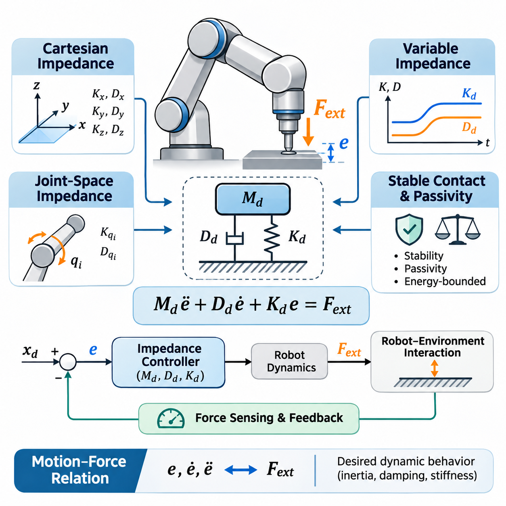
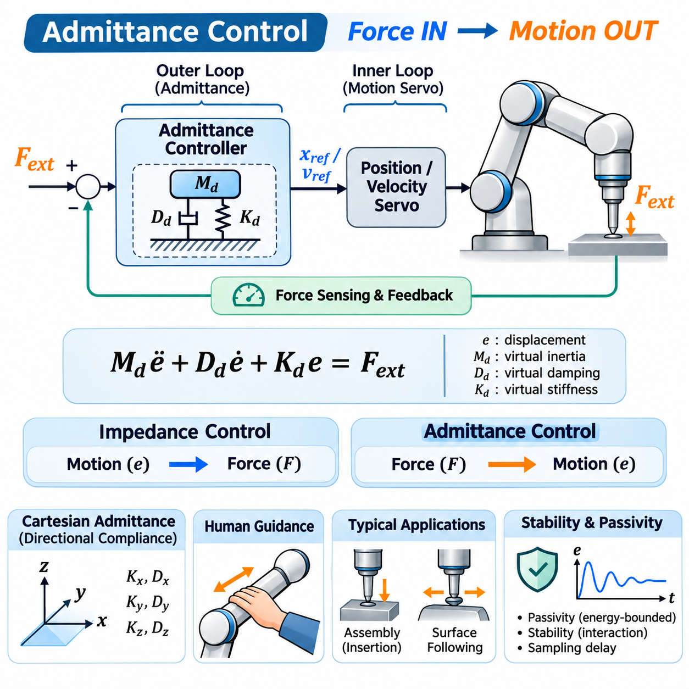
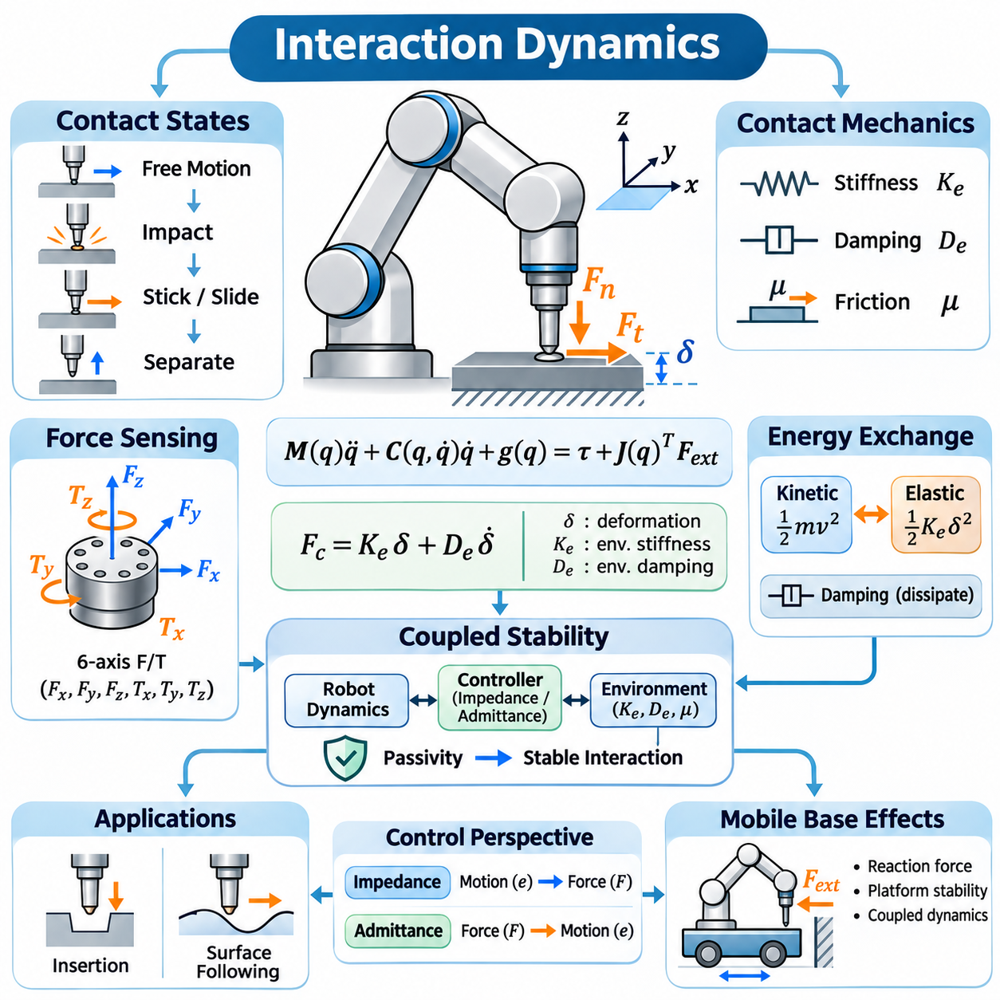
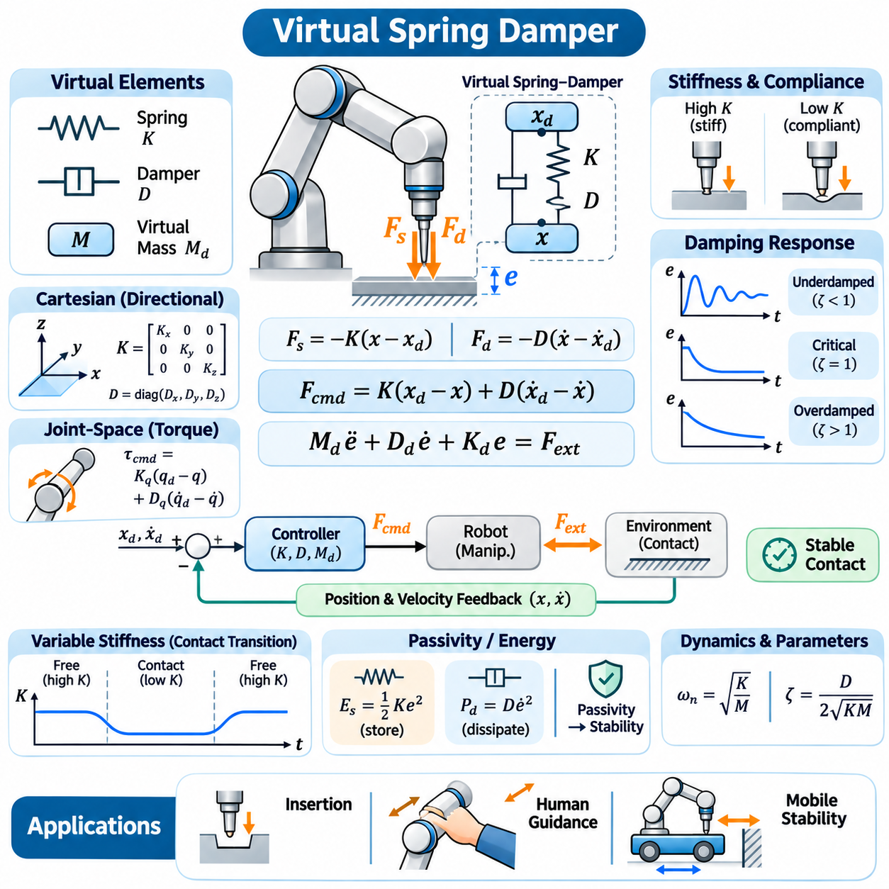
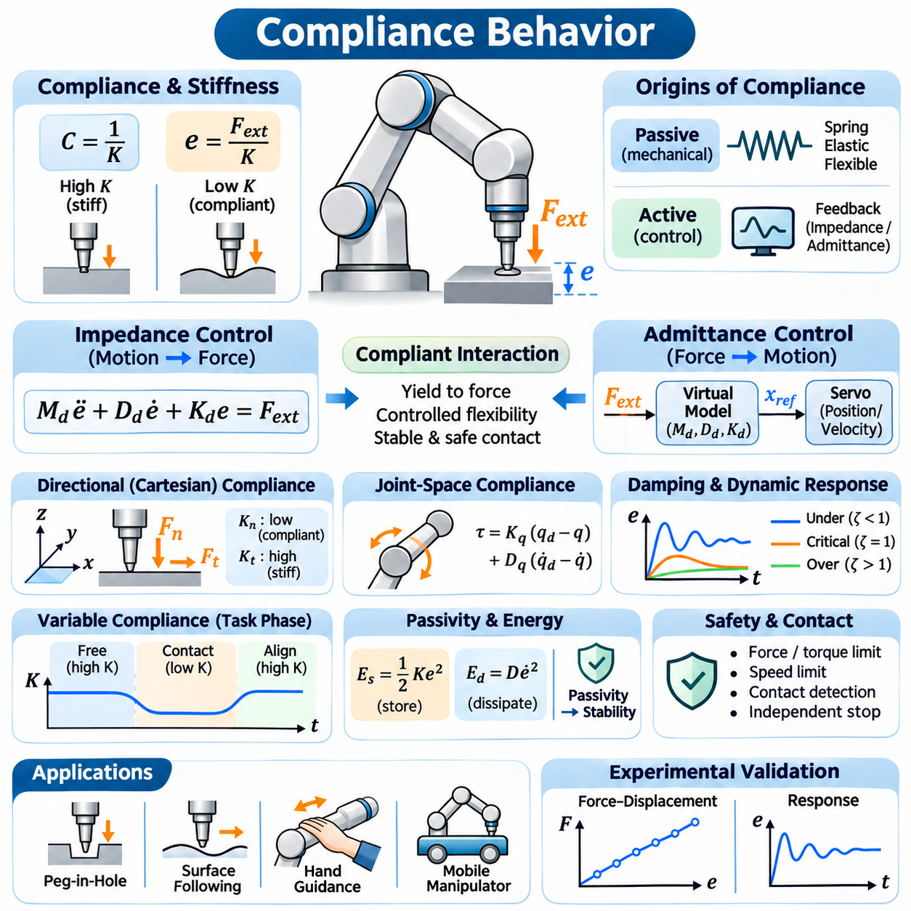
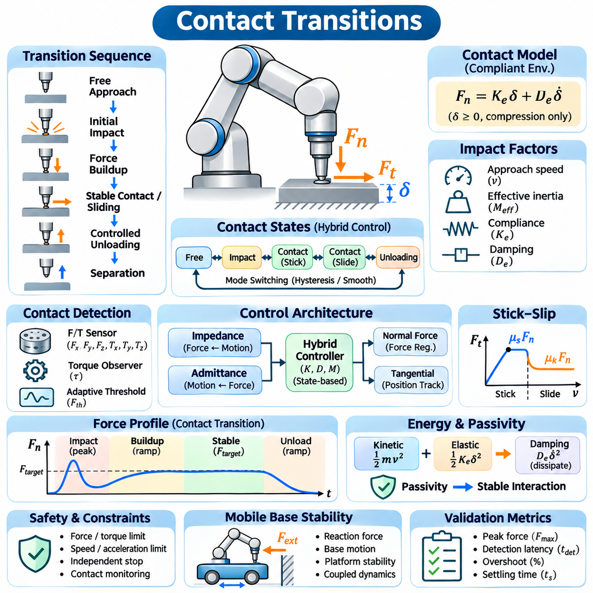
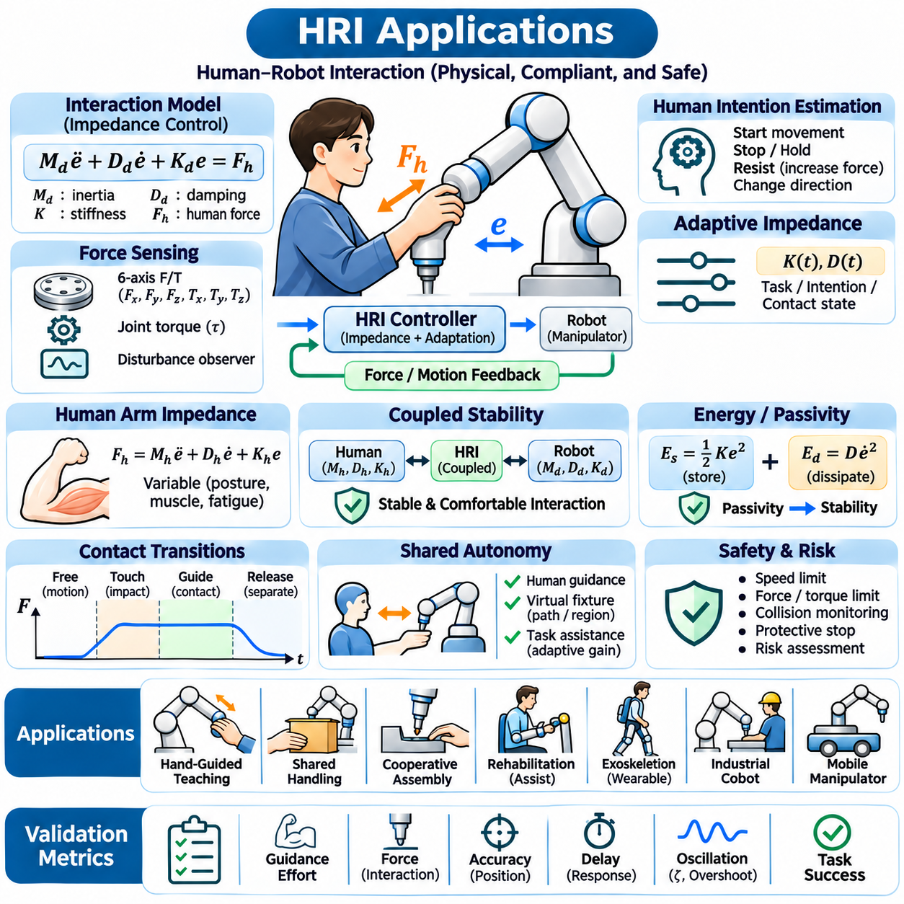
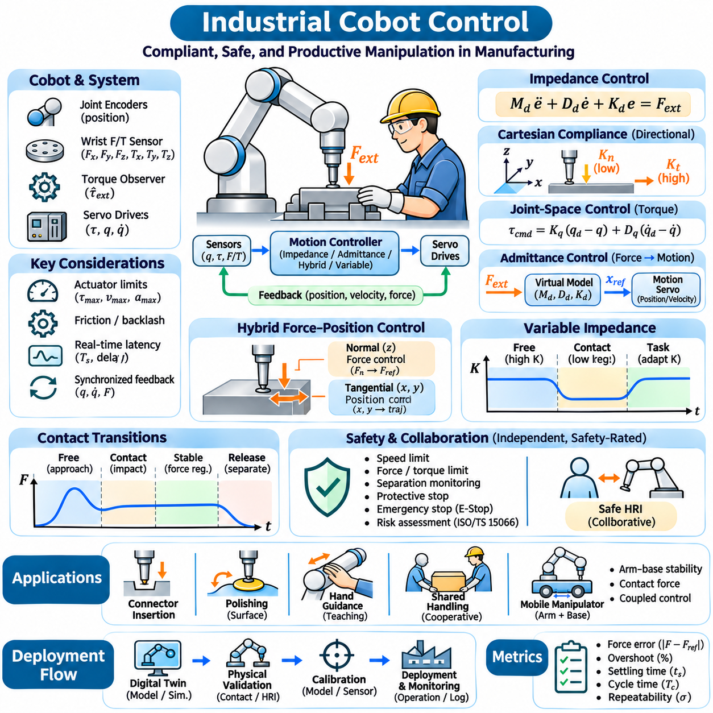
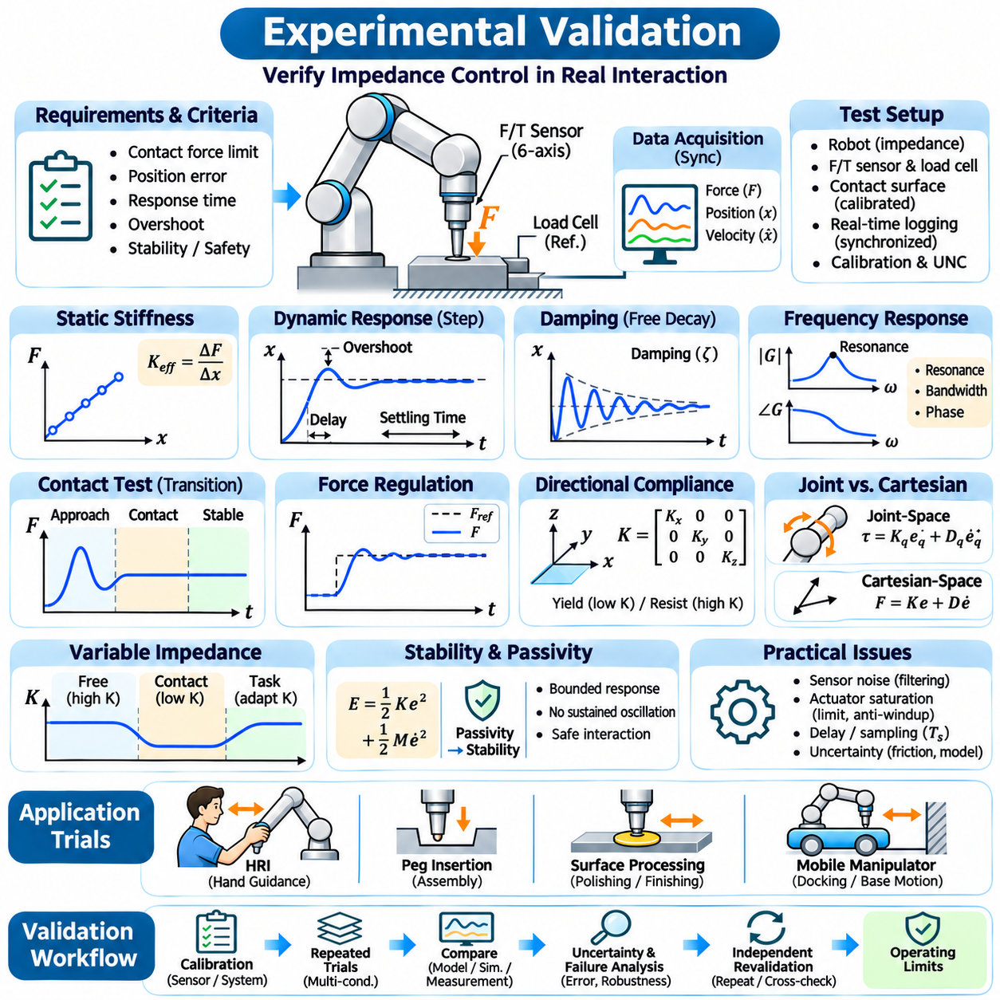

**Volume 02. Manipulator Mechanics and Control**

# Chapter 08. Impedance Control

## 01 Impedance Control Theory

{width="7.268055555555556in" height="7.268055555555556in"}

Impedance control is a fundamental strategy in robotic manipulation that regulates the dynamic relationship between motion and interaction force. Instead of commanding a robot to maintain an exact position regardless of external disturbances, impedance control defines how the robot should respond when forces act upon it. This behavior allows manipulators to interact with objects, surfaces, and humans while maintaining controlled flexibility and mechanical stability.

The theoretical foundation of impedance control comes from mechanical systems composed of mass, springs, and dampers. These elements represent inertia, stiffness, and energy dissipation, respectively. By establishing a desired mechanical impedance, the controller determines how much the robot moves under an applied force. The resulting behavior resembles a programmable mechanical system whose dynamic characteristics can be adjusted according to task requirements.

A classical impedance model is expressed as M_d e_ddot + D_d e_dot + K_d e = F_ext, where e represents the displacement from a reference trajectory, M_d is the desired inertia, D_d is the desired damping, and K_d is the desired stiffness. F_ext represents the external interaction force under the selected sign convention. This equation establishes the desired relationship between motion error and applied force rather than requiring exact trajectory tracking.

Desired inertia determines how strongly the robot resists changes in velocity. A larger inertia value produces slower acceleration under the same external force, while a smaller value allows more responsive movement. Desired damping determines how oscillatory motion dissipates over time, whereas stiffness determines the restoring force generated by displacement. Together, these parameters define the dynamic behavior experienced during physical interaction.

The distinction between position control and impedance control becomes especially important during contact with uncertain environments. A conventional high-gain position controller attempts to eliminate displacement even when an obstacle prevents the commanded motion. This behavior can generate excessive contact forces. Impedance control intentionally permits controlled displacement, allowing the manipulator to accommodate geometric uncertainty without requiring perfectly accurate environmental models.

In Cartesian impedance control, the desired dynamic relationship is established directly in the end-effector coordinate space. Translational and rotational movements can be assigned different stiffness and damping characteristics. For example, a robot performing surface inspection may maintain relatively high stiffness along the inspection direction while allowing greater compliance perpendicular to the surface. This directional behavior supports stable contact and accurate task execution.

Joint-space impedance control establishes similar dynamic relationships at individual robot joints. Each joint responds to position errors, velocity errors, and external disturbances according to selected impedance parameters. Joint-space implementations are often convenient when torque-controlled actuators are available. However, achieving a specific Cartesian interaction behavior requires consideration of robot kinematics, Jacobian transformations, and coupling between joints.

Robot dynamics play an essential role in implementing impedance control accurately. The manipulator equation includes an inertia matrix, Coriolis and centrifugal effects, gravitational forces, and actuator torques. Model-based impedance controllers compensate for selected dynamic effects so that the actual robot approximates the desired mass-spring-damper behavior. Modeling errors, friction, actuator limitations, and sensor uncertainty can reduce the accuracy of this approximation.

A common torque-based Cartesian impedance controller uses the robot Jacobian to transform desired end-effector forces into joint torques. The control law typically combines Cartesian position error, velocity error, stiffness, damping, and gravity compensation. The resulting torque commands influence the manipulator\'s response to external forces. Additional dynamic compensation may be required when accurate Cartesian inertia shaping is necessary.

Stability is a central consideration because impedance-controlled robots continuously exchange mechanical energy with their environments. Positive stiffness and damping generally contribute to stable behavior, but parameter selection alone does not guarantee stability in every interaction. Sampling delays, actuator saturation, unmodeled flexibility, and environmental stiffness can introduce oscillations. Stability analysis must therefore consider the complete robot-controller-environment system.

Passivity provides an important theoretical framework for analyzing physical interaction. A passive mechanical system cannot generate unlimited net energy from its internal dynamics. Impedance controllers designed to preserve passivity can offer useful stability properties when connected to passive environments. Nevertheless, discrete-time implementation, changing controller parameters, and active external systems may violate passivity assumptions and require additional energy monitoring or control constraints.

The relationship between impedance and admittance control is particularly important in robotic system design. Impedance control primarily establishes a force response to motion deviations, whereas admittance control computes desired motion from measured external forces. Both approaches can produce compliant interaction, but their implementation requirements differ. Torque-controlled manipulators commonly support impedance control, while position-controlled industrial robots may favor admittance architectures.

The selection of impedance parameters depends on the physical characteristics of the task. High stiffness improves resistance to displacement and may support accurate positioning in free space, but it can increase contact forces when alignment errors occur. Lower stiffness improves compliance and tolerance to uncertainty, although excessive flexibility may reduce precision. Damping must be coordinated with stiffness and inertia to avoid undesirable oscillations or sluggish responses.

Contact transitions introduce additional challenges because the dynamic conditions change abruptly when a manipulator touches or leaves an object. During free-space movement, relatively high stiffness may provide accurate trajectory tracking. Upon contact, reduced stiffness or increased damping may improve interaction behavior. Smooth parameter transitions are important because sudden changes in commanded forces or stored virtual spring energy can produce unwanted mechanical disturbances.

Variable impedance control extends the classical approach by adjusting stiffness, damping, or inertia during task execution. Parameters may change according to contact state, estimated environmental properties, task phase, or measured interaction forces. For example, a robot may use low stiffness during initial alignment and increase stiffness after successful insertion. Such adaptation requires careful stability analysis, particularly when parameters change rapidly during physical contact.

Human-robot interaction benefits from impedance control because physical guidance and collaborative manipulation require predictable responses to external forces. A robot with appropriately configured impedance can yield when pushed, resist unwanted displacement, or maintain a controlled interaction force. However, compliant behavior does not automatically guarantee human safety. Collision detection, speed limitations, force constraints, and independent protective functions remain necessary.

Mobile manipulators introduce additional complexity because the robot arm operates on a movable platform. Base motion, suspension compliance, structural vibration, and localization uncertainty influence the end-effector\'s interaction dynamics. An impedance controller designed for a fixed manipulator may therefore behave differently when installed on an autonomous mobile robot. Coordinated control must account for base stability, arm dynamics, and the coupling between platform and manipulator motion.

Practical implementation requires reliable measurements or estimates of joint positions, velocities, external forces, and actuator torques. Force-torque sensors provide direct interaction measurements, while model-based observers can estimate disturbances using motor currents and dynamic models. Measurement noise and filtering delays influence controller performance, especially during rapid contact events. Accurate calibration and appropriate control-loop frequency are essential for reproducible behavior.

Experimental validation typically examines trajectory tracking, contact force response, displacement under external loading, damping behavior, and recovery after disturbances. Tests should include free-space motion, controlled contact, varying environmental stiffness, and unexpected interaction forces. Engineers can compare measured responses against the desired impedance model to identify modeling errors, insufficient damping, excessive stiffness, or actuator limitations.

Impedance control ultimately provides a systematic method for combining motion accuracy with controlled mechanical interaction. Its central principle is that a robot should not merely reach a commanded position but should exhibit an appropriate dynamic response when the environment influences its motion. By integrating mechanical modeling, feedback control, stability analysis, and task-dependent parameter selection, impedance control enables robust and adaptable robotic manipulation.

## 02 Admittance Control

{width="7.268055555555556in" height="7.268055555555556in"}

Admittance control is a robotic interaction strategy that converts measured external forces into commanded motion. Unlike conventional position control, which attempts to maintain a prescribed trajectory, admittance control allows a manipulator to modify its movement according to physical interaction. This approach is particularly useful when a robot must respond to contact forces while operating through an existing position or velocity control interface.

The fundamental principle of admittance control is based on the relationship between applied force and resulting motion. A virtual mechanical system interprets external forces as inputs and generates corresponding position or velocity references. By adjusting the characteristics of this virtual system, engineers can define how readily the robot moves when pushed or constrained. This creates programmable compliant behavior without requiring direct access to actuator torque commands.

A classical admittance model is expressed as M_d e_ddot + D_d e_dot + K_d e = F_ext, where e represents displacement from a reference trajectory, M_d denotes virtual inertia, D_d represents virtual damping, and K_d defines virtual stiffness. F_ext is the measured external force under a consistent sign convention. Solving this differential equation produces a motion reference that reflects the desired dynamic response to physical interaction.

Virtual inertia determines the acceleration generated by an applied force. A larger inertia value makes the robot respond more gradually, while a smaller value produces faster motion under identical loading. Virtual damping controls resistance to velocity and suppresses oscillatory behavior. Virtual stiffness generates a restoring tendency toward the reference position. These three parameters collectively determine the apparent mechanical behavior experienced by the environment.

The control architecture typically contains an outer admittance loop and an inner motion control loop. The outer loop processes measured interaction forces and calculates modified position or velocity commands. The inner loop attempts to track these commands using the robot\'s existing servo controller. This separation makes admittance control practical for industrial manipulators whose low-level torque control interfaces are inaccessible or restricted.

Force measurement is a critical component of admittance control because external interaction forces directly influence commanded motion. Six-axis force-torque sensors mounted near the end effector can measure three force components and three torque components. Alternatively, external forces may be estimated from motor currents, joint torque measurements, and robot dynamics. Sensor calibration, gravity compensation, and measurement filtering are essential for obtaining reliable interaction information.

The relationship between admittance control and impedance control can be understood through their input-output structures. Impedance control primarily determines the force response associated with motion deviations, whereas admittance control determines motion commands from applied forces. Both approaches can realize similar desired mechanical behavior under appropriate conditions. However, their practical performance depends on actuator capabilities, controller bandwidth, and environmental interaction characteristics.

Cartesian admittance control generates motion references in the end-effector coordinate space. External forces can produce translational displacement, while measured moments can generate rotational adjustments. Separate virtual stiffness and damping parameters may be assigned to different directions. This enables a robot to move freely along selected axes while maintaining greater resistance in directions requiring accurate positioning or controlled alignment.

Joint-space admittance control applies the same principle to individual robot joints. Estimated external joint torques are processed through virtual dynamic models to generate joint position or velocity references. This approach can simplify integration with existing joint controllers, although the resulting Cartesian behavior depends on manipulator configuration. Kinematic coupling and Jacobian transformations must be considered when precise end-effector compliance is required.

The design of admittance parameters involves balancing responsiveness, accuracy, and stability. Low virtual inertia and damping can produce highly responsive motion, but excessive sensitivity may amplify sensor noise or cause oscillation. Higher damping generally reduces rapid movement and improves disturbance suppression, although excessive damping can make interaction feel sluggish. Virtual stiffness determines how strongly the system returns toward its nominal trajectory after an external force disappears.

Contact with rigid environments presents particular challenges because small position changes can generate large reaction forces. An admittance controller must respond quickly enough to reduce excessive contact loading while avoiding unstable interactions with the inner position controller. Communication delays, limited servo bandwidth, and discrete sampling can introduce phase lag. These effects become especially significant when high environmental stiffness is combined with aggressive admittance parameters.

Stability analysis must consider the complete interaction between the virtual admittance model, inner motion controller, robot mechanics, and contacted environment. Although positive virtual inertia, damping, and stiffness provide a well-behaved nominal model, they do not guarantee stability in practical implementations. Passivity-based analysis and energy monitoring can help evaluate interaction safety, particularly when controller delays or rapidly changing parameters influence energy exchange.

Digital implementation requires numerical integration of the virtual dynamic equations. At each control cycle, measured forces are used to update virtual acceleration, velocity, and displacement. The resulting reference is transmitted to the motion controller. Numerical integration methods, sampling frequency, filtering, and command saturation influence accuracy and stability. Anti-windup mechanisms and motion limits help prevent excessive displacement when sustained external forces are applied.

Human-guided manipulation is a representative application of admittance control. When an operator pushes or pulls the robot end effector, the measured force is converted into controlled movement. Appropriate virtual inertia and damping can make a heavy industrial manipulator feel easier to guide while maintaining predictable resistance. Such systems are useful for teaching trajectories, positioning tools, and supporting collaborative tasks, provided independent safety measures remain active.

Industrial assembly applications also benefit from admittance control because manufacturing environments frequently contain geometric uncertainty. During insertion, fastening, or alignment, contact forces can indicate positional mismatch between components. An admittance controller can adjust the commanded motion to reduce these forces and accommodate small errors. Direction-dependent compliance is especially valuable when a task requires precise movement along one axis while permitting correction along another.

Surface following and polishing provide additional examples of force-responsive motion. A robot may follow a nominal geometric trajectory while measured contact forces modify its position perpendicular to the workpiece surface. This behavior compensates for surface irregularities, calibration errors, and moderate variations in workpiece geometry. Combining admittance control with force regulation can improve contact consistency, although sensor bandwidth and mechanical compliance remain important.

Variable admittance control extends the classical approach by adjusting virtual inertia, damping, or stiffness during operation. Parameters may change according to task phase, measured contact force, operator intention, or estimated environmental conditions. For example, low resistance may be desirable during free-space guidance, while increased damping can improve stability during precise contact. Parameter transitions must be managed carefully to avoid abrupt changes in commanded motion.

Mobile manipulators introduce additional considerations because force-responsive arm movement can influence the stability of the mobile platform. External forces applied at the end effector may generate moments that disturb the base, especially when the arm is extended. Admittance control must therefore account for platform motion, structural flexibility, and base localization uncertainty. Coordinated control may distribute commanded movement between the robot arm and mobile base according to task constraints.

Experimental validation should examine force-to-motion response, tracking accuracy, contact stability, disturbance rejection, and sensitivity to measurement noise. Tests involving different virtual parameters and environmental stiffness levels reveal the practical operating range of the controller. Engineers should also evaluate actuator saturation, communication latency, and emergency stopping behavior. Comparing measured motion with the virtual admittance model helps identify implementation errors and dynamic limitations.

Admittance control provides a practical framework for implementing compliant robotic interaction through force-driven motion generation. Its principal advantage is compatibility with manipulators that already possess reliable position or velocity controllers. By integrating force sensing, virtual mechanical dynamics, numerical computation, and stable motion tracking, admittance control enables robots to adapt their movement to physical interaction while supporting precise and flexible manipulation tasks.

## 03 Interaction Dynamics

{width="7.268055555555556in" height="7.268055555555556in"}

Interaction dynamics describes the mechanical relationships that emerge when a robotic manipulator exchanges forces and motion with its environment. Unlike free-space motion, physical contact introduces additional constraints, reaction forces, and energy transfer between interacting bodies. Understanding these relationships is essential for designing impedance and admittance controllers that maintain predictable behavior during assembly, surface following, collaborative manipulation, and other contact-intensive tasks.

The dynamics of a robotic manipulator are commonly represented by M(q)q_ddot + C(q,q_dot)q_dot + g(q) = tau + J(q)\^T F_ext. Here, M(q) represents the joint-space inertia matrix, C(q,q_dot) describes Coriolis and centrifugal effects, g(q) represents gravitational torque, and tau denotes actuator torque. The Jacobian transpose maps the external Cartesian wrench F_ext into equivalent joint torques under a consistent force convention.

External interaction forces depend on the relative motion and mechanical properties of the robot and its environment. When a manipulator contacts a surface, the resulting force may depend on penetration deformation, relative velocity, material stiffness, and damping. These effects determine how rapidly contact forces develop and dissipate. Accurate interaction models help predict force peaks, oscillations, and the mechanical response of both the manipulator and contacted object.

A simplified contact model often uses a spring-damper relationship expressed as F_c = K_e delta + D_e delta_dot during active contact. In this expression, delta represents contact deformation, K_e is environmental stiffness, and D_e is environmental damping. The model approximates the normal contact response of compliant materials. More complex interactions may require nonlinear stiffness, hysteresis, friction, or deformation-dependent parameters to reproduce observed behavior.

Contact constraints determine which movements remain possible after the robot touches an object. A manipulator pressing against a rigid surface may be restricted along the surface normal while remaining free to move tangentially. These constraints alter the effective degrees of freedom and introduce reaction forces. Constraint Jacobians can represent the relationship between joint motion and allowable contact velocities, supporting the formulation of constrained robot dynamics.

Interaction dynamics must distinguish between normal and tangential contact forces. Normal forces act perpendicular to the contact surface and primarily determine compression or separation. Tangential forces arise from friction and influence sliding, sticking, and object manipulation. Coulomb friction models approximate frictional resistance using a coefficient of friction and normal loading. However, real contacts may exhibit velocity dependence, static friction transitions, and complex surface effects.

The transition from free motion to contact is a particularly challenging dynamic event. Before contact, the manipulator follows its commanded trajectory without significant environmental reaction forces. At contact, momentum may produce a rapid increase in force, especially when the environment is stiff. Impact severity depends on approach velocity, effective inertia, mechanical compliance, and damping. Controllers must manage these factors to prevent excessive loading and unstable oscillations.

Effective inertia describes the apparent resistance of a manipulator to acceleration along a particular Cartesian direction. Because robot inertia depends on joint configuration, the same external force can produce different responses at different arm postures. Cartesian operational-space dynamics provide a framework for analyzing this configuration-dependent behavior. Effective inertia is especially important when estimating impact forces or selecting safe approach velocities for contact operations.

Impedance control shapes the relationship between interaction force and motion deviation by specifying desired inertia, damping, and stiffness. When the environment applies a force, the robot responds according to its programmed mechanical characteristics. The resulting interaction depends not only on controller parameters but also on environmental dynamics. A stable response therefore requires consideration of both the robot\'s desired impedance and the mechanical properties of the contacted environment.

Admittance control approaches interaction dynamics from the complementary perspective of force-driven motion generation. Measured contact forces enter a virtual dynamic model that produces position or velocity references. The inner motion controller then attempts to follow these references. Although the virtual model may resemble an impedance equation, the actual interaction depends on servo bandwidth, tracking errors, sensor delays, and mechanical properties of the robot.

The combined robot-environment system can exhibit dynamic behavior that differs significantly from either component operating independently. High controller stiffness interacting with a rigid environment may produce oscillations or excessive forces. Conversely, insufficient damping can allow repeated contact and separation. Stability analysis must examine the coupled dynamics, including controller sampling, actuator limitations, structural flexibility, and environmental uncertainty.

Passivity provides a useful framework for understanding energy exchange during interaction. A passive system cannot deliver more net energy than it initially stores and receives from external sources. When interacting components satisfy suitable passivity conditions, their interconnection can support stable behavior. However, active control, communication delays, numerical integration, and changing impedance parameters may introduce energy that challenges these assumptions.

Energy storage and dissipation are central to contact behavior. Springs and elastic structures store potential energy during deformation, while dampers and friction dissipate mechanical energy. Robot inertia stores kinetic energy that may be transferred during impact. Excessive stored energy can produce rebound or large transient forces. Proper controller design therefore considers how energy enters, accumulates, transfers, and leaves the coupled mechanical system.

Force sensing provides information about interaction conditions that cannot always be inferred from position measurements alone. Six-axis force-torque sensors measure contact wrenches, while joint torque sensors and disturbance observers can estimate externally applied loads. Combining force measurements with motion information helps distinguish free motion, initial contact, sustained loading, and separation. Measurement noise, bias, and filtering delays must be considered when interpreting these signals.

Contact-state estimation identifies the current physical relationship between the robot and its environment. Common states include free space, initial contact, sticking contact, sliding contact, and separation. Transitions between these states may be detected through force thresholds, velocity changes, or model-based residuals. Reliable estimation enables controllers to modify stiffness, damping, and motion references according to the actual interaction conditions rather than relying exclusively on predetermined timing.

Human-robot interaction introduces additional uncertainty because human mechanical behavior changes with posture, muscle activation, and intention. A person may behave as a compliant load, actively guide the robot, or unexpectedly resist its movement. Interaction controllers must accommodate these variations while maintaining predictable responses. Force limits, velocity constraints, collision detection, and independent safety functions remain necessary even when compliant control strategies are employed.

Mobile manipulators experience interaction dynamics that involve both the robot arm and its mobile base. Contact forces applied at the end effector generate reaction forces and moments transmitted through the arm to the platform. These loads may cause base displacement, suspension deformation, wheel slip, or structural vibration. Accurate modeling must consider the coupling between manipulator motion, platform stability, and environmental contact.

Industrial assembly illustrates the importance of interaction dynamics in practical manipulation. During peg insertion, alignment errors can create lateral contact forces and friction that prevent smooth movement. Appropriate compliance allows the robot to adjust its position while limiting excessive loading. Similar principles apply to polishing, grinding, fastening, and precision inspection, where consistent interaction forces are often more important than exact geometric trajectory tracking.

Experimental evaluation of interaction dynamics should include force response, contact duration, impact peaks, vibration, energy dissipation, and recovery after disturbances. Tests across different approach velocities, environmental stiffness levels, and controller parameters reveal the sensitivity of the coupled system. Comparing measurements with predicted dynamic responses helps identify inaccurate contact models, insufficient damping, sensor limitations, and unstable operating conditions.

Interaction dynamics provides the theoretical foundation for designing robots that operate reliably during physical contact. By combining manipulator dynamics, environmental models, contact constraints, friction, energy analysis, and feedback control, engineers can predict and regulate the mechanical consequences of interaction. This understanding supports impedance control, admittance control, compliant manipulation, and safe operation in environments where forces and motion are continuously coupled.

## 04 Virtual Spring Damper

{width="7.268055555555556in" height="7.268055555555556in"}

A virtual spring-damper is a fundamental control concept used to create programmable mechanical behavior in robotic manipulators. Instead of relying exclusively on physical springs and dampers, the controller generates forces or motion commands that imitate elastic and dissipative elements. This approach allows robots to respond predictably to displacement, velocity, and external contact while maintaining flexibility during interaction with uncertain environments.

The virtual spring represents a restoring force that increases with displacement from a reference position. Its behavior follows Hooke\'s law, expressed as F_s = -K(x - x_d), where K denotes stiffness, x represents actual position, and x_d is the desired position. The negative sign indicates that the restoring force acts against displacement. Increasing stiffness produces stronger positional resistance, while reducing stiffness allows greater movement under the same external loading.

The virtual damper introduces a force proportional to relative velocity, commonly expressed as F_d = -D(x_dot - x_d_dot). Here, D represents the damping coefficient, while x_dot and x_d_dot describe actual and desired velocities. Damping opposes relative motion and dissipates energy in the ideal mechanical analogy. Its primary purpose is to suppress oscillation, reduce overshoot, and improve the smoothness of robot movement during contact and trajectory transitions.

Combining virtual spring and damper elements produces the control relationship F_cmd = K(x_d - x) + D(x_d_dot - x_dot). The commanded force depends on both position error and velocity error, creating a dynamic response similar to a mechanical spring-damper system. The stiffness component encourages movement toward the reference trajectory, while the damping component moderates velocity differences. Their combined effect determines the apparent compliance of the manipulator.

A virtual mass can be added to extend the spring-damper relationship into a complete second-order mechanical model. The desired dynamics are commonly written as M_d e_ddot + D_d e_dot + K_d e = F_ext, where e is displacement from the reference and F_ext is the external force under a consistent sign convention. Virtual inertia determines acceleration response, damping regulates energy dissipation, and stiffness establishes the restoring tendency toward the reference.

The dynamic behavior of a virtual spring-damper depends strongly on the relationship between stiffness, damping, and inertia. For a single degree of freedom, the natural frequency is omega_n = sqrt(K/M), while the damping ratio is zeta = D/(2 sqrt(KM)). These quantities describe the speed and oscillatory characteristics of the response. Low damping ratios produce oscillation, critical damping provides a nonoscillatory boundary, and excessive damping generally produces slower recovery.

Stiffness selection determines the tradeoff between positioning accuracy and mechanical compliance. High virtual stiffness helps maintain precise positioning and resist external disturbances, but it can generate large forces when the environment prevents commanded motion. Low stiffness allows the robot to accommodate alignment errors and contact uncertainty, although excessive flexibility may reduce task accuracy. Appropriate stiffness therefore depends on the geometry, material properties, and force requirements of the operation.

Damping selection is equally important because stiffness alone can produce persistent oscillatory behavior. Insufficient damping may cause repeated overshoot, vibration, or unstable contact with rigid surfaces. Increasing damping reduces oscillation and moderates rapid movement, but excessive damping can slow the response and increase resistance during human guidance. Engineers must balance damping against desired responsiveness, environmental stiffness, actuator bandwidth, and control-loop delays.

In Cartesian impedance control, virtual springs and dampers are defined in the end-effector coordinate space. Stiffness and damping matrices describe how translational and rotational errors generate commanded forces and moments. Direction-dependent parameters allow a manipulator to remain stiff along selected axes while yielding along others. This capability is valuable for surface following, precision alignment, and tasks requiring controlled contact without sacrificing directional accuracy.

Joint-space virtual spring-damper control applies similar principles to individual robot joints. Each joint generates a restoring torque from angular position error and a damping torque from angular velocity error. A typical relationship is tau_cmd = K_q(q_d - q) + D_q(q_d_dot - q_dot). This approach is convenient for torque-controlled manipulators, although the resulting end-effector behavior depends on robot configuration, joint coupling, and kinematic transformations.

The implementation of virtual spring-damper behavior depends on the available actuator control interface. Torque-controlled robots can directly approximate desired interaction forces through joint torque commands and dynamic compensation. Position-controlled robots may instead use admittance control to convert measured external forces into compliant motion references. In either case, actual behavior depends on actuator limits, servo bandwidth, sensor accuracy, and the mechanical properties of the robot.

Virtual spring-damper systems are particularly useful during contact transitions. Before contact, relatively high stiffness may support accurate free-space motion. When contact is detected, stiffness can be reduced or damping increased to limit impact forces and improve stability. Such transitions must be smooth because abrupt parameter changes can introduce discontinuities in commanded forces or alter stored virtual elastic energy, potentially producing undesirable motion.

Passivity provides an important framework for evaluating the stability of virtual mechanical elements. An ideal spring stores potential energy, while an ideal damper dissipates energy. A controller that reproduces these properties can support stable physical interaction under suitable conditions. However, discrete sampling, communication delays, actuator saturation, and time-varying parameters may introduce additional energy. Practical implementations therefore require stability analysis beyond nominal spring-damper equations.

Variable stiffness and damping extend the virtual spring-damper concept to tasks with changing interaction requirements. During free-space movement, high stiffness may improve trajectory accuracy, while lower stiffness can accommodate contact uncertainty. Increased damping may suppress oscillations during insertion or surface contact. Adaptive parameter adjustment can improve performance, but rapid changes must be constrained to prevent destabilizing energy injection or abrupt motion.

Human-robot collaboration benefits from virtual spring-damper control because it creates predictable resistance to physical guidance. A robot can be configured to yield when pushed, return gently toward a reference position, or resist motion along restricted directions. These characteristics support hand-guided teaching, collaborative positioning, and shared manipulation. Nevertheless, virtual compliance must be combined with independent safety functions, force limits, and collision monitoring.

Industrial assembly provides practical examples of virtual spring-damper behavior. During peg insertion, reduced lateral stiffness allows the end effector to accommodate small alignment errors, while appropriate axial stiffness supports insertion motion. Damping suppresses oscillation caused by repeated contact and friction. Similar principles apply to polishing, grinding, fastening, and inspection, where controlled mechanical interaction is essential for consistent quality and reduced component damage.

Mobile manipulators require additional consideration because virtual spring-damper forces can influence both the robotic arm and its supporting platform. End-effector interaction forces generate reaction loads that may disturb the mobile base, especially when the arm is extended. Base compliance, wheel-ground contact, and structural vibration modify the effective system response. Coordinated control should account for these effects to preserve interaction accuracy and platform stability.

Practical implementation requires accurate position and velocity feedback, reliable force estimation when needed, and sufficiently fast control execution. Position measurements are typically obtained from joint encoders, while velocity estimates may require filtering to suppress noise. Excessive filtering introduces delay, which can reduce effective damping and destabilize contact. Torque saturation, motion limits, and numerical precision must also be considered when implementing virtual mechanical behavior.

Experimental validation should examine displacement-force relationships, damping response, natural frequency, contact stability, and recovery after disturbances. Tests with different stiffness and damping values help determine whether the measured behavior matches the intended virtual mechanical model. Contact experiments should include varying environmental stiffness, approach velocity, and external loading. These evaluations reveal modeling errors, control delays, actuator limitations, and unsafe parameter combinations.

Virtual spring-damper control provides a practical foundation for implementing compliant and stable robotic interaction. By translating mechanical concepts into programmable control laws, engineers can shape how manipulators respond to position errors, velocity differences, and external forces. When combined with accurate dynamics, appropriate parameter tuning, stability analysis, and safety constraints, virtual spring-damper systems enable adaptable manipulation across industrial, collaborative, and mobile robotic applications.

## 05 Compliance Behavior

{width="7.268055555555556in" height="7.268055555555556in"}

Compliance behavior describes the ability of a robotic manipulator to yield in a controlled manner when external forces act upon its structure. Unlike rigid position control, which strongly resists deviations from commanded motion, compliant behavior permits displacement according to defined mechanical characteristics. This capability is essential for robots that interact with uncertain objects, constrained environments, and human operators during physical manipulation.

The fundamental relationship between compliance and stiffness is established through force and displacement. In a linear static model, compliance is the inverse of stiffness, expressed as C = 1/K for a single degree of freedom. A highly compliant system produces relatively large displacement under a small applied force, while a stiff system resists deformation. This relationship provides a foundation for selecting interaction characteristics according to task requirements.

Compliance can originate from physical mechanisms or active control algorithms. Passive compliance results from elastic joints, flexible materials, springs, and mechanical structures that deform under loading. Active compliance is generated through feedback controllers that modify actuator commands in response to measured or estimated interaction forces. Both approaches can support safe interaction, but their bandwidth, accuracy, energy consumption, and response limitations differ.

Impedance control creates compliant behavior by defining the desired relationship between motion deviation and interaction force. A common model is M_d e_ddot + D_d e_dot + K_d e = F_ext, where M_d, D_d, and K_d represent desired inertia, damping, and stiffness. The displacement error e evolves according to external loading and controller parameters. This model allows engineers to shape both static flexibility and dynamic response during contact.

Admittance control provides an alternative implementation of compliance by converting measured forces into commanded motion. A virtual mechanical model calculates position or velocity adjustments that are subsequently tracked by an internal motion controller. This approach is particularly useful for industrial manipulators with accurate position servos but limited torque-control access. Actual compliance depends on force sensing, servo bandwidth, tracking performance, and communication delays.

Static compliance describes the equilibrium displacement produced by a sustained external force. For a linear spring model, displacement satisfies e = F_ext/K under the selected force convention. Dynamic compliance additionally considers inertia and damping, determining how quickly the robot responds and whether oscillations occur. Consequently, two systems with identical static stiffness may exhibit substantially different behavior during rapid contact or changing external loads.

Directional compliance allows a manipulator to yield along selected axes while maintaining rigidity in others. Cartesian stiffness and compliance matrices define these relationships in the end-effector coordinate space. During surface following, for example, low stiffness perpendicular to the surface can accommodate geometric variations, while higher tangential stiffness supports accurate path tracking. Such anisotropic behavior is important for assembly, polishing, and precision inspection.

Joint-space compliance defines flexible behavior at individual robot joints. Each joint responds to external torque according to its configured stiffness and damping characteristics. However, joint compliance does not directly correspond to uniform Cartesian compliance because the relationship depends on robot configuration and Jacobian transformations. Engineers must account for kinematic coupling when designing predictable end-effector behavior across different manipulator postures.

The degree of compliance must be selected according to the mechanical requirements of the task. Excessively high stiffness can generate damaging contact forces when geometric uncertainty prevents commanded motion. Excessively low stiffness may reduce positioning accuracy, allow unwanted deflection, or prevent the robot from applying sufficient process force. Effective compliance design therefore balances contact tolerance, task precision, structural stability, and force transmission.

Damping is essential for maintaining stable compliant behavior during dynamic interaction. Although stiffness determines resistance to displacement, damping controls the rate at which motion energy is dissipated. Insufficient damping may cause overshoot, repeated contact, and oscillation, particularly against rigid surfaces. Excessive damping can produce sluggish movement and reduce responsiveness. Appropriate tuning must consider robot inertia, environmental stiffness, actuator bandwidth, and control delays.

Contact transitions reveal important differences between compliant and rigid manipulation. When a robot first touches an object, impact forces depend on approach velocity, effective inertia, and mechanical flexibility. A compliant controller can reduce sustained contact loading by allowing controlled displacement after contact. However, software compliance cannot eliminate the initial impact instantaneously. Mechanical compliance, approach-speed limits, and reliable contact detection remain important.

Variable compliance control adjusts stiffness and damping according to task conditions. A manipulator may use relatively high stiffness during free-space positioning, reduce stiffness during uncertain contact, and increase directional stiffness after alignment is established. Such adaptation improves flexibility across different operating phases. Nevertheless, abrupt parameter changes may introduce discontinuities or inject energy into the system, requiring smooth transitions and stability monitoring.

Compliance behavior is closely related to passivity and energy exchange. Elastic elements store potential energy, while damping mechanisms dissipate mechanical energy. A properly designed compliant controller can reproduce these characteristics and support stable interaction with passive environments. However, actuator saturation, sampling delays, changing stiffness, and active external forces may compromise stability. Passivity analysis and energy monitoring provide additional tools for evaluating controller behavior.

Human-robot collaboration requires compliant behavior that remains predictable under changing external forces. During hand-guided teaching, low resistance allows an operator to move the manipulator naturally, while damping prevents excessive acceleration or oscillation. Directional stiffness can restrict motion along unsafe or unnecessary axes. Nevertheless, compliance alone does not establish human safety, and independent collision monitoring, force limits, and protective functions remain necessary.

Industrial assembly demonstrates the practical value of compliance when component positions are uncertain. During peg-in-hole insertion, lateral compliance allows the end effector to accommodate small alignment errors, while controlled axial stiffness supports insertion. Similar principles apply to connector mating, fastening, and delicate component handling. Appropriate compliance reduces excessive contact loading and can improve assembly success when combined with accurate sensing and motion planning.

Surface processing tasks also depend on carefully selected compliance characteristics. During polishing, grinding, or inspection, the robot must maintain consistent interaction despite variations in surface geometry. Compliance perpendicular to the surface allows positional adjustment, while stiffness along the travel direction preserves path accuracy. Force feedback can further regulate contact loading, although excessive compliance may introduce vibration or reduce process consistency.

Mobile manipulators require compliance strategies that consider both arm motion and mobile-base dynamics. Contact forces applied at the end effector generate reaction loads that can disturb the supporting platform. Wheel-ground interaction, suspension deformation, and structural flexibility influence the apparent compliance of the complete system. Coordinated control must account for these effects to prevent base displacement, loss of positioning accuracy, or unstable interaction.

Experimental evaluation of compliance behavior should measure displacement under applied force, dynamic response, contact stability, and recovery after disturbances. Static tests characterize effective stiffness, while dynamic tests reveal damping, oscillation, and response delays. Measurements across different robot configurations and contact directions help identify nonlinearities and coupling effects. Validation should also include actuator saturation, unexpected contact, and realistic environmental stiffness.

Compliance behavior provides a fundamental capability for robots that must interact with physical environments rather than operate exclusively in free space. By combining mechanical flexibility, impedance or admittance control, directional stiffness, damping, and force feedback, engineers can design manipulators that accommodate uncertainty while preserving task performance. Properly validated compliance enables adaptable, precise, and more predictable interaction across industrial and collaborative robotic applications.

## 06 Contact Transitions

{width="7.268055555555556in" height="7.268055555555556in"}

Contact transitions describe the changes in mechanical interaction that occur when a robotic manipulator establishes, maintains, modifies, or releases physical contact with its environment. These events introduce abrupt changes in force, motion constraints, and energy transfer. Unlike free-space movement, contact transitions require coordinated regulation of position, velocity, and interaction force. Reliable transition control is essential for assembly, surface processing, object handling, and collaborative manipulation.

A typical contact sequence begins with free-space approach, followed by initial contact, force buildup, sustained interaction, and eventual separation. Each phase has different dynamic characteristics and control requirements. During free motion, trajectory accuracy and obstacle avoidance dominate. At contact, impact forces and mechanical constraints become important. During sustained interaction, the controller must regulate force and compliance while maintaining task stability.

Initial contact occurs when the end effector or manipulated object first touches an environmental surface. The relative velocity at impact determines how much kinetic energy must be absorbed or redistributed. High approach velocity can produce large transient forces, particularly against rigid surfaces. Effective inertia, structural flexibility, and contact damping influence the resulting impact response. Reducing approach speed is therefore a primary method for limiting contact severity.

Contact dynamics are often represented using a compliant environment model. A simplified normal-force relationship is F_n = K_e delta + D_e delta_dot during compression, where delta represents contact deformation, K_e denotes environmental stiffness, and D_e represents damping. The model approximates how force develops as the contacting bodies deform. For unilateral contact, the model must also prevent tensile contact forces and account for separation when compression disappears.

The transition from noncontact to contact introduces a change in the system\'s motion constraints. Before contact, the manipulator can move freely within its kinematic workspace. Once contact occurs, movement along the surface normal may become restricted, while tangential movement remains possible. Constraint Jacobians describe these relationships and support dynamic formulations that include reaction forces. Accurate constraint handling helps prevent unrealistic motion commands and excessive loading.

Contact detection is a critical component of transition control because the controller must recognize when the physical interaction state changes. Force-torque sensors, joint torque measurements, motor current estimates, and disturbance observers can provide evidence of contact. Position and velocity deviations may offer additional indicators. Reliable detection typically combines multiple signals because measurement noise, friction, and model uncertainty can produce false contact indications.

Force thresholds provide a simple method for detecting contact, but fixed thresholds may be unreliable across different operating conditions. Small thresholds increase sensitivity but also raise the risk of false detection. Large thresholds reduce false alarms but may delay recognition until substantial forces develop. Adaptive thresholds, filtered measurements, and persistence checks can improve robustness. Detection latency must remain sufficiently low to support the intended safety and performance requirements.

Contact-state estimation distinguishes free motion, initial impact, stable contact, sliding contact, and separation. These states can be represented using a hybrid control architecture that combines continuous dynamics with discrete operating modes. Each mode may employ different stiffness, damping, force limits, and motion references. State transitions should include well-defined entry and exit conditions to prevent rapid switching caused by noisy measurements or small force fluctuations.

Impedance control supports smooth contact transitions by defining the mechanical relationship between force and motion deviation. Lower stiffness can allow the manipulator to accommodate unexpected surface positions, while damping suppresses oscillations following impact. However, virtual compliance does not instantly remove kinetic energy already present at contact. Effective transition design must therefore combine impedance tuning with appropriate approach velocity, actuator capability, and mechanical flexibility.

Admittance control manages contact transitions by converting measured interaction forces into motion adjustments. When contact force increases, the virtual dynamic model modifies the commanded trajectory according to selected inertia, damping, and stiffness. This approach is useful for position-controlled manipulators that cannot directly command joint torque. Nevertheless, sensor filtering, servo tracking delay, and actuator saturation can limit responsiveness during rapid impacts.

The force buildup phase begins after initial contact and continues until the desired interaction force is reached. Sudden force commands can excite structural vibration or cause overshoot, especially when environmental stiffness is high. Gradual force references, bounded acceleration, and suitable damping help regulate loading. Force ramps should be selected according to the mechanical characteristics of the contacted object and the required processing or assembly operation.

Stable contact requires the controller to maintain appropriate interaction forces while accommodating small variations in surface geometry and external disturbances. Force regulation may be combined with position control along unconstrained directions. For example, a robot following a surface can regulate normal force while tracking a tangential path. Such hybrid behavior depends on accurate contact-frame estimation and suitable separation of force-controlled and motion-controlled directions.

Sliding contact introduces additional complexity because friction changes the relationship between applied force and resulting motion. Static friction may prevent movement until tangential loading exceeds a threshold, after which sliding begins. This stick-slip transition can generate vibration, positioning errors, and unstable force responses. Controllers may require friction compensation, velocity regulation, and compliant motion strategies to maintain predictable interaction during sliding.

Contact loss occurs when the normal reaction force approaches zero and the contacting bodies begin to separate. This event may be intentional, as during tool withdrawal, or unexpected because of surface discontinuities or external disturbances. If the controller continues commanding motion based on an assumed contact condition, excessive acceleration or unintended movement may result. Reliable separation detection and appropriate mode switching are therefore essential.

Controlled separation should reduce interaction force before the manipulator withdraws from the contacted surface. Gradual unloading limits sudden changes in stored elastic energy and reduces the likelihood of rebound. The controller can then transition from force regulation to position or velocity control. Smooth reference blending and bounded command changes help prevent discontinuities in actuator torque, end-effector acceleration, and overall robot motion.

Passivity and energy management are important during contact transitions because impacts and changing control parameters alter the energy exchanged between the robot and environment. Springs store elastic energy, dampers dissipate energy, and moving robot links carry kinetic energy. Abrupt stiffness changes or delayed feedback can inject energy into the interaction. Passivity observers, energy tanks, and conservative parameter scheduling can help maintain stable behavior under suitable design assumptions.

Human-robot interaction requires special attention to unexpected contact transitions. A person may suddenly touch, guide, resist, or release a robotic manipulator, producing changes in external loading. Compliant control can reduce sustained interaction forces and improve physical guidance, but it cannot replace protective safety functions. Collision detection, speed limits, force constraints, and independent stopping mechanisms remain necessary to address hazardous contact conditions.

Mobile manipulators introduce additional transition dynamics because end-effector contact forces generate reaction loads on the mobile platform. Initial contact can cause base displacement, wheel slip, suspension deformation, or structural vibration. These effects alter the effective inertia and compliance of the complete system. Coordinated arm-base control, stable platform positioning, and appropriate approach trajectories are important for maintaining reliable contact behavior.

Experimental validation should examine impact-force peaks, contact detection latency, force overshoot, settling time, and separation behavior. Tests should cover different approach velocities, environmental stiffness values, contact angles, and controller settings. Repeated experiments help reveal sensitivity to sensor noise, friction, and uncertain geometry. Validation must also consider unexpected contact, actuator saturation, and transitions between multiple contact surfaces.

Contact transition control provides the foundation for reliable robotic interaction in environments where physical constraints change during operation. By integrating contact detection, hybrid state management, impedance or admittance control, force regulation, and energy-aware stability analysis, engineers can reduce impact severity and improve interaction consistency. Well-designed transitions enable robotic manipulators to approach, contact, manipulate, and release objects with controlled mechanical behavior.

## 07 HRI Applications

{width="7.268055555555556in" height="7.268055555555556in"}

Human-robot interaction applications require robotic systems to respond safely and predictably when people exchange forces, motion, and physical guidance with machines. Unlike conventional automation, where robots operate within isolated workspaces, collaborative environments involve changing human intentions and uncertain contact conditions. Impedance control provides programmable mechanical behavior that allows manipulators to adapt their resistance, damping, and motion response during physical interaction.

Physical human-robot interaction involves direct mechanical coupling between a person and a robotic system. The interaction may occur through hand guidance, shared object manipulation, physical assistance, or incidental contact. Human motion introduces variable forces and unpredictable changes in direction. A compliant controller must accommodate these disturbances without generating excessive resistance or unstable oscillations, while preserving the intended task behavior and operational constraints.

Impedance control establishes a desired relationship between external force and robot motion deviation. A common representation is M_d e_ddot + D_d e_dot + K_d e = F_h, where F_h denotes the human-applied force and the matrices represent desired inertia, damping, and stiffness. By adjusting these parameters, engineers can determine how strongly the robot resists displacement, how quickly it responds, and how smoothly it settles after physical guidance.

Hand-guided teaching is a practical application in which an operator physically moves a manipulator through desired positions or trajectories. Low apparent stiffness reduces the effort required for guidance, while suitable damping prevents sudden acceleration and oscillation. The robot can record joint configurations, end-effector poses, or complete motion paths for later execution. Reliable teaching also requires gravity compensation, motion limits, and safeguards against unintended movement.

Collaborative object handling allows humans and robots to support or transport the same object simultaneously. The robot must accommodate human-initiated motion while maintaining sufficient force to support the shared load. Impedance parameters determine whether the robot behaves as a compliant follower or provides stronger positional guidance. Accurate load estimation and coordinated motion control help prevent excessive forces, object tilting, and unexpected changes in the shared payload.

Cooperative assembly requires robots to adjust their mechanical behavior when humans position components, align parts, or perform fastening operations. Low stiffness along selected directions allows the operator to correct alignment errors, while higher stiffness maintains support along load-bearing axes. Such directional compliance reduces unnecessary physical effort and improves positioning flexibility. However, force limits and collision monitoring remain essential when hands and tools occupy the same workspace.

Assistive robotics uses compliant interaction to support human movement during rehabilitation, mobility assistance, and physical training. The controller may provide adjustable resistance, movement guidance, or partial assistance according to the user\'s capabilities. Desired impedance must account for individual strength, movement speed, and changing participation. Clinical applications require additional attention to patient-specific limits, validated safety mechanisms, and appropriate professional supervision.

Exoskeletons and wearable robotic devices create continuous mechanical interaction with the human body. Joint alignment, actuator torque, and mechanical compliance influence both comfort and movement assistance. Excessive stiffness can restrict natural motion or produce uncomfortable interface forces, while insufficient support may reduce effectiveness. Impedance control can regulate assistance and resistance, but wearable systems must also account for human biomechanics, attachment forces, and actuator limitations.

Human intention estimation can improve impedance control by identifying whether a person intends to initiate movement, stop, resist, or change direction. Interaction forces, motion patterns, and sensor measurements provide information about these intentions. Adaptive controllers may modify stiffness or damping according to estimated activity. However, intention estimates are uncertain, so parameter adjustments must remain bounded and should not override independent safety functions.

Variable impedance control is especially valuable when interaction requirements change during a collaborative task. A robot may use low stiffness during manual guidance, increase stiffness while supporting a stationary object, and reduce resistance when the operator initiates movement. Smooth parameter scheduling helps prevent abrupt force changes and unwanted energy injection. Stability analysis must consider the combined human-robot dynamics rather than treating the robot independently.

Human arm impedance varies with posture, muscle activation, fatigue, and task intention. A person can deliberately increase joint stiffness to stabilize an object or relax muscles to permit movement. These changes alter the coupled mechanical response of the human and robot. Controllers designed around fixed human parameters may perform inconsistently. Robust impedance strategies therefore accommodate uncertainty and avoid relying on precise estimates of human mechanical properties.

Interaction stability depends on the combined behavior of human impedance, robot impedance, contact dynamics, and control delays. High robot stiffness may conflict with active human resistance, producing oscillation or uncomfortable force amplification. Excessive damping can make cooperative movement difficult, while insufficient damping may cause unstable motion. Stable interaction requires appropriate parameter tuning, bounded forces, and evaluation across realistic human behaviors.

Passivity provides a useful framework for analyzing energy exchange during physical human-robot interaction. Virtual springs store energy, dampers dissipate energy, and active human movement can inject mechanical energy into the coupled system. Time-varying impedance, delayed feedback, and actuator saturation may further affect stability. Passivity observers and energy-based control methods can help regulate energy exchange, although practical safety still requires independent protective measures.

Force sensing is essential for interpreting physical guidance and detecting unexpected interaction conditions. Six-axis force-torque sensors, joint torque sensors, and disturbance observers can estimate forces applied by human operators. These measurements may be combined with position and velocity information to distinguish intentional guidance from unexpected contact. Sensor noise, gravitational loading, tool forces, and estimation delays must be considered to avoid incorrect control responses.

Contact transitions occur frequently during human-robot collaboration because operators may suddenly touch, push, release, or reposition the manipulator. The controller must recognize these changes and adjust motion behavior without generating abrupt reactions. Gradual force references, compliant motion, and reliable contact-state estimation support smoother transitions. Nevertheless, software-based compliance cannot eliminate impact energy instantaneously, making speed limits and mechanical design important.

Shared autonomy combines human guidance with robotic motion planning and environmental awareness. The operator may specify movement direction or task intent, while the robot assists with alignment, obstacle avoidance, or constrained motion. Impedance control can provide haptic guidance through directional resistance or virtual fixtures. Such assistance should remain understandable and predictable, allowing the operator to recognize when the robot is supporting or restricting movement.

Mobile manipulators extend physical human-robot interaction beyond stationary robotic arms. A person may guide the arm while the mobile base supports movement or transports a shared object. Contact forces can influence platform stability, wheel traction, and base positioning. Coordinated arm-base control must manage these coupled effects while maintaining predictable interaction. Navigation safety and manipulation safety should be considered together rather than as independent functions.

Industrial collaborative robots use impedance-related strategies for hand guidance, flexible assembly, ergonomic assistance, and shared material handling. Compliance can reduce sustained contact forces and accommodate positioning uncertainty, improving operational flexibility. However, compliant behavior does not automatically establish safety compliance. Risk assessment, protective separation, speed monitoring, force limitation, and applicable collaborative robot safety requirements remain necessary for deployment.

Experimental validation of human-robot interaction should evaluate guidance effort, interaction force, trajectory accuracy, response delay, oscillation, and task completion. Tests should include different operators, movement speeds, contact directions, and unexpected disturbances. Subjective comfort and perceived predictability provide useful supplementary information, but objective safety measurements remain essential. Repeated evaluation helps identify unsuitable impedance settings and unstable interaction conditions.

Human-robot interaction applications demonstrate how impedance control transforms rigid automation into adaptable physical collaboration. By integrating compliant motion, force sensing, variable mechanical behavior, intention estimation, and stability analysis, robotic systems can accommodate human guidance while maintaining useful task performance. Successful implementation requires predictable control responses, carefully validated operating limits, and independent safety mechanisms throughout physical interaction.

## 08 Industrial Cobot Control

{width="7.268055555555556in" height="7.268055555555556in"}

Industrial collaborative robot control enables manipulators to perform manufacturing tasks while accommodating physical interaction with operators, workpieces, and surrounding equipment. Unlike conventional rigid automation, collaborative robots must combine positioning accuracy with controlled mechanical compliance. Impedance control provides a framework for shaping force and motion responses during contact. Its implementation must also account for industrial productivity, actuator limitations, environmental uncertainty, and functional safety.

Collaborative robots typically employ integrated joint sensing, servo drives, motion controllers, and protective monitoring functions. Joint encoders provide position feedback, while torque sensors or motor current measurements support external force estimation. The controller coordinates these signals to regulate movement and interaction behavior. However, sensor availability and torque-control access differ across robot platforms, influencing the selection of impedance or admittance control architectures.

Industrial impedance control defines the desired mechanical relationship between end-effector displacement and interaction force. A representative model is M_d e_ddot + D_d e_dot + K_d e = F_ext, where M_d, D_d, and K_d represent desired inertia, damping, and stiffness. Adjusting these parameters allows the robot to resist motion along selected directions while yielding along others. The resulting behavior depends on actual robot dynamics, controller bandwidth, and environmental contact conditions.

Cartesian impedance control is particularly useful for industrial tasks requiring direction-dependent compliance. A robot performing surface processing may maintain high tangential stiffness for accurate path tracking while allowing normal displacement to accommodate surface variations. During insertion, reduced lateral stiffness can help correct alignment errors. Stiffness and damping matrices must be defined in appropriate coordinate frames, with careful consideration of rotational compliance and coupling between motion directions.

Joint-space impedance control regulates individual joint torques according to position and velocity deviations. This approach can provide compliant behavior throughout the manipulator structure rather than exclusively at the end effector. However, joint-space stiffness does not directly correspond to constant Cartesian stiffness because the Jacobian changes with robot configuration. Dynamic compensation and configuration-dependent analysis are therefore important when consistent interaction behavior is required across the workspace.

Many industrial collaborative robots provide high-level position or velocity interfaces rather than unrestricted joint torque control. In these systems, admittance control can convert measured external forces into compliant motion references. The internal servo controller then tracks the generated trajectory. This architecture can reproduce useful compliant behavior, but its effective stiffness and damping depend on tracking accuracy, communication latency, filtering, and actuator saturation.

Force sensing plays a central role in industrial collaborative manipulation. Wrist-mounted force-torque sensors measure interaction wrenches, while joint torque sensors and disturbance observers estimate distributed external loading. Accurate force estimation requires compensation for gravity, tool mass, payload changes, and internal friction. Measurement noise and filtering delays must be managed carefully because they can degrade contact detection, force regulation, and dynamic stability.

Industrial assembly frequently involves geometric uncertainty arising from manufacturing tolerances, fixture positioning, and component variation. Rigid trajectory execution may generate excessive contact forces when the commanded path does not match the actual geometry. Compliant control allows controlled deviations that accommodate small alignment errors. Applications include connector insertion, precision fastening, part mating, and mechanical fitting, where interaction forces provide valuable information about assembly conditions.

Contact transitions require special attention because industrial robots repeatedly move between free-space positioning and constrained interaction. Approach velocity, effective inertia, and environmental stiffness determine the initial impact response. After contact detection, the controller may reduce stiffness, increase damping, or switch to force regulation. Smooth transitions are necessary to avoid abrupt command changes, while mechanical compliance and speed limits remain important for limiting impact severity.

Hybrid force-position control combines force regulation along constrained directions with position tracking along unconstrained directions. During polishing, for example, the robot can regulate normal contact force while following a programmed tangential trajectory. The controller must estimate the contact frame and maintain appropriate separation between controlled directions. Inaccurate surface orientation or unexpected friction can introduce coupling that reduces tracking accuracy and destabilizes contact.

Variable impedance control allows industrial cobots to adapt mechanical behavior across different manufacturing phases. High stiffness supports accurate free-space positioning, while lower stiffness accommodates uncertain contact. Damping can be increased during insertion or surface interaction to suppress oscillations. Parameter scheduling should remain smooth and bounded because rapid stiffness changes can alter stored virtual energy and produce undesirable transient forces.

Collaborative operation introduces additional requirements when human operators share the robot workspace. Hand guidance, cooperative assembly, and shared material handling benefit from low apparent resistance and predictable damping. However, compliance control alone does not guarantee safe human interaction. Appropriate risk assessment, speed monitoring, separation monitoring, force limitation, and protective stopping functions must be implemented according to the specific application and applicable safety requirements.

Industrial robot safety architecture should separate task-level compliance behavior from independently validated protective functions. The motion controller may adjust stiffness or force references to improve interaction quality, while safety-rated monitoring supervises hazardous conditions. Emergency stopping, protective stopping, joint limits, and speed restrictions must remain effective even if the impedance controller fails. This separation reduces dependence on non-safety-rated software for critical protective actions.

Actuator limitations strongly influence achievable impedance behavior. Motor torque limits, gearbox friction, structural flexibility, and transmission backlash affect force response and motion accuracy. High commanded stiffness may exceed actuator capability or excite mechanical resonance, while aggressive damping may demand unavailable torque. Controller design must therefore consider saturation handling, anti-windup strategies, thermal constraints, and the achievable dynamic bandwidth of the complete manipulator.

Communication and computation delays can significantly affect industrial compliance control. Sensor measurements, trajectory generation, fieldbus communication, and servo execution introduce latency into the feedback loop. Excessive delay reduces phase margin and may destabilize interaction with stiff environments. Real-time scheduling, synchronized measurements, suitable filtering, and conservative controller gains help maintain predictable behavior. Network-based control requires particular attention to timing variability and missed updates.

Industrial mobile manipulators extend collaborative control requirements to systems combining robotic arms with autonomous mobile platforms. End-effector contact forces generate reaction loads that may disturb the mobile base, alter positioning accuracy, or cause wheel slip. Coordinated arm-base control must consider platform compliance, docking repeatability, and structural vibration. Stable base positioning and accurate localization are important when performing precision assembly or inspection from a mobile platform.

Digital twins and simulation environments support industrial impedance controller development before deployment. Robot dynamics, contact stiffness, friction, actuator limits, and control delays can be represented to evaluate expected behavior. Simulated insertion, surface following, and collision scenarios help identify unsuitable parameter combinations. However, contact models are approximate, so simulation results must be verified through physical experiments with representative materials and operating conditions.

Performance evaluation should consider both manipulation quality and interaction stability. Relevant measurements include positioning error, contact force error, force overshoot, settling time, vibration, and task completion rate. Production environments also require assessment of cycle time, repeatability, equipment wear, and recovery from abnormal contact. Testing across different payloads, tool configurations, and environmental stiffness levels reveals whether controller performance remains consistent.

Industrial deployment requires systematic calibration, parameter management, and operational validation. Tool mass properties, sensor offsets, coordinate transformations, and force limits must be configured correctly. Changes in payload, tooling, or production fixtures may require controller retuning and renewed safety assessment. Monitoring contact forces, tracking errors, and protective events supports maintenance and continuous improvement while preserving traceability of controller settings.

Industrial collaborative robot control integrates impedance behavior with sensing, motion planning, force regulation, and protective safety architecture. Properly tuned compliance improves tolerance to geometric uncertainty and supports reliable physical interaction during manufacturing. Successful implementation depends on realistic dynamic models, robust feedback, controlled contact transitions, and comprehensive validation. These principles enable collaborative manipulators to perform adaptable industrial tasks while maintaining predictable mechanical behavior.

## 09 Experimental Validation

{width="7.268055555555556in" height="7.268055555555556in"}

Experimental validation is essential for determining whether an impedance-controlled manipulator exhibits the intended mechanical behavior under realistic operating conditions. Mathematical models and simulations provide useful predictions, but physical systems introduce friction, sensor noise, actuator limits, and uncertain contact dynamics. Validation must therefore examine both free-space motion and physical interaction. The objective is to establish measurable evidence of stability, accuracy, compliance, and repeatability.

A validation program begins by defining performance requirements and acceptance criteria for the intended application. These requirements may include allowable contact force, positioning error, response time, overshoot, and disturbance recovery. Test conditions should reflect expected payloads, robot configurations, environmental stiffness, and operating speeds. Clearly defined criteria allow engineers to distinguish acceptable behavior from unstable or inconsistent responses without relying on subjective observations.

Experimental equipment typically includes a robotic manipulator, force-torque sensors, position measurement devices, and a real-time data acquisition system. External load cells, calibrated springs, and instrumented contact surfaces may provide independent force references. Accurate synchronization between force, position, velocity, and control commands is important. Calibration and measurement uncertainty must be documented before experimental results can support meaningful controller comparisons.

Static stiffness testing evaluates the displacement produced by a known external force while the robot maintains a commanded equilibrium position. For a linear model, effective stiffness can be estimated from K_eff = Delta F / Delta x along a selected direction. Repeated measurements reveal hysteresis, friction, and nonlinear behavior. Testing at multiple robot configurations is necessary because joint geometry and structural flexibility influence the apparent Cartesian stiffness.

Dynamic response testing examines how the manipulator reacts to changing forces and motion disturbances. Step inputs, force pulses, and controlled displacement perturbations can reveal response delay, overshoot, oscillation, and settling time. The measured response is compared with the desired mass-spring-damper behavior. Differences may indicate inaccurate dynamic compensation, limited actuator bandwidth, sensor filtering effects, or unexpected coupling between controlled axes.

Damping validation focuses on the rate at which oscillatory motion decays after a disturbance. Insufficient damping can produce repeated overshoot and unstable contact, while excessive damping may reduce responsiveness and increase task completion time. Free-decay experiments and frequency-response measurements help characterize these effects. Damping estimates should be interpreted carefully because friction, saturation, and nonlinear contact behavior may influence the observed response.

Frequency-domain testing provides additional information about impedance behavior across different excitation frequencies. Controlled sinusoidal forces or displacement inputs can be used to estimate the relationship between interaction force and motion. Frequency-response functions reveal resonance peaks, phase shifts, and bandwidth limitations. Such measurements help identify whether the implemented controller reproduces the desired impedance only at low frequencies or across the intended operating range.

Contact experiments evaluate the transition from free-space motion to constrained interaction with an environmental surface. Approach velocity, effective inertia, contact stiffness, and damping influence the resulting impact force. Tests should measure peak contact force, detection latency, rebound, and post-contact settling. Different surface materials and approach angles reveal sensitivity to environmental uncertainty. Mechanical protection and conservative speed limits are important during these experiments.

Force regulation testing examines the ability to maintain a desired interaction force despite changes in surface geometry or external disturbances. The robot may press against a calibrated surface while the commanded force varies over time. Performance measures include steady-state force error, transient overshoot, response delay, and force variability. Tests involving moving or compliant surfaces provide additional evidence of robustness under realistic industrial interaction conditions.

Directional compliance validation determines whether the robot yields along intended directions while resisting displacement along others. External forces are applied along multiple Cartesian axes, and the resulting translations and rotations are measured. Cross-axis responses reveal coupling that may not appear in simplified controller models. These experiments are particularly important for insertion, surface following, and precision assembly tasks requiring anisotropic stiffness.

Joint-space and Cartesian-space validation should be performed separately because their mechanical interpretations differ. Joint torque disturbances reveal local stiffness and damping characteristics, while end-effector force measurements characterize task-space behavior. The Jacobian relates these domains but changes with robot posture. Comparing results across representative configurations helps identify singularity effects, configuration-dependent compliance, and unexpected changes in interaction performance.

Stability validation examines whether the robot maintains bounded and predictable behavior during sustained contact and external disturbances. Tests should include different environmental stiffness values, payloads, and controller gains. High-stiffness contact can expose oscillations caused by sampling delays or insufficient damping. Passivity analysis and energy measurements may provide additional evidence, but empirical stability under tested conditions does not establish stability for every possible environment.

Variable impedance experiments investigate transitions between different stiffness and damping settings. The controller may switch from high-stiffness positioning to compliant contact and then return to free-space motion. Measurements should capture transient forces, position discontinuities, oscillations, and changes in stored virtual energy. Smooth parameter scheduling is expected to reduce abrupt responses. Testing must also examine whether rapid adjustments introduce instability or violate actuator limits.

Sensor and actuator limitations must be included in experimental evaluation. Force measurement noise, encoder resolution, filtering delay, motor torque saturation, and gearbox friction can substantially alter impedance behavior. Controlled tests should characterize these effects under different operating loads. Sensor faults and communication interruptions may also be examined within an appropriate safety framework. Such experiments reveal whether controller performance depends on assumptions that are unrealistic in production.

Human-robot interaction experiments require careful evaluation of physical guidance and collaborative motion. Relevant measurements include operator effort, interaction force, movement smoothness, response delay, and task accuracy. Different users may apply forces with different magnitudes and frequencies, affecting coupled system dynamics. Testing should use appropriate risk controls and independent protective functions. Subjective comfort assessments can supplement objective measurements but cannot replace safety validation.

Industrial application trials connect controller-level measurements with actual task performance. In assembly, relevant outcomes include insertion success, alignment tolerance, contact force, and cycle time. Surface processing may require consistent normal force, trajectory accuracy, and acceptable process quality. Repeated trials across varying component positions and material properties reveal operational robustness. Task success alone is insufficient if excessive forces or unstable responses occur during execution.

Mobile manipulator validation must consider the interaction between robotic arm dynamics and mobile-base stability. Contact forces can produce platform displacement, wheel slip, suspension deformation, and structural vibration. Experiments should compare performance under different base configurations and docking conditions. Measurements of end-effector accuracy, base motion, and contact force help identify coupled effects. Stable platform positioning is especially important for precision manipulation tasks.

Experimental repeatability requires standardized procedures, consistent calibration, and sufficient trial repetitions. Each experiment should record controller parameters, robot configuration, payload, environmental properties, and sampling conditions. Statistical summaries of force error, displacement, and response time reveal performance variability. Outliers and failed trials should be retained for analysis rather than discarded without justification. Reproducible procedures support meaningful comparisons between controller designs.

Data analysis should compare measured responses with theoretical predictions and simulation results. Discrepancies may arise from unmodeled friction, structural flexibility, actuator dynamics, or inaccurate environmental parameters. Parameter identification can improve model fidelity, but controller retuning should be followed by independent validation. Clear reporting of assumptions, uncertainty, test boundaries, and failure conditions is necessary to prevent unsupported claims about controller performance.

Experimental validation establishes the practical credibility of impedance control by connecting theoretical mechanical behavior with measurable physical performance. A comprehensive program combines static stiffness tests, dynamic response analysis, contact experiments, stability evaluation, and application-level trials. Results should demonstrate predictable interaction within defined operating limits rather than universal robustness. Systematic validation supports reliable deployment, safer physical interaction, and continuous controller improvement.
