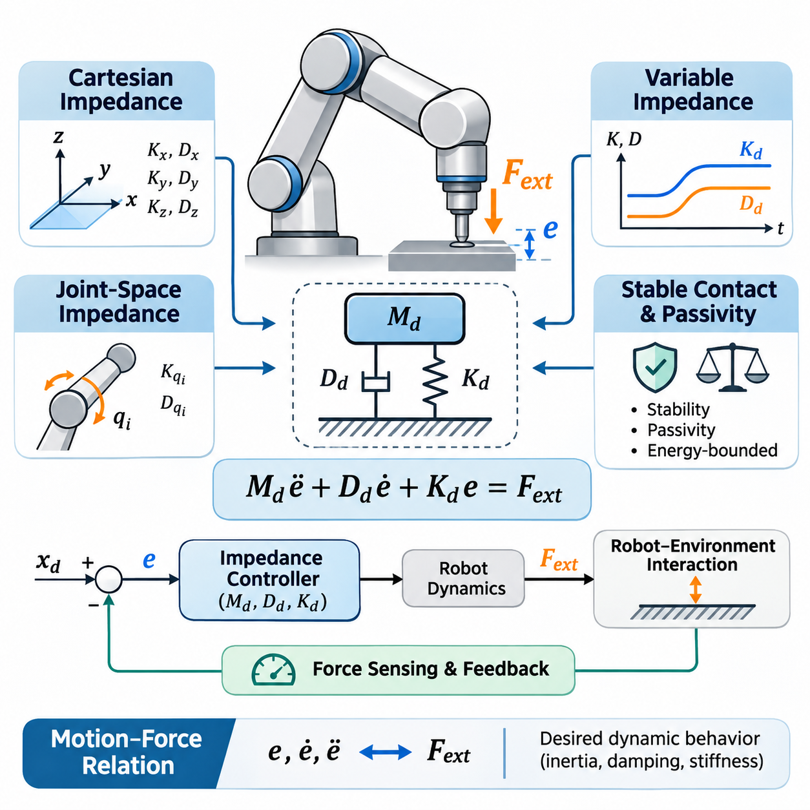
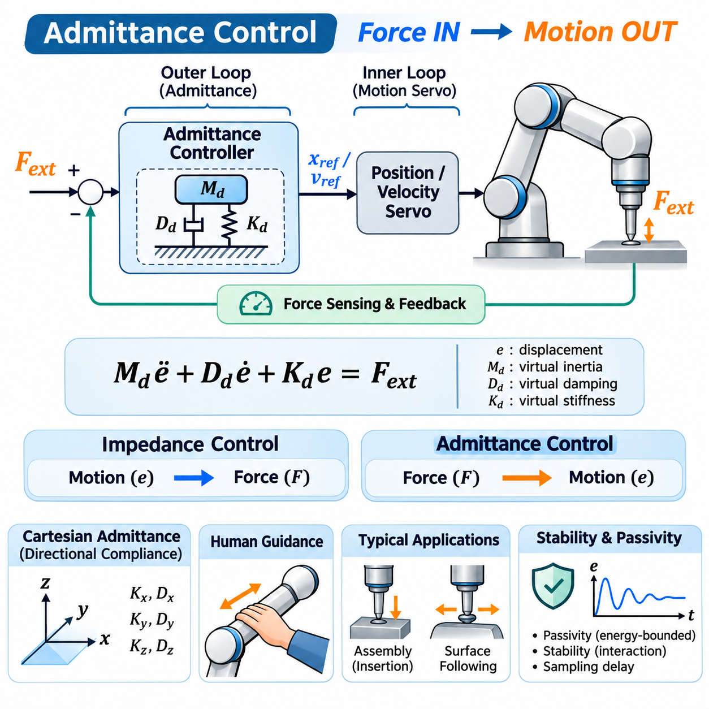
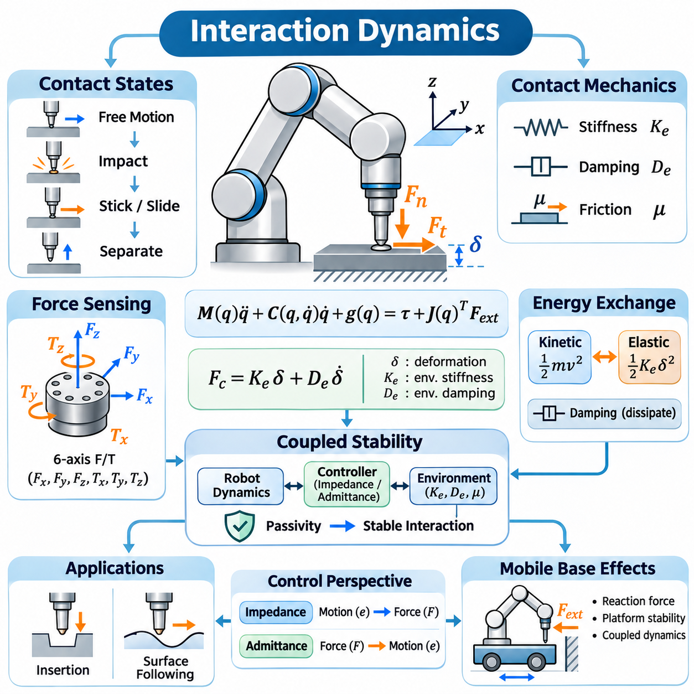
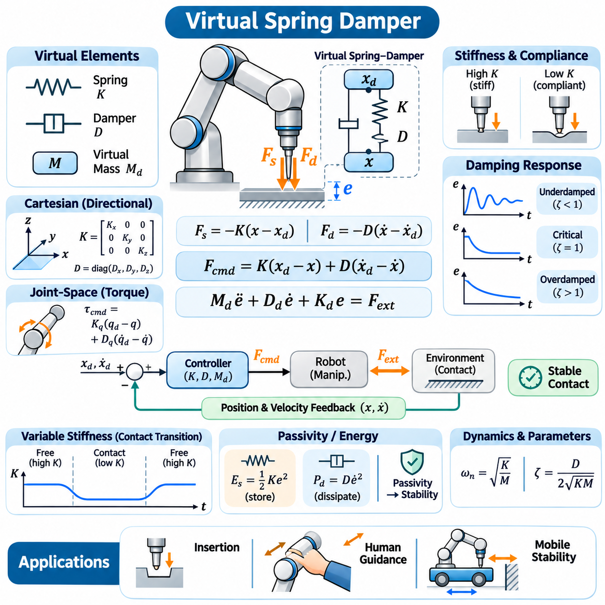
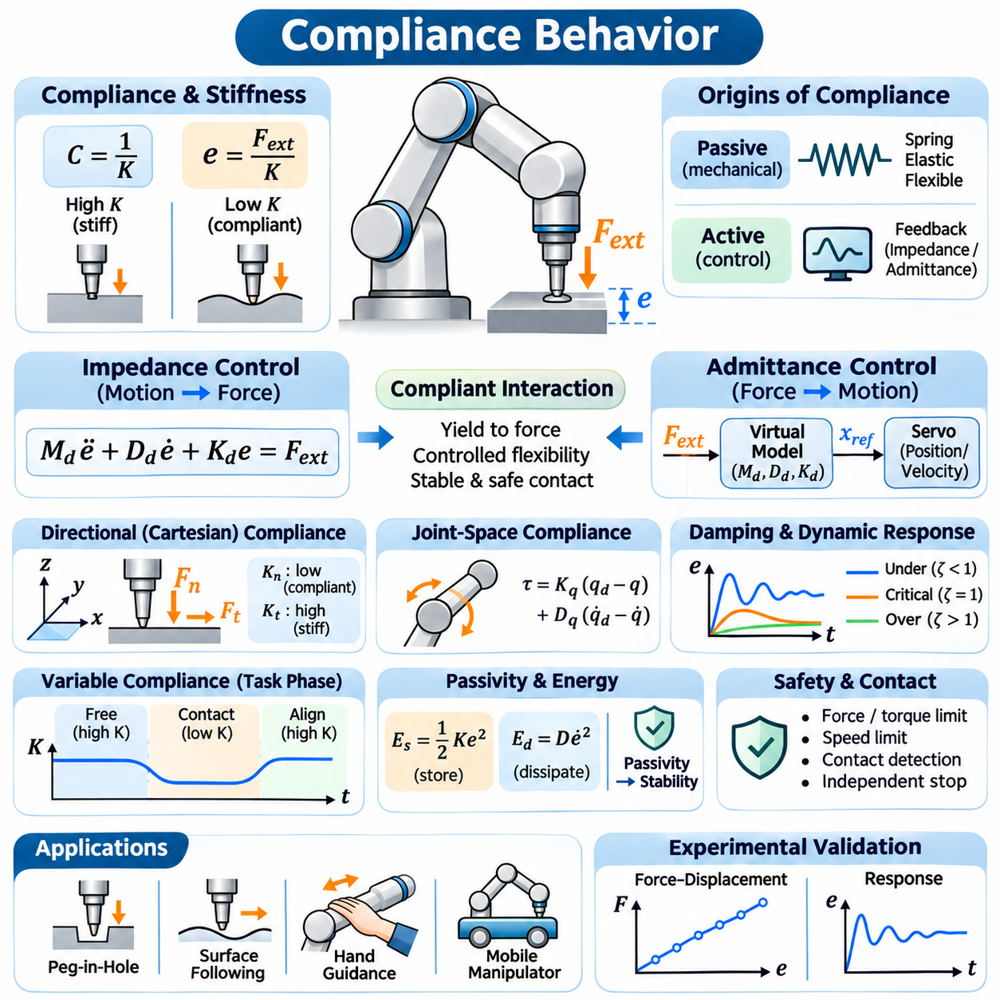
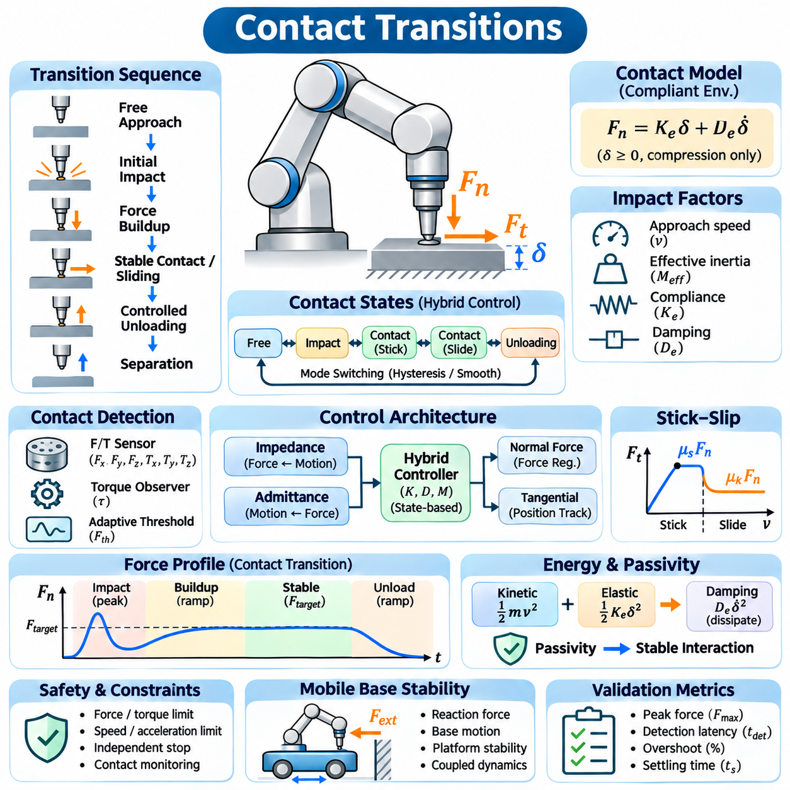
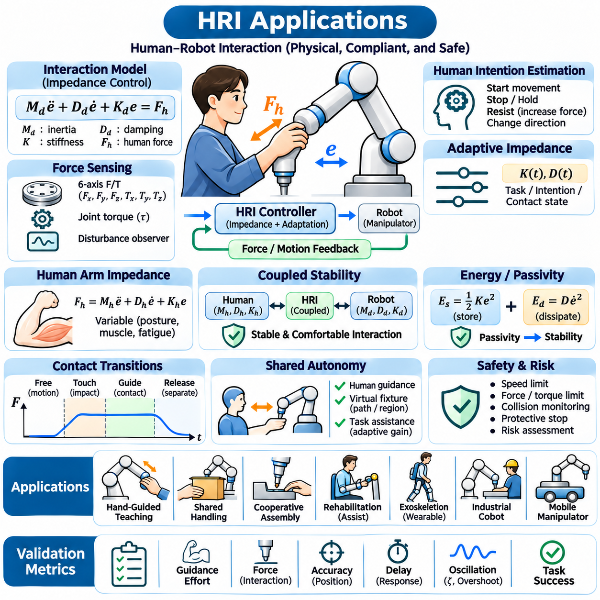
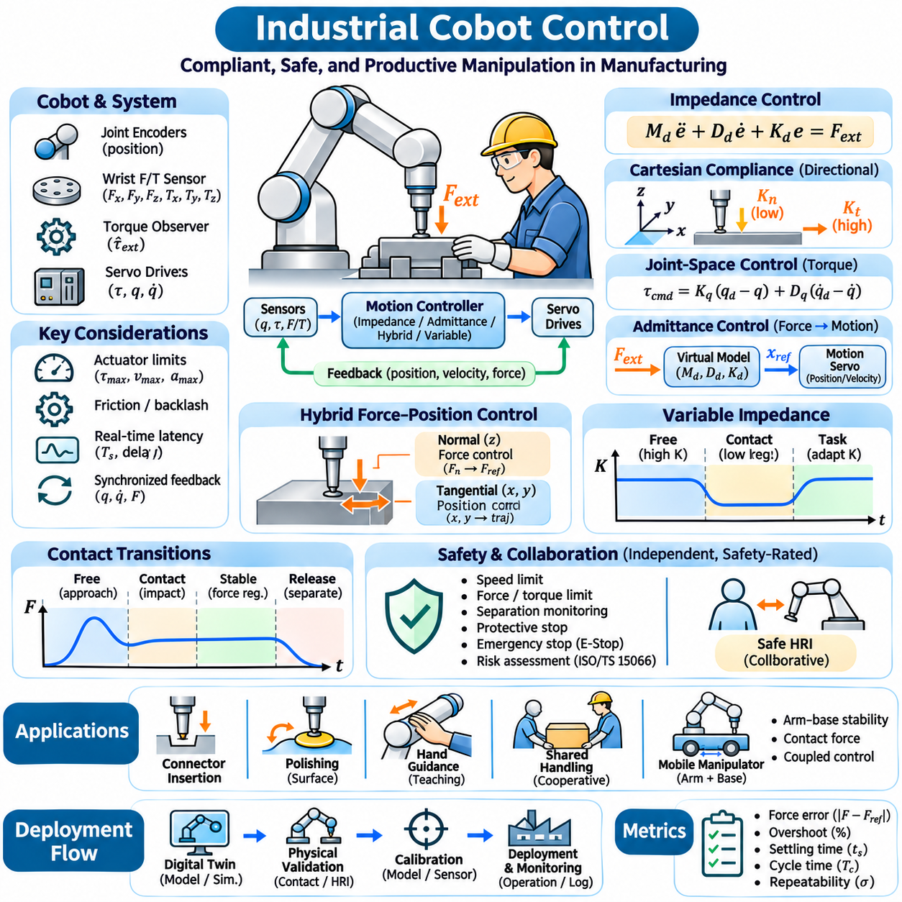
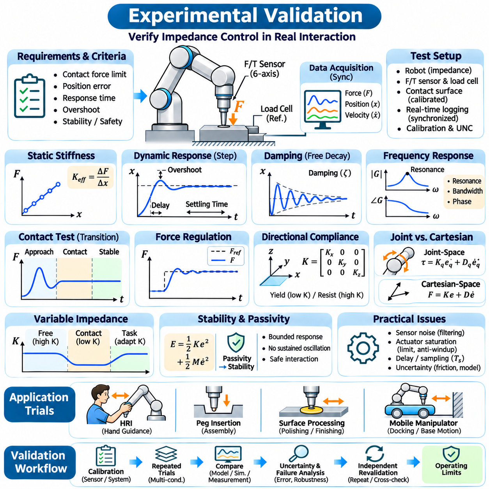

# Chapter 08. Impedance Control

## 01 Impedance Control Theory

{width="7.268055555555556in" height="7.268055555555556in"}

임피던스 제어(Impedance Control)는 운동(Motion)과 상호작용 힘(Interaction Force) 사이의 동적 관계(Dynamic Relationship)를 조절하는 로봇 조작(Robotic Manipulation)의 핵심 제어 전략이다. 외부 교란(External Disturbance)에 관계없이 정확한 위치를 유지하도록 명령하는 대신, 외력이 작용할 때 로봇이 어떻게 반응해야 하는지를 정의한다. 이를 통해 로봇 조작기(Manipulator)는 제어된 유연성(Controlled Flexibility)과 기계적 안정성(Mechanical Stability)을 유지하면서 물체, 표면 및 사람과 상호작용할 수 있다.

임피던스 제어의 이론적 기반(Theoretical Foundation)은 질량(Mass), 스프링(Spring), 댐퍼(Damper)로 구성된 기계 시스템(Mechanical System)에서 출발한다. 이러한 요소는 각각 관성(Inertia), 강성(Stiffness), 에너지 소산(Energy Dissipation)을 나타낸다. 목표 기계 임피던스(Desired Mechanical Impedance)를 설정하면 제어기는 외력이 가해졌을 때 로봇이 얼마나 움직여야 하는지를 결정한다. 그 결과 작업 요구사항에 따라 동적 특성을 조정할 수 있는 프로그래밍 가능한 기계 시스템과 유사한 동작이 구현된다.

고전적인 임피던스 모델(Classical Impedance Model)은 M_d e_ddot + D_d e_dot + K_d e = F_ext로 표현된다. 여기서 e는 기준 궤적(Reference Trajectory)에 대한 변위(Displacement), M_d는 목표 관성(Desired Inertia), D_d는 목표 감쇠(Desired Damping), K_d는 목표 강성(Desired Stiffness)을 나타낸다. F_ext는 선택한 부호 규약(Sign Convention)에 따른 외부 상호작용 힘(External Interaction Force)이다. 이 방정식은 정확한 궤적 추종(Trajectory Tracking)을 요구하는 대신 운동 오차(Motion Error)와 외력 사이의 목표 관계를 정의한다.

목표 관성(Desired Inertia)은 로봇이 속도 변화에 얼마나 강하게 저항하는지를 결정한다. 관성 값이 크면 동일한 외력에 대해 가속도(Acceleration)가 작아지고, 관성 값이 작으면 더욱 민감한 움직임이 가능해진다. 목표 감쇠(Desired Damping)는 진동 운동(Oscillatory Motion)이 시간에 따라 얼마나 빠르게 소산되는지를 결정하며, 강성(Stiffness)은 변위에 의해 발생하는 복원력(Restoring Force)을 결정한다. 이러한 매개변수(Parameter)는 물리적 상호작용 중 나타나는 동적 거동(Dynamic Behavior)을 함께 정의한다.

위치 제어(Position Control)와 임피던스 제어(Impedance Control)의 차이는 불확실한 환경(Uncertain Environment)과 접촉할 때 특히 중요해진다. 기존의 고이득 위치 제어기(High-Gain Position Controller)는 장애물이 명령된 움직임을 방해하더라도 위치 오차를 제거하려고 시도한다. 이러한 동작은 과도한 접촉력(Contact Force)을 발생시킬 수 있다. 반면 임피던스 제어는 의도적으로 제어된 변위(Controlled Displacement)를 허용하여 완벽하게 정확한 환경 모델(Environment Model) 없이도 기하학적 불확실성(Geometric Uncertainty)에 대응할 수 있도록 한다.

직교좌표 임피던스 제어(Cartesian Impedance Control)에서는 목표 동적 관계를 엔드이펙터(End-Effector)의 좌표 공간(Coordinate Space)에서 직접 설정한다. 병진 운동(Translational Motion)과 회전 운동(Rotational Motion)에 서로 다른 강성 및 감쇠 특성을 부여할 수 있다. 예를 들어 표면 검사(Surface Inspection)를 수행하는 로봇은 검사 방향을 따라 상대적으로 높은 강성을 유지하면서 표면에 수직인 방향으로는 더 큰 유연성(Compliance)을 허용할 수 있다. 이러한 방향별 제어 특성은 안정적인 접촉과 정확한 작업 수행을 지원한다.

관절 공간 임피던스 제어(Joint-Space Impedance Control)는 개별 로봇 관절(Joint)에서 유사한 동적 관계를 설정한다. 각 관절은 선택된 임피던스 매개변수에 따라 위치 오차(Position Error), 속도 오차(Velocity Error), 외부 교란에 반응한다. 관절 공간 방식은 토크 제어 액추에이터(Torque-Controlled Actuator)를 사용할 수 있을 때 구현하기 편리하다. 그러나 특정 직교좌표 상호작용 거동을 구현하려면 로봇 운동학(Kinematics), 자코비안 변환(Jacobian Transformation), 관절 간 결합(Coupling)을 고려해야 한다.

로봇 동역학(Robot Dynamics)은 임피던스 제어를 정확하게 구현하는 데 핵심적인 역할을 한다. 조작기 동역학 방정식(Manipulator Dynamics Equation)에는 관성 행렬(Inertia Matrix), 코리올리 및 원심력 효과(Coriolis and Centrifugal Effects), 중력(Gravity), 액추에이터 토크(Actuator Torque)가 포함된다. 모델 기반 임피던스 제어기(Model-Based Impedance Controller)는 선택된 동적 효과를 보상하여 실제 로봇이 목표 질량-스프링-댐퍼(Mass-Spring-Damper) 거동에 근접하도록 한다. 모델링 오차, 마찰, 액추에이터 한계 및 센서 불확실성은 이러한 근사의 정확도를 저하시킬 수 있다.

일반적인 토크 기반 직교좌표 임피던스 제어기(Torque-Based Cartesian Impedance Controller)는 로봇 자코비안(Jacobian)을 사용하여 목표 엔드이펙터 힘을 관절 토크(Joint Torque)로 변환한다. 제어 법칙(Control Law)은 일반적으로 직교좌표 위치 오차, 속도 오차, 강성, 감쇠 및 중력 보상(Gravity Compensation)을 결합한다. 이렇게 생성된 토크 명령(Torque Command)은 외력에 대한 조작기의 반응을 결정한다. 정확한 직교좌표 관성 형상화(Cartesian Inertia Shaping)가 필요한 경우 추가적인 동역학 보상(Dynamic Compensation)이 요구될 수 있다.

안정성(Stability)은 임피던스 제어 로봇이 주변 환경과 지속적으로 기계적 에너지(Mechanical Energy)를 교환하기 때문에 중요한 고려사항이다. 양의 강성(Positive Stiffness)과 양의 감쇠(Positive Damping)는 일반적으로 안정적인 동작에 기여하지만, 매개변수 선택만으로 모든 상호작용 상황에서 안정성을 보장할 수는 없다. 샘플링 지연(Sampling Delay), 액추에이터 포화(Actuator Saturation), 모델링되지 않은 유연성(Unmodeled Flexibility), 환경 강성(Environmental Stiffness)은 진동을 유발할 수 있다. 따라서 안정성 분석(Stability Analysis)은 로봇, 제어기 및 환경으로 구성된 전체 시스템을 고려해야 한다.

수동성(Passivity)은 물리적 상호작용(Physical Interaction)을 분석하기 위한 중요한 이론적 프레임워크(Theoretical Framework)를 제공한다. 수동 기계 시스템(Passive Mechanical System)은 내부 동역학만으로 무제한의 순에너지(Net Energy)를 생성할 수 없다. 수동성을 유지하도록 설계된 임피던스 제어기는 수동 환경(Passive Environment)과 연결될 때 유용한 안정성 특성을 제공할 수 있다. 그러나 이산시간 구현(Discrete-Time Implementation), 제어 매개변수 변경, 능동 외부 시스템(Active External System)은 수동성 가정을 위반할 수 있으므로 추가적인 에너지 감시(Energy Monitoring) 또는 제어 제약(Control Constraint)이 필요할 수 있다.

임피던스 제어(Impedance Control)와 어드미턴스 제어(Admittance Control)의 관계는 로봇 시스템 설계에서 특히 중요하다. 임피던스 제어는 주로 운동 편차(Motion Deviation)에 대한 힘의 반응을 설정하는 반면, 어드미턴스 제어는 측정된 외력으로부터 목표 운동(Desired Motion)을 계산한다. 두 방식 모두 유연한 상호작용(Compliant Interaction)을 구현할 수 있지만 구현 요구사항은 서로 다르다. 토크 제어 조작기(Torque-Controlled Manipulator)는 일반적으로 임피던스 제어에 적합하며, 위치 제어 산업용 로봇(Position-Controlled Industrial Robot)은 어드미턴스 제어 구조를 선호할 수 있다.

임피던스 매개변수(Impedance Parameter)의 선택은 작업의 물리적 특성(Physical Characteristics)에 따라 달라진다. 높은 강성(High Stiffness)은 변위에 대한 저항을 증가시키고 자유 공간(Free Space)에서 정확한 위치 제어를 지원할 수 있지만, 정렬 오차(Alignment Error)가 발생하면 접촉력이 증가할 수 있다. 낮은 강성(Low Stiffness)은 유연성과 불확실성에 대한 허용도를 높이지만 과도한 유연성은 정밀도를 저하시킬 수 있다. 감쇠는 원하지 않는 진동이나 지나치게 느린 반응을 방지하도록 강성 및 관성과 조화롭게 설정해야 한다.

접촉 전환(Contact Transition)은 조작기가 물체에 접촉하거나 물체에서 분리될 때 동적 조건(Dynamic Condition)이 급격하게 변화하기 때문에 추가적인 문제를 발생시킨다. 자유 공간 이동(Free-Space Motion)에서는 상대적으로 높은 강성이 정확한 궤적 추종을 제공할 수 있다. 접촉이 발생하면 강성을 낮추거나 감쇠를 증가시켜 상호작용 거동을 개선할 수 있다. 갑작스러운 매개변수 변경은 명령된 힘이나 가상 스프링(Virtual Spring)에 저장된 에너지를 급격하게 변화시켜 원하지 않는 기계적 교란을 유발할 수 있으므로 부드러운 전환이 중요하다.

가변 임피던스 제어(Variable Impedance Control)는 작업 수행 중 강성, 감쇠 또는 관성을 조정함으로써 고전적인 임피던스 제어를 확장한다. 매개변수는 접촉 상태(Contact State), 추정된 환경 특성(Environmental Properties), 작업 단계(Task Phase), 측정된 상호작용 힘에 따라 변경될 수 있다. 예를 들어 로봇은 초기 정렬(Initial Alignment) 과정에서 낮은 강성을 사용하고 삽입(Insertion)이 성공적으로 이루어진 이후 강성을 증가시킬 수 있다. 이러한 적응(Adaptation)은 특히 물리적 접촉 중 매개변수가 빠르게 변화할 때 신중한 안정성 분석을 필요로 한다.

인간-로봇 상호작용(Human-Robot Interaction)은 물리적 안내(Physical Guidance)와 협업 조작(Collaborative Manipulation)에 외력에 대한 예측 가능한 반응이 필요하기 때문에 임피던스 제어의 이점을 얻는다. 적절한 임피던스를 설정한 로봇은 사람이 밀었을 때 움직이거나, 원하지 않는 변위에 저항하거나, 제어된 상호작용 힘을 유지할 수 있다. 그러나 유연한 동작 자체가 인간의 안전(Human Safety)을 자동으로 보장하지는 않는다. 충돌 감지(Collision Detection), 속도 제한(Speed Limitation), 힘 제약(Force Constraint), 독립적인 보호 기능(Protective Function)은 여전히 필요하다.

모바일 매니퓰레이터(Mobile Manipulator)는 로봇 팔(Robot Arm)이 이동 플랫폼(Mobile Platform) 위에서 동작하기 때문에 추가적인 복잡성을 가진다. 베이스 운동(Base Motion), 서스펜션 유연성(Suspension Compliance), 구조 진동(Structural Vibration), 위치 추정 불확실성(Localization Uncertainty)은 엔드이펙터의 상호작용 동역학에 영향을 준다. 따라서 고정형 조작기(Fixed Manipulator)를 위해 설계된 임피던스 제어기는 자율이동로봇(Autonomous Mobile Robot)에 설치되었을 때 다른 거동을 보일 수 있다. 협조 제어(Coordinated Control)는 베이스 안정성, 로봇 팔 동역학, 플랫폼과 조작기 운동 사이의 결합을 고려해야 한다.

실제 구현(Practical Implementation)에는 관절 위치(Joint Position), 속도(Velocity), 외력(External Force), 액추에이터 토크(Actuator Torque)에 대한 신뢰할 수 있는 측정값 또는 추정값이 필요하다. 힘-토크 센서(Force-Torque Sensor)는 상호작용을 직접 측정하며, 모델 기반 관측기(Model-Based Observer)는 모터 전류(Motor Current)와 동역학 모델을 이용하여 교란을 추정할 수 있다. 측정 잡음(Measurement Noise)과 필터링 지연(Filtering Delay)은 특히 빠른 접촉 상황에서 제어 성능에 영향을 준다. 정확한 보정(Calibration)과 적절한 제어 루프 주파수(Control-Loop Frequency)는 재현 가능한 동작을 위해 필수적이다.

실험적 검증(Experimental Validation)은 일반적으로 궤적 추종(Trajectory Tracking), 접촉력 반응(Contact Force Response), 외부 하중(External Loading)에 따른 변위, 감쇠 거동(Damping Behavior), 교란 이후의 복원(Recovery)을 평가한다. 시험에는 자유 공간 운동, 제어된 접촉, 다양한 환경 강성, 예상하지 못한 상호작용 힘이 포함되어야 한다. 엔지니어는 측정된 응답을 목표 임피던스 모델과 비교하여 모델링 오차, 불충분한 감쇠, 과도한 강성 또는 액추에이터 한계를 식별할 수 있다.

임피던스 제어(Impedance Control)는 궁극적으로 운동 정확도(Motion Accuracy)와 제어된 기계적 상호작용(Controlled Mechanical Interaction)을 결합하는 체계적인 방법을 제공한다. 핵심 원리는 로봇이 단순히 명령된 위치에 도달하는 것에 그치지 않고, 환경이 로봇의 운동에 영향을 줄 때 적절한 동적 반응(Dynamic Response)을 나타내야 한다는 것이다. 기계적 모델링(Mechanical Modeling), 피드백 제어(Feedback Control), 안정성 분석(Stability Analysis), 작업 의존적 매개변수 선택(Task-Dependent Parameter Selection)을 통합함으로써 임피던스 제어는 강건하고 적응 가능한 로봇 조작(Robotic Manipulation)을 가능하게 한다.

## 02 Admittance Control

{width="7.268055555555556in" height="7.268055555555556in"}

어드미턴스 제어(Admittance Control)는 측정된 외력(External Force)을 명령 운동(Commanded Motion)으로 변환하는 로봇 상호작용 제어 전략(Robotic Interaction Control Strategy)이다. 지정된 궤적(Prescribed Trajectory)을 유지하려는 기존 위치 제어(Position Control)와 달리, 어드미턴스 제어는 물리적 상호작용(Physical Interaction)에 따라 조작기(Manipulator)의 움직임을 수정할 수 있도록 한다. 이러한 방식은 기존 위치 또는 속도 제어 인터페이스(Position or Velocity Control Interface)를 사용하면서 접촉력(Contact Force)에 대응해야 하는 로봇에 특히 유용하다.

어드미턴스 제어의 기본 원리(Fundamental Principle)는 가해진 힘(Applied Force)과 그 결과로 발생하는 운동(Resulting Motion) 사이의 관계에 기반한다. 가상 기계 시스템(Virtual Mechanical System)은 외력을 입력으로 해석하고 이에 대응하는 위치 또는 속도 기준값(Position or Velocity Reference)을 생성한다. 이 가상 시스템의 특성을 조정함으로써 엔지니어는 로봇이 외력이나 구속 조건에 얼마나 쉽게 움직이는지를 정의할 수 있다. 이를 통해 액추에이터 토크 명령(Actuator Torque Command)에 직접 접근하지 않고도 프로그래밍 가능한 유연 동작(Programmable Compliant Behavior)을 구현할 수 있다.

고전적인 어드미턴스 모델(Classical Admittance Model)은 M_d e_ddot + D_d e_dot + K_d e = F_ext로 표현된다. 여기서 e는 기준 궤적(Reference Trajectory)에 대한 변위(Displacement), M_d는 가상 관성(Virtual Inertia), D_d는 가상 감쇠(Virtual Damping), K_d는 가상 강성(Virtual Stiffness)을 나타낸다. F_ext는 일관된 부호 규약(Sign Convention)에 따라 측정된 외력이다. 이 미분방정식(Differential Equation)을 풀면 물리적 상호작용에 대한 목표 동적 응답(Desired Dynamic Response)을 반영하는 운동 기준값(Motion Reference)이 생성된다.

가상 관성(Virtual Inertia)은 가해진 힘에 의해 발생하는 가속도(Acceleration)를 결정한다. 관성 값이 클수록 로봇은 더 점진적으로 반응하며, 관성 값이 작을수록 동일한 하중에서 더 빠른 움직임이 발생한다. 가상 감쇠(Virtual Damping)는 속도에 대한 저항을 조절하고 진동 거동(Oscillatory Behavior)을 억제한다. 가상 강성(Virtual Stiffness)은 기준 위치(Reference Position)로 복귀하려는 복원 경향(Restoring Tendency)을 생성한다. 이 세 가지 매개변수는 환경이 경험하는 겉보기 기계적 거동(Apparent Mechanical Behavior)을 함께 결정한다.

제어 아키텍처(Control Architecture)는 일반적으로 외부 어드미턴스 루프(Outer Admittance Loop)와 내부 운동 제어 루프(Inner Motion Control Loop)로 구성된다. 외부 루프는 측정된 상호작용 힘(Interaction Force)을 처리하고 수정된 위치 또는 속도 명령을 계산한다. 내부 루프는 로봇의 기존 서보 제어기(Servo Controller)를 사용하여 이러한 명령을 추종한다. 이와 같은 분리 구조는 저수준 토크 제어 인터페이스(Low-Level Torque Control Interface)에 접근할 수 없거나 사용이 제한된 산업용 조작기(Industrial Manipulator)에 어드미턴스 제어를 적용하기 쉽게 만든다.

힘 측정(Force Measurement)은 외부 상호작용 힘이 명령 운동에 직접 영향을 주기 때문에 어드미턴스 제어의 핵심 구성요소이다. 엔드이펙터(End-Effector) 근처에 장착된 6축 힘-토크 센서(Six-Axis Force-Torque Sensor)는 세 방향의 힘 성분과 세 방향의 토크 성분을 측정할 수 있다. 또는 모터 전류(Motor Current), 관절 토크 측정값(Joint Torque Measurement), 로봇 동역학(Robot Dynamics)을 이용하여 외력을 추정할 수도 있다. 신뢰할 수 있는 상호작용 정보를 얻기 위해서는 센서 보정(Sensor Calibration), 중력 보상(Gravity Compensation), 측정값 필터링(Measurement Filtering)이 필수적이다.

어드미턴스 제어(Admittance Control)와 임피던스 제어(Impedance Control)의 관계는 입력-출력 구조(Input-Output Structure)를 통해 이해할 수 있다. 임피던스 제어는 주로 운동 편차(Motion Deviation)에 따른 힘의 응답(Force Response)을 결정하는 반면, 어드미턴스 제어는 가해진 힘으로부터 운동 명령(Motion Command)을 결정한다. 두 방식 모두 적절한 조건에서 유사한 목표 기계적 거동(Desired Mechanical Behavior)을 구현할 수 있다. 그러나 실제 성능은 액추에이터 성능(Actuator Capability), 제어기 대역폭(Controller Bandwidth), 환경 상호작용 특성(Environmental Interaction Characteristics)에 따라 달라진다.

직교좌표 어드미턴스 제어(Cartesian Admittance Control)는 엔드이펙터 좌표 공간(End-Effector Coordinate Space)에서 운동 기준값을 생성한다. 외력은 병진 변위(Translational Displacement)를 발생시킬 수 있으며, 측정된 모멘트(Measured Moment)는 회전 조정(Rotational Adjustment)을 생성할 수 있다. 서로 다른 방향에 별도의 가상 강성 및 감쇠 매개변수를 지정할 수 있다. 이를 통해 로봇은 선택된 축을 따라 자유롭게 움직이면서 정확한 위치 결정이나 제어된 정렬이 필요한 방향에서는 더 큰 저항을 유지할 수 있다.

관절 공간 어드미턴스 제어(Joint-Space Admittance Control)는 동일한 원리를 개별 로봇 관절(Robot Joint)에 적용한다. 추정된 외부 관절 토크(External Joint Torque)는 가상 동역학 모델(Virtual Dynamic Model)을 통해 처리되어 관절 위치 또는 속도 기준값(Joint Position or Velocity Reference)을 생성한다. 이러한 방식은 기존 관절 제어기(Joint Controller)와의 통합을 단순화할 수 있지만, 결과적인 직교좌표 거동(Cartesian Behavior)은 조작기의 구성(Configuration)에 따라 달라진다. 정밀한 엔드이펙터 유연성(End-Effector Compliance)이 필요한 경우 운동학적 결합(Kinematic Coupling)과 자코비안 변환(Jacobian Transformation)을 고려해야 한다.

어드미턴스 매개변수(Admittance Parameter)의 설계에는 응답성(Responsiveness), 정확도(Accuracy), 안정성(Stability) 사이의 균형이 필요하다. 낮은 가상 관성과 감쇠는 매우 민감한 움직임을 생성할 수 있지만, 지나친 민감도는 센서 잡음(Sensor Noise)을 증폭하거나 진동(Oscillation)을 유발할 수 있다. 높은 감쇠는 일반적으로 빠른 움직임을 줄이고 교란 억제(Disturbance Suppression)를 개선하지만, 과도한 감쇠는 상호작용을 둔하게 만들 수 있다. 가상 강성은 외력이 사라진 이후 시스템이 공칭 궤적(Nominal Trajectory)으로 얼마나 강하게 복귀하는지를 결정한다.

강체 환경(Rigid Environment)과의 접촉은 작은 위치 변화만으로도 큰 반력(Reaction Force)이 발생할 수 있기 때문에 특별한 문제를 제기한다. 어드미턴스 제어기는 내부 위치 제어기(Inner Position Controller)와의 불안정한 상호작용을 방지하면서 과도한 접촉 하중(Contact Loading)을 줄일 수 있을 만큼 빠르게 반응해야 한다. 통신 지연(Communication Delay), 제한된 서보 대역폭(Servo Bandwidth), 이산 샘플링(Discrete Sampling)은 위상 지연(Phase Lag)을 유발할 수 있다. 이러한 영향은 높은 환경 강성(Environmental Stiffness)과 공격적인 어드미턴스 매개변수가 결합될 때 특히 중요해진다.

안정성 분석(Stability Analysis)은 가상 어드미턴스 모델(Virtual Admittance Model), 내부 운동 제어기(Inner Motion Controller), 로봇 기계 구조(Robot Mechanics), 접촉 환경(Contacted Environment) 사이의 전체 상호작용을 고려해야 한다. 양의 가상 관성, 감쇠 및 강성은 정상적인 공칭 모델(Nominal Model)을 제공하지만 실제 구현에서 안정성을 보장하지는 않는다. 수동성 기반 분석(Passivity-Based Analysis)과 에너지 감시(Energy Monitoring)는 특히 제어 지연이나 빠르게 변화하는 매개변수가 에너지 교환(Energy Exchange)에 영향을 줄 때 상호작용 안전성을 평가하는 데 도움이 된다.

디지털 구현(Digital Implementation)에서는 가상 동역학 방정식(Virtual Dynamic Equation)의 수치 적분(Numerical Integration)이 필요하다. 각 제어 주기(Control Cycle)에서 측정된 힘을 사용하여 가상 가속도(Virtual Acceleration), 속도(Velocity), 변위(Displacement)를 갱신한다. 그 결과로 생성된 기준값은 운동 제어기(Motion Controller)에 전달된다. 수치 적분 방법(Numerical Integration Method), 샘플링 주파수(Sampling Frequency), 필터링(Filtering), 명령 포화(Command Saturation)는 정확도와 안정성에 영향을 준다. 적분 포화 방지(Anti-Windup) 메커니즘과 운동 제한(Motion Limit)은 지속적인 외력이 가해질 때 과도한 변위를 방지하는 데 도움이 된다.

인간 유도 조작(Human-Guided Manipulation)은 어드미턴스 제어의 대표적인 응용 분야이다. 작업자가 로봇 엔드이펙터를 밀거나 당기면 측정된 힘이 제어된 움직임(Controlled Movement)으로 변환된다. 적절한 가상 관성과 감쇠를 설정하면 무거운 산업용 조작기(Industrial Manipulator)도 예측 가능한 저항을 유지하면서 쉽게 안내할 수 있다. 이러한 시스템은 궤적 교시(Trajectory Teaching), 도구 위치 결정(Tool Positioning), 협업 작업(Collaborative Task) 지원에 유용하며, 독립적인 안전 조치(Independent Safety Measure)는 계속 활성화되어 있어야 한다.

산업용 조립(Industrial Assembly) 분야에서도 제조 환경(Manufacturing Environment)에 기하학적 불확실성(Geometric Uncertainty)이 자주 존재하기 때문에 어드미턴스 제어가 유용하다. 삽입(Insertion), 체결(Fastening), 정렬(Alignment) 과정에서 접촉력은 부품 사이의 위치 불일치(Positional Mismatch)를 나타낼 수 있다. 어드미턴스 제어기는 이러한 힘을 줄이고 작은 오차를 수용하도록 명령 운동을 조정할 수 있다. 방향 의존적 유연성(Direction-Dependent Compliance)은 특정 축을 따라 정밀하게 움직이면서 다른 축에서는 보정(Correction)을 허용해야 하는 작업에서 특히 중요하다.

표면 추종(Surface Following)과 연마(Polishing)는 힘에 반응하는 운동(Force-Responsive Motion)의 또 다른 사례이다. 로봇은 공칭 기하학적 궤적(Nominal Geometric Trajectory)을 추종하면서 측정된 접촉력에 따라 작업물 표면(Workpiece Surface)에 수직인 방향의 위치를 수정할 수 있다. 이러한 동작은 표면 불규칙성(Surface Irregularity), 보정 오차(Calibration Error), 작업물 형상(Workpiece Geometry)의 적당한 변화를 보상한다. 어드미턴스 제어와 힘 조절(Force Regulation)을 결합하면 접촉 일관성(Contact Consistency)을 개선할 수 있지만, 센서 대역폭(Sensor Bandwidth)과 기계적 유연성(Mechanical Compliance)은 여전히 중요하다.

가변 어드미턴스 제어(Variable Admittance Control)는 작동 중 가상 관성, 감쇠 또는 강성을 조정하여 고전적인 방식을 확장한다. 매개변수는 작업 단계(Task Phase), 측정된 접촉력(Measured Contact Force), 작업자 의도(Operator Intention), 추정된 환경 조건(Environmental Condition)에 따라 변경될 수 있다. 예를 들어 자유 공간 안내(Free-Space Guidance)에서는 낮은 저항이 바람직할 수 있으며, 정밀 접촉(Precise Contact) 중에는 감쇠를 증가시켜 안정성을 개선할 수 있다. 명령 운동의 급격한 변화를 방지하기 위해 매개변수 전환(Parameter Transition)을 신중하게 관리해야 한다.

모바일 매니퓰레이터(Mobile Manipulator)는 힘에 반응하는 로봇 팔의 움직임이 이동 플랫폼(Mobile Platform)의 안정성에 영향을 줄 수 있기 때문에 추가적인 고려사항이 필요하다. 엔드이펙터에 가해지는 외력은 특히 로봇 팔이 확장된 상태에서 베이스(Base)를 교란하는 모멘트(Moment)를 발생시킬 수 있다. 따라서 어드미턴스 제어는 플랫폼 운동(Platform Motion), 구조적 유연성(Structural Flexibility), 베이스 위치 추정 불확실성(Base Localization Uncertainty)을 고려해야 한다. 협조 제어(Coordinated Control)는 작업 제약조건(Task Constraint)에 따라 로봇 팔과 이동 베이스 사이에 명령 운동을 분배할 수 있다.

실험적 검증(Experimental Validation)에서는 힘-운동 응답(Force-to-Motion Response), 추종 정확도(Tracking Accuracy), 접촉 안정성(Contact Stability), 교란 억제(Disturbance Rejection), 측정 잡음에 대한 민감도(Sensitivity to Measurement Noise)를 평가해야 한다. 다양한 가상 매개변수와 환경 강성 수준을 적용한 시험은 제어기의 실제 작동 범위(Operating Range)를 확인하는 데 도움이 된다. 엔지니어는 액추에이터 포화(Actuator Saturation), 통신 지연(Communication Latency), 비상 정지 동작(Emergency Stopping Behavior)도 평가해야 한다. 측정된 운동과 가상 어드미턴스 모델을 비교하면 구현 오류(Implementation Error)와 동적 한계(Dynamic Limitation)를 식별할 수 있다.

어드미턴스 제어(Admittance Control)는 힘 기반 운동 생성(Force-Driven Motion Generation)을 통해 유연한 로봇 상호작용(Compliant Robotic Interaction)을 구현하는 실용적인 프레임워크(Practical Framework)를 제공한다. 주요 장점은 이미 신뢰할 수 있는 위치 또는 속도 제어기(Position or Velocity Controller)를 갖춘 조작기와의 호환성(Compatibility)이다. 힘 감지(Force Sensing), 가상 기계 동역학(Virtual Mechanical Dynamics), 수치 계산(Numerical Computation), 안정적인 운동 추종(Stable Motion Tracking)을 통합함으로써 어드미턴스 제어는 로봇이 물리적 상호작용에 따라 움직임을 조정하면서 정밀하고 유연한 조작 작업을 수행할 수 있도록 한다.

## 03 Interaction Dynamics

{width="7.268055555555556in" height="7.268055555555556in"}

상호작용 동역학(Interaction Dynamics)은 로봇 조작기(Robotic Manipulator)가 주변 환경과 힘(Force)과 운동(Motion)을 교환할 때 발생하는 기계적 관계(Mechanical Relationship)를 설명한다. 자유 공간 운동(Free-Space Motion)과 달리 물리적 접촉(Physical Contact)은 상호작용하는 물체 사이에 추가적인 제약조건(Constraint), 반력(Reaction Force), 에너지 전달(Energy Transfer)을 발생시킨다. 이러한 관계를 이해하는 것은 조립(Assembly), 표면 추종(Surface Following), 협업 조작(Collaborative Manipulation) 및 기타 접촉 중심 작업(Contact-Intensive Task)에서 예측 가능한 동작을 유지하는 임피던스 및 어드미턴스 제어기(Impedance and Admittance Controller)를 설계하는 데 필수적이다.

로봇 조작기의 동역학(Robot Manipulator Dynamics)은 일반적으로 M(q)q_ddot + C(q,q_dot)q_dot + g(q) = tau + J(q)\^T F_ext로 표현된다. 여기서 M(q)는 관절 공간 관성 행렬(Joint-Space Inertia Matrix), C(q,q_dot)는 코리올리 및 원심력 효과(Coriolis and Centrifugal Effects), g(q)는 중력 토크(Gravitational Torque), tau는 액추에이터 토크(Actuator Torque)를 나타낸다. 자코비안 전치 행렬(Jacobian Transpose)은 일관된 힘 부호 규약(Force Sign Convention)에 따라 외부 직교좌표 렌치(External Cartesian Wrench) F_ext를 등가 관절 토크(Equivalent Joint Torque)로 변환한다.

외부 상호작용 힘(External Interaction Force)은 로봇과 환경 사이의 상대 운동(Relative Motion) 및 기계적 특성(Mechanical Property)에 따라 달라진다. 조작기가 표면과 접촉하면 발생하는 힘은 접촉 변형(Contact Deformation), 상대 속도(Relative Velocity), 재료 강성(Material Stiffness), 감쇠(Damping)에 영향을 받을 수 있다. 이러한 요소는 접촉력이 얼마나 빠르게 발생하고 소산되는지를 결정한다. 정확한 상호작용 모델(Interaction Model)은 최대 힘(Force Peak), 진동(Oscillation), 조작기와 접촉 물체의 기계적 응답(Mechanical Response)을 예측하는 데 도움이 된다.

단순화된 접촉 모델(Simplified Contact Model)은 활성 접촉(Active Contact) 상태에서 F_c = K_e delta + D_e delta_dot로 표현되는 스프링-댐퍼 관계(Spring-Damper Relationship)를 자주 사용한다. 여기서 delta는 접촉 변형(Contact Deformation), K_e는 환경 강성(Environmental Stiffness), D_e는 환경 감쇠(Environmental Damping)를 나타낸다. 이 모델은 유연한 재료(Compliant Material)의 법선 방향 접촉 응답(Normal Contact Response)을 근사한다. 더욱 복잡한 상호작용을 재현하려면 비선형 강성(Nonlinear Stiffness), 이력현상(Hysteresis), 마찰(Friction), 변형 의존적 매개변수(Deformation-Dependent Parameter)가 필요할 수 있다.

접촉 제약조건(Contact Constraint)은 로봇이 물체에 접촉한 이후 어떤 움직임이 가능한지를 결정한다. 강체 표면(Rigid Surface)을 누르는 조작기는 표면 법선 방향(Surface Normal Direction)으로 움직임이 제한되는 반면, 접선 방향(Tangential Direction)으로는 자유롭게 움직일 수 있다. 이러한 제약조건은 유효 자유도(Effective Degrees of Freedom)를 변경하고 반력(Reaction Force)을 발생시킨다. 제약 자코비안(Constraint Jacobian)은 관절 운동(Joint Motion)과 허용 가능한 접촉 속도(Allowable Contact Velocity) 사이의 관계를 표현하여 구속된 로봇 동역학(Constrained Robot Dynamics)의 수식화를 지원한다.

상호작용 동역학(Interaction Dynamics)에서는 법선 접촉력(Normal Contact Force)과 접선 접촉력(Tangential Contact Force)을 구분해야 한다. 법선력(Normal Force)은 접촉 표면에 수직으로 작용하며 주로 압축(Compression)이나 분리(Separation)를 결정한다. 접선력(Tangential Force)은 마찰에 의해 발생하며 미끄러짐(Sliding), 고착(Sticking), 물체 조작(Object Manipulation)에 영향을 준다. 쿨롱 마찰 모델(Coulomb Friction Model)은 마찰계수(Coefficient of Friction)와 법선 하중(Normal Loading)을 이용하여 마찰 저항(Frictional Resistance)을 근사한다. 그러나 실제 접촉에서는 속도 의존성(Velocity Dependence), 정지 마찰 전환(Static Friction Transition), 복잡한 표면 효과(Surface Effect)가 나타날 수 있다.

자유 운동(Free Motion)에서 접촉(Contact)으로의 전환은 특히 어려운 동적 사건(Dynamic Event)이다. 접촉 이전에는 조작기가 큰 환경 반력(Environmental Reaction Force) 없이 명령된 궤적(Commanded Trajectory)을 추종한다. 접촉 순간에는 운동량(Momentum)으로 인해 힘이 급격하게 증가할 수 있으며, 특히 환경이 단단할수록 이러한 현상이 두드러진다. 충격 강도(Impact Severity)는 접근 속도(Approach Velocity), 유효 관성(Effective Inertia), 기계적 유연성(Mechanical Compliance), 감쇠에 따라 달라진다. 제어기는 과도한 하중과 불안정한 진동을 방지하기 위해 이러한 요소를 관리해야 한다.

유효 관성(Effective Inertia)은 특정 직교좌표 방향(Cartesian Direction)으로 가속할 때 조작기가 나타내는 겉보기 저항(Apparent Resistance)을 설명한다. 로봇 관성(Robot Inertia)은 관절 구성(Joint Configuration)에 따라 달라지므로 동일한 외력도 로봇 팔 자세(Arm Posture)에 따라 서로 다른 응답을 발생시킬 수 있다. 직교좌표 작업 공간 동역학(Cartesian Operational-Space Dynamics)은 이러한 구성 의존적 거동(Configuration-Dependent Behavior)을 분석하는 프레임워크를 제공한다. 유효 관성은 충격력(Impact Force)을 추정하거나 접촉 작업에서 안전한 접근 속도(Safe Approach Velocity)를 선택할 때 특히 중요하다.

임피던스 제어(Impedance Control)는 목표 관성(Desired Inertia), 감쇠(Damping), 강성(Stiffness)을 지정하여 상호작용 힘(Interaction Force)과 운동 편차(Motion Deviation) 사이의 관계를 형성한다. 환경이 힘을 가하면 로봇은 프로그래밍된 기계적 특성(Programmed Mechanical Characteristics)에 따라 반응한다. 결과적인 상호작용은 제어기 매개변수(Controller Parameter)뿐만 아니라 환경 동역학(Environmental Dynamics)에도 영향을 받는다. 따라서 안정적인 응답을 위해서는 로봇의 목표 임피던스(Desired Impedance)와 접촉 환경의 기계적 특성을 모두 고려해야 한다.

어드미턴스 제어(Admittance Control)는 힘 기반 운동 생성(Force-Driven Motion Generation)이라는 상호보완적 관점에서 상호작용 동역학에 접근한다. 측정된 접촉력(Measured Contact Force)은 위치 또는 속도 기준값(Position or Velocity Reference)을 생성하는 가상 동역학 모델(Virtual Dynamic Model)에 입력된다. 이후 내부 운동 제어기(Inner Motion Controller)가 이러한 기준값을 추종한다. 가상 모델이 임피던스 방정식(Impedance Equation)과 유사할 수 있지만, 실제 상호작용은 서보 대역폭(Servo Bandwidth), 추종 오차(Tracking Error), 센서 지연(Sensor Delay), 로봇의 기계적 특성에 따라 달라진다.

결합된 로봇-환경 시스템(Coupled Robot-Environment System)은 각 구성요소가 독립적으로 작동할 때와 상당히 다른 동적 거동(Dynamic Behavior)을 나타낼 수 있다. 높은 제어기 강성(Controller Stiffness)이 강체 환경(Rigid Environment)과 상호작용하면 진동이나 과도한 힘이 발생할 수 있다. 반대로 감쇠가 부족하면 접촉과 분리가 반복될 수 있다. 안정성 분석(Stability Analysis)은 제어기 샘플링(Controller Sampling), 액추에이터 한계(Actuator Limitation), 구조적 유연성(Structural Flexibility), 환경 불확실성(Environmental Uncertainty)을 포함한 결합 동역학(Coupled Dynamics)을 검토해야 한다.

수동성(Passivity)은 상호작용 중 발생하는 에너지 교환(Energy Exchange)을 이해하는 데 유용한 프레임워크를 제공한다. 수동 시스템(Passive System)은 초기에 저장된 에너지와 외부에서 공급받은 에너지의 합보다 많은 순에너지(Net Energy)를 전달할 수 없다. 상호작용하는 구성요소들이 적절한 수동성 조건(Passivity Condition)을 만족하면 이들의 상호연결(Interconnection)은 안정적인 거동을 지원할 수 있다. 그러나 능동 제어(Active Control), 통신 지연(Communication Delay), 수치 적분(Numerical Integration), 임피던스 매개변수 변경은 이러한 가정을 위협하는 에너지를 유입시킬 수 있다.

에너지 저장(Energy Storage)과 소산(Energy Dissipation)은 접촉 거동(Contact Behavior)의 핵심 요소이다. 스프링과 탄성 구조(Elastic Structure)는 변형 중 위치 에너지(Potential Energy)를 저장하며, 댐퍼와 마찰은 기계적 에너지(Mechanical Energy)를 소산한다. 로봇 관성은 충격 중 전달될 수 있는 운동 에너지(Kinetic Energy)를 저장한다. 과도하게 저장된 에너지는 반발(Rebound)이나 큰 과도 힘(Transient Force)을 발생시킬 수 있다. 따라서 적절한 제어기 설계는 에너지가 결합된 기계 시스템에 어떻게 유입되고, 축적되고, 전달되고, 배출되는지를 고려해야 한다.

힘 감지(Force Sensing)는 위치 측정(Position Measurement)만으로 항상 추론할 수 없는 상호작용 상태(Interaction Condition)에 대한 정보를 제공한다. 6축 힘-토크 센서(Six-Axis Force-Torque Sensor)는 접촉 렌치(Contact Wrench)를 측정하며, 관절 토크 센서(Joint Torque Sensor)와 교란 관측기(Disturbance Observer)는 외부 하중(External Load)을 추정할 수 있다. 힘 측정값과 운동 정보를 결합하면 자유 운동(Free Motion), 초기 접촉(Initial Contact), 지속적인 하중(Sustained Loading), 분리(Separation)를 구분하는 데 도움이 된다. 이러한 신호를 해석할 때는 측정 잡음(Measurement Noise), 바이어스(Bias), 필터링 지연(Filtering Delay)을 고려해야 한다.

접촉 상태 추정(Contact-State Estimation)은 로봇과 환경 사이의 현재 물리적 관계(Physical Relationship)를 식별한다. 일반적인 상태에는 자유 공간(Free Space), 초기 접촉(Initial Contact), 고착 접촉(Sticking Contact), 미끄럼 접촉(Sliding Contact), 분리(Separation)가 포함된다. 이러한 상태 사이의 전환은 힘 임계값(Force Threshold), 속도 변화(Velocity Change), 모델 기반 잔차(Model-Based Residual)를 통해 감지할 수 있다. 신뢰할 수 있는 상태 추정은 제어기가 미리 정해진 시간에만 의존하지 않고 실제 상호작용 조건에 따라 강성, 감쇠 및 운동 기준값(Motion Reference)을 수정할 수 있도록 한다.

인간-로봇 상호작용(Human-Robot Interaction)은 인간의 기계적 거동(Mechanical Behavior)이 자세(Posture), 근육 활성화(Muscle Activation), 의도(Intention)에 따라 변화하기 때문에 추가적인 불확실성을 발생시킨다. 사람은 유연한 하중(Compliant Load)처럼 행동하거나, 로봇을 능동적으로 안내하거나, 예상하지 못하게 움직임에 저항할 수 있다. 상호작용 제어기(Interaction Controller)는 예측 가능한 응답을 유지하면서 이러한 변화를 수용해야 한다. 유연 제어 전략(Compliant Control Strategy)을 사용하더라도 힘 제한(Force Limit), 속도 제약(Velocity Constraint), 충돌 감지(Collision Detection), 독립적인 안전 기능(Independent Safety Function)은 여전히 필요하다.

모바일 매니퓰레이터(Mobile Manipulator)는 로봇 팔(Robot Arm)과 이동 베이스(Mobile Base)를 모두 포함하는 상호작용 동역학을 경험한다. 엔드이펙터에 가해지는 접촉력은 로봇 팔을 통해 플랫폼(Platform)으로 전달되는 반력(Reaction Force)과 모멘트(Moment)를 발생시킨다. 이러한 하중은 베이스 변위(Base Displacement), 서스펜션 변형(Suspension Deformation), 바퀴 미끄러짐(Wheel Slip), 구조 진동(Structural Vibration)을 유발할 수 있다. 정확한 모델링(Accurate Modeling)을 위해서는 조작기 운동(Manipulator Motion), 플랫폼 안정성(Platform Stability), 환경 접촉(Environmental Contact) 사이의 결합을 고려해야 한다.

산업용 조립(Industrial Assembly)은 실제 로봇 조작에서 상호작용 동역학의 중요성을 보여준다. 핀 삽입(Peg Insertion) 과정에서 정렬 오차(Alignment Error)는 측면 접촉력(Lateral Contact Force)과 마찰(Friction)을 발생시켜 원활한 움직임을 방해할 수 있다. 적절한 유연성(Compliance)은 로봇이 과도한 하중을 제한하면서 위치를 조정할 수 있도록 한다. 동일한 원리는 연마(Polishing), 연삭(Grinding), 체결(Fastening), 정밀 검사(Precision Inspection)에도 적용되며, 이러한 작업에서는 정확한 기하학적 궤적 추종(Geometric Trajectory Tracking)보다 일정한 상호작용 힘(Consistent Interaction Force)이 더 중요할 수 있다.

상호작용 동역학의 실험적 평가(Experimental Evaluation)에는 힘 응답(Force Response), 접촉 지속시간(Contact Duration), 최대 충격력(Impact Peak), 진동(Vibration), 에너지 소산(Energy Dissipation), 교란 이후 복원(Recovery After Disturbance)이 포함되어야 한다. 다양한 접근 속도(Approach Velocity), 환경 강성(Environmental Stiffness), 제어기 매개변수(Controller Parameter)에 대한 시험은 결합 시스템(Coupled System)의 민감도를 보여준다. 측정 결과와 예측된 동적 응답(Predicted Dynamic Response)을 비교하면 부정확한 접촉 모델, 불충분한 감쇠, 센서 한계 및 불안정한 작동 조건(Unstable Operating Condition)을 식별하는 데 도움이 된다.

상호작용 동역학(Interaction Dynamics)은 물리적 접촉(Physical Contact) 중 안정적으로 작동하는 로봇을 설계하기 위한 이론적 기반(Theoretical Foundation)을 제공한다. 조작기 동역학(Manipulator Dynamics), 환경 모델(Environmental Model), 접촉 제약조건(Contact Constraint), 마찰(Friction), 에너지 분석(Energy Analysis), 피드백 제어(Feedback Control)를 결합함으로써 엔지니어는 상호작용의 기계적 결과(Mechanical Consequence)를 예측하고 조절할 수 있다. 이러한 이해는 힘과 운동이 지속적으로 결합되는 환경에서 임피던스 제어(Impedance Control), 어드미턴스 제어(Admittance Control), 유연 조작(Compliant Manipulation), 안전한 로봇 운용(Safe Robot Operation)을 지원한다.

## 04 Virtual Spring Damper

{width="7.268055555555556in" height="7.268055555555556in"}

가상 스프링-댐퍼(Virtual Spring-Damper)는 로봇 조작기(Robotic Manipulator)에서 프로그래밍 가능한 기계적 거동(Programmable Mechanical Behavior)을 구현하기 위한 기본적인 제어 개념(Control Concept)이다. 물리적인 스프링과 댐퍼에만 의존하는 대신, 제어기(Controller)는 탄성 요소(Elastic Element)와 에너지 소산 요소(Dissipative Element)를 모방하는 힘 또는 운동 명령을 생성한다. 이러한 방식은 불확실한 환경(Uncertain Environment)과 상호작용하는 동안 유연성을 유지하면서 변위(Displacement), 속도(Velocity), 외부 접촉(External Contact)에 예측 가능하게 반응하도록 한다.

가상 스프링(Virtual Spring)은 기준 위치(Reference Position)로부터의 변위에 비례하여 증가하는 복원력(Restoring Force)을 나타낸다. 이러한 거동은 훅의 법칙(Hooke\'s Law)을 따르며, F_s = -K(x - x_d)로 표현된다. 여기서 K는 강성(Stiffness), x는 실제 위치(Actual Position), x_d는 목표 위치(Desired Position)를 나타낸다. 음의 부호(Negative Sign)는 복원력이 변위와 반대 방향으로 작용한다는 것을 의미한다. 강성을 증가시키면 위치 변화에 대한 저항이 커지고, 강성을 낮추면 동일한 외부 하중(External Loading)에서 더 큰 움직임이 허용된다.

가상 댐퍼(Virtual Damper)는 상대 속도(Relative Velocity)에 비례하는 힘을 발생시키며, 일반적으로 F_d = -D(x_dot - x_d_dot)로 표현된다. 여기서 D는 감쇠계수(Damping Coefficient)를 나타내며, x_dot과 x_d_dot은 각각 실제 속도(Actual Velocity)와 목표 속도(Desired Velocity)를 의미한다. 감쇠(Damping)는 상대 운동에 저항하고 이상적인 기계적 모델(Mechanical Analogy)에서 에너지를 소산한다. 주요 목적은 진동(Oscillation)을 억제하고 오버슈트(Overshoot)를 줄이며 접촉 및 궤적 전환(Trajectory Transition) 중 로봇 움직임의 부드러움을 개선하는 것이다.

가상 스프링과 댐퍼 요소를 결합하면 F_cmd = K(x_d - x) + D(x_d_dot - x_dot)로 표현되는 제어 관계(Control Relationship)가 형성된다. 명령 힘(Commanded Force)은 위치 오차(Position Error)와 속도 오차(Velocity Error)에 따라 결정되며, 기계적 스프링-댐퍼 시스템(Mechanical Spring-Damper System)과 유사한 동적 응답(Dynamic Response)을 생성한다. 강성 요소는 기준 궤적(Reference Trajectory)을 향한 움직임을 유도하고, 감쇠 요소는 속도 차이를 조절한다. 두 요소의 결합 효과는 조작기의 겉보기 유연성(Apparent Compliance)을 결정한다.

가상 질량(Virtual Mass)을 추가하면 스프링-댐퍼 관계를 완전한 2차 기계 모델(Second-Order Mechanical Model)로 확장할 수 있다. 목표 동역학(Desired Dynamics)은 일반적으로 M_d e_ddot + D_d e_dot + K_d e = F_ext로 표현된다. 여기서 e는 기준 위치에 대한 변위이며, F_ext는 일관된 부호 규약(Sign Convention)에 따른 외력(External Force)이다. 가상 관성(Virtual Inertia)은 가속도 응답(Acceleration Response)을 결정하고, 감쇠는 에너지 소산(Energy Dissipation)을 조절하며, 강성은 기준 위치로 복귀하려는 복원 경향(Restoring Tendency)을 형성한다.

가상 스프링-댐퍼의 동적 거동(Dynamic Behavior)은 강성(Stiffness), 감쇠(Damping), 관성(Inertia) 사이의 관계에 크게 영향을 받는다. 단일 자유도(Single Degree of Freedom) 시스템에서 고유진동수(Natural Frequency)는 omega_n = sqrt(K/M)으로 표현되며, 감쇠비(Damping Ratio)는 zeta = D/(2 sqrt(KM))로 표현된다. 이러한 값은 응답 속도(Response Speed)와 진동 특성(Oscillatory Characteristics)을 설명한다. 낮은 감쇠비는 진동을 발생시키고, 임계 감쇠(Critical Damping)는 비진동 응답의 경계 조건을 제공하며, 과도한 감쇠는 일반적으로 복원 속도를 늦춘다.

강성 선택(Stiffness Selection)은 위치 정확도(Positioning Accuracy)와 기계적 유연성(Mechanical Compliance) 사이의 절충 관계(Tradeoff)를 결정한다. 높은 가상 강성(High Virtual Stiffness)은 정밀한 위치 유지와 외부 교란(External Disturbance)에 대한 저항에 도움이 되지만, 환경이 명령된 움직임을 방해하면 큰 힘을 발생시킬 수 있다. 낮은 강성은 정렬 오차(Alignment Error)와 접촉 불확실성(Contact Uncertainty)을 수용할 수 있지만, 지나친 유연성은 작업 정확도를 저하시킬 수 있다. 따라서 적절한 강성은 작업의 기하학적 구조(Geometry), 재료 특성(Material Property), 힘 요구사항(Force Requirement)에 따라 결정된다.

감쇠 선택(Damping Selection)도 강성만으로는 지속적인 진동 거동(Oscillatory Behavior)이 발생할 수 있기 때문에 중요하다. 감쇠가 부족하면 반복적인 오버슈트(Overshoot), 진동(Vibration), 강체 표면(Rigid Surface)과의 불안정한 접촉(Unstable Contact)이 발생할 수 있다. 감쇠를 증가시키면 진동이 줄어들고 급격한 움직임이 완화되지만, 과도한 감쇠는 응답을 느리게 하고 인간 유도 작업(Human Guidance)에서 저항을 증가시킬 수 있다. 엔지니어는 목표 응답성(Desired Responsiveness), 환경 강성(Environmental Stiffness), 액추에이터 대역폭(Actuator Bandwidth), 제어 루프 지연(Control-Loop Delay)을 고려하여 감쇠를 조정해야 한다.

직교좌표 임피던스 제어(Cartesian Impedance Control)에서는 가상 스프링과 댐퍼를 엔드이펙터 좌표 공간(End-Effector Coordinate Space)에 정의한다. 강성 행렬(Stiffness Matrix)과 감쇠 행렬(Damping Matrix)은 병진 및 회전 오차(Translational and Rotational Error)가 명령 힘(Commanded Force)과 모멘트(Moment)를 생성하는 관계를 나타낸다. 방향 의존적 매개변수(Direction-Dependent Parameter)를 사용하면 조작기는 특정 축에서는 높은 강성을 유지하면서 다른 축에서는 유연하게 움직일 수 있다. 이러한 기능은 표면 추종(Surface Following), 정밀 정렬(Precision Alignment), 방향별 정확도를 유지하면서 접촉을 제어해야 하는 작업에 유용하다.

관절 공간 가상 스프링-댐퍼 제어(Joint-Space Virtual Spring-Damper Control)는 유사한 원리를 개별 로봇 관절(Robot Joint)에 적용한다. 각 관절은 각도 위치 오차(Angular Position Error)로부터 복원 토크(Restoring Torque)를 생성하고, 각속도 오차(Angular Velocity Error)로부터 감쇠 토크(Damping Torque)를 생성한다. 일반적인 관계는 tau_cmd = K_q(q_d - q) + D_q(q_d_dot - q_dot)로 표현된다. 이러한 방식은 토크 제어 조작기(Torque-Controlled Manipulator)에 적합하지만, 엔드이펙터의 최종 거동은 로봇 구성(Robot Configuration), 관절 결합(Joint Coupling), 운동학적 변환(Kinematic Transformation)에 따라 달라진다.

가상 스프링-댐퍼 거동의 구현(Implementation)은 사용 가능한 액추에이터 제어 인터페이스(Actuator Control Interface)에 따라 달라진다. 토크 제어 로봇(Torque-Controlled Robot)은 관절 토크 명령(Joint Torque Command)과 동역학 보상(Dynamic Compensation)을 통해 목표 상호작용 힘(Desired Interaction Force)을 직접 근사할 수 있다. 반면 위치 제어 로봇(Position-Controlled Robot)은 어드미턴스 제어(Admittance Control)를 사용하여 측정된 외력을 유연한 운동 기준값(Compliant Motion Reference)으로 변환할 수 있다. 어느 경우든 실제 거동은 액추에이터 한계(Actuator Limit), 서보 대역폭(Servo Bandwidth), 센서 정확도(Sensor Accuracy), 로봇의 기계적 특성에 따라 달라진다.

가상 스프링-댐퍼 시스템(Virtual Spring-Damper System)은 접촉 전환(Contact Transition) 중 특히 유용하다. 접촉 이전에는 상대적으로 높은 강성을 사용하여 정확한 자유 공간 운동(Free-Space Motion)을 지원할 수 있다. 접촉이 감지되면 강성을 낮추거나 감쇠를 증가시켜 충격력(Impact Force)을 제한하고 안정성을 개선할 수 있다. 이러한 전환은 부드럽게 이루어져야 한다. 갑작스러운 매개변수 변경(Parameter Change)은 명령 힘의 불연속성(Discontinuity)을 발생시키거나 저장된 가상 탄성 에너지(Virtual Elastic Energy)를 변화시켜 원하지 않는 움직임을 유발할 수 있기 때문이다.

수동성(Passivity)은 가상 기계 요소(Virtual Mechanical Element)의 안정성을 평가하기 위한 중요한 프레임워크(Framework)를 제공한다. 이상적인 스프링(Ideal Spring)은 위치 에너지(Potential Energy)를 저장하고, 이상적인 댐퍼(Ideal Damper)는 에너지를 소산한다. 이러한 특성을 재현하는 제어기는 적절한 조건에서 안정적인 물리적 상호작용(Physical Interaction)을 지원할 수 있다. 그러나 이산 샘플링(Discrete Sampling), 통신 지연(Communication Delay), 액추에이터 포화(Actuator Saturation), 시간 가변 매개변수(Time-Varying Parameter)는 추가적인 에너지를 유입시킬 수 있다. 따라서 실제 구현에서는 공칭 스프링-댐퍼 방정식(Nominal Spring-Damper Equation)을 넘어서는 안정성 분석(Stability Analysis)이 필요하다.

가변 강성 및 감쇠(Variable Stiffness and Damping)는 변화하는 상호작용 요구사항(Interaction Requirement)을 가진 작업에 가상 스프링-댐퍼 개념을 확장한다. 자유 공간 이동(Free-Space Movement)에서는 높은 강성이 궤적 정확도(Trajectory Accuracy)를 개선할 수 있으며, 낮은 강성은 접촉 불확실성을 수용할 수 있다. 감쇠를 증가시키면 삽입(Insertion)이나 표면 접촉(Surface Contact) 중 발생하는 진동을 억제할 수 있다. 적응형 매개변수 조정(Adaptive Parameter Adjustment)은 성능을 향상시킬 수 있지만, 불안정한 에너지 유입(Destabilizing Energy Injection)이나 급격한 움직임을 방지하도록 빠른 매개변수 변경을 제한해야 한다.

인간-로봇 협업(Human-Robot Collaboration)은 물리적 안내(Physical Guidance)에 대해 예측 가능한 저항을 생성할 수 있기 때문에 가상 스프링-댐퍼 제어의 이점을 얻는다. 로봇은 사람이 밀면 유연하게 움직이거나, 기준 위치(Reference Position)로 부드럽게 복귀하거나, 제한된 방향(Restricted Direction)의 움직임에 저항하도록 설정할 수 있다. 이러한 특성은 손 유도 교시(Hand-Guided Teaching), 협업 위치 결정(Collaborative Positioning), 공동 조작(Shared Manipulation)을 지원한다. 그러나 가상 유연성(Virtual Compliance)은 독립적인 안전 기능(Independent Safety Function), 힘 제한(Force Limit), 충돌 감시(Collision Monitoring)와 함께 사용되어야 한다.

산업용 조립(Industrial Assembly)은 가상 스프링-댐퍼 거동의 실제 적용 사례를 제공한다. 핀 삽입(Peg Insertion) 과정에서 낮은 측면 강성(Lateral Stiffness)은 엔드이펙터가 작은 정렬 오차(Alignment Error)를 수용하도록 하며, 적절한 축 방향 강성(Axial Stiffness)은 삽입 운동(Insertion Motion)을 지원한다. 감쇠는 반복적인 접촉과 마찰(Friction)에 의해 발생하는 진동을 억제한다. 유사한 원리는 연마(Polishing), 연삭(Grinding), 체결(Fastening), 검사(Inspection)에도 적용되며, 이러한 작업에서는 일정한 품질(Consistent Quality)과 부품 손상 감소(Reduced Component Damage)를 위해 제어된 기계적 상호작용(Controlled Mechanical Interaction)이 필수적이다.

모바일 매니퓰레이터(Mobile Manipulator)는 가상 스프링-댐퍼 힘(Virtual Spring-Damper Force)이 로봇 팔(Robot Arm)과 이를 지지하는 이동 플랫폼(Mobile Platform) 모두에 영향을 줄 수 있기 때문에 추가적인 고려가 필요하다. 엔드이펙터 상호작용 힘(End-Effector Interaction Force)은 특히 로봇 팔이 확장된 상태에서 이동 베이스(Mobile Base)를 교란할 수 있는 반력 하중(Reaction Load)을 발생시킨다. 베이스 유연성(Base Compliance), 바퀴-지면 접촉(Wheel-Ground Contact), 구조 진동(Structural Vibration)은 시스템의 유효 응답(Effective System Response)을 변화시킨다. 협조 제어(Coordinated Control)는 상호작용 정확도(Interaction Accuracy)와 플랫폼 안정성(Platform Stability)을 유지하기 위해 이러한 영향을 고려해야 한다.

실제 구현(Practical Implementation)에는 정확한 위치 및 속도 피드백(Position and Velocity Feedback), 필요한 경우 신뢰할 수 있는 힘 추정(Force Estimation), 충분히 빠른 제어 실행(Control Execution)이 요구된다. 위치 측정(Position Measurement)은 일반적으로 관절 엔코더(Joint Encoder)에서 얻으며, 속도 추정(Velocity Estimation)에는 잡음(Noise)을 억제하기 위한 필터링(Filtering)이 필요할 수 있다. 과도한 필터링은 지연(Delay)을 발생시켜 유효 감쇠(Effective Damping)를 감소시키고 접촉을 불안정하게 만들 수 있다. 가상 기계적 거동을 구현할 때는 토크 포화(Torque Saturation), 운동 제한(Motion Limit), 수치 정밀도(Numerical Precision)도 고려해야 한다.

실험적 검증(Experimental Validation)에서는 변위-힘 관계(Displacement-Force Relationship), 감쇠 응답(Damping Response), 고유진동수(Natural Frequency), 접촉 안정성(Contact Stability), 교란 이후 복원(Recovery After Disturbance)을 평가해야 한다. 서로 다른 강성과 감쇠 값을 적용한 시험은 측정된 거동이 목표 가상 기계 모델(Desired Virtual Mechanical Model)과 일치하는지 판단하는 데 도움이 된다. 접촉 실험(Contact Experiment)에는 다양한 환경 강성(Environmental Stiffness), 접근 속도(Approach Velocity), 외부 하중(External Loading)이 포함되어야 한다. 이러한 평가는 모델링 오차(Modeling Error), 제어 지연(Control Delay), 액추에이터 한계(Actuator Limitation), 안전하지 않은 매개변수 조합(Unsafe Parameter Combination)을 식별할 수 있도록 한다.

가상 스프링-댐퍼 제어(Virtual Spring-Damper Control)는 유연하고 안정적인 로봇 상호작용(Compliant and Stable Robotic Interaction)을 구현하기 위한 실용적인 기반을 제공한다. 기계적 개념(Mechanical Concept)을 프로그래밍 가능한 제어 법칙(Programmable Control Law)으로 변환함으로써 엔지니어는 조작기가 위치 오차(Position Error), 속도 차이(Velocity Difference), 외력(External Force)에 어떻게 반응하는지를 설계할 수 있다. 정확한 동역학(Accurate Dynamics), 적절한 매개변수 조정(Parameter Tuning), 안정성 분석(Stability Analysis), 안전 제약조건(Safety Constraint)을 결합하면 가상 스프링-댐퍼 시스템은 산업용, 협업용 및 모바일 로봇 응용 분야에서 적응형 조작(Adaptable Manipulation)을 가능하게 한다.

## 05 Compliance Behavior

{width="7.268055555555556in" height="7.268055555555556in"}

유연성 거동(Compliance Behavior)은 외력이 로봇 조작기(Robotic Manipulator)의 구조에 작용할 때 제어된 방식으로 변위를 허용하는 능력을 의미한다. 명령된 운동(Commanded Motion)에서 벗어나는 것을 강하게 억제하는 강체 위치 제어(Rigid Position Control)와 달리, 유연성 거동은 정의된 기계적 특성(Mechanical Characteristics)에 따라 변위(Displacement)를 허용한다. 이러한 능력은 불확실한 물체(Uncertain Object), 제약된 환경(Constrained Environment), 인간 작업자(Human Operator)와 물리적 조작(Physical Manipulation)을 수행하는 로봇에 필수적이다.

유연성(Compliance)과 강성(Stiffness) 사이의 기본 관계는 힘(Force)과 변위(Displacement)를 통해 정의된다. 선형 정적 모델(Linear Static Model)에서 단일 자유도(Single Degree of Freedom)의 유연성은 강성의 역수로 표현되며, C = 1/K의 관계를 가진다. 유연성이 높은 시스템(Highly Compliant System)은 작은 외력에도 상대적으로 큰 변위를 발생시키는 반면, 강성이 높은 시스템(Stiff System)은 변형에 저항한다. 이러한 관계는 작업 요구사항(Task Requirement)에 따라 상호작용 특성(Interaction Characteristics)을 선택하기 위한 기초를 제공한다.

유연성은 물리적 메커니즘(Physical Mechanism)이나 능동 제어 알고리즘(Active Control Algorithm)에서 발생할 수 있다. 수동 유연성(Passive Compliance)은 탄성 관절(Elastic Joint), 유연한 재료(Flexible Material), 스프링(Spring), 하중에 따라 변형되는 기계 구조(Mechanical Structure)에서 발생한다. 능동 유연성(Active Compliance)은 측정되거나 추정된 상호작용 힘(Interaction Force)에 따라 액추에이터 명령(Actuator Command)을 수정하는 피드백 제어기(Feedback Controller)를 통해 생성된다. 두 방식 모두 안전한 상호작용을 지원할 수 있지만 대역폭(Bandwidth), 정확도(Accuracy), 에너지 소비(Energy Consumption), 응답 한계(Response Limitation)는 서로 다르다.

임피던스 제어(Impedance Control)는 운동 편차(Motion Deviation)와 상호작용 힘(Interaction Force) 사이의 목표 관계를 정의하여 유연성 거동을 생성한다. 일반적인 모델은 M_d e_ddot + D_d e_dot + K_d e = F_ext로 표현되며, 여기서 M_d, D_d, K_d는 각각 목표 관성(Desired Inertia), 감쇠(Damping), 강성(Stiffness)을 나타낸다. 변위 오차(Displacement Error) e는 외부 하중(External Loading)과 제어기 매개변수(Controller Parameter)에 따라 변화한다. 이 모델을 통해 엔지니어는 접촉 중 정적 유연성(Static Flexibility)과 동적 응답(Dynamic Response)을 모두 설계할 수 있다.

어드미턴스 제어(Admittance Control)는 측정된 힘을 명령 운동(Commanded Motion)으로 변환하여 유연성을 구현하는 대안적인 방법을 제공한다. 가상 기계 모델(Virtual Mechanical Model)은 위치 또는 속도 조정값(Position or Velocity Adjustment)을 계산하고, 내부 운동 제어기(Internal Motion Controller)는 이를 추종한다. 이러한 방식은 정확한 위치 서보(Position Servo)를 갖추고 있지만 토크 제어(Torque Control)에 대한 접근이 제한된 산업용 조작기(Industrial Manipulator)에 특히 유용하다. 실제 유연성은 힘 감지(Force Sensing), 서보 대역폭(Servo Bandwidth), 추종 성능(Tracking Performance), 통신 지연(Communication Delay)에 따라 달라진다.

정적 유연성(Static Compliance)은 지속적인 외력(Sustained External Force)에 의해 발생하는 평형 변위(Equilibrium Displacement)를 설명한다. 선형 스프링 모델(Linear Spring Model)에서 변위는 선택된 힘 부호 규약(Force Sign Convention)에 따라 e = F_ext/K를 만족한다. 동적 유연성(Dynamic Compliance)은 추가로 관성(Inertia)과 감쇠(Damping)를 고려하여 로봇이 얼마나 빠르게 반응하고 진동(Oscillation)이 발생하는지를 결정한다. 따라서 동일한 정적 강성(Static Stiffness)을 가진 두 시스템이라도 빠른 접촉이나 변화하는 외부 하중에 대해서는 상당히 다른 거동을 나타낼 수 있다.

방향별 유연성(Directional Compliance)은 조작기가 특정 축을 따라 유연하게 움직이면서 다른 축에서는 강성(Rigidity)을 유지하도록 한다. 직교좌표 강성 및 유연성 행렬(Cartesian Stiffness and Compliance Matrix)은 엔드이펙터 좌표 공간(End-Effector Coordinate Space)에서 이러한 관계를 정의한다. 예를 들어 표면 추종(Surface Following) 작업에서는 표면에 수직인 방향의 낮은 강성이 기하학적 변화(Geometric Variation)를 수용하도록 하며, 접선 방향(Tangential Direction)의 높은 강성은 정확한 경로 추종(Path Tracking)을 지원한다. 이러한 이방성 거동(Anisotropic Behavior)은 조립(Assembly), 연마(Polishing), 정밀 검사(Precision Inspection)에 중요하다.

관절 공간 유연성(Joint-Space Compliance)은 개별 로봇 관절(Robot Joint)에서 유연한 거동을 정의한다. 각 관절은 설정된 강성 및 감쇠 특성(Stiffness and Damping Characteristics)에 따라 외부 토크(External Torque)에 반응한다. 그러나 관절 유연성이 균일한 직교좌표 유연성(Uniform Cartesian Compliance)과 직접적으로 일치하지는 않는다. 이러한 관계는 로봇 구성(Robot Configuration)과 자코비안 변환(Jacobian Transformation)에 따라 달라지기 때문이다. 엔지니어는 다양한 조작기 자세(Manipulator Posture)에서 예측 가능한 엔드이펙터 거동(End-Effector Behavior)을 설계하기 위해 운동학적 결합(Kinematic Coupling)을 고려해야 한다.

유연성 수준(Degree of Compliance)은 작업의 기계적 요구사항(Mechanical Requirement)에 따라 선택해야 한다. 지나치게 높은 강성(Excessively High Stiffness)은 기하학적 불확실성(Geometric Uncertainty)으로 인해 명령된 운동이 방해받을 때 손상을 유발하는 접촉력(Damaging Contact Force)을 발생시킬 수 있다. 반대로 지나치게 낮은 강성은 위치 정확도(Positioning Accuracy)를 저하시키거나 원하지 않는 처짐(Unwanted Deflection)을 허용하며, 충분한 공정 힘(Process Force)을 전달하지 못하게 할 수 있다. 따라서 효과적인 유연성 설계(Compliance Design)는 접촉 허용도(Contact Tolerance), 작업 정밀도(Task Precision), 구조적 안정성(Structural Stability), 힘 전달(Force Transmission) 사이의 균형을 고려해야 한다.

감쇠(Damping)는 동적 상호작용(Dynamic Interaction) 중 안정적인 유연성 거동을 유지하는 데 필수적이다. 강성(Stiffness)이 변위에 대한 저항을 결정하는 반면, 감쇠는 운동 에너지(Motion Energy)가 소산되는 속도를 제어한다. 감쇠가 부족하면 특히 강체 표면(Rigid Surface)과의 접촉에서 오버슈트(Overshoot), 반복 접촉(Repeated Contact), 진동(Oscillation)이 발생할 수 있다. 과도한 감쇠는 움직임을 둔하게 만들고 응답성(Responsiveness)을 저하시킬 수 있다. 적절한 매개변수 조정(Parameter Tuning)은 로봇 관성(Robot Inertia), 환경 강성(Environmental Stiffness), 액추에이터 대역폭(Actuator Bandwidth), 제어 지연(Control Delay)을 고려해야 한다.

접촉 전환(Contact Transition)은 유연 조작(Compliant Manipulation)과 강체 조작(Rigid Manipulation) 사이의 중요한 차이를 보여준다. 로봇이 물체에 처음 접촉할 때 충격력(Impact Force)은 접근 속도(Approach Velocity), 유효 관성(Effective Inertia), 기계적 유연성(Mechanical Flexibility)에 따라 달라진다. 유연 제어기(Compliant Controller)는 접촉 이후 제어된 변위를 허용하여 지속적인 접촉 하중(Sustained Contact Loading)을 줄일 수 있다. 그러나 소프트웨어 기반 유연성(Software Compliance)만으로 초기 충격(Initial Impact)을 즉시 제거할 수는 없다. 기계적 유연성(Mechanical Compliance), 접근 속도 제한(Approach-Speed Limit), 신뢰할 수 있는 접촉 감지(Contact Detection)는 여전히 중요하다.

가변 유연성 제어(Variable Compliance Control)는 작업 조건(Task Condition)에 따라 강성 및 감쇠를 조정한다. 조작기는 자유 공간 위치 결정(Free-Space Positioning) 중 상대적으로 높은 강성을 사용하고, 불확실한 접촉(Uncertain Contact) 중에는 강성을 낮추며, 정렬이 완료된 이후에는 방향별 강성(Directional Stiffness)을 증가시킬 수 있다. 이러한 적응(Adaptation)은 서로 다른 작업 단계(Operating Phase)에서 유연성을 향상시킨다. 그러나 갑작스러운 매개변수 변경(Parameter Change)은 불연속성(Discontinuity)을 발생시키거나 시스템에 에너지를 유입시킬 수 있으므로 부드러운 전환(Smooth Transition)과 안정성 감시(Stability Monitoring)가 필요하다.

유연성 거동(Compliance Behavior)은 수동성(Passivity) 및 에너지 교환(Energy Exchange)과 밀접하게 관련되어 있다. 탄성 요소(Elastic Element)는 위치 에너지(Potential Energy)를 저장하고, 감쇠 메커니즘(Damping Mechanism)은 기계적 에너지(Mechanical Energy)를 소산한다. 적절하게 설계된 유연 제어기(Compliant Controller)는 이러한 특성을 재현하여 수동 환경(Passive Environment)과의 안정적인 상호작용을 지원할 수 있다. 그러나 액추에이터 포화(Actuator Saturation), 샘플링 지연(Sampling Delay), 강성 변화(Changing Stiffness), 능동 외력(Active External Force)은 안정성을 저하시킬 수 있다. 수동성 분석(Passivity Analysis)과 에너지 감시(Energy Monitoring)는 제어기 거동을 평가하기 위한 추가적인 도구를 제공한다.

인간-로봇 협업(Human-Robot Collaboration)에는 변화하는 외력(External Force)에 대해 예측 가능한 유연성 거동이 필요하다. 손 유도 교시(Hand-Guided Teaching) 중 낮은 저항(Low Resistance)은 작업자가 조작기를 자연스럽게 움직이도록 하며, 감쇠(Damping)는 과도한 가속도(Excessive Acceleration)나 진동을 방지한다. 방향별 강성(Directional Stiffness)은 안전하지 않거나 불필요한 축 방향의 움직임을 제한할 수 있다. 그러나 유연성만으로 인간 안전(Human Safety)이 확보되는 것은 아니며, 독립적인 충돌 감시(Collision Monitoring), 힘 제한(Force Limit), 보호 기능(Protective Function)은 여전히 필요하다.

산업용 조립(Industrial Assembly)은 부품 위치(Component Position)가 불확실할 때 유연성이 가지는 실질적인 가치를 보여준다. 핀-홀 삽입(Peg-in-Hole Insertion) 과정에서 측면 유연성(Lateral Compliance)은 엔드이펙터가 작은 정렬 오차(Alignment Error)를 수용하도록 하며, 제어된 축 방향 강성(Controlled Axial Stiffness)은 삽입을 지원한다. 유사한 원리는 커넥터 결합(Connector Mating), 체결(Fastening), 정밀 부품 취급(Delicate Component Handling)에 적용된다. 적절한 유연성은 과도한 접촉 하중(Excessive Contact Loading)을 줄이고, 정확한 감지(Sensing) 및 운동 계획(Motion Planning)과 결합될 때 조립 성공률(Assembly Success Rate)을 개선할 수 있다.

표면 가공 작업(Surface Processing Task)도 신중하게 선택된 유연성 특성(Compliance Characteristics)에 의존한다. 연마(Polishing), 연삭(Grinding), 검사(Inspection) 중 로봇은 표면 형상(Surface Geometry)의 변화에도 일정한 상호작용(Consistent Interaction)을 유지해야 한다. 표면에 수직인 방향의 유연성은 위치 조정(Positional Adjustment)을 허용하고, 이동 방향(Travel Direction)의 강성은 경로 정확도(Path Accuracy)를 유지한다. 힘 피드백(Force Feedback)은 접촉 하중(Contact Loading)을 추가로 조절할 수 있지만, 과도한 유연성은 진동을 발생시키거나 공정 일관성(Process Consistency)을 저하시킬 수 있다.

모바일 매니퓰레이터(Mobile Manipulator)는 로봇 팔 운동(Arm Motion)과 이동 베이스 동역학(Mobile-Base Dynamics)을 모두 고려하는 유연성 전략(Compliance Strategy)이 필요하다. 엔드이펙터에 가해지는 접촉력은 지지 플랫폼(Supporting Platform)을 교란할 수 있는 반력 하중(Reaction Load)을 발생시킨다. 바퀴-지면 상호작용(Wheel-Ground Interaction), 서스펜션 변형(Suspension Deformation), 구조적 유연성(Structural Flexibility)은 전체 시스템의 겉보기 유연성(Apparent Compliance)에 영향을 준다. 협조 제어(Coordinated Control)는 베이스 변위(Base Displacement), 위치 정확도 저하(Loss of Positioning Accuracy), 불안정한 상호작용(Unstable Interaction)을 방지하기 위해 이러한 영향을 고려해야 한다.

유연성 거동의 실험적 평가(Experimental Evaluation)에서는 가해진 힘에 따른 변위(Displacement Under Applied Force), 동적 응답(Dynamic Response), 접촉 안정성(Contact Stability), 교란 이후 복원(Recovery After Disturbance)을 측정해야 한다. 정적 시험(Static Test)은 유효 강성(Effective Stiffness)을 평가하고, 동적 시험(Dynamic Test)은 감쇠(Damping), 진동(Oscillation), 응답 지연(Response Delay)을 확인한다. 다양한 로봇 구성과 접촉 방향(Contact Direction)에서 측정하면 비선형성(Nonlinearity)과 결합 효과(Coupling Effect)를 식별하는 데 도움이 된다. 검증에는 액추에이터 포화(Actuator Saturation), 예상하지 못한 접촉(Unexpected Contact), 실제 환경 강성(Realistic Environmental Stiffness)도 포함되어야 한다.

유연성 거동(Compliance Behavior)은 자유 공간(Free Space)에서만 작동하는 것이 아니라 물리적 환경(Physical Environment)과 상호작용해야 하는 로봇에 필수적인 능력을 제공한다. 기계적 유연성(Mechanical Flexibility), 임피던스 또는 어드미턴스 제어(Impedance or Admittance Control), 방향별 강성(Directional Stiffness), 감쇠(Damping), 힘 피드백(Force Feedback)을 결합함으로써 엔지니어는 작업 성능(Task Performance)을 유지하면서 불확실성을 수용하는 조작기를 설계할 수 있다. 적절하게 검증된 유연성은 산업용 및 협업 로봇 응용 분야(Industrial and Collaborative Robotic Applications)에서 적응 가능하고 정밀하며 예측 가능한 상호작용을 가능하게 한다.

## 06 Contact Transitions

{width="7.268055555555556in" height="7.268055555555556in"}

접촉 전환(Contact Transitions)은 로봇 조작기(Robotic Manipulator)가 주변 환경과 물리적 접촉(Physical Contact)을 형성하고, 유지하고, 변경하거나 해제할 때 발생하는 기계적 상호작용(Mechanical Interaction)의 변화를 설명한다. 이러한 과정에서는 힘(Force), 운동 제약조건(Motion Constraints), 에너지 전달(Energy Transfer)이 급격하게 변화한다. 자유 공간 운동(Free-Space Movement)과 달리 접촉 전환에서는 위치(Position), 속도(Velocity), 상호작용 힘(Interaction Force)의 협조적인 조절이 필요하다. 신뢰할 수 있는 접촉 전환 제어(Contact Transition Control)는 조립(Assembly), 표면 가공(Surface Processing), 물체 취급(Object Handling), 협업 조작(Collaborative Manipulation)에 필수적이다.

일반적인 접촉 과정(Contact Sequence)은 자유 공간 접근(Free-Space Approach)에서 시작하여 초기 접촉(Initial Contact), 접촉력 증가(Force Buildup), 지속적인 상호작용(Sustained Interaction), 최종적인 분리(Separation)로 이어진다. 각 단계는 서로 다른 동적 특성(Dynamic Characteristics)과 제어 요구사항(Control Requirements)을 가진다. 자유 운동(Free Motion) 중에는 궤적 정확도(Trajectory Accuracy)와 장애물 회피(Obstacle Avoidance)가 중요하다. 접촉 순간에는 충격력(Impact Force)과 기계적 제약조건(Mechanical Constraints)이 중요해진다. 지속적인 상호작용 중에는 제어기가 작업 안정성(Task Stability)을 유지하면서 힘과 유연성(Compliance)을 조절해야 한다.

초기 접촉(Initial Contact)은 엔드이펙터(End Effector) 또는 조작 대상 물체(Manipulated Object)가 환경 표면(Environmental Surface)에 처음 닿을 때 발생한다. 충돌 순간의 상대 속도(Relative Velocity)는 흡수되거나 재분배되어야 하는 운동 에너지(Kinetic Energy)의 크기를 결정한다. 높은 접근 속도(Approach Velocity)는 특히 강체 표면(Rigid Surface)에서 큰 과도 힘(Transient Force)을 발생시킬 수 있다. 유효 관성(Effective Inertia), 구조적 유연성(Structural Flexibility), 접촉 감쇠(Contact Damping)는 충격 응답(Impact Response)에 영향을 준다. 따라서 접근 속도를 낮추는 것은 접촉 충격의 심각도(Contact Severity)를 제한하는 기본적인 방법이다.

접촉 동역학(Contact Dynamics)은 일반적으로 유연한 환경 모델(Compliant Environment Model)을 사용하여 표현된다. 단순화된 법선력 관계(Normal-Force Relationship)는 압축(Compression) 중 F_n = K_e delta + D_e delta_dot으로 표현되며, 여기서 delta는 접촉 변형(Contact Deformation), K_e는 환경 강성(Environmental Stiffness), D_e는 감쇠(Damping)를 나타낸다. 이 모델은 접촉하는 물체들이 변형될 때 힘이 어떻게 발생하는지를 근사한다. 단방향 접촉(Unilateral Contact)의 경우 모델은 인장 접촉력(Tensile Contact Force)이 발생하지 않도록 해야 하며, 압축이 사라질 때 발생하는 분리(Separation)도 고려해야 한다.

비접촉(Noncontact) 상태에서 접촉(Contact) 상태로의 전환은 시스템의 운동 제약조건(Motion Constraints)을 변화시킨다. 접촉 이전에는 조작기가 운동학적 작업 공간(Kinematic Workspace) 내에서 자유롭게 움직일 수 있다. 접촉이 발생하면 표면 법선 방향(Surface Normal Direction)의 움직임이 제한될 수 있지만, 접선 방향(Tangential Direction)의 움직임은 여전히 가능할 수 있다. 제약 자코비안(Constraint Jacobian)은 이러한 관계를 설명하고 반력(Reaction Force)을 포함하는 동역학 수식화(Dynamic Formulation)를 지원한다. 정확한 제약조건 처리(Constraint Handling)는 비현실적인 운동 명령(Unrealistic Motion Command)과 과도한 하중(Excessive Loading)을 방지하는 데 도움이 된다.

접촉 감지(Contact Detection)는 물리적 상호작용 상태(Physical Interaction State)가 언제 변화하는지를 제어기가 인식해야 하므로 접촉 전환 제어의 핵심 구성요소이다. 힘-토크 센서(Force-Torque Sensor), 관절 토크 측정(Joint Torque Measurement), 모터 전류 추정(Motor Current Estimation), 교란 관측기(Disturbance Observer)는 접촉을 판단할 수 있는 정보를 제공한다. 위치 및 속도 편차(Position and Velocity Deviation)도 추가적인 지표가 될 수 있다. 측정 잡음(Measurement Noise), 마찰(Friction), 모델 불확실성(Model Uncertainty)이 잘못된 접촉 판단을 발생시킬 수 있으므로 신뢰할 수 있는 감지는 일반적으로 여러 신호를 결합한다.

힘 임계값(Force Threshold)은 접촉을 감지하는 간단한 방법을 제공하지만, 고정 임계값(Fixed Threshold)은 다양한 작동 조건(Operating Conditions)에서 신뢰성이 떨어질 수 있다. 작은 임계값은 민감도(Sensitivity)를 높이지만 오검출(False Detection)의 위험도 증가시킨다. 큰 임계값은 오경보(False Alarm)를 줄이지만 상당한 힘이 발생한 이후에야 접촉을 인식할 수 있다. 적응형 임계값(Adaptive Threshold), 필터링된 측정값(Filtered Measurement), 지속성 검사(Persistence Check)는 강건성(Robustness)을 개선할 수 있다. 감지 지연(Detection Latency)은 목표 안전 및 성능 요구사항(Safety and Performance Requirements)을 만족할 만큼 충분히 짧아야 한다.

접촉 상태 추정(Contact-State Estimation)은 자유 운동(Free Motion), 초기 충격(Initial Impact), 안정 접촉(Stable Contact), 미끄럼 접촉(Sliding Contact), 분리(Separation)를 구분한다. 이러한 상태는 연속 동역학(Continuous Dynamics)과 이산 작동 모드(Discrete Operating Mode)를 결합하는 하이브리드 제어 아키텍처(Hybrid Control Architecture)를 통해 표현할 수 있다. 각 모드는 서로 다른 강성(Stiffness), 감쇠(Damping), 힘 제한(Force Limit), 운동 기준값(Motion Reference)을 사용할 수 있다. 상태 전환(State Transition)에는 측정 잡음이나 작은 힘 변동으로 인한 빠른 모드 전환(Rapid Switching)을 방지하기 위해 명확한 진입 및 종료 조건(Entry and Exit Conditions)이 필요하다.

임피던스 제어(Impedance Control)는 힘과 운동 편차(Motion Deviation) 사이의 기계적 관계(Mechanical Relationship)를 정의하여 부드러운 접촉 전환(Smooth Contact Transition)을 지원한다. 낮은 강성(Lower Stiffness)은 조작기가 예상하지 못한 표면 위치(Unexpected Surface Position)를 수용하도록 하며, 감쇠(Damping)는 충격 이후의 진동(Oscillation)을 억제한다. 그러나 가상 유연성(Virtual Compliance)은 접촉 순간 이미 존재하는 운동 에너지를 즉시 제거하지 못한다. 따라서 효과적인 접촉 전환 설계(Transition Design)는 임피던스 매개변수 조정(Impedance Tuning)과 적절한 접근 속도, 액추에이터 성능(Actuator Capability), 기계적 유연성(Mechanical Flexibility)을 함께 고려해야 한다.

어드미턴스 제어(Admittance Control)는 측정된 상호작용 힘(Interaction Force)을 운동 조정값(Motion Adjustment)으로 변환하여 접촉 전환을 관리한다. 접촉력이 증가하면 가상 동역학 모델(Virtual Dynamic Model)은 선택된 관성(Inertia), 감쇠(Damping), 강성(Stiffness)에 따라 명령 궤적(Commanded Trajectory)을 수정한다. 이러한 방식은 관절 토크(Joint Torque)를 직접 명령할 수 없는 위치 제어 조작기(Position-Controlled Manipulator)에 유용하다. 그러나 센서 필터링(Sensor Filtering), 서보 추종 지연(Servo Tracking Delay), 액추에이터 포화(Actuator Saturation)는 빠른 충격에 대한 응답성(Responsiveness)을 제한할 수 있다.

접촉력 증가 단계(Force Buildup Phase)는 초기 접촉 이후 시작되며 목표 상호작용 힘(Desired Interaction Force)에 도달할 때까지 지속된다. 갑작스러운 힘 명령(Force Command)은 특히 환경 강성(Environmental Stiffness)이 높을 때 구조 진동(Structural Vibration)을 유발하거나 오버슈트(Overshoot)를 발생시킬 수 있다. 점진적인 힘 기준값(Gradual Force Reference), 제한된 가속도(Bounded Acceleration), 적절한 감쇠는 하중을 조절하는 데 도움이 된다. 힘 램프(Force Ramp)는 접촉 물체(Contacted Object)의 기계적 특성(Mechanical Characteristics)과 요구되는 가공 또는 조립 작업(Processing or Assembly Operation)에 따라 선택해야 한다.

안정 접촉(Stable Contact)은 표면 형상(Surface Geometry)의 작은 변화와 외부 교란(External Disturbance)을 수용하면서 적절한 상호작용 힘을 유지하도록 요구한다. 힘 조절(Force Regulation)은 제약되지 않은 방향(Unconstrained Direction)의 위치 제어(Position Control)와 결합될 수 있다. 예를 들어 표면을 추종하는 로봇은 접선 경로(Tangential Path)를 추종하면서 법선력(Normal Force)을 조절할 수 있다. 이러한 하이브리드 거동(Hybrid Behavior)은 정확한 접촉 좌표계 추정(Contact-Frame Estimation)과 힘 제어 방향(Force-Controlled Direction) 및 운동 제어 방향(Motion-Controlled Direction)의 적절한 분리에 따라 달라진다.

미끄럼 접촉(Sliding Contact)은 마찰(Friction)이 가해진 힘과 결과적인 운동 사이의 관계를 변화시키기 때문에 추가적인 복잡성을 발생시킨다. 정지 마찰(Static Friction)은 접선 하중(Tangential Loading)이 특정 임계값을 초과할 때까지 움직임을 방해할 수 있으며, 이후 미끄러짐(Sliding)이 시작된다. 이러한 스틱-슬립 전환(Stick-Slip Transition)은 진동(Vibration), 위치 오차(Positioning Error), 불안정한 힘 응답(Unstable Force Response)을 발생시킬 수 있다. 제어기는 미끄럼 중 예측 가능한 상호작용을 유지하기 위해 마찰 보상(Friction Compensation), 속도 조절(Velocity Regulation), 유연 운동 전략(Compliant Motion Strategy)을 필요로 할 수 있다.

접촉 상실(Contact Loss)은 법선 반력(Normal Reaction Force)이 0에 가까워지고 접촉하던 물체들이 분리되기 시작할 때 발생한다. 이러한 현상은 공구 후퇴(Tool Withdrawal) 과정처럼 의도적으로 발생할 수도 있고, 표면 불연속성(Surface Discontinuity)이나 외부 교란으로 인해 예상하지 못하게 발생할 수도 있다. 제어기가 접촉 상태를 가정한 채 계속 운동을 명령하면 과도한 가속도(Excessive Acceleration)나 의도하지 않은 움직임(Unintended Movement)이 발생할 수 있다. 따라서 신뢰할 수 있는 분리 감지(Separation Detection)와 적절한 모드 전환(Mode Switching)이 필수적이다.

제어된 분리(Controlled Separation)는 조작기가 접촉 표면(Contacted Surface)에서 후퇴하기 전에 상호작용 힘을 감소시켜야 한다. 점진적인 하중 제거(Gradual Unloading)는 저장된 탄성 에너지(Stored Elastic Energy)의 급격한 변화를 제한하고 반발(Rebound) 가능성을 줄인다. 이후 제어기는 힘 조절(Force Regulation)에서 위치 또는 속도 제어(Position or Velocity Control)로 전환할 수 있다. 부드러운 기준값 혼합(Smooth Reference Blending)과 제한된 명령 변화(Bounded Command Change)는 액추에이터 토크(Actuator Torque), 엔드이펙터 가속도(End-Effector Acceleration), 전체 로봇 운동(Overall Robot Motion)의 불연속성을 방지하는 데 도움이 된다.

수동성(Passivity)과 에너지 관리(Energy Management)는 충격과 제어 매개변수(Control Parameter)의 변화가 로봇과 환경 사이의 에너지 교환(Energy Exchange)을 변화시키기 때문에 접촉 전환에서 중요하다. 스프링(Spring)은 탄성 에너지(Elastic Energy)를 저장하고, 댐퍼(Damper)는 에너지를 소산하며, 움직이는 로봇 링크(Robot Link)는 운동 에너지(Kinetic Energy)를 가진다. 갑작스러운 강성 변화(Stiffness Change)나 지연된 피드백(Delayed Feedback)은 상호작용에 에너지를 유입시킬 수 있다. 수동성 관측기(Passivity Observer), 에너지 탱크(Energy Tank), 보수적인 매개변수 스케줄링(Conservative Parameter Scheduling)은 적절한 설계 가정(Design Assumption)하에서 안정적인 거동을 유지하는 데 도움이 될 수 있다.

인간-로봇 상호작용(Human-Robot Interaction)에서는 예상하지 못한 접촉 전환(Unexpected Contact Transition)에 특별한 주의가 필요하다. 사람은 갑자기 로봇 조작기를 만지거나, 안내하거나, 움직임에 저항하거나, 놓을 수 있으며, 이 과정에서 외부 하중(External Loading)이 변화한다. 유연 제어(Compliant Control)는 지속적인 상호작용 힘(Sustained Interaction Force)을 줄이고 물리적 안내(Physical Guidance)를 개선할 수 있지만, 보호 안전 기능(Protective Safety Function)을 대체할 수는 없다. 위험한 접촉 조건(Hazardous Contact Condition)에 대응하기 위해 충돌 감지(Collision Detection), 속도 제한(Speed Limit), 힘 제약조건(Force Constraint), 독립적인 정지 메커니즘(Independent Stopping Mechanism)이 여전히 필요하다.

모바일 매니퓰레이터(Mobile Manipulator)는 엔드이펙터 접촉력(End-Effector Contact Force)이 이동 플랫폼(Mobile Platform)에 반력 하중(Reaction Load)을 발생시키기 때문에 추가적인 접촉 전환 동역학(Transition Dynamics)을 가진다. 초기 접촉(Initial Contact)은 베이스 변위(Base Displacement), 바퀴 미끄러짐(Wheel Slip), 서스펜션 변형(Suspension Deformation), 구조 진동(Structural Vibration)을 유발할 수 있다. 이러한 효과는 전체 시스템의 유효 관성(Effective Inertia)과 유연성(Compliance)을 변화시킨다. 신뢰할 수 있는 접촉 거동(Contact Behavior)을 유지하려면 로봇 팔과 베이스의 협조 제어(Coordinated Arm-Base Control), 안정적인 플랫폼 위치 유지(Stable Platform Positioning), 적절한 접근 궤적(Approach Trajectory)이 중요하다.

실험적 검증(Experimental Validation)에서는 최대 충격력(Impact-Force Peak), 접촉 감지 지연(Contact Detection Latency), 힘 오버슈트(Force Overshoot), 정착 시간(Settling Time), 분리 거동(Separation Behavior)을 평가해야 한다. 시험은 다양한 접근 속도(Approach Velocity), 환경 강성(Environmental Stiffness), 접촉 각도(Contact Angle), 제어기 설정(Controller Setting)을 포함해야 한다. 반복 실험(Repeated Experiment)은 센서 잡음(Sensor Noise), 마찰(Friction), 불확실한 기하학적 형상(Uncertain Geometry)에 대한 민감도를 확인하는 데 도움이 된다. 검증에서는 예상하지 못한 접촉(Unexpected Contact), 액추에이터 포화(Actuator Saturation), 여러 접촉 표면(Multiple Contact Surface) 사이의 전환도 고려해야 한다.

접촉 전환 제어(Contact Transition Control)는 작동 중 물리적 제약조건(Physical Constraint)이 변화하는 환경에서 신뢰할 수 있는 로봇 상호작용(Robotic Interaction)을 구현하기 위한 기반을 제공한다. 접촉 감지(Contact Detection), 하이브리드 상태 관리(Hybrid State Management), 임피던스 또는 어드미턴스 제어(Impedance or Admittance Control), 힘 조절(Force Regulation), 에너지 인식 안정성 분석(Energy-Aware Stability Analysis)을 통합함으로써 엔지니어는 충격의 심각도(Impact Severity)를 줄이고 상호작용 일관성(Interaction Consistency)을 개선할 수 있다. 적절하게 설계된 접촉 전환은 로봇 조작기가 제어된 기계적 거동(Controlled Mechanical Behavior)을 유지하면서 물체에 접근하고, 접촉하고, 조작하고, 해제할 수 있도록 한다.

## 07 HRI Applications

{width="7.268055555555556in" height="7.268055555555556in"}

인간-로봇 상호작용 응용(Human-Robot Interaction Applications)은 사람과 기계가 힘(Force), 운동(Motion), 물리적 안내(Physical Guidance)를 교환할 때 로봇 시스템(Robotic System)이 안전하고 예측 가능하게 반응하도록 요구한다. 로봇이 격리된 작업 공간(Isolated Workspace)에서 작동하는 기존 자동화(Conventional Automation)와 달리, 협업 환경(Collaborative Environment)에서는 변화하는 인간의 의도(Human Intention)와 불확실한 접촉 조건(Uncertain Contact Condition)이 존재한다. 임피던스 제어(Impedance Control)는 물리적 상호작용 중 조작기가 저항(Resistance), 감쇠(Damping), 운동 응답(Motion Response)을 조정할 수 있도록 프로그래밍 가능한 기계적 거동(Programmable Mechanical Behavior)을 제공한다.

물리적 인간-로봇 상호작용(Physical Human-Robot Interaction)은 사람과 로봇 시스템 사이의 직접적인 기계적 결합(Mechanical Coupling)을 포함한다. 이러한 상호작용은 손 유도(Hand Guidance), 공동 물체 조작(Shared Object Manipulation), 신체 보조(Physical Assistance), 우발적 접촉(Incidental Contact)을 통해 발생할 수 있다. 인간의 움직임(Human Motion)은 가변적인 힘(Variable Force)과 예측하기 어려운 방향 변화(Unpredictable Direction Change)를 발생시킨다. 유연 제어기(Compliant Controller)는 의도된 작업 거동(Intended Task Behavior)과 작동 제약조건(Operational Constraint)을 유지하면서 과도한 저항이나 불안정한 진동(Unstable Oscillation)을 발생시키지 않고 이러한 교란(Disturbance)을 수용해야 한다.

임피던스 제어(Impedance Control)는 외력(External Force)과 로봇 운동 편차(Robot Motion Deviation) 사이의 목표 관계(Desired Relationship)를 설정한다. 일반적인 표현은 M_d e_ddot + D_d e_dot + K_d e = F_h이며, 여기서 F_h는 인간이 가한 힘(Human-Applied Force)을 나타내고 각 행렬(Matrix)은 목표 관성(Desired Inertia), 감쇠(Damping), 강성(Stiffness)을 나타낸다. 엔지니어는 이러한 매개변수(Parameter)를 조정하여 로봇이 변위(Displacement)에 얼마나 강하게 저항하는지, 얼마나 빠르게 반응하는지, 물리적 안내 이후 얼마나 부드럽게 안정 상태에 도달하는지를 결정할 수 있다.

손 유도 교시(Hand-Guided Teaching)는 작업자가 조작기(Manipulator)를 원하는 위치(Position)나 궤적(Trajectory)을 따라 직접 움직이는 실용적인 응용 분야이다. 낮은 겉보기 강성(Apparent Stiffness)은 안내에 필요한 힘을 줄이며, 적절한 감쇠(Damping)는 급격한 가속도(Sudden Acceleration)와 진동(Oscillation)을 방지한다. 로봇은 이후 실행을 위해 관절 구성(Joint Configuration), 엔드이펙터 자세(End-Effector Pose), 전체 운동 경로(Complete Motion Path)를 기록할 수 있다. 신뢰할 수 있는 교시를 위해서는 중력 보상(Gravity Compensation), 운동 제한(Motion Limit), 의도하지 않은 움직임(Unintended Movement)에 대한 안전 보호장치(Safeguard)도 필요하다.

협업 물체 취급(Collaborative Object Handling)은 사람과 로봇이 동일한 물체를 동시에 지지하거나 운반하도록 한다. 로봇은 공동 하중(Shared Load)을 지지하기에 충분한 힘을 유지하면서 인간이 시작한 움직임(Human-Initiated Motion)을 수용해야 한다. 임피던스 매개변수(Impedance Parameter)는 로봇이 유연한 추종자(Compliant Follower)처럼 동작할지, 더 강한 위치 안내(Positional Guidance)를 제공할지를 결정한다. 정확한 하중 추정(Load Estimation)과 협조 운동 제어(Coordinated Motion Control)는 과도한 힘, 물체 기울어짐(Object Tilting), 공동 적재물(Shared Payload)의 예상하지 못한 변화를 방지하는 데 도움이 된다.

협력 조립(Cooperative Assembly)은 사람이 부품을 배치하거나, 부품을 정렬하거나, 체결 작업(Fastening Operation)을 수행할 때 로봇이 기계적 거동(Mechanical Behavior)을 조정하도록 요구한다. 선택된 방향의 낮은 강성(Low Stiffness)은 작업자가 정렬 오차(Alignment Error)를 수정하도록 하며, 높은 강성(Higher Stiffness)은 하중 지지 축(Load-Bearing Axis)을 따라 안정적인 지지를 유지한다. 이러한 방향별 유연성(Directional Compliance)은 불필요한 신체적 노력(Physical Effort)을 줄이고 위치 조정 유연성(Positioning Flexibility)을 개선한다. 그러나 손과 공구가 동일한 작업 공간을 사용하는 경우 힘 제한(Force Limit)과 충돌 감시(Collision Monitoring)는 여전히 필수적이다.

보조 로봇공학(Assistive Robotics)은 재활(Rehabilitation), 이동 보조(Mobility Assistance), 신체 훈련(Physical Training) 중 인간의 움직임을 지원하기 위해 유연한 상호작용(Compliant Interaction)을 활용한다. 제어기는 사용자의 능력(User Capability)에 따라 조절 가능한 저항(Adjustable Resistance), 운동 안내(Movement Guidance), 부분적인 보조(Partial Assistance)를 제공할 수 있다. 목표 임피던스(Desired Impedance)는 개인별 근력(Individual Strength), 운동 속도(Movement Speed), 변화하는 참여 수준(Changing Participation)을 고려해야 한다. 임상 응용(Clinical Application)에서는 환자별 제한조건(Patient-Specific Limit), 검증된 안전 메커니즘(Validated Safety Mechanism), 적절한 전문가 감독(Professional Supervision)에 추가적인 주의가 필요하다.

외골격 로봇(Exoskeleton)과 착용형 로봇 장치(Wearable Robotic Device)는 인체(Human Body)와 지속적인 기계적 상호작용(Mechanical Interaction)을 형성한다. 관절 정렬(Joint Alignment), 액추에이터 토크(Actuator Torque), 기계적 유연성(Mechanical Compliance)은 착용 편안함(Comfort)과 운동 보조(Movement Assistance)에 모두 영향을 준다. 지나치게 높은 강성(Excessive Stiffness)은 자연스러운 움직임(Natural Motion)을 제한하거나 불편한 접촉력(Interface Force)을 발생시킬 수 있으며, 지원이 부족하면 보조 효과(Assistance Effectiveness)가 감소할 수 있다. 임피던스 제어는 보조력과 저항을 조절할 수 있지만, 착용형 시스템은 인간 생체역학(Human Biomechanics), 부착력(Attachment Force), 액추에이터 한계(Actuator Limitation)도 고려해야 한다.

인간 의도 추정(Human Intention Estimation)은 사람이 움직임을 시작하거나, 멈추거나, 저항하거나, 방향을 변경하려는지를 식별하여 임피던스 제어를 개선할 수 있다. 상호작용 힘(Interaction Force), 운동 패턴(Motion Pattern), 센서 측정값(Sensor Measurement)은 이러한 의도에 대한 정보를 제공한다. 적응형 제어기(Adaptive Controller)는 추정된 활동(Estimated Activity)에 따라 강성(Stiffness)이나 감쇠(Damping)를 수정할 수 있다. 그러나 의도 추정에는 불확실성(Uncertainty)이 존재하므로 매개변수 조정(Parameter Adjustment)은 제한된 범위 내에서 수행되어야 하며, 독립적인 안전 기능(Independent Safety Function)을 무시해서는 안 된다.

가변 임피던스 제어(Variable Impedance Control)는 협업 작업(Collaborative Task) 중 상호작용 요구사항(Interaction Requirement)이 변화할 때 특히 유용하다. 로봇은 수동 안내(Manual Guidance) 중 낮은 강성을 사용하고, 정지된 물체(Stationary Object)를 지지할 때 강성을 높이며, 작업자가 움직임을 시작하면 저항을 줄일 수 있다. 부드러운 매개변수 스케줄링(Smooth Parameter Scheduling)은 급격한 힘 변화(Abrupt Force Change)와 원하지 않는 에너지 유입(Unwanted Energy Injection)을 방지하는 데 도움이 된다. 안정성 분석(Stability Analysis)은 로봇을 독립적으로 취급하기보다 결합된 인간-로봇 동역학(Coupled Human-Robot Dynamics)을 고려해야 한다.

인간 팔 임피던스(Human Arm Impedance)는 자세(Posture), 근육 활성화(Muscle Activation), 피로(Fatigue), 작업 의도(Task Intention)에 따라 변화한다. 사람은 물체를 안정화하기 위해 의도적으로 관절 강성(Joint Stiffness)을 높이거나, 움직임을 허용하기 위해 근육을 이완할 수 있다. 이러한 변화는 인간과 로봇의 결합된 기계적 응답(Coupled Mechanical Response)을 변화시킨다. 고정된 인간 매개변수(Fixed Human Parameter)를 기반으로 설계된 제어기는 일관되지 않은 성능을 나타낼 수 있다. 따라서 강건한 임피던스 전략(Robust Impedance Strategy)은 불확실성을 수용하고 인간의 기계적 특성(Mechanical Property)에 대한 정밀한 추정에 지나치게 의존하지 않아야 한다.

상호작용 안정성(Interaction Stability)은 인간 임피던스(Human Impedance), 로봇 임피던스(Robot Impedance), 접촉 동역학(Contact Dynamics), 제어 지연(Control Delay)의 결합된 거동에 따라 달라진다. 높은 로봇 강성(Robot Stiffness)은 인간의 능동적인 저항(Active Human Resistance)과 충돌하여 진동(Oscillation)이나 불편한 힘 증폭(Force Amplification)을 발생시킬 수 있다. 과도한 감쇠(Excessive Damping)는 협력 운동(Cooperative Movement)을 어렵게 만들며, 감쇠가 부족하면 불안정한 움직임(Unstable Motion)이 발생할 수 있다. 안정적인 상호작용을 위해서는 적절한 매개변수 조정(Parameter Tuning), 제한된 힘(Bounded Force), 실제적인 인간 거동(Realistic Human Behavior)에 대한 평가가 필요하다.

수동성(Passivity)은 물리적 인간-로봇 상호작용(Physical Human-Robot Interaction) 중 에너지 교환(Energy Exchange)을 분석하기 위한 유용한 프레임워크(Framework)를 제공한다. 가상 스프링(Virtual Spring)은 에너지를 저장하고, 댐퍼(Damper)는 에너지를 소산하며, 인간의 능동적인 움직임(Active Human Movement)은 결합 시스템(Coupled System)에 기계적 에너지(Mechanical Energy)를 유입시킬 수 있다. 시간 가변 임피던스(Time-Varying Impedance), 지연된 피드백(Delayed Feedback), 액추에이터 포화(Actuator Saturation)도 안정성에 영향을 줄 수 있다. 수동성 관측기(Passivity Observer)와 에너지 기반 제어 방법(Energy-Based Control Method)은 에너지 교환을 조절하는 데 도움이 될 수 있지만, 실제 안전을 위해서는 독립적인 보호 조치(Independent Protective Measure)가 여전히 필요하다.

힘 감지(Force Sensing)는 물리적 안내(Physical Guidance)를 해석하고 예상하지 못한 상호작용 조건(Unexpected Interaction Condition)을 감지하는 데 필수적이다. 6축 힘-토크 센서(Six-Axis Force-Torque Sensor), 관절 토크 센서(Joint Torque Sensor), 교란 관측기(Disturbance Observer)는 인간 작업자가 가한 힘을 추정할 수 있다. 이러한 측정값은 위치(Position) 및 속도(Velocity) 정보와 결합되어 의도적인 안내(Intentional Guidance)와 예상하지 못한 접촉(Unexpected Contact)을 구분할 수 있다. 잘못된 제어 응답(Incorrect Control Response)을 방지하려면 센서 잡음(Sensor Noise), 중력 하중(Gravitational Loading), 공구 힘(Tool Force), 추정 지연(Estimation Delay)을 고려해야 한다.

접촉 전환(Contact Transition)은 작업자가 갑자기 조작기를 만지거나, 밀거나, 놓거나, 위치를 변경할 수 있기 때문에 인간-로봇 협업(Human-Robot Collaboration) 중 빈번하게 발생한다. 제어기는 이러한 변화를 인식하고 급격한 반응(Abrupt Reaction)을 발생시키지 않으면서 운동 거동(Motion Behavior)을 조정해야 한다. 점진적인 힘 기준값(Gradual Force Reference), 유연 운동(Compliant Motion), 신뢰할 수 있는 접촉 상태 추정(Contact-State Estimation)은 더욱 부드러운 전환을 지원한다. 그러나 소프트웨어 기반 유연성(Software-Based Compliance)은 충격 에너지(Impact Energy)를 즉시 제거할 수 없으므로 속도 제한(Speed Limit)과 기계적 설계(Mechanical Design)가 중요하다.

공유 자율성(Shared Autonomy)은 인간의 안내(Human Guidance)와 로봇의 운동 계획(Motion Planning) 및 환경 인식(Environmental Awareness)을 결합한다. 작업자는 이동 방향(Movement Direction)이나 작업 의도(Task Intent)를 지정하고, 로봇은 정렬(Alignment), 장애물 회피(Obstacle Avoidance), 제약된 운동(Constrained Motion)을 지원할 수 있다. 임피던스 제어는 방향별 저항(Directional Resistance)이나 가상 지그(Virtual Fixture)를 통해 햅틱 안내(Haptic Guidance)를 제공할 수 있다. 이러한 보조 기능은 이해하기 쉽고 예측 가능해야 하며, 작업자가 로봇이 움직임을 지원하거나 제한하는 시점을 인식할 수 있도록 해야 한다.

모바일 매니퓰레이터(Mobile Manipulator)는 물리적 인간-로봇 상호작용(Physical Human-Robot Interaction)을 고정형 로봇 팔(Stationary Robot Arm)의 범위를 넘어 확장한다. 사람은 로봇 팔을 안내하는 동안 이동 베이스(Mobile Base)가 움직임을 지원하거나 공동 물체(Shared Object)를 운반하도록 할 수 있다. 접촉력(Contact Force)은 플랫폼 안정성(Platform Stability), 바퀴 접지력(Wheel Traction), 베이스 위치 결정(Base Positioning)에 영향을 줄 수 있다. 로봇 팔과 베이스의 협조 제어(Coordinated Arm-Base Control)는 예측 가능한 상호작용을 유지하면서 이러한 결합 효과(Coupled Effect)를 관리해야 한다. 주행 안전(Navigation Safety)과 조작 안전(Manipulation Safety)은 독립적인 기능이 아니라 함께 고려되어야 한다.

산업용 협동 로봇(Industrial Collaborative Robot)은 손 유도(Hand Guidance), 유연 조립(Flexible Assembly), 인체공학적 보조(Ergonomic Assistance), 공동 자재 취급(Shared Material Handling)에 임피던스 관련 전략(Impedance-Related Strategy)을 활용한다. 유연성(Compliance)은 지속적인 접촉력(Sustained Contact Force)을 줄이고 위치 불확실성(Positioning Uncertainty)을 수용하여 작업 유연성(Operational Flexibility)을 개선할 수 있다. 그러나 유연한 거동만으로 안전 규정 준수(Safety Compliance)가 자동으로 확보되는 것은 아니다. 실제 배치를 위해서는 위험성 평가(Risk Assessment), 보호 분리(Protective Separation), 속도 감시(Speed Monitoring), 힘 제한(Force Limitation), 적용 가능한 협동 로봇 안전 요구사항(Collaborative Robot Safety Requirements)이 필요하다.

인간-로봇 상호작용의 실험적 검증(Experimental Validation)에서는 안내에 필요한 힘(Guidance Effort), 상호작용 힘(Interaction Force), 궤적 정확도(Trajectory Accuracy), 응답 지연(Response Delay), 진동(Oscillation), 작업 완료(Task Completion)를 평가해야 한다. 시험에는 다양한 작업자(Operator), 운동 속도(Movement Speed), 접촉 방향(Contact Direction), 예상하지 못한 교란(Unexpected Disturbance)이 포함되어야 한다. 주관적인 편안함(Subjective Comfort)과 인지된 예측 가능성(Perceived Predictability)은 유용한 보조 정보를 제공하지만, 객관적인 안전 측정(Objective Safety Measurement)은 여전히 필수적이다. 반복 평가(Repeated Evaluation)는 부적절한 임피던스 설정(Impedance Setting)과 불안정한 상호작용 조건(Unstable Interaction Condition)을 식별하는 데 도움이 된다.

인간-로봇 상호작용 응용(Human-Robot Interaction Applications)은 임피던스 제어(Impedance Control)가 강체 자동화(Rigid Automation)를 적응형 물리적 협업(Adaptable Physical Collaboration)으로 전환하는 방법을 보여준다. 유연 운동(Compliant Motion), 힘 감지(Force Sensing), 가변 기계적 거동(Variable Mechanical Behavior), 의도 추정(Intention Estimation), 안정성 분석(Stability Analysis)을 통합함으로써 로봇 시스템은 유용한 작업 성능(Task Performance)을 유지하면서 인간의 안내를 수용할 수 있다. 성공적인 구현을 위해서는 물리적 상호작용 전반에 걸쳐 예측 가능한 제어 응답(Predictable Control Response), 신중하게 검증된 작동 한계(Validated Operating Limit), 독립적인 안전 메커니즘(Independent Safety Mechanism)이 필요하다.

## 08 Industrial Cobot Control

{width="7.268055555555556in" height="7.268055555555556in"}

산업용 협동 로봇 제어(Industrial Collaborative Robot Control)는 조작기(Manipulator)가 작업자(Operator), 작업물(Workpiece), 주변 장비(Surrounding Equipment)와의 물리적 상호작용(Physical Interaction)을 수용하면서 제조 작업(Manufacturing Task)을 수행할 수 있도록 한다. 기존의 강체 자동화(Rigid Automation)와 달리 협동 로봇(Collaborative Robot)은 위치 정확도(Positioning Accuracy)와 제어된 기계적 유연성(Controlled Mechanical Compliance)을 결합해야 한다. 임피던스 제어(Impedance Control)는 접촉 중 힘과 운동 응답(Force and Motion Response)을 조절하기 위한 프레임워크(Framework)를 제공한다. 이를 구현할 때는 산업 생산성(Industrial Productivity), 액추에이터 한계(Actuator Limitation), 환경 불확실성(Environmental Uncertainty), 기능 안전(Functional Safety)도 고려해야 한다.

협동 로봇(Collaborative Robot)은 일반적으로 통합 관절 센싱(Integrated Joint Sensing), 서보 드라이브(Servo Drive), 운동 제어기(Motion Controller), 보호 감시 기능(Protective Monitoring Function)을 사용한다. 관절 엔코더(Joint Encoder)는 위치 피드백(Position Feedback)을 제공하고, 토크 센서(Torque Sensor) 또는 모터 전류 측정(Motor Current Measurement)은 외력 추정(External Force Estimation)을 지원한다. 제어기는 이러한 신호를 통합하여 움직임과 상호작용 거동(Interaction Behavior)을 조절한다. 그러나 센서 가용성(Sensor Availability)과 토크 제어 접근성(Torque-Control Access)은 로봇 플랫폼(Robot Platform)에 따라 다르므로 임피던스 또는 어드미턴스 제어 아키텍처(Impedance or Admittance Control Architecture)의 선택에 영향을 준다.

산업용 임피던스 제어(Industrial Impedance Control)는 엔드이펙터 변위(End-Effector Displacement)와 상호작용 힘(Interaction Force) 사이의 목표 기계적 관계(Desired Mechanical Relationship)를 정의한다. 대표적인 모델은 M_d e_ddot + D_d e_dot + K_d e = F_ext로 표현되며, 여기서 M_d, D_d, K_d는 각각 목표 관성(Desired Inertia), 감쇠(Damping), 강성(Stiffness)을 나타낸다. 이러한 매개변수를 조정하면 로봇이 특정 방향의 움직임에는 저항하면서 다른 방향으로는 유연하게 움직이도록 할 수 있다. 결과적인 거동은 실제 로봇 동역학(Actual Robot Dynamics), 제어기 대역폭(Controller Bandwidth), 환경 접촉 조건(Environmental Contact Condition)에 따라 달라진다.

직교좌표 임피던스 제어(Cartesian Impedance Control)는 방향별 유연성(Direction-Dependent Compliance)이 필요한 산업 작업에 특히 유용하다. 표면 가공(Surface Processing)을 수행하는 로봇은 정확한 경로 추종(Path Tracking)을 위해 높은 접선 강성(Tangential Stiffness)을 유지하면서 표면 변화(Surface Variation)를 수용하기 위해 법선 방향 변위(Normal Displacement)를 허용할 수 있다. 삽입 작업(Insertion Task)에서는 낮은 측면 강성(Lateral Stiffness)이 정렬 오차(Alignment Error)를 수정하는 데 도움이 된다. 강성 및 감쇠 행렬(Stiffness and Damping Matrix)은 적절한 좌표계(Coordinate Frame)에서 정의해야 하며, 회전 유연성(Rotational Compliance)과 운동 방향 사이의 결합(Motion Coupling)을 신중하게 고려해야 한다.

관절 공간 임피던스 제어(Joint-Space Impedance Control)는 위치 및 속도 편차(Position and Velocity Deviation)에 따라 개별 관절 토크(Joint Torque)를 조절한다. 이러한 방식은 엔드이펙터뿐만 아니라 조작기 구조(Manipulator Structure) 전체에 유연한 거동(Compliant Behavior)을 제공할 수 있다. 그러나 관절 공간 강성(Joint-Space Stiffness)은 자코비안(Jacobian)이 로봇 구성(Robot Configuration)에 따라 변화하기 때문에 일정한 직교좌표 강성(Constant Cartesian Stiffness)과 직접적으로 일치하지 않는다. 따라서 작업 공간(Workspace) 전반에서 일관된 상호작용 거동이 요구되는 경우 동역학 보상(Dynamic Compensation)과 구성 의존적 분석(Configuration-Dependent Analysis)이 중요하다.

많은 산업용 협동 로봇은 제한 없는 관절 토크 제어(Unrestricted Joint Torque Control) 대신 상위 수준의 위치 또는 속도 인터페이스(High-Level Position or Velocity Interface)를 제공한다. 이러한 시스템에서는 어드미턴스 제어(Admittance Control)를 사용하여 측정된 외력(Measured External Force)을 유연한 운동 기준값(Compliant Motion Reference)으로 변환할 수 있다. 이후 내부 서보 제어기(Internal Servo Controller)가 생성된 궤적(Generated Trajectory)을 추종한다. 이 아키텍처는 유용한 유연성 거동을 구현할 수 있지만, 유효 강성(Effective Stiffness)과 감쇠는 추종 정확도(Tracking Accuracy), 통신 지연(Communication Latency), 필터링(Filtering), 액추에이터 포화(Actuator Saturation)에 따라 달라진다.

힘 감지(Force Sensing)는 산업용 협업 조작(Industrial Collaborative Manipulation)에서 핵심적인 역할을 수행한다. 손목 장착형 힘-토크 센서(Wrist-Mounted Force-Torque Sensor)는 상호작용 렌치(Interaction Wrench)를 측정하고, 관절 토크 센서(Joint Torque Sensor)와 교란 관측기(Disturbance Observer)는 분산된 외부 하중(Distributed External Loading)을 추정한다. 정확한 힘 추정(Force Estimation)을 위해서는 중력(Gravity), 공구 질량(Tool Mass), 적재 하중 변화(Payload Change), 내부 마찰(Internal Friction)에 대한 보상이 필요하다. 측정 잡음(Measurement Noise)과 필터링 지연(Filtering Delay)은 접촉 감지(Contact Detection), 힘 조절(Force Regulation), 동적 안정성(Dynamic Stability)을 저하시킬 수 있으므로 신중하게 관리해야 한다.

산업용 조립(Industrial Assembly)에서는 제조 공차(Manufacturing Tolerance), 지그 위치(Fixture Positioning), 부품 편차(Component Variation)로 인해 기하학적 불확실성(Geometric Uncertainty)이 자주 발생한다. 명령된 경로(Commanded Path)가 실제 형상(Actual Geometry)과 일치하지 않으면 강체 궤적 실행(Rigid Trajectory Execution)은 과도한 접촉력(Excessive Contact Force)을 발생시킬 수 있다. 유연 제어(Compliant Control)는 작은 정렬 오차를 수용할 수 있도록 제어된 편차(Controlled Deviation)를 허용한다. 적용 분야에는 커넥터 삽입(Connector Insertion), 정밀 체결(Precision Fastening), 부품 결합(Part Mating), 기계적 끼워 맞춤(Mechanical Fitting)이 포함되며, 이러한 작업에서는 상호작용 힘이 조립 상태(Assembly Condition)에 대한 중요한 정보를 제공한다.

접촉 전환(Contact Transition)은 산업용 로봇이 자유 공간 위치 결정(Free-Space Positioning)과 제약된 상호작용(Constrained Interaction) 사이를 반복적으로 이동하기 때문에 특별한 주의가 필요하다. 접근 속도(Approach Velocity), 유효 관성(Effective Inertia), 환경 강성(Environmental Stiffness)은 초기 충격 응답(Initial Impact Response)을 결정한다. 접촉이 감지된 이후 제어기는 강성을 낮추거나 감쇠를 증가시키거나 힘 조절(Force Regulation) 모드로 전환할 수 있다. 급격한 명령 변화(Abrupt Command Change)를 방지하려면 부드러운 전환(Smooth Transition)이 필요하며, 충격 강도(Impact Severity)를 제한하기 위해 기계적 유연성(Mechanical Compliance)과 속도 제한(Speed Limit)도 중요하다.

하이브리드 힘-위치 제어(Hybrid Force-Position Control)는 제약된 방향(Constrained Direction)의 힘 조절과 제약되지 않은 방향(Unconstrained Direction)의 위치 추종(Position Tracking)을 결합한다. 예를 들어 연마(Polishing) 작업에서 로봇은 프로그래밍된 접선 궤적(Tangential Trajectory)을 추종하면서 법선 접촉력(Normal Contact Force)을 조절할 수 있다. 제어기는 접촉 좌표계(Contact Frame)를 추정하고 제어 방향(Controlled Direction) 사이의 적절한 분리를 유지해야 한다. 부정확한 표면 방향(Surface Orientation)이나 예상하지 못한 마찰(Friction)은 결합 효과(Coupling Effect)를 발생시켜 추종 정확도를 낮추고 접촉을 불안정하게 만들 수 있다.

가변 임피던스 제어(Variable Impedance Control)는 산업용 협동 로봇이 서로 다른 제조 단계(Manufacturing Phase)에 따라 기계적 거동(Mechanical Behavior)을 조정하도록 한다. 높은 강성(High Stiffness)은 정확한 자유 공간 위치 결정(Free-Space Positioning)을 지원하고, 낮은 강성(Low Stiffness)은 불확실한 접촉(Uncertain Contact)을 수용한다. 삽입(Insertion)이나 표면 상호작용(Surface Interaction) 중에는 감쇠를 증가시켜 진동(Oscillation)을 억제할 수 있다. 빠른 강성 변화(Stiffness Change)는 저장된 가상 에너지(Stored Virtual Energy)를 변화시키고 원하지 않는 과도 힘(Transient Force)을 발생시킬 수 있으므로 매개변수 스케줄링(Parameter Scheduling)은 부드럽고 제한된 범위에서 이루어져야 한다.

협업 작업(Collaborative Operation)은 인간 작업자(Human Operator)가 로봇 작업 공간(Robot Workspace)을 공유할 때 추가적인 요구사항을 발생시킨다. 손 유도(Hand Guidance), 협력 조립(Cooperative Assembly), 공동 자재 취급(Shared Material Handling)은 낮은 겉보기 저항(Apparent Resistance)과 예측 가능한 감쇠(Predictable Damping)의 이점을 얻는다. 그러나 유연성 제어(Compliance Control)만으로 안전한 인간 상호작용(Safe Human Interaction)이 보장되지는 않는다. 특정 응용 분야(Application)와 적용 가능한 안전 요구사항(Safety Requirements)에 따라 적절한 위험성 평가(Risk Assessment), 속도 감시(Speed Monitoring), 분리 감시(Separation Monitoring), 힘 제한(Force Limitation), 보호 정지 기능(Protective Stopping Function)을 구현해야 한다.

산업용 로봇 안전 아키텍처(Industrial Robot Safety Architecture)는 작업 수준의 유연성 거동(Task-Level Compliance Behavior)과 독립적으로 검증된 보호 기능(Independently Validated Protective Function)을 분리해야 한다. 운동 제어기(Motion Controller)는 상호작용 품질(Interaction Quality)을 개선하기 위해 강성 또는 힘 기준값(Force Reference)을 조정할 수 있으며, 안전 등급 감시 기능(Safety-Rated Monitoring)은 위험한 조건(Hazardous Condition)을 감독한다. 비상 정지(Emergency Stopping), 보호 정지(Protective Stopping), 관절 제한(Joint Limit), 속도 제한(Speed Restriction)은 임피던스 제어기가 고장 나더라도 유효하게 작동해야 한다. 이러한 분리는 핵심 보호 동작(Critical Protective Action)을 안전 등급이 없는 소프트웨어(Non-Safety-Rated Software)에 의존하는 정도를 줄인다.

액추에이터 한계(Actuator Limitation)는 구현 가능한 임피던스 거동(Achievable Impedance Behavior)에 큰 영향을 준다. 모터 토크 제한(Motor Torque Limit), 감속기 마찰(Gearbox Friction), 구조적 유연성(Structural Flexibility), 동력 전달계 백래시(Transmission Backlash)는 힘 응답(Force Response)과 운동 정확도(Motion Accuracy)에 영향을 미친다. 높은 명령 강성(Commanded Stiffness)은 액추에이터 성능을 초과하거나 기계적 공진(Mechanical Resonance)을 유발할 수 있으며, 공격적인 감쇠(Aggressive Damping)는 공급할 수 없는 토크를 요구할 수 있다. 따라서 제어기 설계는 포화 처리(Saturation Handling), 적분기 포화 방지 전략(Anti-Windup Strategy), 열적 제약조건(Thermal Constraint), 전체 조작기의 구현 가능한 동적 대역폭(Achievable Dynamic Bandwidth)을 고려해야 한다.

통신 및 계산 지연(Communication and Computation Delay)은 산업용 유연성 제어(Industrial Compliance Control)에 상당한 영향을 줄 수 있다. 센서 측정(Sensor Measurement), 궤적 생성(Trajectory Generation), 필드버스 통신(Fieldbus Communication), 서보 실행(Servo Execution)은 피드백 루프(Feedback Loop)에 지연을 발생시킨다. 과도한 지연은 위상 여유(Phase Margin)를 감소시키고 강성이 높은 환경(Stiff Environment)과의 상호작용을 불안정하게 만들 수 있다. 실시간 스케줄링(Real-Time Scheduling), 동기화된 측정(Synchronized Measurement), 적절한 필터링(Suitable Filtering), 보수적인 제어기 이득(Conservative Controller Gain)은 예측 가능한 거동을 유지하는 데 도움이 된다. 네트워크 기반 제어(Network-Based Control)에서는 타이밍 변동(Timing Variability)과 누락된 갱신(Missed Update)에 특별한 주의가 필요하다.

산업용 모바일 매니퓰레이터(Industrial Mobile Manipulator)는 로봇 팔(Robotic Arm)과 자율 이동 플랫폼(Autonomous Mobile Platform)을 결합한 시스템으로 협업 제어 요구사항(Collaborative Control Requirement)을 확장한다. 엔드이펙터 접촉력(End-Effector Contact Force)은 이동 베이스(Mobile Base)를 교란하거나 위치 정확도(Positioning Accuracy)를 변화시키거나 바퀴 미끄러짐(Wheel Slip)을 발생시킬 수 있는 반력 하중(Reaction Load)을 생성한다. 로봇 팔과 베이스의 협조 제어(Coordinated Arm-Base Control)는 플랫폼 유연성(Platform Compliance), 도킹 반복정밀도(Docking Repeatability), 구조 진동(Structural Vibration)을 고려해야 한다. 이동 플랫폼에서 정밀 조립(Precision Assembly)이나 검사(Inspection)를 수행할 때는 안정적인 베이스 위치 유지(Stable Base Positioning)와 정확한 위치 추정(Accurate Localization)이 중요하다.

디지털 트윈(Digital Twin)과 시뮬레이션 환경(Simulation Environment)은 실제 배치(Deployment) 이전에 산업용 임피던스 제어기(Industrial Impedance Controller)를 개발하는 데 도움이 된다. 로봇 동역학(Robot Dynamics), 접촉 강성(Contact Stiffness), 마찰(Friction), 액추에이터 한계(Actuator Limit), 제어 지연(Control Delay)을 모델링하여 예상 거동(Expected Behavior)을 평가할 수 있다. 삽입(Insertion), 표면 추종(Surface Following), 충돌 시나리오(Collision Scenario)의 시뮬레이션은 부적절한 매개변수 조합(Unsuitable Parameter Combination)을 식별하는 데 도움이 된다. 그러나 접촉 모델(Contact Model)은 근사 모델이므로 시뮬레이션 결과는 대표적인 재료(Representative Material)와 작동 조건(Operating Condition)을 사용하는 물리적 실험(Physical Experiment)을 통해 검증해야 한다.

성능 평가(Performance Evaluation)는 조작 품질(Manipulation Quality)과 상호작용 안정성(Interaction Stability)을 모두 고려해야 한다. 관련 측정 항목에는 위치 오차(Positioning Error), 접촉력 오차(Contact Force Error), 힘 오버슈트(Force Overshoot), 정착 시간(Settling Time), 진동(Vibration), 작업 완료율(Task Completion Rate)이 포함된다. 생산 환경(Production Environment)에서는 사이클 타임(Cycle Time), 반복정밀도(Repeatability), 장비 마모(Equipment Wear), 비정상 접촉(Abnormal Contact) 이후의 복구(Recovery)도 평가해야 한다. 서로 다른 적재 하중(Payload), 공구 구성(Tool Configuration), 환경 강성(Environmental Stiffness)에서 시험하면 제어기 성능이 일관되게 유지되는지 확인할 수 있다.

산업 현장 배치(Industrial Deployment)에는 체계적인 보정(Calibration), 매개변수 관리(Parameter Management), 작동 검증(Operational Validation)이 필요하다. 공구 질량 특성(Tool Mass Property), 센서 오프셋(Sensor Offset), 좌표 변환(Coordinate Transformation), 힘 제한(Force Limit)을 올바르게 설정해야 한다. 적재 하중(Payload), 공구(Tooling), 생산 지그(Production Fixture)가 변경되면 제어기 재조정(Controller Retuning)과 새로운 안전성 평가(Safety Assessment)가 필요할 수 있다. 접촉력(Contact Force), 추종 오차(Tracking Error), 보호 이벤트(Protective Event)를 감시하면 제어기 설정(Controller Setting)의 추적 가능성(Traceability)을 유지하면서 유지보수(Maintenance)와 지속적인 개선(Continuous Improvement)을 지원할 수 있다.

산업용 협동 로봇 제어(Industrial Collaborative Robot Control)는 임피던스 거동(Impedance Behavior)을 센싱(Sensing), 운동 계획(Motion Planning), 힘 조절(Force Regulation), 보호 안전 아키텍처(Protective Safety Architecture)와 통합한다. 적절하게 조정된 유연성(Properly Tuned Compliance)은 기하학적 불확실성(Geometric Uncertainty)에 대한 허용도를 높이고 제조 과정에서 신뢰할 수 있는 물리적 상호작용(Physical Interaction)을 지원한다. 성공적인 구현은 현실적인 동역학 모델(Realistic Dynamic Model), 강건한 피드백(Robust Feedback), 제어된 접촉 전환(Controlled Contact Transition), 포괄적인 검증(Comprehensive Validation)에 달려 있다. 이러한 원리는 협동 조작기(Collaborative Manipulator)가 예측 가능한 기계적 거동(Predictable Mechanical Behavior)을 유지하면서 적응형 산업 작업(Adaptable Industrial Task)을 수행할 수 있도록 한다.

## 09 Experimental Validation

{width="7.268055555555556in" height="7.268055555555556in"}

실험적 검증(Experimental Validation)은 임피던스 제어 조작기(Impedance-Controlled Manipulator)가 실제 작동 조건(Realistic Operating Conditions)에서 의도한 기계적 거동(Mechanical Behavior)을 나타내는지 판단하는 데 필수적이다. 수학적 모델(Mathematical Model)과 시뮬레이션(Simulation)은 유용한 예측을 제공하지만, 실제 물리 시스템(Physical System)에는 마찰(Friction), 센서 잡음(Sensor Noise), 액추에이터 한계(Actuator Limit), 불확실한 접촉 동역학(Uncertain Contact Dynamics)이 존재한다. 따라서 검증에서는 자유 공간 운동(Free-Space Motion)과 물리적 상호작용(Physical Interaction)을 모두 평가해야 한다. 목표는 안정성(Stability), 정확도(Accuracy), 유연성(Compliance), 반복정밀도(Repeatability)에 대한 측정 가능한 근거를 확보하는 것이다.

검증 프로그램(Validation Program)은 대상 응용 분야(Intended Application)의 성능 요구사항(Performance Requirement)과 합격 기준(Acceptance Criteria)을 정의하는 것으로 시작한다. 이러한 요구사항에는 허용 접촉력(Allowable Contact Force), 위치 오차(Positioning Error), 응답 시간(Response Time), 오버슈트(Overshoot), 교란 복구(Disturbance Recovery)가 포함될 수 있다. 시험 조건(Test Condition)은 예상 적재 하중(Expected Payload), 로봇 구성(Robot Configuration), 환경 강성(Environmental Stiffness), 작동 속도(Operating Speed)를 반영해야 한다. 명확하게 정의된 기준은 엔지니어가 주관적인 관찰(Subjective Observation)에 의존하지 않고 허용 가능한 거동과 불안정하거나 일관되지 않은 응답을 구분하도록 한다.

실험 장비(Experimental Equipment)는 일반적으로 로봇 조작기(Robotic Manipulator), 힘-토크 센서(Force-Torque Sensor), 위치 측정 장치(Position Measurement Device), 실시간 데이터 수집 시스템(Real-Time Data Acquisition System)으로 구성된다. 외부 로드셀(External Load Cell), 보정된 스프링(Calibrated Spring), 계측 기능이 있는 접촉 표면(Instrumented Contact Surface)은 독립적인 힘 기준값(Independent Force Reference)을 제공할 수 있다. 힘, 위치, 속도, 제어 명령(Control Command) 사이의 정확한 시간 동기화(Time Synchronization)가 중요하다. 실험 결과를 이용하여 제어기를 의미 있게 비교하려면 사전에 보정(Calibration)과 측정 불확실성(Measurement Uncertainty)을 문서화해야 한다.

정적 강성 시험(Static Stiffness Testing)은 로봇이 명령된 평형 위치(Commanded Equilibrium Position)를 유지하는 동안 알려진 외력(Known External Force)에 의해 발생하는 변위(Displacement)를 평가한다. 선형 모델(Linear Model)에서 유효 강성(Effective Stiffness)은 선택된 방향에 대해 K_eff = Delta F / Delta x로 추정할 수 있다. 반복 측정(Repeated Measurement)을 통해 히스테리시스(Hysteresis), 마찰(Friction), 비선형 거동(Nonlinear Behavior)을 확인할 수 있다. 관절 기하학(Joint Geometry)과 구조적 유연성(Structural Flexibility)이 겉보기 직교좌표 강성(Apparent Cartesian Stiffness)에 영향을 주므로 여러 로봇 구성에서 시험해야 한다.

동적 응답 시험(Dynamic Response Testing)은 변화하는 힘과 운동 교란(Motion Disturbance)에 대해 조작기가 어떻게 반응하는지 평가한다. 계단 입력(Step Input), 힘 펄스(Force Pulse), 제어된 변위 교란(Controlled Displacement Perturbation)을 통해 응답 지연(Response Delay), 오버슈트(Overshoot), 진동(Oscillation), 정착 시간(Settling Time)을 확인할 수 있다. 측정된 응답(Measured Response)은 목표 질량-스프링-댐퍼 거동(Desired Mass-Spring-Damper Behavior)과 비교한다. 차이가 발생하면 부정확한 동역학 보상(Dynamic Compensation), 제한된 액추에이터 대역폭(Actuator Bandwidth), 센서 필터링 효과(Sensor Filtering Effect), 제어 축 사이의 예상하지 못한 결합(Unexpected Coupling)이 원인일 수 있다.

감쇠 검증(Damping Validation)은 교란 이후 진동 운동(Oscillatory Motion)이 감소하는 속도에 초점을 맞춘다. 감쇠가 부족하면 반복적인 오버슈트(Repeated Overshoot)와 불안정한 접촉(Unstable Contact)이 발생할 수 있으며, 과도한 감쇠(Excessive Damping)는 응답성(Responsiveness)을 낮추고 작업 완료 시간(Task Completion Time)을 증가시킬 수 있다. 자유 감쇠 실험(Free-Decay Experiment)과 주파수 응답 측정(Frequency-Response Measurement)은 이러한 효과를 분석하는 데 도움이 된다. 마찰, 포화(Saturation), 비선형 접촉 거동(Nonlinear Contact Behavior)이 관측된 응답에 영향을 줄 수 있으므로 감쇠 추정값(Damping Estimate)은 신중하게 해석해야 한다.

주파수 영역 시험(Frequency-Domain Testing)은 다양한 가진 주파수(Excitation Frequency)에서 임피던스 거동(Impedance Behavior)에 관한 추가 정보를 제공한다. 제어된 정현파 힘(Controlled Sinusoidal Force)이나 변위 입력(Displacement Input)을 사용하여 상호작용 힘(Interaction Force)과 운동(Motion) 사이의 관계를 추정할 수 있다. 주파수 응답 함수(Frequency-Response Function)는 공진 피크(Resonance Peak), 위상 변화(Phase Shift), 대역폭 제한(Bandwidth Limitation)을 나타낸다. 이러한 측정은 구현된 제어기가 낮은 주파수에서만 목표 임피던스(Desired Impedance)를 재현하는지, 아니면 의도한 작동 범위(Operating Range) 전체에서 재현하는지를 식별하는 데 도움이 된다.

접촉 실험(Contact Experiment)은 자유 공간 운동(Free-Space Motion)에서 환경 표면(Environmental Surface)과의 제약된 상호작용(Constrained Interaction)으로 전환되는 과정을 평가한다. 접근 속도(Approach Velocity), 유효 관성(Effective Inertia), 접촉 강성(Contact Stiffness), 감쇠(Damping)는 결과적인 충격력(Impact Force)에 영향을 준다. 시험에서는 최대 접촉력(Peak Contact Force), 감지 지연(Detection Latency), 반발(Rebound), 접촉 이후 정착(Post-Contact Settling)을 측정해야 한다. 서로 다른 표면 재료(Surface Material)와 접근 각도(Approach Angle)는 환경 불확실성(Environmental Uncertainty)에 대한 민감도를 보여준다. 이러한 실험에서는 기계적 보호(Mechanical Protection)와 보수적인 속도 제한(Conservative Speed Limit)이 중요하다.

힘 조절 시험(Force Regulation Testing)은 표면 형상(Surface Geometry)이나 외부 교란(External Disturbance)이 변화하더라도 목표 상호작용 힘(Desired Interaction Force)을 유지하는 능력을 평가한다. 로봇은 명령된 힘(Commanded Force)을 시간에 따라 변화시키면서 보정된 표면(Calibrated Surface)을 누를 수 있다. 성능 지표(Performance Measure)에는 정상 상태 힘 오차(Steady-State Force Error), 과도 오버슈트(Transient Overshoot), 응답 지연(Response Delay), 힘 변동성(Force Variability)이 포함된다. 움직이는 표면(Moving Surface)이나 유연한 표면(Compliant Surface)을 사용하는 시험은 실제 산업 상호작용 조건(Industrial Interaction Condition)에서의 강건성(Robustness)에 대한 추가 근거를 제공한다.

방향별 유연성 검증(Directional Compliance Validation)은 로봇이 의도된 방향으로는 유연하게 움직이면서 다른 방향의 변위에는 저항하는지를 판단한다. 여러 직교좌표 축(Cartesian Axis)을 따라 외력(External Force)을 가하고 결과적인 병진 운동(Translation)과 회전 운동(Rotation)을 측정한다. 축 간 응답(Cross-Axis Response)은 단순화된 제어기 모델(Simplified Controller Model)에서 나타나지 않을 수 있는 결합 효과(Coupling Effect)를 보여준다. 이러한 실험은 비등방성 강성(Anisotropic Stiffness)이 필요한 삽입(Insertion), 표면 추종(Surface Following), 정밀 조립(Precision Assembly) 작업에서 특히 중요하다.

관절 공간 검증(Joint-Space Validation)과 직교좌표 공간 검증(Cartesian-Space Validation)은 기계적 해석(Mechanical Interpretation)이 서로 다르므로 별도로 수행해야 한다. 관절 토크 교란(Joint Torque Disturbance)은 국부 강성(Local Stiffness)과 감쇠 특성(Damping Characteristic)을 보여주며, 엔드이펙터 힘 측정(End-Effector Force Measurement)은 작업 공간 거동(Task-Space Behavior)을 나타낸다. 자코비안(Jacobian)은 두 영역을 연결하지만 로봇 자세(Robot Posture)에 따라 변화한다. 대표적인 구성(Representative Configuration)에서 결과를 비교하면 특이점 효과(Singularity Effect), 구성 의존적 유연성(Configuration-Dependent Compliance), 예상하지 못한 상호작용 성능 변화(Interaction Performance Change)를 식별하는 데 도움이 된다.

안정성 검증(Stability Validation)은 지속적인 접촉(Sustained Contact)과 외부 교란(External Disturbance) 중 로봇이 제한된 범위에서 예측 가능한 거동(Bounded and Predictable Behavior)을 유지하는지 평가한다. 시험에는 서로 다른 환경 강성(Environmental Stiffness), 적재 하중(Payload), 제어기 이득(Controller Gain)이 포함되어야 한다. 높은 강성의 접촉(High-Stiffness Contact)은 샘플링 지연(Sampling Delay)이나 불충분한 감쇠(Insufficient Damping)로 발생하는 진동(Oscillation)을 드러낼 수 있다. 수동성 분석(Passivity Analysis)과 에너지 측정(Energy Measurement)은 추가적인 근거를 제공할 수 있지만, 시험 조건에서 확인된 경험적 안정성(Empirical Stability)이 모든 가능한 환경에서의 안정성을 보장하는 것은 아니다.

가변 임피던스 실험(Variable Impedance Experiment)은 서로 다른 강성(Stiffness)과 감쇠(Damping) 설정 사이의 전환을 조사한다. 제어기는 높은 강성의 위치 결정(High-Stiffness Positioning)에서 유연한 접촉(Compliant Contact)으로 전환한 후 다시 자유 공간 운동(Free-Space Motion)으로 복귀할 수 있다. 측정에서는 과도 힘(Transient Force), 위치 불연속성(Position Discontinuity), 진동(Oscillation), 저장된 가상 에너지(Stored Virtual Energy)의 변화를 기록해야 한다. 부드러운 매개변수 스케줄링(Smooth Parameter Scheduling)은 급격한 응답을 줄일 것으로 예상된다. 또한 빠른 매개변수 조정(Rapid Parameter Adjustment)이 불안정성을 유발하거나 액추에이터 한계(Actuator Limit)를 위반하는지도 시험해야 한다.

센서 및 액추에이터 한계(Sensor and Actuator Limitation)는 실험 평가(Experimental Evaluation)에 반드시 포함되어야 한다. 힘 측정 잡음(Force Measurement Noise), 엔코더 분해능(Encoder Resolution), 필터링 지연(Filtering Delay), 모터 토크 포화(Motor Torque Saturation), 감속기 마찰(Gearbox Friction)은 임피던스 거동(Impedance Behavior)을 크게 변화시킬 수 있다. 제어된 시험(Controlled Test)을 통해 서로 다른 작동 하중(Operating Load)에서 이러한 효과를 분석해야 한다. 센서 고장(Sensor Fault)과 통신 중단(Communication Interruption)도 적절한 안전 프레임워크(Safety Framework) 내에서 평가할 수 있다. 이러한 실험은 제어기 성능이 실제 생산 환경(Production Environment)에서 비현실적인 가정(Unrealistic Assumption)에 의존하는지를 밝혀준다.

인간-로봇 상호작용 실험(Human-Robot Interaction Experiment)은 물리적 안내(Physical Guidance)와 협업 운동(Collaborative Motion)을 신중하게 평가해야 한다. 관련 측정 항목에는 작업자 노력(Operator Effort), 상호작용 힘(Interaction Force), 운동 부드러움(Movement Smoothness), 응답 지연(Response Delay), 작업 정확도(Task Accuracy)가 포함된다. 서로 다른 사용자는 다양한 크기와 주파수의 힘을 가할 수 있으며, 이는 결합 시스템 동역학(Coupled System Dynamics)에 영향을 준다. 시험에는 적절한 위험 통제(Risk Control)와 독립적인 보호 기능(Independent Protective Function)을 적용해야 한다. 주관적 편안함 평가(Subjective Comfort Assessment)는 객관적 측정(Objective Measurement)을 보완할 수 있지만 안전 검증(Safety Validation)을 대체할 수는 없다.

산업 응용 시험(Industrial Application Trial)은 제어기 수준의 측정값(Controller-Level Measurement)을 실제 작업 성능(Actual Task Performance)과 연결한다. 조립(Assembly)에서는 삽입 성공률(Insertion Success), 정렬 공차(Alignment Tolerance), 접촉력(Contact Force), 사이클 타임(Cycle Time)이 중요한 평가 결과이다. 표면 가공(Surface Processing)에서는 일정한 법선력(Consistent Normal Force), 궤적 정확도(Trajectory Accuracy), 허용 가능한 공정 품질(Process Quality)이 요구될 수 있다. 부품 위치(Component Position)와 재료 특성(Material Property)을 변화시키는 반복 시험(Repeated Trial)은 운영 강건성(Operational Robustness)을 보여준다. 실행 중 과도한 힘이나 불안정한 응답이 발생한다면 작업 성공(Task Success)만으로 충분하지 않다.

모바일 매니퓰레이터 검증(Mobile Manipulator Validation)은 로봇 팔 동역학(Robotic Arm Dynamics)과 이동 베이스 안정성(Mobile-Base Stability) 사이의 상호작용을 고려해야 한다. 접촉력(Contact Force)은 플랫폼 변위(Platform Displacement), 바퀴 미끄러짐(Wheel Slip), 서스펜션 변형(Suspension Deformation), 구조 진동(Structural Vibration)을 발생시킬 수 있다. 실험에서는 서로 다른 베이스 구성(Base Configuration)과 도킹 조건(Docking Condition)에 따른 성능을 비교해야 한다. 엔드이펙터 정확도(End-Effector Accuracy), 베이스 운동(Base Motion), 접촉력 측정은 결합 효과(Coupled Effect)를 식별하는 데 도움이 된다. 안정적인 플랫폼 위치 유지(Stable Platform Positioning)는 정밀 조작 작업(Precision Manipulation Task)에서 특히 중요하다.

실험 반복성(Experimental Repeatability)을 확보하려면 표준화된 절차(Standardized Procedure), 일관된 보정(Consistent Calibration), 충분한 시험 반복(Sufficient Trial Repetition)이 필요하다. 각 실험에서는 제어기 매개변수(Controller Parameter), 로봇 구성(Robot Configuration), 적재 하중(Payload), 환경 특성(Environmental Property), 샘플링 조건(Sampling Condition)을 기록해야 한다. 힘 오차(Force Error), 변위(Displacement), 응답 시간(Response Time)에 대한 통계적 요약(Statistical Summary)은 성능 변동성(Performance Variability)을 보여준다. 이상치(Outlier)와 실패한 시험(Failed Trial)은 정당한 이유 없이 폐기하지 말고 분석을 위해 보존해야 한다. 재현 가능한 절차(Reproducible Procedure)는 제어기 설계(Controller Design) 사이의 의미 있는 비교를 지원한다.

데이터 분석(Data Analysis)은 측정된 응답(Measured Response)을 이론적 예측(Theoretical Prediction) 및 시뮬레이션 결과(Simulation Result)와 비교해야 한다. 차이는 모델링되지 않은 마찰(Unmodeled Friction), 구조적 유연성(Structural Flexibility), 액추에이터 동역학(Actuator Dynamics), 부정확한 환경 매개변수(Inaccurate Environmental Parameter)에서 발생할 수 있다. 매개변수 식별(Parameter Identification)은 모델 충실도(Model Fidelity)를 개선할 수 있지만, 제어기 재조정(Controller Retuning) 이후에는 독립적인 검증(Independent Validation)이 수행되어야 한다. 제어기 성능에 대한 근거 없는 주장(Unsupported Claim)을 방지하려면 가정(Assumption), 불확실성(Uncertainty), 시험 범위(Test Boundary), 실패 조건(Failure Condition)을 명확하게 보고해야 한다.

실험적 검증(Experimental Validation)은 이론적인 기계적 거동(Theoretical Mechanical Behavior)을 측정 가능한 물리적 성능(Measurable Physical Performance)과 연결하여 임피던스 제어(Impedance Control)의 실용적 신뢰성(Practical Credibility)을 확립한다. 포괄적인 검증 프로그램(Comprehensive Validation Program)은 정적 강성 시험(Static Stiffness Test), 동적 응답 분석(Dynamic Response Analysis), 접촉 실험(Contact Experiment), 안정성 평가(Stability Evaluation), 응용 수준 시험(Application-Level Trial)을 결합한다. 결과는 보편적인 강건성(Universal Robustness)을 주장하기보다 정의된 작동 한계(Defined Operating Limit) 내에서 예측 가능한 상호작용(Predictable Interaction)을 입증해야 한다. 체계적인 검증(Systematic Validation)은 신뢰할 수 있는 배치(Reliable Deployment), 더욱 안전한 물리적 상호작용(Safer Physical Interaction), 지속적인 제어기 개선(Continuous Controller Improvement)을 지원한다.
