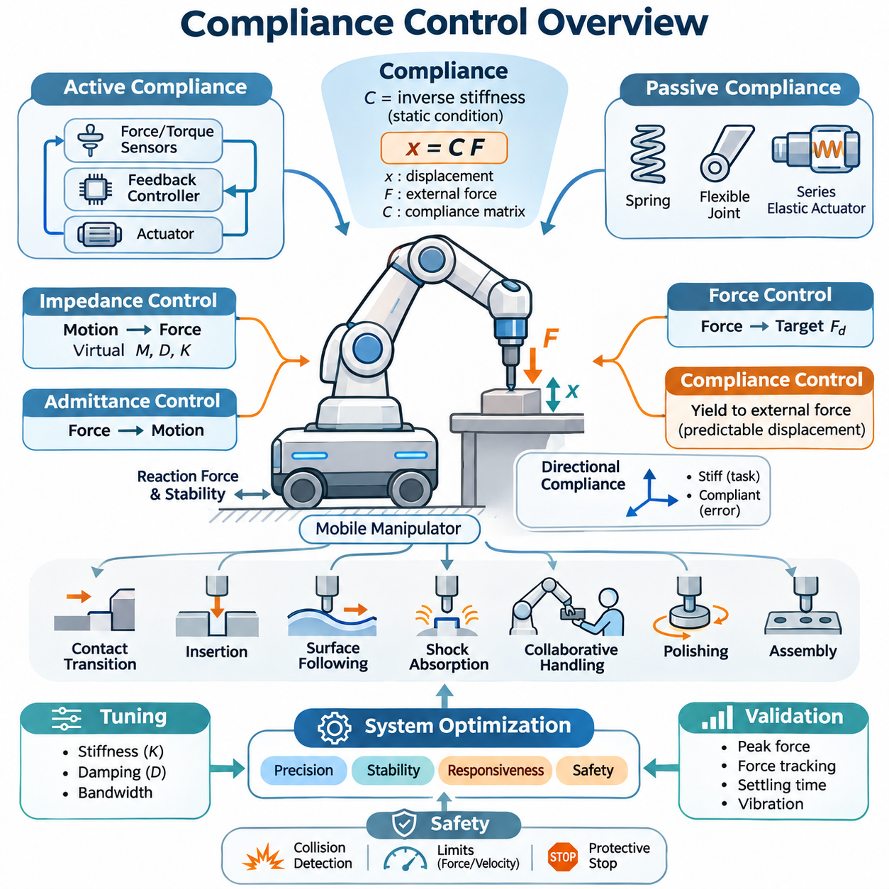
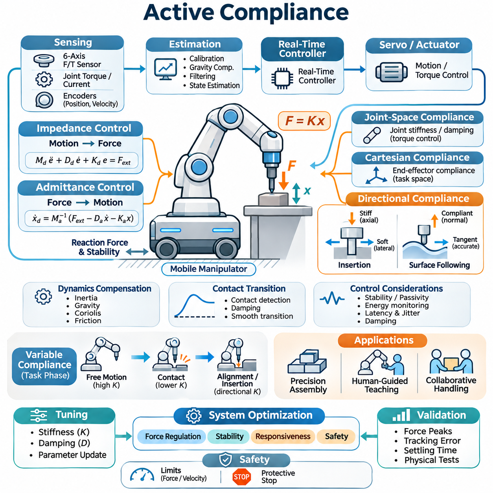
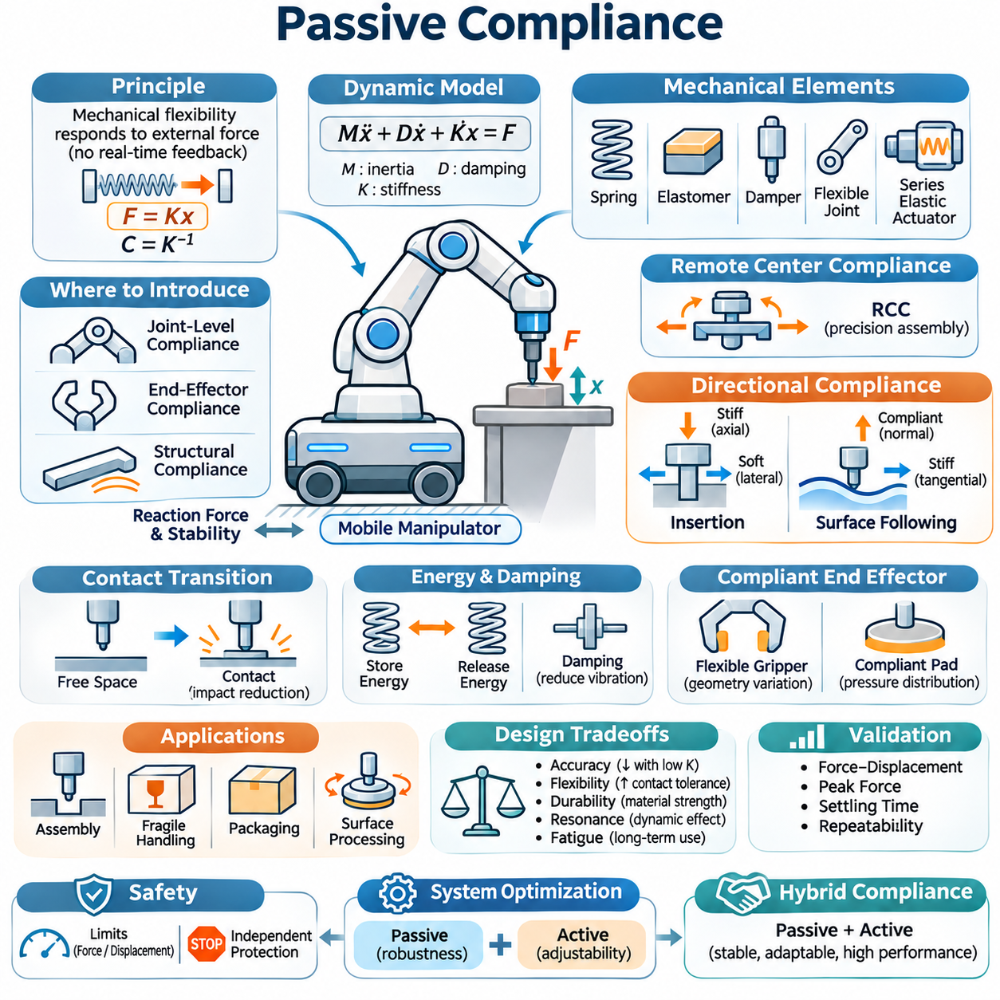
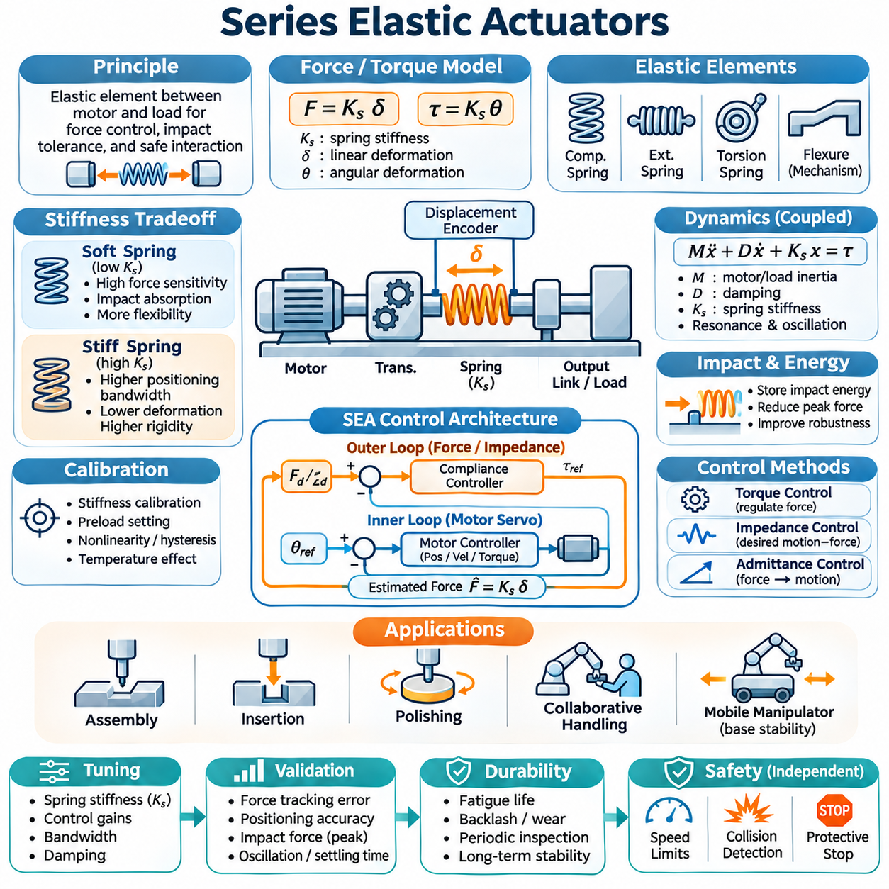
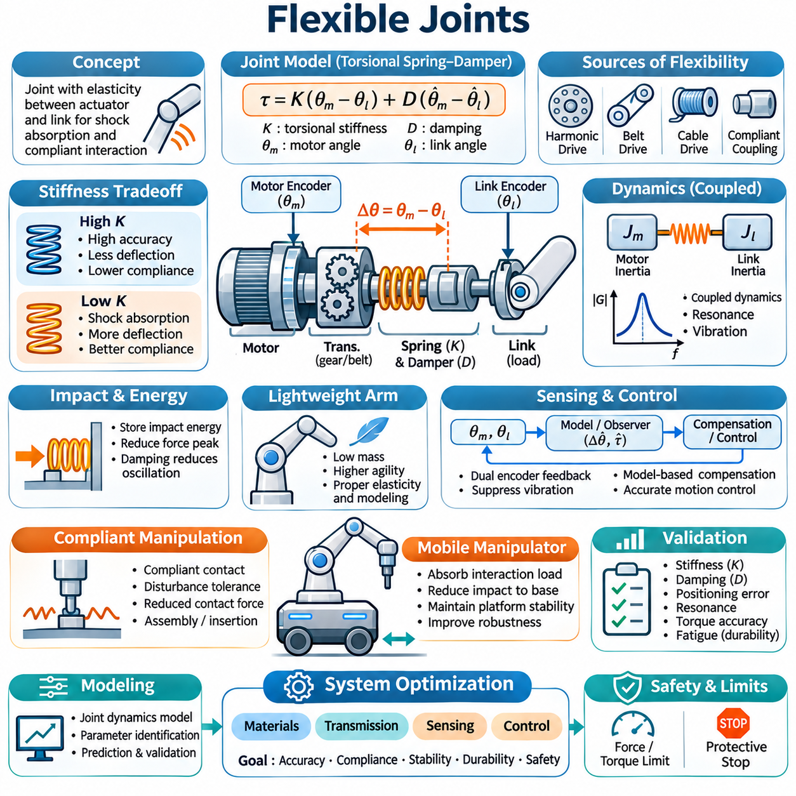
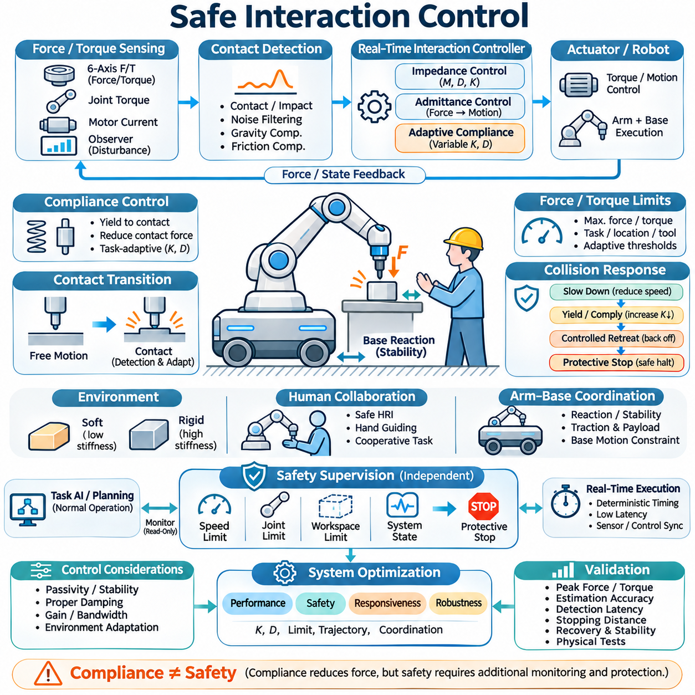
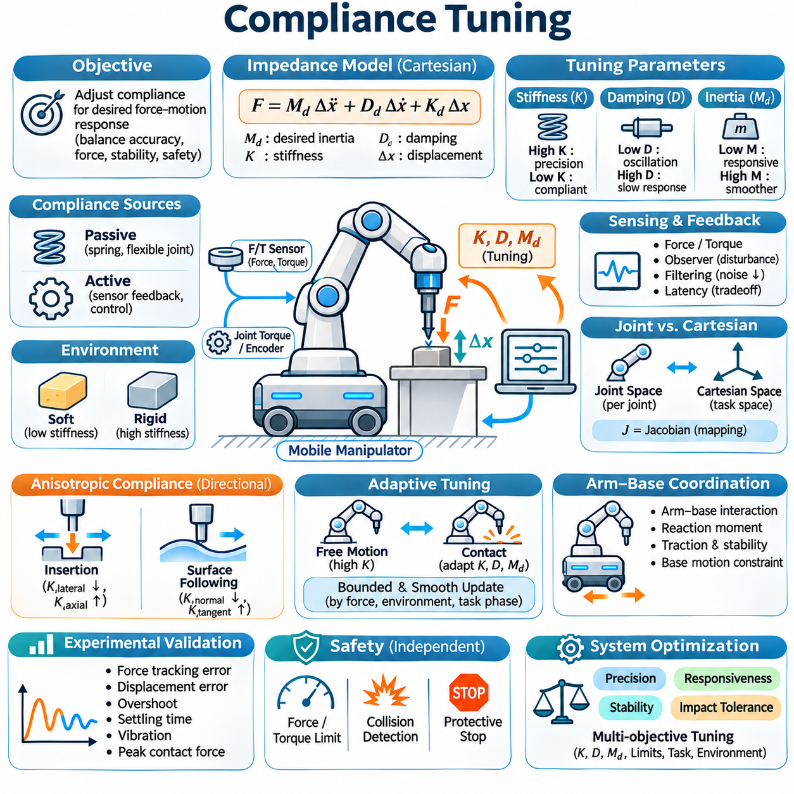
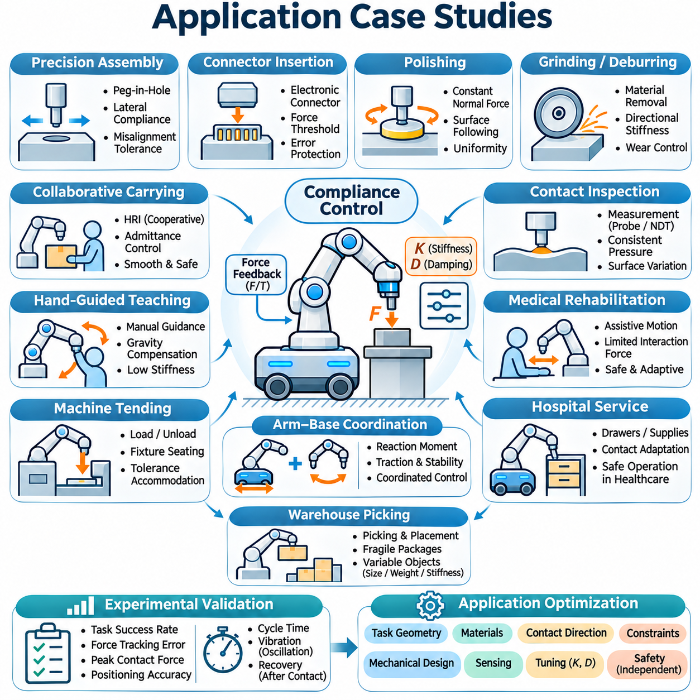
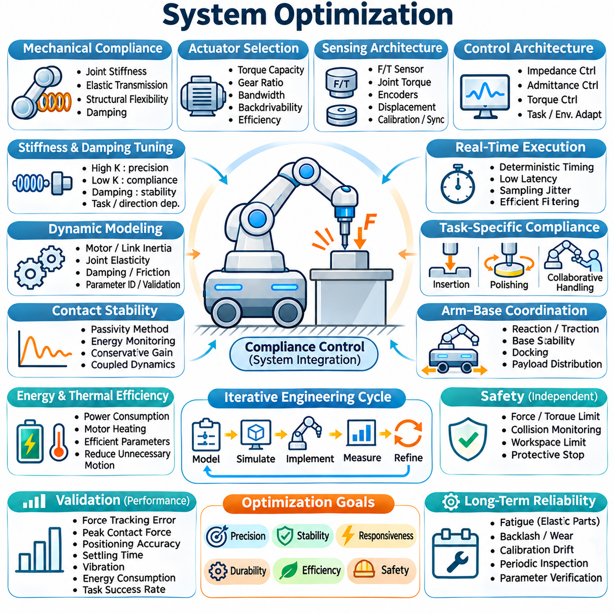

**Volume 02. Manipulator Mechanics and Control**


# Chapter 09. Compliance Control

##  

## 01 Compliance Control Overview

{width="7.268055555555556in" height="7.268055555555556in"}

Compliance control is a fundamental approach in robotic manipulation that enables a robot to respond flexibly to external forces, physical contact, and environmental uncertainty. Unlike rigid position control, which attempts to maintain a predetermined trajectory, compliance control allows controlled deviations from the commanded motion. This behavior improves interaction quality, reduces excessive contact forces, and supports reliable manipulation in environments where exact geometric conditions cannot be guaranteed.

The primary objective of compliance control is to regulate the mechanical relationship between external forces and robot motion. A compliant manipulator can adapt its position, orientation, or joint configuration when encountering unexpected resistance. This adaptability is particularly important during assembly, surface contact, object handling, and human-robot collaboration. By permitting controlled mechanical displacement, the robot can maintain task effectiveness while reducing the likelihood of damage.

Compliance represents the displacement produced by an applied force and is commonly interpreted as the inverse of stiffness under appropriate static conditions. A highly compliant system produces relatively large displacement under a small external force, whereas a stiff system resists deformation. In robotic applications, compliance may be defined at individual joints or at the end effector. Its characteristics depend on mechanical construction, actuator behavior, control algorithms, and the direction of applied forces.

A simplified static relationship can be expressed as x = C F, where x represents displacement, F represents external force, and C denotes the compliance matrix. For multidimensional manipulation, this matrix describes how forces and torques influence translational and rotational displacement. Compliance is therefore not necessarily uniform across all directions. A robot may be designed to remain stiff along a primary task direction while allowing greater flexibility in directions associated with positioning errors.

Compliance control is generally divided into active and passive approaches. Active compliance uses sensors, actuators, and feedback algorithms to modify robot behavior according to measured or estimated interaction forces. Passive compliance relies on mechanical properties such as springs, flexible joints, elastic materials, and compliant mechanisms. Both approaches provide adaptability, but they differ in response bandwidth, implementation complexity, energy requirements, and dependence on control software.

Active compliance enables programmable mechanical behavior through coordinated sensing and motion control. Joint torque sensors, force-torque sensors, motor current measurements, and observer-based estimators can provide information about external interactions. The controller uses this information to adjust motion commands or actuator torques. Because compliance parameters can be modified during operation, active systems can support different interaction requirements without physically changing the manipulator structure.

Passive compliance introduces mechanical flexibility directly into the robot\'s physical structure. Elastic elements can absorb impact energy, accommodate small alignment errors, and reduce peak contact forces without requiring immediate computational intervention. Such characteristics are valuable when communication delays or controller bandwidth limitations prevent sufficiently fast responses. However, passive compliance is constrained by mechanical design and cannot provide arbitrary adjustments to stiffness or damping during operation.

Series elastic actuators are an important example of mechanically compliant actuation. They incorporate an elastic element between the motor transmission and the driven load, allowing force to be estimated from measured spring deformation when stiffness is known. This configuration improves force regulation and can reduce the transmission of sudden impacts. However, elastic deformation introduces additional dynamics that must be considered when designing position controllers, torque controllers, and interaction control strategies.

Flexible joints provide another mechanism for achieving compliant behavior. Their elasticity may originate from transmission components, intentional mechanical structures, or material deformation. Joint flexibility changes the relationship between motor position and link position, creating coupled dynamics that differ from ideal rigid-joint models. Accurate control therefore requires consideration of elastic deflection, joint stiffness, damping, and possible oscillations, especially when high positioning accuracy is required.

Compliance control is closely related to impedance and admittance control, although these concepts describe different aspects of interaction behavior. Impedance control establishes a desired dynamic relationship between motion deviation and interaction force, typically using virtual stiffness, damping, and inertia. Admittance control converts measured external forces into motion references. Both methods can generate compliant behavior, but their suitability depends on actuator characteristics, sensing capabilities, and controller architecture.

The distinction between compliance and force control is also important. Force control primarily attempts to regulate contact force toward a desired reference, whereas compliance control emphasizes the robot\'s ability to yield predictably under external loading. A compliant robot may allow displacement without maintaining a specific force target. In practical manipulation systems, these objectives are frequently combined to achieve stable contact, accurate force regulation, and controlled movement during constrained operations.

Contact transitions present significant challenges because the mechanical interaction changes when a manipulator moves from free space into contact with an object or surface. A controller optimized for unconstrained motion may generate excessive forces when unexpected contact occurs. Compliance can reduce these forces by allowing motion errors to be absorbed through controlled displacement. Appropriate damping and contact detection are nevertheless necessary to prevent oscillations, unstable responses, or repeated impacts.

Compliance characteristics must be selected according to the task and surrounding environment. Precision insertion may require low lateral stiffness to accommodate small alignment errors while maintaining sufficient axial stiffness for insertion. Surface following may require compliance normal to the surface and accurate motion control along the tangential direction. These directional requirements demonstrate why compliance should be treated as a task-dependent property rather than a single universal parameter.

Safe physical interaction is another major motivation for compliance control. When robots operate near people, compliant behavior can reduce contact forces and improve responsiveness to unexpected disturbances. Nevertheless, compliance alone does not guarantee safety because impact severity also depends on effective mass, velocity, geometry, and available stopping distance. Safety-oriented systems must integrate compliant control with collision detection, motion limitations, protective functions, and appropriate risk assessment.

In mobile manipulators, compliance control must account for interactions between the robotic arm and its mobile platform. External forces applied at the end effector can generate reaction forces and moments that influence platform stability, wheel-ground contact, and localization accuracy. The controller may need to coordinate arm motion with base constraints, especially during assembly or manipulation involving substantial contact forces. This interaction creates additional challenges beyond those encountered in fixed-base manipulators.

Compliance tuning determines how the robot balances positioning accuracy, responsiveness, stability, and contact-force limitations. Excessive stiffness can produce large forces when geometric errors occur, while insufficient stiffness may cause poor tracking accuracy or excessive deflection. Damping influences transient response and helps suppress oscillation. Effective tuning requires consideration of actuator bandwidth, sensor noise, communication delay, mechanical flexibility, and the dynamic properties of the contacted environment.

Performance evaluation should examine both free-motion behavior and physical interaction under representative operating conditions. Relevant measurements include contact-force peaks, steady-state displacement, force tracking error, settling time, vibration, and recovery after disturbances. Repeated experiments with different surface stiffness values and contact geometries help reveal controller limitations. These evaluations are essential because successful behavior in simulation does not automatically guarantee reliable operation on physical hardware.

Industrial applications demonstrate the practical importance of compliant manipulation. Robotic assembly benefits from tolerance compensation during insertion and alignment, while polishing and finishing operations require controlled contact with irregular surfaces. Collaborative handling tasks benefit from predictable responses to externally applied forces. In each case, compliance improves adaptability, but successful deployment depends on integrating mechanical design, sensing, control algorithms, and application-specific operating constraints.

System-level optimization involves selecting an appropriate combination of active compliance, passive elasticity, actuator technology, and control architecture. Designers must balance mechanical simplicity against programmability, interaction performance against positioning precision, and response speed against stability margins. A well-designed compliant manipulator does not merely behave softly. It provides predictable, controllable, and task-appropriate mechanical interaction while maintaining the performance and safety requirements of the complete robotic system.

컴플라이언스 제어(Compliance Control)는 로봇 조작(Robotic Manipulation)에서 외력(External Force), 물리적 접촉(Physical Contact), 환경 불확실성(Environmental Uncertainty)에 유연하게 대응할 수 있도록 하는 핵심 제어 방식이다. 미리 정해진 궤적(Trajectory)을 유지하려는 강체 위치 제어(Rigid Position Control)와 달리, 컴플라이언스 제어는 명령된 운동(Commanded Motion)에서 제어된 편차(Controlled Deviation)를 허용한다. 이러한 특성은 상호작용 품질(Interaction Quality)을 개선하고 과도한 접촉력(Contact Force)을 감소시키며, 정확한 기하학적 조건(Geometric Conditions)을 보장하기 어려운 환경에서도 안정적인 조작을 지원한다.

컴플라이언스 제어의 주요 목적은 외력(External Force)과 로봇 운동(Robot Motion) 사이의 기계적 관계(Mechanical Relationship)를 조절하는 것이다. 유연성을 갖춘 매니퓰레이터(Compliant Manipulator)는 예상하지 못한 저항(Unexpected Resistance)이 발생하면 위치(Position), 자세(Orientation), 관절 구성(Joint Configuration)을 조정할 수 있다. 이러한 적응성(Adaptability)은 조립(Assembly), 표면 접촉(Surface Contact), 물체 취급(Object Handling), 인간-로봇 협업(Human-Robot Collaboration)에서 특히 중요하다. 제어된 기계적 변위(Mechanical Displacement)를 허용함으로써 작업 성능(Task Performance)을 유지하면서 손상 가능성을 줄일 수 있다.

컴플라이언스(Compliance)는 가해진 힘(Applied Force)에 의해 발생하는 변위(Displacement)를 의미하며, 적절한 정적 조건(Static Conditions)에서는 강성(Stiffness)의 역수로 해석할 수 있다. 컴플라이언스가 높은 시스템(Highly Compliant System)은 작은 외력에도 비교적 큰 변위를 발생시키지만, 강성이 높은 시스템(Stiff System)은 변형(Deformation)에 저항한다. 로봇 응용에서는 개별 관절(Joint) 또는 말단효과기(End Effector)를 기준으로 컴플라이언스를 정의할 수 있다. 이러한 특성은 기계적 구조(Mechanical Structure), 액추에이터(Actuator), 제어 알고리즘(Control Algorithm), 힘의 작용 방향에 따라 달라진다.

단순화된 정적 관계(Static Relationship)는 x = C F로 표현할 수 있으며, 여기서 x는 변위(Displacement), F는 외력(External Force), C는 컴플라이언스 행렬(Compliance Matrix)을 의미한다. 다차원 조작(Multidimensional Manipulation)에서는 이 행렬을 통해 힘(Force)과 토크(Torque)가 병진 변위(Translational Displacement) 및 회전 변위(Rotational Displacement)에 미치는 영향을 설명한다. 따라서 컴플라이언스는 모든 방향에서 동일할 필요가 없다. 로봇은 주요 작업 방향(Task Direction)에서는 높은 강성을 유지하면서 위치 오차(Positioning Error)가 발생하는 방향에서는 더 높은 유연성을 갖도록 설계할 수 있다.

컴플라이언스 제어는 일반적으로 능동 컴플라이언스(Active Compliance)와 수동 컴플라이언스(Passive Compliance)로 구분된다. 능동 컴플라이언스는 센서(Sensor), 액추에이터(Actuator), 피드백 알고리즘(Feedback Algorithm)을 이용하여 측정하거나 추정한 상호작용 힘(Interaction Force)에 따라 로봇 동작을 수정한다. 수동 컴플라이언스는 스프링(Spring), 유연 관절(Flexible Joint), 탄성 재료(Elastic Material), 유연 기구(Compliant Mechanism)와 같은 기계적 특성을 활용한다. 두 방식 모두 적응성을 제공하지만 응답 대역폭(Response Bandwidth), 구현 복잡도(Implementation Complexity), 에너지 요구량(Energy Requirement), 제어 소프트웨어 의존성에서 차이가 있다.

능동 컴플라이언스(Active Compliance)는 센싱(Sensing)과 운동 제어(Motion Control)를 통합하여 프로그래밍 가능한 기계적 동작(Programmable Mechanical Behavior)을 구현한다. 관절 토크 센서(Joint Torque Sensor), 힘-토크 센서(Force-Torque Sensor), 모터 전류 측정(Motor Current Measurement), 관측기 기반 추정기(Observer-Based Estimator)를 통해 외부 상호작용 정보를 얻을 수 있다. 제어기(Controller)는 이 정보를 이용하여 운동 명령(Motion Command)이나 액추에이터 토크(Actuator Torque)를 조정한다. 운용 중 컴플라이언스 매개변수(Compliance Parameter)를 변경할 수 있으므로 기계적 구조를 변경하지 않고도 다양한 상호작용 요구사항을 지원할 수 있다.

수동 컴플라이언스(Passive Compliance)는 로봇의 물리적 구조(Physical Structure)에 직접 기계적 유연성(Mechanical Flexibility)을 부여한다. 탄성 요소(Elastic Element)는 충격 에너지(Impact Energy)를 흡수하고 작은 정렬 오차(Alignment Error)를 보상하며, 즉각적인 계산 개입 없이 최대 접촉력(Peak Contact Force)을 줄일 수 있다. 이러한 특성은 통신 지연(Communication Delay)이나 제어기 대역폭(Controller Bandwidth)의 한계로 충분히 빠른 응답을 제공하기 어려울 때 유용하다. 그러나 수동 컴플라이언스는 기계적 설계에 의해 제한되므로 운용 중 강성(Stiffness)이나 감쇠(Damping)를 임의로 조정하기 어렵다.

직렬 탄성 액추에이터(Series Elastic Actuator, SEA)는 기계적 컴플라이언스(Mechanical Compliance)를 구현하는 대표적인 구동 방식이다. 모터 전달계(Motor Transmission)와 구동 부하(Driven Load) 사이에 탄성 요소(Elastic Element)를 배치하며, 스프링 강성(Spring Stiffness)을 알고 있다면 측정된 스프링 변형(Spring Deformation)으로부터 힘을 추정할 수 있다. 이러한 구조는 힘 조절(Force Regulation)을 개선하고 갑작스러운 충격 전달을 줄일 수 있다. 그러나 탄성 변형은 추가적인 동특성(Dynamics)을 발생시키므로 위치 제어기(Position Controller), 토크 제어기(Torque Controller), 상호작용 제어 전략(Interaction Control Strategy)을 설계할 때 이를 고려해야 한다.

유연 관절(Flexible Joint)은 컴플라이언스 동작(Compliant Behavior)을 구현하는 또 다른 방법이다. 관절의 탄성(Elasticity)은 동력 전달 부품(Transmission Component), 의도적으로 설계된 기계 구조(Mechanical Structure), 재료 변형(Material Deformation)에서 발생할 수 있다. 관절 유연성(Joint Flexibility)은 모터 위치(Motor Position)와 링크 위치(Link Position)의 관계를 변화시키며, 이상적인 강체 관절 모델(Rigid-Joint Model)과 다른 결합 동역학(Coupled Dynamics)을 형성한다. 따라서 정확한 제어를 위해서는 탄성 변위(Elastic Deflection), 관절 강성(Joint Stiffness), 감쇠(Damping), 진동(Oscillation)을 고려해야 하며, 특히 높은 위치 정확도(Positioning Accuracy)가 요구되는 작업에서 중요하다.

컴플라이언스 제어는 임피던스 제어(Impedance Control) 및 어드미턴스 제어(Admittance Control)와 밀접하게 관련되어 있지만, 이 개념들은 상호작용 동작(Interaction Behavior)의 서로 다른 측면을 설명한다. 임피던스 제어는 가상 강성(Virtual Stiffness), 감쇠(Damping), 관성(Inertia)을 이용하여 운동 편차(Motion Deviation)와 상호작용 힘(Interaction Force) 사이의 목표 동적 관계(Desired Dynamic Relationship)를 설정한다. 어드미턴스 제어는 측정된 외력을 운동 기준값(Motion Reference)으로 변환한다. 두 방식 모두 컴플라이언스 동작을 구현할 수 있지만, 적합성은 액추에이터 특성(Actuator Characteristics), 센싱 능력(Sensing Capability), 제어기 구조(Controller Architecture)에 따라 달라진다.

컴플라이언스 제어(Compliance Control)와 힘 제어(Force Control)의 차이도 중요하다. 힘 제어는 주로 접촉력(Contact Force)을 원하는 기준값(Desired Reference)에 맞추도록 조절하는 반면, 컴플라이언스 제어는 외부 하중(External Loading)에 대해 로봇이 예측 가능한 방식으로 변위를 허용하는 능력을 강조한다. 컴플라이언스를 갖춘 로봇은 특정 힘 목표값(Force Target)을 유지하지 않더라도 변위를 허용할 수 있다. 실제 조작 시스템에서는 이러한 목적을 결합하여 안정적인 접촉(Stable Contact), 정확한 힘 조절(Force Regulation), 구속된 작업 환경(Constrained Environment)에서의 제어된 운동을 구현한다.

접촉 전환(Contact Transition)은 매니퓰레이터가 자유 공간(Free Space)에서 물체 또는 표면과 접촉하는 상태로 이동할 때 기계적 상호작용(Mechanical Interaction)이 변화하기 때문에 중요한 제어 과제가 된다. 비접촉 운동(Unconstrained Motion)에 최적화된 제어기는 예상하지 못한 접촉이 발생하면 과도한 힘을 생성할 수 있다. 컴플라이언스는 제어된 변위(Controlled Displacement)를 통해 운동 오차(Motion Error)를 흡수함으로써 이러한 힘을 감소시킨다. 그러나 진동(Oscillation), 불안정 응답(Unstable Response), 반복 충격(Repeated Impact)을 방지하려면 적절한 감쇠(Damping)와 접촉 감지(Contact Detection)가 필요하다.

컴플라이언스 특성(Compliance Characteristics)은 작업(Task)과 주변 환경(Environment)에 따라 선택해야 한다. 정밀 삽입(Precision Insertion)에서는 작은 정렬 오차(Alignment Error)를 보상하기 위해 측면 강성(Lateral Stiffness)을 낮추면서 삽입에 필요한 축 방향 강성(Axial Stiffness)을 충분히 유지해야 할 수 있다. 표면 추종(Surface Following)에서는 표면 법선 방향(Normal Direction)의 컴플라이언스와 접선 방향(Tangential Direction)의 정확한 운동 제어가 요구된다. 이러한 방향별 요구사항(Directional Requirements)은 컴플라이언스를 단일한 범용 매개변수가 아니라 작업 의존적 특성(Task-Dependent Property)으로 다루어야 함을 보여준다.

안전한 물리적 상호작용(Safe Physical Interaction)은 컴플라이언스 제어의 또 다른 주요 목적이다. 로봇이 사람 가까이에서 동작할 때 컴플라이언스는 접촉력(Contact Force)을 줄이고 예상하지 못한 외란(Unexpected Disturbance)에 대한 응답성을 개선할 수 있다. 그러나 충격의 심각도(Impact Severity)는 유효 질량(Effective Mass), 속도(Velocity), 기하학적 형상(Geometry), 가용 정지 거리(Available Stopping Distance)에 의해서도 결정되므로 컴플라이언스만으로 안전을 보장할 수는 없다. 안전 지향 시스템(Safety-Oriented System)은 컴플라이언스 제어를 충돌 감지(Collision Detection), 운동 제한(Motion Limitation), 보호 기능(Protective Function), 위험 평가(Risk Assessment)와 통합해야 한다.

모바일 매니퓰레이터(Mobile Manipulator)의 컴플라이언스 제어에서는 로봇 팔(Robot Arm)과 이동 플랫폼(Mobile Platform) 사이의 상호작용을 고려해야 한다. 말단효과기(End Effector)에 가해지는 외력은 반력(Reaction Force)과 반력 모멘트(Reaction Moment)를 발생시켜 플랫폼 안정성(Platform Stability), 바퀴-지면 접촉(Wheel-Ground Contact), 위치 추정 정확도(Localization Accuracy)에 영향을 줄 수 있다. 특히 상당한 접촉력이 발생하는 조립 또는 조작 작업에서는 제어기가 로봇 팔의 운동을 이동 베이스 제약조건(Base Constraints)과 조정해야 할 수 있다. 이러한 상호작용은 고정형 매니퓰레이터(Fixed-Base Manipulator)보다 복잡한 제어 문제를 발생시킨다.

컴플라이언스 튜닝(Compliance Tuning)은 로봇의 위치 정확도(Positioning Accuracy), 응답성(Responsiveness), 안정성(Stability), 접촉력 제한(Contact-Force Limitation) 사이의 균형을 결정한다. 강성(Stiffness)이 지나치게 높으면 기하학적 오차(Geometric Error)가 발생할 때 큰 힘이 생성될 수 있으며, 강성이 지나치게 낮으면 추종 정확도(Tracking Accuracy)가 저하되거나 과도한 변위(Excessive Deflection)가 발생할 수 있다. 감쇠(Damping)는 과도 응답(Transient Response)에 영향을 주고 진동 억제(Oscillation Suppression)에 기여한다. 효과적인 튜닝을 위해서는 액추에이터 대역폭(Actuator Bandwidth), 센서 잡음(Sensor Noise), 통신 지연(Communication Delay), 기계적 유연성(Mechanical Flexibility), 접촉 환경의 동적 특성(Dynamic Properties)을 고려해야 한다.

성능 평가(Performance Evaluation)는 대표적인 운용 조건(Operating Conditions)에서 자유 운동(Free Motion)과 물리적 상호작용(Physical Interaction)을 모두 검토해야 한다. 주요 측정 항목에는 최대 접촉력(Peak Contact Force), 정상상태 변위(Steady-State Displacement), 힘 추종 오차(Force Tracking Error), 정착 시간(Settling Time), 진동(Vibration), 외란 이후 복구 성능(Disturbance Recovery)이 포함된다. 다양한 표면 강성(Surface Stiffness)과 접촉 형상(Contact Geometry)을 적용한 반복 실험(Repeated Experiment)은 제어기의 한계를 파악하는 데 도움이 된다. 시뮬레이션(Simulation)에서 성공적인 동작이 실제 하드웨어(Physical Hardware)의 신뢰성 있는 운용을 자동으로 보장하지 않으므로 이러한 평가는 필수적이다.

산업 응용(Industrial Application)은 컴플라이언스 조작(Compliant Manipulation)의 실질적인 중요성을 보여준다. 로봇 조립(Robotic Assembly)은 삽입(Insertion)과 정렬(Alignment) 과정에서 공차 보상(Tolerance Compensation)의 이점을 얻으며, 연마(Polishing)와 표면 마감(Finishing) 작업은 불규칙한 표면(Irregular Surface)에 대한 제어된 접촉이 필요하다. 협업 취급 작업(Collaborative Handling Task)은 외력에 대한 예측 가능한 응답(Predictable Response)을 통해 성능을 개선할 수 있다. 각각의 응용에서 컴플라이언스는 적응성(Adaptability)을 높이지만, 성공적인 현장 적용을 위해서는 기계 설계(Mechanical Design), 센싱(Sensing), 제어 알고리즘(Control Algorithm), 응용별 운용 제약조건(Application-Specific Operating Constraints)의 통합이 필요하다.

시스템 수준 최적화(System-Level Optimization)는 능동 컴플라이언스(Active Compliance), 수동 탄성(Passive Elasticity), 액추에이터 기술(Actuator Technology), 제어 아키텍처(Control Architecture)의 적절한 조합을 선택하는 과정이다. 설계자는 기계적 단순성(Mechanical Simplicity)과 프로그래밍 가능성(Programmability), 상호작용 성능(Interaction Performance)과 위치 정밀도(Positioning Precision), 응답 속도(Response Speed)와 안정성 여유(Stability Margin) 사이의 균형을 고려해야 한다. 잘 설계된 컴플라이언스 매니퓰레이터(Compliant Manipulator)는 단순히 부드럽게 움직이는 로봇이 아니라, 전체 로봇 시스템의 성능 및 안전 요구사항(Performance and Safety Requirements)을 유지하면서 예측 가능하고 제어 가능하며 작업에 적합한 기계적 상호작용(Mechanical Interaction)을 제공하는 시스템이다.

##  

## 02 Active Compliance

{width="7.268055555555556in" height="7.268055555555556in"}

Active compliance is a robotic control approach that enables a manipulator to modify its mechanical response through sensors, actuators, and real-time feedback. Instead of relying exclusively on fixed mechanical elasticity, the robot actively adjusts its motion or torque in response to external forces. This capability allows programmable interaction behavior, making active compliance particularly valuable for precision assembly, contact-rich manipulation, and human-robot collaboration.

The fundamental objective of active compliance is to establish a controlled relationship between external interaction forces and robot displacement. When a manipulator encounters resistance, its controller modifies the commanded motion or actuator torque to produce an appropriate response. This behavior reduces excessive contact forces while maintaining task objectives. Unlike passive compliance, active compliance can change its apparent stiffness, damping, and dynamic response according to operating conditions.

Active compliance systems typically integrate force sensing, motion estimation, dynamic modeling, and closed-loop control. External forces may be measured directly using force-torque sensors or estimated from joint torque measurements and motor currents. Position encoders and velocity estimators provide additional information about robot movement. The controller combines these measurements to determine how the manipulator should respond to contact forces and environmental disturbances.

A simplified active compliance relationship can be represented by F = Kx, where F denotes the interaction force, K represents the commanded stiffness, and x describes displacement relative to an equilibrium position. In dynamic applications, damping and inertia are incorporated to describe transient behavior. By adjusting these parameters, the controller can create different mechanical responses without changing the robot\'s physical structure, provided that the actuator and control system can realize the commanded behavior.

Impedance control is one of the most widely used methods for implementing active compliance. It establishes a desired dynamic relationship between position error, velocity, acceleration, and external force. A typical formulation is M_d ë + D_d ė + K_d e = F_ext, where M_d, D_d, and K_d represent desired inertia, damping, and stiffness. The controller uses this relationship to generate compliant motion while regulating the robot\'s response to physical interaction.

Admittance control provides another practical implementation, particularly for robots equipped with accurate position controllers. In this approach, measured external forces are converted into desired position or velocity references through a virtual mechanical model. The resulting motion commands are executed by the underlying servo system. Admittance control is especially useful when direct joint torque control is unavailable, although its effectiveness depends on force measurement quality and achievable motion bandwidth.

Joint-level active compliance regulates individual actuator behavior according to measured or estimated external torques. A controller may adjust joint stiffness, damping, or torque commands to accommodate disturbances. Cartesian compliance instead controls the response of the end effector in task-space coordinates. Cartesian methods are often more intuitive for assembly and surface interaction because compliance can be assigned independently along selected translational and rotational directions.

Directional compliance is essential when a manipulation task requires different mechanical responses along different axes. During peg-in-hole insertion, for example, low lateral stiffness can accommodate small alignment errors while sufficient axial stiffness supports insertion. Similarly, surface following may require compliance normal to the contacted surface while maintaining accurate tangential motion. These behaviors can be implemented using task-space stiffness matrices and appropriate coordinate transformations.

Force feedback plays a central role in active compliance because it provides information about the interaction between the manipulator and its environment. Six-axis force-torque sensors can measure three force components and three torque components at the wrist or tool interface. Joint torque sensors provide complementary information about distributed loading. Accurate calibration, gravity compensation, sensor filtering, and coordinate transformation are necessary to interpret these measurements correctly.

Model-based active compliance incorporates robot dynamics to improve response accuracy. Gravity, inertia, Coriolis effects, and friction influence the relationship between commanded actuator torque and actual movement. Dynamic compensation can reduce these effects, allowing the controller to approximate the desired mechanical impedance more closely. However, modeling errors and unmodeled flexibility may degrade performance, particularly during rapid contact transitions or interactions with stiff environments.

Contact transitions represent a major challenge for active compliance controllers. When the robot moves from free space into physical contact, interaction forces may increase rapidly. A controller with excessive stiffness or insufficient damping can produce oscillations or high impact forces. Smooth reference trajectories, contact detection, appropriate damping, and controlled parameter transitions help reduce these effects. Stable behavior requires consideration of both robot dynamics and environmental stiffness.

Variable compliance allows the robot to modify its mechanical behavior during different phases of a task. A manipulator may operate with relatively high stiffness during free-space positioning, reduce stiffness during initial contact, and adjust directional compliance during insertion or alignment. Such adaptation can improve both efficiency and interaction quality. Nevertheless, rapidly changing stiffness or damping parameters can introduce energy into the system and must be managed carefully.

Passivity and stability are important considerations in active compliance design. A passive interaction system does not generate net energy beyond its stored energy and supplied mechanical input, making passivity a useful framework for analyzing physical interaction. Control delays, discretization, actuator saturation, and aggressive parameter adaptation can compromise this property. Passivity observers, energy tanks, and conservative damping strategies are among the techniques used to improve interaction stability.

Real-time implementation requires coordinated execution of sensing, estimation, control computation, and actuator commands. High-frequency control loops are often necessary to achieve responsive force regulation and stable contact behavior. Communication latency and timing jitter can reduce achievable bandwidth and introduce phase delays. Consequently, active compliance performance depends not only on control algorithms but also on embedded computing capabilities, communication architecture, and deterministic execution.

Active compliance in mobile manipulators introduces additional complexity because interaction forces affect both the robotic arm and its mobile base. Contact forces can create reaction moments that influence platform stability, wheel loading, and positioning accuracy. The controller must consider whether the base is stationary, mechanically restrained, or moving during manipulation. Coordinated arm-base control can improve interaction performance while respecting mobility, traction, and stability constraints.

Human-robot collaboration is another important application of active compliance. A robot can respond to forces applied by a human operator, allowing guided motion, cooperative object handling, and physical teaching. Low apparent stiffness may make the manipulator easier to move, while suitable damping prevents unwanted oscillation. However, safe collaboration also requires independent protective functions, force and speed limitations, collision monitoring, and application-specific risk assessment.

Industrial assembly illustrates the practical benefits of active compliance. During connector insertion, component alignment, or precision fitting, small geometric errors may generate substantial contact forces under rigid position control. A compliant controller allows limited corrective displacement while maintaining the intended assembly direction. Force feedback can also indicate unsuccessful insertion, unexpected obstruction, or excessive resistance, enabling the system to stop, retract, or initiate a recovery procedure.

Compliance tuning requires balancing positioning accuracy, force responsiveness, damping, and stability. Excessively high stiffness may cause damaging contact forces, whereas overly low stiffness can produce unacceptable displacement and poor task accuracy. Insufficient damping can lead to oscillation, while excessive damping slows adaptation. Engineers should evaluate controller behavior under different payloads, contact geometries, environmental stiffness values, and disturbance conditions before deployment.

Performance evaluation should include contact-force peaks, steady-state displacement, response time, settling behavior, force estimation accuracy, and tracking error. Experiments should examine both free-space motion and sustained contact with representative materials. Repeated trials can reveal sensitivity to sensor noise, payload variation, communication delay, and model uncertainty. Simulation provides useful preliminary evidence, but physical testing remains necessary to validate real interaction behavior.

System-level optimization integrates mechanical design, sensor placement, actuator capabilities, dynamic modeling, and control software. Active compliance should be configured according to the task rather than treated as a universal low-stiffness operating mode. Effective implementations combine accurate sensing, stable feedback, suitable compliance parameters, and reliable safety supervision. The resulting system can maintain precision when necessary while adapting predictably to physical contact and environmental uncertainty.

능동 컴플라이언스(Active Compliance)는 센서(Sensor), 액추에이터(Actuator), 실시간 피드백(Real-Time Feedback)을 통해 매니퓰레이터(Manipulator)의 기계적 응답(Mechanical Response)을 조정할 수 있도록 하는 로봇 제어 방식이다. 고정된 기계적 탄성(Mechanical Elasticity)에만 의존하는 대신, 로봇은 외력(External Force)에 대응하여 운동(Motion)이나 토크(Torque)를 능동적으로 조절한다. 이러한 기능은 프로그래밍 가능한 상호작용 동작(Programmable Interaction Behavior)을 제공하므로 정밀 조립(Precision Assembly), 접촉 중심 조작(Contact-Rich Manipulation), 인간-로봇 협업(Human-Robot Collaboration)에서 특히 중요하다.

능동 컴플라이언스의 기본 목적은 외부 상호작용 힘(External Interaction Force)과 로봇 변위(Robot Displacement) 사이에 제어된 관계(Controlled Relationship)를 형성하는 것이다. 매니퓰레이터가 저항(Resistance)을 만나면 제어기(Controller)는 명령된 운동(Commanded Motion)이나 액추에이터 토크(Actuator Torque)를 수정하여 적절한 응답을 생성한다. 이러한 동작은 작업 목표(Task Objective)를 유지하면서 과도한 접촉력(Contact Force)을 감소시킨다. 수동 컴플라이언스(Passive Compliance)와 달리 능동 컴플라이언스는 운용 조건(Operating Condition)에 따라 겉보기 강성(Apparent Stiffness), 감쇠(Damping), 동적 응답(Dynamic Response)을 변경할 수 있다.

능동 컴플라이언스 시스템(Active Compliance System)은 일반적으로 힘 감지(Force Sensing), 운동 추정(Motion Estimation), 동역학 모델링(Dynamic Modeling), 폐루프 제어(Closed-Loop Control)를 통합한다. 외력은 힘-토크 센서(Force-Torque Sensor)를 통해 직접 측정하거나 관절 토크 측정(Joint Torque Measurement) 및 모터 전류(Motor Current)를 이용하여 추정할 수 있다. 위치 엔코더(Position Encoder)와 속도 추정기(Velocity Estimator)는 로봇 운동에 관한 추가 정보를 제공한다. 제어기는 이러한 측정값을 결합하여 접촉력과 환경 외란(Environmental Disturbance)에 대한 매니퓰레이터의 응답을 결정한다.

단순화된 능동 컴플라이언스 관계(Active Compliance Relationship)는 F = Kx로 표현할 수 있으며, 여기서 F는 상호작용 힘(Interaction Force), K는 명령 강성(Commanded Stiffness), x는 평형 위치(Equilibrium Position)에 대한 변위(Displacement)를 의미한다. 동적 응용(Dynamic Application)에서는 과도 응답(Transient Behavior)을 설명하기 위해 감쇠(Damping)와 관성(Inertia)을 추가한다. 제어기는 이러한 매개변수(Parameter)를 조정함으로써 로봇의 물리적 구조를 변경하지 않고도 다양한 기계적 응답을 구현할 수 있다. 다만 이러한 동작은 액추에이터와 제어 시스템이 명령된 특성을 실제로 구현할 수 있어야 한다.

임피던스 제어(Impedance Control)는 능동 컴플라이언스를 구현하는 가장 널리 사용되는 방법 중 하나이다. 이 방식은 위치 오차(Position Error), 속도(Velocity), 가속도(Acceleration), 외력(External Force) 사이에 원하는 동적 관계(Desired Dynamic Relationship)를 설정한다. 대표적인 수식은 M_d ë + D_d ė + K_d e = F_ext이며, 여기서 M_d, D_d, K_d는 각각 목표 관성(Desired Inertia), 목표 감쇠(Desired Damping), 목표 강성(Desired Stiffness)을 의미한다. 제어기는 이 관계를 이용하여 물리적 상호작용에 대한 로봇의 응답을 조절하면서 유연한 운동(Compliant Motion)을 생성한다.

어드미턴스 제어(Admittance Control)는 특히 정확한 위치 제어기(Position Controller)를 갖춘 로봇에서 활용할 수 있는 또 다른 실용적인 구현 방법이다. 이 방식에서는 측정된 외력(Measured External Force)을 가상 기계 모델(Virtual Mechanical Model)을 통해 목표 위치(Desired Position) 또는 목표 속도(Desired Velocity) 기준값으로 변환한다. 생성된 운동 명령(Motion Command)은 하위 서보 시스템(Servo System)에 의해 실행된다. 어드미턴스 제어는 직접적인 관절 토크 제어(Direct Joint Torque Control)를 사용할 수 없는 경우에 특히 유용하지만, 성능은 힘 측정 품질(Force Measurement Quality)과 구현 가능한 운동 대역폭(Motion Bandwidth)에 따라 달라진다.

관절 수준 능동 컴플라이언스(Joint-Level Active Compliance)는 측정하거나 추정한 외부 토크(External Torque)에 따라 개별 액추에이터의 동작을 조절한다. 제어기는 외란(Disturbance)에 대응하기 위해 관절 강성(Joint Stiffness), 감쇠(Damping), 토크 명령(Torque Command)을 조정할 수 있다. 반면 직교좌표계 컴플라이언스(Cartesian Compliance)는 작업 공간 좌표(Task-Space Coordinates)에서 말단효과기(End Effector)의 응답을 제어한다. 직교좌표계 방식은 선택된 병진 방향(Translational Direction)과 회전 방향(Rotational Direction)에 독립적으로 컴플라이언스를 부여할 수 있으므로 조립 및 표면 상호작용 작업에서 직관적으로 활용할 수 있다.

방향별 컴플라이언스(Directional Compliance)는 조작 작업에서 축마다 서로 다른 기계적 응답(Mechanical Response)이 요구될 때 필수적이다. 예를 들어 핀-구멍 삽입(Peg-in-Hole Insertion)에서는 낮은 측면 강성(Lateral Stiffness)을 통해 작은 정렬 오차(Alignment Error)를 보상하면서 충분한 축 방향 강성(Axial Stiffness)을 유지하여 삽입을 지원할 수 있다. 마찬가지로 표면 추종(Surface Following)에서는 접촉 표면의 법선 방향(Normal Direction)으로 컴플라이언스를 제공하면서 접선 방향(Tangential Direction)의 운동 정확도를 유지해야 할 수 있다. 이러한 동작은 작업 공간 강성 행렬(Task-Space Stiffness Matrix)과 적절한 좌표 변환(Coordinate Transformation)을 이용하여 구현할 수 있다.

힘 피드백(Force Feedback)은 매니퓰레이터와 환경 사이의 상호작용 정보를 제공하므로 능동 컴플라이언스에서 핵심적인 역할을 한다. 6축 힘-토크 센서(Six-Axis Force-Torque Sensor)는 손목(Wrist) 또는 공구 인터페이스(Tool Interface)에서 세 방향의 힘 성분(Force Component)과 세 방향의 토크 성분(Torque Component)을 측정할 수 있다. 관절 토크 센서(Joint Torque Sensor)는 분산 하중(Distributed Loading)에 관한 보완적인 정보를 제공한다. 이러한 측정값을 정확하게 해석하려면 센서 보정(Sensor Calibration), 중력 보상(Gravity Compensation), 센서 필터링(Sensor Filtering), 좌표 변환(Coordinate Transformation)이 필요하다.

모델 기반 능동 컴플라이언스(Model-Based Active Compliance)는 로봇 동역학(Robot Dynamics)을 활용하여 응답 정확도(Response Accuracy)를 개선한다. 중력(Gravity), 관성(Inertia), 코리올리 효과(Coriolis Effect), 마찰(Friction)은 액추에이터 토크 명령과 실제 운동 사이의 관계에 영향을 미친다. 동역학 보상(Dynamic Compensation)은 이러한 영향을 줄여 제어기가 원하는 기계적 임피던스(Mechanical Impedance)를 더욱 정확하게 구현하도록 한다. 그러나 모델링 오차(Modeling Error)와 모델에 반영되지 않은 유연성(Unmodeled Flexibility)은 특히 빠른 접촉 전환(Contact Transition)이나 강성이 높은 환경(Stiff Environment)과의 상호작용에서 성능을 저하시킬 수 있다.

접촉 전환(Contact Transition)은 능동 컴플라이언스 제어기(Active Compliance Controller)의 주요 과제 중 하나이다. 로봇이 자유 공간(Free Space)에서 물리적 접촉(Physical Contact) 상태로 이동하면 상호작용 힘(Interaction Force)이 빠르게 증가할 수 있다. 강성(Stiffness)이 지나치게 높거나 감쇠(Damping)가 부족한 제어기는 진동(Oscillation)이나 높은 충격력(Impact Force)을 발생시킬 수 있다. 부드러운 기준 궤적(Reference Trajectory), 접촉 감지(Contact Detection), 적절한 감쇠, 제어 매개변수의 점진적 전환(Controlled Parameter Transition)은 이러한 영향을 줄이는 데 도움이 된다. 안정적인 동작을 위해서는 로봇 동역학과 환경 강성(Environmental Stiffness)을 함께 고려해야 한다.

가변 컴플라이언스(Variable Compliance)는 로봇이 작업 단계(Task Phase)에 따라 기계적 동작(Mechanical Behavior)을 변경할 수 있도록 한다. 매니퓰레이터는 자유 공간 위치 결정(Free-Space Positioning) 중에는 비교적 높은 강성으로 동작하고, 초기 접촉(Initial Contact)에서는 강성을 낮추며, 삽입(Insertion)이나 정렬(Alignment) 중에는 방향별 컴플라이언스를 조정할 수 있다. 이러한 적응(Adaptation)은 작업 효율(Efficiency)과 상호작용 품질(Interaction Quality)을 모두 개선할 수 있다. 그러나 강성이나 감쇠 매개변수를 급격하게 변경하면 시스템에 에너지가 유입될 수 있으므로 신중하게 관리해야 한다.

수동성(Passivity)과 안정성(Stability)은 능동 컴플라이언스 설계에서 중요한 고려사항이다. 수동적 상호작용 시스템(Passive Interaction System)은 저장된 에너지(Stored Energy)와 공급된 기계적 입력(Mechanical Input)을 초과하는 순에너지(Net Energy)를 생성하지 않으므로, 수동성은 물리적 상호작용을 분석하는 유용한 이론적 틀(Framework)을 제공한다. 제어 지연(Control Delay), 이산화(Discretization), 액추에이터 포화(Actuator Saturation), 과도한 매개변수 적응(Parameter Adaptation)은 이러한 특성을 손상시킬 수 있다. 수동성 관측기(Passivity Observer), 에너지 탱크(Energy Tank), 보수적인 감쇠 전략(Conservative Damping Strategy)은 상호작용 안정성을 개선하는 데 활용되는 방법이다.

실시간 구현(Real-Time Implementation)에서는 센싱(Sensing), 추정(Estimation), 제어 연산(Control Computation), 액추에이터 명령(Actuator Command)을 조정하여 실행해야 한다. 응답성이 높은 힘 조절(Force Regulation)과 안정적인 접촉 동작(Contact Behavior)을 구현하려면 높은 주파수의 제어 루프(High-Frequency Control Loop)가 필요한 경우가 많다. 통신 지연(Communication Latency)과 타이밍 지터(Timing Jitter)는 구현 가능한 대역폭(Bandwidth)을 감소시키고 위상 지연(Phase Delay)을 발생시킬 수 있다. 따라서 능동 컴플라이언스 성능은 제어 알고리즘뿐 아니라 임베디드 컴퓨팅 성능(Embedded Computing Capability), 통신 아키텍처(Communication Architecture), 결정론적 실행(Deterministic Execution)에도 영향을 받는다.

모바일 매니퓰레이터(Mobile Manipulator)의 능동 컴플라이언스는 상호작용 힘(Interaction Force)이 로봇 팔(Robot Arm)과 이동 베이스(Mobile Base) 모두에 영향을 미치므로 추가적인 복잡성을 갖는다. 접촉력은 반력 모멘트(Reaction Moment)를 발생시켜 플랫폼 안정성(Platform Stability), 바퀴 하중(Wheel Loading), 위치 정확도(Positioning Accuracy)에 영향을 줄 수 있다. 제어기는 조작 중 이동 베이스가 정지 상태(Stationary State)인지, 기계적으로 구속된 상태(Mechanically Restrained State)인지, 이동 중(Moving State)인지 고려해야 한다. 로봇 팔과 베이스의 협조 제어(Coordinated Arm-Base Control)는 이동성(Mobility), 접지력(Traction), 안정성 제약조건(Stability Constraint)을 준수하면서 상호작용 성능을 개선할 수 있다.

인간-로봇 협업(Human-Robot Collaboration)은 능동 컴플라이언스의 또 다른 중요한 응용 분야이다. 로봇은 작업자가 가하는 힘에 반응하여 유도 운동(Guided Motion), 협동 물체 취급(Cooperative Object Handling), 물리적 교시(Physical Teaching)를 지원할 수 있다. 낮은 겉보기 강성(Apparent Stiffness)은 매니퓰레이터를 쉽게 움직일 수 있도록 하며, 적절한 감쇠(Damping)는 원하지 않는 진동을 방지한다. 그러나 안전한 협업을 위해서는 독립적인 보호 기능(Independent Protective Function), 힘 및 속도 제한(Force and Speed Limitation), 충돌 감시(Collision Monitoring), 응용별 위험 평가(Application-Specific Risk Assessment)도 필요하다.

산업용 조립(Industrial Assembly)은 능동 컴플라이언스의 실질적인 이점을 보여준다. 커넥터 삽입(Connector Insertion), 부품 정렬(Component Alignment), 정밀 끼워 맞춤(Precision Fitting) 과정에서는 작은 기하학적 오차(Geometric Error)도 강체 위치 제어(Rigid Position Control)에서 상당한 접촉력을 발생시킬 수 있다. 컴플라이언스 제어기(Compliant Controller)는 의도한 조립 방향(Assembly Direction)을 유지하면서 제한된 보정 변위(Corrective Displacement)를 허용한다. 힘 피드백은 삽입 실패(Unsuccessful Insertion), 예상하지 못한 장애물(Unexpected Obstruction), 과도한 저항(Excessive Resistance)을 감지하는 데 활용되며, 시스템이 정지(Stop), 후퇴(Retraction), 복구 절차(Recovery Procedure)를 수행하도록 지원한다.

컴플라이언스 튜닝(Compliance Tuning)은 위치 정확도(Positioning Accuracy), 힘 응답성(Force Responsiveness), 감쇠(Damping), 안정성(Stability) 사이의 균형을 요구한다. 강성이 지나치게 높으면 손상을 유발하는 접촉력(Damaging Contact Force)이 발생할 수 있으며, 강성이 지나치게 낮으면 허용할 수 없는 변위(Unacceptable Displacement)와 낮은 작업 정확도(Task Accuracy)가 나타날 수 있다. 감쇠가 부족하면 진동이 발생하고, 감쇠가 과도하면 적응 속도(Adaptation Speed)가 느려진다. 엔지니어는 실제 배치(Deployment) 전에 다양한 페이로드(Payload), 접촉 형상(Contact Geometry), 환경 강성(Environmental Stiffness), 외란 조건(Disturbance Condition)에서 제어기 동작을 평가해야 한다.

성능 평가(Performance Evaluation)에는 최대 접촉력(Peak Contact Force), 정상상태 변위(Steady-State Displacement), 응답 시간(Response Time), 정착 특성(Settling Behavior), 힘 추정 정확도(Force Estimation Accuracy), 추종 오차(Tracking Error)가 포함되어야 한다. 실험은 대표적인 재료(Representative Material)를 대상으로 자유 공간 운동(Free-Space Motion)과 지속적인 접촉(Sustained Contact)을 모두 검토해야 한다. 반복 시험(Repeated Trial)은 센서 잡음(Sensor Noise), 페이로드 변화(Payload Variation), 통신 지연(Communication Delay), 모델 불확실성(Model Uncertainty)에 대한 민감도를 파악하는 데 도움이 된다. 시뮬레이션(Simulation)은 유용한 예비 검증(Preliminary Validation) 자료를 제공하지만, 실제 상호작용 동작을 검증하려면 물리적 시험(Physical Testing)이 필요하다.

시스템 수준 최적화(System-Level Optimization)는 기계 설계(Mechanical Design), 센서 배치(Sensor Placement), 액추에이터 성능(Actuator Capability), 동역학 모델링(Dynamic Modeling), 제어 소프트웨어(Control Software)를 통합하는 과정이다. 능동 컴플라이언스는 보편적인 저강성 운전 모드(Universal Low-Stiffness Operating Mode)로 취급하기보다 작업 요구사항(Task Requirements)에 따라 설정해야 한다. 효과적인 구현은 정확한 센싱(Accurate Sensing), 안정적인 피드백(Stable Feedback), 적절한 컴플라이언스 매개변수(Compliance Parameter), 신뢰성 있는 안전 감독(Reliable Safety Supervision)을 결합한다. 이를 통해 로봇 시스템은 필요한 경우 정밀도(Precision)를 유지하면서 물리적 접촉과 환경 불확실성(Environmental Uncertainty)에 예측 가능한 방식으로 적응할 수 있다.

##  

## 03 Passive Compliance

{width="7.268055555555556in" height="7.268055555555556in"}

Passive compliance is a mechanical approach that enables robotic manipulators to respond to external forces through inherent structural flexibility rather than continuous electronic feedback. Elastic elements, flexible joints, and compliant mechanisms allow controlled deformation when contact occurs. This behavior reduces excessive interaction forces, accommodates positioning uncertainty, and improves robustness during physical manipulation without requiring immediate intervention from a control algorithm.

The fundamental principle of passive compliance is that mechanical structures deform predictably under applied loads. Springs, elastomers, flexible transmissions, and specially designed mechanisms store or dissipate mechanical energy during interaction. Their responses are determined primarily by material properties and geometry. Unlike active compliance, passive compliance does not require real-time sensing or actuator commands to produce its basic mechanical response.

Mechanical stiffness determines the relationship between applied force and resulting displacement. Under simplified linear static conditions, this relationship is expressed as F = Kx, where F represents force, K denotes stiffness, and x describes deformation. Compliance is the inverse of stiffness when the stiffness matrix is invertible. Lower stiffness produces greater displacement under equivalent loading, allowing the manipulator to accommodate contact uncertainty while reducing resistance to external disturbances.

Passive compliance can be introduced at several locations within a robotic system. Joint-level compliance uses elastic components in actuators or transmissions, while end-effector compliance incorporates flexible structures near the tool or gripper. Structural compliance may also arise from links, mounting brackets, and mechanical interfaces. The placement of compliant elements determines how external forces influence motion, positioning accuracy, and the distribution of mechanical loads.

Elastic elements are central to many passive compliance mechanisms. Coil springs, torsion springs, leaf springs, and elastomeric components can provide predictable restoring forces over appropriate operating ranges. Their stiffness characteristics depend on material selection, geometry, and deformation limits. Properly designed elastic components absorb temporary displacement and return toward their original configuration when external loading decreases, supporting repeatable mechanical interaction.

Damping is another important characteristic because elastic systems can oscillate after sudden disturbances. Mechanical dampers, viscoelastic materials, and frictional interfaces dissipate energy and reduce vibration. A simplified dynamic relationship is expressed as Mẍ + Dẋ + Kx = F, where M represents effective inertia, D denotes damping, and K represents stiffness. The resulting response depends on the interaction between these parameters and the surrounding environment.

Passive compliance is particularly useful during contact transitions, when a manipulator moves from free space into contact with an object or surface. A rigid mechanism may transmit impact forces directly through its structure, while compliant elements allow limited deformation and extend the duration of impact. This can reduce peak contact forces under suitable conditions. However, the resulting displacement must remain within acceptable limits to preserve task accuracy and mechanical integrity.

Remote center compliance mechanisms are widely associated with precision assembly applications. These devices are designed to provide specific translational and rotational flexibility around an effective remote center. During insertion operations, such behavior can help correct small positional and angular misalignments. The mechanism\'s geometry and stiffness distribution determine its effectiveness, making proper selection essential for reliable peg-in-hole assembly and similar constrained tasks.

Directional compliance allows a robotic mechanism to remain relatively stiff in selected directions while yielding more readily in others. This behavior is achieved through mechanical geometry, anisotropic materials, or carefully arranged elastic components. For example, an insertion tool may require lateral flexibility to accommodate alignment errors while maintaining sufficient axial stiffness to transmit insertion forces. Direction-dependent compliance therefore supports task-specific mechanical adaptation.

Flexible joints introduce passive compliance between actuator motion and link motion. Elastic deformation in gears, belts, couplings, or dedicated spring elements can reduce the direct transmission of shocks and disturbances. However, joint flexibility also introduces additional dynamic states and potential oscillations. Accurate modeling must distinguish motor-side motion from link-side motion, particularly when high-precision positioning or rapid acceleration is required.

Series elastic actuators incorporate a compliant element between the actuator and its mechanical load. Although these devices are frequently combined with active force control, their elastic components provide passive mechanical compliance independently of feedback execution. Spring deformation can also support force estimation when stiffness is known. The resulting design offers impact tolerance and improved force interaction, but may reduce achievable positioning bandwidth and introduce resonance.

Compliant end effectors provide another practical implementation of passive compliance. Flexible fingertips, elastomeric pads, spring-loaded grippers, and deformable contact surfaces adapt mechanically to variations in object geometry. These structures can distribute contact pressure and accommodate small shape differences without requiring complex sensing. Their effectiveness depends on friction, material durability, contact geometry, and the range of deformation permitted during grasping.

Passive compliance is particularly valuable in environments where sensing delays or computational limitations restrict active control performance. Mechanical deformation begins immediately when force is applied, without waiting for measurement, communication, or controller execution. Nevertheless, passive elements have their own dynamic limitations and cannot guarantee stable interaction under every condition. Their behavior must be evaluated against environmental stiffness, loading frequency, and structural resonance.

Energy storage and release are important considerations in passive compliant mechanisms. Elastic components store potential energy during deformation and release it as the mechanism returns toward equilibrium. This property supports reversible motion but can also produce rebound or oscillation. Damping and mechanical travel limits help manage these effects. Designers must consider maximum stored energy, allowable deformation, fatigue resistance, and failure behavior under repeated loading.

Human-robot interaction can benefit from passive compliance because flexible mechanical structures may reduce peak forces during unintended contact. Soft coverings, elastic joints, and compliant interfaces can provide an additional layer of mechanical protection. However, passive compliance alone does not establish safe operation. Effective safety engineering must also consider robot velocity, effective mass, contact geometry, mechanical stops, and independently implemented protective functions.

Mobile manipulators introduce additional design considerations because compliant arm structures interact with a mobile base. External contact forces can create reaction moments that influence platform stability and wheel loading. Elastic deformation may reduce some transmitted force peaks, but it can also introduce end-effector positioning errors and structural oscillations. The overall design must therefore account for arm stiffness, base dynamics, payload distribution, and the constraints imposed by the operating surface.

Industrial applications demonstrate the value of passive compliance in assembly, material handling, packaging, and surface processing. Spring-loaded tooling can accommodate dimensional variation, while compliant fixtures can reduce alignment sensitivity during insertion. Flexible gripping surfaces support handling of irregular or fragile objects. These applications benefit from mechanical simplicity, but successful deployment requires matching compliance characteristics to the expected contact forces and positional tolerances.

Passive compliance design involves balancing flexibility, accuracy, durability, and load-bearing capability. Excessive stiffness limits adaptation and increases contact forces, whereas insufficient stiffness may produce unacceptable deflection or unstable vibration. Engineers must evaluate static stiffness, dynamic response, fatigue life, material aging, and environmental influences such as temperature. Mechanical testing is necessary to verify that compliant elements maintain their intended behavior throughout repeated operating cycles.

Performance evaluation should include force-displacement characteristics, peak impact force, energy dissipation, settling time, positioning repeatability, and structural durability. Tests should cover representative payloads, contact directions, loading rates, and environmental conditions. Experimental measurements can reveal nonlinear stiffness, hysteresis, creep, and fatigue effects that simplified models may overlook. These results provide the basis for selecting suitable materials and refining mechanical designs.

System-level optimization integrates passive compliance with actuator selection, structural design, sensing, and higher-level control strategies. Passive elements can complement active compliance by providing immediate mechanical flexibility while feedback controllers regulate slower or more complex interactions. Effective integration requires careful consideration of resonance, stability, positioning accuracy, and safety constraints. The resulting robotic system can achieve predictable physical adaptability with reduced dependence on continuous electronic intervention.

수동 컴플라이언스(Passive Compliance)는 지속적인 전자식 피드백(Electronic Feedback)에 의존하지 않고 구조 자체의 유연성(Structural Flexibility)을 통해 로봇 매니퓰레이터(Robotic Manipulator)가 외력(External Force)에 대응하도록 하는 기계적 접근 방식(Mechanical Approach)이다. 탄성 요소(Elastic Element), 유연 관절(Flexible Joint), 컴플라이언스 기구(Compliant Mechanism)는 접촉이 발생할 때 제어된 변형(Controlled Deformation)을 허용한다. 이러한 동작은 과도한 상호작용 힘(Interaction Force)을 줄이고 위치 불확실성(Positioning Uncertainty)을 보상하며, 제어 알고리즘(Control Algorithm)의 즉각적인 개입 없이도 물리적 조작(Physical Manipulation)의 강건성(Robustness)을 향상시킨다.

수동 컴플라이언스의 기본 원리(Fundamental Principle)는 기계 구조(Mechanical Structure)가 가해진 하중(Applied Load)에 따라 예측 가능한 방식으로 변형된다는 것이다. 스프링(Spring), 엘라스토머(Elastomer), 유연 전달 장치(Flexible Transmission), 특수 설계된 기구(Mechanism)는 상호작용 과정에서 기계적 에너지(Mechanical Energy)를 저장하거나 소산한다. 이러한 응답은 주로 재료 특성(Material Property)과 기하학적 구조(Geometry)에 의해 결정된다. 능동 컴플라이언스(Active Compliance)와 달리 수동 컴플라이언스는 기본적인 기계적 응답을 생성하기 위해 실시간 센싱(Real-Time Sensing)이나 액추에이터 명령(Actuator Command)을 필요로 하지 않는다.

기계적 강성(Mechanical Stiffness)은 가해진 힘(Applied Force)과 그 결과로 발생하는 변위(Displacement) 사이의 관계를 결정한다. 단순화된 선형 정적 조건(Linear Static Condition)에서 이러한 관계는 F = Kx로 표현되며, F는 힘(Force), K는 강성(Stiffness), x는 변형(Deformation)을 의미한다. 강성 행렬(Stiffness Matrix)이 역행렬을 가질 수 있는 경우 컴플라이언스(Compliance)는 강성의 역수 관계로 정의된다. 강성이 낮을수록 동일한 하중에서 더 큰 변위가 발생하므로 매니퓰레이터는 접촉 불확실성(Contact Uncertainty)을 수용하고 외부 외란(External Disturbance)에 대한 저항을 줄일 수 있다.

수동 컴플라이언스는 로봇 시스템(Robotic System)의 여러 위치에 적용할 수 있다. 관절 수준 컴플라이언스(Joint-Level Compliance)는 액추에이터(Actuator)나 동력 전달 장치(Transmission)에 탄성 부품(Elastic Component)을 사용하며, 말단효과기 컴플라이언스(End-Effector Compliance)는 공구(Tool) 또는 그리퍼(Gripper) 주변에 유연 구조(Flexible Structure)를 배치한다. 구조적 컴플라이언스(Structural Compliance)는 링크(Link), 장착 브래킷(Mounting Bracket), 기계적 인터페이스(Mechanical Interface)에서도 발생할 수 있다. 컴플라이언스 요소의 배치 위치는 외력이 운동(Motion), 위치 정확도(Positioning Accuracy), 기계적 하중 분포(Mechanical Load Distribution)에 미치는 영향을 결정한다.

탄성 요소(Elastic Element)는 많은 수동 컴플라이언스 기구(Passive Compliance Mechanism)의 핵심 구성요소이다. 코일 스프링(Coil Spring), 비틀림 스프링(Torsion Spring), 판 스프링(Leaf Spring), 엘라스토머 부품(Elastomeric Component)은 적절한 운용 범위에서 예측 가능한 복원력(Restoring Force)을 제공할 수 있다. 강성 특성(Stiffness Characteristics)은 재료 선택(Material Selection), 기하학적 형상(Geometry), 변형 한계(Deformation Limit)에 따라 달라진다. 적절하게 설계된 탄성 부품은 일시적인 변위를 흡수하고 외부 하중이 감소하면 원래 형상으로 복귀하여 반복 가능한 기계적 상호작용(Repeatable Mechanical Interaction)을 지원한다.

감쇠(Damping)는 탄성 시스템(Elastic System)이 갑작스러운 외란(Sudden Disturbance) 이후 진동할 수 있기 때문에 중요한 특성이다. 기계적 댐퍼(Mechanical Damper), 점탄성 재료(Viscoelastic Material), 마찰 인터페이스(Frictional Interface)는 에너지를 소산하고 진동(Vibration)을 감소시킨다. 단순화된 동적 관계(Dynamic Relationship)는 Mẍ + Dẋ + Kx = F로 표현되며, M은 유효 관성(Effective Inertia), D는 감쇠, K는 강성을 의미한다. 결과적인 응답은 이러한 매개변수와 주변 환경(Environment) 사이의 상호작용에 따라 달라진다.

수동 컴플라이언스는 매니퓰레이터가 자유 공간(Free Space)에서 물체 또는 표면과 접촉하는 상태로 이동하는 접촉 전환(Contact Transition) 과정에서 특히 유용하다. 강체 기구(Rigid Mechanism)는 충격력(Impact Force)을 구조 전체에 직접 전달할 수 있지만, 컴플라이언스 요소(Compliant Element)는 제한된 변형을 허용하고 충격 지속 시간(Impact Duration)을 늘린다. 적절한 조건에서는 이러한 특성이 최대 접촉력(Peak Contact Force)을 감소시킬 수 있다. 그러나 작업 정확도(Task Accuracy)와 기계적 건전성(Mechanical Integrity)을 유지하려면 발생하는 변위를 허용 가능한 범위 내로 제한해야 한다.

원격 중심 컴플라이언스 기구(Remote Center Compliance Mechanism, RCC)는 정밀 조립(Precision Assembly) 응용에서 널리 사용된다. 이러한 장치는 유효 원격 중심(Effective Remote Center)을 기준으로 특정한 병진 유연성(Translational Flexibility)과 회전 유연성(Rotational Flexibility)을 제공하도록 설계된다. 삽입 작업(Insertion Operation) 중 이러한 동작은 작은 위치 오정렬(Positional Misalignment)과 각도 오정렬(Angular Misalignment)을 보정하는 데 도움이 된다. 기구의 기하학적 구조와 강성 분포(Stiffness Distribution)가 성능을 결정하므로 핀-구멍 조립(Peg-in-Hole Assembly)과 유사한 구속 작업(Constrained Task)에서 신뢰성을 확보하려면 적절한 기구 선택이 중요하다.

방향별 컴플라이언스(Directional Compliance)는 로봇 기구가 특정 방향에서는 비교적 높은 강성을 유지하면서 다른 방향에서는 더 쉽게 변형되도록 한다. 이러한 동작은 기계적 기하학 구조(Mechanical Geometry), 이방성 재료(Anisotropic Material), 정교하게 배치된 탄성 부품(Elastic Component)을 통해 구현된다. 예를 들어 삽입 공구(Insertion Tool)는 정렬 오차(Alignment Error)를 보상하기 위해 측면 유연성(Lateral Flexibility)을 확보하면서 삽입력(Insertion Force)을 전달하기 위한 충분한 축 방향 강성(Axial Stiffness)을 유지해야 할 수 있다. 따라서 방향 의존적 컴플라이언스(Direction-Dependent Compliance)는 작업별 기계적 적응(Task-Specific Mechanical Adaptation)을 지원한다.

유연 관절(Flexible Joint)은 액추에이터 운동(Actuator Motion)과 링크 운동(Link Motion) 사이에 수동 컴플라이언스를 도입한다. 기어(Gear), 벨트(Belt), 커플링(Coupling), 전용 스프링 요소(Dedicated Spring Element)에서 발생하는 탄성 변형(Elastic Deformation)은 충격과 외란의 직접적인 전달을 줄일 수 있다. 그러나 관절 유연성(Joint Flexibility)은 추가적인 동적 상태(Dynamic State)와 잠재적인 진동(Oscillation)을 발생시킨다. 특히 고정밀 위치 결정(High-Precision Positioning)이나 빠른 가속(Rapid Acceleration)이 필요한 경우 정확한 모델링(Modeling)을 위해 모터 측 운동(Motor-Side Motion)과 링크 측 운동(Link-Side Motion)을 구분해야 한다.

직렬 탄성 액추에이터(Series Elastic Actuator, SEA)는 액추에이터와 기계적 부하(Mechanical Load) 사이에 컴플라이언스 요소(Compliant Element)를 포함한다. 이러한 장치는 능동 힘 제어(Active Force Control)와 결합되는 경우가 많지만, 탄성 부품 자체는 피드백 제어(Feedback Control)의 실행 여부와 관계없이 수동적인 기계적 컴플라이언스를 제공한다. 스프링 강성(Spring Stiffness)을 알고 있다면 스프링 변형(Spring Deformation)을 이용하여 힘 추정(Force Estimation)도 수행할 수 있다. 이러한 설계는 충격 허용성(Impact Tolerance)과 힘 상호작용(Force Interaction)을 개선하지만, 구현 가능한 위치 제어 대역폭(Positioning Bandwidth)을 감소시키거나 공진(Resonance)을 발생시킬 수 있다.

컴플라이언스 말단효과기(Compliant End Effector)는 수동 컴플라이언스의 또 다른 실용적인 구현 방식이다. 유연한 손가락 끝(Flexible Fingertip), 엘라스토머 패드(Elastomeric Pad), 스프링 장착 그리퍼(Spring-Loaded Gripper), 변형 가능한 접촉 표면(Deformable Contact Surface)은 물체 형상(Object Geometry)의 변화에 기계적으로 적응한다. 이러한 구조는 복잡한 센싱 없이도 접촉 압력(Contact Pressure)을 분산하고 작은 형상 차이(Shape Difference)를 수용할 수 있다. 성능은 마찰(Friction), 재료 내구성(Material Durability), 접촉 형상(Contact Geometry), 파지(Grasping) 중 허용되는 변형 범위(Deformation Range)에 따라 달라진다.

수동 컴플라이언스는 센싱 지연(Sensing Delay)이나 계산 성능의 한계(Computational Limitation)로 능동 제어(Active Control)의 성능이 제한되는 환경에서 특히 유용하다. 기계적 변형(Mechanical Deformation)은 힘이 가해지는 즉시 시작되므로 측정(Measurement), 통신(Communication), 제어기 실행(Controller Execution)을 기다릴 필요가 없다. 그러나 수동 요소(Passive Element)에도 고유한 동적 한계(Dynamic Limitation)가 존재하며 모든 조건에서 안정적인 상호작용을 보장할 수는 없다. 따라서 환경 강성(Environmental Stiffness), 하중 주파수(Loading Frequency), 구조적 공진(Structural Resonance)을 고려하여 동작을 평가해야 한다.

에너지 저장 및 방출(Energy Storage and Release)은 수동 컴플라이언스 기구에서 중요한 설계 고려사항이다. 탄성 부품(Elastic Component)은 변형 중 위치 에너지(Potential Energy)를 저장하고 기구가 평형 상태(Equilibrium State)로 복귀할 때 이를 방출한다. 이러한 특성은 가역 운동(Reversible Motion)을 지원하지만 반발(Rebound)이나 진동(Oscillation)을 발생시킬 수도 있다. 감쇠(Damping)와 기계적 이동 제한(Mechanical Travel Limit)은 이러한 영향을 관리하는 데 도움이 된다. 설계자는 반복 하중(Repeated Loading)에서 최대 저장 에너지(Maximum Stored Energy), 허용 변형(Allowable Deformation), 피로 저항(Fatigue Resistance), 고장 시 동작(Failure Behavior)을 고려해야 한다.

인간-로봇 상호작용(Human-Robot Interaction)은 유연한 기계 구조(Flexible Mechanical Structure)가 의도하지 않은 접촉(Unintended Contact)에서 최대 힘(Peak Force)을 감소시킬 수 있으므로 수동 컴플라이언스의 이점을 얻을 수 있다. 부드러운 외피(Soft Covering), 탄성 관절(Elastic Joint), 컴플라이언스 인터페이스(Compliant Interface)는 추가적인 기계적 보호(Mechanical Protection)를 제공할 수 있다. 그러나 수동 컴플라이언스만으로 안전한 운용(Safe Operation)이 보장되지는 않는다. 효과적인 안전 공학(Safety Engineering)을 위해서는 로봇 속도(Robot Velocity), 유효 질량(Effective Mass), 접촉 형상(Contact Geometry), 기계적 스토퍼(Mechanical Stop), 독립적으로 구현된 보호 기능(Protective Function)을 함께 고려해야 한다.

모바일 매니퓰레이터(Mobile Manipulator)는 유연한 로봇 팔 구조(Compliant Arm Structure)가 이동 베이스(Mobile Base)와 상호작용하므로 추가적인 설계 고려사항이 발생한다. 외부 접촉력(External Contact Force)은 반력 모멘트(Reaction Moment)를 생성하여 플랫폼 안정성(Platform Stability)과 바퀴 하중(Wheel Loading)에 영향을 줄 수 있다. 탄성 변형(Elastic Deformation)은 전달되는 최대 힘을 일부 감소시킬 수 있지만 말단효과기 위치 오차(End-Effector Positioning Error)와 구조적 진동(Structural Oscillation)을 유발할 수도 있다. 따라서 전체 설계에서는 로봇 팔 강성(Arm Stiffness), 베이스 동역학(Base Dynamics), 페이로드 분포(Payload Distribution), 운용 표면(Operating Surface)의 제약조건을 고려해야 한다.

산업 응용(Industrial Application)은 조립(Assembly), 자재 취급(Material Handling), 포장(Packaging), 표면 가공(Surface Processing)에서 수동 컴플라이언스의 가치를 보여준다. 스프링 장착 공구(Spring-Loaded Tooling)는 치수 편차(Dimensional Variation)를 수용할 수 있으며, 컴플라이언스 지그(Compliant Fixture)는 삽입 과정에서 정렬 민감도(Alignment Sensitivity)를 낮출 수 있다. 유연한 파지 표면(Flexible Gripping Surface)은 불규칙하거나 깨지기 쉬운 물체(Irregular or Fragile Object)의 취급을 지원한다. 이러한 응용은 기계적 단순성(Mechanical Simplicity)의 이점을 제공하지만, 성공적인 현장 적용을 위해서는 예상 접촉력(Expected Contact Force)과 위치 공차(Positional Tolerance)에 적합한 컴플라이언스 특성을 선택해야 한다.

수동 컴플라이언스 설계(Passive Compliance Design)는 유연성(Flexibility), 정확도(Accuracy), 내구성(Durability), 하중 지지 능력(Load-Bearing Capability) 사이의 균형을 요구한다. 강성이 지나치게 높으면 적응성이 제한되고 접촉력이 증가하지만, 강성이 지나치게 낮으면 허용할 수 없는 변위(Unacceptable Deflection)나 불안정한 진동(Unstable Vibration)이 발생할 수 있다. 엔지니어는 정적 강성(Static Stiffness), 동적 응답(Dynamic Response), 피로 수명(Fatigue Life), 재료 노화(Material Aging), 온도(Temperature)와 같은 환경 영향을 평가해야 한다. 반복 운용 주기(Repeated Operating Cycle) 동안 컴플라이언스 요소가 의도한 동작을 유지하는지 검증하려면 기계적 시험(Mechanical Testing)이 필요하다.

성능 평가(Performance Evaluation)에는 힘-변위 특성(Force-Displacement Characteristics), 최대 충격력(Peak Impact Force), 에너지 소산(Energy Dissipation), 정착 시간(Settling Time), 위치 반복 정밀도(Positioning Repeatability), 구조적 내구성(Structural Durability)이 포함되어야 한다. 시험은 대표적인 페이로드(Payload), 접촉 방향(Contact Direction), 하중 속도(Loading Rate), 환경 조건(Environmental Condition)을 포함해야 한다. 실험 측정(Experimental Measurement)을 통해 단순화된 모델(Simplified Model)이 간과할 수 있는 비선형 강성(Nonlinear Stiffness), 히스테리시스(Hysteresis), 크리프(Creep), 피로 효과(Fatigue Effect)를 확인할 수 있다. 이러한 결과는 적절한 재료 선택(Material Selection)과 기계 설계 개선(Mechanical Design Refinement)의 근거가 된다.

시스템 수준 최적화(System-Level Optimization)는 수동 컴플라이언스를 액추에이터 선정(Actuator Selection), 구조 설계(Structural Design), 센싱(Sensing), 상위 제어 전략(Higher-Level Control Strategy)과 통합하는 과정이다. 수동 요소(Passive Element)는 즉각적인 기계적 유연성(Mechanical Flexibility)을 제공하고, 피드백 제어기(Feedback Controller)는 더 느리거나 복잡한 상호작용을 조절함으로써 능동 컴플라이언스(Active Compliance)를 보완할 수 있다. 효과적인 통합을 위해서는 공진(Resonance), 안정성(Stability), 위치 정확도(Positioning Accuracy), 안전 제약조건(Safety Constraint)을 신중하게 고려해야 한다. 이를 통해 로봇 시스템은 지속적인 전자식 제어 개입(Continuous Electronic Intervention)에 대한 의존도를 줄이면서 예측 가능한 물리적 적응성(Physical Adaptability)을 확보할 수 있다.

##  

## 04 Series Elastic Actuators

{width="7.268055555555556in" height="7.268055555555556in"}

Series Elastic Actuators (SEAs) are a class of robotic actuators that incorporate an elastic element between the motor and the mechanical load. Unlike conventional rigid actuators, which transmit motor torque directly through a relatively stiff transmission, SEAs intentionally introduce mechanical compliance into the drive system. This configuration enables improved force control, impact tolerance, and safer physical interaction with the environment.

The fundamental operating principle of an SEA is based on measuring the deformation of an elastic element to estimate the transmitted force or torque. When an external load acts on the actuator, the spring deforms according to its mechanical stiffness. By measuring this displacement and applying a calibrated stiffness model, the controller can estimate the output force. This approach provides an indirect but practical method of force sensing without requiring a dedicated force sensor.

The mechanical structure of an SEA typically consists of an electric motor, transmission mechanism, elastic element, output link, and displacement sensor. The motor generates mechanical power, while the transmission converts motor rotation into the required output motion. The elastic element is positioned between the transmission and the load, allowing relative displacement under applied forces. A sensor measures spring deformation, providing information for force estimation and closed-loop control.

The relationship between spring deformation and transmitted force can be expressed using Hooke\'s law as F = K_s δ, where F represents the transmitted force, K_s denotes spring stiffness, and δ represents elastic deformation. For rotational actuators, the corresponding relationship is τ = K_s θ, where τ represents torque and θ denotes angular deformation. These relationships provide the foundation for estimating actuator output and implementing precise interaction control.

Spring stiffness is one of the most important design parameters of an SEA. A relatively soft spring improves force sensitivity and impact absorption because small changes in external loading produce measurable deformation. However, excessive flexibility can reduce positioning bandwidth and introduce oscillations. A stiffer spring improves mechanical rigidity and positioning performance but reduces the benefits of compliance. Therefore, spring selection requires balancing force resolution, dynamic response, and structural stability.

SEA configurations can use different types of elastic elements depending on the application. Linear compression springs, extension springs, torsional springs, and specially designed flexure mechanisms are common options. Their selection depends on required force capacity, available installation space, deformation range, fatigue life, and mechanical efficiency. The elastic element must maintain predictable stiffness throughout its operating range while resisting permanent deformation and repeated mechanical loading.

Force estimation through spring deformation requires accurate displacement measurement and stiffness calibration. Linear encoders, rotary encoders, potentiometers, and other displacement sensors can measure relative motion across the elastic element. Measurement resolution directly influences the minimum detectable force. Calibration procedures should consider manufacturing tolerances, preload, nonlinear spring characteristics, temperature variation, and mechanical hysteresis to maintain reliable force estimation.

SEA control architecture generally includes an inner motor control loop and an outer force or impedance control loop. The inner loop regulates motor position, velocity, or torque, while the outer loop uses estimated interaction forces to generate appropriate actuator commands. This hierarchical structure separates motor dynamics from interaction objectives. Proper coordination between the two loops is essential because excessive control bandwidth or inappropriate gain selection can amplify mechanical oscillations.

One major advantage of SEAs is their ability to absorb unexpected impacts. When a robotic arm collides with an object or encounters sudden resistance, the elastic element deforms and temporarily stores mechanical energy. This deformation reduces the immediate transmission of impact forces to the motor and surrounding structure. Compared with rigid transmission systems, SEAs can therefore improve mechanical robustness and reduce the risk of damage during unexpected physical interactions.

SEAs also support accurate force control in tasks requiring sustained physical contact. During assembly, insertion, polishing, and object manipulation, the actuator can regulate interaction forces using spring deformation feedback. The controller can adjust motor commands to maintain a desired force level while accommodating small variations in contact geometry. This capability is particularly useful when rigid position control would generate excessive forces because of dimensional tolerances or alignment errors.

The dynamic behavior of an SEA differs significantly from that of a conventional rigid actuator. The elastic element introduces additional mechanical degrees of freedom and creates a coupled motor-load dynamic system. Its behavior depends on spring stiffness, damping, motor inertia, load inertia, and transmission characteristics. Resonance frequencies and oscillatory modes must be considered during controller design to prevent instability and preserve the desired force response.

SEA control often combines torque control, impedance control, and admittance-based strategies. Torque control regulates the estimated output force directly, while impedance control establishes a desired relationship between motion deviation and interaction force. Admittance control converts measured forces into motion references. The appropriate strategy depends on actuator bandwidth, sensor resolution, mechanical configuration, and the physical characteristics of the contacted environment.

Series elastic actuation is particularly relevant to collaborative robots and human-robot interaction. The mechanical spring provides an additional layer of compliance that can reduce the transmission of sudden external forces. This characteristic supports physical guidance, cooperative manipulation, and safer interaction under unexpected contact. Nevertheless, mechanical compliance does not replace safety-rated monitoring, collision detection, speed limitations, or independent emergency protection mechanisms.

Mobile manipulators introduce additional considerations when SEAs are integrated into robotic arms mounted on mobile platforms. Manipulation forces can generate reaction loads that influence the mobile base, especially during contact-intensive operations. The elastic actuator may reduce impact transmission through the arm, but its deformation can also affect end-effector positioning accuracy. System design must therefore coordinate actuator compliance, arm dynamics, base stability, payload distribution, and task requirements.

SEA performance depends strongly on mechanical and control parameter tuning. Spring stiffness, preload, damping, sensor resolution, and controller gains influence force accuracy and dynamic stability. Excessive stiffness reduces impact absorption, while insufficient stiffness may cause slow responses and excessive deformation. Engineers should evaluate force tracking, positioning accuracy, impact response, oscillation, and recovery behavior under different payloads and environmental conditions.

Reliability and durability are important considerations in practical SEA implementation. Elastic components experience repeated loading and unloading, which can eventually cause fatigue, stiffness variation, or mechanical failure. Sensor mounting, transmission backlash, friction, and temperature changes may also influence force estimation accuracy. Appropriate mechanical protection, periodic calibration, structural inspection, and operating-limit management are necessary to maintain consistent performance over extended operating periods.

System-level optimization requires integrating SEA mechanical design with actuator electronics, sensing architecture, real-time control software, and application-specific safety requirements. The actuator should be evaluated not only as an isolated component but also as part of the complete manipulator. When properly designed and controlled, SEAs provide a practical foundation for precise force regulation, mechanical compliance, impact tolerance, and reliable physical interaction in advanced robotic manipulation systems.

직렬 탄성 액추에이터(Series Elastic Actuator, SEA)는 모터(Motor)와 기계적 부하(Mechanical Load) 사이에 탄성 요소(Elastic Element)를 통합한 로봇 액추에이터(Robotic Actuator)의 한 종류이다. 기존의 강체 액추에이터(Conventional Rigid Actuator)가 비교적 높은 강성의 전달 장치(Transmission)를 통해 모터 토크(Motor Torque)를 직접 전달하는 것과 달리, SEA는 구동 시스템(Drive System)에 의도적으로 기계적 컴플라이언스(Mechanical Compliance)를 도입한다. 이러한 구조는 힘 제어(Force Control), 충격 허용성(Impact Tolerance), 환경과의 안전한 물리적 상호작용(Physical Interaction)을 개선한다.

SEA의 기본 작동 원리(Fundamental Operating Principle)는 탄성 요소의 변형(Deformation)을 측정하여 전달되는 힘이나 토크를 추정하는 데 기반한다. 외부 하중(External Load)이 액추에이터에 작용하면 스프링(Spring)은 기계적 강성(Mechanical Stiffness)에 따라 변형된다. 이러한 변위를 측정하고 보정된 강성 모델(Calibrated Stiffness Model)을 적용하면 제어기는 출력 힘(Output Force)을 추정할 수 있다. 이 방식은 전용 힘 센서(Dedicated Force Sensor)를 사용하지 않고도 힘을 측정할 수 있는 간접적이면서 실용적인 방법을 제공한다.

SEA의 기계적 구조(Mechanical Structure)는 일반적으로 전기 모터(Electric Motor), 전달 기구(Transmission Mechanism), 탄성 요소(Elastic Element), 출력 링크(Output Link), 변위 센서(Displacement Sensor)로 구성된다. 모터는 기계적 동력(Mechanical Power)을 생성하고, 전달 기구는 모터의 회전을 필요한 출력 운동(Output Motion)으로 변환한다. 탄성 요소는 전달 기구와 부하 사이에 배치되어 외력이 작용할 때 상대 변위(Relative Displacement)를 허용한다. 센서는 스프링 변형(Spring Deformation)을 측정하여 힘 추정(Force Estimation)과 폐루프 제어(Closed-Loop Control)에 필요한 정보를 제공한다.

스프링 변형(Spring Deformation)과 전달력(Transmitted Force)의 관계는 훅의 법칙(Hooke\'s Law)을 이용하여 F = K_s δ로 표현할 수 있다. 여기서 F는 전달력, K_s는 스프링 강성(Spring Stiffness), δ는 탄성 변형(Elastic Deformation)을 의미한다. 회전형 액추에이터(Rotational Actuator)에서는 이에 대응하는 관계를 τ = K_s θ로 표현하며, τ는 토크(Torque), θ는 각도 변형(Angular Deformation)을 의미한다. 이러한 관계는 액추에이터 출력 추정(Actuator Output Estimation)과 정밀한 상호작용 제어(Interaction Control)를 구현하는 기초가 된다.

스프링 강성(Spring Stiffness)은 SEA의 가장 중요한 설계 매개변수(Design Parameter) 중 하나이다. 상대적으로 부드러운 스프링(Soft Spring)은 외부 하중의 작은 변화에도 측정 가능한 변형을 발생시키므로 힘 감도(Force Sensitivity)와 충격 흡수(Impact Absorption)를 향상시킨다. 그러나 유연성이 지나치게 높으면 위치 제어 대역폭(Positioning Bandwidth)이 감소하고 진동(Oscillation)이 발생할 수 있다. 강성이 높은 스프링(Stiff Spring)은 기계적 강성(Mechanical Rigidity)과 위치 제어 성능(Positioning Performance)을 개선하지만 컴플라이언스의 이점을 감소시킨다. 따라서 스프링 선정(Spring Selection)에서는 힘 분해능(Force Resolution), 동적 응답(Dynamic Response), 구조적 안정성(Structural Stability) 사이의 균형이 필요하다.

SEA 구성(Configuration)은 응용 분야(Application)에 따라 다양한 유형의 탄성 요소(Elastic Element)를 사용할 수 있다. 선형 압축 스프링(Linear Compression Spring), 인장 스프링(Extension Spring), 비틀림 스프링(Torsional Spring), 특수 설계된 플렉셔 기구(Flexure Mechanism)가 일반적인 선택이다. 이러한 요소의 선정은 요구 힘 용량(Required Force Capacity), 설치 공간(Installation Space), 변형 범위(Deformation Range), 피로 수명(Fatigue Life), 기계적 효율(Mechanical Efficiency)에 따라 달라진다. 탄성 요소는 영구 변형(Permanent Deformation)이나 반복적인 기계적 하중(Repeated Mechanical Loading)에 대한 저항성을 유지하면서 작동 범위 전체에서 예측 가능한 강성을 제공해야 한다.

스프링 변형(Spring Deformation)을 통한 힘 추정(Force Estimation)에는 정확한 변위 측정(Displacement Measurement)과 강성 보정(Stiffness Calibration)이 필요하다. 선형 엔코더(Linear Encoder), 회전 엔코더(Rotary Encoder), 전위차계(Potentiometer) 및 기타 변위 센서를 사용하여 탄성 요소 양단의 상대 운동(Relative Motion)을 측정할 수 있다. 측정 분해능(Measurement Resolution)은 최소 검출 가능 힘(Minimum Detectable Force)에 직접적인 영향을 준다. 신뢰성 있는 힘 추정을 유지하려면 제조 공차(Manufacturing Tolerance), 초기 예압(Preload), 비선형 스프링 특성(Nonlinear Spring Characteristics), 온도 변화(Temperature Variation), 기계적 히스테리시스(Mechanical Hysteresis)를 고려한 보정 절차(Calibration Procedure)가 필요하다.

SEA 제어 아키텍처(Control Architecture)는 일반적으로 내부 모터 제어 루프(Inner Motor Control Loop)와 외부 힘 또는 임피던스 제어 루프(Outer Force or Impedance Control Loop)로 구성된다. 내부 루프는 모터 위치(Motor Position), 속도(Velocity), 토크(Torque)를 조절하고, 외부 루프는 추정된 상호작용 힘(Interaction Force)을 이용하여 적절한 액추에이터 명령(Actuator Command)을 생성한다. 이러한 계층적 구조(Hierarchical Structure)는 모터 동역학(Motor Dynamics)과 상호작용 목표(Interaction Objective)를 분리한다. 두 제어 루프 사이의 적절한 조정이 중요하며, 제어 대역폭(Control Bandwidth)이 지나치게 높거나 게인(Gain)이 부적절하게 설정되면 기계적 진동(Mechanical Oscillation)이 증폭될 수 있다.

SEA의 주요 장점 중 하나는 예상하지 못한 충격(Unexpected Impact)을 흡수할 수 있다는 것이다. 로봇 팔(Robotic Arm)이 물체와 충돌하거나 갑작스러운 저항(Sudden Resistance)을 만나면 탄성 요소가 변형되면서 기계적 에너지(Mechanical Energy)를 일시적으로 저장한다. 이러한 변형은 충격력이 모터와 주변 구조물에 즉각적으로 전달되는 것을 감소시킨다. 따라서 SEA는 강체 전달 시스템(Rigid Transmission System)과 비교하여 기계적 강건성(Mechanical Robustness)을 향상시키고 예상하지 못한 물리적 상호작용에서 손상 위험을 줄일 수 있다.

SEA는 지속적인 물리적 접촉(Sustained Physical Contact)이 필요한 작업에서도 정밀한 힘 제어(Force Control)를 지원한다. 조립(Assembly), 삽입(Insertion), 연마(Polishing), 물체 조작(Object Manipulation) 과정에서 액추에이터는 스프링 변형 피드백(Spring Deformation Feedback)을 이용하여 상호작용 힘을 조절할 수 있다. 제어기는 접촉 형상(Contact Geometry)의 작은 변화에 대응하면서 원하는 힘 수준(Desired Force Level)을 유지하도록 모터 명령을 조정한다. 이러한 기능은 강체 위치 제어(Rigid Position Control)가 치수 공차(Dimensional Tolerance)나 정렬 오차(Alignment Error)로 인해 과도한 힘을 발생시킬 수 있는 작업에서 특히 유용하다.

SEA의 동적 거동(Dynamic Behavior)은 기존 강체 액추에이터(Conventional Rigid Actuator)와 상당히 다르다. 탄성 요소는 추가적인 기계적 자유도(Mechanical Degree of Freedom)를 도입하고 모터와 부하가 결합된 동적 시스템(Coupled Motor-Load Dynamic System)을 형성한다. 시스템의 동작은 스프링 강성(Spring Stiffness), 감쇠(Damping), 모터 관성(Motor Inertia), 부하 관성(Load Inertia), 전달 특성(Transmission Characteristics)에 따라 달라진다. 제어기 설계에서는 안정성을 방해하거나 원하는 힘 응답(Force Response)을 저하시키지 않도록 공진 주파수(Resonance Frequency)와 진동 모드(Oscillatory Mode)를 고려해야 한다.

SEA 제어는 토크 제어(Torque Control), 임피던스 제어(Impedance Control), 어드미턴스 기반 전략(Admittance-Based Strategy)을 결합하는 경우가 많다. 토크 제어는 추정된 출력 힘(Output Force)을 직접 조절하며, 임피던스 제어는 운동 편차(Motion Deviation)와 상호작용 힘(Interaction Force) 사이에 원하는 관계를 설정한다. 어드미턴스 제어는 측정된 힘(Measured Force)을 운동 기준값(Motion Reference)으로 변환한다. 적절한 제어 전략은 액추에이터 대역폭(Actuator Bandwidth), 센서 분해능(Sensor Resolution), 기계적 구성(Mechanical Configuration), 접촉 환경(Contact Environment)의 물리적 특성에 따라 결정된다.

직렬 탄성 구동(Series Elastic Actuation)은 협동 로봇(Collaborative Robot)과 인간-로봇 상호작용(Human-Robot Interaction)에서 특히 중요하다. 기계적 스프링(Mechanical Spring)은 추가적인 컴플라이언스 계층(Compliance Layer)을 제공하여 갑작스러운 외력이 전달되는 것을 줄일 수 있다. 이러한 특성은 물리적 유도(Physical Guidance), 협동 조작(Cooperative Manipulation), 예상하지 못한 접촉에서의 안전한 상호작용(Safer Interaction)을 지원한다. 그러나 기계적 컴플라이언스만으로 안전 등급 모니터링(Safety-Rated Monitoring), 충돌 감지(Collision Detection), 속도 제한(Speed Limitation), 독립적인 비상 보호 장치(Independent Emergency Protection Mechanism)를 대체할 수는 없다.

모바일 매니퓰레이터(Mobile Manipulator)에 SEA를 통합할 때는 이동 플랫폼(Mobile Platform)에 장착된 로봇 팔(Robotic Arm)의 추가적인 설계 요소를 고려해야 한다. 조작력(Manipulation Force)은 반력 하중(Reaction Load)을 발생시켜 특히 접촉 중심 작업(Contact-Intensive Operation)에서 이동 베이스(Mobile Base)에 영향을 줄 수 있다. 탄성 액추에이터(Elastic Actuator)는 로봇 팔을 통해 전달되는 충격을 줄일 수 있지만, 탄성 변형으로 인해 말단효과기 위치 정확도(End-Effector Positioning Accuracy)가 영향을 받을 수도 있다. 따라서 시스템 설계에서는 액추에이터 컴플라이언스(Actuator Compliance), 로봇 팔 동역학(Arm Dynamics), 베이스 안정성(Base Stability), 페이로드 분포(Payload Distribution), 작업 요구사항(Task Requirement)을 통합적으로 고려해야 한다.

SEA 성능(SEA Performance)은 기계적 매개변수(Mechanical Parameter)와 제어 매개변수(Control Parameter)의 튜닝에 크게 영향을 받는다. 스프링 강성(Spring Stiffness), 예압(Preload), 감쇠(Damping), 센서 분해능(Sensor Resolution), 제어기 게인(Controller Gain)은 힘 정확도(Force Accuracy)와 동적 안정성(Dynamic Stability)에 영향을 준다. 강성이 지나치게 높으면 충격 흡수 능력이 감소하고, 강성이 지나치게 낮으면 응답이 느려지거나 과도한 변형이 발생할 수 있다. 엔지니어는 다양한 페이로드(Payload)와 환경 조건(Environmental Condition)에서 힘 추종(Force Tracking), 위치 정확도(Positioning Accuracy), 충격 응답(Impact Response), 진동(Oscillation), 복구 동작(Recovery Behavior)을 평가해야 한다.

신뢰성과 내구성(Reliability and Durability)은 실제 SEA 구현에서 중요한 고려사항이다. 탄성 부품(Elastic Component)은 반복적인 하중과 하중 해제(Loading and Unloading)를 경험하며, 이로 인해 장기적으로 피로(Fatigue), 강성 변화(Stiffness Variation), 기계적 고장(Mechanical Failure)이 발생할 수 있다. 센서 장착(Sensor Mounting), 전달계 백래시(Transmission Backlash), 마찰(Friction), 온도 변화(Temperature Change)도 힘 추정 정확도(Force Estimation Accuracy)에 영향을 줄 수 있다. 장기간 운용에서도 일관된 성능을 유지하려면 적절한 기계적 보호(Mechanical Protection), 정기적인 보정(Periodic Calibration), 구조 검사(Structural Inspection), 운용 한계 관리(Operating-Limit Management)가 필요하다.

시스템 수준 최적화(System-Level Optimization)는 SEA의 기계적 설계(Mechanical Design)를 액추에이터 전자 장치(Actuator Electronics), 센싱 아키텍처(Sensing Architecture), 실시간 제어 소프트웨어(Real-Time Control Software), 응용 분야별 안전 요구사항(Application-Specific Safety Requirements)과 통합하는 과정이다. 액추에이터는 독립적인 부품(Isolated Component)으로만 평가해서는 안 되며 전체 매니퓰레이터(Complete Manipulator)의 일부로 검토해야 한다. 적절하게 설계하고 제어하면 SEA는 첨단 로봇 조작 시스템(Advanced Robotic Manipulation System)에서 정밀한 힘 조절(Precise Force Regulation), 기계적 컴플라이언스(Mechanical Compliance), 충격 허용성(Impact Tolerance), 신뢰성 있는 물리적 상호작용(Reliable Physical Interaction)을 구현하는 실용적인 기반을 제공한다.

##  

## 05 Flexible Joints

{width="7.268055555555556in" height="7.268055555555556in"}

Flexible joints are mechanical connections that intentionally incorporate elasticity between the actuator and the moving links of a robotic manipulator. Unlike ideal rigid joints, which assume that motor motion is transmitted directly to the connected structure, flexible joints allow small relative deformations under applied torque. This characteristic influences the mechanical behavior of the manipulator and provides opportunities to improve shock absorption, interaction safety, and dynamic adaptability.

Joint flexibility can originate from several mechanical components, including gears, belts, couplings, shafts, bearings, and dedicated elastic elements. Even when a joint is designed to behave as rigidly as possible, its transmission components exhibit a certain degree of deformation under load. In practical robotic systems, these effects cannot always be ignored because they influence positioning accuracy, vibration, and the relationship between motor motion and actual link motion.

A flexible joint can be represented using a simplified spring-damper model. The elastic torque is proportional to the relative angular displacement between the motor side and the link side, while damping contributes a velocity-dependent resistance. A simplified relationship is expressed as τ = K(θ_m − θ_l) + D(θ̇\\_m − θ̇\\_l), where K represents torsional stiffness, D denotes damping, and θ_m and θ_l represent motor and link positions. This model provides a foundation for analyzing joint deformation and dynamic response.

Torsional stiffness is one of the most important characteristics of a flexible joint. It determines how much angular deformation occurs when an external torque is applied. High stiffness generally improves positioning accuracy and reduces relative motion between the motor and link. Lower stiffness allows greater deformation and can improve shock tolerance, but may introduce positioning errors and oscillatory behavior. Joint design therefore requires balancing mechanical rigidity, compliance, and dynamic performance.

The dynamic behavior of flexible joints differs from that of rigid-joint manipulators because motor-side and link-side motions are no longer identical. Elastic deformation introduces additional dynamic states and creates mechanical coupling between the actuator and the load. The resulting system may exhibit resonance frequencies that depend on joint stiffness, motor inertia, and link inertia. These characteristics must be considered when designing motion trajectories and control algorithms.

Flexible joints can improve the ability of robotic systems to absorb mechanical disturbances. When an external impact occurs, elastic deformation temporarily stores mechanical energy and reduces the direct transmission of shock forces through the transmission system. This characteristic can protect sensitive mechanical components and improve physical interaction behavior. However, excessive flexibility may produce unwanted oscillations, making damping and appropriate mechanical constraints essential.

Joint flexibility is particularly relevant to lightweight robotic manipulators. Reducing structural mass can improve acceleration, energy efficiency, and dynamic responsiveness, but lightweight structures may exhibit greater elastic deformation. Flexible joints can be incorporated into such systems to achieve a suitable balance between mechanical performance and structural adaptability. Accurate dynamic modeling becomes increasingly important as the influence of elasticity grows.

Flexible transmission mechanisms introduce additional considerations in joint design. Harmonic drives, belt transmissions, cable drives, and compliant couplings exhibit different stiffness, friction, backlash, and hysteresis characteristics. These properties influence torque transmission and motion accuracy. Engineers must evaluate the complete transmission assembly rather than considering the elastic element independently, because the combined mechanical behavior determines the actual joint response.

Position sensing in flexible joints requires careful consideration of motor-side and link-side measurements. A motor encoder measures actuator rotation, but this value may differ from the actual link position because of elastic deformation. Dual-encoder configurations can measure both sides of the transmission and estimate joint deflection directly. This information improves state estimation and provides useful feedback for compensation, vibration suppression, and accurate motion control.

Flexible joint modeling is essential for achieving accurate robot dynamics. Conventional rigid-joint models may produce significant prediction errors when elastic deformation becomes substantial. More complete models incorporate motor inertia, link inertia, joint stiffness, damping, and transmission characteristics. These models support the analysis of vibration modes, torque transmission, and transient responses. Accurate parameter identification is particularly important for high-speed manipulators and precision applications.

Control strategies for flexible joints must account for the interaction between motor dynamics and link dynamics. Conventional position controllers may generate oscillations when their gains are selected without considering joint elasticity. Advanced approaches can incorporate elastic deflection feedback, motor-side compensation, and model-based control. The objective is to maintain accurate link motion while preventing excessive deformation and undesirable vibration throughout the operating range.

Flexible joints are closely related to compliant manipulation and physical interaction control. Their elastic characteristics can provide a degree of mechanical compliance without requiring continuous active adjustment. During contact operations, joint deformation can accommodate small disturbances and reduce sudden force transmission. However, joint-level flexibility does not automatically guarantee appropriate end-effector behavior because the overall response also depends on robot configuration, kinematics, and the distribution of stiffness across multiple joints.

In mobile manipulators, flexible joints must be evaluated together with the dynamics of the robotic arm and mobile base. External interaction forces can generate vibrations that propagate through the arm and influence end-effector positioning. The resulting deformation may also interact with base motion and payload distribution. Coordinated mechanical and control design is therefore necessary to maintain manipulation accuracy, platform stability, and predictable physical interaction during mobile operations.

Performance evaluation of flexible joints should consider torsional stiffness, damping, positioning error, resonance frequency, vibration amplitude, torque transmission accuracy, and fatigue durability. Experimental tests under different payloads and operating speeds can reveal nonlinear behavior and mechanical limitations. Repeated loading is particularly important because elastic components and transmission mechanisms may experience fatigue, wear, and stiffness changes over time.

System optimization requires selecting suitable joint materials, transmission mechanisms, stiffness characteristics, sensing configurations, and control strategies. Excessive rigidity can reduce the benefits of mechanical compliance, while insufficient stiffness can compromise positioning accuracy and dynamic stability. A properly designed flexible joint provides controlled elasticity while maintaining the mechanical performance required by the application. Integrating mechanical design with accurate modeling and appropriate feedback control enables robotic manipulators to achieve reliable motion and adaptable physical interaction.

유연 관절(Flexible Joint)은 로봇 매니퓰레이터(Robotic Manipulator)의 액추에이터(Actuator)와 움직이는 링크(Moving Link) 사이에 의도적으로 탄성(Elasticity)을 포함시킨 기계적 연결 구조(Mechanical Connection)이다. 운동을 연결된 구조에 직접 전달한다고 가정하는 이상적인 강체 관절(Ideal Rigid Joint)과 달리, 유연 관절은 토크(Torque)가 가해질 때 작은 상대 변형(Relative Deformation)을 허용한다. 이러한 특성은 매니퓰레이터의 기계적 동작에 영향을 미치며, 충격 흡수(Shock Absorption), 상호작용 안전성(Interaction Safety), 동적 적응성(Dynamic Adaptability)을 개선할 수 있는 기회를 제공한다.

관절 유연성(Joint Flexibility)은 기어(Gear), 벨트(Belt), 커플링(Coupling), 샤프트(Shaft), 베어링(Bearing), 전용 탄성 요소(Dedicated Elastic Element) 등 여러 기계 부품에서 발생할 수 있다. 관절이 가능한 한 강체처럼 동작하도록 설계되더라도, 전달 장치(Transmission Component)는 하중이 가해질 때 일정 수준의 변형을 나타낸다. 실제 로봇 시스템에서는 이러한 효과가 위치 정확도(Positioning Accuracy), 진동(Vibration), 모터 운동(Motor Motion)과 실제 링크 운동(Actual Link Motion) 사이의 관계에 영향을 미치므로 항상 무시할 수 있는 것은 아니다.

유연 관절(Flexible Joint)은 단순화된 스프링-댐퍼 모델(Spring-Damper Model)을 이용하여 표현할 수 있다. 탄성 토크(Elastic Torque)는 모터 측(Motor Side)과 링크 측(Link Side) 사이의 상대 각변위(Relative Angular Displacement)에 비례하며, 감쇠(Damping)는 속도에 의존하는 저항(Velocity-Dependent Resistance)을 제공한다. 단순화된 관계식은 τ = K(θ_m − θ_l) + D(θ̇\\_m − θ̇\\_l)로 표현된다. 여기서 K는 비틀림 강성(Torsional Stiffness), D는 감쇠(Damping), θ_m과 θ_l은 각각 모터 위치(Motor Position)와 링크 위치(Link Position)를 의미한다. 이 모델은 관절 변형(Joint Deformation)과 동적 응답(Dynamic Response)을 분석하는 기초를 제공한다.

비틀림 강성(Torsional Stiffness)은 유연 관절의 가장 중요한 특성 중 하나이다. 이는 외부 토크(External Torque)가 가해질 때 발생하는 각변형(Angular Deformation)의 크기를 결정한다. 높은 강성은 일반적으로 위치 정확도(Positioning Accuracy)를 향상시키고 모터와 링크 사이의 상대 운동(Relative Motion)을 감소시킨다. 낮은 강성은 더 큰 변형을 허용하여 충격 허용성(Shock Tolerance)을 개선할 수 있지만, 위치 오차(Positioning Error)와 진동성 동작(Oscillatory Behavior)을 발생시킬 수 있다. 따라서 관절 설계(Joint Design)에서는 기계적 강성(Mechanical Rigidity), 컴플라이언스(Compliance), 동적 성능(Dynamic Performance) 사이의 균형이 필요하다.

유연 관절의 동적 거동(Dynamic Behavior)은 모터 측 운동과 링크 측 운동이 더 이상 동일하지 않기 때문에 강체 관절 매니퓰레이터(Rigid-Joint Manipulator)와 다르다. 탄성 변형(Elastic Deformation)은 추가적인 동적 상태(Dynamic State)를 도입하고 액추에이터와 부하(Load) 사이에 기계적 결합(Mechanical Coupling)을 형성한다. 이로 인해 관절 강성(Joint Stiffness), 모터 관성(Motor Inertia), 링크 관성(Link Inertia)에 따라 결정되는 공진 주파수(Resonance Frequency)가 발생할 수 있다. 이러한 특성은 운동 궤적(Motion Trajectory)과 제어 알고리즘(Control Algorithm)을 설계할 때 고려해야 한다.

유연 관절은 로봇 시스템이 기계적 외란(Mechanical Disturbance)을 흡수하는 능력을 향상시킬 수 있다. 외부 충격(External Impact)이 발생하면 탄성 변형이 일시적으로 기계적 에너지(Mechanical Energy)를 저장하고 전달 장치(Transmission System)를 통한 충격력(Shock Force)의 직접적인 전달을 감소시킨다. 이러한 특성은 민감한 기계 부품(Sensitive Mechanical Component)을 보호하고 물리적 상호작용 동작(Physical Interaction Behavior)을 개선할 수 있다. 그러나 지나친 유연성은 원하지 않는 진동을 발생시킬 수 있으므로 감쇠(Damping)와 적절한 기계적 제약조건(Mechanical Constraint)이 필수적이다.

관절 유연성(Joint Flexibility)은 경량 로봇 매니퓰레이터(Lightweight Robotic Manipulator)에서 특히 중요하다. 구조 질량(Structural Mass)을 줄이면 가속도(Acceleration), 에너지 효율(Energy Efficiency), 동적 응답성(Dynamic Responsiveness)을 향상시킬 수 있지만, 경량 구조(Lightweight Structure)는 더 큰 탄성 변형(Elastic Deformation)을 나타낼 수 있다. 이러한 시스템에는 기계적 성능(Mechanical Performance)과 구조적 적응성(Structural Adaptability) 사이의 적절한 균형을 확보하기 위해 유연 관절을 적용할 수 있다. 탄성의 영향이 커질수록 정확한 동역학 모델링(Dynamic Modeling)의 중요성도 증가한다.

유연 전달 기구(Flexible Transmission Mechanism)는 관절 설계에서 추가적인 고려사항을 제공한다. 하모닉 드라이브(Harmonic Drive), 벨트 전달 장치(Belt Transmission), 케이블 구동 장치(Cable Drive), 컴플라이언스 커플링(Compliant Coupling)은 서로 다른 강성(Stiffness), 마찰(Friction), 백래시(Backlash), 히스테리시스(Hysteresis) 특성을 나타낸다. 이러한 특성은 토크 전달(Torque Transmission)과 운동 정확도(Motion Accuracy)에 영향을 미친다. 실제 관절 응답은 전체 전달 장치의 결합된 기계적 동작에 의해 결정되므로 엔지니어는 탄성 요소만 독립적으로 평가하지 않고 전달 장치 전체를 검토해야 한다.

유연 관절의 위치 센싱(Position Sensing)에서는 모터 측 측정값(Motor-Side Measurement)과 링크 측 측정값(Link-Side Measurement)을 신중하게 고려해야 한다. 모터 엔코더(Motor Encoder)는 액추에이터 회전을 측정하지만, 탄성 변형으로 인해 이 값은 실제 링크 위치(Actual Link Position)와 다를 수 있다. 이중 엔코더 구성(Dual-Encoder Configuration)은 전달 장치의 양쪽을 측정하여 관절 변형(Joint Deflection)을 직접 추정할 수 있다. 이러한 정보는 상태 추정(State Estimation)을 개선하고 보상(Compensation), 진동 억제(Vibration Suppression), 정확한 운동 제어(Accurate Motion Control)에 유용한 피드백을 제공한다.

유연 관절 모델링(Flexible Joint Modeling)은 정확한 로봇 동역학(Robot Dynamics)을 구현하는 데 필수적이다. 탄성 변형이 상당한 경우 기존 강체 관절 모델(Conventional Rigid-Joint Model)은 큰 예측 오차(Prediction Error)를 발생시킬 수 있다. 보다 완전한 모델은 모터 관성(Motor Inertia), 링크 관성(Link Inertia), 관절 강성(Joint Stiffness), 감쇠(Damping), 전달 특성(Transmission Characteristics)을 포함한다. 이러한 모델은 진동 모드(Vibration Mode), 토크 전달(Torque Transmission), 과도 응답(Transient Response)을 분석하는 데 활용된다. 특히 고속 매니퓰레이터(High-Speed Manipulator)와 정밀 응용(Precision Application)에서는 정확한 매개변수 식별(Parameter Identification)이 중요하다.

유연 관절을 위한 제어 전략(Control Strategy)은 모터 동역학(Motor Dynamics)과 링크 동역학(Link Dynamics) 사이의 상호작용을 고려해야 한다. 관절 탄성(Joint Elasticity)을 고려하지 않고 게인(Gain)을 설정하면 기존 위치 제어기(Conventional Position Controller)에서 진동이 발생할 수 있다. 고급 제어 방식(Advanced Control Approach)은 탄성 변형 피드백(Elastic Deflection Feedback), 모터 측 보상(Motor-Side Compensation), 모델 기반 제어(Model-Based Control)를 통합할 수 있다. 이러한 제어의 목적은 운용 범위 전체에서 과도한 변형과 원하지 않는 진동을 방지하면서 정확한 링크 운동(Link Motion)을 유지하는 것이다.

유연 관절은 컴플라이언스 조작(Compliant Manipulation) 및 물리적 상호작용 제어(Physical Interaction Control)와 밀접하게 관련되어 있다. 관절의 탄성 특성(Elastic Characteristics)은 지속적인 능동 조정(Active Adjustment) 없이도 일정 수준의 기계적 컴플라이언스(Mechanical Compliance)를 제공할 수 있다. 접촉 작업(Contact Operation) 중 관절 변형은 작은 외란(Small Disturbance)을 수용하고 갑작스러운 힘 전달(Sudden Force Transmission)을 줄일 수 있다. 그러나 관절 수준의 유연성만으로 적절한 말단효과기 동작(End-Effector Behavior)이 자동으로 보장되지는 않는다. 전체 응답은 로봇 구성(Robot Configuration), 기구학(Kinematics), 여러 관절에 분포된 강성(Stiffness Distribution)에도 영향을 받기 때문이다.

모바일 매니퓰레이터(Mobile Manipulator)에서는 유연 관절을 로봇 팔(Robotic Arm)과 이동 베이스(Mobile Base)의 동역학과 함께 평가해야 한다. 외부 상호작용 힘(External Interaction Force)은 로봇 팔을 통해 전달되는 진동을 발생시켜 말단효과기 위치 결정(End-Effector Positioning)에 영향을 미칠 수 있다. 발생한 변형은 베이스 운동(Base Motion) 및 페이로드 분포(Payload Distribution)와도 상호작용할 수 있다. 따라서 모바일 운용(Mobile Operation) 중 조작 정확도(Manipulation Accuracy), 플랫폼 안정성(Platform Stability), 예측 가능한 물리적 상호작용(Predictable Physical Interaction)을 유지하려면 기계 설계(Mechanical Design)와 제어 설계(Control Design)의 통합이 필요하다.

유연 관절의 성능 평가(Performance Evaluation)에서는 비틀림 강성(Torsional Stiffness), 감쇠(Damping), 위치 오차(Positioning Error), 공진 주파수(Resonance Frequency), 진동 진폭(Vibration Amplitude), 토크 전달 정확도(Torque Transmission Accuracy), 피로 내구성(Fatigue Durability)을 고려해야 한다. 다양한 페이로드(Payload)와 운용 속도(Operating Speed)에서 수행하는 실험은 비선형 동작(Nonlinear Behavior)과 기계적 한계(Mechanical Limitation)를 파악하는 데 도움이 된다. 반복 하중(Repeated Loading)은 특히 중요하다. 탄성 부품(Elastic Component)과 전달 기구(Transmission Mechanism)는 시간이 지남에 따라 피로(Fatigue), 마모(Wear), 강성 변화(Stiffness Change)를 경험할 수 있기 때문이다.

시스템 최적화(System Optimization)는 적절한 관절 재료(Joint Material), 전달 기구(Transmission Mechanism), 강성 특성(Stiffness Characteristics), 센싱 구성(Sensing Configuration), 제어 전략(Control Strategy)을 선정하는 과정을 포함한다. 지나친 강성은 기계적 컴플라이언스의 이점을 감소시키며, 강성이 부족하면 위치 정확도와 동적 안정성이 저하될 수 있다. 적절하게 설계된 유연 관절(Flexible Joint)은 응용 분야(Application)에서 요구하는 기계적 성능을 유지하면서 제어된 탄성(Controlled Elasticity)을 제공한다. 기계 설계(Mechanical Design)를 정확한 모델링(Accurate Modeling) 및 적절한 피드백 제어(Feedback Control)와 통합하면 로봇 매니퓰레이터는 신뢰성 있는 운동(Reliable Motion)과 적응성 있는 물리적 상호작용(Adaptable Physical Interaction)을 구현할 수 있다.

##  

## 06 Safe Interaction Control

{width="7.268055555555556in" height="7.268055555555556in"}

Safe interaction control is a fundamental component of compliant robotic manipulation that enables robots to maintain controlled and predictable physical interactions with humans, objects, and surrounding environments. Unlike conventional motion control, which primarily focuses on trajectory accuracy, safe interaction control considers contact forces, mechanical impedance, collision risks, and environmental constraints. Its objective is to achieve task performance while preventing excessive forces, unexpected movements, and potentially hazardous physical interactions.

The primary principle of safe interaction control is to regulate how a robot responds when external forces or physical contact occur. A manipulator must recognize changes in interaction conditions and adjust its motion, torque, or stiffness accordingly. This capability is particularly important in collaborative workspaces, assembly operations, material handling, and contact-intensive tasks. Safe interaction requires coordination between mechanical compliance, force sensing, motion planning, and real-time control.

Force and torque sensing provide essential information for detecting physical interactions. Six-axis force-torque sensors can measure forces and moments applied at the end effector, while joint torque sensors provide information about loading throughout the manipulator. Motor current measurements and model-based observers can also estimate external disturbances. These measurements allow the controller to distinguish expected contact forces from unexpected interactions and initiate appropriate responses.

Contact detection is an important function because a robot must identify when its motion changes from free-space movement to physical interaction. Sudden increases in measured force, torque, or joint current may indicate contact with an object or human. Detection algorithms should account for sensor noise, gravity, friction, and normal dynamic loading to avoid false alarms. Reliable contact detection enables the controller to modify motion behavior before excessive forces develop.

Compliance control provides a mechanism for reducing contact forces by allowing controlled displacement under external loading. Impedance control can establish a desired relationship between position deviation, velocity, and interaction force, while admittance control converts measured forces into motion references. These approaches allow a robot to yield appropriately when encountering unexpected resistance. Their parameters must be selected according to the task, contact environment, and mechanical capabilities of the manipulator.

Force limitation is another essential aspect of safe interaction. The controller can define maximum allowable force and torque thresholds for different operating conditions. When measured interaction forces approach these limits, the robot may reduce velocity, modify its trajectory, increase compliance, or stop the current motion. Threshold selection should consider contact location, effective mass, tool geometry, task requirements, and the characteristics of the contacted object.

Collision response mechanisms determine how the robot reacts when unexpected contact occurs. Depending on the severity of the detected event, the controller may perform controlled deceleration, protective stopping, trajectory retreat, or complete motion termination. A gradual response may be appropriate for harmless contact during assembly, whereas potentially dangerous collisions require immediate protective action. Response strategies should be designed to minimize additional impact forces while maintaining predictable system behavior.

Safe interaction control must consider both robot motion and the mechanical properties of the environment. Contact with a soft object produces different dynamic responses from contact with a rigid structure. Excessive stiffness can generate high forces against rigid obstacles, while insufficient damping may cause oscillations during sustained contact. Adaptive compliance can improve interaction behavior by modifying stiffness and damping according to estimated environmental conditions.

Human-robot interaction introduces additional safety requirements because people may enter the robot workspace unexpectedly or intentionally guide the manipulator. Safe physical collaboration requires controlled movement, predictable force responses, and appropriate limitations on speed and acceleration. Hand-guiding functions can allow an operator to move the robot manually, while force-based interaction control supports cooperative object handling. These functions must operate together with independent protective measures.

In mobile manipulators, safe interaction control must account for the combined behavior of the robotic arm and mobile platform. Contact forces applied to the end effector can generate reaction moments that affect base stability, wheel loading, and platform movement. A stationary base may provide greater mechanical stability, while a moving base introduces additional dynamic uncertainty. Coordinated arm-base control should therefore consider platform constraints, payload distribution, traction, and the possibility of unintended base displacement.

Real-time control performance is critical because delayed responses can increase contact forces and reduce the effectiveness of protective actions. Force sensing, collision detection, state estimation, and actuator commands must be executed with predictable timing. Communication latency, sensor filtering, computational load, and actuator response characteristics can influence the total reaction time. Safety-related control functions should therefore be designed with appropriate timing margins and deterministic execution requirements.

Safety supervision provides an additional layer for monitoring robot operation independently of normal task execution. A supervisory controller can evaluate force limits, velocity constraints, joint positions, workspace boundaries, and system operating states. When abnormal conditions are detected, it can request a protective stop or transition the robot into a predefined safe state. Critical protective functions should not depend exclusively on high-level task software or artificial intelligence algorithms.

Safe interaction control also requires consideration of stability during physical contact. Aggressive force feedback, excessive control gains, and communication delays may produce oscillations or unstable behavior. Appropriate damping, passivity-based methods, and conservative parameter adaptation can improve stability. Engineers should evaluate the combined dynamics of the robot, controller, and contacted environment rather than treating the manipulator as an isolated mechanical system.

Performance validation should examine contact-force peaks, force estimation accuracy, collision detection latency, stopping distance, recovery behavior, and stability under different contact conditions. Tests should include expected interactions as well as unexpected collisions involving different objects and contact directions. Human-robot collaboration requires additional evaluation of foreseeable misuse and operating conditions. Simulation can support preliminary analysis, but physical testing is necessary to verify actual system responses.

System-level implementation integrates compliant mechanics, force sensing, collision monitoring, motion control, and independent safety supervision. Safe interaction should be treated as a continuous operating requirement rather than a protective function activated only after an accident occurs. A properly designed system maintains awareness of contact conditions, regulates interaction forces, and responds predictably to disturbances. This integrated approach enables robotic manipulators to perform precise tasks while maintaining reliable and controlled physical interaction with their environment.

안전 상호작용 제어(Safe Interaction Control)는 로봇이 사람, 물체, 주변 환경과 제어 가능하고 예측 가능한 물리적 상호작용(Physical Interaction)을 유지하도록 하는 컴플라이언스 로봇 조작(Compliant Robotic Manipulation)의 핵심 구성요소이다. 주로 궤적 정확도(Trajectory Accuracy)에 초점을 맞추는 기존 운동 제어(Conventional Motion Control)와 달리, 안전 상호작용 제어는 접촉력(Contact Force), 기계적 임피던스(Mechanical Impedance), 충돌 위험(Collision Risk), 환경 제약조건(Environmental Constraint)을 고려한다. 그 목적은 과도한 힘, 예상하지 못한 움직임, 잠재적으로 위험한 물리적 상호작용을 방지하면서 작업 성능(Task Performance)을 달성하는 것이다.

안전 상호작용 제어의 기본 원리(Fundamental Principle)는 외력(External Force)이나 물리적 접촉이 발생했을 때 로봇의 응답을 조절하는 것이다. 매니퓰레이터(Manipulator)는 상호작용 조건(Interaction Condition)의 변화를 인식하고 이에 따라 운동(Motion), 토크(Torque), 강성(Stiffness)을 조정해야 한다. 이러한 기능은 협업 작업 공간(Collaborative Workspace), 조립 작업(Assembly Operation), 자재 취급(Material Handling), 접촉 중심 작업(Contact-Intensive Task)에서 특히 중요하다. 안전한 상호작용을 위해서는 기계적 컴플라이언스(Mechanical Compliance), 힘 감지(Force Sensing), 운동 계획(Motion Planning), 실시간 제어(Real-Time Control) 사이의 협조가 필요하다.

힘 및 토크 센싱(Force and Torque Sensing)은 물리적 상호작용을 감지하는 데 필수적인 정보를 제공한다. 6축 힘-토크 센서(Six-Axis Force-Torque Sensor)는 말단효과기(End Effector)에 작용하는 힘과 모멘트(Force and Moment)를 측정할 수 있으며, 관절 토크 센서(Joint Torque Sensor)는 매니퓰레이터 전체의 하중 상태(Loading Condition)에 관한 정보를 제공한다. 모터 전류 측정(Motor Current Measurement)과 모델 기반 관측기(Model-Based Observer)를 이용하여 외부 외란(External Disturbance)을 추정할 수도 있다. 이러한 측정값을 통해 제어기는 예상된 접촉력(Expected Contact Force)과 예상하지 못한 상호작용(Unexpected Interaction)을 구분하고 적절한 대응을 시작할 수 있다.

접촉 감지(Contact Detection)는 로봇의 운동이 자유 공간 이동(Free-Space Movement)에서 물리적 상호작용으로 전환되는 시점을 식별해야 하므로 중요한 기능이다. 측정된 힘(Force), 토크(Torque), 관절 전류(Joint Current)가 갑자기 증가하면 물체 또는 사람과의 접촉을 의미할 수 있다. 감지 알고리즘(Detection Algorithm)은 잘못된 경보(False Alarm)를 방지하기 위해 센서 잡음(Sensor Noise), 중력(Gravity), 마찰(Friction), 정상적인 동적 하중(Normal Dynamic Loading)을 고려해야 한다. 신뢰성 있는 접촉 감지는 과도한 힘이 발생하기 전에 제어기가 운동 동작(Motion Behavior)을 변경할 수 있도록 한다.

컴플라이언스 제어(Compliance Control)는 외부 하중(External Loading)에 대해 제어된 변위(Controlled Displacement)를 허용함으로써 접촉력을 감소시키는 메커니즘을 제공한다. 임피던스 제어(Impedance Control)는 위치 편차(Position Deviation), 속도(Velocity), 상호작용 힘(Interaction Force) 사이에 원하는 관계를 설정할 수 있으며, 어드미턴스 제어(Admittance Control)는 측정된 힘을 운동 기준값(Motion Reference)으로 변환한다. 이러한 방식은 로봇이 예상하지 못한 저항(Unexpected Resistance)을 만났을 때 적절하게 유연한 응답을 하도록 한다. 제어 매개변수(Control Parameter)는 작업(Task), 접촉 환경(Contact Environment), 매니퓰레이터의 기계적 성능(Mechanical Capability)에 따라 선정해야 한다.

힘 제한(Force Limitation)은 안전 상호작용의 또 다른 필수 요소이다. 제어기는 서로 다른 운용 조건(Operating Condition)에 대해 최대 허용 힘(Maximum Allowable Force)과 토크 임계값(Torque Threshold)을 정의할 수 있다. 측정된 상호작용 힘이 이러한 한계에 접근하면 로봇은 속도(Velocity)를 낮추거나 궤적(Trajectory)을 수정하고, 컴플라이언스(Compliance)를 증가시키거나 현재 운동을 정지할 수 있다. 임계값 선정(Threshold Selection)에서는 접촉 위치(Contact Location), 유효 질량(Effective Mass), 공구 형상(Tool Geometry), 작업 요구사항(Task Requirement), 접촉 대상 물체의 특성(Object Characteristics)을 고려해야 한다.

충돌 대응 메커니즘(Collision Response Mechanism)은 예상하지 못한 접촉이 발생했을 때 로봇이 어떻게 반응할지를 결정한다. 감지된 사건의 심각도(Severity)에 따라 제어기는 제어된 감속(Controlled Deceleration), 보호 정지(Protective Stop), 궤적 후퇴(Trajectory Retreat), 완전한 운동 종료(Complete Motion Termination)를 수행할 수 있다. 조립 중 발생하는 무해한 접촉(Harmless Contact)에는 점진적인 대응(Gradual Response)이 적절할 수 있지만, 잠재적으로 위험한 충돌(Potentially Dangerous Collision)에는 즉각적인 보호 조치(Protective Action)가 필요하다. 대응 전략(Response Strategy)은 추가적인 충격력을 최소화하면서 예측 가능한 시스템 동작(System Behavior)을 유지하도록 설계해야 한다.

안전 상호작용 제어는 로봇 운동(Robot Motion)과 환경의 기계적 특성(Mechanical Properties)을 모두 고려해야 한다. 부드러운 물체(Soft Object)와의 접촉은 강체 구조(Rigid Structure)와의 접촉과 서로 다른 동적 응답(Dynamic Response)을 발생시킨다. 과도한 강성(Excessive Stiffness)은 단단한 장애물(Rigid Obstacle)에 대해 높은 접촉력을 발생시킬 수 있으며, 감쇠(Damping)가 부족하면 지속적인 접촉(Sustained Contact) 중 진동(Oscillation)이 발생할 수 있다. 적응형 컴플라이언스(Adaptive Compliance)는 추정된 환경 조건(Environmental Condition)에 따라 강성과 감쇠를 수정하여 상호작용 동작(Interaction Behavior)을 개선할 수 있다.

인간-로봇 상호작용(Human-Robot Interaction)은 사람이 예상하지 못하게 로봇 작업 공간(Robot Workspace)에 진입하거나 의도적으로 매니퓰레이터를 유도할 수 있으므로 추가적인 안전 요구사항(Safety Requirement)을 발생시킨다. 안전한 물리적 협업(Safe Physical Collaboration)을 위해서는 제어된 운동(Controlled Movement), 예측 가능한 힘 응답(Predictable Force Response), 적절한 속도 및 가속도 제한(Speed and Acceleration Limitation)이 필요하다. 수동 유도 기능(Hand-Guiding Function)은 작업자가 로봇을 직접 움직일 수 있도록 하며, 힘 기반 상호작용 제어(Force-Based Interaction Control)는 협동 물체 취급(Cooperative Object Handling)을 지원한다. 이러한 기능은 독립적인 보호 조치(Independent Protective Measure)와 함께 작동해야 한다.

모바일 매니퓰레이터(Mobile Manipulator)의 안전 상호작용 제어에서는 로봇 팔(Robotic Arm)과 이동 플랫폼(Mobile Platform)의 결합된 동작(Combined Behavior)을 고려해야 한다. 말단효과기에 작용하는 접촉력(Contact Force)은 반력 모멘트(Reaction Moment)를 발생시켜 베이스 안정성(Base Stability), 바퀴 하중(Wheel Loading), 플랫폼 운동(Platform Movement)에 영향을 줄 수 있다. 정지된 베이스(Stationary Base)는 더 높은 기계적 안정성(Mechanical Stability)을 제공할 수 있지만, 이동 중인 베이스(Moving Base)는 추가적인 동적 불확실성(Dynamic Uncertainty)을 발생시킨다. 따라서 로봇 팔과 베이스의 협조 제어(Coordinated Arm-Base Control)는 플랫폼 제약조건(Platform Constraint), 페이로드 분포(Payload Distribution), 접지력(Traction), 의도하지 않은 베이스 변위(Unintended Base Displacement)의 가능성을 고려해야 한다.

실시간 제어 성능(Real-Time Control Performance)은 응답 지연(Delayed Response)이 접촉력을 증가시키고 보호 조치(Protective Action)의 효과를 감소시킬 수 있으므로 매우 중요하다. 힘 감지(Force Sensing), 충돌 감지(Collision Detection), 상태 추정(State Estimation), 액추에이터 명령(Actuator Command)은 예측 가능한 타이밍(Predictable Timing)으로 실행되어야 한다. 통신 지연(Communication Latency), 센서 필터링(Sensor Filtering), 계산 부하(Computational Load), 액추에이터 응답 특성(Actuator Response Characteristics)은 전체 반응 시간(Total Reaction Time)에 영향을 줄 수 있다. 따라서 안전 관련 제어 기능(Safety-Related Control Function)은 적절한 시간 여유(Timing Margin)와 결정론적 실행 요구사항(Deterministic Execution Requirement)을 고려하여 설계해야 한다.

안전 감독(Safety Supervision)은 정상적인 작업 실행(Normal Task Execution)과 독립적으로 로봇 운용을 감시하는 추가적인 계층을 제공한다. 감독 제어기(Supervisory Controller)는 힘 제한(Force Limit), 속도 제약조건(Velocity Constraint), 관절 위치(Joint Position), 작업 공간 경계(Workspace Boundary), 시스템 운용 상태(System Operating State)를 평가할 수 있다. 비정상 조건(Abnormal Condition)이 감지되면 보호 정지(Protective Stop)를 요청하거나 로봇을 미리 정의된 안전 상태(Predefined Safe State)로 전환할 수 있다. 중요한 보호 기능(Critical Protective Function)은 상위 작업 소프트웨어(High-Level Task Software)나 인공지능 알고리즘(Artificial Intelligence Algorithm)에만 의존해서는 안 된다.

안전 상호작용 제어에서는 물리적 접촉 중 안정성(Stability)도 고려해야 한다. 공격적인 힘 피드백(Aggressive Force Feedback), 과도한 제어 게인(Excessive Control Gain), 통신 지연(Communication Delay)은 진동(Oscillation)이나 불안정한 동작(Unstable Behavior)을 발생시킬 수 있다. 적절한 감쇠(Damping), 수동성 기반 방법(Passivity-Based Method), 보수적인 매개변수 적응(Conservative Parameter Adaptation)은 안정성을 개선할 수 있다. 엔지니어는 매니퓰레이터를 독립적인 기계 시스템(Isolated Mechanical System)으로 취급하기보다 로봇, 제어기(Controller), 접촉 환경(Contacted Environment)의 결합 동역학(Combined Dynamics)을 평가해야 한다.

성능 검증(Performance Validation)에서는 최대 접촉력(Peak Contact Force), 힘 추정 정확도(Force Estimation Accuracy), 충돌 감지 지연(Collision Detection Latency), 정지 거리(Stopping Distance), 복구 동작(Recovery Behavior), 다양한 접촉 조건(Contact Condition)에서의 안정성을 검토해야 한다. 시험에는 예상된 상호작용(Expected Interaction)뿐 아니라 서로 다른 물체(Object)와 접촉 방향(Contact Direction)에서 발생하는 예상하지 못한 충돌(Unexpected Collision)도 포함되어야 한다. 인간-로봇 협업(Human-Robot Collaboration)에서는 합리적으로 예측 가능한 오사용(Foreseeable Misuse)과 운용 조건(Operating Condition)에 대한 추가 평가가 필요하다. 시뮬레이션(Simulation)은 예비 분석(Preliminary Analysis)을 지원할 수 있지만, 실제 시스템 응답(Actual System Response)을 검증하려면 물리적 시험(Physical Testing)이 필요하다.

시스템 수준 구현(System-Level Implementation)은 컴플라이언스 기계 구조(Compliant Mechanics), 힘 감지(Force Sensing), 충돌 감시(Collision Monitoring), 운동 제어(Motion Control), 독립적인 안전 감독(Independent Safety Supervision)을 통합한다. 안전 상호작용은 사고가 발생한 이후에만 활성화되는 보호 기능(Protective Function)이 아니라 지속적인 운용 요구사항(Continuous Operating Requirement)으로 다루어야 한다. 적절하게 설계된 시스템은 접촉 조건(Contact Condition)을 지속적으로 인식하고 상호작용 힘(Interaction Force)을 조절하며 외란(Disturbance)에 예측 가능한 방식으로 대응한다. 이러한 통합 접근 방식(Integrated Approach)을 통해 로봇 매니퓰레이터는 주변 환경과 신뢰성 있고 제어된 물리적 상호작용을 유지하면서 정밀 작업(Precision Task)을 수행할 수 있다.

##  

## 07 Compliance Tuning

{width="7.268055555555556in" height="7.268055555555556in"}

Compliance tuning is the process of adjusting mechanical and control parameters to achieve a desired relationship between robot motion and external interaction forces. In robotic manipulators, compliance determines how the system responds to contact, disturbances, and variations in environmental conditions. Effective tuning balances positioning accuracy, force regulation, dynamic stability, and interaction safety while maintaining the performance required by the manipulation task.

The primary objective of compliance tuning is to establish appropriate stiffness and damping characteristics for different operating conditions. High stiffness improves positional precision but can generate excessive contact forces when alignment errors occur. Low stiffness allows greater displacement under external loading but may reduce tracking accuracy. Damping controls the rate of motion and suppresses oscillations, making its selection essential for stable physical interaction.

Compliance parameters can be implemented through mechanical structures, actuator characteristics, and software-based control algorithms. Passive compliance depends on springs, flexible joints, and elastic transmission elements, while active compliance modifies actuator commands using sensor feedback. Many robotic systems combine both approaches to improve disturbance tolerance. The tuning process must consider the interaction between physical elasticity and electronically controlled behavior.

Impedance control provides a common framework for compliance tuning by defining the relationship between position error, velocity, acceleration, and interaction force. A simplified Cartesian impedance model is expressed as F = M_d Δẍ + D_d Δẋ + K_d Δx, where M_d represents desired inertia, D_d denotes damping, and K_d represents stiffness. These parameters determine how the end effector responds to displacement and external loading.

Stiffness tuning directly influences the resistance of a manipulator to external displacement. Higher stiffness is suitable for precise positioning and operations requiring limited deformation, whereas lower stiffness supports compliant contact and uncertain object geometry. Cartesian stiffness may be configured independently along different motion directions. This allows a robot to remain rigid along task-critical axes while yielding along directions where alignment correction is necessary.

Damping tuning is essential for controlling transient behavior during contact. Insufficient damping can produce oscillations, overshoot, and repeated impacts, particularly when interacting with rigid environments. Excessive damping may slow the response and reduce operational efficiency. Engineers commonly begin with conservative damping settings and refine them through controlled experiments. The objective is to obtain a stable response without unnecessary delay or excessive actuator effort.

Desired inertia is another important parameter in impedance-based compliance control. It influences how strongly the robot accelerates in response to external forces and motion errors. Lower desired inertia can improve responsiveness, while higher inertia can produce smoother but less agile behavior. In practical systems, desired inertia must remain compatible with actuator torque limits, sensor bandwidth, and the physical dynamics of the manipulator.

Compliance tuning should account for the mechanical characteristics of the contacted environment. A rigid surface requires different control settings from a soft or deformable object. High combined stiffness between the robot and environment can amplify contact forces and destabilize force regulation. Environmental stiffness and damping may be estimated from measured force-displacement behavior. These estimates can support parameter adaptation when contact conditions vary during operation.

Force feedback plays a central role in active compliance tuning. Force-torque sensors, joint torque measurements, and disturbance observers provide information about interaction loads. Sensor noise, calibration errors, and communication delays can influence the accuracy of this feedback. Filtering improves measurement quality but introduces additional latency. Tuning must therefore balance noise rejection, response speed, and stability rather than maximizing sensor filtering alone.

Joint-space and Cartesian-space compliance require different tuning considerations. Joint-space compliance regulates individual joint behavior and may be appropriate for protecting transmissions or accommodating distributed contact forces. Cartesian compliance focuses on end-effector motion and interaction forces in task coordinates. The relationship between these representations depends on robot kinematics and the Jacobian matrix, which changes with manipulator configuration.

Anisotropic compliance allows different stiffness and damping values along selected directions. During insertion tasks, for example, low lateral stiffness can accommodate small alignment errors while higher axial stiffness supports controlled motion. During surface following, compliance may be increased along the surface normal while maintaining accurate tangential movement. Direction-dependent tuning improves task performance by matching mechanical response to contact geometry.

Adaptive compliance tuning modifies control parameters according to changing task conditions. The controller may adjust stiffness and damping based on contact force, estimated environmental properties, tracking error, or task phase. Such adaptation can improve performance when a robot transitions between free-space motion and physical contact. However, parameter changes must be bounded and sufficiently smooth to avoid abrupt force variations or unstable behavior.

Mobile manipulators introduce additional challenges because compliance behavior depends on both arm dynamics and mobile-base stability. Contact forces at the end effector generate reaction loads that may influence wheel traction, suspension behavior, and platform motion. Tuning should consider whether the base is stationary, docked, or moving during manipulation. Coordinated arm-base control helps maintain predictable interaction forces and positioning accuracy.

Experimental compliance tuning should follow a structured validation process using representative payloads, contact materials, and operating conditions. Engineers can evaluate force tracking error, displacement response, overshoot, settling time, vibration amplitude, and maximum contact force. Repeated tests reveal sensitivity to payload variation and environmental uncertainty. Parameter changes should be documented to support reproducibility and systematic performance comparison.

Safety constraints must remain active throughout the tuning process. Force limits, velocity restrictions, joint travel boundaries, actuator torque limits, and protective stopping functions should be established before contact experiments begin. Compliance control alone does not guarantee safe operation, particularly when sensor failures or unexpected collisions occur. Safety-rated protective functions should remain independent of experimental tuning algorithms.

System-level compliance optimization requires integrating mechanical design, actuator performance, sensing, control architecture, and task-specific requirements. No single stiffness or damping configuration is optimal for every manipulation operation. Effective tuning establishes a suitable compromise between precision, responsiveness, stability, and impact tolerance. Properly calibrated compliance enables robotic manipulators to maintain reliable contact behavior while adapting to uncertain physical environments.

컴플라이언스 튜닝(Compliance Tuning)은 로봇 운동(Robot Motion)과 외부 상호작용 힘(External Interaction Force) 사이에 원하는 관계를 형성하기 위해 기계적 매개변수(Mechanical Parameter)와 제어 매개변수(Control Parameter)를 조정하는 과정이다. 로봇 매니퓰레이터(Robotic Manipulator)에서 컴플라이언스(Compliance)는 접촉(Contact), 외란(Disturbance), 환경 조건(Environmental Condition)의 변화에 대해 시스템이 어떻게 반응하는지를 결정한다. 효과적인 튜닝은 조작 작업(Manipulation Task)에 필요한 성능을 유지하면서 위치 정확도(Positioning Accuracy), 힘 조절(Force Regulation), 동적 안정성(Dynamic Stability), 상호작용 안전성(Interaction Safety) 사이의 균형을 확보한다.

컴플라이언스 튜닝의 주요 목적은 다양한 운용 조건(Operating Condition)에 적합한 강성(Stiffness)과 감쇠(Damping) 특성을 설정하는 것이다. 높은 강성은 위치 정밀도(Positional Precision)를 향상시키지만 정렬 오차(Alignment Error)가 발생하면 과도한 접촉력(Contact Force)을 생성할 수 있다. 낮은 강성은 외부 하중(External Loading)에 대해 더 큰 변위를 허용하지만 추종 정확도(Tracking Accuracy)를 감소시킬 수 있다. 감쇠는 운동 속도를 조절하고 진동(Oscillation)을 억제하므로 안정적인 물리적 상호작용(Physical Interaction)을 위해 적절한 감쇠값을 선정하는 것이 필수적이다.

컴플라이언스 매개변수(Compliance Parameter)는 기계적 구조(Mechanical Structure), 액추에이터 특성(Actuator Characteristics), 소프트웨어 기반 제어 알고리즘(Software-Based Control Algorithm)을 통해 구현할 수 있다. 수동 컴플라이언스(Passive Compliance)는 스프링(Spring), 유연 관절(Flexible Joint), 탄성 전달 요소(Elastic Transmission Element)에 의존하며, 능동 컴플라이언스(Active Compliance)는 센서 피드백(Sensor Feedback)을 이용하여 액추에이터 명령(Actuator Command)을 수정한다. 많은 로봇 시스템은 외란 허용성(Disturbance Tolerance)을 향상시키기 위해 두 방식을 결합한다. 튜닝 과정에서는 물리적 탄성(Physical Elasticity)과 전자적으로 제어되는 동작(Electronically Controlled Behavior) 사이의 상호작용을 고려해야 한다.

임피던스 제어(Impedance Control)는 위치 오차(Position Error), 속도(Velocity), 가속도(Acceleration), 상호작용 힘(Interaction Force) 사이의 관계를 정의함으로써 컴플라이언스 튜닝을 위한 일반적인 프레임워크(Framework)를 제공한다. 단순화된 직교좌표계 임피던스 모델(Cartesian Impedance Model)은 F = M_d Δẍ + D_d Δẋ + K_d Δx로 표현된다. 여기서 M_d는 목표 관성(Desired Inertia), D_d는 감쇠(Damping), K_d는 강성(Stiffness)을 의미한다. 이러한 매개변수는 말단효과기(End Effector)가 변위(Displacement)와 외부 하중에 어떻게 반응하는지를 결정한다.

강성 튜닝(Stiffness Tuning)은 외부 변위(External Displacement)에 대한 매니퓰레이터의 저항에 직접적인 영향을 미친다. 높은 강성은 정밀 위치 결정(Precise Positioning)과 변형을 제한해야 하는 작업에 적합하며, 낮은 강성은 유연한 접촉(Compliant Contact)과 불확실한 물체 형상(Uncertain Object Geometry)에 대응하는 데 유리하다. 직교좌표계 강성(Cartesian Stiffness)은 서로 다른 운동 방향(Motion Direction)에 대해 독립적으로 설정할 수 있다. 이를 통해 로봇은 작업상 중요한 축(Task-Critical Axis)에서는 높은 강성을 유지하면서 정렬 보정(Alignment Correction)이 필요한 방향에서는 유연하게 움직일 수 있다.

감쇠 튜닝(Damping Tuning)은 접촉 중 과도 응답(Transient Behavior)을 제어하는 데 필수적이다. 감쇠가 부족하면 특히 강체 환경(Rigid Environment)과 상호작용할 때 진동(Oscillation), 오버슈트(Overshoot), 반복 충격(Repeated Impact)이 발생할 수 있다. 반대로 감쇠가 지나치게 높으면 응답 속도(Response Speed)가 느려지고 운용 효율(Operational Efficiency)이 감소할 수 있다. 엔지니어는 일반적으로 보수적인 감쇠 설정(Conservative Damping Setting)에서 시작하여 제어된 실험(Controlled Experiment)을 통해 값을 조정한다. 목표는 불필요한 지연이나 과도한 액추에이터 작동 부담(Actuator Effort) 없이 안정적인 응답을 확보하는 것이다.

목표 관성(Desired Inertia)은 임피던스 기반 컴플라이언스 제어(Impedance-Based Compliance Control)의 또 다른 중요한 매개변수이다. 이는 외력(External Force)과 운동 오차(Motion Error)에 대해 로봇이 얼마나 강하게 가속하는지를 결정한다. 낮은 목표 관성은 응답성(Responsiveness)을 향상시킬 수 있으며, 높은 목표 관성은 더 부드럽지만 민첩성이 낮은 동작을 생성할 수 있다. 실제 시스템에서 목표 관성은 액추에이터 토크 한계(Actuator Torque Limit), 센서 대역폭(Sensor Bandwidth), 매니퓰레이터의 물리적 동역학(Physical Dynamics)과 양립할 수 있어야 한다.

컴플라이언스 튜닝에서는 접촉 환경(Contacted Environment)의 기계적 특성(Mechanical Characteristics)을 고려해야 한다. 단단한 표면(Rigid Surface)은 부드럽거나 변형 가능한 물체(Soft or Deformable Object)와 서로 다른 제어 설정(Control Setting)을 요구한다. 로봇과 환경 사이의 결합 강성(Combined Stiffness)이 높으면 접촉력이 증폭되고 힘 조절(Force Regulation)이 불안정해질 수 있다. 환경 강성(Environmental Stiffness)과 감쇠는 측정된 힘-변위 관계(Force-Displacement Relationship)를 통해 추정할 수 있다. 이러한 추정값은 운용 중 접촉 조건(Contact Condition)이 변화할 때 매개변수 적응(Parameter Adaptation)을 지원한다.

힘 피드백(Force Feedback)은 능동 컴플라이언스 튜닝(Active Compliance Tuning)에서 핵심적인 역할을 한다. 힘-토크 센서(Force-Torque Sensor), 관절 토크 측정(Joint Torque Measurement), 외란 관측기(Disturbance Observer)는 상호작용 하중(Interaction Load)에 관한 정보를 제공한다. 센서 잡음(Sensor Noise), 보정 오차(Calibration Error), 통신 지연(Communication Delay)은 피드백 정확도(Feedback Accuracy)에 영향을 줄 수 있다. 필터링(Filtering)은 측정 품질(Measurement Quality)을 개선하지만 추가적인 지연(Latency)을 발생시킨다. 따라서 튜닝에서는 센서 필터링을 최대화하는 것보다 잡음 제거(Noise Rejection), 응답 속도(Response Speed), 안정성(Stability) 사이의 균형을 확보해야 한다.

관절 공간 컴플라이언스(Joint-Space Compliance)와 직교좌표계 공간 컴플라이언스(Cartesian-Space Compliance)는 서로 다른 튜닝 요소를 고려해야 한다. 관절 공간 컴플라이언스는 개별 관절 동작(Individual Joint Behavior)을 조절하며, 전달 장치(Transmission)를 보호하거나 분산된 접촉력(Distributed Contact Force)을 수용하는 데 적합할 수 있다. 직교좌표계 컴플라이언스는 작업 좌표계(Task Coordinates)에서 말단효과기의 운동과 상호작용 힘에 초점을 맞춘다. 두 표현 사이의 관계는 로봇 기구학(Robot Kinematics)과 매니퓰레이터 구성(Manipulator Configuration)에 따라 변화하는 자코비안 행렬(Jacobian Matrix)에 의해 결정된다.

이방성 컴플라이언스(Anisotropic Compliance)는 선택된 방향에 따라 서로 다른 강성(Stiffness)과 감쇠(Damping) 값을 적용할 수 있도록 한다. 예를 들어 삽입 작업(Insertion Task)에서는 낮은 횡방향 강성(Lateral Stiffness)이 작은 정렬 오차(Alignment Error)를 수용하는 반면, 높은 축방향 강성(Axial Stiffness)은 제어된 운동(Controlled Motion)을 지원한다. 표면 추종(Surface Following) 작업에서는 정확한 접선 방향 운동(Tangential Movement)을 유지하면서 표면 법선 방향(Surface Normal Direction)의 컴플라이언스를 증가시킬 수 있다. 이러한 방향 의존적 튜닝(Direction-Dependent Tuning)은 기계적 응답(Mechanical Response)을 접촉 형상(Contact Geometry)에 맞춤으로써 작업 성능을 향상시킨다.

적응형 컴플라이언스 튜닝(Adaptive Compliance Tuning)은 변화하는 작업 조건(Task Condition)에 따라 제어 매개변수(Control Parameter)를 수정한다. 제어기는 접촉력(Contact Force), 추정된 환경 특성(Estimated Environmental Properties), 추종 오차(Tracking Error), 작업 단계(Task Phase)를 기반으로 강성과 감쇠를 조정할 수 있다. 이러한 적응(Adaptation)은 로봇이 자유 공간 운동(Free-Space Motion)에서 물리적 접촉(Physical Contact)으로 전환될 때 성능을 향상시킬 수 있다. 그러나 매개변수 변화는 갑작스러운 힘 변동(Abrupt Force Variation)이나 불안정한 동작(Unstable Behavior)을 방지하도록 제한된 범위 내에서 충분히 부드럽게 이루어져야 한다.

모바일 매니퓰레이터(Mobile Manipulator)는 컴플라이언스 동작이 로봇 팔 동역학(Arm Dynamics)과 이동 베이스 안정성(Mobile-Base Stability)에 모두 영향을 받으므로 추가적인 어려움이 발생한다. 말단효과기의 접촉력은 반력 하중(Reaction Load)을 생성하여 바퀴 접지력(Wheel Traction), 서스펜션 동작(Suspension Behavior), 플랫폼 운동(Platform Motion)에 영향을 줄 수 있다. 튜닝에서는 조작 중 베이스가 정지 상태(Stationary), 도킹 상태(Docked), 이동 상태(Moving) 중 어느 상태에 있는지 고려해야 한다. 로봇 팔과 베이스의 협조 제어(Coordinated Arm-Base Control)는 예측 가능한 상호작용 힘과 위치 정확도를 유지하는 데 도움이 된다.

실험적 컴플라이언스 튜닝(Experimental Compliance Tuning)은 대표적인 페이로드(Representative Payload), 접촉 재료(Contact Material), 운용 조건(Operating Condition)을 사용하는 체계적인 검증 절차(Structured Validation Process)를 따라야 한다. 엔지니어는 힘 추종 오차(Force Tracking Error), 변위 응답(Displacement Response), 오버슈트(Overshoot), 정착 시간(Settling Time), 진동 진폭(Vibration Amplitude), 최대 접촉력(Maximum Contact Force)을 평가할 수 있다. 반복 시험(Repeated Test)은 페이로드 변화(Payload Variation)와 환경 불확실성(Environmental Uncertainty)에 대한 민감도를 파악하는 데 도움이 된다. 매개변수 변경 사항은 재현성(Reproducibility)과 체계적인 성능 비교(Systematic Performance Comparison)를 지원하도록 기록해야 한다.

안전 제약조건(Safety Constraint)은 튜닝 과정 전체에서 지속적으로 활성화되어야 한다. 접촉 실험(Contact Experiment)을 시작하기 전에 힘 제한(Force Limit), 속도 제한(Velocity Restriction), 관절 이동 경계(Joint Travel Boundary), 액추에이터 토크 한계(Actuator Torque Limit), 보호 정지 기능(Protective Stopping Function)을 설정해야 한다. 컴플라이언스 제어만으로는 특히 센서 고장(Sensor Failure)이나 예상하지 못한 충돌(Unexpected Collision)이 발생하는 경우 안전한 운용을 보장할 수 없다. 안전 등급 보호 기능(Safety-Rated Protective Function)은 실험용 튜닝 알고리즘(Experimental Tuning Algorithm)과 독립적으로 유지되어야 한다.

시스템 수준 컴플라이언스 최적화(System-Level Compliance Optimization)는 기계 설계(Mechanical Design), 액추에이터 성능(Actuator Performance), 센싱(Sensing), 제어 아키텍처(Control Architecture), 작업별 요구사항(Task-Specific Requirement)을 통합하는 과정이다. 모든 조작 작업(Manipulation Operation)에 최적인 단일 강성 또는 감쇠 구성은 존재하지 않는다. 효과적인 튜닝은 정밀도(Precision), 응답성(Responsiveness), 안정성(Stability), 충격 허용성(Impact Tolerance) 사이에 적절한 절충점을 설정한다. 올바르게 보정된 컴플라이언스(Properly Calibrated Compliance)는 로봇 매니퓰레이터가 불확실한 물리적 환경(Uncertain Physical Environment)에 적응하면서 신뢰성 있는 접촉 동작(Reliable Contact Behavior)을 유지할 수 있도록 한다.

##  

## 08 Application Case Studies

{width="7.268055555555556in" height="7.268055555555556in"}

Application case studies demonstrate how compliance control improves robotic manipulation in environments involving physical contact, uncertain geometry, and variable interaction forces. Unlike rigid position control, compliant manipulation allows controlled motion deviations when external resistance occurs. Practical applications include precision assembly, surface processing, collaborative handling, medical assistance, and mobile manipulation. Each application requires different stiffness, damping, and force regulation characteristics.

Precision assembly provides a representative example of compliance-based manipulation. During peg-in-hole insertion, small positioning errors can generate large contact forces when a rigid controller attempts to maintain its trajectory. Cartesian compliance allows lateral displacement while maintaining controlled insertion motion. Force feedback detects contact conditions and supports alignment correction. Appropriate stiffness selection reduces jamming, component damage, and unsuccessful insertion attempts.

Electronic connector insertion presents additional challenges because connectors often contain delicate contacts, locking mechanisms, and narrow alignment tolerances. A compliant manipulator can detect initial contact, reduce insertion velocity, and adjust its orientation according to measured forces and torques. Force thresholds help distinguish normal engagement from mechanical obstruction. This approach improves insertion consistency while reducing the risk of bent pins or damaged connector housings.

Surface polishing illustrates the importance of maintaining stable contact forces while following complex geometry. Variations in surface curvature, tool wear, and workpiece positioning can cause inconsistent processing when rigid position control is used. Impedance or force control allows the tool to accommodate surface deviations while maintaining a desired normal force. Proper damping reduces vibration and improves surface uniformity, tool life, and process repeatability.

Robotic grinding and deburring require compliance strategies that account for changing material resistance and intermittent contact. Excessive force may damage the workpiece or accelerate tool wear, while insufficient force reduces material removal efficiency. A compliant controller can adjust tool motion according to measured contact loads. Direction-dependent stiffness supports accurate path following while allowing controlled displacement along the surface normal.

Collaborative object handling demonstrates compliance control during direct human-robot interaction. When a person and robot carry a shared object, the robot must respond to human-applied forces without generating excessive resistance. Admittance control can convert measured interaction forces into motion commands, allowing the robot to follow the operator\'s intended movement. Smooth acceleration, appropriate damping, and independent safety supervision support predictable cooperative behavior.

Hand-guided robotic teaching is another application in which compliance improves usability. An operator physically moves the manipulator through desired positions while the controller compensates for gravity and regulates resistance. Low apparent stiffness allows intuitive movement, while damping prevents uncontrolled acceleration. Recorded poses or trajectories can subsequently support automated execution. Safety-rated monitoring remains necessary during manual guidance and mode transitions.

Industrial machine tending benefits from compliance when loading parts into fixtures, chucks, and locating mechanisms. Small errors in robot positioning or machine alignment may create unwanted contact forces during insertion. A compliant end effector can accommodate geometric tolerances and guide the part into its intended location. Force monitoring helps identify incomplete seating, unexpected obstruction, or excessive mechanical loading before the operation continues.

Robotic inspection applications use compliance to maintain controlled contact between measurement tools and inspected surfaces. Contact probes, thickness gauges, and certain nondestructive testing sensors require consistent pressure for reliable measurements. Excessive force can deform the workpiece or damage the sensor, while insufficient contact may reduce measurement quality. Compliant positioning and force regulation improve measurement consistency across varying surface geometries.

Medical and rehabilitation robots provide examples of compliance control in sensitive human-contact environments. Assistive manipulators and rehabilitation devices must accommodate voluntary human movement while limiting interaction forces. Impedance control can regulate resistance during guided motion, whereas admittance control can respond to patient-applied forces. Such systems require application-specific risk assessment, validated operating limits, and appropriate medical safety measures.

Service robots operating in hospitals and care facilities encounter uncertain objects and frequently changing environments. A mobile manipulator may retrieve supplies, open drawers, or assist with nonclinical handling tasks. Compliance allows the robotic arm to accommodate small positioning errors during contact with handles, shelves, and containers. Force sensing can detect unexpected resistance and trigger motion adjustment or task termination when predefined limits are exceeded.

Warehouse mobile manipulators use compliance during picking, placement, and container handling. Objects may vary in size, stiffness, weight, and packaging condition, making exact geometric models difficult to maintain. Compliant gripping and controlled arm motion reduce the likelihood of crushing fragile packages or generating excessive contact forces. Integration with perception and grasp planning enables the robot to adapt its manipulation strategy to different object properties.

Mobile manipulation introduces additional challenges when the robotic arm performs contact-intensive tasks from a movable base. During assembly or inspection, reaction forces may influence wheel traction, platform stability, and end-effector accuracy. A compliant arm can reduce sudden force transmission, but excessive flexibility may increase positioning uncertainty. Coordinated base stabilization, arm impedance control, and force monitoring are necessary for reliable operation.

Experimental evaluation of compliance applications should examine both task performance and physical interaction behavior. Relevant metrics include task completion rate, force tracking error, peak contact force, positioning accuracy, cycle time, vibration, and recovery after disturbances. Comparisons between rigid and compliant control can reveal improvements in robustness. However, test conditions must remain consistent to distinguish genuine control benefits from environmental variations.

Application-level optimization requires selecting compliance characteristics according to task geometry, material properties, contact direction, and operational constraints. High precision may require substantial stiffness along selected axes, while uncertain contact conditions benefit from lower stiffness and appropriate damping. No single compliance configuration is suitable for every application. Successful implementations integrate mechanical design, sensing, control tuning, and safety supervision to achieve reliable physical interaction.

응용 사례 연구(Application Case Studies)는 물리적 접촉(Physical Contact), 불확실한 형상(Uncertain Geometry), 가변적인 상호작용 힘(Variable Interaction Force)이 존재하는 환경에서 컴플라이언스 제어(Compliance Control)가 로봇 조작(Robotic Manipulation)을 어떻게 개선하는지 보여준다. 강체 위치 제어(Rigid Position Control)와 달리 컴플라이언스 조작(Compliant Manipulation)은 외부 저항(External Resistance)이 발생할 때 제어된 운동 편차(Controlled Motion Deviation)를 허용한다. 대표적인 응용 분야에는 정밀 조립(Precision Assembly), 표면 가공(Surface Processing), 협동 물체 취급(Collaborative Handling), 의료 지원(Medical Assistance), 모바일 조작(Mobile Manipulation)이 포함된다. 각 응용 분야는 서로 다른 강성(Stiffness), 감쇠(Damping), 힘 조절(Force Regulation) 특성을 요구한다.

정밀 조립(Precision Assembly)은 컴플라이언스 기반 조작(Compliance-Based Manipulation)의 대표적인 사례이다. 핀 삽입(Peg-in-Hole Insertion) 과정에서 강체 제어기(Rigid Controller)가 설정된 궤적(Trajectory)을 유지하려고 하면 작은 위치 오차(Positioning Error)도 큰 접촉력(Contact Force)을 발생시킬 수 있다. 직교좌표계 컴플라이언스(Cartesian Compliance)는 제어된 삽입 운동(Controlled Insertion Motion)을 유지하면서 횡방향 변위(Lateral Displacement)를 허용한다. 힘 피드백(Force Feedback)은 접촉 조건(Contact Condition)을 감지하고 정렬 보정(Alignment Correction)을 지원한다. 적절한 강성 선정(Stiffness Selection)은 끼임(Jamming), 부품 손상(Component Damage), 삽입 실패(Unsuccessful Insertion)를 감소시킨다.

전자 커넥터 삽입(Electronic Connector Insertion)은 커넥터에 섬세한 접점(Delicate Contact), 잠금 기구(Locking Mechanism), 좁은 정렬 공차(Narrow Alignment Tolerance)가 포함되는 경우가 많기 때문에 추가적인 어려움이 발생한다. 컴플라이언스 매니퓰레이터(Compliant Manipulator)는 초기 접촉(Initial Contact)을 감지하고 삽입 속도(Insertion Velocity)를 낮추며 측정된 힘과 토크(Measured Forces and Torques)에 따라 자세(Orientation)를 조정할 수 있다. 힘 임계값(Force Threshold)은 정상적인 결합(Normal Engagement)과 기계적 장애(Mechanical Obstruction)를 구분하는 데 도움이 된다. 이러한 접근 방식은 삽입 일관성(Insertion Consistency)을 향상시키면서 핀 휨(Bent Pin)이나 커넥터 하우징 손상(Connector Housing Damage)의 위험을 줄인다.

표면 연마(Surface Polishing)는 복잡한 형상(Complex Geometry)을 따라 이동하면서 안정적인 접촉력(Contact Force)을 유지하는 것이 얼마나 중요한지를 보여준다. 표면 곡률(Surface Curvature), 공구 마모(Tool Wear), 공작물 위치(Workpiece Positioning)의 변화는 강체 위치 제어를 사용할 때 가공 불균일성(Inconsistent Processing)을 발생시킬 수 있다. 임피던스 제어(Impedance Control) 또는 힘 제어(Force Control)는 원하는 법선 방향 힘(Desired Normal Force)을 유지하면서 공구가 표면 편차(Surface Deviation)에 적응하도록 한다. 적절한 감쇠는 진동(Vibration)을 줄이고 표면 균일성(Surface Uniformity), 공구 수명(Tool Life), 공정 반복성(Process Repeatability)을 개선한다.

로봇 연삭(Robotic Grinding)과 디버링(Deburring)은 변화하는 재료 저항(Material Resistance)과 간헐적인 접촉(Intermittent Contact)을 고려하는 컴플라이언스 전략(Compliance Strategy)이 필요하다. 과도한 힘은 공작물(Workpiece)을 손상시키거나 공구 마모(Tool Wear)를 가속할 수 있으며, 힘이 부족하면 재료 제거 효율(Material Removal Efficiency)이 감소한다. 컴플라이언스 제어기(Compliant Controller)는 측정된 접촉 하중(Contact Load)에 따라 공구 운동(Tool Motion)을 조정할 수 있다. 방향 의존적 강성(Direction-Dependent Stiffness)은 정확한 경로 추종(Path Following)을 지원하면서 표면 법선 방향(Surface Normal Direction)으로 제어된 변위를 허용한다.

협동 물체 취급(Collaborative Object Handling)은 직접적인 인간-로봇 상호작용(Human-Robot Interaction)에서 컴플라이언스 제어의 역할을 보여준다. 사람과 로봇이 하나의 물체를 함께 운반할 때 로봇은 과도한 저항(Excessive Resistance)을 발생시키지 않으면서 사람이 가하는 힘(Human-Applied Force)에 반응해야 한다. 어드미턴스 제어(Admittance Control)는 측정된 상호작용 힘(Interaction Force)을 운동 명령(Motion Command)으로 변환하여 로봇이 작업자의 의도된 움직임(Intended Movement)을 따르도록 한다. 부드러운 가속(Smooth Acceleration), 적절한 감쇠(Damping), 독립적인 안전 감독(Independent Safety Supervision)은 예측 가능한 협동 동작(Cooperative Behavior)을 지원한다.

수동 유도 로봇 티칭(Hand-Guided Robotic Teaching)은 컴플라이언스가 사용성(Usability)을 향상시키는 또 다른 응용 사례이다. 작업자는 제어기가 중력 보상(Gravity Compensation)을 수행하고 저항(Resistance)을 조절하는 동안 매니퓰레이터를 원하는 위치로 직접 움직인다. 낮은 겉보기 강성(Apparent Stiffness)은 직관적인 움직임(Intuitive Movement)을 허용하며, 감쇠(Damping)는 제어되지 않은 가속(Uncontrolled Acceleration)을 방지한다. 기록된 자세(Pose)나 궤적(Trajectory)은 이후 자동 실행(Automated Execution)에 활용할 수 있다. 수동 유도와 운용 모드 전환(Mode Transition) 중에도 안전 등급 모니터링(Safety-Rated Monitoring)이 필요하다.

산업용 머신 텐딩(Industrial Machine Tending)은 부품을 고정구(Fixture), 척(Chuck), 위치 결정 기구(Locating Mechanism)에 장착할 때 컴플라이언스의 이점을 활용할 수 있다. 로봇 위치 결정(Robot Positioning)이나 기계 정렬(Machine Alignment)의 작은 오차는 삽입 과정에서 원하지 않는 접촉력을 발생시킬 수 있다. 컴플라이언스 말단효과기(Compliant End Effector)는 형상 공차(Geometric Tolerance)를 수용하고 부품을 의도된 위치로 유도할 수 있다. 힘 모니터링(Force Monitoring)은 작업이 계속되기 전에 불완전한 안착(Incomplete Seating), 예상하지 못한 장애물(Unexpected Obstruction), 과도한 기계적 하중(Excessive Mechanical Loading)을 식별하는 데 도움이 된다.

로봇 검사 응용(Robotic Inspection Application)은 측정 도구(Measurement Tool)와 검사 대상 표면(Inspected Surface) 사이의 접촉을 일정하게 유지하기 위해 컴플라이언스를 활용한다. 접촉식 프로브(Contact Probe), 두께 측정기(Thickness Gauge), 일부 비파괴 검사 센서(Nondestructive Testing Sensor)는 신뢰성 있는 측정을 위해 일정한 접촉 압력(Contact Pressure)이 필요하다. 과도한 힘은 공작물을 변형시키거나 센서를 손상시킬 수 있으며, 접촉력이 부족하면 측정 품질(Measurement Quality)이 저하될 수 있다. 컴플라이언스 위치 제어(Compliant Positioning)와 힘 조절(Force Regulation)은 다양한 표면 형상(Surface Geometry)에서 측정 일관성(Measurement Consistency)을 향상시킨다.

의료 및 재활 로봇(Medical and Rehabilitation Robot)은 민감한 인체 접촉 환경(Human-Contact Environment)에서 컴플라이언스 제어를 적용하는 사례이다. 보조 매니퓰레이터(Assistive Manipulator)와 재활 장치(Rehabilitation Device)는 상호작용 힘을 제한하면서 사람의 자발적인 움직임(Voluntary Human Movement)을 수용해야 한다. 임피던스 제어(Impedance Control)는 유도 운동(Guided Motion) 중 저항을 조절할 수 있으며, 어드미턴스 제어(Admittance Control)는 환자가 가하는 힘(Patient-Applied Force)에 반응할 수 있다. 이러한 시스템에는 응용 분야별 위험 평가(Application-Specific Risk Assessment), 검증된 운용 한계(Validated Operating Limit), 적절한 의료 안전 조치(Medical Safety Measure)가 필요하다.

병원과 돌봄 시설(Hospital and Care Facility)에서 운용되는 서비스 로봇(Service Robot)은 불확실한 물체(Uncertain Object)와 빈번하게 변화하는 환경(Frequently Changing Environment)을 접한다. 모바일 매니퓰레이터(Mobile Manipulator)는 물품 회수(Supply Retrieval), 서랍 열기(Drawer Opening), 비임상 물품 취급(Nonclinical Handling Task) 등의 작업을 수행할 수 있다. 컴플라이언스는 로봇 팔(Robotic Arm)이 손잡이(Handle), 선반(Shelf), 용기(Container)와 접촉할 때 작은 위치 오차를 수용하도록 한다. 힘 감지(Force Sensing)는 예상하지 못한 저항을 감지하고 사전에 정의된 한계(Predefined Limit)를 초과하면 운동 조정(Motion Adjustment)이나 작업 종료(Task Termination)를 실행할 수 있다.

창고 모바일 매니퓰레이터(Warehouse Mobile Manipulator)는 피킹(Picking), 배치(Placement), 컨테이너 취급(Container Handling) 과정에서 컴플라이언스를 활용한다. 물체는 크기(Size), 강성(Stiffness), 무게(Weight), 포장 상태(Packaging Condition)가 다양하므로 정확한 기하학적 모델(Geometric Model)을 유지하기 어려울 수 있다. 컴플라이언스 파지(Compliant Gripping)와 제어된 로봇 팔 운동(Controlled Arm Motion)은 깨지기 쉬운 포장재(Fragile Package)를 압착하거나 과도한 접촉력을 발생시킬 가능성을 줄인다. 인지(Perception) 및 파지 계획(Grasp Planning)과의 통합은 로봇이 서로 다른 물체 특성(Object Property)에 맞게 조작 전략(Manipulation Strategy)을 조정하도록 한다.

모바일 조작(Mobile Manipulation)은 로봇 팔이 이동 가능한 베이스(Movable Base) 위에서 접촉 중심 작업(Contact-Intensive Task)을 수행할 때 추가적인 어려움이 발생한다. 조립(Assembly)이나 검사(Inspection) 중 발생하는 반력(Reaction Force)은 바퀴 접지력(Wheel Traction), 플랫폼 안정성(Platform Stability), 말단효과기 정확도(End-Effector Accuracy)에 영향을 줄 수 있다. 컴플라이언스 로봇 팔(Compliant Arm)은 갑작스러운 힘 전달(Sudden Force Transmission)을 감소시킬 수 있지만, 과도한 유연성(Excessive Flexibility)은 위치 불확실성(Positioning Uncertainty)을 증가시킬 수 있다. 신뢰성 있는 운용을 위해서는 협조된 베이스 안정화(Coordinated Base Stabilization), 로봇 팔 임피던스 제어(Arm Impedance Control), 힘 모니터링(Force Monitoring)이 필요하다.

컴플라이언스 응용의 실험적 평가(Experimental Evaluation)는 작업 성능(Task Performance)과 물리적 상호작용 동작(Physical Interaction Behavior)을 모두 검토해야 한다. 관련 성능 지표(Performance Metric)에는 작업 완료율(Task Completion Rate), 힘 추종 오차(Force Tracking Error), 최대 접촉력(Peak Contact Force), 위치 정확도(Positioning Accuracy), 사이클 시간(Cycle Time), 진동(Vibration), 외란 발생 후 복구(Recovery After Disturbance)가 포함된다. 강체 제어(Rigid Control)와 컴플라이언스 제어(Compliant Control)의 비교는 강건성(Robustness) 향상 효과를 확인하는 데 도움이 된다. 그러나 실제 제어 성능 개선과 환경 변화(Environmental Variation)의 영향을 구분하려면 시험 조건(Test Condition)을 일관되게 유지해야 한다.

응용 수준 최적화(Application-Level Optimization)는 작업 형상(Task Geometry), 재료 특성(Material Property), 접촉 방향(Contact Direction), 운용 제약조건(Operational Constraint)에 따라 컴플라이언스 특성(Compliance Characteristics)을 선정하는 과정이다. 높은 정밀도(High Precision)가 필요한 경우 특정 축(Selected Axis)에서 높은 강성이 요구될 수 있으며, 불확실한 접촉 조건(Uncertain Contact Condition)에서는 낮은 강성과 적절한 감쇠가 유리하다. 모든 응용 분야에 적합한 단일 컴플라이언스 구성(Compliance Configuration)은 존재하지 않는다. 성공적인 구현을 위해서는 기계 설계(Mechanical Design), 센싱(Sensing), 제어 튜닝(Control Tuning), 안전 감독(Safety Supervision)을 통합하여 신뢰성 있는 물리적 상호작용(Reliable Physical Interaction)을 달성해야 한다.

##  

## 09 System Optimization

{width="7.268055555555556in" height="7.268055555555556in"}

System optimization in compliance control is the process of coordinating mechanical design, actuator performance, sensing, and control algorithms to achieve reliable physical interaction. Rather than optimizing individual components independently, the system must be evaluated as an integrated robotic manipulator. The primary objectives include accurate force regulation, stable motion, impact tolerance, positioning precision, and operational safety under changing task conditions.

Mechanical compliance establishes the physical foundation of system performance. Joint stiffness, elastic transmissions, structural flexibility, and damping determine how interaction forces propagate through the manipulator. Excessive rigidity can amplify contact forces, while insufficient stiffness can reduce positioning accuracy and introduce oscillations. Mechanical optimization therefore requires selecting appropriate materials, transmission mechanisms, and elastic characteristics for the intended application.

Actuator selection strongly influences achievable compliance performance. Motor torque capacity, transmission ratio, actuator bandwidth, friction, and thermal limits determine how accurately interaction forces can be regulated. High transmission ratios may improve torque capability but increase reflected inertia and friction. Direct-drive or low-ratio actuators can improve backdrivability, although they may require larger motors. Selection must balance force sensitivity, efficiency, and mechanical constraints.

Sensing architecture is another essential component of compliance optimization. Force-torque sensors, joint torque sensors, motor encoders, and displacement sensors provide complementary information about interaction forces and mechanical deformation. Sensor placement affects measurement accuracy and disturbance observability. Combining multiple measurements can improve state estimation, but sensor synchronization, calibration, and noise characteristics must be considered to avoid inconsistent feedback.

Control architecture determines how mechanical compliance and sensor feedback are translated into robot behavior. Impedance control establishes a desired dynamic relationship between motion and force, while admittance control converts measured interaction forces into motion references. Joint torque control can regulate actuator output directly when supported by suitable hardware. The appropriate architecture depends on actuator capabilities, sensor bandwidth, task requirements, and environmental characteristics.

Stiffness and damping optimization is central to achieving predictable interaction behavior. High stiffness supports precise positioning but can produce excessive forces against rigid surfaces. Lower stiffness accommodates geometric uncertainty but may increase tracking error. Damping suppresses oscillations and controls transient responses. Optimal settings depend on contact direction, payload, task phase, and environmental properties rather than a single fixed parameter configuration.

Dynamic modeling provides a foundation for systematic compliance optimization. Accurate models should represent motor inertia, link inertia, joint elasticity, damping, friction, and external interaction forces. Simplified rigid-body models may be insufficient when flexible joints or elastic transmissions contribute significantly to system behavior. Parameter identification and experimental validation improve model accuracy and support more reliable controller tuning.

Contact stability is particularly important when a manipulator interacts with rigid or uncertain environments. High controller gains, delayed force feedback, and excessive combined stiffness can generate oscillations or unstable contact. Passivity-based methods, energy monitoring, and conservative gain selection can improve stability margins. Optimization should evaluate the coupled dynamics of the robot, controller, and environment rather than treating each element independently.

Real-time execution performance directly influences compliance control quality. Sensor acquisition, state estimation, control computation, and actuator commands must operate with predictable timing. Communication latency and sampling jitter can degrade force tracking and increase contact-force peaks. Computational optimization should therefore prioritize deterministic execution, appropriate control frequencies, efficient filtering, and reliable communication between distributed control components.

Task-oriented optimization adjusts compliance behavior according to the physical requirements of each operation. Precision insertion may require low lateral stiffness and controlled axial motion, while surface polishing requires stable normal force and accurate tangential tracking. Collaborative handling benefits from low apparent impedance and smooth motion. Direction-dependent stiffness and damping allow the manipulator to satisfy different constraints without sacrificing overall task performance.

Mobile manipulators require additional optimization because robotic arm dynamics interact with mobile-base behavior. Contact forces can generate reaction moments that influence wheel traction, platform stability, and end-effector accuracy. Base localization errors and structural vibration may further degrade manipulation performance. Coordinated arm-base control, stable docking, and appropriate payload distribution help maintain predictable compliance during contact-intensive operations.

Energy efficiency and thermal management must also be considered during system optimization. Continuous force regulation can increase actuator current, motor heating, and electrical power consumption. Excessive control gains may generate unnecessary actuator activity, while mechanical compliance can temporarily store and release energy. Efficient parameter selection should reduce avoidable motion and thermal loading without compromising force accuracy or interaction stability.

Safety optimization requires integrating force limits, velocity constraints, collision monitoring, workspace boundaries, and protective stopping functions. Compliance control can reduce contact forces but cannot independently guarantee safe human-robot interaction. Safety-related functions should remain effective during sensor faults, communication failures, and unexpected disturbances. Risk assessment and validation must consider the complete robot system, including tools, payloads, and operating environments.

Performance evaluation should combine mechanical, control, and task-level metrics. Relevant measurements include force tracking error, positioning accuracy, contact-force peaks, settling time, vibration amplitude, energy consumption, and task completion rate. Tests should cover different payloads, contact materials, operating speeds, and disturbance conditions. Consistent experimental procedures allow engineers to identify tradeoffs and compare optimization results objectively.

Long-term reliability is an important consideration because compliance characteristics may change during extended operation. Elastic elements can experience fatigue, transmissions may develop backlash, and sensors may exhibit calibration drift. These changes influence force estimation and control stability. Periodic calibration, condition monitoring, mechanical inspection, and parameter verification help maintain consistent performance and detect degradation before it affects task execution.

System-level optimization is ultimately an iterative engineering process involving modeling, simulation, implementation, measurement, and refinement. No single compliance configuration provides the best performance for every task or environment. Successful optimization balances precision, responsiveness, mechanical durability, energy efficiency, and safety. By integrating mechanical design, sensing, real-time control, and systematic validation, robotic manipulators can achieve robust and adaptable physical interaction.

컴플라이언스 제어(Compliance Control)의 시스템 최적화(System Optimization)는 신뢰성 있는 물리적 상호작용(Physical Interaction)을 달성하기 위해 기계 설계(Mechanical Design), 액추에이터 성능(Actuator Performance), 센싱(Sensing), 제어 알고리즘(Control Algorithm)을 조정하고 통합하는 과정이다. 개별 구성요소(Component)를 독립적으로 최적화하는 대신 전체 시스템을 통합된 로봇 매니퓰레이터(Integrated Robotic Manipulator)로 평가해야 한다. 주요 목표에는 변화하는 작업 조건(Task Condition)에서 정확한 힘 조절(Force Regulation), 안정적인 운동(Stable Motion), 충격 허용성(Impact Tolerance), 위치 정밀도(Positioning Precision), 운용 안전성(Operational Safety)을 확보하는 것이 포함된다.

기계적 컴플라이언스(Mechanical Compliance)는 시스템 성능(System Performance)의 물리적 기반을 형성한다. 관절 강성(Joint Stiffness), 탄성 전달 장치(Elastic Transmission), 구조적 유연성(Structural Flexibility), 감쇠(Damping)는 상호작용 힘(Interaction Force)이 매니퓰레이터를 통해 어떻게 전달되는지를 결정한다. 지나친 강성(Excessive Rigidity)은 접촉력(Contact Force)을 증폭시킬 수 있으며, 강성이 부족하면 위치 정확도(Positioning Accuracy)가 감소하고 진동(Oscillation)이 발생할 수 있다. 따라서 기계적 최적화(Mechanical Optimization)에서는 목표 응용 분야(Intended Application)에 적합한 재료(Material), 전달 기구(Transmission Mechanism), 탄성 특성(Elastic Characteristics)을 선정해야 한다.

액추에이터 선정(Actuator Selection)은 달성 가능한 컴플라이언스 성능(Compliance Performance)에 큰 영향을 미친다. 모터 토크 용량(Motor Torque Capacity), 감속비(Transmission Ratio), 액추에이터 대역폭(Actuator Bandwidth), 마찰(Friction), 열적 한계(Thermal Limit)는 상호작용 힘을 얼마나 정확하게 조절할 수 있는지를 결정한다. 높은 감속비는 토크 성능(Torque Capability)을 향상시킬 수 있지만 반사 관성(Reflected Inertia)과 마찰을 증가시킬 수 있다. 직접 구동(Direct Drive) 또는 저감속비 액추에이터(Low-Ratio Actuator)는 역구동성(Backdrivability)을 향상시킬 수 있지만 더 큰 모터가 필요할 수 있다. 따라서 선정 과정에서는 힘 감도(Force Sensitivity), 효율(Efficiency), 기계적 제약조건(Mechanical Constraint) 사이의 균형을 고려해야 한다.

센싱 아키텍처(Sensing Architecture)는 컴플라이언스 최적화의 또 다른 핵심 구성요소이다. 힘-토크 센서(Force-Torque Sensor), 관절 토크 센서(Joint Torque Sensor), 모터 엔코더(Motor Encoder), 변위 센서(Displacement Sensor)는 상호작용 힘과 기계적 변형(Mechanical Deformation)에 관한 상호 보완적인 정보를 제공한다. 센서 배치(Sensor Placement)는 측정 정확도(Measurement Accuracy)와 외란 관측 가능성(Disturbance Observability)에 영향을 미친다. 여러 측정값을 결합하면 상태 추정(State Estimation)을 개선할 수 있지만, 일관성 없는 피드백(Inconsistent Feedback)을 방지하기 위해 센서 동기화(Sensor Synchronization), 보정(Calibration), 잡음 특성(Noise Characteristics)을 고려해야 한다.

제어 아키텍처(Control Architecture)는 기계적 컴플라이언스와 센서 피드백(Sensor Feedback)이 로봇 동작(Robot Behavior)으로 어떻게 변환되는지를 결정한다. 임피던스 제어(Impedance Control)는 운동(Motion)과 힘(Force) 사이에 원하는 동적 관계(Dynamic Relationship)를 설정하며, 어드미턴스 제어(Admittance Control)는 측정된 상호작용 힘을 운동 기준값(Motion Reference)으로 변환한다. 관절 토크 제어(Joint Torque Control)는 적절한 하드웨어가 지원되는 경우 액추에이터 출력(Actuator Output)을 직접 조절할 수 있다. 적절한 제어 구조는 액추에이터 성능(Actuator Capability), 센서 대역폭(Sensor Bandwidth), 작업 요구사항(Task Requirement), 환경 특성(Environmental Characteristics)에 따라 결정된다.

강성 및 감쇠 최적화(Stiffness and Damping Optimization)는 예측 가능한 상호작용 동작(Predictable Interaction Behavior)을 달성하는 핵심 요소이다. 높은 강성은 정밀 위치 결정(Precise Positioning)을 지원하지만 단단한 표면(Rigid Surface)과 접촉할 때 과도한 힘을 발생시킬 수 있다. 낮은 강성은 기하학적 불확실성(Geometric Uncertainty)을 수용하지만 추종 오차(Tracking Error)를 증가시킬 수 있다. 감쇠(Damping)는 진동(Oscillation)을 억제하고 과도 응답(Transient Response)을 제어한다. 최적 설정(Optimal Setting)은 하나의 고정된 매개변수 구성(Fixed Parameter Configuration)이 아니라 접촉 방향(Contact Direction), 페이로드(Payload), 작업 단계(Task Phase), 환경 특성(Environmental Property)에 따라 달라진다.

동역학 모델링(Dynamic Modeling)은 체계적인 컴플라이언스 최적화(Systematic Compliance Optimization)를 위한 기반을 제공한다. 정확한 모델(Accurate Model)은 모터 관성(Motor Inertia), 링크 관성(Link Inertia), 관절 탄성(Joint Elasticity), 감쇠(Damping), 마찰(Friction), 외부 상호작용 힘(External Interaction Force)을 표현해야 한다. 유연 관절(Flexible Joint)이나 탄성 전달 장치(Elastic Transmission)가 시스템 동작에 상당한 영향을 미치는 경우 단순화된 강체 모델(Simplified Rigid-Body Model)은 충분하지 않을 수 있다. 매개변수 식별(Parameter Identification)과 실험적 검증(Experimental Validation)은 모델 정확도(Model Accuracy)를 개선하고 더욱 신뢰성 있는 제어기 튜닝(Controller Tuning)을 지원한다.

접촉 안정성(Contact Stability)은 매니퓰레이터가 강체 환경(Rigid Environment)이나 불확실한 환경(Uncertain Environment)과 상호작용할 때 특히 중요하다. 높은 제어기 게인(Controller Gain), 지연된 힘 피드백(Delayed Force Feedback), 과도한 결합 강성(Excessive Combined Stiffness)은 진동(Oscillation)이나 불안정한 접촉(Unstable Contact)을 발생시킬 수 있다. 수동성 기반 방법(Passivity-Based Method), 에너지 모니터링(Energy Monitoring), 보수적인 게인 선정(Conservative Gain Selection)은 안정성 여유(Stability Margin)를 향상시킬 수 있다. 최적화에서는 각 요소를 독립적으로 취급하기보다 로봇, 제어기(Controller), 환경(Environment)의 결합 동역학(Coupled Dynamics)을 평가해야 한다.

실시간 실행 성능(Real-Time Execution Performance)은 컴플라이언스 제어 품질(Compliance Control Quality)에 직접적인 영향을 미친다. 센서 데이터 수집(Sensor Acquisition), 상태 추정(State Estimation), 제어 연산(Control Computation), 액추에이터 명령(Actuator Command)은 예측 가능한 타이밍(Predictable Timing)으로 동작해야 한다. 통신 지연(Communication Latency)과 샘플링 지터(Sampling Jitter)는 힘 추종(Force Tracking)을 저하시키고 최대 접촉력(Peak Contact Force)을 증가시킬 수 있다. 따라서 계산 최적화(Computational Optimization)에서는 결정론적 실행(Deterministic Execution), 적절한 제어 주파수(Control Frequency), 효율적인 필터링(Efficient Filtering), 분산 제어 구성요소(Distributed Control Component) 사이의 신뢰성 있는 통신(Reliable Communication)을 우선해야 한다.

작업 지향 최적화(Task-Oriented Optimization)는 각 작업의 물리적 요구사항(Physical Requirement)에 따라 컴플라이언스 동작(Compliance Behavior)을 조정한다. 정밀 삽입(Precision Insertion)은 낮은 횡방향 강성(Lateral Stiffness)과 제어된 축방향 운동(Controlled Axial Motion)이 필요할 수 있으며, 표면 연마(Surface Polishing)는 안정적인 법선 방향 힘(Normal Force)과 정확한 접선 방향 추종(Tangential Tracking)이 필요하다. 협동 물체 취급(Collaborative Handling)은 낮은 겉보기 임피던스(Apparent Impedance)와 부드러운 운동(Smooth Motion)의 이점을 활용한다. 방향 의존적 강성(Direction-Dependent Stiffness)과 감쇠(Damping)를 통해 매니퓰레이터는 전체 작업 성능을 희생하지 않으면서 서로 다른 제약조건을 충족할 수 있다.

모바일 매니퓰레이터(Mobile Manipulator)는 로봇 팔 동역학(Robotic Arm Dynamics)이 이동 베이스 동작(Mobile-Base Behavior)과 상호작용하므로 추가적인 최적화가 필요하다. 접촉력(Contact Force)은 반력 모멘트(Reaction Moment)를 발생시켜 바퀴 접지력(Wheel Traction), 플랫폼 안정성(Platform Stability), 말단효과기 정확도(End-Effector Accuracy)에 영향을 줄 수 있다. 베이스 위치 추정 오차(Base Localization Error)와 구조적 진동(Structural Vibration)은 조작 성능(Manipulation Performance)을 더욱 저하시킬 수 있다. 로봇 팔과 베이스의 협조 제어(Coordinated Arm-Base Control), 안정적인 도킹(Stable Docking), 적절한 페이로드 분포(Payload Distribution)는 접촉 중심 작업(Contact-Intensive Operation)에서 예측 가능한 컴플라이언스 동작을 유지하는 데 도움이 된다.

에너지 효율(Energy Efficiency)과 열 관리(Thermal Management)도 시스템 최적화 과정에서 고려해야 한다. 지속적인 힘 조절(Continuous Force Regulation)은 액추에이터 전류(Actuator Current), 모터 발열(Motor Heating), 전력 소비(Electrical Power Consumption)를 증가시킬 수 있다. 과도한 제어 게인(Excessive Control Gain)은 불필요한 액추에이터 동작(Actuator Activity)을 발생시킬 수 있으며, 기계적 컴플라이언스(Mechanical Compliance)는 에너지를 일시적으로 저장하고 방출할 수 있다. 효율적인 매개변수 선정(Efficient Parameter Selection)은 힘 정확도(Force Accuracy)와 상호작용 안정성(Interaction Stability)을 저하시키지 않으면서 불필요한 운동과 열 부하(Thermal Loading)를 감소시켜야 한다.

안전 최적화(Safety Optimization)는 힘 제한(Force Limit), 속도 제약조건(Velocity Constraint), 충돌 모니터링(Collision Monitoring), 작업 공간 경계(Workspace Boundary), 보호 정지 기능(Protective Stopping Function)을 통합해야 한다. 컴플라이언스 제어는 접촉력을 감소시킬 수 있지만 안전한 인간-로봇 상호작용(Safe Human-Robot Interaction)을 독립적으로 보장할 수는 없다. 안전 관련 기능(Safety-Related Function)은 센서 고장(Sensor Fault), 통신 장애(Communication Failure), 예상하지 못한 외란(Unexpected Disturbance)이 발생하는 상황에서도 유효하게 작동해야 한다. 위험 평가(Risk Assessment)와 검증(Validation)에서는 공구(Tool), 페이로드(Payload), 운용 환경(Operating Environment)을 포함한 전체 로봇 시스템을 고려해야 한다.

성능 평가(Performance Evaluation)는 기계적 지표(Mechanical Metric), 제어 지표(Control Metric), 작업 수준 지표(Task-Level Metric)를 결합해야 한다. 주요 측정 항목에는 힘 추종 오차(Force Tracking Error), 위치 정확도(Positioning Accuracy), 최대 접촉력(Contact-Force Peak), 정착 시간(Settling Time), 진동 진폭(Vibration Amplitude), 에너지 소비(Energy Consumption), 작업 완료율(Task Completion Rate)이 포함된다. 시험은 다양한 페이로드(Payload), 접촉 재료(Contact Material), 운용 속도(Operating Speed), 외란 조건(Disturbance Condition)을 포함해야 한다. 일관된 실험 절차(Consistent Experimental Procedure)를 통해 엔지니어는 성능 간 절충 관계(Tradeoff)를 식별하고 최적화 결과(Optimization Result)를 객관적으로 비교할 수 있다.

장기 신뢰성(Long-Term Reliability)은 장기간 운용 중 컴플라이언스 특성(Compliance Characteristics)이 변화할 수 있으므로 중요한 고려사항이다. 탄성 요소(Elastic Element)는 피로(Fatigue)를 경험할 수 있으며, 전달 장치(Transmission)에는 백래시(Backlash)가 발생하고 센서(Sensor)에는 보정 드리프트(Calibration Drift)가 나타날 수 있다. 이러한 변화는 힘 추정(Force Estimation)과 제어 안정성(Control Stability)에 영향을 미친다. 정기적인 보정(Periodic Calibration), 상태 모니터링(Condition Monitoring), 기계적 검사(Mechanical Inspection), 매개변수 검증(Parameter Verification)은 일관된 성능을 유지하고 작업 실행(Task Execution)에 영향을 미치기 전에 성능 저하(Degradation)를 감지하는 데 도움이 된다.

시스템 수준 최적화(System-Level Optimization)는 궁극적으로 모델링(Modeling), 시뮬레이션(Simulation), 구현(Implementation), 측정(Measurement), 개선(Refinement)을 반복하는 공학적 과정(Iterative Engineering Process)이다. 모든 작업이나 환경에서 최상의 성능을 제공하는 단일 컴플라이언스 구성(Compliance Configuration)은 존재하지 않는다. 성공적인 최적화는 정밀도(Precision), 응답성(Responsiveness), 기계적 내구성(Mechanical Durability), 에너지 효율(Energy Efficiency), 안전성(Safety) 사이의 균형을 확보한다. 기계 설계(Mechanical Design), 센싱(Sensing), 실시간 제어(Real-Time Control), 체계적인 검증(Systematic Validation)을 통합함으로써 로봇 매니퓰레이터는 강건하고 적응성 있는 물리적 상호작용(Robust and Adaptable Physical Interaction)을 달성할 수 있다.
