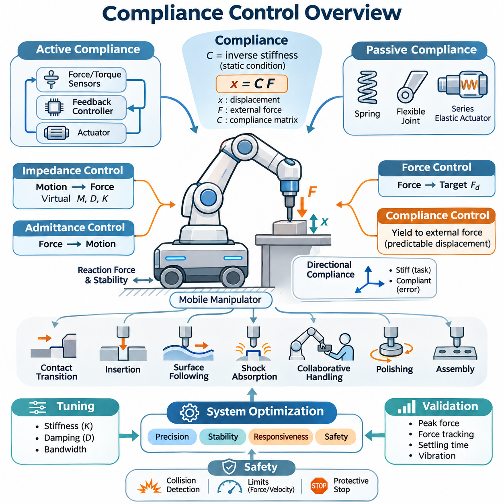
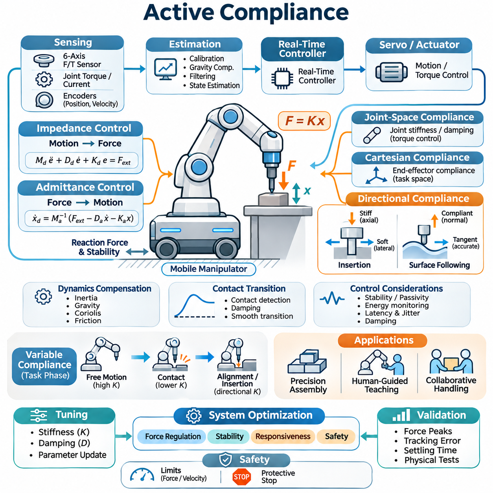
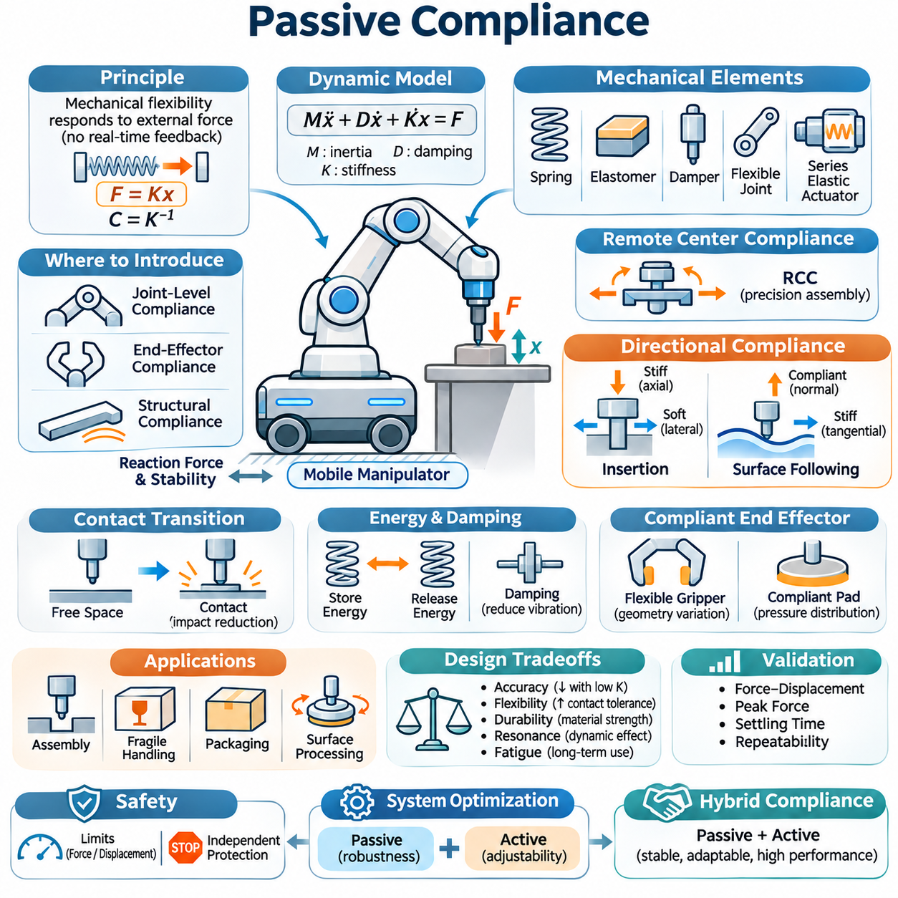
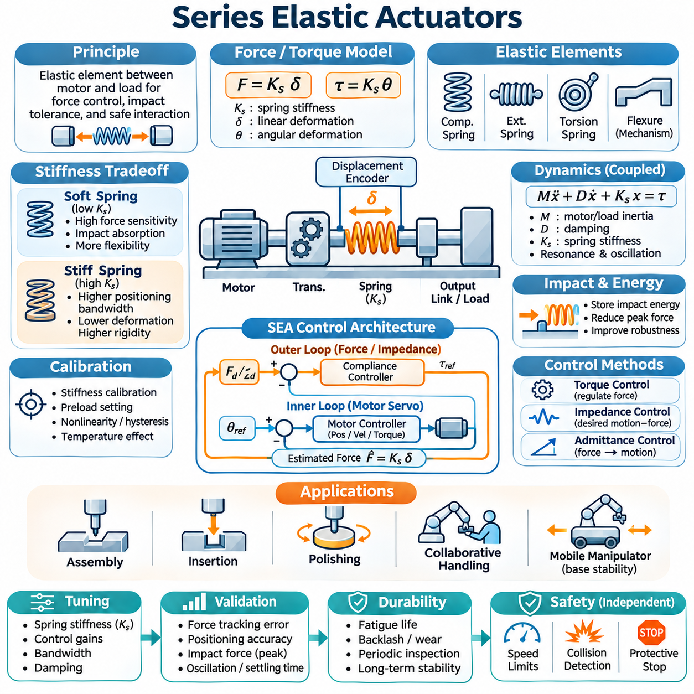
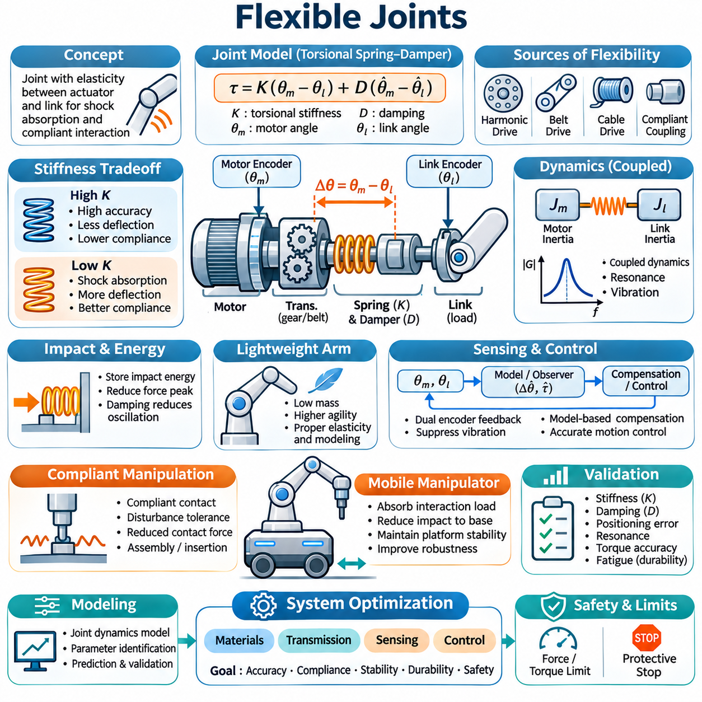
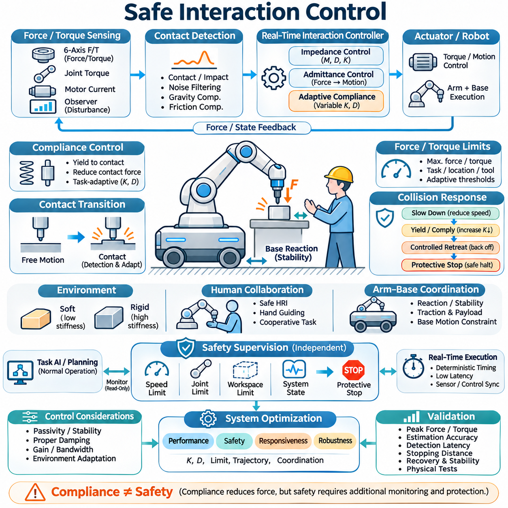
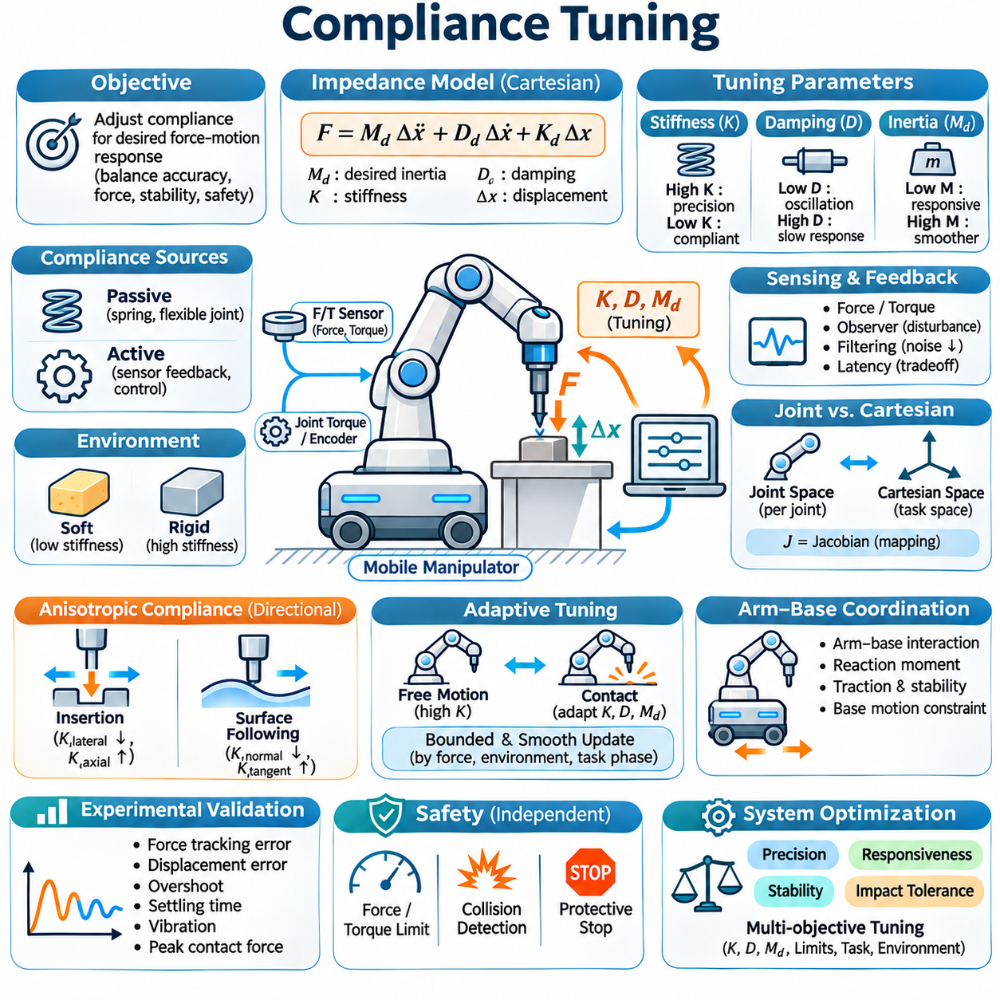
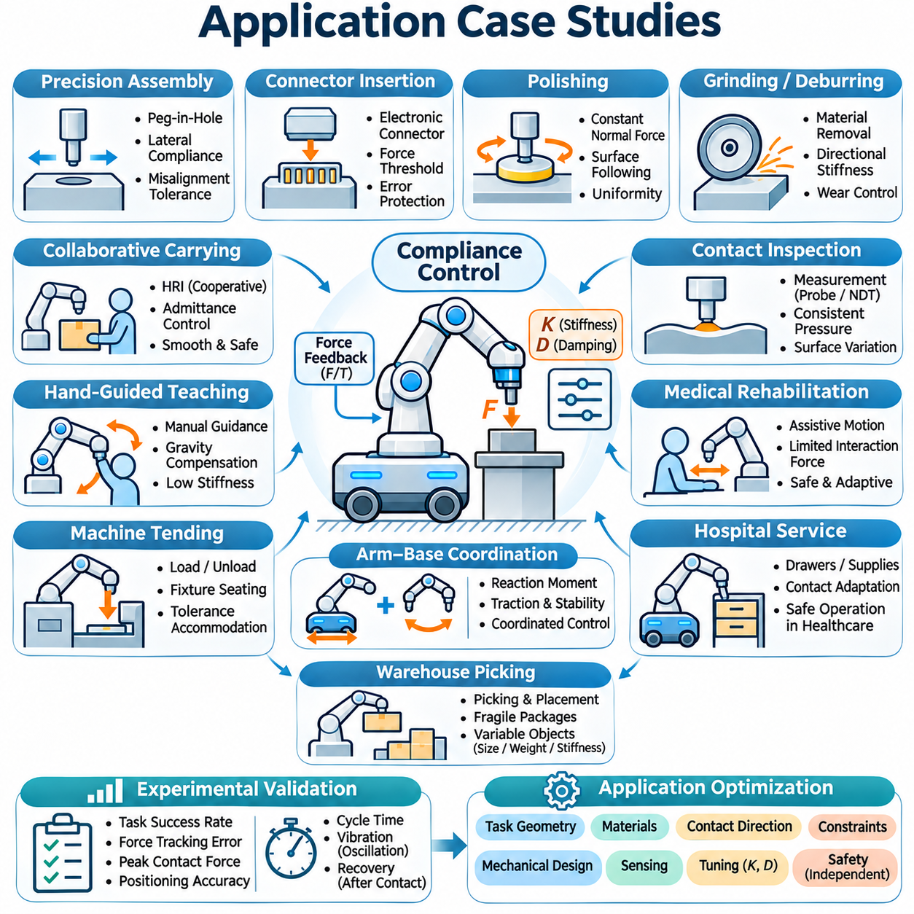
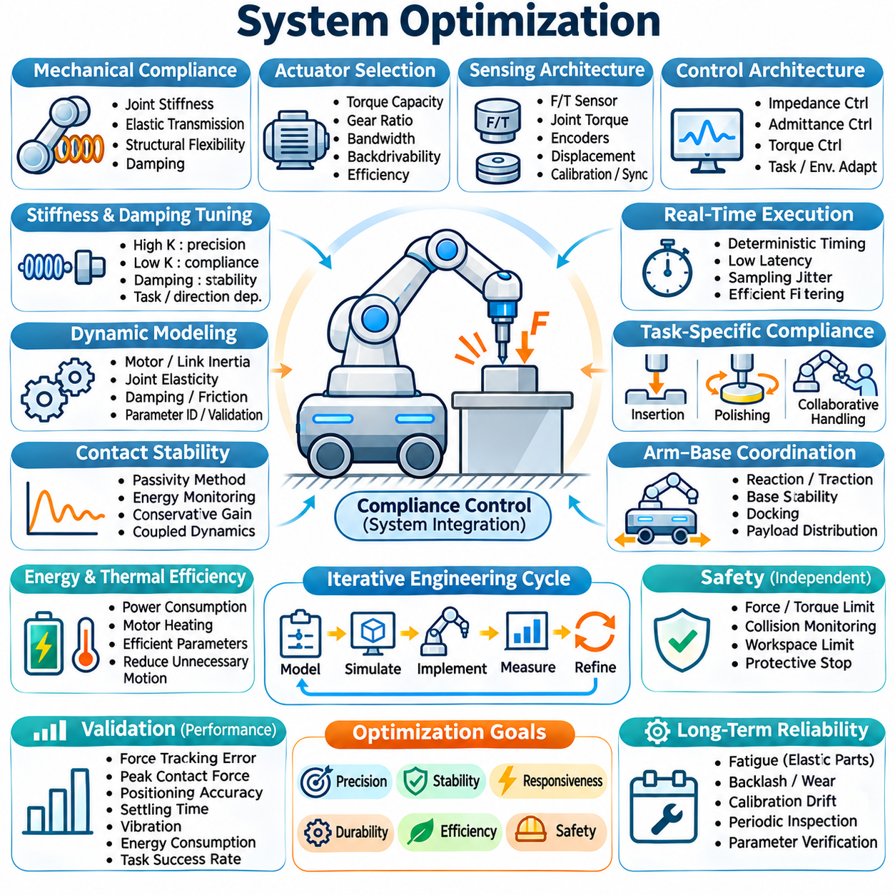

**Volume 02. Manipulator Mechanics and Control**

# Chapter 09. Compliance Control

## 01 Compliance Control Overview

{width="7.268055555555556in" height="7.268055555555556in"}

Compliance control is a fundamental approach in robotic manipulation that enables a robot to respond flexibly to external forces, physical contact, and environmental uncertainty. Unlike rigid position control, which attempts to maintain a predetermined trajectory, compliance control allows controlled deviations from the commanded motion. This behavior improves interaction quality, reduces excessive contact forces, and supports reliable manipulation in environments where exact geometric conditions cannot be guaranteed.

The primary objective of compliance control is to regulate the mechanical relationship between external forces and robot motion. A compliant manipulator can adapt its position, orientation, or joint configuration when encountering unexpected resistance. This adaptability is particularly important during assembly, surface contact, object handling, and human-robot collaboration. By permitting controlled mechanical displacement, the robot can maintain task effectiveness while reducing the likelihood of damage.

Compliance represents the displacement produced by an applied force and is commonly interpreted as the inverse of stiffness under appropriate static conditions. A highly compliant system produces relatively large displacement under a small external force, whereas a stiff system resists deformation. In robotic applications, compliance may be defined at individual joints or at the end effector. Its characteristics depend on mechanical construction, actuator behavior, control algorithms, and the direction of applied forces.

A simplified static relationship can be expressed as x = C F, where x represents displacement, F represents external force, and C denotes the compliance matrix. For multidimensional manipulation, this matrix describes how forces and torques influence translational and rotational displacement. Compliance is therefore not necessarily uniform across all directions. A robot may be designed to remain stiff along a primary task direction while allowing greater flexibility in directions associated with positioning errors.

Compliance control is generally divided into active and passive approaches. Active compliance uses sensors, actuators, and feedback algorithms to modify robot behavior according to measured or estimated interaction forces. Passive compliance relies on mechanical properties such as springs, flexible joints, elastic materials, and compliant mechanisms. Both approaches provide adaptability, but they differ in response bandwidth, implementation complexity, energy requirements, and dependence on control software.

Active compliance enables programmable mechanical behavior through coordinated sensing and motion control. Joint torque sensors, force-torque sensors, motor current measurements, and observer-based estimators can provide information about external interactions. The controller uses this information to adjust motion commands or actuator torques. Because compliance parameters can be modified during operation, active systems can support different interaction requirements without physically changing the manipulator structure.

Passive compliance introduces mechanical flexibility directly into the robot\'s physical structure. Elastic elements can absorb impact energy, accommodate small alignment errors, and reduce peak contact forces without requiring immediate computational intervention. Such characteristics are valuable when communication delays or controller bandwidth limitations prevent sufficiently fast responses. However, passive compliance is constrained by mechanical design and cannot provide arbitrary adjustments to stiffness or damping during operation.

Series elastic actuators are an important example of mechanically compliant actuation. They incorporate an elastic element between the motor transmission and the driven load, allowing force to be estimated from measured spring deformation when stiffness is known. This configuration improves force regulation and can reduce the transmission of sudden impacts. However, elastic deformation introduces additional dynamics that must be considered when designing position controllers, torque controllers, and interaction control strategies.

Flexible joints provide another mechanism for achieving compliant behavior. Their elasticity may originate from transmission components, intentional mechanical structures, or material deformation. Joint flexibility changes the relationship between motor position and link position, creating coupled dynamics that differ from ideal rigid-joint models. Accurate control therefore requires consideration of elastic deflection, joint stiffness, damping, and possible oscillations, especially when high positioning accuracy is required.

Compliance control is closely related to impedance and admittance control, although these concepts describe different aspects of interaction behavior. Impedance control establishes a desired dynamic relationship between motion deviation and interaction force, typically using virtual stiffness, damping, and inertia. Admittance control converts measured external forces into motion references. Both methods can generate compliant behavior, but their suitability depends on actuator characteristics, sensing capabilities, and controller architecture.

The distinction between compliance and force control is also important. Force control primarily attempts to regulate contact force toward a desired reference, whereas compliance control emphasizes the robot\'s ability to yield predictably under external loading. A compliant robot may allow displacement without maintaining a specific force target. In practical manipulation systems, these objectives are frequently combined to achieve stable contact, accurate force regulation, and controlled movement during constrained operations.

Contact transitions present significant challenges because the mechanical interaction changes when a manipulator moves from free space into contact with an object or surface. A controller optimized for unconstrained motion may generate excessive forces when unexpected contact occurs. Compliance can reduce these forces by allowing motion errors to be absorbed through controlled displacement. Appropriate damping and contact detection are nevertheless necessary to prevent oscillations, unstable responses, or repeated impacts.

Compliance characteristics must be selected according to the task and surrounding environment. Precision insertion may require low lateral stiffness to accommodate small alignment errors while maintaining sufficient axial stiffness for insertion. Surface following may require compliance normal to the surface and accurate motion control along the tangential direction. These directional requirements demonstrate why compliance should be treated as a task-dependent property rather than a single universal parameter.

Safe physical interaction is another major motivation for compliance control. When robots operate near people, compliant behavior can reduce contact forces and improve responsiveness to unexpected disturbances. Nevertheless, compliance alone does not guarantee safety because impact severity also depends on effective mass, velocity, geometry, and available stopping distance. Safety-oriented systems must integrate compliant control with collision detection, motion limitations, protective functions, and appropriate risk assessment.

In mobile manipulators, compliance control must account for interactions between the robotic arm and its mobile platform. External forces applied at the end effector can generate reaction forces and moments that influence platform stability, wheel-ground contact, and localization accuracy. The controller may need to coordinate arm motion with base constraints, especially during assembly or manipulation involving substantial contact forces. This interaction creates additional challenges beyond those encountered in fixed-base manipulators.

Compliance tuning determines how the robot balances positioning accuracy, responsiveness, stability, and contact-force limitations. Excessive stiffness can produce large forces when geometric errors occur, while insufficient stiffness may cause poor tracking accuracy or excessive deflection. Damping influences transient response and helps suppress oscillation. Effective tuning requires consideration of actuator bandwidth, sensor noise, communication delay, mechanical flexibility, and the dynamic properties of the contacted environment.

Performance evaluation should examine both free-motion behavior and physical interaction under representative operating conditions. Relevant measurements include contact-force peaks, steady-state displacement, force tracking error, settling time, vibration, and recovery after disturbances. Repeated experiments with different surface stiffness values and contact geometries help reveal controller limitations. These evaluations are essential because successful behavior in simulation does not automatically guarantee reliable operation on physical hardware.

Industrial applications demonstrate the practical importance of compliant manipulation. Robotic assembly benefits from tolerance compensation during insertion and alignment, while polishing and finishing operations require controlled contact with irregular surfaces. Collaborative handling tasks benefit from predictable responses to externally applied forces. In each case, compliance improves adaptability, but successful deployment depends on integrating mechanical design, sensing, control algorithms, and application-specific operating constraints.

System-level optimization involves selecting an appropriate combination of active compliance, passive elasticity, actuator technology, and control architecture. Designers must balance mechanical simplicity against programmability, interaction performance against positioning precision, and response speed against stability margins. A well-designed compliant manipulator does not merely behave softly. It provides predictable, controllable, and task-appropriate mechanical interaction while maintaining the performance and safety requirements of the complete robotic system.

## 02 Active Compliance

{width="7.268055555555556in" height="7.268055555555556in"}

Active compliance is a robotic control approach that enables a manipulator to modify its mechanical response through sensors, actuators, and real-time feedback. Instead of relying exclusively on fixed mechanical elasticity, the robot actively adjusts its motion or torque in response to external forces. This capability allows programmable interaction behavior, making active compliance particularly valuable for precision assembly, contact-rich manipulation, and human-robot collaboration.

The fundamental objective of active compliance is to establish a controlled relationship between external interaction forces and robot displacement. When a manipulator encounters resistance, its controller modifies the commanded motion or actuator torque to produce an appropriate response. This behavior reduces excessive contact forces while maintaining task objectives. Unlike passive compliance, active compliance can change its apparent stiffness, damping, and dynamic response according to operating conditions.

Active compliance systems typically integrate force sensing, motion estimation, dynamic modeling, and closed-loop control. External forces may be measured directly using force-torque sensors or estimated from joint torque measurements and motor currents. Position encoders and velocity estimators provide additional information about robot movement. The controller combines these measurements to determine how the manipulator should respond to contact forces and environmental disturbances.

A simplified active compliance relationship can be represented by F = Kx, where F denotes the interaction force, K represents the commanded stiffness, and x describes displacement relative to an equilibrium position. In dynamic applications, damping and inertia are incorporated to describe transient behavior. By adjusting these parameters, the controller can create different mechanical responses without changing the robot\'s physical structure, provided that the actuator and control system can realize the commanded behavior.

Impedance control is one of the most widely used methods for implementing active compliance. It establishes a desired dynamic relationship between position error, velocity, acceleration, and external force. A typical formulation is M_d ë + D_d ė + K_d e = F_ext, where M_d, D_d, and K_d represent desired inertia, damping, and stiffness. The controller uses this relationship to generate compliant motion while regulating the robot\'s response to physical interaction.

Admittance control provides another practical implementation, particularly for robots equipped with accurate position controllers. In this approach, measured external forces are converted into desired position or velocity references through a virtual mechanical model. The resulting motion commands are executed by the underlying servo system. Admittance control is especially useful when direct joint torque control is unavailable, although its effectiveness depends on force measurement quality and achievable motion bandwidth.

Joint-level active compliance regulates individual actuator behavior according to measured or estimated external torques. A controller may adjust joint stiffness, damping, or torque commands to accommodate disturbances. Cartesian compliance instead controls the response of the end effector in task-space coordinates. Cartesian methods are often more intuitive for assembly and surface interaction because compliance can be assigned independently along selected translational and rotational directions.

Directional compliance is essential when a manipulation task requires different mechanical responses along different axes. During peg-in-hole insertion, for example, low lateral stiffness can accommodate small alignment errors while sufficient axial stiffness supports insertion. Similarly, surface following may require compliance normal to the contacted surface while maintaining accurate tangential motion. These behaviors can be implemented using task-space stiffness matrices and appropriate coordinate transformations.

Force feedback plays a central role in active compliance because it provides information about the interaction between the manipulator and its environment. Six-axis force-torque sensors can measure three force components and three torque components at the wrist or tool interface. Joint torque sensors provide complementary information about distributed loading. Accurate calibration, gravity compensation, sensor filtering, and coordinate transformation are necessary to interpret these measurements correctly.

Model-based active compliance incorporates robot dynamics to improve response accuracy. Gravity, inertia, Coriolis effects, and friction influence the relationship between commanded actuator torque and actual movement. Dynamic compensation can reduce these effects, allowing the controller to approximate the desired mechanical impedance more closely. However, modeling errors and unmodeled flexibility may degrade performance, particularly during rapid contact transitions or interactions with stiff environments.

Contact transitions represent a major challenge for active compliance controllers. When the robot moves from free space into physical contact, interaction forces may increase rapidly. A controller with excessive stiffness or insufficient damping can produce oscillations or high impact forces. Smooth reference trajectories, contact detection, appropriate damping, and controlled parameter transitions help reduce these effects. Stable behavior requires consideration of both robot dynamics and environmental stiffness.

Variable compliance allows the robot to modify its mechanical behavior during different phases of a task. A manipulator may operate with relatively high stiffness during free-space positioning, reduce stiffness during initial contact, and adjust directional compliance during insertion or alignment. Such adaptation can improve both efficiency and interaction quality. Nevertheless, rapidly changing stiffness or damping parameters can introduce energy into the system and must be managed carefully.

Passivity and stability are important considerations in active compliance design. A passive interaction system does not generate net energy beyond its stored energy and supplied mechanical input, making passivity a useful framework for analyzing physical interaction. Control delays, discretization, actuator saturation, and aggressive parameter adaptation can compromise this property. Passivity observers, energy tanks, and conservative damping strategies are among the techniques used to improve interaction stability.

Real-time implementation requires coordinated execution of sensing, estimation, control computation, and actuator commands. High-frequency control loops are often necessary to achieve responsive force regulation and stable contact behavior. Communication latency and timing jitter can reduce achievable bandwidth and introduce phase delays. Consequently, active compliance performance depends not only on control algorithms but also on embedded computing capabilities, communication architecture, and deterministic execution.

Active compliance in mobile manipulators introduces additional complexity because interaction forces affect both the robotic arm and its mobile base. Contact forces can create reaction moments that influence platform stability, wheel loading, and positioning accuracy. The controller must consider whether the base is stationary, mechanically restrained, or moving during manipulation. Coordinated arm-base control can improve interaction performance while respecting mobility, traction, and stability constraints.

Human-robot collaboration is another important application of active compliance. A robot can respond to forces applied by a human operator, allowing guided motion, cooperative object handling, and physical teaching. Low apparent stiffness may make the manipulator easier to move, while suitable damping prevents unwanted oscillation. However, safe collaboration also requires independent protective functions, force and speed limitations, collision monitoring, and application-specific risk assessment.

Industrial assembly illustrates the practical benefits of active compliance. During connector insertion, component alignment, or precision fitting, small geometric errors may generate substantial contact forces under rigid position control. A compliant controller allows limited corrective displacement while maintaining the intended assembly direction. Force feedback can also indicate unsuccessful insertion, unexpected obstruction, or excessive resistance, enabling the system to stop, retract, or initiate a recovery procedure.

Compliance tuning requires balancing positioning accuracy, force responsiveness, damping, and stability. Excessively high stiffness may cause damaging contact forces, whereas overly low stiffness can produce unacceptable displacement and poor task accuracy. Insufficient damping can lead to oscillation, while excessive damping slows adaptation. Engineers should evaluate controller behavior under different payloads, contact geometries, environmental stiffness values, and disturbance conditions before deployment.

Performance evaluation should include contact-force peaks, steady-state displacement, response time, settling behavior, force estimation accuracy, and tracking error. Experiments should examine both free-space motion and sustained contact with representative materials. Repeated trials can reveal sensitivity to sensor noise, payload variation, communication delay, and model uncertainty. Simulation provides useful preliminary evidence, but physical testing remains necessary to validate real interaction behavior.

System-level optimization integrates mechanical design, sensor placement, actuator capabilities, dynamic modeling, and control software. Active compliance should be configured according to the task rather than treated as a universal low-stiffness operating mode. Effective implementations combine accurate sensing, stable feedback, suitable compliance parameters, and reliable safety supervision. The resulting system can maintain precision when necessary while adapting predictably to physical contact and environmental uncertainty.

## 03 Passive Compliance

{width="7.268055555555556in" height="7.268055555555556in"}

Passive compliance is a mechanical approach that enables robotic manipulators to respond to external forces through inherent structural flexibility rather than continuous electronic feedback. Elastic elements, flexible joints, and compliant mechanisms allow controlled deformation when contact occurs. This behavior reduces excessive interaction forces, accommodates positioning uncertainty, and improves robustness during physical manipulation without requiring immediate intervention from a control algorithm.

The fundamental principle of passive compliance is that mechanical structures deform predictably under applied loads. Springs, elastomers, flexible transmissions, and specially designed mechanisms store or dissipate mechanical energy during interaction. Their responses are determined primarily by material properties and geometry. Unlike active compliance, passive compliance does not require real-time sensing or actuator commands to produce its basic mechanical response.

Mechanical stiffness determines the relationship between applied force and resulting displacement. Under simplified linear static conditions, this relationship is expressed as F = Kx, where F represents force, K denotes stiffness, and x describes deformation. Compliance is the inverse of stiffness when the stiffness matrix is invertible. Lower stiffness produces greater displacement under equivalent loading, allowing the manipulator to accommodate contact uncertainty while reducing resistance to external disturbances.

Passive compliance can be introduced at several locations within a robotic system. Joint-level compliance uses elastic components in actuators or transmissions, while end-effector compliance incorporates flexible structures near the tool or gripper. Structural compliance may also arise from links, mounting brackets, and mechanical interfaces. The placement of compliant elements determines how external forces influence motion, positioning accuracy, and the distribution of mechanical loads.

Elastic elements are central to many passive compliance mechanisms. Coil springs, torsion springs, leaf springs, and elastomeric components can provide predictable restoring forces over appropriate operating ranges. Their stiffness characteristics depend on material selection, geometry, and deformation limits. Properly designed elastic components absorb temporary displacement and return toward their original configuration when external loading decreases, supporting repeatable mechanical interaction.

Damping is another important characteristic because elastic systems can oscillate after sudden disturbances. Mechanical dampers, viscoelastic materials, and frictional interfaces dissipate energy and reduce vibration. A simplified dynamic relationship is expressed as Mẍ + Dẋ + Kx = F, where M represents effective inertia, D denotes damping, and K represents stiffness. The resulting response depends on the interaction between these parameters and the surrounding environment.

Passive compliance is particularly useful during contact transitions, when a manipulator moves from free space into contact with an object or surface. A rigid mechanism may transmit impact forces directly through its structure, while compliant elements allow limited deformation and extend the duration of impact. This can reduce peak contact forces under suitable conditions. However, the resulting displacement must remain within acceptable limits to preserve task accuracy and mechanical integrity.

Remote center compliance mechanisms are widely associated with precision assembly applications. These devices are designed to provide specific translational and rotational flexibility around an effective remote center. During insertion operations, such behavior can help correct small positional and angular misalignments. The mechanism\'s geometry and stiffness distribution determine its effectiveness, making proper selection essential for reliable peg-in-hole assembly and similar constrained tasks.

Directional compliance allows a robotic mechanism to remain relatively stiff in selected directions while yielding more readily in others. This behavior is achieved through mechanical geometry, anisotropic materials, or carefully arranged elastic components. For example, an insertion tool may require lateral flexibility to accommodate alignment errors while maintaining sufficient axial stiffness to transmit insertion forces. Direction-dependent compliance therefore supports task-specific mechanical adaptation.

Flexible joints introduce passive compliance between actuator motion and link motion. Elastic deformation in gears, belts, couplings, or dedicated spring elements can reduce the direct transmission of shocks and disturbances. However, joint flexibility also introduces additional dynamic states and potential oscillations. Accurate modeling must distinguish motor-side motion from link-side motion, particularly when high-precision positioning or rapid acceleration is required.

Series elastic actuators incorporate a compliant element between the actuator and its mechanical load. Although these devices are frequently combined with active force control, their elastic components provide passive mechanical compliance independently of feedback execution. Spring deformation can also support force estimation when stiffness is known. The resulting design offers impact tolerance and improved force interaction, but may reduce achievable positioning bandwidth and introduce resonance.

Compliant end effectors provide another practical implementation of passive compliance. Flexible fingertips, elastomeric pads, spring-loaded grippers, and deformable contact surfaces adapt mechanically to variations in object geometry. These structures can distribute contact pressure and accommodate small shape differences without requiring complex sensing. Their effectiveness depends on friction, material durability, contact geometry, and the range of deformation permitted during grasping.

Passive compliance is particularly valuable in environments where sensing delays or computational limitations restrict active control performance. Mechanical deformation begins immediately when force is applied, without waiting for measurement, communication, or controller execution. Nevertheless, passive elements have their own dynamic limitations and cannot guarantee stable interaction under every condition. Their behavior must be evaluated against environmental stiffness, loading frequency, and structural resonance.

Energy storage and release are important considerations in passive compliant mechanisms. Elastic components store potential energy during deformation and release it as the mechanism returns toward equilibrium. This property supports reversible motion but can also produce rebound or oscillation. Damping and mechanical travel limits help manage these effects. Designers must consider maximum stored energy, allowable deformation, fatigue resistance, and failure behavior under repeated loading.

Human-robot interaction can benefit from passive compliance because flexible mechanical structures may reduce peak forces during unintended contact. Soft coverings, elastic joints, and compliant interfaces can provide an additional layer of mechanical protection. However, passive compliance alone does not establish safe operation. Effective safety engineering must also consider robot velocity, effective mass, contact geometry, mechanical stops, and independently implemented protective functions.

Mobile manipulators introduce additional design considerations because compliant arm structures interact with a mobile base. External contact forces can create reaction moments that influence platform stability and wheel loading. Elastic deformation may reduce some transmitted force peaks, but it can also introduce end-effector positioning errors and structural oscillations. The overall design must therefore account for arm stiffness, base dynamics, payload distribution, and the constraints imposed by the operating surface.

Industrial applications demonstrate the value of passive compliance in assembly, material handling, packaging, and surface processing. Spring-loaded tooling can accommodate dimensional variation, while compliant fixtures can reduce alignment sensitivity during insertion. Flexible gripping surfaces support handling of irregular or fragile objects. These applications benefit from mechanical simplicity, but successful deployment requires matching compliance characteristics to the expected contact forces and positional tolerances.

Passive compliance design involves balancing flexibility, accuracy, durability, and load-bearing capability. Excessive stiffness limits adaptation and increases contact forces, whereas insufficient stiffness may produce unacceptable deflection or unstable vibration. Engineers must evaluate static stiffness, dynamic response, fatigue life, material aging, and environmental influences such as temperature. Mechanical testing is necessary to verify that compliant elements maintain their intended behavior throughout repeated operating cycles.

Performance evaluation should include force-displacement characteristics, peak impact force, energy dissipation, settling time, positioning repeatability, and structural durability. Tests should cover representative payloads, contact directions, loading rates, and environmental conditions. Experimental measurements can reveal nonlinear stiffness, hysteresis, creep, and fatigue effects that simplified models may overlook. These results provide the basis for selecting suitable materials and refining mechanical designs.

System-level optimization integrates passive compliance with actuator selection, structural design, sensing, and higher-level control strategies. Passive elements can complement active compliance by providing immediate mechanical flexibility while feedback controllers regulate slower or more complex interactions. Effective integration requires careful consideration of resonance, stability, positioning accuracy, and safety constraints. The resulting robotic system can achieve predictable physical adaptability with reduced dependence on continuous electronic intervention.

## 04 Series Elastic Actuators

{width="7.268055555555556in" height="7.268055555555556in"}

Series Elastic Actuators (SEAs) are a class of robotic actuators that incorporate an elastic element between the motor and the mechanical load. Unlike conventional rigid actuators, which transmit motor torque directly through a relatively stiff transmission, SEAs intentionally introduce mechanical compliance into the drive system. This configuration enables improved force control, impact tolerance, and safer physical interaction with the environment.

The fundamental operating principle of an SEA is based on measuring the deformation of an elastic element to estimate the transmitted force or torque. When an external load acts on the actuator, the spring deforms according to its mechanical stiffness. By measuring this displacement and applying a calibrated stiffness model, the controller can estimate the output force. This approach provides an indirect but practical method of force sensing without requiring a dedicated force sensor.

The mechanical structure of an SEA typically consists of an electric motor, transmission mechanism, elastic element, output link, and displacement sensor. The motor generates mechanical power, while the transmission converts motor rotation into the required output motion. The elastic element is positioned between the transmission and the load, allowing relative displacement under applied forces. A sensor measures spring deformation, providing information for force estimation and closed-loop control.

The relationship between spring deformation and transmitted force can be expressed using Hooke\'s law as F = K_s δ, where F represents the transmitted force, K_s denotes spring stiffness, and δ represents elastic deformation. For rotational actuators, the corresponding relationship is τ = K_s θ, where τ represents torque and θ denotes angular deformation. These relationships provide the foundation for estimating actuator output and implementing precise interaction control.

Spring stiffness is one of the most important design parameters of an SEA. A relatively soft spring improves force sensitivity and impact absorption because small changes in external loading produce measurable deformation. However, excessive flexibility can reduce positioning bandwidth and introduce oscillations. A stiffer spring improves mechanical rigidity and positioning performance but reduces the benefits of compliance. Therefore, spring selection requires balancing force resolution, dynamic response, and structural stability.

SEA configurations can use different types of elastic elements depending on the application. Linear compression springs, extension springs, torsional springs, and specially designed flexure mechanisms are common options. Their selection depends on required force capacity, available installation space, deformation range, fatigue life, and mechanical efficiency. The elastic element must maintain predictable stiffness throughout its operating range while resisting permanent deformation and repeated mechanical loading.

Force estimation through spring deformation requires accurate displacement measurement and stiffness calibration. Linear encoders, rotary encoders, potentiometers, and other displacement sensors can measure relative motion across the elastic element. Measurement resolution directly influences the minimum detectable force. Calibration procedures should consider manufacturing tolerances, preload, nonlinear spring characteristics, temperature variation, and mechanical hysteresis to maintain reliable force estimation.

SEA control architecture generally includes an inner motor control loop and an outer force or impedance control loop. The inner loop regulates motor position, velocity, or torque, while the outer loop uses estimated interaction forces to generate appropriate actuator commands. This hierarchical structure separates motor dynamics from interaction objectives. Proper coordination between the two loops is essential because excessive control bandwidth or inappropriate gain selection can amplify mechanical oscillations.

One major advantage of SEAs is their ability to absorb unexpected impacts. When a robotic arm collides with an object or encounters sudden resistance, the elastic element deforms and temporarily stores mechanical energy. This deformation reduces the immediate transmission of impact forces to the motor and surrounding structure. Compared with rigid transmission systems, SEAs can therefore improve mechanical robustness and reduce the risk of damage during unexpected physical interactions.

SEAs also support accurate force control in tasks requiring sustained physical contact. During assembly, insertion, polishing, and object manipulation, the actuator can regulate interaction forces using spring deformation feedback. The controller can adjust motor commands to maintain a desired force level while accommodating small variations in contact geometry. This capability is particularly useful when rigid position control would generate excessive forces because of dimensional tolerances or alignment errors.

The dynamic behavior of an SEA differs significantly from that of a conventional rigid actuator. The elastic element introduces additional mechanical degrees of freedom and creates a coupled motor-load dynamic system. Its behavior depends on spring stiffness, damping, motor inertia, load inertia, and transmission characteristics. Resonance frequencies and oscillatory modes must be considered during controller design to prevent instability and preserve the desired force response.

SEA control often combines torque control, impedance control, and admittance-based strategies. Torque control regulates the estimated output force directly, while impedance control establishes a desired relationship between motion deviation and interaction force. Admittance control converts measured forces into motion references. The appropriate strategy depends on actuator bandwidth, sensor resolution, mechanical configuration, and the physical characteristics of the contacted environment.

Series elastic actuation is particularly relevant to collaborative robots and human-robot interaction. The mechanical spring provides an additional layer of compliance that can reduce the transmission of sudden external forces. This characteristic supports physical guidance, cooperative manipulation, and safer interaction under unexpected contact. Nevertheless, mechanical compliance does not replace safety-rated monitoring, collision detection, speed limitations, or independent emergency protection mechanisms.

Mobile manipulators introduce additional considerations when SEAs are integrated into robotic arms mounted on mobile platforms. Manipulation forces can generate reaction loads that influence the mobile base, especially during contact-intensive operations. The elastic actuator may reduce impact transmission through the arm, but its deformation can also affect end-effector positioning accuracy. System design must therefore coordinate actuator compliance, arm dynamics, base stability, payload distribution, and task requirements.

SEA performance depends strongly on mechanical and control parameter tuning. Spring stiffness, preload, damping, sensor resolution, and controller gains influence force accuracy and dynamic stability. Excessive stiffness reduces impact absorption, while insufficient stiffness may cause slow responses and excessive deformation. Engineers should evaluate force tracking, positioning accuracy, impact response, oscillation, and recovery behavior under different payloads and environmental conditions.

Reliability and durability are important considerations in practical SEA implementation. Elastic components experience repeated loading and unloading, which can eventually cause fatigue, stiffness variation, or mechanical failure. Sensor mounting, transmission backlash, friction, and temperature changes may also influence force estimation accuracy. Appropriate mechanical protection, periodic calibration, structural inspection, and operating-limit management are necessary to maintain consistent performance over extended operating periods.

System-level optimization requires integrating SEA mechanical design with actuator electronics, sensing architecture, real-time control software, and application-specific safety requirements. The actuator should be evaluated not only as an isolated component but also as part of the complete manipulator. When properly designed and controlled, SEAs provide a practical foundation for precise force regulation, mechanical compliance, impact tolerance, and reliable physical interaction in advanced robotic manipulation systems.

## 05 Flexible Joints

{width="7.268055555555556in" height="7.268055555555556in"}

Flexible joints are mechanical connections that intentionally incorporate elasticity between the actuator and the moving links of a robotic manipulator. Unlike ideal rigid joints, which assume that motor motion is transmitted directly to the connected structure, flexible joints allow small relative deformations under applied torque. This characteristic influences the mechanical behavior of the manipulator and provides opportunities to improve shock absorption, interaction safety, and dynamic adaptability.

Joint flexibility can originate from several mechanical components, including gears, belts, couplings, shafts, bearings, and dedicated elastic elements. Even when a joint is designed to behave as rigidly as possible, its transmission components exhibit a certain degree of deformation under load. In practical robotic systems, these effects cannot always be ignored because they influence positioning accuracy, vibration, and the relationship between motor motion and actual link motion.

A flexible joint can be represented using a simplified spring-damper model. The elastic torque is proportional to the relative angular displacement between the motor side and the link side, while damping contributes a velocity-dependent resistance. A simplified relationship is expressed as τ = K(θ_m − θ_l) + D(θ̇\\_m − θ̇\\_l), where K represents torsional stiffness, D denotes damping, and θ_m and θ_l represent motor and link positions. This model provides a foundation for analyzing joint deformation and dynamic response.

Torsional stiffness is one of the most important characteristics of a flexible joint. It determines how much angular deformation occurs when an external torque is applied. High stiffness generally improves positioning accuracy and reduces relative motion between the motor and link. Lower stiffness allows greater deformation and can improve shock tolerance, but may introduce positioning errors and oscillatory behavior. Joint design therefore requires balancing mechanical rigidity, compliance, and dynamic performance.

The dynamic behavior of flexible joints differs from that of rigid-joint manipulators because motor-side and link-side motions are no longer identical. Elastic deformation introduces additional dynamic states and creates mechanical coupling between the actuator and the load. The resulting system may exhibit resonance frequencies that depend on joint stiffness, motor inertia, and link inertia. These characteristics must be considered when designing motion trajectories and control algorithms.

Flexible joints can improve the ability of robotic systems to absorb mechanical disturbances. When an external impact occurs, elastic deformation temporarily stores mechanical energy and reduces the direct transmission of shock forces through the transmission system. This characteristic can protect sensitive mechanical components and improve physical interaction behavior. However, excessive flexibility may produce unwanted oscillations, making damping and appropriate mechanical constraints essential.

Joint flexibility is particularly relevant to lightweight robotic manipulators. Reducing structural mass can improve acceleration, energy efficiency, and dynamic responsiveness, but lightweight structures may exhibit greater elastic deformation. Flexible joints can be incorporated into such systems to achieve a suitable balance between mechanical performance and structural adaptability. Accurate dynamic modeling becomes increasingly important as the influence of elasticity grows.

Flexible transmission mechanisms introduce additional considerations in joint design. Harmonic drives, belt transmissions, cable drives, and compliant couplings exhibit different stiffness, friction, backlash, and hysteresis characteristics. These properties influence torque transmission and motion accuracy. Engineers must evaluate the complete transmission assembly rather than considering the elastic element independently, because the combined mechanical behavior determines the actual joint response.

Position sensing in flexible joints requires careful consideration of motor-side and link-side measurements. A motor encoder measures actuator rotation, but this value may differ from the actual link position because of elastic deformation. Dual-encoder configurations can measure both sides of the transmission and estimate joint deflection directly. This information improves state estimation and provides useful feedback for compensation, vibration suppression, and accurate motion control.

Flexible joint modeling is essential for achieving accurate robot dynamics. Conventional rigid-joint models may produce significant prediction errors when elastic deformation becomes substantial. More complete models incorporate motor inertia, link inertia, joint stiffness, damping, and transmission characteristics. These models support the analysis of vibration modes, torque transmission, and transient responses. Accurate parameter identification is particularly important for high-speed manipulators and precision applications.

Control strategies for flexible joints must account for the interaction between motor dynamics and link dynamics. Conventional position controllers may generate oscillations when their gains are selected without considering joint elasticity. Advanced approaches can incorporate elastic deflection feedback, motor-side compensation, and model-based control. The objective is to maintain accurate link motion while preventing excessive deformation and undesirable vibration throughout the operating range.

Flexible joints are closely related to compliant manipulation and physical interaction control. Their elastic characteristics can provide a degree of mechanical compliance without requiring continuous active adjustment. During contact operations, joint deformation can accommodate small disturbances and reduce sudden force transmission. However, joint-level flexibility does not automatically guarantee appropriate end-effector behavior because the overall response also depends on robot configuration, kinematics, and the distribution of stiffness across multiple joints.

In mobile manipulators, flexible joints must be evaluated together with the dynamics of the robotic arm and mobile base. External interaction forces can generate vibrations that propagate through the arm and influence end-effector positioning. The resulting deformation may also interact with base motion and payload distribution. Coordinated mechanical and control design is therefore necessary to maintain manipulation accuracy, platform stability, and predictable physical interaction during mobile operations.

Performance evaluation of flexible joints should consider torsional stiffness, damping, positioning error, resonance frequency, vibration amplitude, torque transmission accuracy, and fatigue durability. Experimental tests under different payloads and operating speeds can reveal nonlinear behavior and mechanical limitations. Repeated loading is particularly important because elastic components and transmission mechanisms may experience fatigue, wear, and stiffness changes over time.

System optimization requires selecting suitable joint materials, transmission mechanisms, stiffness characteristics, sensing configurations, and control strategies. Excessive rigidity can reduce the benefits of mechanical compliance, while insufficient stiffness can compromise positioning accuracy and dynamic stability. A properly designed flexible joint provides controlled elasticity while maintaining the mechanical performance required by the application. Integrating mechanical design with accurate modeling and appropriate feedback control enables robotic manipulators to achieve reliable motion and adaptable physical interaction.

## 06 Safe Interaction Control

{width="7.268055555555556in" height="7.268055555555556in"}

Safe interaction control is a fundamental component of compliant robotic manipulation that enables robots to maintain controlled and predictable physical interactions with humans, objects, and surrounding environments. Unlike conventional motion control, which primarily focuses on trajectory accuracy, safe interaction control considers contact forces, mechanical impedance, collision risks, and environmental constraints. Its objective is to achieve task performance while preventing excessive forces, unexpected movements, and potentially hazardous physical interactions.

The primary principle of safe interaction control is to regulate how a robot responds when external forces or physical contact occur. A manipulator must recognize changes in interaction conditions and adjust its motion, torque, or stiffness accordingly. This capability is particularly important in collaborative workspaces, assembly operations, material handling, and contact-intensive tasks. Safe interaction requires coordination between mechanical compliance, force sensing, motion planning, and real-time control.

Force and torque sensing provide essential information for detecting physical interactions. Six-axis force-torque sensors can measure forces and moments applied at the end effector, while joint torque sensors provide information about loading throughout the manipulator. Motor current measurements and model-based observers can also estimate external disturbances. These measurements allow the controller to distinguish expected contact forces from unexpected interactions and initiate appropriate responses.

Contact detection is an important function because a robot must identify when its motion changes from free-space movement to physical interaction. Sudden increases in measured force, torque, or joint current may indicate contact with an object or human. Detection algorithms should account for sensor noise, gravity, friction, and normal dynamic loading to avoid false alarms. Reliable contact detection enables the controller to modify motion behavior before excessive forces develop.

Compliance control provides a mechanism for reducing contact forces by allowing controlled displacement under external loading. Impedance control can establish a desired relationship between position deviation, velocity, and interaction force, while admittance control converts measured forces into motion references. These approaches allow a robot to yield appropriately when encountering unexpected resistance. Their parameters must be selected according to the task, contact environment, and mechanical capabilities of the manipulator.

Force limitation is another essential aspect of safe interaction. The controller can define maximum allowable force and torque thresholds for different operating conditions. When measured interaction forces approach these limits, the robot may reduce velocity, modify its trajectory, increase compliance, or stop the current motion. Threshold selection should consider contact location, effective mass, tool geometry, task requirements, and the characteristics of the contacted object.

Collision response mechanisms determine how the robot reacts when unexpected contact occurs. Depending on the severity of the detected event, the controller may perform controlled deceleration, protective stopping, trajectory retreat, or complete motion termination. A gradual response may be appropriate for harmless contact during assembly, whereas potentially dangerous collisions require immediate protective action. Response strategies should be designed to minimize additional impact forces while maintaining predictable system behavior.

Safe interaction control must consider both robot motion and the mechanical properties of the environment. Contact with a soft object produces different dynamic responses from contact with a rigid structure. Excessive stiffness can generate high forces against rigid obstacles, while insufficient damping may cause oscillations during sustained contact. Adaptive compliance can improve interaction behavior by modifying stiffness and damping according to estimated environmental conditions.

Human-robot interaction introduces additional safety requirements because people may enter the robot workspace unexpectedly or intentionally guide the manipulator. Safe physical collaboration requires controlled movement, predictable force responses, and appropriate limitations on speed and acceleration. Hand-guiding functions can allow an operator to move the robot manually, while force-based interaction control supports cooperative object handling. These functions must operate together with independent protective measures.

In mobile manipulators, safe interaction control must account for the combined behavior of the robotic arm and mobile platform. Contact forces applied to the end effector can generate reaction moments that affect base stability, wheel loading, and platform movement. A stationary base may provide greater mechanical stability, while a moving base introduces additional dynamic uncertainty. Coordinated arm-base control should therefore consider platform constraints, payload distribution, traction, and the possibility of unintended base displacement.

Real-time control performance is critical because delayed responses can increase contact forces and reduce the effectiveness of protective actions. Force sensing, collision detection, state estimation, and actuator commands must be executed with predictable timing. Communication latency, sensor filtering, computational load, and actuator response characteristics can influence the total reaction time. Safety-related control functions should therefore be designed with appropriate timing margins and deterministic execution requirements.

Safety supervision provides an additional layer for monitoring robot operation independently of normal task execution. A supervisory controller can evaluate force limits, velocity constraints, joint positions, workspace boundaries, and system operating states. When abnormal conditions are detected, it can request a protective stop or transition the robot into a predefined safe state. Critical protective functions should not depend exclusively on high-level task software or artificial intelligence algorithms.

Safe interaction control also requires consideration of stability during physical contact. Aggressive force feedback, excessive control gains, and communication delays may produce oscillations or unstable behavior. Appropriate damping, passivity-based methods, and conservative parameter adaptation can improve stability. Engineers should evaluate the combined dynamics of the robot, controller, and contacted environment rather than treating the manipulator as an isolated mechanical system.

Performance validation should examine contact-force peaks, force estimation accuracy, collision detection latency, stopping distance, recovery behavior, and stability under different contact conditions. Tests should include expected interactions as well as unexpected collisions involving different objects and contact directions. Human-robot collaboration requires additional evaluation of foreseeable misuse and operating conditions. Simulation can support preliminary analysis, but physical testing is necessary to verify actual system responses.

System-level implementation integrates compliant mechanics, force sensing, collision monitoring, motion control, and independent safety supervision. Safe interaction should be treated as a continuous operating requirement rather than a protective function activated only after an accident occurs. A properly designed system maintains awareness of contact conditions, regulates interaction forces, and responds predictably to disturbances. This integrated approach enables robotic manipulators to perform precise tasks while maintaining reliable and controlled physical interaction with their environment.

## 07 Compliance Tuning

{width="7.268055555555556in" height="7.268055555555556in"}

Compliance tuning is the process of adjusting mechanical and control parameters to achieve a desired relationship between robot motion and external interaction forces. In robotic manipulators, compliance determines how the system responds to contact, disturbances, and variations in environmental conditions. Effective tuning balances positioning accuracy, force regulation, dynamic stability, and interaction safety while maintaining the performance required by the manipulation task.

The primary objective of compliance tuning is to establish appropriate stiffness and damping characteristics for different operating conditions. High stiffness improves positional precision but can generate excessive contact forces when alignment errors occur. Low stiffness allows greater displacement under external loading but may reduce tracking accuracy. Damping controls the rate of motion and suppresses oscillations, making its selection essential for stable physical interaction.

Compliance parameters can be implemented through mechanical structures, actuator characteristics, and software-based control algorithms. Passive compliance depends on springs, flexible joints, and elastic transmission elements, while active compliance modifies actuator commands using sensor feedback. Many robotic systems combine both approaches to improve disturbance tolerance. The tuning process must consider the interaction between physical elasticity and electronically controlled behavior.

Impedance control provides a common framework for compliance tuning by defining the relationship between position error, velocity, acceleration, and interaction force. A simplified Cartesian impedance model is expressed as F = M_d Δẍ + D_d Δẋ + K_d Δx, where M_d represents desired inertia, D_d denotes damping, and K_d represents stiffness. These parameters determine how the end effector responds to displacement and external loading.

Stiffness tuning directly influences the resistance of a manipulator to external displacement. Higher stiffness is suitable for precise positioning and operations requiring limited deformation, whereas lower stiffness supports compliant contact and uncertain object geometry. Cartesian stiffness may be configured independently along different motion directions. This allows a robot to remain rigid along task-critical axes while yielding along directions where alignment correction is necessary.

Damping tuning is essential for controlling transient behavior during contact. Insufficient damping can produce oscillations, overshoot, and repeated impacts, particularly when interacting with rigid environments. Excessive damping may slow the response and reduce operational efficiency. Engineers commonly begin with conservative damping settings and refine them through controlled experiments. The objective is to obtain a stable response without unnecessary delay or excessive actuator effort.

Desired inertia is another important parameter in impedance-based compliance control. It influences how strongly the robot accelerates in response to external forces and motion errors. Lower desired inertia can improve responsiveness, while higher inertia can produce smoother but less agile behavior. In practical systems, desired inertia must remain compatible with actuator torque limits, sensor bandwidth, and the physical dynamics of the manipulator.

Compliance tuning should account for the mechanical characteristics of the contacted environment. A rigid surface requires different control settings from a soft or deformable object. High combined stiffness between the robot and environment can amplify contact forces and destabilize force regulation. Environmental stiffness and damping may be estimated from measured force-displacement behavior. These estimates can support parameter adaptation when contact conditions vary during operation.

Force feedback plays a central role in active compliance tuning. Force-torque sensors, joint torque measurements, and disturbance observers provide information about interaction loads. Sensor noise, calibration errors, and communication delays can influence the accuracy of this feedback. Filtering improves measurement quality but introduces additional latency. Tuning must therefore balance noise rejection, response speed, and stability rather than maximizing sensor filtering alone.

Joint-space and Cartesian-space compliance require different tuning considerations. Joint-space compliance regulates individual joint behavior and may be appropriate for protecting transmissions or accommodating distributed contact forces. Cartesian compliance focuses on end-effector motion and interaction forces in task coordinates. The relationship between these representations depends on robot kinematics and the Jacobian matrix, which changes with manipulator configuration.

Anisotropic compliance allows different stiffness and damping values along selected directions. During insertion tasks, for example, low lateral stiffness can accommodate small alignment errors while higher axial stiffness supports controlled motion. During surface following, compliance may be increased along the surface normal while maintaining accurate tangential movement. Direction-dependent tuning improves task performance by matching mechanical response to contact geometry.

Adaptive compliance tuning modifies control parameters according to changing task conditions. The controller may adjust stiffness and damping based on contact force, estimated environmental properties, tracking error, or task phase. Such adaptation can improve performance when a robot transitions between free-space motion and physical contact. However, parameter changes must be bounded and sufficiently smooth to avoid abrupt force variations or unstable behavior.

Mobile manipulators introduce additional challenges because compliance behavior depends on both arm dynamics and mobile-base stability. Contact forces at the end effector generate reaction loads that may influence wheel traction, suspension behavior, and platform motion. Tuning should consider whether the base is stationary, docked, or moving during manipulation. Coordinated arm-base control helps maintain predictable interaction forces and positioning accuracy.

Experimental compliance tuning should follow a structured validation process using representative payloads, contact materials, and operating conditions. Engineers can evaluate force tracking error, displacement response, overshoot, settling time, vibration amplitude, and maximum contact force. Repeated tests reveal sensitivity to payload variation and environmental uncertainty. Parameter changes should be documented to support reproducibility and systematic performance comparison.

Safety constraints must remain active throughout the tuning process. Force limits, velocity restrictions, joint travel boundaries, actuator torque limits, and protective stopping functions should be established before contact experiments begin. Compliance control alone does not guarantee safe operation, particularly when sensor failures or unexpected collisions occur. Safety-rated protective functions should remain independent of experimental tuning algorithms.

System-level compliance optimization requires integrating mechanical design, actuator performance, sensing, control architecture, and task-specific requirements. No single stiffness or damping configuration is optimal for every manipulation operation. Effective tuning establishes a suitable compromise between precision, responsiveness, stability, and impact tolerance. Properly calibrated compliance enables robotic manipulators to maintain reliable contact behavior while adapting to uncertain physical environments.

## 08 Application Case Studies

{width="7.268055555555556in" height="7.268055555555556in"}

Application case studies demonstrate how compliance control improves robotic manipulation in environments involving physical contact, uncertain geometry, and variable interaction forces. Unlike rigid position control, compliant manipulation allows controlled motion deviations when external resistance occurs. Practical applications include precision assembly, surface processing, collaborative handling, medical assistance, and mobile manipulation. Each application requires different stiffness, damping, and force regulation characteristics.

Precision assembly provides a representative example of compliance-based manipulation. During peg-in-hole insertion, small positioning errors can generate large contact forces when a rigid controller attempts to maintain its trajectory. Cartesian compliance allows lateral displacement while maintaining controlled insertion motion. Force feedback detects contact conditions and supports alignment correction. Appropriate stiffness selection reduces jamming, component damage, and unsuccessful insertion attempts.

Electronic connector insertion presents additional challenges because connectors often contain delicate contacts, locking mechanisms, and narrow alignment tolerances. A compliant manipulator can detect initial contact, reduce insertion velocity, and adjust its orientation according to measured forces and torques. Force thresholds help distinguish normal engagement from mechanical obstruction. This approach improves insertion consistency while reducing the risk of bent pins or damaged connector housings.

Surface polishing illustrates the importance of maintaining stable contact forces while following complex geometry. Variations in surface curvature, tool wear, and workpiece positioning can cause inconsistent processing when rigid position control is used. Impedance or force control allows the tool to accommodate surface deviations while maintaining a desired normal force. Proper damping reduces vibration and improves surface uniformity, tool life, and process repeatability.

Robotic grinding and deburring require compliance strategies that account for changing material resistance and intermittent contact. Excessive force may damage the workpiece or accelerate tool wear, while insufficient force reduces material removal efficiency. A compliant controller can adjust tool motion according to measured contact loads. Direction-dependent stiffness supports accurate path following while allowing controlled displacement along the surface normal.

Collaborative object handling demonstrates compliance control during direct human-robot interaction. When a person and robot carry a shared object, the robot must respond to human-applied forces without generating excessive resistance. Admittance control can convert measured interaction forces into motion commands, allowing the robot to follow the operator\'s intended movement. Smooth acceleration, appropriate damping, and independent safety supervision support predictable cooperative behavior.

Hand-guided robotic teaching is another application in which compliance improves usability. An operator physically moves the manipulator through desired positions while the controller compensates for gravity and regulates resistance. Low apparent stiffness allows intuitive movement, while damping prevents uncontrolled acceleration. Recorded poses or trajectories can subsequently support automated execution. Safety-rated monitoring remains necessary during manual guidance and mode transitions.

Industrial machine tending benefits from compliance when loading parts into fixtures, chucks, and locating mechanisms. Small errors in robot positioning or machine alignment may create unwanted contact forces during insertion. A compliant end effector can accommodate geometric tolerances and guide the part into its intended location. Force monitoring helps identify incomplete seating, unexpected obstruction, or excessive mechanical loading before the operation continues.

Robotic inspection applications use compliance to maintain controlled contact between measurement tools and inspected surfaces. Contact probes, thickness gauges, and certain nondestructive testing sensors require consistent pressure for reliable measurements. Excessive force can deform the workpiece or damage the sensor, while insufficient contact may reduce measurement quality. Compliant positioning and force regulation improve measurement consistency across varying surface geometries.

Medical and rehabilitation robots provide examples of compliance control in sensitive human-contact environments. Assistive manipulators and rehabilitation devices must accommodate voluntary human movement while limiting interaction forces. Impedance control can regulate resistance during guided motion, whereas admittance control can respond to patient-applied forces. Such systems require application-specific risk assessment, validated operating limits, and appropriate medical safety measures.

Service robots operating in hospitals and care facilities encounter uncertain objects and frequently changing environments. A mobile manipulator may retrieve supplies, open drawers, or assist with nonclinical handling tasks. Compliance allows the robotic arm to accommodate small positioning errors during contact with handles, shelves, and containers. Force sensing can detect unexpected resistance and trigger motion adjustment or task termination when predefined limits are exceeded.

Warehouse mobile manipulators use compliance during picking, placement, and container handling. Objects may vary in size, stiffness, weight, and packaging condition, making exact geometric models difficult to maintain. Compliant gripping and controlled arm motion reduce the likelihood of crushing fragile packages or generating excessive contact forces. Integration with perception and grasp planning enables the robot to adapt its manipulation strategy to different object properties.

Mobile manipulation introduces additional challenges when the robotic arm performs contact-intensive tasks from a movable base. During assembly or inspection, reaction forces may influence wheel traction, platform stability, and end-effector accuracy. A compliant arm can reduce sudden force transmission, but excessive flexibility may increase positioning uncertainty. Coordinated base stabilization, arm impedance control, and force monitoring are necessary for reliable operation.

Experimental evaluation of compliance applications should examine both task performance and physical interaction behavior. Relevant metrics include task completion rate, force tracking error, peak contact force, positioning accuracy, cycle time, vibration, and recovery after disturbances. Comparisons between rigid and compliant control can reveal improvements in robustness. However, test conditions must remain consistent to distinguish genuine control benefits from environmental variations.

Application-level optimization requires selecting compliance characteristics according to task geometry, material properties, contact direction, and operational constraints. High precision may require substantial stiffness along selected axes, while uncertain contact conditions benefit from lower stiffness and appropriate damping. No single compliance configuration is suitable for every application. Successful implementations integrate mechanical design, sensing, control tuning, and safety supervision to achieve reliable physical interaction.

## 09 System Optimization

{width="7.268055555555556in" height="7.268055555555556in"}

System optimization in compliance control is the process of coordinating mechanical design, actuator performance, sensing, and control algorithms to achieve reliable physical interaction. Rather than optimizing individual components independently, the system must be evaluated as an integrated robotic manipulator. The primary objectives include accurate force regulation, stable motion, impact tolerance, positioning precision, and operational safety under changing task conditions.

Mechanical compliance establishes the physical foundation of system performance. Joint stiffness, elastic transmissions, structural flexibility, and damping determine how interaction forces propagate through the manipulator. Excessive rigidity can amplify contact forces, while insufficient stiffness can reduce positioning accuracy and introduce oscillations. Mechanical optimization therefore requires selecting appropriate materials, transmission mechanisms, and elastic characteristics for the intended application.

Actuator selection strongly influences achievable compliance performance. Motor torque capacity, transmission ratio, actuator bandwidth, friction, and thermal limits determine how accurately interaction forces can be regulated. High transmission ratios may improve torque capability but increase reflected inertia and friction. Direct-drive or low-ratio actuators can improve backdrivability, although they may require larger motors. Selection must balance force sensitivity, efficiency, and mechanical constraints.

Sensing architecture is another essential component of compliance optimization. Force-torque sensors, joint torque sensors, motor encoders, and displacement sensors provide complementary information about interaction forces and mechanical deformation. Sensor placement affects measurement accuracy and disturbance observability. Combining multiple measurements can improve state estimation, but sensor synchronization, calibration, and noise characteristics must be considered to avoid inconsistent feedback.

Control architecture determines how mechanical compliance and sensor feedback are translated into robot behavior. Impedance control establishes a desired dynamic relationship between motion and force, while admittance control converts measured interaction forces into motion references. Joint torque control can regulate actuator output directly when supported by suitable hardware. The appropriate architecture depends on actuator capabilities, sensor bandwidth, task requirements, and environmental characteristics.

Stiffness and damping optimization is central to achieving predictable interaction behavior. High stiffness supports precise positioning but can produce excessive forces against rigid surfaces. Lower stiffness accommodates geometric uncertainty but may increase tracking error. Damping suppresses oscillations and controls transient responses. Optimal settings depend on contact direction, payload, task phase, and environmental properties rather than a single fixed parameter configuration.

Dynamic modeling provides a foundation for systematic compliance optimization. Accurate models should represent motor inertia, link inertia, joint elasticity, damping, friction, and external interaction forces. Simplified rigid-body models may be insufficient when flexible joints or elastic transmissions contribute significantly to system behavior. Parameter identification and experimental validation improve model accuracy and support more reliable controller tuning.

Contact stability is particularly important when a manipulator interacts with rigid or uncertain environments. High controller gains, delayed force feedback, and excessive combined stiffness can generate oscillations or unstable contact. Passivity-based methods, energy monitoring, and conservative gain selection can improve stability margins. Optimization should evaluate the coupled dynamics of the robot, controller, and environment rather than treating each element independently.

Real-time execution performance directly influences compliance control quality. Sensor acquisition, state estimation, control computation, and actuator commands must operate with predictable timing. Communication latency and sampling jitter can degrade force tracking and increase contact-force peaks. Computational optimization should therefore prioritize deterministic execution, appropriate control frequencies, efficient filtering, and reliable communication between distributed control components.

Task-oriented optimization adjusts compliance behavior according to the physical requirements of each operation. Precision insertion may require low lateral stiffness and controlled axial motion, while surface polishing requires stable normal force and accurate tangential tracking. Collaborative handling benefits from low apparent impedance and smooth motion. Direction-dependent stiffness and damping allow the manipulator to satisfy different constraints without sacrificing overall task performance.

Mobile manipulators require additional optimization because robotic arm dynamics interact with mobile-base behavior. Contact forces can generate reaction moments that influence wheel traction, platform stability, and end-effector accuracy. Base localization errors and structural vibration may further degrade manipulation performance. Coordinated arm-base control, stable docking, and appropriate payload distribution help maintain predictable compliance during contact-intensive operations.

Energy efficiency and thermal management must also be considered during system optimization. Continuous force regulation can increase actuator current, motor heating, and electrical power consumption. Excessive control gains may generate unnecessary actuator activity, while mechanical compliance can temporarily store and release energy. Efficient parameter selection should reduce avoidable motion and thermal loading without compromising force accuracy or interaction stability.

Safety optimization requires integrating force limits, velocity constraints, collision monitoring, workspace boundaries, and protective stopping functions. Compliance control can reduce contact forces but cannot independently guarantee safe human-robot interaction. Safety-related functions should remain effective during sensor faults, communication failures, and unexpected disturbances. Risk assessment and validation must consider the complete robot system, including tools, payloads, and operating environments.

Performance evaluation should combine mechanical, control, and task-level metrics. Relevant measurements include force tracking error, positioning accuracy, contact-force peaks, settling time, vibration amplitude, energy consumption, and task completion rate. Tests should cover different payloads, contact materials, operating speeds, and disturbance conditions. Consistent experimental procedures allow engineers to identify tradeoffs and compare optimization results objectively.

Long-term reliability is an important consideration because compliance characteristics may change during extended operation. Elastic elements can experience fatigue, transmissions may develop backlash, and sensors may exhibit calibration drift. These changes influence force estimation and control stability. Periodic calibration, condition monitoring, mechanical inspection, and parameter verification help maintain consistent performance and detect degradation before it affects task execution.

System-level optimization is ultimately an iterative engineering process involving modeling, simulation, implementation, measurement, and refinement. No single compliance configuration provides the best performance for every task or environment. Successful optimization balances precision, responsiveness, mechanical durability, energy efficiency, and safety. By integrating mechanical design, sensing, real-time control, and systematic validation, robotic manipulators can achieve robust and adaptable physical interaction.
