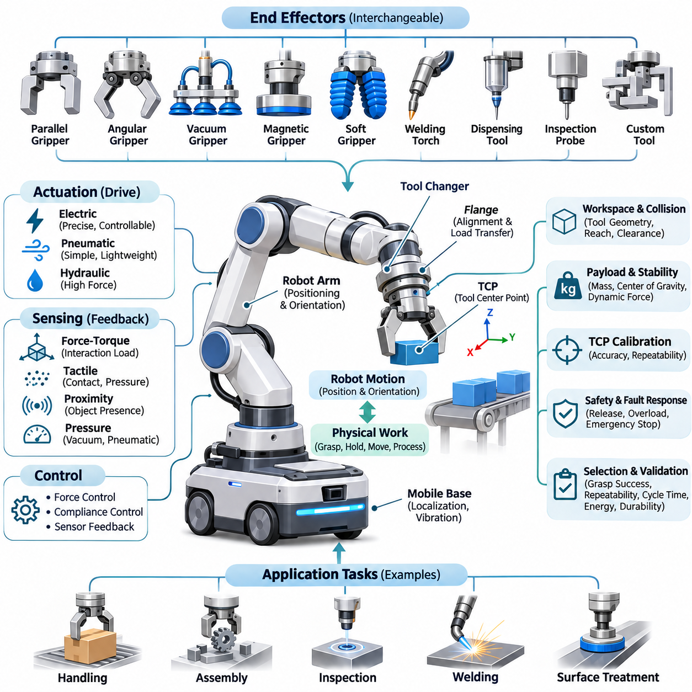
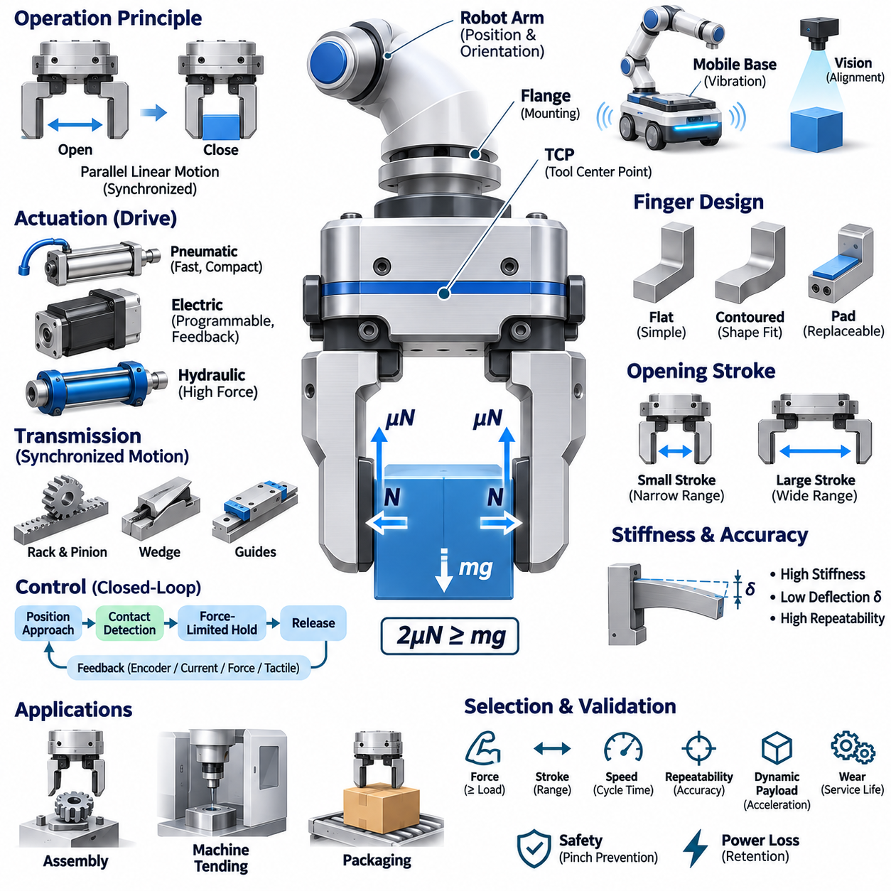
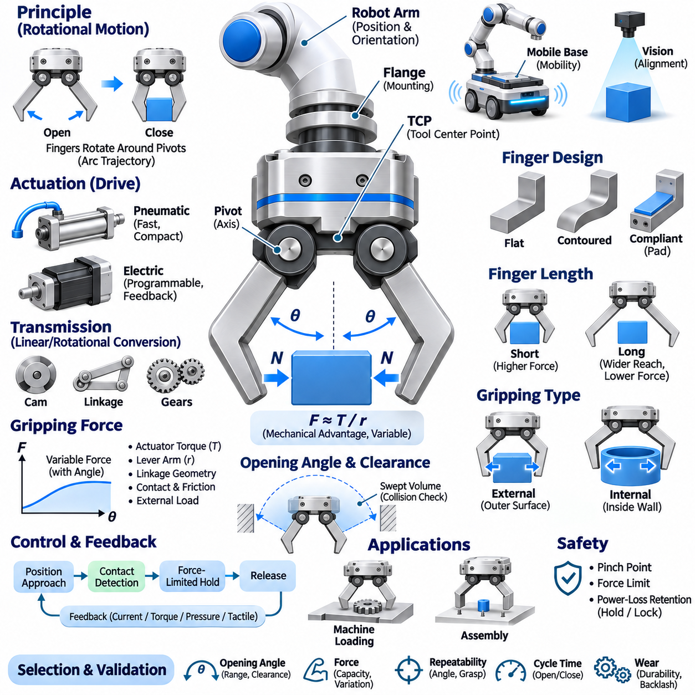
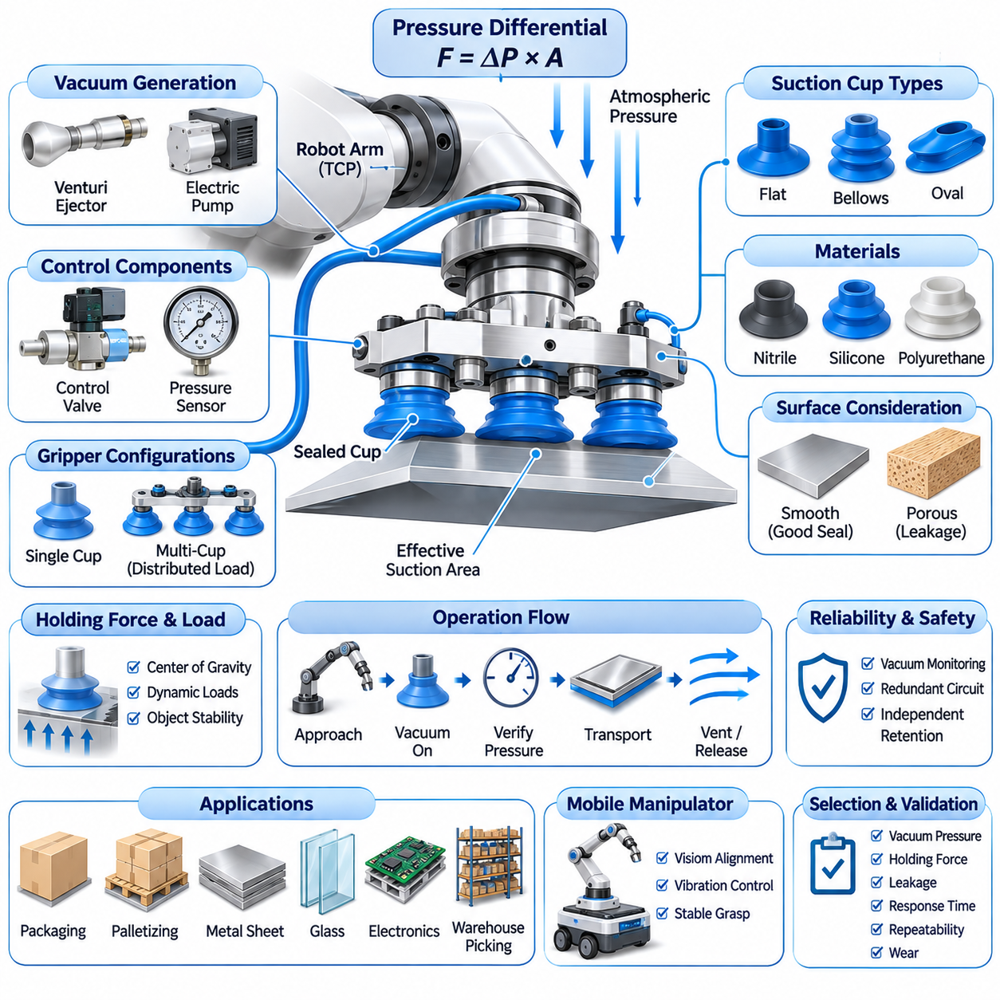
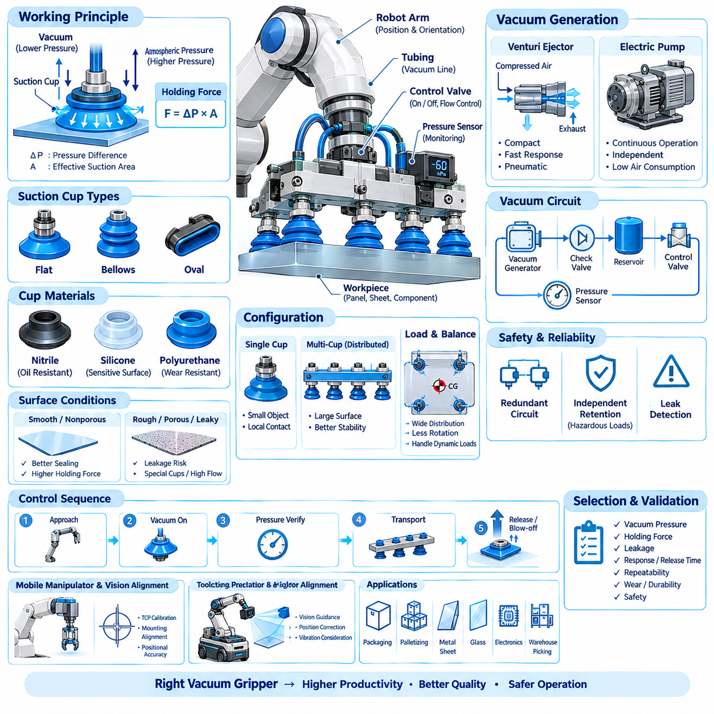
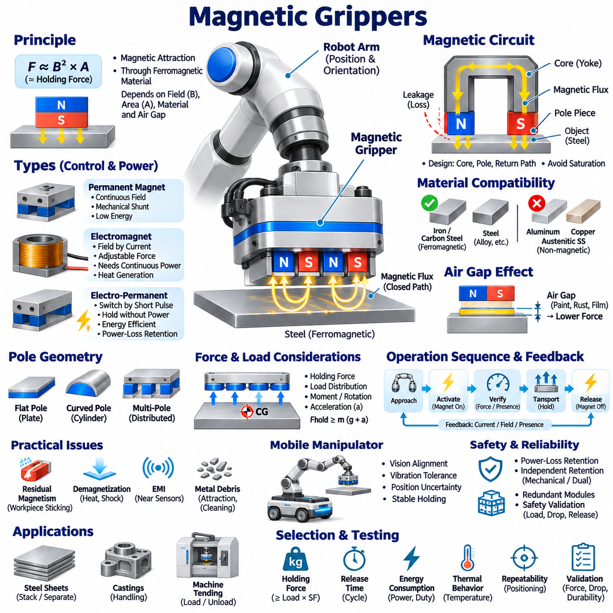
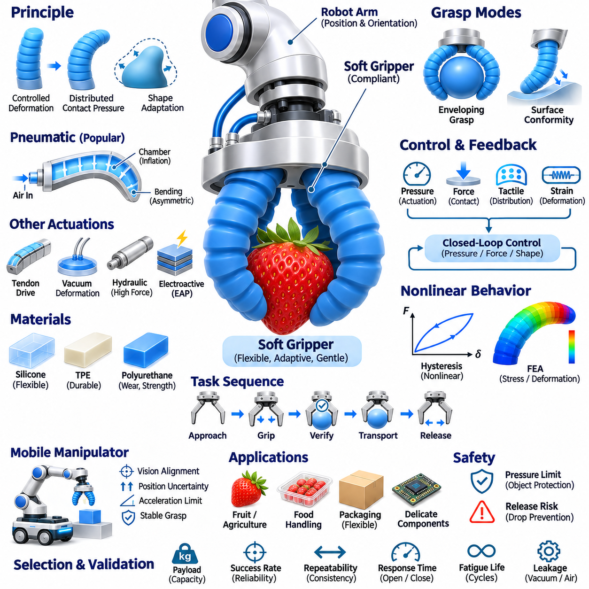
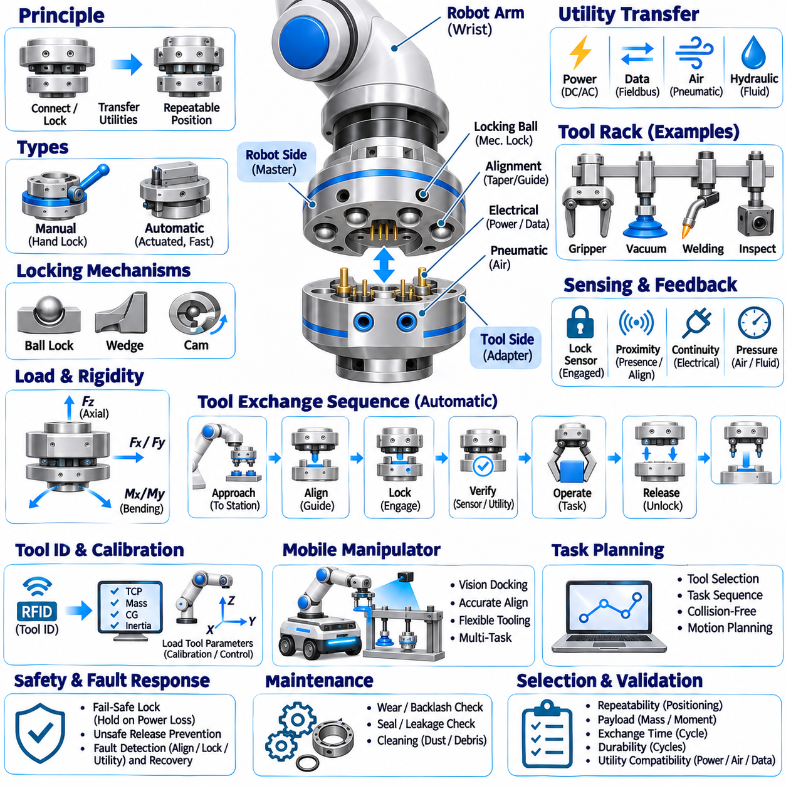
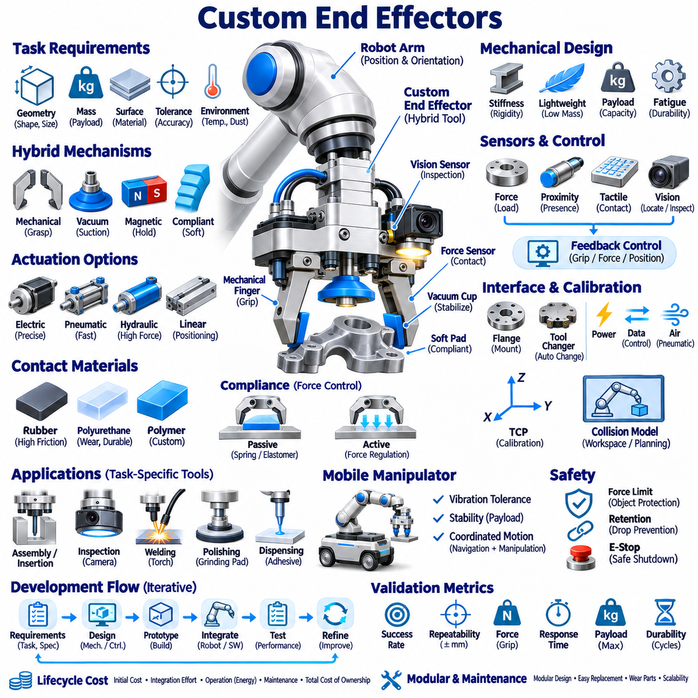
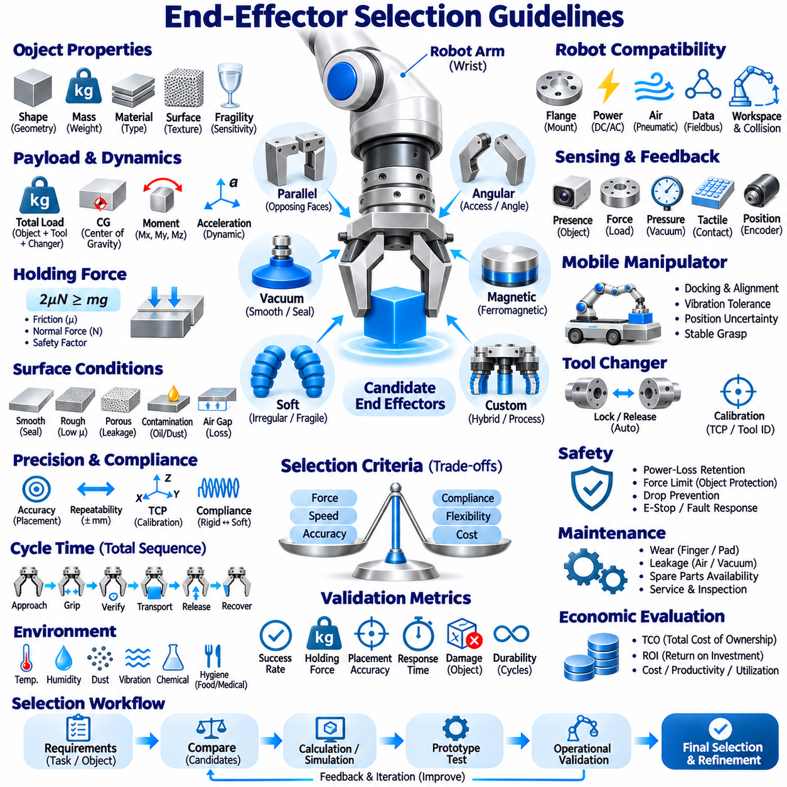

**Volume 02. Manipulator Mechanics and Control**

# Chapter 10. End Effectors

## 01 End Effector Overview

{width="7.268055555555556in" height="7.268055555555556in"}

An end effector is the functional device mounted at the terminal interface of a robotic manipulator, enabling the robot to interact directly with objects, tools, and surrounding environments. While the robot arm provides positioning and orientation capabilities, the end effector performs the actual physical operation. Its design determines how effectively the robotic system can grasp, hold, move, process, or manipulate objects during industrial and service tasks.

End effectors establish the mechanical and functional connection between robotic motion and task execution. They convert the positioning capability of the manipulator into practical operations such as material handling, assembly, inspection, welding, and surface treatment. Their effectiveness depends on mechanical structure, actuation technology, sensing capability, and control integration. A well-designed end effector must satisfy task requirements without exceeding the manipulator\'s operating limits.

The term end effector includes a broad range of devices beyond conventional robotic grippers. Mechanical gripping mechanisms, vacuum suction systems, magnetic holding devices, welding torches, dispensing tools, and inspection probes all represent different end-effector configurations. Each device provides a specialized interaction mechanism suited to particular materials, object geometries, environmental conditions, and manufacturing processes.

Mechanical grippers represent one of the most common end-effector categories in robotic manipulation. They typically employ fingers or jaws that apply controlled forces to secure an object through frictional contact or geometric constraint. Parallel grippers maintain approximately parallel finger motion, while angular grippers rotate their fingers around mechanical pivots. Their selection depends on object dimensions, required gripping force, accessibility, and operational repeatability.

Vacuum end effectors use pressure differences to generate holding forces between suction elements and object surfaces. They are particularly effective for handling flat panels, packaging materials, glass sheets, and components with suitable sealing surfaces. Vacuum performance depends on contact area, pressure differential, surface roughness, leakage, and acceleration. Reliable operation requires appropriate suction-cup geometry, vacuum generation, and pressure monitoring.

Magnetic end effectors provide an alternative holding mechanism for ferromagnetic materials. Permanent magnets, electromagnets, and switchable magnetic systems can generate attractive forces without requiring conventional mechanical fingers. These devices are useful for handling steel plates, fabricated components, and industrial workpieces. Their effectiveness depends on material properties, contact conditions, magnetic circuit design, and controlled release mechanisms.

Soft robotic end effectors employ compliant materials and deformable structures to interact with objects through adaptable contact surfaces. Unlike rigid gripping mechanisms, soft grippers can conform to irregular shapes and distribute contact pressure across larger areas. This behavior is valuable when manipulating fragile, deformable, or geometrically uncertain objects. However, material hysteresis, deformation modeling, and gripping-force estimation introduce additional control challenges.

End-effector actuation may be implemented using electric motors, pneumatic cylinders, hydraulic mechanisms, or specialized smart-material actuators. Electric systems offer precise position control and convenient integration with digital controllers, while pneumatic mechanisms provide relatively simple and lightweight actuation. Hydraulic devices support demanding force requirements but introduce fluid-management complexity. Actuation selection influences response speed, controllability, energy consumption, and maintenance.

The mechanical interface between the manipulator and end effector must provide sufficient structural rigidity, alignment accuracy, and load-transfer capability. Mounting flanges, adapters, fastening mechanisms, and electrical connectors establish this interface. Engineers must consider payload mass, center-of-gravity displacement, bending moments, and dynamic forces. Improper interface design can reduce positioning accuracy, increase joint loading, and compromise operational reliability.

End-effector geometry directly influences the accessible workspace and manipulation capability of the complete robot. Tool length, orientation, external dimensions, and contact geometry affect collision clearance and reachable object poses. A long or bulky end effector may extend the operational reach while restricting access to confined spaces. Consequently, tool geometry must be considered during kinematic modeling, collision checking, and motion-planning development.

The tool center point represents a reference location associated with the functional interaction point of an end effector. Accurate tool center point calibration allows the robot controller to transform commanded tool poses into appropriate joint configurations. Errors in tool geometry or mounting alignment can produce significant positioning deviations during manipulation. Tool calibration must therefore account for mechanical tolerances, mounting changes, and application-specific accuracy requirements.

Sensing capabilities enhance end-effector performance by providing information about contact conditions, object presence, gripping forces, and operational status. Force-torque sensors measure interaction loads, while tactile sensors detect local pressure distributions and contact events. Proximity sensors, pressure switches, and position encoders provide additional feedback. Combining these measurements enables more reliable manipulation under uncertainty and changing environmental conditions.

Force control and compliance control play important roles when end effectors interact with constrained or delicate environments. Excessive contact forces can damage objects, deform components, or destabilize robotic operations. Controlled compliance allows the system to accommodate small positioning errors while maintaining acceptable interaction forces. This capability is particularly important in insertion, surface following, precision assembly, and collaborative manipulation applications.

Tool changers extend robotic flexibility by allowing a single manipulator to exchange different end effectors according to task requirements. Automatic tool-changing systems typically combine mechanical locking interfaces with electrical, pneumatic, or communication connections. Reliable tool identification and connection verification are essential for safe operation. Tool-changing capability enables robotic systems to perform multiple processes without requiring dedicated manipulators for every operation.

Custom end effectors are frequently developed when commercially available devices cannot satisfy specialized application requirements. Their development involves analyzing object geometry, required contact forces, operational sequences, environmental constraints, and manufacturing tolerances. Computer-aided design and mechanical simulation support structural evaluation before fabrication. Prototypes must then undergo functional testing to verify gripping reliability, repeatability, durability, and compatibility with the manipulator.

Mobile manipulators introduce additional constraints because end-effector operation is influenced by the mobility platform and its positioning accuracy. Base localization errors, platform vibration, and structural deflection can affect tool placement and contact stability. The complete system must coordinate mobile-base positioning, manipulator motion, and end-effector activation. Accurate calibration between the mobile platform, robot arm, and tool reference frames is essential for consistent task execution.

Dynamic behavior becomes especially important when end effectors handle substantial payloads or execute rapid movements. Object inertia, gripping-force margins, acceleration profiles, and sudden directional changes influence manipulation stability. A grasp that remains secure under static conditions may fail during aggressive motion. Engineers must evaluate both static holding capability and dynamic load conditions while ensuring that joint torque limits and structural constraints remain satisfied.

Safety considerations extend beyond the manipulator itself to include the physical behavior of attached tools. Pinch points, sharp edges, stored pneumatic energy, electrical hazards, and unintended object release can create operational risks. End-effector safety measures may include force limitations, protective covers, pressure monitoring, redundant holding mechanisms, and controlled fault responses. Risk assessment must address normal operation, maintenance, emergency stopping, and power-loss conditions.

End-effector selection requires balancing task performance against system-level engineering constraints. Important factors include payload capacity, object compatibility, gripping stability, cycle time, positional accuracy, integration complexity, and operating cost. Environmental conditions such as dust, moisture, temperature, and electromagnetic interference may also influence device suitability. The optimal choice is not necessarily the strongest or most sophisticated tool, but the one that reliably satisfies application requirements.

Performance evaluation should examine end effectors under representative operating conditions rather than relying exclusively on nominal specifications. Relevant measurements include grasp success rate, holding-force stability, positioning repeatability, cycle time, energy consumption, and failure frequency. Testing should cover variations in object dimensions, surface conditions, and payload distributions. Long-duration trials help identify wear, calibration drift, actuator degradation, and intermittent operational faults.

Ultimately, end effectors determine how robotic manipulators translate mechanical motion into useful physical work. Their performance emerges from the combined design of mechanical interfaces, actuators, sensors, control algorithms, and task-specific interaction mechanisms. Understanding these relationships provides the foundation for evaluating parallel, angular, vacuum, magnetic, and soft grippers, as well as tool changers and customized devices used in modern robotic manipulation systems.

## 02 Parallel Grippers

{width="7.268055555555556in" height="7.268055555555556in"}

Parallel grippers are widely used robotic end effectors designed to grasp objects through synchronized linear motion of two opposing fingers. Unlike angular gripping mechanisms, their fingers move along approximately parallel paths, maintaining consistent orientation during opening and closing. This configuration supports predictable contact geometry, accurate object positioning, and repeatable manipulation across industrial automation and mobile robotic applications.

The fundamental operating principle of a parallel gripper involves converting actuator motion into controlled displacement of gripping jaws. Mechanical linkages, rack-and-pinion systems, wedge mechanisms, and lead screws are commonly employed to synchronize finger movement. Depending on the design, both fingers may move symmetrically toward the center, or one finger may remain fixed while the other moves. The resulting motion determines grasp alignment and positioning accuracy.

Parallel grippers are generally classified according to their actuation technology, mechanical transmission, and gripping configuration. Pneumatic grippers use compressed air to generate linear motion, while electric grippers employ motors and transmission mechanisms for programmable positioning. Hydraulic systems provide substantial gripping forces for demanding applications. Each configuration presents different tradeoffs involving force capacity, response speed, controllability, maintenance requirements, and integration complexity.

Pneumatic parallel grippers are particularly common in high-speed industrial automation because of their compact construction and relatively simple operation. Compressed air drives pistons that transfer force through mechanical linkages to the gripping fingers. Their advantages include rapid actuation, high power density, and straightforward control. However, compressed-air infrastructure, pressure variations, limited intermediate-position control, and air consumption must be considered during system design.

Electric parallel grippers provide greater flexibility through programmable finger positions, adjustable gripping forces, and integrated feedback capabilities. Servo motors or stepper motors typically drive lead screws, gears, or belt mechanisms to control jaw displacement. Position encoders and motor-current measurements support closed-loop operation, although accurate force estimation may require calibration or dedicated sensors. These features make electric grippers suitable for variable-size objects and adaptive manipulation.

The gripping force required for reliable manipulation depends on object mass, contact friction, acceleration, orientation, and the distribution of contact forces. For a symmetric two-finger friction grasp supporting a vertical load, a simplified static condition is 2μN ≥ mg, where μ represents the friction coefficient and N is the normal force applied by each finger. Practical designs require additional margins for acceleration, uncertainty, vibration, and variations in surface conditions.

Gripping-force distribution is influenced by finger geometry, contact location, and mechanical alignment. Ideally, opposing fingers apply balanced forces that minimize unintended object rotation and local deformation. Uneven contact may introduce torque, cause slipping, or damage fragile components. Engineers therefore evaluate finger stiffness, contact-pad materials, jaw parallelism, and object geometry to achieve stable grasping while avoiding excessive pressure concentrations.

Finger design is a critical aspect of parallel-gripper performance because the fingers establish the physical interface with manipulated objects. Flat fingers are suitable for simple prismatic components, while contoured fingers improve geometric engagement with cylindrical or irregular workpieces. Replaceable contact pads can increase friction or reduce surface damage. Finger length and mass must be controlled because excessive extensions increase bending moments and reduce effective gripping capability.

The opening stroke determines the range of object dimensions that a parallel gripper can accommodate. A larger stroke increases versatility but may require a longer transmission mechanism, greater actuator travel, or a larger device envelope. Designers must distinguish between total jaw travel and the displacement of each individual finger. Stroke selection should account for dimensional tolerances, approach clearance, positioning uncertainty, and the desired range of supported objects.

Mechanical stiffness and structural rigidity strongly influence gripping accuracy and repeatability. Compliance in the fingers, guide rails, bearings, or transmission components can produce displacement errors under load. Backlash and friction may further degrade positioning consistency, especially when grasping small components. Precision applications therefore require suitable guide mechanisms, rigid mounting interfaces, controlled manufacturing tolerances, and periodic inspection of mechanical wear.

Parallel grippers may operate through force-controlled, position-controlled, or hybrid gripping strategies. Position control commands a target jaw opening, while force control regulates the contact load applied to the object. Hybrid strategies combine position-based approach motion with force-limited contact and secure holding. Appropriate control selection depends on object stiffness, dimensional variability, surface characteristics, and the consequences of excessive gripping pressure.

Contact detection enables a gripper controller to identify when the fingers encounter an object during closure. Detection may rely on force sensors, motor-current changes, position deviations, or tactile measurements. Reliable contact detection allows the controller to transition from free motion to controlled gripping. However, motor-current thresholds alone can be affected by friction, temperature, and transmission efficiency, requiring careful calibration and validation.

Grasp stability depends on maintaining sufficient resistance against external disturbances throughout the manipulation sequence. Static gripping-force calculations provide an initial estimate, but dynamic conditions introduce additional loads during acceleration, deceleration, and rotation. Object inertia may generate forces and moments that exceed the available frictional resistance. Motion planning should therefore consider gripper limitations and adjust robot trajectories to maintain secure object retention.

Parallel grippers are commonly integrated with six-axis industrial manipulators, collaborative robots, and mobile manipulation platforms. The gripper mounting interface must transmit operational forces without excessive deflection, while electrical or pneumatic connections must remain protected during robot motion. Accurate tool-center-point calibration establishes the relationship between the robot flange and gripping geometry. Integration also requires coordination between arm motion and jaw actuation.

Mobile manipulators introduce additional challenges because platform localization errors and vibration can influence gripping accuracy. The robotic arm must position the gripper relative to the target object while compensating for uncertainties in base placement and object pose estimation. Vision-guided alignment, compliant approach strategies, and contact feedback can improve reliability. Coordinated control of the mobile base, manipulator, and gripper supports repeatable grasping in changing environments.

Parallel grippers are extensively used in assembly lines, machine tending, component transfer, packaging, and laboratory automation. Their predictable motion makes them suitable for repetitive handling of parts with known geometries. In precision assembly, carefully designed fingers can establish repeatable object alignment before insertion or placement. In logistics applications, interchangeable finger attachments may accommodate multiple product categories without replacing the entire gripping mechanism.

Safety considerations include pinch hazards, excessive gripping forces, unintended jaw movement, and accidental object release. The system must define appropriate responses to power loss, communication failures, actuator faults, and emergency stopping. Some grippers incorporate mechanical brakes, spring mechanisms, or self-locking transmissions to retain objects under selected fault conditions. Such features must be validated rather than assumed to provide universal fail-safe behavior.

Performance evaluation should examine gripping force, opening stroke, actuation time, positioning repeatability, payload compatibility, and operational durability. Testing should include different object masses, contact materials, gripping orientations, and motion profiles. Repeated grasp-and-release cycles reveal wear, thermal effects, and variations in mechanical behavior. Grasp success rate and object damage frequency provide practical measures of performance under representative operating conditions.

Selecting a parallel gripper requires balancing gripping capability with actuator technology, physical dimensions, control requirements, and operational cost. Pneumatic designs may be preferable for rapid repetitive handling, while electric designs often provide advantages when programmable positioning and feedback are important. Finger geometry, force margins, stroke requirements, and environmental conditions must be evaluated together rather than independently.

Ultimately, parallel grippers provide a mechanically straightforward and highly effective solution for robotic object handling. Their synchronized jaw motion supports accurate positioning, repeatable gripping, and integration with modern manipulation controllers. Reliable performance emerges from the combined design of actuation mechanisms, transmission components, finger geometry, sensing systems, and control strategies. These principles establish a foundation for advanced gripping technologies and application-specific robotic manipulation.

## 03 Angular Grippers

{width="7.268055555555556in" height="7.268055555555556in"}

Angular grippers are robotic end effectors that grasp objects through the rotational movement of opposing fingers around fixed pivot points. Unlike parallel grippers, which maintain constant finger orientation during linear motion, angular grippers follow curved trajectories as their jaws open and close. This mechanism provides a compact gripping solution for industrial handling, assembly, and automated transfer operations where rotational finger movement is advantageous.

The fundamental operating principle of an angular gripper involves converting actuator displacement or rotation into controlled finger rotation. Mechanical linkages, cam mechanisms, gears, and lever systems transmit motion from the actuator to the gripping jaws. The fingers typically rotate symmetrically around separate pivot axes, although asymmetric configurations are possible. The relationship between actuator displacement and finger angle determines gripping range, mechanical advantage, and contact behavior.

Angular grippers are commonly classified according to their actuation mechanisms, opening angles, and mechanical configurations. Pneumatic angular grippers use compressed air to drive pistons connected to rotational linkages, while electric versions employ motors and transmission systems. Some designs provide limited angular travel, whereas others support wide opening angles approaching or exceeding 90 degrees per finger. The appropriate configuration depends on object geometry, workspace accessibility, and required gripping performance.

Pneumatic angular grippers are widely employed in industrial automation because they provide rapid opening and closing with relatively simple mechanical construction. A pneumatic piston generates linear force that is converted into rotational motion through a linkage or cam mechanism. Their compact dimensions and fast response are suitable for repetitive handling tasks. However, pressure fluctuations, air consumption, and limited force programmability can affect performance and control flexibility.

Electric angular grippers offer programmable finger positions, controlled opening speeds, and adjustable gripping behavior. Electric motors drive rotational joints through gears, screws, or linkage mechanisms, enabling more flexible motion profiles than conventional binary pneumatic systems. Encoders and current monitoring provide feedback for position control and approximate force estimation. Dedicated torque or contact sensors may be necessary when precise gripping-force regulation is required.

The geometry of an angular gripper determines how the finger contact points move relative to the object during closure. Because each finger follows an arc, the contact location and surface orientation may change continuously throughout the gripping motion. This behavior differs from parallel gripping, where opposing contact surfaces can maintain approximately constant alignment. Engineers must therefore evaluate object shape, finger length, pivot placement, and closing angle to achieve stable contact.

Gripping force in an angular gripper depends on actuator output, linkage geometry, lever-arm length, and the instantaneous finger angle. The mechanical advantage may vary significantly throughout the opening and closing stroke. Consequently, the available gripping force is not necessarily constant across the operating range. Force calculations should account for the moment generated around each pivot, the effective contact radius, friction, and expected external loads.

Finger length introduces an important tradeoff between reach and gripping capability. Longer fingers increase accessibility around fixtures or recessed objects but also increase the moment applied to the pivot mechanism. For a given actuator torque, increasing the distance between the pivot and contact point generally reduces the available normal gripping force. Excessive finger length can also increase structural deflection, vibration, and positioning uncertainty during rapid manipulation.

Contact geometry strongly influences the stability of objects held by angular grippers. Flat gripping surfaces may contact an object at changing angles, producing uneven pressure distributions or unintended sliding. Contoured fingers and compliant contact pads can improve contact consistency by accommodating the rotational approach. Proper finger design should minimize damaging pressure concentrations while providing sufficient frictional resistance against gravitational and inertial forces.

Angular grippers can perform external gripping by closing around an object\'s outer surfaces or internal gripping by expanding against the walls of an opening. External gripping is commonly used for components, containers, and manufactured parts, while internal gripping is useful for rings, hollow components, and suitable cavities. The selected approach must consider object stiffness, available contact area, dimensional tolerances, and the risk of deformation during force application.

The opening angle of an angular gripper influences both object accessibility and required clearance around the manipulation target. Wide-angle designs can move fingers away from the central workspace, allowing the gripper to approach objects without interference. This characteristic is useful when handling components located near fixtures or surrounded by neighboring objects. However, the swept volume of the rotating fingers must be considered during collision checking and trajectory planning.

Mechanical transmission components determine the precision and durability of angular gripping systems. Pivot bearings, gears, linkages, and connecting pins experience repeated loads during gripping cycles. Backlash, bearing wear, and linkage deformation can introduce angular positioning errors and uneven contact forces. Precision applications require appropriate material selection, bearing support, lubrication, and mechanical tolerances to maintain consistent operation over extended service periods.

Angular grippers may operate using position control, force control, or combined control strategies. Position-controlled systems command specific finger angles, while force-controlled systems regulate contact loads through actuator torque or sensor feedback. Hybrid approaches use position control during free motion and transition to force-limited gripping after contact detection. Control performance depends on actuator characteristics, transmission friction, sensor resolution, and object compliance.

Contact detection is essential when gripping objects with uncertain dimensions or variable positioning. Motor-current monitoring, torque sensing, pneumatic pressure measurement, and tactile sensors can indicate contact between the fingers and an object. Once contact is detected, the controller can reduce closing speed or regulate gripping force. Reliable detection requires distinguishing actual object contact from mechanical friction, linkage resistance, and disturbances introduced by the gripping mechanism.

Angular grippers are frequently integrated with industrial manipulators, collaborative robots, and automated assembly equipment. Their mounting interfaces must withstand operational forces and moments while maintaining accurate alignment with the robot flange. Tool-center-point calibration should reflect the functional gripping location and the relationship between finger angles and contact geometry. Communication and control interfaces must coordinate gripper actuation with manipulator motion and task execution.

Mobile manipulators introduce additional challenges because base-positioning errors, vibration, and object-pose uncertainty affect the alignment of rotating fingers. Angular gripping trajectories must account for the relative position between the mobile platform, manipulator, and target object. Vision-guided positioning and compliant approach motions can improve reliability. Coordinated control is particularly important when manipulating objects in confined environments or near surrounding structures.

Industrial applications of angular grippers include machine loading, component transfer, packaging, assembly, and material handling. Their rotational opening mechanism is advantageous when fingers must retract away from the object approach path or operate around mechanical fixtures. Specialized finger geometries can support cylindrical components, irregular parts, and hollow workpieces. Application suitability depends on the interaction between opening angle, gripping force, object geometry, and cycle-time requirements.

Safety considerations include pinch points near rotating joints, unintended finger movement, excessive contact forces, and accidental object release. The system should define predictable behavior during emergency stops, power failures, communication interruptions, and actuator faults. Mechanical locking mechanisms, spring-assisted gripping, or braking systems may improve object retention in selected designs. Their effectiveness must be validated under realistic operating conditions rather than assumed from nominal specifications.

Performance evaluation should measure opening angle, gripping-force variation, actuation time, angular repeatability, payload compatibility, and mechanical durability. Tests should examine multiple finger positions because mechanical advantage and contact geometry change throughout the stroke. Repeated gripping cycles reveal backlash development, bearing wear, thermal effects, and variations in force transmission. Grasp success rate and object damage frequency provide practical indicators of operational reliability.

Selecting an angular gripper requires evaluating object dimensions, required gripping force, available installation space, actuator technology, and control flexibility. Pneumatic designs are often suitable for rapid repetitive operations, while electric systems provide advantages when programmable positioning and adjustable gripping behavior are important. Engineers must also consider finger geometry, pivot loading, swept volume, and environmental conditions to ensure reliable integration with the complete robotic system.

Ultimately, angular grippers provide a compact and versatile approach to robotic object handling through controlled rotational finger motion. Their effectiveness depends on the coordinated design of pivot mechanisms, actuator systems, transmission geometry, gripping surfaces, sensors, and control algorithms. Understanding these relationships enables engineers to select and optimize angular grippers for industrial automation, precision manipulation, and mobile robotic applications where conventional parallel gripping may be less suitable.

## 04 Vacuum Grippers

{width="7.268055555555556in" height="7.268055555555556in"}

{width="7.268055555555556in" height="7.268055555555556in"}

Vacuum grippers are robotic end effectors that use pressure differences to generate holding forces between suction elements and object surfaces. They are widely used in industrial automation for handling flat, smooth, and lightweight objects, including glass panels, metal sheets, plastic components, cardboard packages, and electronic assemblies. Unlike mechanical grippers, vacuum systems can manipulate objects without requiring opposing fingers, making them particularly useful when objects have large surfaces or limited gripping features.

The fundamental operating principle of a vacuum gripper is based on the pressure differential between the sealed region beneath a suction cup and the surrounding atmospheric environment. A vacuum generator removes air from the contact region, reducing internal pressure and allowing atmospheric pressure to produce a force that holds the object against the suction element. The available holding force depends primarily on the effective suction area and the pressure difference achieved during operation.

Vacuum grippers generally consist of suction cups, vacuum generators, pneumatic tubing, control valves, pressure sensors, and mounting structures. Suction cups establish the physical contact with the object, while vacuum generators create the required pressure differential. Valves control vacuum generation and release, and pressure sensors monitor operating conditions. These components must work together to maintain sufficient holding force throughout the gripping, transportation, and release phases.

Suction cups are available in different shapes, sizes, and materials to accommodate various object geometries and surface conditions. Flat suction cups are suitable for smooth surfaces and applications requiring relatively stable positioning. Bellows suction cups provide additional flexibility and can compensate for variations in object height or surface alignment. Oval suction cups are useful when handling elongated objects or when the available contact area is limited in one direction.

The selection of suction-cup materials is important because elasticity, friction, chemical resistance, and wear characteristics influence gripping reliability. Common materials include nitrile rubber, silicone, polyurethane, and specialized elastomers. Silicone is frequently selected for applications involving sensitive surfaces, while nitrile rubber provides useful resistance to oils and industrial contaminants. Material compatibility must also consider operating temperature, surface coatings, cleanliness requirements, and long-term deformation.

Vacuum generation can be implemented using ejectors based on the Venturi principle or electrically driven vacuum pumps. Pneumatic ejectors use compressed air flowing through a specially designed nozzle to generate a low-pressure region. They are compact, respond rapidly, and can be integrated into existing pneumatic systems. Electric vacuum pumps provide an alternative when continuous vacuum generation, independent operation, or reduced compressed-air consumption is required.

The theoretical holding force of a vacuum gripper can be approximated using the relationship F = ΔP × A, where F represents the theoretical holding force, ΔP is the pressure difference between atmospheric pressure and the vacuum region, and A is the effective suction area. However, this ideal calculation does not fully represent practical operating conditions. Leakage, surface irregularities, material deformation, acceleration, and safety margins must be considered when determining the actual payload capacity.

Surface characteristics strongly influence vacuum-gripping performance. Smooth, nonporous materials generally provide better sealing conditions, while rough, porous, or uneven surfaces may allow continuous air leakage. Paper, textiles, untreated wood, and certain packaging materials require specialized suction cups or high-flow vacuum systems. In these applications, maintaining sufficient airflow can be more important than achieving an extremely low vacuum pressure.

Vacuum grippers are commonly classified according to their vacuum generation and suction configurations. Single-cup systems provide a simple solution for small objects or localized contact regions, while multi-cup systems distribute holding forces across larger surfaces. Multi-cup arrangements can improve stability when handling wide panels, but their design must account for differences in surface flatness, suction distribution, and individual cup contact conditions.

The arrangement of multiple suction cups determines how external forces and moments are transferred to the object. Widely distributed cups can improve resistance to rotation and reduce local deformation. However, uneven loading may cause individual cups to lose contact during acceleration or when handling objects with irregular surfaces. Engineers must evaluate cup spacing, contact area, object stiffness, center of gravity, and expected dynamic loads during system design.

Vacuum monitoring is essential for detecting unsuccessful gripping operations and preventing unintended object release. Pressure sensors provide feedback about the vacuum level, allowing controllers to verify whether sufficient holding conditions have been established. Pressure thresholds can be used to identify incomplete sealing, excessive leakage, or sudden vacuum loss. More advanced systems monitor pressure changes over time to distinguish normal gripping behavior from developing faults.

Vacuum release mechanisms determine how quickly and reliably an object can be separated from the suction cups. Conventional release methods introduce atmospheric air into the vacuum circuit, eliminating the pressure differential that maintains the object. Some systems use controlled blow-off air to accelerate release and prevent objects from remaining attached due to residual vacuum. Release timing and pressure must be configured carefully to avoid disturbing nearby objects or damaging fragile components.

Vacuum grippers can also incorporate vacuum reservoirs, non-return valves, and redundant suction circuits to improve operational reliability. A vacuum reservoir stores a limited quantity of reduced-pressure air conditions, helping maintain holding capability during temporary interruptions in vacuum generation. Non-return valves reduce the rate of vacuum loss when the supply is disconnected. These mechanisms are particularly valuable when handling heavy objects or operating above personnel-accessible areas, although their actual protection must be verified through system-level testing.

Dynamic manipulation introduces additional requirements because acceleration, deceleration, and rotational movement generate forces that may exceed the available holding capacity. A vacuum gripper that securely holds an object under static conditions may experience slipping or separation during rapid robot motion. Motion planning should consider object mass, center of gravity, acceleration limits, rotational inertia, and suction-cup distribution. Appropriate safety factors are necessary to maintain reliable retention throughout the complete trajectory.

Vacuum grippers are widely integrated with industrial manipulators, collaborative robots, and mobile manipulation platforms. The mounting interface must provide sufficient structural rigidity while protecting vacuum tubing and electrical connections from excessive bending or interference. Tool-center-point calibration should account for the geometry of the suction cups and the expected contact location. Coordinating robot movement with vacuum activation and pressure verification is essential for reliable pick-and-place operations.

Mobile manipulators introduce additional challenges because platform vibration, localization uncertainty, and variations in object positioning can affect suction-cup contact. The robot must approach the target with appropriate orientation and contact alignment before establishing vacuum. Vision-guided positioning, compliant approach motion, and pressure-based contact verification can improve gripping reliability. Coordinated control between the mobile base, robotic arm, and vacuum system is especially important when handling large or flexible objects.

Industrial applications of vacuum grippers include packaging, palletizing, sheet-metal handling, glass transportation, electronic manufacturing, and warehouse picking. Their ability to handle objects without conventional mechanical fingers makes them particularly effective for products with broad surfaces or limited accessible edges. Multi-cup systems can support large panels, while specialized suction configurations can accommodate delicate packaging and irregular components.

Safety considerations include unexpected vacuum loss, insufficient sealing, accidental object release, and compressed-air system failures. Risk assessment should examine power interruption, vacuum generator malfunction, damaged tubing, sensor failures, and emergency-stop behavior. Heavy objects may require independent retention mechanisms or additional mechanical support. Vacuum monitoring alone should not be considered a universal safety guarantee, particularly when object release could create serious hazards.

Performance evaluation should measure achievable vacuum pressure, effective holding force, gripping response time, release time, leakage rate, and operational repeatability. Testing should include different surface materials, object masses, environmental conditions, and motion profiles. Repeated gripping cycles help identify suction-cup wear, material degradation, leakage development, and vacuum-generator performance changes. Practical evaluation should also examine object damage, positioning accuracy, and successful handling rates.

Selecting an appropriate vacuum gripper requires balancing suction-cup geometry, material compatibility, vacuum-generation capacity, payload requirements, and operating conditions. Engineers must consider whether the target surface is smooth, porous, curved, contaminated, or sensitive to contact pressure. The number and arrangement of suction cups should reflect object geometry and dynamic loading. Vacuum generation, monitoring, and release mechanisms must be selected as an integrated system rather than as independent components.

Ultimately, vacuum grippers provide an efficient and flexible approach to robotic object handling through controlled pressure differences and surface adhesion. Their performance depends on the combined design of suction elements, vacuum-generation devices, pneumatic circuits, sensing systems, and control strategies. Understanding these relationships enables engineers to develop reliable vacuum-based manipulation systems for industrial automation, material handling, precision manufacturing, and mobile robotic applications.

## 05 Magnetic Grippers

{width="7.268055555555556in" height="7.268055555555556in"}

Magnetic grippers are robotic end effectors that use magnetic fields to attract and hold ferromagnetic objects without requiring mechanical fingers or direct clamping mechanisms. They are commonly used in industrial automation for handling steel plates, metal sheets, castings, machined components, and other magnetic materials. Their contactless or near-contact gripping capability makes them particularly useful when conventional mechanical gripping is difficult, when objects have limited accessible surfaces, or when rapid material transfer is required.

The fundamental operating principle of a magnetic gripper is based on the magnetic attraction generated between the gripper and a ferromagnetic object. Magnetic flux passes through the object and creates an attractive force that maintains contact during lifting and transportation. The resulting holding force depends on magnetic field strength, pole geometry, effective contact area, material permeability, and the air gap between the magnetic surface and the object. Reliable operation requires an appropriate magnetic circuit design and suitable contact conditions.

Magnetic grippers are generally classified into permanent magnet grippers, electromagnetic grippers, and electro-permanent magnet grippers. Each type generates and controls magnetic attraction through a different mechanism. Permanent magnet systems use continuously available magnetic fields, electromagnetic systems generate magnetic fields through electrical current, and electro-permanent systems combine permanent magnets with electrically controlled switching. Their selection depends on payload requirements, release behavior, energy consumption, and operational safety.

Permanent magnet grippers use permanent magnetic materials to generate holding forces without requiring continuous electrical power. Materials such as neodymium-iron-boron and samarium-cobalt provide strong magnetic fields within relatively compact structures. Mechanical switching mechanisms or magnetic shunts can redirect the magnetic flux to engage or release an object. Their low energy consumption and simple construction are advantageous, although controlling magnetic attraction and release may require specialized mechanical arrangements.

Electromagnetic grippers generate magnetic fields by passing electrical current through coils wound around magnetic cores. When energized, the coils produce magnetic flux that attracts ferromagnetic objects. Switching off the electrical current normally reduces the magnetic attraction and allows the object to be released. Electromagnets offer convenient electronic control and adjustable magnetic strength through current regulation, but they require continuous electrical power during holding and may generate heat under sustained operation.

Electro-permanent magnetic grippers combine permanent magnets with electrically controlled magnetic switching. A short electrical pulse changes the internal magnetic configuration, allowing the system to switch between holding and releasing states without continuous power consumption. Once activated, permanent magnets maintain the holding force independently of the electrical supply. This architecture can improve energy efficiency and provide object retention during power interruptions, making it attractive for industrial handling applications.

The magnetic circuit is a critical element in magnetic gripper design because it determines how effectively magnetic flux is directed through the target object. Magnetic cores, pole pieces, permanent magnets, and return paths must be arranged to minimize unwanted flux leakage and maximize useful attraction. The magnetic properties of structural materials influence overall performance. Engineers must evaluate magnetic saturation, core geometry, pole spacing, and thermal characteristics when designing the magnetic assembly.

The achievable holding force depends strongly on the physical properties of the handled material. Ferromagnetic materials such as iron, carbon steel, and certain stainless steels can respond strongly to magnetic attraction, while aluminum, copper, and many austenitic stainless steels cannot be handled effectively using conventional magnetic grippers. Even among ferromagnetic materials, differences in permeability, thickness, surface condition, and magnetic characteristics can produce significant variations in gripping performance.

Air gaps between the magnetic poles and the object surface can substantially reduce magnetic holding force. Paint coatings, rust, surface contamination, protective films, and geometric irregularities may prevent complete contact and increase magnetic reluctance. Thin air gaps can therefore have a disproportionate effect on magnetic circuit performance. Practical gripper selection must consider the actual surface conditions of the target object rather than relying exclusively on theoretical magnetic specifications.

Magnetic pole geometry influences the distribution of magnetic flux and the resulting force applied to an object. Pole arrangements may be designed for flat plates, cylindrical components, or irregularly shaped workpieces. Multiple magnetic poles can distribute attraction across a larger contact region and improve gripping stability. However, uneven surface contact or insufficient pole alignment may create localized magnetic forces, reducing effective holding capacity and increasing the possibility of object movement.

Magnetic grippers provide several operational advantages in comparison with conventional mechanical gripping systems. They can handle objects without requiring opposing fingers, accommodate variations in object dimensions, and support rapid engagement and release. They are particularly effective for stacking and separating metal sheets, transferring steel components, and handling objects with limited gripping features. Their relatively simple contact mechanism can also reduce mechanical wear associated with repeated finger movement.

However, magnetic gripping introduces specific limitations that must be considered during system design. Magnetic attraction is generally restricted to suitable ferromagnetic materials, and the holding force may vary with material thickness, surface conditions, and object geometry. Residual magnetism can also cause objects to remain attached after release, particularly when handling certain steel components. Magnetic grippers may additionally attract unwanted metal particles, potentially affecting surface quality and operational reliability.

Magnetic force distribution becomes particularly important when handling large or flexible metal objects. A single magnetic contact point may produce unstable loading or allow the object to rotate during transportation. Multiple magnetic modules can distribute the holding force and improve resistance to external moments. Their arrangement should account for object dimensions, center of gravity, bending stiffness, and expected acceleration. Appropriate positioning helps prevent excessive deformation and unintended separation during manipulation.

Control systems for magnetic grippers coordinate magnetic activation, holding verification, and release operations. Electromagnetic systems can regulate coil current to adjust magnetic strength, while permanent magnet and electro-permanent systems generally require switching mechanisms to change their operating states. Current monitoring, magnetic field sensors, and object-presence sensors can provide feedback about system conditions. Reliable control should verify successful engagement before the robot begins lifting or transporting an object.

Magnetic grippers are frequently integrated with industrial manipulators, collaborative robots, and automated material-handling systems. Their mechanical mounting interfaces must withstand the weight of the magnetic assembly and the dynamic forces generated during operation. Electrical connections, switching circuits, and control signals must be coordinated with robot motion. Tool-center-point calibration should account for the magnetic contact surface and the position at which the object is actually held.

Mobile manipulators introduce additional requirements because platform vibration, localization errors, and dynamic acceleration can affect the stability of magnetically held objects. The robotic arm must approach the target surface with appropriate alignment to establish sufficient magnetic coupling. Vision-based object recognition, surface inspection, and controlled approach motion can improve engagement reliability. Coordinated control between the mobile base, manipulator, and magnetic gripper is important when transporting heavy metal components through changing industrial environments.

Safety is a critical consideration because magnetic grippers may hold heavy objects without visible mechanical locking. Unexpected power interruption, insufficient magnetic contact, material incompatibility, or excessive acceleration can result in object release. Permanent magnet and electro-permanent systems provide certain advantages during power loss, but their holding capability must still be verified under realistic conditions. Safety measures may include redundant magnetic modules, independent mechanical retention, load monitoring, and controlled transport speeds.

Residual magnetism and unintended magnetic interference also require attention in industrial environments. Remaining magnetic fields may affect sensitive electronic components, magnetic sensors, or nearby ferromagnetic objects. Some applications require demagnetization procedures or controlled magnetic release to prevent components from sticking together. Engineers should evaluate electromagnetic compatibility, surrounding equipment, and the potential effects of magnetic fields on adjacent manufacturing processes.

Performance evaluation should examine holding force, magnetic field distribution, engagement time, release time, energy consumption, thermal behavior, and operational repeatability. Testing should include different material grades, surface conditions, object thicknesses, and loading orientations. Dynamic tests should evaluate the ability to retain objects during acceleration, deceleration, and rotational movement. Long-duration operation helps identify thermal degradation, magnetic performance changes, mechanical wear, and switching reliability.

Selecting an appropriate magnetic gripper requires evaluating material compatibility, payload mass, contact geometry, magnetic circuit performance, and operating conditions. Permanent magnet systems are suitable when simple operation and low energy consumption are priorities, while electromagnetic systems provide convenient electronic activation and adjustable magnetic strength. Electro-permanent systems offer a combination of electrically controlled switching and power-independent holding. The final selection should balance gripping performance, release reliability, safety, and integration requirements.

Ultimately, magnetic grippers provide an effective solution for robotic handling of ferromagnetic materials through controlled magnetic attraction. Their performance depends on the combined design of magnetic materials, pole geometry, magnetic circuits, switching mechanisms, sensing systems, and control strategies. Understanding these relationships enables engineers to develop reliable magnetic manipulation systems for steel processing, sheet-metal handling, automated manufacturing, and mobile robotic applications where conventional mechanical gripping may be less practical.

## 06 Soft Grippers

{width="7.268055555555556in" height="7.268055555555556in"}

Soft grippers are robotic end effectors designed to manipulate objects through flexible and deformable structures rather than rigid mechanical fingers. They use compliant materials such as silicone, elastomers, flexible polymers, and specialized fabrics to adapt their shapes to different object geometries. This adaptability makes soft grippers particularly useful for handling fragile, irregularly shaped, deformable, or delicate objects that may be damaged by conventional rigid gripping mechanisms.

The fundamental operating principle of a soft gripper is based on controlled deformation of compliant structures during contact with an object. Unlike rigid grippers that rely primarily on precise geometric positioning, soft grippers conform to object surfaces and distribute contact forces across larger areas. Their deformation enables passive adaptation to dimensional variations and positioning uncertainties. This characteristic reduces the need for highly accurate object alignment while improving contact stability during manipulation.

Soft grippers can employ several actuation mechanisms, including pneumatic inflation, vacuum-induced deformation, tendon-driven motion, hydraulic pressure, and electrically responsive materials. Pneumatic actuation is particularly common because flexible chambers can expand or bend when internal air pressure increases. Tendon-driven systems use cables or flexible transmission elements to generate controlled finger movement. Each approach provides different characteristics in terms of force generation, response speed, controllability, and mechanical complexity.

Pneumatic soft grippers use flexible chambers embedded within elastomeric structures to produce bending, expansion, or curling movements. When compressed air enters these chambers, their internal pressure causes controlled deformation according to the geometry and mechanical properties of the surrounding material. Asymmetric chamber arrangements can generate directional bending, while multiple chambers can produce more complex gripping movements. The resulting behavior depends on chamber dimensions, material stiffness, wall thickness, and operating pressure.

Material selection is a critical factor in soft-gripper development because mechanical compliance, elasticity, durability, and surface properties directly influence gripping performance. Silicone elastomers are frequently used because they provide flexibility, relatively stable deformation, and convenient manufacturing characteristics. Thermoplastic elastomers and polyurethane materials offer alternative mechanical properties for specific applications. Material selection must also consider fatigue resistance, chemical compatibility, temperature conditions, and long-term deformation under repeated loading.

The mechanical structure of a soft gripper may consist of individual flexible fingers, inflatable chambers, continuous compliant surfaces, or interconnected deformable elements. Finger-based configurations provide localized contact and can adapt around individual objects. Continuous soft structures distribute contact pressure over broader regions and are useful for handling fragile products. The geometry of each structure determines its deformation pattern, available gripping range, and ability to maintain stable contact under external disturbances.

Soft grippers provide important advantages when handling objects with uncertain dimensions or irregular geometries. Their flexible structures can adapt to different shapes without requiring frequent mechanical adjustments or customized rigid fixtures. This capability is particularly valuable in agriculture, food processing, packaging, logistics, and laboratory automation. They can handle fruits, vegetables, flexible packages, and delicate manufactured components while reducing the risk of localized contact damage.

Gripping force in soft grippers is influenced by internal pressure, material stiffness, finger geometry, contact area, and deformation characteristics. Unlike conventional rigid grippers, their force distribution changes dynamically as the structure deforms around an object. Excessive pressure may cause unwanted deformation or damage, while insufficient pressure can result in slipping or object release. Reliable operation therefore requires appropriate actuator regulation and consideration of object-specific mechanical properties.

The interaction between soft grippers and objects involves complex contact mechanics. Flexible materials generate distributed contact forces that depend on local deformation, surface friction, and geometric conformity. Their contact behavior may be nonlinear because material stiffness changes with deformation and loading history. Finite element analysis and experimental characterization can help engineers understand structural deformation, stress distribution, and gripping behavior under representative operating conditions.

Soft-gripper control is more challenging than conventional rigid-gripper control because actuator inputs do not always correspond directly to predictable finger positions. Material elasticity, hysteresis, nonlinear deformation, and external contact conditions introduce uncertainty into the relationship between pressure, displacement, and gripping force. Open-loop control may be sufficient for simple repetitive operations, but applications requiring precise manipulation benefit from feedback using pressure sensors, force sensors, tactile sensors, or embedded deformation measurements.

Sensing integration improves the reliability and adaptability of soft grippers. Pressure sensors monitor pneumatic actuation conditions, while force and tactile sensors provide information about object contact and force distribution. Flexible strain sensors can estimate finger deformation and support more accurate control of gripping configurations. Combining multiple sensing modalities allows robotic systems to detect incomplete contact, excessive deformation, and potential object slipping during manipulation.

Soft grippers can be designed for different gripping strategies, including enveloping grasping, surface conformity, friction-based holding, and distributed contact. Enveloping configurations allow flexible fingers to wrap around an object and provide geometric support. Surface-conforming structures adapt to broad contact regions, while friction-based designs rely on controlled normal forces to prevent slipping. The appropriate strategy depends on object geometry, mass, surface properties, and the required manipulation trajectory.

Durability and reliability are important engineering challenges because soft materials experience repeated deformation during normal operation. Cyclic loading can cause fatigue, tearing, permanent deformation, and degradation of material properties. Pneumatic structures may also develop leakage through damaged chambers or connection points. Appropriate material selection, wall-thickness optimization, stress concentration reduction, and periodic inspection are necessary to maintain consistent performance throughout the gripper\'s service life.

Soft grippers can be integrated with industrial manipulators, collaborative robots, and mobile manipulation platforms. Their compliant contact characteristics can improve interaction with fragile products and reduce the consequences of small positioning errors. However, the flexible structure must be considered during tool-center-point calibration, collision checking, and motion planning because its effective geometry changes during deformation. The robot controller must coordinate arm motion with gripper actuation to achieve reliable grasping and release.

Mobile manipulators introduce additional challenges because platform vibration, positioning uncertainty, and dynamic acceleration influence the interaction between soft grippers and handled objects. Flexible fingers may deform differently under changing inertial loads, potentially reducing gripping stability during transportation. Coordinated control of the mobile base, robotic arm, and soft-gripper actuation is therefore important. Motion planning should consider payload characteristics, deformation limits, and appropriate acceleration profiles.

Safety is an important advantage of soft grippers in applications involving fragile objects and human interaction. Their compliant structures can reduce localized contact pressure and provide more adaptable physical interaction than rigid gripping devices. However, softness alone does not guarantee safe operation. Excessive pneumatic pressure, uncontrolled deformation, actuator failure, and unexpected object release must still be addressed through appropriate mechanical design, pressure regulation, monitoring, and system-level risk assessment.

Performance evaluation should consider gripping success rate, payload capacity, deformation range, response time, contact-force distribution, repeatability, and durability. Testing should include objects with different shapes, masses, surface conditions, and mechanical properties. Repeated operation can reveal material fatigue, pneumatic leakage, and changes in deformation behavior. Practical validation should also examine whether the gripper can maintain stable contact during transportation and release objects consistently under different operating conditions.

Selecting an appropriate soft gripper requires balancing compliance, gripping force, object compatibility, actuation complexity, sensing requirements, and maintenance considerations. Pneumatic designs are suitable for applications requiring substantial deformation and adaptable contact, while tendon-driven or other mechanically actuated structures may provide different levels of controllability. Engineers should evaluate material properties, finger geometry, operating pressure, expected loading conditions, and integration requirements together rather than treating them as independent design parameters.

Ultimately, soft grippers provide an adaptable approach to robotic manipulation through controlled deformation and compliant physical interaction. Their effectiveness depends on the integration of flexible materials, mechanical structures, actuation mechanisms, sensing technologies, and control algorithms. Understanding these relationships enables engineers to develop robotic gripping systems capable of handling delicate, irregular, and deformable objects across industrial automation, agricultural processing, logistics, and advanced mobile manipulation applications.

## 07 Tool Changers

{width="7.268055555555556in" height="7.268055555555556in"}

Tool changers are robotic end-effector interfaces that allow manipulators to exchange tools without requiring manual removal and installation. They enable a single robotic arm to perform multiple operations using grippers, vacuum devices, welding tools, inspection sensors, or specialized processing equipment. Tool-changing capability is particularly valuable in flexible manufacturing, high-mix production, and mobile manipulation systems where different tasks require different end-effectors.

The fundamental operating principle of a tool changer involves connecting a robot-side interface to a corresponding tool-side interface through a repeatable mechanical coupling. The connection must maintain sufficient rigidity, positioning accuracy, and load capacity during operation. Many systems also transfer electrical power, communication signals, compressed air, or other utilities through integrated connectors. Reliable engagement and disengagement are essential for automated tool exchange.

Tool changers are generally classified into manual and automatic systems. Manual tool changers use mechanical fasteners or manually operated locking mechanisms to attach different tools. Automatic tool changers employ pneumatic, electrical, or mechanical actuators to establish and release connections under controller supervision. Automatic systems reduce human intervention and support rapid transitions between tasks, although they require more complex control, sensing, and safety mechanisms.

The mechanical coupling mechanism is a critical component because it determines the structural stability of the attached tool. Common designs use locking balls, wedges, tapered surfaces, or cam-based mechanisms to establish secure engagement. Precision alignment features guide the tool-side interface into the correct position before locking occurs. The coupling must resist axial forces, lateral loads, bending moments, and torsional loads generated during robotic manipulation.

Repeatability is one of the most important performance characteristics of a robotic tool changer. Each attachment cycle should position the tool within a predictable tolerance relative to the robot flange. High repeatability is essential for precision assembly, machining, inspection, and automated calibration. Mechanical wear, contamination, thermal expansion, and improper docking can reduce positioning consistency. Tool changer specifications should therefore be evaluated under realistic operating loads and repeated connection cycles.

Tool changers often integrate electrical connectors that transfer power and control signals between the robot and attached equipment. These interfaces may support digital inputs and outputs, analog signals, industrial communication networks, and sensor connections. Connector design must account for contact resistance, current capacity, electrical insulation, and repeated mating cycles. Reliable signal transmission is especially important when tools contain embedded controllers, sensors, or intelligent actuators.

Pneumatic and hydraulic connections can also be incorporated into tool-changing interfaces. Pneumatic channels supply compressed air to grippers, vacuum generators, and other actuators, while hydraulic interfaces support tools requiring higher fluid power. Automatic coupling systems must minimize leakage and prevent unintended pressure release during connection changes. Sealing elements, valves, and pressure monitoring mechanisms are therefore important components of reliable fluid-transfer interfaces.

Automatic tool-changing systems require a coordinated sequence of positioning, alignment, engagement, verification, and release operations. The robot first approaches the designated tool station and aligns its interface with the stored tool. The coupling mechanism then engages, followed by verification of the locking state and utility connections. After successful confirmation, the robot can move away and begin the assigned operation. Releasing a tool requires a similarly controlled sequence to prevent accidental separation.

Tool storage stations provide fixed locations where unused tools can be safely deposited and retrieved. These stations must maintain consistent tool orientation and support the weight of each end-effector without deformation. Mechanical guides and alignment features help the robot approach the tool interface accurately. Storage layouts should consider robot reachability, collision clearance, cable routing, and accessibility for maintenance. Proper station design reduces docking errors and improves tool exchange efficiency.

Sensing and feedback mechanisms are essential for confirming successful tool attachment. Locking-state sensors detect whether the mechanical coupling has engaged, while proximity sensors verify the presence and position of the tool. Electrical continuity checks and pressure sensors can confirm utility connections. The controller should prevent tool operation when engagement conditions are incomplete. Fault detection must distinguish between alignment errors, mechanical locking failures, and communication problems.

Tool changers introduce additional requirements for robot calibration and coordinate management. Each tool has a different tool-center point, mass, center of gravity, and inertia characteristics. The robot controller must load the correct tool parameters after every exchange to maintain accurate motion and dynamic compensation. Tool identification systems, including RFID tags or encoded electrical interfaces, can automate parameter selection and reduce the risk of incorrect tool configuration.

Payload capacity must account for the combined mass of the tool changer, attached end-effector, and handled object. The resulting load also produces bending and torsional moments that depend on the distance between the robot flange and the tool center of gravity. Dynamic acceleration can increase these loads beyond static conditions. Engineers must verify the permissible forces and moments of both the tool changer and robot wrist rather than evaluating payload mass alone.

Tool-changing interfaces can support modular robotic architectures in which different tools share a common mechanical and electrical connection standard. Standardization simplifies equipment integration, replacement, and maintenance. However, compatibility requires agreement on mounting dimensions, locking geometry, electrical pin assignments, communication protocols, and utility connections. A mechanically compatible tool may still require additional adapters or controller configuration before it can operate correctly.

Mobile manipulators benefit from tool-changing capability because they may perform inspection, picking, assembly, cleaning, and maintenance tasks within the same environment. A mobile robot can travel between workstations and select the appropriate end-effector for each operation. However, mobile platforms introduce localization uncertainty, vibration, and docking variability. Tool exchange therefore requires coordinated positioning of the mobile base and robotic arm, often supported by visual alignment or local sensing.

Tool-changing operations must be integrated into the robot\'s task-planning and execution architecture. A task planner selects the required tool according to the operation, while the motion planner generates collision-free trajectories toward the storage station. The controller verifies tool availability, attachment status, and system readiness before execution. Recovery procedures are necessary when a requested tool is unavailable, a coupling attempt fails, or a connection fault occurs during operation.

Safety considerations include unintended tool release, incomplete mechanical locking, electrical faults, pneumatic pressure loss, and collisions during exchange. Automatic tool changers should incorporate mechanisms that prevent accidental separation under expected operating conditions. Depending on the application, mechanical fail-safe locking and redundant state verification may be required. Risk assessment should consider power interruptions, emergency-stop behavior, suspended loads, and human access to tool storage areas.

Maintenance requirements are influenced by repeated mechanical coupling, connector wear, environmental contamination, and actuator reliability. Locking surfaces and alignment components should be inspected for deformation, debris, and excessive wear. Electrical contacts require protection against corrosion and contamination, while pneumatic seals must be checked for leakage. Preventive maintenance and periodic verification of coupling repeatability help preserve reliable operation throughout the equipment\'s service life.

Performance evaluation should measure coupling repeatability, tool exchange time, maximum load capacity, connection reliability, and operational durability. Testing should include repeated attachment cycles, different tool masses, representative dynamic loads, and realistic environmental conditions. Fault-injection tests can evaluate the response to incomplete engagement, sensor failure, and interrupted power. Successful validation requires both mechanical performance and correct coordination with robot control software.

Selecting an appropriate tool changer requires balancing payload capacity, positioning repeatability, coupling mechanism, utility requirements, exchange speed, and integration complexity. Manual systems may be sufficient when tool changes are infrequent, while automatic systems are more appropriate for flexible production and autonomous operations. Engineers should consider available robot payload, tool inventory, communication interfaces, environmental conditions, and maintenance accessibility when comparing alternatives.

Ultimately, tool changers extend robotic flexibility by allowing a single manipulator to operate with multiple specialized end-effectors. Their effectiveness depends on reliable mechanical coupling, integrated utility transfer, accurate calibration, sensing, and coordinated task execution. Understanding these relationships enables engineers to develop adaptable robotic systems for industrial manufacturing, automated inspection, flexible assembly, and mobile manipulation applications where frequent changes in tooling are essential.

## 08 Custom End Effectors

{width="7.268055555555556in" height="7.268055555555556in"}

Custom end effectors are specialized robotic tools designed to perform tasks that cannot be adequately addressed by standard grippers or commercially available tooling. They are developed according to specific object geometries, manufacturing processes, environmental conditions, and operational requirements. Customization allows engineers to optimize contact mechanisms, mechanical structures, sensing capabilities, and actuation methods for particular applications. Such devices are widely used in precision assembly, inspection, material handling, and automated manufacturing.

The development of a custom end effector begins with a detailed analysis of the intended manipulation task. Engineers must identify object dimensions, mass, material properties, surface conditions, required forces, and positioning tolerances. The operating environment also influences design decisions, particularly when temperature, contamination, vibration, or restricted workspace conditions are involved. A clear understanding of these requirements establishes the foundation for selecting an appropriate gripping or processing mechanism.

Custom end effectors may combine mechanical gripping, vacuum suction, magnetic attraction, compliant contact, and specialized actuation within a single device. Hybrid configurations can accommodate objects that require different handling methods during a manufacturing process. For example, a tool may use mechanical fingers for positioning while vacuum elements stabilize a broad surface. Combining multiple mechanisms increases functional flexibility but also introduces additional mechanical, electrical, and control complexity.

Mechanical design must account for structural rigidity, payload capacity, geometric accessibility, and resistance to operational loads. The end effector should maintain sufficient stiffness to preserve positioning accuracy while minimizing unnecessary mass. Lightweight materials and optimized structural geometries can reduce the load imposed on the robotic wrist. However, weight reduction must not compromise strength, fatigue resistance, or dimensional stability under repeated operation.

The selection of contact surfaces is important because the interaction between the end effector and the object determines gripping stability and potential surface damage. Contact pads may use rubber, polyurethane, engineered polymers, or specialized coatings to control friction and pressure distribution. Soft materials can reduce localized stress, while harder surfaces may provide better dimensional consistency. Engineers must balance friction, wear resistance, contamination sensitivity, and object protection.

Actuation mechanisms for custom end effectors include electric motors, pneumatic cylinders, hydraulic actuators, linear drives, and compliant mechanisms. Electric actuation provides precise position and force regulation, while pneumatic systems offer compact construction and rapid movement. Hydraulic systems may be appropriate for high-force applications. The selection depends on required gripping force, response time, available utilities, control resolution, and maintenance requirements.

Custom end effectors frequently incorporate sensors to monitor gripping conditions and verify successful task execution. Force sensors can measure contact loads, proximity sensors detect object presence, and tactile sensors provide information about contact distribution. Vision sensors may support object localization or inspection during manipulation. Integrating sensor feedback enables the controller to detect incomplete engagement, excessive force, slipping, and unexpected object movement.

The mechanical interface between the custom end effector and the robot must provide secure attachment and repeatable positioning. Mounting dimensions, flange compatibility, tool-center-point location, and allowable forces and moments must be evaluated. Electrical connectors and pneumatic connections should be protected against vibration and repeated movement. When automatic tool changers are used, the custom tool must also satisfy coupling geometry, utility transfer, and identification requirements.

Custom tooling often requires dedicated kinematic and geometric models because its effective contact point may differ from that of conventional grippers. The tool-center point must be calibrated according to the actual working geometry and intended task. For tools with moving components, the effective geometry may change during operation. Accurate modeling is therefore necessary for motion planning, collision detection, workspace evaluation, and coordinated manipulation.

Task-specific end effectors can be developed for assembly operations involving insertion, alignment, fastening, dispensing, or component positioning. Such tools may include guiding features, compliance mechanisms, and integrated sensors to compensate for manufacturing tolerances. Mechanical alignment structures can reduce the burden on robot positioning accuracy. However, the design must prevent excessive contact forces and unintended constraints that could damage components during assembly.

Inspection-oriented end effectors may integrate cameras, illumination systems, laser sensors, ultrasonic probes, or other measurement devices. Their mechanical structure must maintain stable sensor positioning and protect sensitive equipment from vibration and impact. Calibration must establish the spatial relationship between the robot flange, sensor reference frame, and measurement target. Reliable inspection requires coordinated control of robot motion, sensor triggering, data acquisition, and result processing.

Manufacturing-oriented custom end effectors can support welding, polishing, deburring, adhesive dispensing, and surface treatment operations. These applications impose additional requirements related to process forces, heat generation, tool wear, and environmental contamination. The tool must maintain appropriate orientation and contact conditions throughout the operation. Process-specific sensors and feedback control can improve consistency while reducing defects and unnecessary mechanical stress.

Compliance mechanisms are frequently incorporated into custom end effectors to accommodate positioning errors and uncertain contact conditions. Passive compliance uses springs, flexible joints, or elastic structures to absorb small misalignments. Active compliance employs controlled actuators and sensor feedback to regulate interaction forces. Appropriate compliance can improve insertion reliability and reduce impact loads, but excessive flexibility may reduce positioning accuracy or introduce unwanted vibration.

Control integration is essential because a custom end effector must operate as part of the robot\'s overall execution architecture. The controller should coordinate tool activation, robot movement, sensor acquisition, and task verification. Communication interfaces may include digital input and output, industrial Ethernet, serial communication, or fieldbus networks. Fault handling should detect actuator malfunction, communication loss, incomplete gripping, and abnormal operating conditions before unsafe motion occurs.

Mobile manipulators introduce additional design constraints because custom end effectors must operate on platforms affected by vibration, localization uncertainty, and changing environmental conditions. Tool mass and geometry influence the robotic arm\'s payload capacity and the mobile platform\'s stability. Compact and lightweight designs are therefore advantageous. Coordinated control between the mobile base, manipulator, and end effector is necessary for reliable manipulation at different workstations.

Safety requirements must be incorporated throughout the custom end-effector development process. Potential hazards include excessive gripping force, sharp edges, unexpected tool movement, electrical faults, pneumatic failures, and accidental object release. Risk assessment should consider both normal operation and foreseeable failure conditions. Protective covers, force limitations, emergency-stop integration, mechanical retention, and diagnostic monitoring may be necessary depending on the application.

Prototyping and iterative testing are important because custom end effectors often involve mechanical interactions that are difficult to predict accurately through analytical models alone. Rapid prototyping, additive manufacturing, and modular construction allow engineers to evaluate alternative geometries and contact mechanisms. Experimental measurements can identify unexpected deformation, insufficient gripping force, excessive wear, or alignment problems. Design refinement should be guided by measured performance rather than theoretical assumptions alone.

Performance evaluation should examine task success rate, positioning repeatability, gripping force, response time, payload capacity, durability, and operational reliability. Testing should include representative objects, realistic motion profiles, and expected environmental conditions. Repeated operation can reveal fatigue, actuator degradation, connector failures, and calibration drift. Validation should also measure how effectively the custom tool integrates with robot motion planning, sensing, and task execution.

The economic feasibility of a custom end effector depends on development cost, manufacturing complexity, maintenance requirements, and expected operational benefits. A specialized tool may improve cycle time, reduce product damage, or enable tasks that standard equipment cannot perform. However, excessive customization can increase spare-part requirements and complicate future modifications. Modular designs and standardized interfaces help balance application-specific performance with long-term maintainability.

Ultimately, custom end effectors extend robotic capabilities by adapting mechanical design, actuation, sensing, and control to the requirements of specific tasks. Their effectiveness depends on understanding object characteristics, contact mechanics, robot constraints, environmental conditions, and operational objectives. A systematic development process combining requirements analysis, mechanical modeling, prototyping, control integration, and experimental validation enables reliable specialized tools for industrial automation, precision manufacturing, inspection, and mobile manipulation.

## 09 Selection Guidelines

{width="7.268055555555556in" height="7.268055555555556in"}

Selecting an appropriate robotic end effector is a critical engineering decision because gripping performance directly influences manipulation reliability, product quality, cycle time, and operational safety. Different applications require different combinations of gripping force, precision, compliance, speed, and adaptability. No single gripper design is optimal for every task. A systematic selection process must therefore consider object characteristics, manipulation requirements, robot capabilities, environmental conditions, and integration constraints.

The selection process begins with a detailed analysis of the objects that must be handled. Important characteristics include dimensions, mass, geometry, material composition, surface texture, stiffness, and fragility. Engineers should also examine variations between objects, including manufacturing tolerances and changes in orientation. A gripper suitable for a rigid metal component may be inappropriate for a flexible package or delicate electronic assembly. Object characterization establishes the foundation for evaluating alternative gripping technologies.

Object geometry determines which contact regions are accessible and how gripping forces can be applied. Parallel grippers are effective when opposing surfaces are available, while angular grippers may provide improved access around certain object shapes. Vacuum grippers are suitable for broad surfaces that can support sufficient sealing, whereas magnetic grippers require compatible ferromagnetic materials. Soft grippers can adapt to irregular geometries and fragile objects. The available contact geometry should guide the initial selection of gripping mechanisms.

Payload requirements must include the mass of the handled object, the end effector, and any additional tooling attached to the robot. The resulting load influences robot wrist forces, joint torques, and allowable acceleration. Engineers must also consider the object\'s center of gravity and the moments generated during manipulation. A gripper capable of supporting a payload under static conditions may not retain the object during rapid movement. Dynamic loading and appropriate safety factors must therefore be included in the selection process.

Gripping force must be sufficient to prevent slipping or unintended release without damaging the object. Mechanical grippers typically generate holding forces through contact pressure and friction, while vacuum grippers rely on pressure differences and magnetic grippers use magnetic attraction. Soft grippers distribute forces through compliant deformation. Each mechanism requires a different force calculation and validation method. Engineers should evaluate both maximum holding capacity and the ability to regulate force for sensitive products.

Surface conditions strongly influence gripping reliability. Smooth, nonporous surfaces generally support vacuum gripping, while rough or porous materials may require mechanical or specialized suction mechanisms. Oily, dusty, coated, or irregular surfaces can reduce friction and interfere with sealing. Magnetic gripping performance may also decrease when coatings or air gaps separate the magnetic poles from the object. Actual production surfaces should be tested rather than assuming ideal laboratory conditions.

Required positioning accuracy and repeatability are important when selecting an end effector for precision assembly, inspection, or machining. Rigid mechanical grippers can provide predictable geometric constraints, while compliant designs accommodate positioning uncertainty. However, excessive compliance may reduce placement accuracy. The relationship between gripping geometry, object alignment, and tool-center-point calibration must be considered. Selection should reflect the required final placement tolerance rather than gripping capability alone.

Cycle time requirements influence actuator selection, gripping strategy, and overall system productivity. Pneumatic grippers often provide rapid opening and closing, while electric grippers offer programmable movement and force control. Vacuum systems require sufficient time for pressure establishment and release. Magnetic systems depend on their switching mechanisms. Engineers should evaluate the complete gripping sequence, including approach, engagement, verification, transportation, release, and recovery, rather than considering actuator speed alone.

Compliance requirements depend on object fragility, geometric uncertainty, and the nature of physical contact. Rigid grippers are suitable when objects have predictable dimensions and require precise positioning. Soft or compliant grippers can reduce localized pressure and accommodate variations in shape. Hybrid mechanisms may combine rigid positioning with compliant contact surfaces. The appropriate compliance level should balance object protection, gripping stability, and manipulation accuracy under expected operating conditions.

Environmental conditions can significantly affect end-effector performance and service life. Temperature, humidity, dust, moisture, chemicals, and vibration may influence material properties, sensor reliability, and actuator operation. Food processing and medical applications may require hygienic materials and cleanable surfaces, while industrial environments may demand resistance to oils, debris, and mechanical impact. Environmental compatibility should be evaluated together with maintenance accessibility and expected operating duration.

Robot compatibility is another essential selection criterion. The end effector must satisfy mounting interface dimensions, allowable payload, wrist moment limits, and available electrical or pneumatic utilities. Its mass and center of gravity influence robot dynamics and reachable workspace. Communication interfaces must also be compatible with the robot controller. Tool-center-point configuration, collision geometry, and software integration should be verified before final selection to avoid unexpected deployment limitations.

Sensing requirements depend on the complexity and reliability expectations of the manipulation task. Simple repetitive operations may require only object-presence detection, while precision handling can benefit from force, pressure, tactile, or position feedback. Sensors help identify incomplete gripping, slipping, excessive contact force, and actuator faults. Intelligent grippers may provide integrated diagnostics and configurable operating modes. The sensing architecture should support reliable verification without introducing unnecessary complexity.

Safety evaluation must consider both normal operation and foreseeable failure conditions. Potential hazards include unexpected object release, excessive gripping force, sharp contact surfaces, pneumatic pressure loss, electrical failure, and actuator malfunction. Heavy or hazardous objects may require redundant retention or independent mechanical support. Emergency-stop behavior and power-loss conditions must be examined carefully. Gripper selection should follow application-specific risk assessment rather than relying exclusively on nominal product specifications.

Mobile manipulators introduce additional selection constraints because the end effector operates on a moving platform. Platform vibration, localization uncertainty, acceleration, and changing object positions can influence gripping stability. Lightweight and compact designs reduce demands on the robotic arm and mobile base. Grippers with compliance or integrated sensing can improve tolerance to docking and positioning errors. Coordinated control between navigation, arm motion, and gripping operations is essential for reliable mobile manipulation.

Tool-changing requirements should be considered when a robotic system performs multiple tasks using different end effectors. Automatic tool changers enable flexible operation but introduce additional mass, mechanical interfaces, electrical connections, and calibration requirements. Engineers must evaluate coupling repeatability, utility transfer, locking reliability, and tool storage arrangements. A modular tooling architecture may improve operational flexibility, but its added complexity must be justified by expected productivity and task diversity.

Maintenance and lifecycle considerations influence the long-term suitability of a gripping solution. Mechanical fingers and contact pads may experience wear, pneumatic systems may develop leakage, and flexible materials may degrade under repeated deformation. Electrical connectors and sensors also require periodic inspection. Engineers should evaluate expected service life, replacement intervals, spare-part availability, and ease of maintenance. A low initial purchase price does not necessarily correspond to the lowest total operating cost.

Economic evaluation should consider acquisition cost, integration effort, energy consumption, maintenance expenses, cycle time, and expected production benefits. Advanced grippers may offer improved adaptability and sensing but require higher initial investment and more complex software integration. Simpler mechanisms may be preferable for stable, repetitive tasks. Total cost of ownership and expected return on investment should be assessed using realistic production volumes, utilization rates, and failure-related costs.

Performance validation is necessary before committing to a final end-effector design. Testing should include representative objects, realistic motion trajectories, environmental variations, and repeated operating cycles. Important metrics include gripping success rate, holding force, placement accuracy, response time, object damage, and recovery performance. Dynamic tests should verify retention during acceleration and deceleration. Experimental results should guide design refinement and confirm that the selected mechanism satisfies actual operational requirements.

A structured selection methodology compares candidate grippers against measurable task requirements rather than relying on general technology preferences. Engineers can establish acceptance criteria for payload, gripping force, accuracy, speed, safety, reliability, and integration compatibility. Candidate mechanisms should then be evaluated through calculations, simulation, prototype testing, and operational trials. Trade-offs must be documented because improvements in one characteristic may introduce limitations in another.

Ultimately, end-effector selection is a system-level engineering process that connects object properties, gripping physics, robot capabilities, sensing, control, safety, and economic objectives. The most appropriate solution is not necessarily the most sophisticated mechanism but the one that consistently satisfies task requirements under realistic conditions. A disciplined approach to analysis, comparison, testing, and validation enables reliable robotic manipulation across industrial manufacturing, logistics, precision assembly, inspection, and mobile robotic applications.
