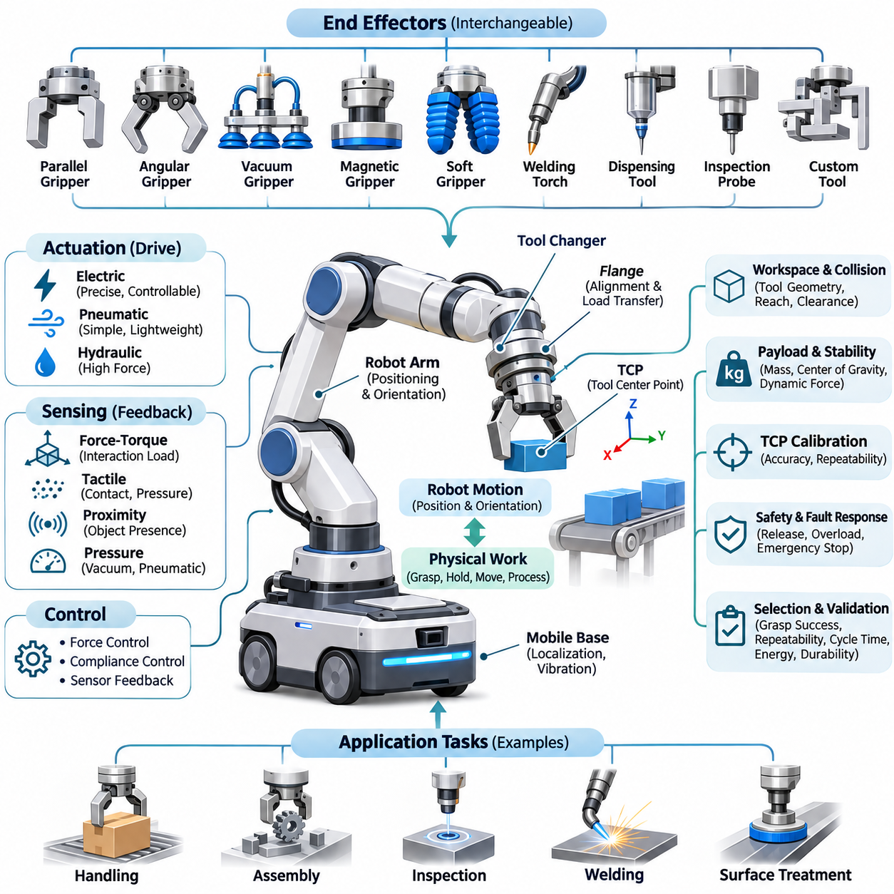
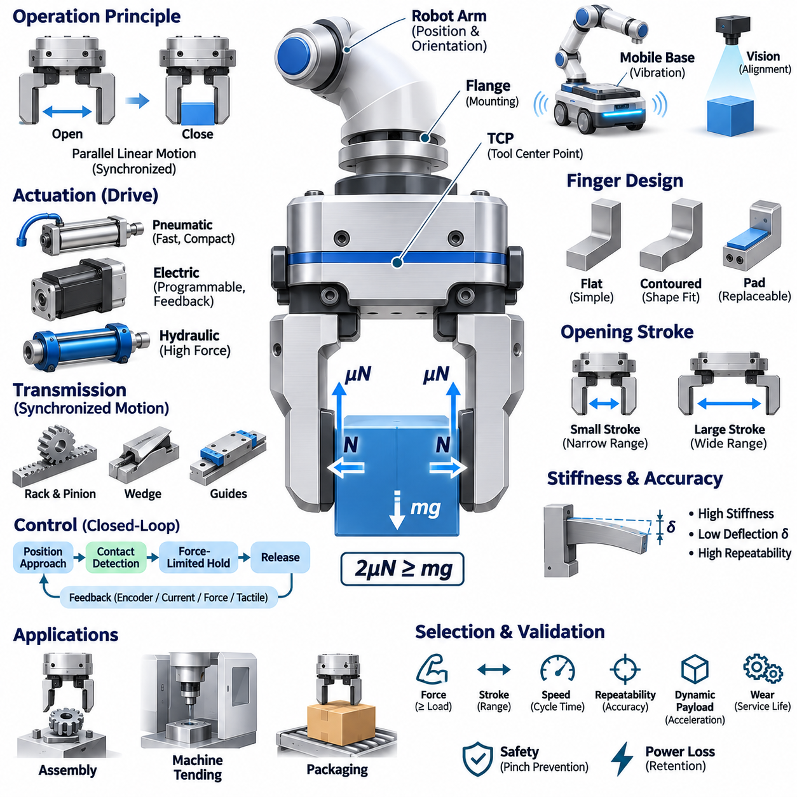
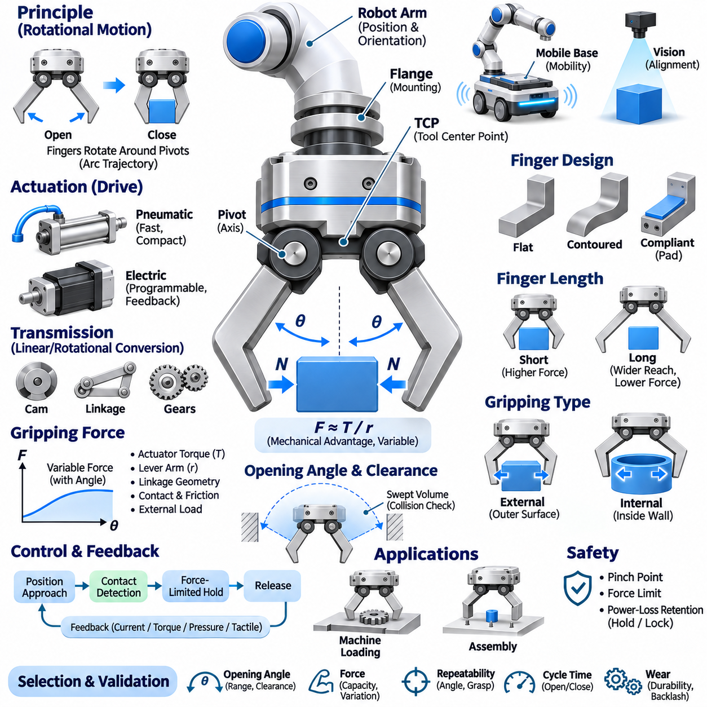
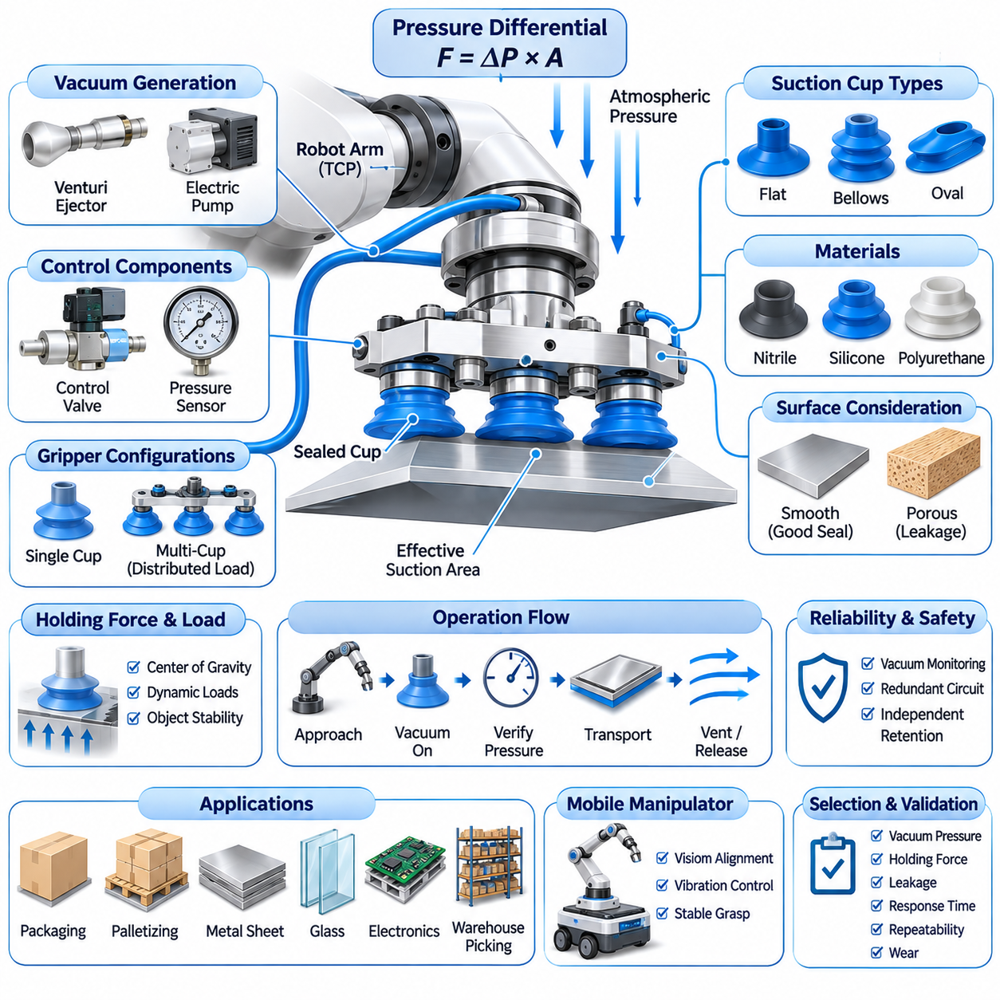
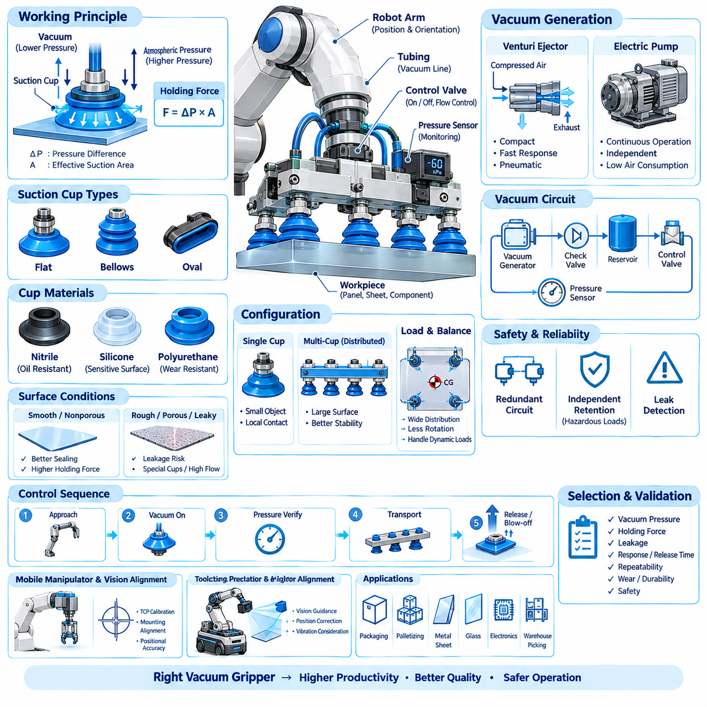
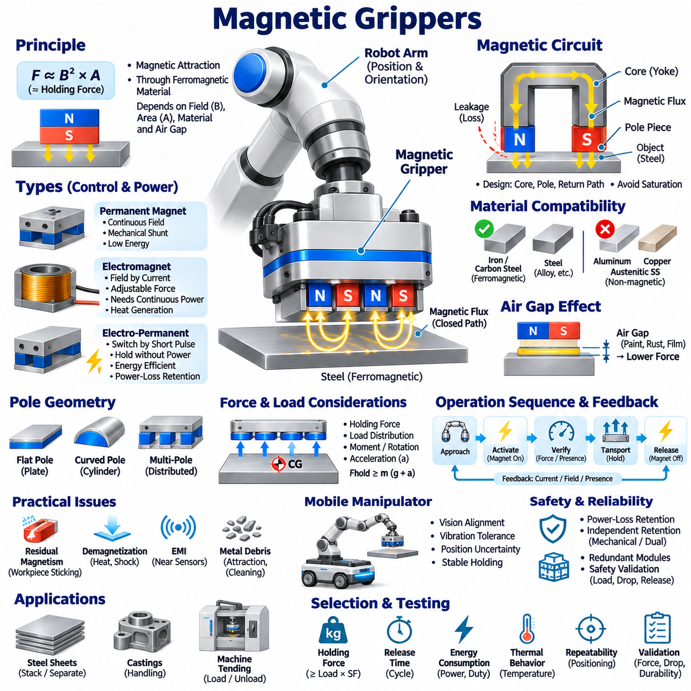
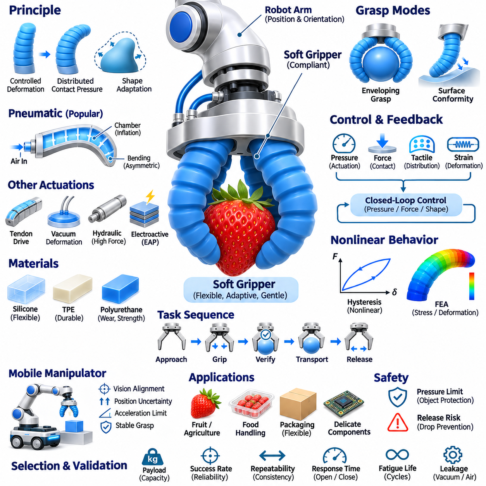
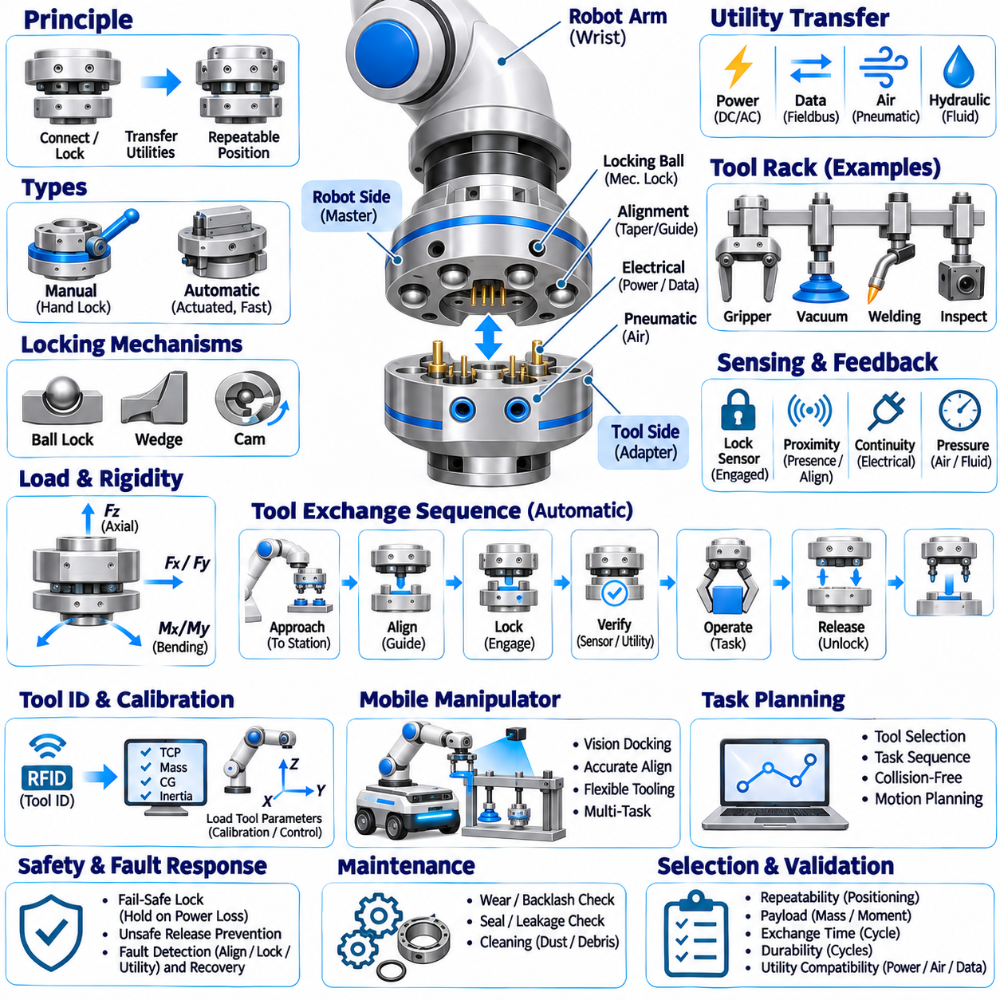
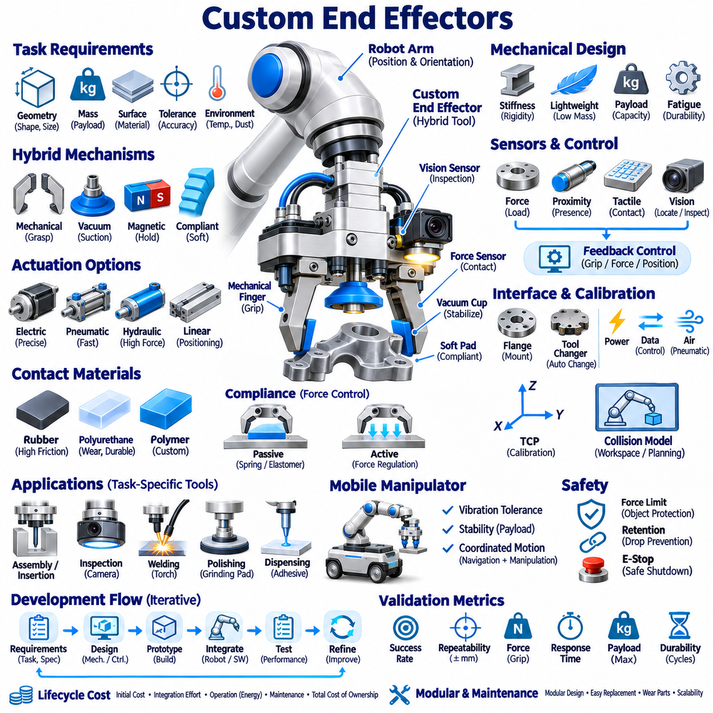
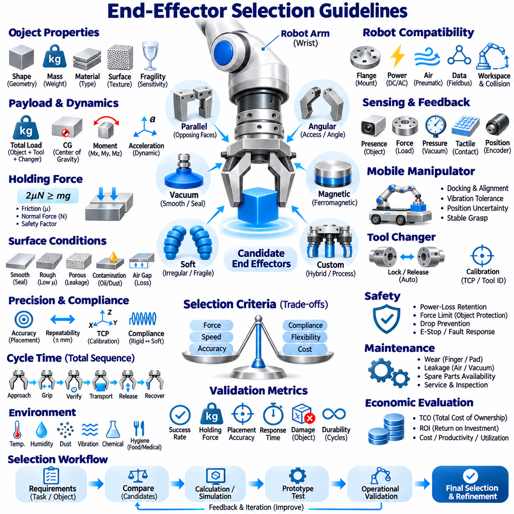

# Chapter 10. End Effectors

## 01 End Effector Overview

{width="7.268055555555556in" height="7.268055555555556in"}

엔드 이펙터(End Effector)는 로봇 매니퓰레이터(Robotic Manipulator)의 말단 인터페이스(Terminal Interface)에 장착되어 로봇이 물체, 도구 및 주변 환경과 직접 상호작용할 수 있도록 하는 기능 장치이다. 로봇 팔(Robot Arm)이 위치 및 방향 제어 기능을 제공하는 반면, 엔드 이펙터는 실제 물리적 작업을 수행한다. 엔드 이펙터의 설계는 로봇 시스템이 물체를 파지(Grasping), 유지(Holding), 이동(Moving), 가공(Processing) 또는 조작(Manipulation)하는 능력을 결정한다.

엔드 이펙터는 로봇의 운동(Motion)과 작업 실행(Task Execution) 사이에 기계적 및 기능적 연결을 형성한다. 이를 통해 매니퓰레이터의 위치 결정 능력(Positioning Capability)이 자재 취급(Material Handling), 조립(Assembly), 검사(Inspection), 용접(Welding), 표면 처리(Surface Treatment)와 같은 실제 작업으로 전환된다. 엔드 이펙터의 성능은 기계 구조(Mechanical Structure), 구동 기술(Actuation Technology), 센싱 능력(Sensing Capability), 제어 통합(Control Integration)에 따라 달라진다.

엔드 이펙터라는 용어는 기존의 로봇 그리퍼(Robotic Gripper)를 넘어 다양한 장치를 포함한다. 기계식 파지 장치(Mechanical Gripping Mechanism), 진공 흡착 시스템(Vacuum Suction System), 자기식 유지 장치(Magnetic Holding Device), 용접 토치(Welding Torch), 디스펜싱 도구(Dispensing Tool), 검사 프로브(Inspection Probe) 등이 대표적이다. 각 장치는 특정 재료, 물체 형상, 환경 조건 및 제조 공정에 적합한 특화된 상호작용 메커니즘(Interaction Mechanism)을 제공한다.

기계식 그리퍼(Mechanical Gripper)는 로봇 조작에서 가장 일반적인 엔드 이펙터 유형 중 하나이다. 일반적으로 핑거(Finger) 또는 조(Jaw)를 사용하여 마찰 접촉(Frictional Contact)이나 기하학적 구속(Geometric Constraint)을 통해 물체를 고정한다. 평행 그리퍼(Parallel Gripper)는 핑거가 거의 평행하게 움직이도록 설계되며, 각도형 그리퍼(Angular Gripper)는 기계적 회전축을 중심으로 핑거를 회전시킨다. 선택 기준에는 물체 크기, 파지력(Gripping Force), 접근성(Accessibility), 반복 정밀도(Repeatability)가 포함된다.

진공 엔드 이펙터(Vacuum End Effector)는 흡착 요소(Suction Element)와 물체 표면 사이의 압력 차이(Pressure Differential)를 이용하여 유지력(Holding Force)을 생성한다. 평판, 포장재, 유리판 및 밀봉에 적합한 표면을 가진 부품을 취급하는 데 효과적이다. 진공 성능은 접촉 면적(Contact Area), 압력 차이, 표면 거칠기(Surface Roughness), 누설(Leakage), 가속도(Acceleration)에 영향을 받는다. 안정적인 작동을 위해 적절한 흡착컵 형상, 진공 발생 장치 및 압력 모니터링이 필요하다.

자기식 엔드 이펙터(Magnetic End Effector)는 강자성 재료(Ferromagnetic Material)를 유지하기 위한 대체 메커니즘을 제공한다. 영구자석(Permanent Magnet), 전자석(Electromagnet), 전환형 자기 시스템(Switchable Magnetic System)은 기존 기계식 핑거 없이 인력을 발생시킬 수 있다. 이러한 장치는 강판, 가공 부품 및 산업용 공작물을 취급하는 데 유용하다. 성능은 재료 특성(Material Properties), 접촉 조건(Contact Conditions), 자기 회로 설계(Magnetic Circuit Design), 제어된 해제 메커니즘(Controlled Release Mechanism)에 따라 결정된다.

소프트 로봇 엔드 이펙터(Soft Robotic End Effector)는 유연한 재료(Compliant Material)와 변형 가능한 구조(Deformable Structure)를 사용하여 물체와 적응적으로 접촉한다. 강체형 파지 장치(Rigid Gripping Mechanism)와 달리 소프트 그리퍼(Soft Gripper)는 불규칙한 형상에 맞추어 변형되며 접촉 압력을 넓은 면적에 분산시킬 수 있다. 이러한 특성은 깨지기 쉽거나 변형 가능하며 형상이 불확실한 물체를 조작할 때 유용하다. 그러나 재료 히스테리시스(Material Hysteresis), 변형 모델링(Deformation Modeling), 파지력 추정(Gripping Force Estimation)은 추가적인 제어 과제를 발생시킨다.

엔드 이펙터의 구동(Actuation)은 전기 모터(Electric Motor), 공압 실린더(Pneumatic Cylinder), 유압 메커니즘(Hydraulic Mechanism), 특수 스마트 소재 액추에이터(Smart-Material Actuator)를 통해 구현할 수 있다. 전기식 시스템은 정밀한 위치 제어와 디지털 제어기(Digital Controller)와의 편리한 통합을 제공한다. 공압식 메커니즘은 비교적 단순하고 경량화된 구동 구조를 제공하며, 유압식 장치는 높은 힘이 필요한 작업에 적합하지만 유체 관리의 복잡성이 증가한다. 구동 방식의 선택은 응답 속도, 제어 가능성, 에너지 소비 및 유지보수에 영향을 미친다.

매니퓰레이터와 엔드 이펙터 사이의 기계적 인터페이스(Mechanical Interface)는 충분한 구조 강성(Structural Rigidity), 정렬 정확도(Alignment Accuracy), 하중 전달 능력(Load Transfer Capability)을 제공해야 한다. 장착 플랜지(Mounting Flange), 어댑터(Adapter), 체결 메커니즘(Fastening Mechanism), 전기 커넥터(Electrical Connector)가 이러한 인터페이스를 구성한다. 엔지니어는 페이로드 질량(Payload Mass), 무게중심 변위(Center-of-Gravity Displacement), 굽힘 모멘트(Bending Moment), 동적 힘(Dynamic Force)을 고려해야 한다. 부적절한 인터페이스 설계는 위치 정확도를 낮추고 관절 부하를 증가시킬 수 있다.

엔드 이펙터의 형상(Geometry)은 로봇 전체의 접근 가능한 작업공간(Accessible Workspace)과 조작 능력(Manipulation Capability)에 직접적인 영향을 미친다. 도구 길이(Tool Length), 방향(Orientation), 외형 치수(External Dimensions), 접촉 형상(Contact Geometry)은 충돌 여유 공간(Collision Clearance)과 도달 가능한 물체 자세(Reachable Object Pose)에 영향을 준다. 길거나 부피가 큰 엔드 이펙터는 작업 도달 범위를 확장할 수 있지만 좁은 공간에 대한 접근을 제한할 수 있다. 따라서 도구 형상은 운동학 모델링(Kinematic Modeling), 충돌 검사(Collision Checking), 동작 계획(Motion Planning) 과정에서 고려되어야 한다.

도구 중심점(Tool Center Point, TCP)은 엔드 이펙터의 기능적 상호작용 지점과 연관된 기준 위치를 의미한다. 정확한 도구 중심점 보정(TCP Calibration)을 수행하면 로봇 제어기(Robot Controller)가 명령된 도구 자세를 적절한 관절 구성(Joint Configuration)으로 변환할 수 있다. 도구 형상이나 장착 정렬의 오차는 조작 과정에서 상당한 위치 편차(Positioning Deviation)를 발생시킬 수 있다. 따라서 도구 보정은 기계적 공차(Mechanical Tolerance), 장착 변경(Mounting Change), 응용 분야별 정확도 요구사항을 반영해야 한다.

센싱 능력(Sensing Capability)은 접촉 조건, 물체 존재 여부, 파지력 및 작동 상태에 관한 정보를 제공하여 엔드 이펙터의 성능을 향상시킨다. 힘-토크 센서(Force-Torque Sensor)는 상호작용 하중(Interaction Load)을 측정하며, 촉각 센서(Tactile Sensor)는 국부 압력 분포(Local Pressure Distribution)와 접촉 이벤트(Contact Event)를 감지한다. 근접 센서(Proximity Sensor), 압력 스위치(Pressure Switch), 위치 엔코더(Position Encoder)도 추가적인 피드백을 제공한다. 이러한 측정 정보를 결합하면 불확실하고 변화하는 환경에서도 더욱 안정적인 조작이 가능하다.

힘 제어(Force Control)와 컴플라이언스 제어(Compliance Control)는 엔드 이펙터가 구속된 환경이나 손상되기 쉬운 물체와 상호작용할 때 중요한 역할을 한다. 과도한 접촉력(Contact Force)은 물체를 손상시키거나 부품을 변형시키고 로봇 작동을 불안정하게 만들 수 있다. 제어된 컴플라이언스(Controlled Compliance)는 허용 가능한 상호작용 힘을 유지하면서 작은 위치 오차를 수용할 수 있도록 한다. 이러한 기능은 삽입(Insertion), 표면 추종(Surface Following), 정밀 조립(Precision Assembly), 협업 조작(Collaborative Manipulation)에서 특히 중요하다.

도구 교환 장치(Tool Changer)는 하나의 매니퓰레이터가 작업 요구사항에 따라 서로 다른 엔드 이펙터를 교환할 수 있도록 하여 로봇의 유연성을 확장한다. 자동 도구 교환 시스템(Automatic Tool-Changing System)은 일반적으로 기계적 잠금 인터페이스(Mechanical Locking Interface)와 전기, 공압 또는 통신 연결을 결합한다. 안전한 작동을 위해서는 신뢰할 수 있는 도구 식별(Tool Identification)과 연결 검증(Connection Verification)이 필수적이다. 도구 교환 기능을 활용하면 작업마다 전용 매니퓰레이터를 설치하지 않고도 여러 공정을 수행할 수 있다.

맞춤형 엔드 이펙터(Custom End Effector)는 상용 장치가 특수한 응용 요구사항을 충족하지 못할 때 개발된다. 개발 과정에서는 물체 형상(Object Geometry), 요구 접촉력(Required Contact Force), 작동 순서(Operational Sequence), 환경 제약(Environmental Constraint), 제조 공차(Manufacturing Tolerance)를 분석한다. 컴퓨터 지원 설계(Computer-Aided Design, CAD)와 기계 시뮬레이션(Mechanical Simulation)은 제작 전에 구조적 평가를 지원한다. 이후 시제품(Prototype)은 기능 시험을 통해 파지 신뢰성, 반복 정밀도, 내구성 및 매니퓰레이터 호환성을 검증해야 한다.

모바일 매니퓰레이터(Mobile Manipulator)는 엔드 이펙터의 작동이 이동 플랫폼(Mobile Platform)과 위치 결정 정확도(Positioning Accuracy)의 영향을 받기 때문에 추가적인 제약이 발생한다. 베이스 위치 추정 오차(Base Localization Error), 플랫폼 진동(Platform Vibration), 구조적 처짐(Structural Deflection)은 도구 배치와 접촉 안정성에 영향을 줄 수 있다. 전체 시스템은 이동 베이스 위치 결정, 매니퓰레이터 운동, 엔드 이펙터 활성화를 조정해야 한다. 일관된 작업 실행을 위해서는 이동 플랫폼, 로봇 팔, 도구 기준 좌표계 사이의 정확한 보정이 필수적이다.

동적 거동(Dynamic Behavior)은 엔드 이펙터가 상당한 페이로드를 취급하거나 빠른 움직임을 수행할 때 특히 중요하다. 물체 관성(Object Inertia), 파지력 여유(Gripping-Force Margin), 가속도 프로파일(Acceleration Profile), 급격한 방향 변화(Sudden Directional Change)는 조작 안정성에 영향을 준다. 정적 조건(Static Condition)에서 안정적으로 유지되는 파지도 급격한 운동 중에는 실패할 수 있다. 따라서 엔지니어는 관절 토크 제한(Joint Torque Limit)과 구조적 제약을 준수하면서 정적 유지 능력과 동적 하중 조건을 모두 평가해야 한다.

안전 고려사항(Safety Considerations)은 매니퓰레이터 자체를 넘어 장착된 도구의 물리적 거동까지 포함한다. 끼임 지점(Pinch Point), 날카로운 모서리(Sharp Edge), 저장된 공압 에너지(Stored Pneumatic Energy), 전기적 위험(Electrical Hazard), 의도하지 않은 물체 해제(Unintended Object Release)는 작동 위험을 발생시킬 수 있다. 안전 대책에는 힘 제한(Force Limitation), 보호 커버(Protective Cover), 압력 모니터링(Pressure Monitoring), 이중화된 유지 메커니즘(Redundant Holding Mechanism), 제어된 고장 대응(Controlled Fault Response)이 포함될 수 있다. 위험성 평가(Risk Assessment)는 정상 작동, 유지보수, 비상 정지 및 전원 상실 조건을 다루어야 한다.

엔드 이펙터 선택(End-Effector Selection)은 작업 성능(Task Performance)과 시스템 수준의 엔지니어링 제약(System-Level Engineering Constraint) 사이에서 균형을 유지해야 한다. 중요한 요소에는 페이로드 용량(Payload Capacity), 물체 호환성(Object Compatibility), 파지 안정성(Gripping Stability), 사이클 시간(Cycle Time), 위치 정확도(Positional Accuracy), 통합 복잡성(Integration Complexity), 운영 비용(Operating Cost)이 포함된다. 먼지, 습기, 온도 및 전자기 간섭(Electromagnetic Interference)과 같은 환경 조건도 장치 적합성에 영향을 미친다. 최적의 장치는 반드시 가장 강력하거나 복잡한 장치가 아니라 응용 요구사항을 안정적으로 충족하는 장치이다.

성능 평가(Performance Evaluation)는 명목상 사양(Nominal Specification)에만 의존하지 않고 실제 작동 조건을 대표하는 환경에서 엔드 이펙터를 검증해야 한다. 주요 측정 항목에는 파지 성공률(Grasp Success Rate), 유지력 안정성(Holding-Force Stability), 위치 반복 정밀도(Positioning Repeatability), 사이클 시간, 에너지 소비 및 고장 빈도(Failure Frequency)가 포함된다. 시험은 물체 치수, 표면 상태 및 페이로드 분포의 변화를 포함해야 한다. 장시간 시험(Long-Duration Test)은 마모(Wear), 보정 드리프트(Calibration Drift), 액추에이터 성능 저하(Actuator Degradation), 간헐적 작동 오류(Intermittent Operational Fault)를 식별하는 데 도움이 된다.

궁극적으로 엔드 이펙터는 로봇 매니퓰레이터가 기계적 운동(Mechanical Motion)을 실제로 유용한 물리적 작업(Physical Work)으로 전환하는 방식을 결정한다. 엔드 이펙터의 성능은 기계적 인터페이스, 액추에이터(Actuator), 센서(Sensor), 제어 알고리즘(Control Algorithm), 작업별 상호작용 메커니즘(Task-Specific Interaction Mechanism)의 통합 설계에서 나타난다. 이러한 관계에 대한 이해는 현대 로봇 조작 시스템에서 사용되는 평행 그리퍼, 각도형 그리퍼, 진공 그리퍼, 자기식 그리퍼, 소프트 그리퍼, 도구 교환 장치 및 맞춤형 엔드 이펙터를 평가하기 위한 기초를 제공한다.

## 02 Parallel Grippers

{width="7.268055555555556in" height="7.268055555555556in"}

평행 그리퍼(Parallel Gripper)는 서로 마주 보는 두 핑거(Finger)의 동기화된 직선 운동(Synchronized Linear Motion)을 통해 물체를 파지하도록 설계된 로봇 엔드 이펙터(Robotic End Effector)이다. 각도형 파지 메커니즘(Angular Gripping Mechanism)과 달리 핑거가 거의 평행한 경로를 따라 이동하며 개폐 과정에서 일정한 방향을 유지한다. 이러한 구조는 예측 가능한 접촉 형상(Contact Geometry), 정확한 물체 위치 결정(Object Positioning), 반복 가능한 조작(Repeatable Manipulation)을 지원하여 산업 자동화와 모바일 로봇 응용 분야에서 널리 활용된다.

평행 그리퍼의 기본 작동 원리는 액추에이터 운동(Actuator Motion)을 파지 조(Gripping Jaw)의 제어된 변위(Controlled Displacement)로 변환하는 것이다. 기계식 링크(Mechanical Linkage), 랙 앤 피니언 시스템(Rack-and-Pinion System), 쐐기 메커니즘(Wedge Mechanism), 리드 스크루(Lead Screw) 등이 핑거 운동을 동기화하는 데 사용된다. 설계에 따라 두 핑거가 중심을 향해 대칭적으로 이동하거나 하나의 핑거는 고정되고 다른 핑거만 이동할 수 있다. 이러한 운동 방식은 파지 정렬(Grasp Alignment)과 위치 정확도(Positioning Accuracy)를 결정한다.

평행 그리퍼는 일반적으로 구동 기술(Actuation Technology), 기계적 동력 전달 장치(Mechanical Transmission), 파지 구성(Gripping Configuration)에 따라 분류된다. 공압 그리퍼(Pneumatic Gripper)는 압축 공기(Compressed Air)를 사용하여 직선 운동을 생성하고, 전동 그리퍼(Electric Gripper)는 모터와 동력 전달 메커니즘을 이용하여 프로그래밍 가능한 위치 제어를 수행한다. 유압 시스템(Hydraulic System)은 높은 파지력이 필요한 작업에 적합하다. 각 방식은 힘 용량, 응답 속도, 제어 가능성, 유지보수 요구사항 및 통합 복잡성에서 서로 다른 특성을 가진다.

공압 평행 그리퍼(Pneumatic Parallel Gripper)는 소형 구조와 비교적 단순한 작동 방식으로 인해 고속 산업 자동화(High-Speed Industrial Automation)에서 널리 사용된다. 압축 공기가 피스톤(Piston)을 구동하고, 피스톤의 힘이 기계식 링크를 통해 파지 핑거로 전달된다. 주요 장점에는 빠른 구동, 높은 출력 밀도(Power Density), 간단한 제어가 포함된다. 그러나 압축 공기 공급 설비, 압력 변동(Pressure Variation), 제한적인 중간 위치 제어(Intermediate-Position Control), 공기 소비량(Air Consumption)을 시스템 설계 과정에서 고려해야 한다.

전동 평행 그리퍼(Electric Parallel Gripper)는 프로그래밍 가능한 핑거 위치(Programmable Finger Position), 조절 가능한 파지력(Adjustable Gripping Force), 통합 피드백(Integrated Feedback)을 통해 높은 유연성을 제공한다. 서보 모터(Servo Motor) 또는 스테퍼 모터(Stepper Motor)가 리드 스크루, 기어 또는 벨트 메커니즘을 구동하여 조의 변위를 제어한다. 위치 엔코더(Position Encoder)와 모터 전류 측정(Motor-Current Measurement)은 폐루프 제어(Closed-Loop Control)를 지원하지만, 정확한 힘 추정을 위해서는 보정이나 전용 센서가 필요할 수 있다. 이러한 기능은 크기가 다양한 물체와 적응형 조작(Adaptive Manipulation)에 적합하다.

안정적인 조작에 필요한 파지력(Gripping Force)은 물체 질량(Object Mass), 접촉 마찰(Contact Friction), 가속도(Acceleration), 방향(Orientation), 접촉력 분포(Contact Force Distribution)에 따라 결정된다. 대칭형 2핑거 마찰 파지(Symmetric Two-Finger Friction Grasp)가 수직 하중을 지지하는 경우, 단순화된 정적 조건(Static Condition)은 2μN ≥ mg로 표현된다. 여기서 μ는 마찰계수(Friction Coefficient), N은 각 핑거가 가하는 수직항력(Normal Force)을 의미한다. 실제 설계에서는 가속도, 불확실성, 진동 및 표면 상태 변화에 대한 추가적인 안전 여유(Safety Margin)가 필요하다.

파지력 분포(Gripping-Force Distribution)는 핑거 형상(Finger Geometry), 접촉 위치(Contact Location), 기계적 정렬(Mechanical Alignment)의 영향을 받는다. 이상적으로 마주 보는 핑거는 균형 잡힌 힘을 가하여 의도하지 않은 물체 회전(Object Rotation)과 국부 변형(Local Deformation)을 최소화해야 한다. 불균일한 접촉은 토크(Torque)를 발생시키거나 미끄러짐(Slipping) 및 취약한 부품의 손상을 유발할 수 있다. 따라서 엔지니어는 안정적인 파지를 위해 핑거 강성(Finger Stiffness), 접촉 패드 재료(Contact-Pad Material), 조 평행도(Jaw Parallelism), 물체 형상을 평가해야 한다.

핑거 설계(Finger Design)는 조작 대상 물체와 직접적인 물리적 인터페이스(Physical Interface)를 형성하므로 평행 그리퍼 성능의 핵심 요소이다. 평면형 핑거(Flat Finger)는 단순한 각기둥 형태의 부품에 적합하며, 윤곽형 핑거(Contoured Finger)는 원통형 또는 불규칙한 공작물과의 기하학적 결합(Geometric Engagement)을 개선한다. 교체형 접촉 패드(Replaceable Contact Pad)는 마찰력을 높이거나 표면 손상을 줄일 수 있다. 핑거 길이와 질량이 과도하게 증가하면 굽힘 모멘트(Bending Moment)가 커지고 유효 파지 능력(Effective Gripping Capability)이 감소하므로 적절하게 관리해야 한다.

개방 스트로크(Opening Stroke)는 평행 그리퍼가 수용할 수 있는 물체 치수 범위를 결정한다. 스트로크가 증가하면 다양한 크기의 물체를 처리할 수 있지만 더 긴 동력 전달 메커니즘, 더 큰 액추에이터 이동 거리(Actuator Travel), 더 큰 장치 외형(Device Envelope)이 필요할 수 있다. 설계자는 전체 조 이동 거리(Total Jaw Travel)와 개별 핑거 변위(Individual Finger Displacement)를 구분해야 한다. 스트로크 선택에서는 치수 공차(Dimensional Tolerance), 접근 여유 공간(Approach Clearance), 위치 불확실성(Positioning Uncertainty), 지원 대상 물체의 크기 범위를 고려해야 한다.

기계적 강성(Mechanical Stiffness)과 구조 강성(Structural Rigidity)은 파지 정확도(Gripping Accuracy)와 반복 정밀도(Repeatability)에 큰 영향을 미친다. 핑거, 가이드 레일(Guide Rail), 베어링(Bearing), 동력 전달 부품(Transmission Component)의 유연성(Compliance)은 하중이 작용할 때 변위 오차(Displacement Error)를 발생시킬 수 있다. 백래시(Backlash)와 마찰(Friction)은 특히 소형 부품을 파지할 때 위치 일관성을 저하시킬 수 있다. 따라서 정밀 응용 분야에서는 적절한 가이드 메커니즘, 견고한 장착 인터페이스, 관리된 제조 공차 및 정기적인 기계적 마모 검사가 필요하다.

평행 그리퍼는 힘 제어(Force Control), 위치 제어(Position Control), 하이브리드 파지 전략(Hybrid Gripping Strategy)을 통해 작동할 수 있다. 위치 제어는 목표 조 개방 폭(Target Jaw Opening)을 명령하고, 힘 제어는 물체에 가해지는 접촉 하중(Contact Load)을 조절한다. 하이브리드 전략은 위치 기반 접근 운동(Position-Based Approach Motion)과 힘 제한 접촉(Force-Limited Contact), 안정적인 유지 동작(Secure Holding)을 결합한다. 적절한 제어 방식은 물체 강성(Object Stiffness), 치수 변동(Dimensional Variability), 표면 특성(Surface Characteristics), 과도한 파지 압력의 영향을 고려하여 선택한다.

접촉 감지(Contact Detection)는 그리퍼 제어기(Gripper Controller)가 닫힘 동작 중 핑거와 물체의 접촉 시점을 식별할 수 있도록 한다. 접촉 감지는 힘 센서(Force Sensor), 모터 전류 변화(Motor-Current Change), 위치 편차(Position Deviation), 촉각 측정(Tactile Measurement)을 활용할 수 있다. 신뢰할 수 있는 접촉 감지는 제어기가 자유 운동(Free Motion)에서 제어된 파지(Controlled Gripping)로 전환하도록 지원한다. 그러나 모터 전류 임계값(Motor-Current Threshold)은 마찰, 온도 및 동력 전달 효율(Transmission Efficiency)의 영향을 받을 수 있으므로 세심한 보정과 검증이 필요하다.

파지 안정성(Grasp Stability)은 전체 조작 과정에서 외부 교란(External Disturbance)에 저항할 수 있는 충분한 능력을 유지하는 데 달려 있다. 정적 파지력 계산(Static Gripping-Force Calculation)은 초기 추정값을 제공하지만, 동적 조건(Dynamic Condition)에서는 가속, 감속 및 회전 중 추가 하중이 발생한다. 물체 관성(Object Inertia)은 사용 가능한 마찰 저항(Frictional Resistance)을 초과하는 힘과 모멘트를 발생시킬 수 있다. 따라서 동작 계획(Motion Planning)은 그리퍼의 한계를 고려하고 로봇 궤적(Robot Trajectory)을 조정하여 안정적인 물체 유지를 보장해야 한다.

평행 그리퍼는 6축 산업용 매니퓰레이터(Six-Axis Industrial Manipulator), 협동 로봇(Collaborative Robot), 모바일 매니퓰레이터 플랫폼(Mobile Manipulation Platform)에 널리 통합된다. 그리퍼 장착 인터페이스(Mounting Interface)는 과도한 변형 없이 작동력을 전달해야 하며, 전기 또는 공압 연결부는 로봇 운동 중 보호되어야 한다. 정확한 도구 중심점 보정(Tool Center Point Calibration)은 로봇 플랜지(Robot Flange)와 파지 형상(Gripping Geometry) 사이의 관계를 설정한다. 통합 과정에서는 로봇 팔 운동과 조 구동(Jaw Actuation) 사이의 조정도 필요하다.

모바일 매니퓰레이터(Mobile Manipulator)는 플랫폼 위치 추정 오차(Platform Localization Error)와 진동(Vibration)이 파지 정확도에 영향을 미칠 수 있으므로 추가적인 과제를 가진다. 로봇 팔은 베이스 배치(Base Placement)와 물체 자세 추정(Object Pose Estimation)의 불확실성을 보상하면서 목표 물체에 대해 그리퍼를 배치해야 한다. 비전 기반 정렬(Vision-Guided Alignment), 유연한 접근 전략(Compliant Approach Strategy), 접촉 피드백(Contact Feedback)은 신뢰성을 향상시킬 수 있다. 이동 베이스, 매니퓰레이터 및 그리퍼의 협조 제어(Coordinated Control)는 변화하는 환경에서도 반복 가능한 파지를 지원한다.

평행 그리퍼는 조립 라인(Assembly Line), 공작기계 자동화(Machine Tending), 부품 이송(Component Transfer), 포장(Packaging), 실험실 자동화(Laboratory Automation)에 폭넓게 활용된다. 예측 가능한 운동 특성은 형상이 알려진 부품을 반복적으로 취급하는 작업에 적합하다. 정밀 조립(Precision Assembly)에서는 세심하게 설계된 핑거를 통해 삽입이나 배치 전에 물체의 정렬을 반복적으로 확보할 수 있다. 물류 응용 분야(Logistics Application)에서는 교체 가능한 핑거 부착물(Interchangeable Finger Attachment)을 사용하여 전체 파지 메커니즘을 교체하지 않고 여러 제품 범주를 처리할 수 있다.

안전 고려사항(Safety Considerations)에는 끼임 위험(Pinch Hazard), 과도한 파지력(Excessive Gripping Force), 의도하지 않은 조 운동(Unintended Jaw Movement), 우발적인 물체 해제(Accidental Object Release)가 포함된다. 시스템은 전원 상실(Power Loss), 통신 장애(Communication Failure), 액추에이터 고장(Actuator Fault), 비상 정지(Emergency Stop)에 대한 적절한 대응을 정의해야 한다. 일부 그리퍼는 특정 고장 조건에서 물체를 유지하기 위해 기계식 브레이크(Mechanical Brake), 스프링 메커니즘(Spring Mechanism), 자기 잠금식 동력 전달 장치(Self-Locking Transmission)를 포함한다. 이러한 기능은 모든 상황에서 자동으로 고장 안전 동작(Fail-Safe Behavior)을 제공한다고 가정하지 않고 검증해야 한다.

성능 평가(Performance Evaluation)는 파지력(Gripping Force), 개방 스트로크(Opening Stroke), 구동 시간(Actuation Time), 위치 반복 정밀도(Positioning Repeatability), 페이로드 호환성(Payload Compatibility), 작동 내구성(Operational Durability)을 검토해야 한다. 시험에는 다양한 물체 질량, 접촉 재료, 파지 방향 및 운동 프로파일(Motion Profile)이 포함되어야 한다. 반복적인 파지 및 해제 사이클(Grasp-and-Release Cycle)은 마모, 열적 영향(Thermal Effect), 기계적 거동 변화를 드러낸다. 파지 성공률(Grasp Success Rate)과 물체 손상 빈도(Object Damage Frequency)는 대표적인 작동 조건에서 실질적인 성능 지표를 제공한다.

평행 그리퍼 선택(Parallel Gripper Selection)은 파지 능력(Gripping Capability), 구동 기술(Actuation Technology), 물리적 치수(Physical Dimensions), 제어 요구사항(Control Requirements), 운영 비용(Operational Cost) 사이의 균형을 고려해야 한다. 공압식 설계(Pneumatic Design)는 빠르고 반복적인 취급 작업에 적합할 수 있으며, 전동식 설계(Electric Design)는 프로그래밍 가능한 위치 제어와 피드백이 중요한 경우 장점을 제공한다. 핑거 형상, 파지력 여유(Force Margin), 스트로크 요구사항(Stroke Requirement), 환경 조건(Environmental Condition)은 개별적으로 평가하기보다 종합적으로 검토해야 한다.

궁극적으로 평행 그리퍼는 로봇 물체 취급(Robotic Object Handling)을 위한 기계적으로 단순하면서도 매우 효과적인 솔루션을 제공한다. 동기화된 조 운동(Synchronized Jaw Motion)은 정확한 위치 결정, 반복 가능한 파지 및 현대적인 조작 제어기(Manipulation Controller)와의 통합을 지원한다. 신뢰할 수 있는 성능은 구동 메커니즘(Actuation Mechanism), 동력 전달 부품(Transmission Component), 핑거 형상, 센싱 시스템(Sensing System), 제어 전략(Control Strategy)의 통합 설계에서 나타난다. 이러한 원리는 고급 파지 기술(Advanced Gripping Technology)과 응용 분야별 로봇 조작(Application-Specific Robotic Manipulation)을 위한 기초를 형성한다.

## 03 Angular Grippers

{width="7.268055555555556in" height="7.268055555555556in"}

각도형 그리퍼(Angular Gripper)는 고정된 회전축(Pivot Point)을 중심으로 서로 마주 보는 핑거(Finger)가 회전 운동(Rotational Motion)을 수행하여 물체를 파지하는 로봇 엔드 이펙터(Robotic End Effector)이다. 직선 운동 중 핑거 방향을 일정하게 유지하는 평행 그리퍼(Parallel Gripper)와 달리, 각도형 그리퍼는 조(Jaw)가 열리고 닫힐 때 곡선 궤적(Curved Trajectory)을 따른다. 이러한 메커니즘은 회전형 핑거 운동이 유리한 산업용 물체 취급, 조립 및 자동 이송 작업에서 소형 파지 솔루션(Compact Gripping Solution)을 제공한다.

각도형 그리퍼의 기본 작동 원리는 액추에이터 변위(Actuator Displacement) 또는 회전을 제어된 핑거 회전(Controlled Finger Rotation)으로 변환하는 것이다. 기계식 링크(Mechanical Linkage), 캠 메커니즘(Cam Mechanism), 기어(Gear), 레버 시스템(Lever System)이 액추에이터에서 파지 조(Gripping Jaw)로 운동을 전달한다. 일반적으로 핑거는 서로 다른 회전축을 중심으로 대칭적으로 회전하지만 비대칭 구성(Asymmetric Configuration)도 가능하다. 액추에이터 변위와 핑거 각도 사이의 관계는 파지 범위(Gripping Range), 기계적 이득(Mechanical Advantage), 접촉 거동(Contact Behavior)을 결정한다.

각도형 그리퍼는 일반적으로 구동 메커니즘(Actuation Mechanism), 개방 각도(Opening Angle), 기계적 구성(Mechanical Configuration)에 따라 분류된다. 공압 각도형 그리퍼(Pneumatic Angular Gripper)는 압축 공기(Compressed Air)를 사용하여 회전 링크에 연결된 피스톤(Piston)을 구동하며, 전동식 모델(Electric Version)은 모터와 동력 전달 시스템(Transmission System)을 사용한다. 일부 설계는 제한된 각도 이동을 제공하지만, 다른 설계는 핑거당 90도에 근접하거나 이를 초과하는 넓은 개방 각도를 지원한다. 적절한 구성은 물체 형상(Object Geometry), 작업공간 접근성(Workspace Accessibility), 요구 파지 성능(Gripping Performance)에 따라 결정된다.

공압 각도형 그리퍼(Pneumatic Angular Gripper)는 비교적 단순한 기계 구조로 빠른 개폐 동작을 제공하기 때문에 산업 자동화(Industrial Automation)에서 널리 사용된다. 공압 피스톤은 직선 힘(Linear Force)을 생성하며, 이 힘은 링크 또는 캠 메커니즘을 통해 회전 운동으로 변환된다. 소형 크기와 빠른 응답 특성은 반복적인 물체 취급 작업에 적합하다. 그러나 압력 변동(Pressure Fluctuation), 공기 소비량(Air Consumption), 제한적인 힘 프로그래밍 기능(Force Programmability)은 성능과 제어 유연성(Control Flexibility)에 영향을 줄 수 있다.

전동 각도형 그리퍼(Electric Angular Gripper)는 프로그래밍 가능한 핑거 위치(Programmable Finger Position), 제어된 개방 속도(Controlled Opening Speed), 조절 가능한 파지 거동(Adjustable Gripping Behavior)을 제공한다. 전기 모터(Electric Motor)는 기어, 스크루 또는 링크 메커니즘을 통해 회전 관절(Rotational Joint)을 구동하여 기존의 이진식 공압 시스템(Binary Pneumatic System)보다 유연한 운동 프로파일(Motion Profile)을 구현한다. 엔코더(Encoder)와 전류 모니터링(Current Monitoring)은 위치 제어와 대략적인 힘 추정을 위한 피드백을 제공한다. 정밀한 파지력 제어가 필요한 경우 전용 토크 센서(Torque Sensor) 또는 접촉 센서(Contact Sensor)가 필요할 수 있다.

각도형 그리퍼의 형상(Geometry)은 닫힘 동작 중 핑거 접촉점(Finger Contact Point)이 물체에 대해 어떻게 이동하는지를 결정한다. 각 핑거가 원호(Arc)를 따라 움직이기 때문에 접촉 위치(Contact Location)와 표면 방향(Surface Orientation)은 파지 운동 전반에 걸쳐 지속적으로 변할 수 있다. 이러한 특성은 마주 보는 접촉면이 거의 일정한 정렬을 유지하는 평행 파지(Parallel Gripping)와 다르다. 따라서 엔지니어는 안정적인 접촉을 확보하기 위해 물체 형상, 핑거 길이(Finger Length), 회전축 위치(Pivot Placement), 닫힘 각도(Closing Angle)를 평가해야 한다.

각도형 그리퍼의 파지력(Gripping Force)은 액추에이터 출력(Actuator Output), 링크 형상(Linkage Geometry), 레버 암 길이(Lever-Arm Length), 순간 핑거 각도(Instantaneous Finger Angle)에 따라 달라진다. 기계적 이득(Mechanical Advantage)은 개폐 스트로크(Opening and Closing Stroke) 전반에서 크게 변할 수 있다. 따라서 사용 가능한 파지력이 전체 작동 범위(Operating Range)에서 반드시 일정한 것은 아니다. 힘 계산(Force Calculation)에서는 각 회전축을 중심으로 발생하는 모멘트(Moment), 유효 접촉 반경(Effective Contact Radius), 마찰(Friction), 예상 외부 하중(External Load)을 고려해야 한다.

핑거 길이(Finger Length)는 도달 범위(Reach)와 파지 능력(Gripping Capability) 사이에서 중요한 절충 관계(Tradeoff)를 형성한다. 긴 핑거는 고정 장치(Fixture) 주변이나 움푹 들어간 물체(Recessed Object)에 대한 접근성을 높이지만 회전축 메커니즘(Pivot Mechanism)에 작용하는 모멘트도 증가시킨다. 액추에이터 토크(Actuator Torque)가 일정할 때 회전축과 접촉점 사이의 거리가 증가하면 일반적으로 사용 가능한 수직 파지력(Normal Gripping Force)이 감소한다. 과도한 핑거 길이는 빠른 조작 중 구조적 처짐(Structural Deflection), 진동(Vibration), 위치 불확실성(Positioning Uncertainty)을 증가시킬 수 있다.

접촉 형상(Contact Geometry)은 각도형 그리퍼가 유지하는 물체의 안정성에 큰 영향을 미친다. 평평한 파지 표면(Flat Gripping Surface)은 변화하는 각도로 물체와 접촉하여 불균일한 압력 분포(Uneven Pressure Distribution)나 의도하지 않은 미끄러짐(Unintended Sliding)을 발생시킬 수 있다. 윤곽형 핑거(Contoured Finger)와 유연한 접촉 패드(Compliant Contact Pad)는 회전형 접근 운동에 적응하여 접촉 일관성(Contact Consistency)을 향상시킬 수 있다. 적절한 핑거 설계는 손상을 유발하는 압력 집중(Pressure Concentration)을 최소화하면서 중력과 관성력에 저항할 충분한 마찰력을 제공해야 한다.

각도형 그리퍼는 물체의 외부 표면을 향해 닫히는 외부 파지(External Gripping) 또는 개구부(Opening)의 내벽을 향해 확장되는 내부 파지(Internal Gripping)를 수행할 수 있다. 외부 파지는 부품, 용기 및 제조된 공작물에 일반적으로 사용되며, 내부 파지는 링(Ring), 중공 부품(Hollow Component), 적절한 공동(Cavity)을 가진 물체에 유용하다. 선택한 접근 방식은 물체 강성(Object Stiffness), 사용 가능한 접촉 면적(Contact Area), 치수 공차(Dimensional Tolerance), 힘 적용 중 변형 위험(Deformation Risk)을 고려해야 한다.

각도형 그리퍼의 개방 각도(Opening Angle)는 물체 접근성(Object Accessibility)과 조작 대상 주변에 필요한 여유 공간(Clearance)에 영향을 미친다. 광각 설계(Wide-Angle Design)는 핑거를 중앙 작업공간(Central Workspace)에서 멀리 이동시켜 간섭 없이 물체에 접근할 수 있도록 한다. 이러한 특성은 고정 장치 근처에 있거나 주변 물체로 둘러싸인 부품을 취급할 때 유용하다. 그러나 회전하는 핑거가 차지하는 스윕 체적(Swept Volume)은 충돌 검사(Collision Checking)와 궤적 계획(Trajectory Planning) 과정에서 고려되어야 한다.

기계적 동력 전달 부품(Mechanical Transmission Component)은 각도형 파지 시스템의 정밀도(Precision)와 내구성(Durability)을 결정한다. 회전축 베어링(Pivot Bearing), 기어, 링크, 연결 핀(Connecting Pin)은 반복적인 파지 사이클(Gripping Cycle) 동안 지속적인 하중을 받는다. 백래시(Backlash), 베어링 마모(Bearing Wear), 링크 변형(Linkage Deformation)은 각도 위치 오차(Angular Positioning Error)와 불균일한 접촉력을 발생시킬 수 있다. 정밀 응용 분야에서는 장기간 일관된 작동을 유지하기 위해 적절한 재료 선택(Material Selection), 베어링 지지(Bearing Support), 윤활(Lubrication), 기계적 공차(Mechanical Tolerance)가 필요하다.

각도형 그리퍼는 위치 제어(Position Control), 힘 제어(Force Control), 복합 제어 전략(Combined Control Strategy)을 사용하여 작동할 수 있다. 위치 제어 시스템은 특정 핑거 각도(Finger Angle)를 명령하고, 힘 제어 시스템은 액추에이터 토크 또는 센서 피드백(Sensor Feedback)을 통해 접촉 하중(Contact Load)을 조절한다. 하이브리드 접근 방식(Hybrid Approach)은 자유 운동(Free Motion) 중 위치 제어를 사용하고 접촉 감지(Contact Detection) 이후 힘 제한 파지(Force-Limited Gripping)로 전환한다. 제어 성능은 액추에이터 특성, 동력 전달 마찰(Transmission Friction), 센서 분해능(Sensor Resolution), 물체 유연성(Object Compliance)에 따라 달라진다.

접촉 감지(Contact Detection)는 치수가 불확실하거나 위치가 변동하는 물체를 파지할 때 필수적이다. 모터 전류 모니터링(Motor-Current Monitoring), 토크 센싱(Torque Sensing), 공압 압력 측정(Pneumatic Pressure Measurement), 촉각 센서(Tactile Sensor)는 핑거와 물체 사이의 접촉을 감지하는 데 활용할 수 있다. 접촉이 감지되면 제어기는 닫힘 속도(Closing Speed)를 줄이거나 파지력을 조절할 수 있다. 신뢰할 수 있는 감지를 위해서는 실제 물체 접촉과 기계적 마찰(Mechanical Friction), 링크 저항(Linkage Resistance), 파지 메커니즘에서 발생하는 교란(Disturbance)을 구분해야 한다.

각도형 그리퍼는 산업용 매니퓰레이터(Industrial Manipulator), 협동 로봇(Collaborative Robot), 자동 조립 장비(Automated Assembly Equipment)에 자주 통합된다. 장착 인터페이스(Mounting Interface)는 로봇 플랜지(Robot Flange)와의 정확한 정렬을 유지하면서 작동력과 모멘트를 견뎌야 한다. 도구 중심점 보정(Tool Center Point Calibration)은 기능적 파지 위치(Functional Gripping Location)와 핑거 각도 및 접촉 형상 사이의 관계를 반영해야 한다. 통신 및 제어 인터페이스(Communication and Control Interface)는 그리퍼 구동을 매니퓰레이터 운동 및 작업 실행(Task Execution)과 조정해야 한다.

모바일 매니퓰레이터(Mobile Manipulator)는 베이스 위치 결정 오차(Base-Positioning Error), 진동(Vibration), 물체 자세 불확실성(Object-Pose Uncertainty)이 회전형 핑거의 정렬에 영향을 미치기 때문에 추가적인 과제를 가진다. 각도형 파지 궤적(Angular Gripping Trajectory)은 이동 플랫폼(Mobile Platform), 매니퓰레이터, 목표 물체(Target Object) 사이의 상대 위치(Relative Position)를 고려해야 한다. 비전 기반 위치 결정(Vision-Guided Positioning)과 유연한 접근 운동(Compliant Approach Motion)은 신뢰성을 향상시킬 수 있다. 협조 제어(Coordinated Control)는 좁은 환경이나 주변 구조물 근처에서 물체를 조작할 때 특히 중요하다.

각도형 그리퍼의 산업 응용 분야(Industrial Application)에는 공작기계 로딩(Machine Loading), 부품 이송(Component Transfer), 포장(Packaging), 조립(Assembly), 자재 취급(Material Handling)이 포함된다. 회전형 개방 메커니즘(Rotational Opening Mechanism)은 핑거가 물체 접근 경로(Object Approach Path)에서 벗어나거나 기계적 고정 장치 주변에서 작동해야 할 때 유리하다. 특수 핑거 형상(Specialized Finger Geometry)은 원통형 부품(Cylindrical Component), 불규칙한 부품(Irregular Part), 중공 공작물(Hollow Workpiece)을 지원할 수 있다. 적용 적합성은 개방 각도, 파지력, 물체 형상 및 사이클 시간(Cycle Time) 요구사항 사이의 관계에 따라 결정된다.

안전 고려사항(Safety Considerations)에는 회전 관절(Rotating Joint) 근처의 끼임 지점(Pinch Point), 의도하지 않은 핑거 운동(Unintended Finger Movement), 과도한 접촉력(Excessive Contact Force), 우발적인 물체 해제(Accidental Object Release)가 포함된다. 시스템은 비상 정지(Emergency Stop), 전원 장애(Power Failure), 통신 중단(Communication Interruption), 액추에이터 고장(Actuator Fault) 상황에서 예측 가능한 동작을 정의해야 한다. 기계적 잠금 메커니즘(Mechanical Locking Mechanism), 스프링 보조 파지(Spring-Assisted Gripping), 제동 시스템(Braking System)은 특정 설계에서 물체 유지 능력을 향상시킬 수 있다. 이러한 기능의 효과는 명목상 사양(Nominal Specification)에만 의존하지 않고 실제 작동 조건에서 검증해야 한다.

성능 평가(Performance Evaluation)는 개방 각도(Opening Angle), 파지력 변화(Gripping-Force Variation), 구동 시간(Actuation Time), 각도 반복 정밀도(Angular Repeatability), 페이로드 호환성(Payload Compatibility), 기계적 내구성(Mechanical Durability)을 측정해야 한다. 기계적 이득과 접촉 형상이 스트로크 전반에서 변화하므로 시험에서는 여러 핑거 위치를 검토해야 한다. 반복 파지 사이클(Repeated Gripping Cycle)은 백래시 증가(Backlash Development), 베어링 마모, 열적 영향(Thermal Effect), 힘 전달 변화(Force Transmission Variation)를 드러낸다. 파지 성공률(Grasp Success Rate)과 물체 손상 빈도(Object Damage Frequency)는 작동 신뢰성(Operational Reliability)을 평가하는 실질적인 지표를 제공한다.

각도형 그리퍼 선택(Angular Gripper Selection)은 물체 치수(Object Dimension), 요구 파지력(Required Gripping Force), 설치 가능 공간(Available Installation Space), 구동 기술(Actuation Technology), 제어 유연성(Control Flexibility)을 평가해야 한다. 공압식 설계(Pneumatic Design)는 빠르고 반복적인 작업에 적합한 경우가 많으며, 전동식 시스템(Electric System)은 프로그래밍 가능한 위치 결정과 조절 가능한 파지 거동이 중요한 경우 장점을 제공한다. 엔지니어는 전체 로봇 시스템과의 안정적인 통합을 위해 핑거 형상, 회전축 하중(Pivot Loading), 스윕 체적, 환경 조건(Environmental Condition)도 고려해야 한다.

궁극적으로 각도형 그리퍼는 제어된 회전형 핑거 운동(Controlled Rotational Finger Motion)을 통해 로봇 물체 취급(Robotic Object Handling)에 소형이면서 다양한 작업에 대응할 수 있는 접근 방식을 제공한다. 효과적인 성능은 회전축 메커니즘(Pivot Mechanism), 액추에이터 시스템(Actuator System), 동력 전달 형상(Transmission Geometry), 파지 표면(Gripping Surface), 센서(Sensor), 제어 알고리즘(Control Algorithm)의 통합 설계에 달려 있다. 이러한 관계를 이해하면 기존 평행 파지가 적합하지 않은 산업 자동화, 정밀 조작(Precision Manipulation), 모바일 로봇 응용 분야에서 각도형 그리퍼를 적절하게 선택하고 최적화할 수 있다.

## 04 Vacuum Grippers

{width="7.268055555555556in" height="7.268055555555556in"}

{width="7.268055555555556in" height="7.268055555555556in"}

진공 그리퍼(Vacuum Gripper)는 흡착 요소(Suction Element)와 물체 표면 사이의 압력 차이(Pressure Difference)를 이용하여 유지력(Holding Force)을 생성하는 로봇 엔드 이펙터(Robotic End Effector)이다. 유리판, 금속판, 플라스틱 부품, 종이 상자 및 전자 부품 조립품과 같이 평평하고 매끄러우며 가벼운 물체를 취급하는 산업 자동화(Industrial Automation) 분야에서 널리 사용된다. 기계식 그리퍼(Mechanical Gripper)와 달리 진공 시스템은 서로 마주 보는 핑거(Finger)를 필요로 하지 않으므로 넓은 표면을 가지거나 파지할 수 있는 특징이 제한적인 물체를 취급하는 데 특히 유용하다.

진공 그리퍼의 기본 작동 원리는 흡착컵(Suction Cup) 아래의 밀폐된 영역과 주변 대기 환경 사이의 압력 차이에 기반한다. 진공 발생 장치(Vacuum Generator)가 접촉 영역의 공기를 제거하면 내부 압력이 낮아지고, 대기압(Atmospheric Pressure)이 흡착 요소에 물체를 밀착시키는 힘을 발생시킨다. 사용 가능한 유지력은 주로 유효 흡착 면적(Effective Suction Area)과 작동 중 형성되는 압력 차이에 따라 결정된다.

진공 그리퍼는 일반적으로 흡착컵, 진공 발생 장치, 공압 튜브(Pneumatic Tubing), 제어 밸브(Control Valve), 압력 센서(Pressure Sensor), 장착 구조물(Mounting Structure)로 구성된다. 흡착컵은 물체와 물리적으로 접촉하며, 진공 발생 장치는 필요한 압력 차이를 생성한다. 밸브는 진공 생성과 해제를 제어하고, 압력 센서는 작동 상태를 모니터링한다. 이러한 구성 요소는 파지, 운반 및 해제 단계 전체에서 충분한 유지력을 확보할 수 있도록 상호 연동되어야 한다.

흡착컵은 다양한 물체 형상과 표면 조건에 대응하기 위해 여러 형태, 크기 및 재료로 제공된다. 평면형 흡착컵(Flat Suction Cup)은 매끄러운 표면과 비교적 안정적인 위치 결정이 필요한 응용 분야에 적합하다. 벨로즈형 흡착컵(Bellows Suction Cup)은 추가적인 유연성을 제공하며 물체 높이나 표면 정렬의 차이를 보상할 수 있다. 타원형 흡착컵(Oval Suction Cup)은 길쭉한 물체를 취급하거나 한 방향의 접촉 면적이 제한된 경우 유용하다.

흡착컵 재료(Suction-Cup Material)의 선택은 탄성(Elasticity), 마찰(Friction), 내화학성(Chemical Resistance), 내마모 특성(Wear Characteristics)이 파지 신뢰성에 영향을 미치기 때문에 중요하다. 일반적인 재료에는 니트릴 고무(Nitrile Rubber), 실리콘(Silicone), 폴리우레탄(Polyurethane), 특수 엘라스토머(Specialized Elastomer)가 포함된다. 실리콘은 표면 손상에 민감한 응용 분야에서 자주 선택되며, 니트릴 고무는 오일과 산업용 오염물질에 대한 유용한 저항성을 제공한다. 재료 호환성을 평가할 때는 작동 온도, 표면 코팅, 청결도 요구사항 및 장기 변형도 고려해야 한다.

진공 생성(Vacuum Generation)은 벤투리 원리(Venturi Principle)에 기반한 이젝터(Ejector) 또는 전기 구동 진공 펌프(Electrically Driven Vacuum Pump)를 통해 구현할 수 있다. 공압 이젝터(Pneumatic Ejector)는 특수하게 설계된 노즐을 통해 압축 공기를 흐르게 하여 저압 영역(Low-Pressure Region)을 생성한다. 이러한 장치는 소형이며 빠르게 반응하고 기존 공압 시스템에 통합할 수 있다. 전기식 진공 펌프는 지속적인 진공 생성, 독립적인 작동 또는 압축 공기 소비량 감소가 필요한 경우 대안으로 사용된다.

진공 그리퍼의 이론적 유지력(Theoretical Holding Force)은 F = ΔP × A의 관계식으로 근사할 수 있다. 여기서 F는 이론적 유지력, ΔP는 대기압과 진공 영역 사이의 압력 차이, A는 유효 흡착 면적을 의미한다. 그러나 이러한 이상적인 계산은 실제 작동 조건을 완전히 반영하지 못한다. 실제 페이로드 용량(Payload Capacity)을 결정할 때는 누설(Leakage), 표면 불규칙성(Surface Irregularity), 재료 변형(Material Deformation), 가속도(Acceleration), 안전 여유(Safety Margin)를 고려해야 한다.

표면 특성(Surface Characteristics)은 진공 파지 성능(Vacuum-Gripping Performance)에 큰 영향을 미친다. 일반적으로 매끄럽고 비다공성인 재료(Nonporous Material)는 우수한 밀폐 조건을 제공하지만, 거칠거나 다공성이거나 불균일한 표면은 지속적인 공기 누설을 발생시킬 수 있다. 종이, 직물, 가공되지 않은 목재 및 일부 포장재는 특수 흡착컵이나 높은 유량의 진공 시스템(High-Flow Vacuum System)이 필요하다. 이러한 응용 분야에서는 매우 낮은 진공 압력을 달성하는 것보다 충분한 공기 유량(Airflow)을 유지하는 것이 더 중요할 수 있다.

진공 그리퍼는 일반적으로 진공 생성 방식과 흡착 구성(Suction Configuration)에 따라 분류된다. 단일 흡착컵 시스템(Single-Cup System)은 소형 물체나 국부적인 접촉 영역에 적합한 단순한 솔루션을 제공하며, 다중 흡착컵 시스템(Multi-Cup System)은 넓은 표면에 유지력을 분산시킨다. 다중 흡착컵 배치는 넓은 패널을 취급할 때 안정성을 향상시킬 수 있지만, 표면 평탄도 차이, 흡착력 분포(Suction Distribution), 개별 흡착컵의 접촉 조건을 고려하여 설계해야 한다.

다수의 흡착컵 배치(Arrangement)는 외력과 모멘트(External Force and Moment)가 물체에 전달되는 방식을 결정한다. 넓게 분산된 흡착컵은 회전에 대한 저항성을 향상시키고 국부 변형을 줄일 수 있다. 그러나 하중이 불균일하게 분포되면 가속 중이나 불규칙한 표면을 가진 물체를 취급할 때 개별 흡착컵이 접촉을 잃을 수 있다. 엔지니어는 시스템 설계 과정에서 흡착컵 간격, 접촉 면적, 물체 강성(Object Stiffness), 무게중심(Center of Gravity), 예상 동적 하중(Expected Dynamic Load)을 평가해야 한다.

진공 모니터링(Vacuum Monitoring)은 파지 실패를 감지하고 의도하지 않은 물체 해제를 방지하는 데 필수적이다. 압력 센서는 진공 수준(Vacuum Level)에 대한 피드백을 제공하여 제어기가 충분한 유지 조건이 형성되었는지 확인할 수 있도록 한다. 압력 임계값(Pressure Threshold)을 사용하면 밀폐 불완전, 과도한 누설 또는 갑작스러운 진공 손실을 식별할 수 있다. 보다 발전된 시스템은 시간에 따른 압력 변화를 모니터링하여 정상적인 파지 동작과 잠재적인 고장을 구분한다.

진공 해제 메커니즘(Vacuum Release Mechanism)은 물체를 흡착컵에서 얼마나 빠르고 안정적으로 분리할 수 있는지를 결정한다. 일반적인 해제 방식은 대기 공기를 진공 회로(Vacuum Circuit)에 유입시켜 물체를 유지하는 압력 차이를 제거한다. 일부 시스템은 제어된 블로오프 공기(Controlled Blow-Off Air)를 사용하여 해제 속도를 높이고 잔류 진공(Residual Vacuum)으로 인해 물체가 계속 부착되는 현상을 방지한다. 주변 물체를 움직이거나 취약한 부품을 손상시키지 않도록 해제 시점과 압력을 신중하게 설정해야 한다.

진공 그리퍼에는 작동 신뢰성을 향상시키기 위해 진공 저장 탱크(Vacuum Reservoir), 체크 밸브(Non-Return Valve), 이중화된 흡착 회로(Redundant Suction Circuit)를 추가할 수 있다. 진공 저장 탱크는 제한된 양의 저압 상태를 유지하여 진공 생성이 일시적으로 중단되는 동안 유지 능력을 지원한다. 체크 밸브는 공급 장치가 분리되었을 때 진공 손실 속도를 줄인다. 이러한 메커니즘은 무거운 물체를 취급하거나 작업자가 접근할 수 있는 영역 위에서 작동할 때 특히 유용하지만, 실제 보호 성능은 시스템 수준의 시험을 통해 검증해야 한다.

동적 조작(Dynamic Manipulation)은 가속, 감속 및 회전 운동으로 인해 사용 가능한 유지 능력을 초과하는 힘이 발생할 수 있으므로 추가적인 요구사항을 발생시킨다. 정적 조건(Static Condition)에서 물체를 안정적으로 유지하는 진공 그리퍼도 로봇의 빠른 운동 중에는 미끄러지거나 분리될 수 있다. 동작 계획(Motion Planning)에서는 물체 질량, 무게중심, 가속도 제한(Acceleration Limit), 회전 관성(Rotational Inertia), 흡착컵 분포를 고려해야 한다. 전체 궤적에서 안정적인 물체 유지를 보장하려면 적절한 안전 계수(Safety Factor)가 필요하다.

진공 그리퍼는 산업용 매니퓰레이터(Industrial Manipulator), 협동 로봇(Collaborative Robot), 모바일 매니퓰레이션 플랫폼(Mobile Manipulation Platform)에 널리 통합된다. 장착 인터페이스(Mounting Interface)는 충분한 구조 강성을 제공하는 동시에 진공 튜브와 전기 연결부가 과도하게 굽거나 간섭을 받지 않도록 보호해야 한다. 도구 중심점 보정(Tool Center Point Calibration)은 흡착컵의 형상과 예상 접촉 위치(Expected Contact Location)를 반영해야 한다. 신뢰할 수 있는 픽앤플레이스(Pick-and-Place) 작업을 위해서는 로봇 운동과 진공 활성화 및 압력 검증을 조정하는 것이 중요하다.

모바일 매니퓰레이터(Mobile Manipulator)는 플랫폼 진동(Platform Vibration), 위치 추정 불확실성(Localization Uncertainty), 물체 위치 변화가 흡착컵 접촉에 영향을 미칠 수 있으므로 추가적인 과제를 가진다. 로봇은 진공을 형성하기 전에 적절한 방향과 접촉 정렬(Contact Alignment)을 유지하면서 목표 물체에 접근해야 한다. 비전 기반 위치 결정(Vision-Guided Positioning), 유연한 접근 운동(Compliant Approach Motion), 압력 기반 접촉 검증(Pressure-Based Contact Verification)은 파지 신뢰성을 향상시킬 수 있다. 이동 베이스, 로봇 팔 및 진공 시스템 사이의 협조 제어(Coordinated Control)는 대형 물체나 유연한 물체를 취급할 때 특히 중요하다.

진공 그리퍼의 산업 응용 분야(Industrial Application)에는 포장(Packaging), 팔레타이징(Palletizing), 판금 취급(Sheet-Metal Handling), 유리 운반(Glass Transportation), 전자제품 제조(Electronic Manufacturing), 창고 피킹(Warehouse Picking)이 포함된다. 기존의 기계식 핑거 없이 물체를 취급할 수 있다는 점에서 넓은 표면을 가지거나 접근 가능한 가장자리가 제한된 제품에 특히 효과적이다. 다중 흡착컵 시스템은 대형 패널을 지지할 수 있으며, 특수 흡착 구성은 섬세한 포장재와 불규칙한 부품을 처리할 수 있다.

안전 고려사항(Safety Considerations)에는 예상하지 못한 진공 손실(Unexpected Vacuum Loss), 밀폐 불충분(Insufficient Sealing), 우발적인 물체 해제(Accidental Object Release), 압축 공기 시스템 고장(Compressed-Air System Failure)이 포함된다. 위험성 평가(Risk Assessment)에서는 전원 중단, 진공 발생 장치 오작동, 튜브 손상, 센서 고장 및 비상 정지 동작을 검토해야 한다. 무거운 물체를 취급하는 경우 독립적인 유지 메커니즘(Independent Retention Mechanism)이나 추가적인 기계적 지지(Mechanical Support)가 필요할 수 있다. 특히 물체 해제가 심각한 위험을 초래할 수 있는 환경에서는 진공 모니터링만으로 모든 안전 요구사항을 보장할 수 있다고 간주해서는 안 된다.

성능 평가(Performance Evaluation)에서는 달성 가능한 진공 압력(Achievable Vacuum Pressure), 유효 유지력(Effective Holding Force), 파지 응답 시간(Gripping Response Time), 해제 시간(Release Time), 누설률(Leakage Rate), 작동 반복 정밀도(Operational Repeatability)를 측정해야 한다. 시험에는 다양한 표면 재료, 물체 질량, 환경 조건 및 운동 프로파일(Motion Profile)이 포함되어야 한다. 반복적인 파지 사이클(Repeated Gripping Cycle)은 흡착컵 마모, 재료 열화(Material Degradation), 누설 발생, 진공 발생 장치의 성능 변화를 식별하는 데 도움이 된다. 실제 평가에서는 물체 손상, 위치 정확도 및 성공적인 취급 비율도 검토해야 한다.

적절한 진공 그리퍼 선택(Selection of Vacuum Gripper)에는 흡착컵 형상, 재료 호환성(Material Compatibility), 진공 생성 용량(Vacuum-Generation Capacity), 페이로드 요구사항(Payload Requirement), 작동 조건 사이의 균형이 필요하다. 엔지니어는 대상 표면이 매끄러운지, 다공성인지, 곡면인지, 오염되었는지 또는 접촉 압력에 민감한지를 고려해야 한다. 흡착컵의 수와 배치는 물체 형상과 동적 하중을 반영해야 한다. 진공 생성, 모니터링 및 해제 메커니즘은 서로 독립적인 구성 요소가 아니라 통합 시스템으로 선정해야 한다.

궁극적으로 진공 그리퍼는 제어된 압력 차이(Controlled Pressure Difference)와 표면 흡착(Surface Adhesion)을 통해 로봇 물체 취급(Robotic Object Handling)을 위한 효율적이고 유연한 접근 방식을 제공한다. 성능은 흡착 요소(Suction Element), 진공 생성 장치(Vacuum-Generation Device), 공압 회로(Pneumatic Circuit), 센싱 시스템(Sensing System), 제어 전략(Control Strategy)의 통합 설계에 따라 결정된다. 이러한 관계를 이해하면 산업 자동화, 자재 취급(Material Handling), 정밀 제조(Precision Manufacturing), 모바일 로봇 응용 분야(Mobile Robotic Application)를 위한 신뢰성 높은 진공 기반 조작 시스템(Vacuum-Based Manipulation System)을 개발할 수 있다.

## 05 Magnetic Grippers

{width="7.268055555555556in" height="7.268055555555556in"}

자기식 그리퍼(Magnetic Gripper)는 자기장(Magnetic Field)을 이용하여 기계식 핑거(Mechanical Finger)나 직접적인 클램핑 메커니즘(Clamping Mechanism) 없이 강자성 물체(Ferromagnetic Object)를 끌어당기고 유지하는 로봇 엔드 이펙터(Robotic End Effector)이다. 강판(Steel Plate), 금속판(Metal Sheet), 주조 부품(Casting), 가공 부품(Machined Component) 및 기타 자성 재료를 취급하는 산업 자동화(Industrial Automation) 분야에서 널리 사용된다. 비접촉 또는 근접 접촉 방식의 파지 능력은 기존 기계식 파지가 어려운 경우, 물체의 접근 가능한 파지면이 제한적인 경우 또는 신속한 자재 이송(Material Transfer)이 필요한 경우에 특히 유용하다.

자기식 그리퍼의 기본 작동 원리는 그리퍼와 강자성 물체 사이에서 발생하는 자기 인력(Magnetic Attraction)에 기반한다. 자기 선속(Magnetic Flux)이 물체를 통과하면서 물체를 들어 올리고 운반하는 동안 접촉을 유지하는 인력을 생성한다. 결과적인 유지력(Holding Force)은 자기장 강도(Magnetic Field Strength), 자극 형상(Pole Geometry), 유효 접촉 면적(Effective Contact Area), 재료 투자율(Material Permeability), 자기 표면과 물체 사이의 공극(Air Gap)에 따라 달라진다. 신뢰성 있는 작동을 위해서는 적절한 자기 회로 설계(Magnetic Circuit Design)와 적합한 접촉 조건이 필요하다.

자기식 그리퍼는 일반적으로 영구자석 그리퍼(Permanent Magnet Gripper), 전자석 그리퍼(Electromagnetic Gripper), 전기영구자석 그리퍼(Electro-Permanent Magnet Gripper)로 분류된다. 각 유형은 서로 다른 메커니즘을 통해 자기 인력을 생성하고 제어한다. 영구자석 시스템은 지속적으로 유지되는 자기장을 사용하고, 전자석 시스템은 전류를 통해 자기장을 생성하며, 전기영구자석 시스템은 영구자석과 전기적으로 제어되는 전환 기능을 결합한다. 선택 기준은 페이로드 요구사항(Payload Requirement), 해제 특성(Release Behavior), 에너지 소비(Energy Consumption), 작동 안전성(Operational Safety)에 따라 결정된다.

영구자석 그리퍼(Permanent Magnet Gripper)는 지속적인 전력 공급 없이 유지력을 생성하기 위해 영구자석 재료(Permanent Magnetic Material)를 사용한다. 네오디뮴-철-붕소(Neodymium-Iron-Boron)와 사마륨-코발트(Samarium-Cobalt)와 같은 재료는 비교적 소형 구조에서 강한 자기장을 제공한다. 기계식 전환 메커니즘(Mechanical Switching Mechanism)이나 자기 션트(Magnetic Shunt)를 사용하여 자기 선속을 전환함으로써 물체를 부착하거나 해제할 수 있다. 낮은 에너지 소비와 단순한 구조가 장점이지만, 자기 인력과 해제를 제어하기 위해 특수한 기계적 구성이 필요할 수 있다.

전자석 그리퍼(Electromagnetic Gripper)는 자기 코어(Magnetic Core)에 감긴 코일(Coil)에 전류를 흘려 자기장을 생성한다. 전원이 공급되면 코일은 자기 선속을 발생시켜 강자성 물체를 끌어당긴다. 일반적으로 전류를 차단하면 자기 인력이 감소하여 물체를 해제할 수 있다. 전자석은 편리한 전자 제어와 전류 조절을 통한 자기력 조정이 가능하지만, 물체를 유지하는 동안 지속적인 전력이 필요하며 장시간 작동 시 열이 발생할 수 있다.

전기영구자석 그리퍼(Electro-Permanent Magnetic Gripper)는 영구자석과 전기적으로 제어되는 자기 전환 기능을 결합한다. 짧은 전기 펄스(Electrical Pulse)를 통해 내부 자기 구성을 변경하여 지속적인 전력 소비 없이 유지 상태와 해제 상태 사이를 전환할 수 있다. 활성화된 이후에는 영구자석이 전원 공급과 관계없이 유지력을 제공한다. 이러한 구조는 에너지 효율을 향상시키고 전원 중단 중에도 물체 유지 능력을 제공할 수 있어 산업용 취급 작업에 적합하다.

자기 회로(Magnetic Circuit)는 자기 선속이 목표 물체를 효과적으로 통과하도록 유도하는 방식을 결정하므로 자기식 그리퍼 설계의 핵심 요소이다. 자기 코어(Magnetic Core), 자극편(Pole Piece), 영구자석, 자기 귀환 경로(Return Path)는 원하지 않는 자기 선속 누설(Magnetic Flux Leakage)을 최소화하고 유효 인력을 최대화하도록 배치해야 한다. 구조 재료의 자기적 특성(Magnetic Properties)은 전체 성능에 영향을 미친다. 엔지니어는 자기 포화(Magnetic Saturation), 코어 형상, 자극 간격(Pole Spacing), 열적 특성을 평가해야 한다.

실현 가능한 유지력(Achievable Holding Force)은 취급하는 재료의 물리적 특성에 크게 좌우된다. 철(Iron), 탄소강(Carbon Steel), 일부 스테인리스강(Stainless Steel)과 같은 강자성 재료는 자기 인력에 강하게 반응할 수 있지만, 알루미늄(Aluminum), 구리(Copper), 대부분의 오스테나이트계 스테인리스강(Austenitic Stainless Steel)은 일반적인 자기식 그리퍼로 효과적으로 취급할 수 없다. 강자성 재료 사이에서도 투자율, 두께, 표면 상태 및 자기적 특성의 차이에 따라 파지 성능이 크게 달라질 수 있다.

자극과 물체 표면 사이의 공극(Air Gap)은 자기 유지력을 크게 감소시킬 수 있다. 페인트 코팅(Paint Coating), 녹(Rust), 표면 오염(Surface Contamination), 보호 필름(Protective Film), 기하학적 불규칙성(Geometric Irregularity)은 완전한 접촉을 방해하고 자기 저항(Magnetic Reluctance)을 증가시킬 수 있다. 따라서 얇은 공극도 자기 회로 성능에 불균형적으로 큰 영향을 미칠 수 있다. 실제 그리퍼를 선정할 때는 이론적인 자기 사양에만 의존하지 않고 대상 물체의 실제 표면 상태를 고려해야 한다.

자극 형상(Magnetic Pole Geometry)은 자기 선속의 분포와 물체에 작용하는 힘을 결정한다. 자극 배치는 평판(Flat Plate), 원통형 부품(Cylindrical Component), 불규칙한 형상의 공작물(Irregular Workpiece)에 적합하도록 설계할 수 있다. 다중 자극(Multiple Magnetic Pole)은 더 넓은 접촉 영역에 인력을 분산시키고 파지 안정성을 향상시킬 수 있다. 그러나 표면 접촉이 불균일하거나 자극 정렬이 충분하지 않으면 국부적인 자기력이 발생하여 유효 유지력이 감소하고 물체가 움직일 가능성이 커질 수 있다.

자기식 그리퍼는 기존 기계식 파지 시스템과 비교하여 여러 가지 작동상의 장점을 제공한다. 서로 마주 보는 핑거 없이 물체를 취급할 수 있고, 물체 치수의 변화를 수용하며, 신속한 부착과 해제를 지원한다. 특히 금속판 적층 및 분리, 강철 부품 이송, 파지 특징이 제한적인 물체 취급에 효과적이다. 비교적 단순한 접촉 메커니즘은 반복적인 핑거 운동과 관련된 기계적 마모를 줄이는 데에도 도움이 된다.

그러나 자기식 파지는 시스템 설계 과정에서 고려해야 하는 고유한 한계도 가지고 있다. 자기 인력은 일반적으로 적절한 강자성 재료에만 적용할 수 있으며, 유지력은 재료 두께, 표면 상태, 물체 형상에 따라 달라질 수 있다. 잔류 자성(Residual Magnetism)은 특히 특정 강철 부품을 취급할 때 해제 이후에도 물체가 그리퍼에 부착된 상태로 남게 할 수 있다. 또한 자기식 그리퍼는 원하지 않는 금속 입자를 끌어당겨 표면 품질과 작동 신뢰성에 영향을 줄 수 있다.

대형 또는 유연한 금속 물체를 취급할 때는 자기력 분포(Magnetic Force Distribution)가 특히 중요하다. 하나의 자기 접촉 지점만 사용하는 경우 하중이 불안정해지거나 운반 중 물체가 회전할 수 있다. 여러 개의 자기 모듈(Magnetic Module)을 사용하면 유지력을 분산시키고 외부 모멘트(External Moment)에 대한 저항성을 향상시킬 수 있다. 배치 설계에서는 물체 치수, 무게중심(Center of Gravity), 굽힘 강성(Bending Stiffness), 예상 가속도를 고려해야 한다. 적절한 배치는 조작 중 과도한 변형과 의도하지 않은 분리를 방지하는 데 도움이 된다.

자기식 그리퍼의 제어 시스템(Control System)은 자기장 활성화(Magnetic Activation), 유지 상태 검증(Holding Verification), 해제 작업(Release Operation)을 조정한다. 전자석 시스템은 코일 전류를 조절하여 자기 강도를 제어할 수 있지만, 영구자석 및 전기영구자석 시스템은 일반적으로 작동 상태를 변경하기 위한 전환 메커니즘이 필요하다. 전류 모니터링(Current Monitoring), 자기장 센서(Magnetic Field Sensor), 물체 감지 센서(Object-Presence Sensor)는 시스템 상태에 대한 피드백을 제공할 수 있다. 신뢰할 수 있는 제어를 위해서는 로봇이 물체를 들어 올리거나 운반하기 전에 자기적 결합(Magnetic Engagement)이 성공적으로 이루어졌는지 확인해야 한다.

자기식 그리퍼는 산업용 매니퓰레이터(Industrial Manipulator), 협동 로봇(Collaborative Robot), 자동 자재 취급 시스템(Automated Material-Handling System)에 자주 통합된다. 기계적 장착 인터페이스(Mechanical Mounting Interface)는 자기 장치의 무게와 작동 중 발생하는 동적 힘(Dynamic Force)을 견뎌야 한다. 전기 연결부, 전환 회로(Switching Circuit), 제어 신호(Control Signal)는 로봇 운동과 조정되어야 한다. 도구 중심점 보정(Tool Center Point Calibration)은 자기 접촉 표면과 실제 물체가 유지되는 위치를 고려해야 한다.

모바일 매니퓰레이터(Mobile Manipulator)는 플랫폼 진동(Platform Vibration), 위치 추정 오차(Localization Error), 동적 가속도(Dynamic Acceleration)가 자기적으로 유지되는 물체의 안정성에 영향을 줄 수 있으므로 추가적인 요구사항이 발생한다. 로봇 팔은 충분한 자기적 결합을 형성하기 위해 적절한 정렬 상태로 목표 표면에 접근해야 한다. 비전 기반 물체 인식(Vision-Based Object Recognition), 표면 검사(Surface Inspection), 제어된 접근 운동(Controlled Approach Motion)은 부착 신뢰성을 향상시킬 수 있다. 변화하는 산업 환경에서 무거운 금속 부품을 운반할 때는 이동 베이스, 매니퓰레이터 및 자기식 그리퍼 사이의 협조 제어(Coordinated Control)가 중요하다.

안전(Safety)은 자기식 그리퍼가 외부에서 명확하게 확인할 수 있는 기계적 잠금 없이 무거운 물체를 유지할 수 있기 때문에 매우 중요한 고려사항이다. 예상하지 못한 전원 중단, 불충분한 자기 접촉, 재료 비호환성(Material Incompatibility), 과도한 가속도는 물체 해제를 초래할 수 있다. 영구자석 및 전기영구자석 시스템은 전원 상실 상황에서 일부 장점을 제공하지만, 실제 유지 능력은 현실적인 조건에서 검증되어야 한다. 안전 대책에는 이중화된 자기 모듈(Redundant Magnetic Module), 독립적인 기계적 유지 장치(Independent Mechanical Retention), 하중 모니터링(Load Monitoring), 제어된 운반 속도(Controlled Transport Speed)가 포함될 수 있다.

잔류 자성(Residual Magnetism)과 의도하지 않은 자기 간섭(Unintended Magnetic Interference)도 산업 환경에서 주의해야 한다. 남아 있는 자기장은 민감한 전자 부품(Sensitive Electronic Component), 자기 센서(Magnetic Sensor), 주변의 강자성 물체에 영향을 미칠 수 있다. 일부 응용 분야에서는 부품이 서로 달라붙는 현상을 방지하기 위해 소자화 절차(Demagnetization Procedure)나 제어된 자기 해제(Controlled Magnetic Release)가 필요하다. 엔지니어는 전자기 적합성(Electromagnetic Compatibility), 주변 장비, 인접 제조 공정에 대한 자기장의 잠재적 영향을 평가해야 한다.

성능 평가(Performance Evaluation)에서는 유지력, 자기장 분포, 부착 시간(Engagement Time), 해제 시간(Release Time), 에너지 소비, 열적 거동(Thermal Behavior), 작동 반복 정밀도(Operational Repeatability)를 검토해야 한다. 시험에는 다양한 재료 등급(Material Grade), 표면 상태, 물체 두께 및 하중 방향(Loading Orientation)이 포함되어야 한다. 동적 시험(Dynamic Test)에서는 가속, 감속 및 회전 운동 중 물체를 유지하는 능력을 평가해야 한다. 장시간 작동 시험(Long-Duration Operation)은 열적 열화(Thermal Degradation), 자기 성능 변화, 기계적 마모 및 전환 신뢰성(Switching Reliability)을 식별하는 데 도움이 된다.

적절한 자기식 그리퍼를 선택하려면 재료 호환성(Material Compatibility), 페이로드 질량(Payload Mass), 접촉 형상(Contact Geometry), 자기 회로 성능(Magnetic Circuit Performance), 작동 조건을 종합적으로 평가해야 한다. 영구자석 시스템은 단순한 작동과 낮은 에너지 소비가 중요한 경우 적합하며, 전자석 시스템은 편리한 전자식 활성화와 조절 가능한 자기 강도를 제공한다. 전기영구자석 시스템은 전기적으로 제어되는 전환 기능과 전원에 독립적인 유지 능력을 결합한다. 최종 선정에서는 파지 성능, 해제 신뢰성, 안전성 및 시스템 통합 요구사항 사이의 균형을 고려해야 한다.

궁극적으로 자기식 그리퍼는 제어된 자기 인력(Controlled Magnetic Attraction)을 통해 강자성 재료를 로봇으로 취급하기 위한 효과적인 솔루션을 제공한다. 성능은 자기 재료(Magnetic Material), 자극 형상, 자기 회로, 전환 메커니즘, 센싱 시스템(Sensing System), 제어 전략(Control Strategy)의 통합 설계에 따라 결정된다. 이러한 관계를 이해하면 기존 기계식 파지가 실용적이지 않은 철강 가공(Steel Processing), 판금 취급(Sheet-Metal Handling), 자동 제조(Automated Manufacturing), 모바일 로봇 응용 분야(Mobile Robotic Application)를 위한 신뢰성 높은 자기 기반 조작 시스템(Magnetic Manipulation System)을 개발할 수 있다.

## 06 Soft Grippers

{width="7.268055555555556in" height="7.268055555555556in"}

소프트 그리퍼(Soft Gripper)는 강체형 기계식 핑거(Rigid Mechanical Finger) 대신 유연하고 변형 가능한 구조(Flexible and Deformable Structure)를 통해 물체를 조작하도록 설계된 로봇 엔드 이펙터(Robotic End Effector)이다. 실리콘(Silicone), 엘라스토머(Elastomer), 유연한 폴리머(Flexible Polymer), 특수 직물(Specialized Fabric)과 같은 유연성 재료(Compliant Material)를 사용하여 다양한 물체 형상에 적응한다. 이러한 적응성은 기존 강체형 파지 메커니즘(Rigid Gripping Mechanism)에 의해 손상될 수 있는 깨지기 쉽거나 불규칙한 형상, 변형 가능한 물체 또는 섬세한 물체를 취급하는 데 특히 유용하다.

소프트 그리퍼의 기본 작동 원리는 물체와 접촉하는 동안 유연한 구조의 제어된 변형(Controlled Deformation)을 활용하는 것이다. 주로 정밀한 기하학적 위치 결정(Geometric Positioning)에 의존하는 강체형 그리퍼(Rigid Gripper)와 달리, 소프트 그리퍼는 물체 표면에 맞추어 변형되며 접촉력을 더 넓은 영역에 분산시킨다. 이러한 변형은 치수 변화(Dimensional Variation)와 위치 불확실성(Positioning Uncertainty)에 수동적으로 적응할 수 있도록 한다. 이 특성은 높은 수준의 물체 정렬 정확도에 대한 요구를 줄이면서 조작 중 접촉 안정성(Contact Stability)을 향상시킨다.

소프트 그리퍼는 공압 팽창(Pneumatic Inflation), 진공 유도 변형(Vacuum-Induced Deformation), 텐던 구동 운동(Tendon-Driven Motion), 유압(Hydraulic Pressure), 전기 반응성 재료(Electrically Responsive Material) 등 다양한 구동 메커니즘(Actuation Mechanism)을 사용할 수 있다. 공압 구동(Pneumatic Actuation)은 내부 공기압이 증가할 때 유연한 챔버(Flexible Chamber)가 팽창하거나 굽어질 수 있기 때문에 특히 일반적이다. 텐던 구동 시스템(Tendon-Driven System)은 케이블이나 유연한 동력 전달 요소를 사용하여 제어된 핑거 운동을 생성한다. 각 방식은 힘 생성, 응답 속도, 제어 가능성 및 기계적 복잡성 측면에서 서로 다른 특성을 제공한다.

공압 소프트 그리퍼(Pneumatic Soft Gripper)는 엘라스토머 구조(Elastomeric Structure) 내부에 포함된 유연한 챔버를 사용하여 굽힘(Bending), 팽창(Expansion), 말림(Curling) 운동을 생성한다. 압축 공기(Compressed Air)가 챔버에 유입되면 내부 압력에 의해 주변 재료의 형상과 기계적 특성에 따라 제어된 변형이 발생한다. 비대칭 챔버 배치(Asymmetric Chamber Arrangement)는 특정 방향의 굽힘을 생성할 수 있으며, 다중 챔버(Multiple Chamber)는 더욱 복잡한 파지 운동을 구현할 수 있다. 결과적인 거동은 챔버 치수, 재료 강성(Material Stiffness), 벽 두께(Wall Thickness), 작동 압력(Operating Pressure)에 따라 달라진다.

재료 선택(Material Selection)은 기계적 유연성(Mechanical Compliance), 탄성(Elasticity), 내구성(Durability), 표면 특성(Surface Properties)이 파지 성능에 직접적인 영향을 미치므로 소프트 그리퍼 개발에서 핵심 요소이다. 실리콘 엘라스토머(Silicone Elastomer)는 유연성, 비교적 안정적인 변형 특성, 편리한 제조 특성을 제공하기 때문에 자주 사용된다. 열가소성 엘라스토머(Thermoplastic Elastomer)와 폴리우레탄(Polyurethane)은 특정 응용 분야에 적합한 대체 기계적 특성을 제공한다. 재료 선택에서는 피로 저항성(Fatigue Resistance), 화학적 호환성(Chemical Compatibility), 온도 조건, 반복 하중에 따른 장기 변형도 고려해야 한다.

소프트 그리퍼의 기계적 구조(Mechanical Structure)는 개별 유연 핑거(Flexible Finger), 팽창식 챔버(Inflatable Chamber), 연속적인 유연 표면(Continuous Compliant Surface), 상호 연결된 변형 요소(Interconnected Deformable Element)로 구성될 수 있다. 핑거 기반 구성(Finger-Based Configuration)은 국부적인 접촉을 제공하며 개별 물체의 형상에 적응할 수 있다. 연속적인 소프트 구조(Continuous Soft Structure)는 더 넓은 영역에 접촉 압력을 분산시키므로 깨지기 쉬운 제품을 취급하는 데 유용하다. 각 구조의 형상은 변형 패턴(Deformation Pattern), 사용 가능한 파지 범위(Gripping Range), 외부 교란(External Disturbance)에 대한 안정적인 접촉 유지 능력을 결정한다.

소프트 그리퍼는 치수가 불확실하거나 불규칙한 형상을 가진 물체를 취급할 때 중요한 장점을 제공한다. 유연한 구조는 빈번한 기계적 조정(Mechanical Adjustment)이나 맞춤형 강체 고정 장치(Customized Rigid Fixture) 없이 다양한 형상에 적응할 수 있다. 이러한 능력은 농업(Agriculture), 식품 가공(Food Processing), 포장(Packaging), 물류(Logistics), 실험실 자동화(Laboratory Automation)에서 특히 가치가 높다. 과일, 채소, 유연한 포장재(Flexible Package), 섬세한 제조 부품(Delicate Manufactured Component)을 취급하면서 국부적인 접촉 손상(Local Contact Damage)의 위험을 줄일 수 있다.

소프트 그리퍼의 파지력(Gripping Force)은 내부 압력(Internal Pressure), 재료 강성, 핑거 형상(Finger Geometry), 접촉 면적(Contact Area), 변형 특성(Deformation Characteristics)의 영향을 받는다. 기존 강체형 그리퍼와 달리 소프트 그리퍼의 힘 분포(Force Distribution)는 구조가 물체 주변으로 변형되면서 동적으로 변화한다. 과도한 압력은 원하지 않는 변형이나 손상을 유발할 수 있으며, 압력이 부족하면 미끄러짐(Slipping)이나 물체 해제(Object Release)가 발생할 수 있다. 따라서 신뢰할 수 있는 작동을 위해서는 적절한 액추에이터 조절(Actuator Regulation)과 물체별 기계적 특성(Object-Specific Mechanical Properties)을 고려해야 한다.

소프트 그리퍼와 물체 사이의 상호작용(Interaction)은 복잡한 접촉 역학(Contact Mechanics)을 포함한다. 유연한 재료는 국부 변형(Local Deformation), 표면 마찰(Surface Friction), 기하학적 순응성(Geometric Conformity)에 따라 분포된 접촉력(Distributed Contact Force)을 생성한다. 재료 강성이 변형 정도와 하중 이력(Loading History)에 따라 변화하므로 접촉 거동은 비선형적(Nonlinear)일 수 있다. 유한요소해석(Finite Element Analysis, FEA)과 실험적 특성 분석(Experimental Characterization)은 대표적인 작동 조건에서 구조 변형, 응력 분포(Stress Distribution), 파지 거동을 이해하는 데 도움이 된다.

소프트 그리퍼 제어(Soft-Gripper Control)는 액추에이터 입력(Actuator Input)이 항상 예측 가능한 핑거 위치(Finger Position)와 직접적으로 대응하지 않기 때문에 기존 강체형 그리퍼 제어보다 어렵다. 재료 탄성(Material Elasticity), 히스테리시스(Hysteresis), 비선형 변형(Nonlinear Deformation), 외부 접촉 조건(External Contact Condition)은 압력, 변위(Displacement), 파지력 사이의 관계에 불확실성을 발생시킨다. 단순한 반복 작업에는 개루프 제어(Open-Loop Control)가 충분할 수 있지만, 정밀한 조작이 필요한 응용 분야에서는 압력 센서(Pressure Sensor), 힘 센서(Force Sensor), 촉각 센서(Tactile Sensor), 내장형 변형 측정(Embedded Deformation Measurement)을 이용한 피드백 제어(Feedback Control)가 유리하다.

센싱 통합(Sensing Integration)은 소프트 그리퍼의 신뢰성과 적응성을 향상시킨다. 압력 센서는 공압 구동 조건(Pneumatic Actuation Condition)을 모니터링하며, 힘 센서와 촉각 센서는 물체 접촉(Object Contact)과 힘 분포에 관한 정보를 제공한다. 유연한 변형률 센서(Flexible Strain Sensor)는 핑거 변형을 추정하고 파지 구성(Gripping Configuration)을 더욱 정확하게 제어하도록 지원한다. 여러 센싱 방식(Sensing Modality)을 결합하면 로봇 시스템은 조작 중 불완전한 접촉(Incomplete Contact), 과도한 변형(Excessive Deformation), 잠재적인 물체 미끄러짐(Potential Object Slipping)을 감지할 수 있다.

소프트 그리퍼는 감싸기 파지(Enveloping Grasping), 표면 순응(Surface Conformity), 마찰 기반 유지(Friction-Based Holding), 분산 접촉(Distributed Contact) 등 다양한 파지 전략(Gripping Strategy)에 맞게 설계할 수 있다. 감싸기 파지 구성(Enveloping Configuration)은 유연한 핑거가 물체를 감싸면서 기하학적 지지(Geometric Support)를 제공한다. 표면 순응형 구조(Surface-Conforming Structure)는 넓은 접촉 영역에 적응하며, 마찰 기반 설계(Friction-Based Design)는 제어된 수직항력(Normal Force)을 이용하여 미끄러짐을 방지한다. 적절한 전략은 물체 형상, 질량, 표면 특성 및 요구 조작 궤적(Manipulation Trajectory)에 따라 결정된다.

내구성(Durability)과 신뢰성(Reliability)은 소프트 재료가 정상 작동 중 반복적으로 변형되기 때문에 중요한 엔지니어링 과제이다. 반복 하중(Cyclic Loading)은 피로(Fatigue), 찢어짐(Tearing), 영구 변형(Permanent Deformation), 재료 특성 열화(Material Property Degradation)를 유발할 수 있다. 공압 구조(Pneumatic Structure)는 손상된 챔버나 연결 지점을 통해 누설(Leakage)이 발생할 수도 있다. 그리퍼의 사용 수명(Service Life) 동안 일관된 성능을 유지하려면 적절한 재료 선택, 벽 두께 최적화(Wall-Thickness Optimization), 응력 집중 감소(Stress Concentration Reduction), 정기적인 검사(Periodic Inspection)가 필요하다.

소프트 그리퍼는 산업용 매니퓰레이터(Industrial Manipulator), 협동 로봇(Collaborative Robot), 모바일 매니퓰레이션 플랫폼(Mobile Manipulation Platform)에 통합할 수 있다. 유연한 접촉 특성(Compliant Contact Characteristics)은 깨지기 쉬운 제품과의 상호작용을 개선하고 작은 위치 오차(Positioning Error)의 영향을 줄일 수 있다. 그러나 변형 중 유효 형상(Effective Geometry)이 변화하므로 도구 중심점 보정(Tool Center Point Calibration), 충돌 검사(Collision Checking), 동작 계획(Motion Planning)에서 유연한 구조를 고려해야 한다. 로봇 제어기(Robot Controller)는 안정적인 파지와 해제를 위해 로봇 팔 운동과 그리퍼 구동을 조정해야 한다.

모바일 매니퓰레이터(Mobile Manipulator)는 플랫폼 진동(Platform Vibration), 위치 결정 불확실성(Positioning Uncertainty), 동적 가속도(Dynamic Acceleration)가 소프트 그리퍼와 취급 물체 사이의 상호작용에 영향을 미치기 때문에 추가적인 과제를 가진다. 유연한 핑거는 변화하는 관성 하중(Inertial Load)에 따라 서로 다르게 변형될 수 있으며, 이로 인해 운반 중 파지 안정성(Gripping Stability)이 감소할 수 있다. 따라서 이동 베이스(Mobile Base), 로봇 팔(Robotic Arm), 소프트 그리퍼 구동 사이의 협조 제어(Coordinated Control)가 중요하다. 동작 계획에서는 페이로드 특성(Payload Characteristics), 변형 한계(Deformation Limit), 적절한 가속도 프로파일(Acceleration Profile)을 고려해야 한다.

안전성(Safety)은 깨지기 쉬운 물체를 취급하거나 사람과 상호작용하는 응용 분야에서 소프트 그리퍼가 제공하는 중요한 장점이다. 유연한 구조는 국부 접촉 압력(Localized Contact Pressure)을 줄이고 강체형 파지 장치보다 적응적인 물리적 상호작용(Physical Interaction)을 제공할 수 있다. 그러나 부드러운 재료를 사용한다는 사실만으로 안전한 작동이 보장되지는 않는다. 과도한 공압 압력(Excessive Pneumatic Pressure), 제어되지 않은 변형(Uncontrolled Deformation), 액추에이터 고장(Actuator Failure), 예상하지 못한 물체 해제(Unexpected Object Release)는 적절한 기계 설계, 압력 조절(Pressure Regulation), 모니터링(Monitoring), 시스템 수준의 위험성 평가(System-Level Risk Assessment)를 통해 관리해야 한다.

성능 평가(Performance Evaluation)에서는 파지 성공률(Gripping Success Rate), 페이로드 용량(Payload Capacity), 변형 범위(Deformation Range), 응답 시간(Response Time), 접촉력 분포(Contact-Force Distribution), 반복 정밀도(Repeatability), 내구성을 고려해야 한다. 시험에는 다양한 형상, 질량, 표면 상태 및 기계적 특성을 가진 물체가 포함되어야 한다. 반복 작동(Repeated Operation)은 재료 피로(Material Fatigue), 공압 누설(Pneumatic Leakage), 변형 거동 변화(Changes in Deformation Behavior)를 드러낼 수 있다. 실제 검증(Practical Validation)에서는 운반 중 안정적인 접촉 유지와 다양한 작동 조건에서 일관된 물체 해제 능력도 평가해야 한다.

적절한 소프트 그리퍼 선택(Soft Gripper Selection)에는 유연성(Compliance), 파지력, 물체 호환성(Object Compatibility), 구동 복잡성(Actuation Complexity), 센싱 요구사항(Sensing Requirements), 유지보수 고려사항(Maintenance Considerations) 사이의 균형이 필요하다. 공압식 설계(Pneumatic Design)는 큰 변형과 적응형 접촉(Adaptable Contact)이 필요한 응용 분야에 적합하며, 텐던 구동 방식이나 다른 기계식 구동 구조(Mechanically Actuated Structure)는 서로 다른 수준의 제어 가능성을 제공할 수 있다. 엔지니어는 재료 특성, 핑거 형상, 작동 압력, 예상 하중 조건(Expected Loading Conditions), 통합 요구사항(Integration Requirements)을 독립적인 설계 변수로 취급하지 않고 종합적으로 평가해야 한다.

궁극적으로 소프트 그리퍼는 제어된 변형(Controlled Deformation)과 유연한 물리적 상호작용(Compliant Physical Interaction)을 통해 로봇 조작(Robotic Manipulation)에 적응적인 접근 방식을 제공한다. 그 효과는 유연한 재료(Flexible Material), 기계적 구조(Mechanical Structure), 구동 메커니즘(Actuation Mechanism), 센싱 기술(Sensing Technology), 제어 알고리즘(Control Algorithm)의 통합에 달려 있다. 이러한 관계를 이해하면 산업 자동화, 농업 가공(Agricultural Processing), 물류 및 고급 모바일 매니퓰레이션(Advanced Mobile Manipulation) 분야에서 섬세하고 불규칙하며 변형 가능한 물체를 취급할 수 있는 로봇 파지 시스템(Robotic Gripping System)을 개발할 수 있다.

## 07 Tool Changers

{width="7.268055555555556in" height="7.268055555555556in"}

툴 체인저(Tool Changer)는 수동으로 공구를 제거하거나 설치하지 않고도 매니퓰레이터(Manipulator)가 공구를 교체할 수 있도록 하는 로봇 엔드 이펙터 인터페이스(Robotic End-Effector Interface)이다. 하나의 로봇 팔(Robotic Arm)이 그리퍼(Gripper), 진공 장치(Vacuum Device), 용접 공구(Welding Tool), 검사 센서(Inspection Sensor), 특수 가공 장비(Specialized Processing Equipment)를 사용하여 여러 작업을 수행할 수 있도록 한다. 공구 교체 기능(Tool-Changing Capability)은 서로 다른 작업에 다양한 엔드 이펙터가 필요한 유연 제조(Flexible Manufacturing), 다품종 생산(High-Mix Production), 모바일 매니퓰레이션(Mobile Manipulation) 시스템에서 특히 유용하다.

툴 체인저의 기본 작동 원리는 반복 가능한 기계적 결합(Repeatable Mechanical Coupling)을 통해 로봇 측 인터페이스(Robot-Side Interface)를 해당 공구 측 인터페이스(Tool-Side Interface)에 연결하는 것이다. 연결부는 작동 중 충분한 강성(Rigidity), 위치 정확도(Positioning Accuracy), 하중 용량(Load Capacity)을 유지해야 한다. 많은 시스템은 통합 커넥터(Integrated Connector)를 통해 전력, 통신 신호(Communication Signal), 압축 공기(Compressed Air) 또는 기타 유틸리티(Utility)도 전달한다. 신뢰성 있는 결합(Engagement)과 분리(Disengagement)는 자동 공구 교체(Automated Tool Exchange)에 필수적이다.

툴 체인저는 일반적으로 수동식 시스템(Manual System)과 자동식 시스템(Automatic System)으로 분류된다. 수동식 툴 체인저(Manual Tool Changer)는 기계적 체결 요소(Mechanical Fastener) 또는 수동 잠금 메커니즘(Manually Operated Locking Mechanism)을 사용하여 서로 다른 공구를 장착한다. 자동식 툴 체인저(Automatic Tool Changer)는 공압식(Pneumatic), 전기식(Electrical), 기계식 액추에이터(Mechanical Actuator)를 이용하여 제어기의 감독 아래 연결과 해제를 수행한다. 자동식 시스템은 작업자 개입을 줄이고 작업 간 신속한 전환을 지원하지만, 더욱 복잡한 제어, 센싱 및 안전 메커니즘이 필요하다.

기계적 결합 메커니즘(Mechanical Coupling Mechanism)은 장착된 공구의 구조적 안정성(Structural Stability)을 결정하므로 핵심 구성 요소이다. 일반적인 설계에서는 잠금 볼(Locking Ball), 쐐기(Wedge), 테이퍼 표면(Tapered Surface), 캠 기반 메커니즘(Cam-Based Mechanism)을 사용하여 견고한 결합을 형성한다. 정밀 정렬 요소(Precision Alignment Feature)는 잠금이 이루어지기 전에 공구 측 인터페이스를 올바른 위치로 안내한다. 결합부는 로봇 조작 중 발생하는 축방향 힘(Axial Force), 횡방향 하중(Lateral Load), 굽힘 모멘트(Bending Moment), 비틀림 하중(Torsional Load)을 견뎌야 한다.

반복 정밀도(Repeatability)는 로봇 툴 체인저의 가장 중요한 성능 특성 중 하나이다. 각 장착 사이클(Attachment Cycle)은 로봇 플랜지(Robot Flange)를 기준으로 예측 가능한 허용오차(Tolerance) 내에서 공구를 위치시켜야 한다. 높은 반복 정밀도는 정밀 조립(Precision Assembly), 기계 가공(Machining), 검사(Inspection), 자동 보정(Automated Calibration)에 필수적이다. 기계적 마모(Mechanical Wear), 오염(Contamination), 열팽창(Thermal Expansion), 부정확한 도킹(Improper Docking)은 위치 일관성(Positioning Consistency)을 저하시킬 수 있다. 따라서 툴 체인저의 사양은 실제 작동 하중과 반복적인 연결 사이클 조건에서 평가해야 한다.

툴 체인저는 로봇과 장착 장비 사이에 전력과 제어 신호를 전달하는 전기 커넥터(Electrical Connector)를 통합하는 경우가 많다. 이러한 인터페이스는 디지털 입출력(Digital Input and Output), 아날로그 신호(Analog Signal), 산업용 통신 네트워크(Industrial Communication Network), 센서 연결(Sensor Connection)을 지원할 수 있다. 커넥터 설계에서는 접촉 저항(Contact Resistance), 전류 용량(Current Capacity), 전기 절연(Electrical Insulation), 반복 체결 사이클(Repeated Mating Cycle)을 고려해야 한다. 공구에 내장형 제어기(Embedded Controller), 센서 또는 지능형 액추에이터(Intelligent Actuator)가 포함된 경우 신뢰성 있는 신호 전송(Signal Transmission)이 특히 중요하다.

공압 연결(Pneumatic Connection)과 유압 연결(Hydraulic Connection)도 공구 교체 인터페이스에 통합할 수 있다. 공압 채널(Pneumatic Channel)은 그리퍼, 진공 발생 장치(Vacuum Generator), 기타 액추에이터에 압축 공기를 공급하며, 유압 인터페이스(Hydraulic Interface)는 더 높은 유체 동력(Fluid Power)이 필요한 공구를 지원한다. 자동 결합 시스템(Automatic Coupling System)은 연결 변경 중 누설(Leakage)을 최소화하고 의도하지 않은 압력 해제(Unintended Pressure Release)를 방지해야 한다. 따라서 밀봉 요소(Sealing Element), 밸브(Valve), 압력 모니터링 메커니즘(Pressure Monitoring Mechanism)은 신뢰성 있는 유체 전달 인터페이스(Fluid-Transfer Interface)의 중요한 구성 요소이다.

자동 공구 교체 시스템(Automatic Tool-Changing System)은 위치 결정(Positioning), 정렬(Alignment), 결합(Engagement), 검증(Verification), 해제(Release) 작업이 조정된 순서로 수행되어야 한다. 로봇은 먼저 지정된 공구 스테이션(Tool Station)에 접근하여 저장된 공구와 인터페이스를 정렬한다. 이후 결합 메커니즘이 작동하고 잠금 상태(Locking State)와 유틸리티 연결(Utility Connection)을 검증한다. 성공적인 확인이 완료되면 로봇은 스테이션에서 벗어나 지정된 작업을 시작할 수 있다. 공구를 해제할 때도 우발적인 분리(Accidental Separation)를 방지하기 위해 유사한 제어 순서가 필요하다.

공구 보관 스테이션(Tool Storage Station)은 사용하지 않는 공구를 안전하게 내려놓고 다시 가져올 수 있는 고정된 위치를 제공한다. 이러한 스테이션은 공구의 방향(Tool Orientation)을 일관되게 유지하고 변형 없이 각 엔드 이펙터의 무게를 지지해야 한다. 기계적 가이드(Mechanical Guide)와 정렬 요소(Alignment Feature)는 로봇이 공구 인터페이스에 정확하게 접근하도록 지원한다. 보관 배치(Storage Layout)에서는 로봇 도달 가능성(Reachability), 충돌 여유 공간(Collision Clearance), 케이블 배선(Cable Routing), 유지보수 접근성(Maintenance Accessibility)을 고려해야 한다. 적절한 스테이션 설계는 도킹 오류(Docking Error)를 줄이고 공구 교체 효율(Tool Exchange Efficiency)을 향상시킨다.

센싱 및 피드백 메커니즘(Sensing and Feedback Mechanism)은 공구 장착의 성공 여부를 확인하는 데 필수적이다. 잠금 상태 센서(Locking-State Sensor)는 기계적 결합이 이루어졌는지 감지하며, 근접 센서(Proximity Sensor)는 공구의 존재와 위치를 확인한다. 전기적 연속성 검사(Electrical Continuity Check)와 압력 센서(Pressure Sensor)는 유틸리티 연결 상태를 확인할 수 있다. 제어기는 결합 조건이 불완전한 경우 공구 작동을 방지해야 한다. 고장 감지(Fault Detection)는 정렬 오류(Alignment Error), 기계적 잠금 실패(Mechanical Locking Failure), 통신 문제(Communication Problem)를 구분할 수 있어야 한다.

툴 체인저는 로봇 보정(Robot Calibration)과 좌표 관리(Coordinate Management)에 추가적인 요구사항을 발생시킨다. 각 공구는 서로 다른 도구 중심점(Tool-Center Point, TCP), 질량(Mass), 무게중심(Center of Gravity), 관성 특성(Inertia Characteristics)을 가진다. 로봇 제어기(Robot Controller)는 정확한 운동과 동적 보상(Dynamic Compensation)을 유지하기 위해 공구를 교체할 때마다 올바른 공구 매개변수(Tool Parameter)를 불러와야 한다. RFID 태그(RFID Tag)나 부호화된 전기 인터페이스(Encoded Electrical Interface)를 포함한 공구 식별 시스템(Tool Identification System)은 매개변수 선택을 자동화하고 잘못된 공구 설정(Incorrect Tool Configuration)의 위험을 줄일 수 있다.

페이로드 용량(Payload Capacity)은 툴 체인저, 장착된 엔드 이펙터, 취급 물체의 질량을 합산하여 고려해야 한다. 결과적인 하중은 로봇 플랜지와 공구 무게중심 사이의 거리에 따라 굽힘 모멘트(Bending Moment)와 비틀림 모멘트(Torsional Moment)도 발생시킨다. 동적 가속도(Dynamic Acceleration)는 이러한 하중을 정적 조건(Static Condition)보다 증가시킬 수 있다. 엔지니어는 페이로드 질량만 평가하는 것이 아니라 툴 체인저와 로봇 손목(Robot Wrist) 모두의 허용 힘(Permissible Force)과 허용 모멘트(Permissible Moment)를 검증해야 한다.

공구 교체 인터페이스(Tool-Changing Interface)는 서로 다른 공구가 공통의 기계적 및 전기적 연결 표준(Common Mechanical and Electrical Connection Standard)을 공유하는 모듈형 로봇 아키텍처(Modular Robotic Architecture)를 지원할 수 있다. 표준화(Standardization)는 장비 통합(Equipment Integration), 교체(Replacement), 유지보수(Maintenance)를 단순화한다. 그러나 호환성(Compatibility)을 확보하려면 장착 치수(Mounting Dimension), 잠금 형상(Locking Geometry), 전기 핀 할당(Electrical Pin Assignment), 통신 프로토콜(Communication Protocol), 유틸리티 연결에 대한 일치가 필요하다. 기계적으로 호환되는 공구라도 올바르게 작동하기 위해 추가 어댑터(Adapter)나 제어기 설정(Controller Configuration)이 필요할 수 있다.

모바일 매니퓰레이터(Mobile Manipulator)는 동일한 환경에서 검사(Inspection), 피킹(Picking), 조립(Assembly), 청소(Cleaning), 유지보수(Maintenance) 작업을 수행할 수 있으므로 공구 교체 기능의 이점을 얻는다. 모바일 로봇(Mobile Robot)은 작업장(Workstation) 사이를 이동하면서 각 작업에 적합한 엔드 이펙터를 선택할 수 있다. 그러나 모바일 플랫폼(Mobile Platform)은 위치 추정 불확실성(Localization Uncertainty), 진동(Vibration), 도킹 편차(Docking Variability)를 발생시킨다. 따라서 공구 교체에는 이동 베이스(Mobile Base)와 로봇 팔의 협조된 위치 결정(Coordinated Positioning)이 필요하며, 비전 기반 정렬(Visual Alignment)이나 국부 센싱(Local Sensing)이 이를 지원하는 경우가 많다.

공구 교체 작업(Tool-Changing Operation)은 로봇의 작업 계획(Task Planning) 및 실행 아키텍처(Execution Architecture)에 통합되어야 한다. 작업 계획기(Task Planner)는 수행할 작업에 따라 필요한 공구를 선택하고, 동작 계획기(Motion Planner)는 보관 스테이션까지 충돌 없는 궤적(Collision-Free Trajectory)을 생성한다. 제어기는 실행 전에 공구 가용성(Tool Availability), 장착 상태(Attachment Status), 시스템 준비 상태(System Readiness)를 검증한다. 요청된 공구를 사용할 수 없거나 결합 시도가 실패하거나 작동 중 연결 고장(Connection Fault)이 발생한 경우에는 복구 절차(Recovery Procedure)가 필요하다.

안전 고려사항(Safety Considerations)에는 의도하지 않은 공구 해제(Unintended Tool Release), 불완전한 기계적 잠금(Incomplete Mechanical Locking), 전기적 고장(Electrical Fault), 공압 손실(Pneumatic Pressure Loss), 교체 중 충돌(Collision During Exchange)이 포함된다. 자동식 툴 체인저는 예상 작동 조건에서 우발적인 분리를 방지하는 메커니즘을 갖추어야 한다. 응용 분야에 따라 기계적 고장 안전 잠금(Mechanical Fail-Safe Locking)과 이중화된 상태 검증(Redundant State Verification)이 필요할 수 있다. 위험성 평가(Risk Assessment)에서는 전원 중단(Power Interruption), 비상 정지 동작(Emergency-Stop Behavior), 매달린 하중(Suspended Load), 공구 보관 영역에 대한 작업자 접근(Human Access)을 고려해야 한다.

유지보수 요구사항(Maintenance Requirements)은 반복적인 기계적 결합, 커넥터 마모(Connector Wear), 환경 오염(Environmental Contamination), 액추에이터 신뢰성(Actuator Reliability)의 영향을 받는다. 잠금 표면(Locking Surface)과 정렬 구성 요소(Alignment Component)는 변형(Deformation), 이물질(Debris), 과도한 마모(Excessive Wear)가 있는지 검사해야 한다. 전기 접점(Electrical Contact)은 부식(Corrosion)과 오염으로부터 보호해야 하며, 공압 밀봉부(Pneumatic Seal)는 누설 여부를 점검해야 한다. 예방 정비(Preventive Maintenance)와 결합 반복 정밀도(Coupling Repeatability)의 정기적인 검증은 장비의 사용 수명(Service Life) 동안 신뢰성 있는 작동을 유지하는 데 도움이 된다.

성능 평가(Performance Evaluation)에서는 결합 반복 정밀도(Coupling Repeatability), 공구 교체 시간(Tool Exchange Time), 최대 하중 용량(Maximum Load Capacity), 연결 신뢰성(Connection Reliability), 작동 내구성(Operational Durability)을 측정해야 한다. 시험에는 반복적인 장착 사이클(Repeated Attachment Cycle), 서로 다른 공구 질량(Tool Mass), 대표적인 동적 하중(Representative Dynamic Load), 실제 환경 조건(Realistic Environmental Condition)이 포함되어야 한다. 고장 주입 시험(Fault-Injection Test)은 불완전한 결합, 센서 고장(Sensor Failure), 전원 중단에 대한 시스템의 대응을 평가할 수 있다. 성공적인 검증을 위해서는 기계적 성능뿐 아니라 로봇 제어 소프트웨어(Robot Control Software)와의 올바른 협조도 확인해야 한다.

적절한 툴 체인저 선택(Tool Changer Selection)에는 페이로드 용량, 위치 반복 정밀도(Positioning Repeatability), 결합 메커니즘, 유틸리티 요구사항(Utility Requirements), 교체 속도(Exchange Speed), 통합 복잡성(Integration Complexity) 사이의 균형이 필요하다. 공구 교체 빈도가 낮은 경우에는 수동식 시스템이 충분할 수 있지만, 유연 생산(Flexible Production)과 자율 작업(Autonomous Operation)에는 자동식 시스템이 더 적합하다. 엔지니어는 대안을 비교할 때 로봇의 가용 페이로드(Available Robot Payload), 공구 목록(Tool Inventory), 통신 인터페이스(Communication Interface), 환경 조건(Environmental Condition), 유지보수 접근성을 고려해야 한다.

궁극적으로 툴 체인저는 하나의 매니퓰레이터가 여러 특수 엔드 이펙터(Specialized End-Effector)를 사용할 수 있도록 하여 로봇의 유연성(Robotic Flexibility)을 확장한다. 그 효과는 신뢰성 있는 기계적 결합(Reliable Mechanical Coupling), 통합 유틸리티 전달(Integrated Utility Transfer), 정확한 보정(Accurate Calibration), 센싱(Sensing), 협조된 작업 실행(Coordinated Task Execution)에 달려 있다. 이러한 관계를 이해하면 빈번한 공구 변경이 필수적인 산업 제조(Industrial Manufacturing), 자동 검사(Automated Inspection), 유연 조립(Flexible Assembly), 모바일 매니퓰레이션(Mobile Manipulation) 분야를 위한 적응형 로봇 시스템(Adaptable Robotic System)을 개발할 수 있다.

## 08 Custom End Effectors

{width="7.268055555555556in" height="7.268055555555556in"}

맞춤형 엔드 이펙터(Custom End Effector)는 표준 그리퍼(Standard Gripper)나 상용 공구(Commercially Available Tooling)로 충분히 수행하기 어려운 작업을 위해 설계된 특수 로봇 공구(Specialized Robotic Tool)이다. 특정 물체의 형상(Object Geometry), 제조 공정(Manufacturing Process), 환경 조건(Environmental Condition), 작동 요구사항(Operational Requirement)에 따라 개발된다. 맞춤화(Customization)를 통해 엔지니어는 특정 응용 분야에 적합하도록 접촉 메커니즘(Contact Mechanism), 기계적 구조(Mechanical Structure), 센싱 기능(Sensing Capability), 구동 방식(Actuation Method)을 최적화할 수 있다. 이러한 장치는 정밀 조립(Precision Assembly), 검사(Inspection), 자재 취급(Material Handling), 자동 제조(Automated Manufacturing) 분야에서 널리 사용된다.

맞춤형 엔드 이펙터의 개발은 수행하려는 조작 작업(Manipulation Task)에 대한 상세한 분석에서 시작된다. 엔지니어는 물체 치수(Object Dimension), 질량(Mass), 재료 특성(Material Property), 표면 상태(Surface Condition), 요구 힘(Required Force), 위치 허용오차(Positioning Tolerance)를 파악해야 한다. 작동 환경(Operating Environment)도 설계 결정에 영향을 미치며, 특히 온도, 오염, 진동 또는 제한된 작업 공간(Restricted Workspace)이 존재하는 경우 중요하다. 이러한 요구사항을 명확하게 이해하는 것은 적절한 파지 또는 가공 메커니즘(Gripping or Processing Mechanism)을 선택하기 위한 기초가 된다.

맞춤형 엔드 이펙터는 기계식 파지(Mechanical Gripping), 진공 흡착(Vacuum Suction), 자기 인력(Magnetic Attraction), 유연 접촉(Compliant Contact), 특수 구동(Specialized Actuation)을 하나의 장치에 결합할 수 있다. 하이브리드 구성(Hybrid Configuration)은 제조 공정 중 서로 다른 취급 방식이 필요한 물체에 대응할 수 있다. 예를 들어 기계식 핑거(Mechanical Finger)를 사용하여 위치를 결정하고, 진공 흡착 요소(Vacuum Element)를 이용하여 넓은 표면을 안정화할 수 있다. 여러 메커니즘을 결합하면 기능적 유연성(Functional Flexibility)이 증가하지만 기계적, 전기적 및 제어 복잡성(Control Complexity)도 함께 증가한다.

기계 설계(Mechanical Design)에서는 구조 강성(Structural Rigidity), 페이로드 용량(Payload Capacity), 기하학적 접근성(Geometric Accessibility), 작동 하중(Operational Load)에 대한 저항성을 고려해야 한다. 엔드 이펙터는 불필요한 질량을 최소화하면서 위치 정확도(Positioning Accuracy)를 유지할 수 있는 충분한 강성(Stiffness)을 확보해야 한다. 경량 재료(Lightweight Material)와 최적화된 구조 형상(Optimized Structural Geometry)은 로봇 손목(Robotic Wrist)에 가해지는 하중을 줄일 수 있다. 그러나 경량화(Weight Reduction)가 반복 작동 중 강도(Strength), 피로 저항성(Fatigue Resistance), 치수 안정성(Dimensional Stability)을 저하시켜서는 안 된다.

접촉 표면(Contact Surface)의 선택은 엔드 이펙터와 물체 사이의 상호작용(Interaction)이 파지 안정성(Gripping Stability)과 잠재적인 표면 손상(Surface Damage)을 결정하므로 중요하다. 접촉 패드(Contact Pad)는 마찰(Friction)과 압력 분포(Pressure Distribution)를 제어하기 위해 고무(Rubber), 폴리우레탄(Polyurethane), 엔지니어링 폴리머(Engineered Polymer), 특수 코팅(Specialized Coating)을 사용할 수 있다. 부드러운 재료는 국부 응력(Localized Stress)을 줄일 수 있으며, 단단한 표면은 더 우수한 치수 일관성(Dimensional Consistency)을 제공할 수 있다. 엔지니어는 마찰, 내마모성(Wear Resistance), 오염 민감도(Contamination Sensitivity), 물체 보호(Object Protection) 사이의 균형을 고려해야 한다.

맞춤형 엔드 이펙터의 구동 메커니즘(Actuation Mechanism)에는 전기 모터(Electric Motor), 공압 실린더(Pneumatic Cylinder), 유압 액추에이터(Hydraulic Actuator), 선형 구동 장치(Linear Drive), 유연 메커니즘(Compliant Mechanism)이 포함된다. 전기 구동(Electric Actuation)은 정밀한 위치 및 힘 조절(Position and Force Regulation)을 제공하며, 공압 시스템(Pneumatic System)은 소형 구조와 빠른 운동을 지원한다. 유압 시스템(Hydraulic System)은 높은 힘이 필요한 응용 분야에 적합할 수 있다. 구동 방식의 선택은 요구 파지력(Required Gripping Force), 응답 시간(Response Time), 사용 가능한 유틸리티(Available Utility), 제어 분해능(Control Resolution), 유지보수 요구사항(Maintenance Requirement)에 따라 결정된다.

맞춤형 엔드 이펙터는 파지 상태(Gripping Condition)를 모니터링하고 작업의 성공적인 수행을 검증하기 위해 센서를 통합하는 경우가 많다. 힘 센서(Force Sensor)는 접촉 하중(Contact Load)을 측정하고, 근접 센서(Proximity Sensor)는 물체 존재 여부를 감지하며, 촉각 센서(Tactile Sensor)는 접촉 분포(Contact Distribution)에 관한 정보를 제공한다. 비전 센서(Vision Sensor)는 조작 중 물체 위치 추정(Object Localization)이나 검사를 지원할 수 있다. 센서 피드백(Sensor Feedback)을 통합하면 제어기가 불완전한 결합(Incomplete Engagement), 과도한 힘(Excessive Force), 미끄러짐(Slipping), 예상하지 못한 물체 이동(Unexpected Object Movement)을 감지할 수 있다.

맞춤형 엔드 이펙터와 로봇 사이의 기계적 인터페이스(Mechanical Interface)는 견고한 장착(Secure Attachment)과 반복 가능한 위치 결정(Repeatable Positioning)을 제공해야 한다. 장착 치수(Mounting Dimension), 플랜지 호환성(Flange Compatibility), 도구 중심점(Tool-Center Point, TCP) 위치, 허용 힘 및 모멘트(Allowable Forces and Moments)를 평가해야 한다. 전기 커넥터(Electrical Connector)와 공압 연결부(Pneumatic Connection)는 진동과 반복 운동으로부터 보호되어야 한다. 자동 툴 체인저(Automatic Tool Changer)를 사용하는 경우 맞춤형 공구는 결합 형상(Coupling Geometry), 유틸리티 전달(Utility Transfer), 공구 식별(Tool Identification) 요구사항도 충족해야 한다.

맞춤형 공구(Custom Tooling)는 실제 접촉점(Effective Contact Point)이 기존 그리퍼와 다를 수 있으므로 전용 운동학 모델(Kinematic Model)과 기하학적 모델(Geometric Model)이 필요한 경우가 많다. 도구 중심점은 실제 작업 형상(Working Geometry)과 의도한 작업에 따라 보정(Calibration)해야 한다. 움직이는 구성 요소(Moving Component)가 포함된 공구는 작동 중 유효 형상(Effective Geometry)이 변화할 수 있다. 따라서 정확한 모델링(Accurate Modeling)은 동작 계획(Motion Planning), 충돌 감지(Collision Detection), 작업 공간 평가(Workspace Evaluation), 협조 조작(Coordinated Manipulation)에 필요하다.

작업 특화 엔드 이펙터(Task-Specific End Effector)는 삽입(Insertion), 정렬(Alignment), 체결(Fastening), 디스펜싱(Dispensing), 부품 위치 결정(Component Positioning)을 포함하는 조립 작업(Assembly Operation)을 위해 개발할 수 있다. 이러한 공구에는 제조 허용오차(Manufacturing Tolerance)를 보상하기 위한 가이드 구조(Guiding Feature), 유연 메커니즘(Compliance Mechanism), 통합 센서(Integrated Sensor)가 포함될 수 있다. 기계적 정렬 구조(Mechanical Alignment Structure)는 로봇 위치 정확도에 대한 부담을 줄일 수 있다. 그러나 설계에서는 조립 중 부품을 손상시킬 수 있는 과도한 접촉력(Excessive Contact Force)과 의도하지 않은 구속(Unintended Constraint)을 방지해야 한다.

검사 지향 엔드 이펙터(Inspection-Oriented End Effector)는 카메라(Camera), 조명 시스템(Illumination System), 레이저 센서(Laser Sensor), 초음파 프로브(Ultrasonic Probe), 기타 측정 장치(Measurement Device)를 통합할 수 있다. 기계적 구조는 안정적인 센서 위치(Sensor Positioning)를 유지하고 민감한 장비를 진동과 충격으로부터 보호해야 한다. 보정은 로봇 플랜지(Robot Flange), 센서 기준 좌표계(Sensor Reference Frame), 측정 대상(Measurement Target) 사이의 공간적 관계(Spatial Relationship)를 설정해야 한다. 신뢰성 있는 검사를 위해서는 로봇 운동, 센서 트리거링(Sensor Triggering), 데이터 획득(Data Acquisition), 결과 처리(Result Processing)의 협조 제어(Coordinated Control)가 필요하다.

제조 지향 맞춤형 엔드 이펙터(Manufacturing-Oriented Custom End Effector)는 용접(Welding), 연마(Polishing), 디버링(Deburring), 접착제 도포(Adhesive Dispensing), 표면 처리(Surface Treatment) 작업을 지원할 수 있다. 이러한 응용 분야에서는 공정력(Process Force), 열 발생(Heat Generation), 공구 마모(Tool Wear), 환경 오염(Environmental Contamination)과 관련된 추가 요구사항이 발생한다. 공구는 작업 전반에 걸쳐 적절한 방향(Orientation)과 접촉 조건(Contact Condition)을 유지해야 한다. 공정 특화 센서(Process-Specific Sensor)와 피드백 제어(Feedback Control)는 결함(Defect)과 불필요한 기계적 응력(Mechanical Stress)을 줄이면서 공정 일관성(Process Consistency)을 향상시킬 수 있다.

유연 메커니즘(Compliance Mechanism)은 위치 오차(Positioning Error)와 불확실한 접촉 조건(Uncertain Contact Condition)에 대응하기 위해 맞춤형 엔드 이펙터에 자주 통합된다. 수동 유연성(Passive Compliance)은 스프링(Spring), 유연 관절(Flexible Joint), 탄성 구조(Elastic Structure)를 사용하여 작은 정렬 오차(Misalignment)를 흡수한다. 능동 유연성(Active Compliance)은 제어된 액추에이터(Controlled Actuator)와 센서 피드백을 이용하여 상호작용 힘(Interaction Force)을 조절한다. 적절한 유연성은 삽입 신뢰성(Insertion Reliability)을 향상시키고 충격 하중(Impact Load)을 줄일 수 있지만, 과도한 유연성은 위치 정확도를 저하시키거나 원하지 않는 진동(Unwanted Vibration)을 발생시킬 수 있다.

제어 통합(Control Integration)은 맞춤형 엔드 이펙터가 로봇의 전체 실행 아키텍처(Execution Architecture)의 일부로 작동해야 하므로 필수적이다. 제어기는 공구 활성화(Tool Activation), 로봇 운동(Robot Movement), 센서 데이터 획득(Sensor Acquisition), 작업 검증(Task Verification)을 조정해야 한다. 통신 인터페이스(Communication Interface)에는 디지털 입출력(Digital Input and Output), 산업용 이더넷(Industrial Ethernet), 직렬 통신(Serial Communication), 필드버스 네트워크(Fieldbus Network)가 포함될 수 있다. 고장 처리(Fault Handling)는 위험한 운동이 발생하기 전에 액추에이터 오작동(Actuator Malfunction), 통신 손실(Communication Loss), 불완전한 파지(Incomplete Gripping), 비정상 작동 조건(Abnormal Operating Condition)을 감지해야 한다.

모바일 매니퓰레이터(Mobile Manipulator)는 맞춤형 엔드 이펙터가 진동(Vibration), 위치 추정 불확실성(Localization Uncertainty), 변화하는 환경 조건(Changing Environmental Condition)의 영향을 받는 플랫폼에서 작동해야 하므로 추가적인 설계 제약(Design Constraint)이 발생한다. 공구 질량(Tool Mass)과 형상(Geometry)은 로봇 팔의 페이로드 용량과 이동 플랫폼(Mobile Platform)의 안정성에 영향을 미친다. 따라서 소형 경량 설계(Compact and Lightweight Design)가 유리하다. 서로 다른 작업장(Workstation)에서 신뢰성 있는 조작을 수행하려면 이동 베이스(Mobile Base), 매니퓰레이터, 엔드 이펙터 사이의 협조 제어가 필요하다.

안전 요구사항(Safety Requirement)은 맞춤형 엔드 이펙터 개발 과정 전반에 통합되어야 한다. 잠재적 위험(Potential Hazard)에는 과도한 파지력(Excessive Gripping Force), 날카로운 모서리(Sharp Edge), 예상하지 못한 공구 운동(Unexpected Tool Movement), 전기적 고장(Electrical Fault), 공압 고장(Pneumatic Failure), 우발적인 물체 해제(Accidental Object Release)가 포함된다. 위험성 평가(Risk Assessment)는 정상 작동(Normal Operation)과 예측 가능한 고장 조건(Foreseeable Failure Condition)을 모두 고려해야 한다. 응용 분야에 따라 보호 커버(Protective Cover), 힘 제한(Force Limitation), 비상 정지 통합(Emergency-Stop Integration), 기계적 유지 장치(Mechanical Retention), 진단 모니터링(Diagnostic Monitoring)이 필요할 수 있다.

시제품 제작(Prototyping)과 반복 시험(Iterative Testing)은 맞춤형 엔드 이펙터가 해석 모델(Analytical Model)만으로 정확하게 예측하기 어려운 기계적 상호작용(Mechanical Interaction)을 포함하는 경우가 많으므로 중요하다. 신속 시제품 제작(Rapid Prototyping), 적층 제조(Additive Manufacturing), 모듈형 구조(Modular Construction)를 활용하면 대체 형상(Alternative Geometry)과 접촉 메커니즘을 평가할 수 있다. 실험적 측정(Experimental Measurement)은 예상하지 못한 변형(Unexpected Deformation), 불충분한 파지력(Insufficient Gripping Force), 과도한 마모(Excessive Wear), 정렬 문제(Alignment Problem)를 식별할 수 있다. 설계 개선(Design Refinement)은 이론적 가정(Theoretical Assumption)에만 의존하지 않고 측정된 성능(Measured Performance)을 기반으로 수행해야 한다.

성능 평가(Performance Evaluation)에서는 작업 성공률(Task Success Rate), 위치 반복 정밀도(Positioning Repeatability), 파지력(Gripping Force), 응답 시간(Response Time), 페이로드 용량, 내구성(Durability), 작동 신뢰성(Operational Reliability)을 검토해야 한다. 시험에는 대표적인 물체(Representative Object), 실제적인 운동 프로파일(Realistic Motion Profile), 예상 환경 조건(Expected Environmental Condition)이 포함되어야 한다. 반복 작동(Repeated Operation)은 피로(Fatigue), 액추에이터 성능 저하(Actuator Degradation), 커넥터 고장(Connector Failure), 보정 드리프트(Calibration Drift)를 드러낼 수 있다. 검증(Validation)에서는 맞춤형 공구가 로봇의 동작 계획, 센싱 및 작업 실행(Task Execution)과 얼마나 효과적으로 통합되는지도 측정해야 한다.

맞춤형 엔드 이펙터의 경제적 타당성(Economic Feasibility)은 개발 비용(Development Cost), 제조 복잡성(Manufacturing Complexity), 유지보수 요구사항, 예상 운영 효과(Expected Operational Benefit)에 따라 달라진다. 특수 공구(Specialized Tool)는 사이클 시간(Cycle Time)을 단축하고 제품 손상(Product Damage)을 줄이거나 표준 장비로 수행할 수 없는 작업을 가능하게 할 수 있다. 그러나 과도한 맞춤화(Excessive Customization)는 예비 부품 요구사항(Spare-Part Requirement)을 증가시키고 향후 수정(Future Modification)을 복잡하게 만들 수 있다. 모듈형 설계(Modular Design)와 표준화된 인터페이스(Standardized Interface)는 응용 분야별 성능(Application-Specific Performance)과 장기 유지보수성(Long-Term Maintainability) 사이의 균형을 유지하는 데 도움이 된다.

궁극적으로 맞춤형 엔드 이펙터는 기계 설계, 구동, 센싱 및 제어를 특정 작업의 요구사항에 맞게 조정함으로써 로봇의 기능(Robotic Capability)을 확장한다. 그 효과는 물체 특성(Object Characteristics), 접촉 역학(Contact Mechanics), 로봇 제약조건(Robot Constraint), 환경 조건, 운영 목표(Operational Objective)에 대한 이해에 달려 있다. 요구사항 분석(Requirements Analysis), 기계적 모델링(Mechanical Modeling), 시제품 제작, 제어 통합, 실험적 검증(Experimental Validation)을 결합한 체계적인 개발 과정(Systematic Development Process)을 통해 산업 자동화, 정밀 제조(Precision Manufacturing), 검사 및 모바일 매니퓰레이션(Mobile Manipulation)을 위한 신뢰성 높은 특수 공구를 개발할 수 있다.

## 09 Selection Guidelines

{width="7.268055555555556in" height="7.268055555555556in"}

적절한 로봇 엔드 이펙터(Robotic End Effector)를 선택하는 것은 파지 성능(Gripping Performance)이 조작 신뢰성(Manipulation Reliability), 제품 품질(Product Quality), 사이클 시간(Cycle Time), 작동 안전성(Operational Safety)에 직접적인 영향을 미치기 때문에 중요한 엔지니어링 의사결정(Engineering Decision)이다. 서로 다른 응용 분야에서는 파지력(Gripping Force), 정밀도(Precision), 유연성(Compliance), 속도(Speed), 적응성(Adaptability)의 다양한 조합이 필요하다. 모든 작업에 최적인 단일 그리퍼 설계는 존재하지 않는다. 따라서 체계적인 선정 과정(Systematic Selection Process)에서는 물체 특성(Object Characteristics), 조작 요구사항(Manipulation Requirements), 로봇 성능(Robot Capabilities), 환경 조건(Environmental Conditions), 통합 제약조건(Integration Constraints)을 고려해야 한다.

선정 과정(Selection Process)은 취급해야 하는 물체에 대한 상세한 분석에서 시작된다. 중요한 특성에는 치수(Dimensions), 질량(Mass), 형상(Geometry), 재료 구성(Material Composition), 표면 질감(Surface Texture), 강성(Stiffness), 취약성(Fragility)이 포함된다. 엔지니어는 제조 허용오차(Manufacturing Tolerances)와 방향 변화(Orientation Changes)를 포함하여 물체 사이의 편차도 검토해야 한다. 강체 금속 부품(Rigid Metal Component)에 적합한 그리퍼가 유연한 포장재(Flexible Package)나 섬세한 전자 조립품(Delicate Electronic Assembly)에는 부적합할 수 있다. 물체 특성 분석(Object Characterization)은 대체 파지 기술(Alternative Gripping Technologies)을 평가하기 위한 기초를 제공한다.

물체 형상(Object Geometry)은 접근 가능한 접촉 영역(Contact Region)과 파지력을 적용할 수 있는 방식을 결정한다. 평행 그리퍼(Parallel Gripper)는 서로 마주 보는 표면이 있는 경우 효과적이며, 각도형 그리퍼(Angular Gripper)는 특정 물체 형상 주변에서 접근성을 향상시킬 수 있다. 진공 그리퍼(Vacuum Gripper)는 충분한 밀폐(Sealing)를 형성할 수 있는 넓은 표면에 적합하며, 자기식 그리퍼(Magnetic Gripper)는 호환 가능한 강자성 재료(Ferromagnetic Material)가 필요하다. 소프트 그리퍼(Soft Gripper)는 불규칙한 형상과 깨지기 쉬운 물체에 적응할 수 있다. 사용 가능한 접촉 형상(Contact Geometry)을 기준으로 초기 파지 메커니즘(Gripping Mechanism)을 선정해야 한다.

페이로드 요구사항(Payload Requirements)에는 취급 물체, 엔드 이펙터 및 로봇에 장착되는 추가 공구(Additional Tooling)의 질량이 포함되어야 한다. 결과적인 하중(Load)은 로봇 손목 힘(Robot Wrist Force), 관절 토크(Joint Torque), 허용 가속도(Allowable Acceleration)에 영향을 미친다. 엔지니어는 물체의 무게중심(Center of Gravity)과 조작 중 발생하는 모멘트(Moment)도 고려해야 한다. 정적 조건(Static Conditions)에서 페이로드를 지지할 수 있는 그리퍼라도 빠른 운동 중에는 물체를 유지하지 못할 수 있다. 따라서 선정 과정에는 동적 하중(Dynamic Loading)과 적절한 안전 계수(Safety Factor)가 포함되어야 한다.

파지력(Gripping Force)은 물체를 손상시키지 않으면서 미끄러짐(Slipping)이나 의도하지 않은 해제(Unintended Release)를 방지할 수 있을 만큼 충분해야 한다. 기계식 그리퍼(Mechanical Gripper)는 일반적으로 접촉 압력(Contact Pressure)과 마찰(Friction)을 통해 유지력을 생성하며, 진공 그리퍼는 압력 차이(Pressure Difference)에 의존하고 자기식 그리퍼는 자기 인력(Magnetic Attraction)을 사용한다. 소프트 그리퍼는 유연한 변형(Compliant Deformation)을 통해 힘을 분산시킨다. 각 메커니즘에는 서로 다른 힘 계산(Force Calculation)과 검증 방법(Validation Method)이 필요하다. 엔지니어는 최대 유지 용량(Maximum Holding Capacity)과 민감한 제품을 위한 힘 조절 능력(Force Regulation Capability)을 모두 평가해야 한다.

표면 상태(Surface Conditions)는 파지 신뢰성(Gripping Reliability)에 큰 영향을 미친다. 매끄럽고 비다공성인 표면(Smooth, Nonporous Surface)은 일반적으로 진공 파지(Vacuum Gripping)에 적합하지만, 거칠거나 다공성인 재료(Rough or Porous Material)는 기계식 또는 특수 흡착 메커니즘(Specialized Suction Mechanism)이 필요할 수 있다. 기름, 먼지, 코팅 또는 불규칙한 표면은 마찰을 감소시키고 밀폐를 방해할 수 있다. 자기식 파지 성능(Magnetic Gripping Performance)도 코팅이나 공극(Air Gap)이 자극(Magnetic Pole)과 물체를 분리하는 경우 감소할 수 있다. 이상적인 실험실 조건을 가정하기보다 실제 생산 환경의 표면을 시험해야 한다.

요구 위치 정확도(Required Positioning Accuracy)와 반복 정밀도(Repeatability)는 정밀 조립(Precision Assembly), 검사(Inspection), 기계 가공(Machining)을 위한 엔드 이펙터를 선택할 때 중요하다. 강체형 기계식 그리퍼(Rigid Mechanical Gripper)는 예측 가능한 기하학적 구속(Geometric Constraint)을 제공할 수 있으며, 유연한 설계(Compliant Design)는 위치 불확실성(Positioning Uncertainty)을 수용한다. 그러나 과도한 유연성은 배치 정확도(Placement Accuracy)를 감소시킬 수 있다. 파지 형상(Gripping Geometry), 물체 정렬(Object Alignment), 도구 중심점 보정(Tool-Center-Point Calibration) 사이의 관계를 고려해야 한다. 선정 기준은 단순한 파지 능력뿐 아니라 요구되는 최종 배치 허용오차(Final Placement Tolerance)를 반영해야 한다.

사이클 시간 요구사항(Cycle Time Requirements)은 액추에이터 선택(Actuator Selection), 파지 전략(Gripping Strategy), 전체 시스템 생산성(System Productivity)에 영향을 미친다. 공압 그리퍼(Pneumatic Gripper)는 일반적으로 빠른 개폐 동작(Opening and Closing)을 제공하며, 전동 그리퍼(Electric Gripper)는 프로그래밍 가능한 운동(Programmable Movement)과 힘 제어(Force Control)를 지원한다. 진공 시스템(Vacuum System)은 압력 형성과 해제에 충분한 시간이 필요하다. 자기식 시스템(Magnetic System)은 전환 메커니즘(Switching Mechanism)에 따라 작동 시간이 달라진다. 엔지니어는 액추에이터 속도만 고려하지 않고 접근(Approach), 결합(Engagement), 검증(Verification), 운반(Transportation), 해제(Release), 복구(Recovery)를 포함한 전체 파지 순서를 평가해야 한다.

유연성 요구사항(Compliance Requirements)은 물체의 취약성(Object Fragility), 기하학적 불확실성(Geometric Uncertainty), 물리적 접촉(Physical Contact)의 특성에 따라 달라진다. 강체형 그리퍼(Rigid Gripper)는 물체 치수가 예측 가능하고 정밀한 위치 결정이 필요한 경우 적합하다. 소프트 또는 유연 그리퍼(Soft or Compliant Gripper)는 국부 압력(Localized Pressure)을 줄이고 형상 변화(Shape Variation)를 수용할 수 있다. 하이브리드 메커니즘(Hybrid Mechanism)은 강체 위치 결정(Rigid Positioning)과 유연 접촉 표면(Compliant Contact Surface)을 결합할 수 있다. 적절한 유연성 수준(Compliance Level)은 예상 작동 조건에서 물체 보호(Object Protection), 파지 안정성(Gripping Stability), 조작 정확도(Manipulation Accuracy) 사이의 균형을 유지해야 한다.

환경 조건(Environmental Conditions)은 엔드 이펙터의 성능과 사용 수명(Service Life)에 상당한 영향을 미칠 수 있다. 온도(Temperature), 습도(Humidity), 먼지(Dust), 수분(Moisture), 화학물질(Chemicals), 진동(Vibration)은 재료 특성(Material Properties), 센서 신뢰성(Sensor Reliability), 액추에이터 작동(Actuator Operation)에 영향을 줄 수 있다. 식품 가공(Food Processing)과 의료 응용 분야(Medical Applications)에서는 위생적인 재료(Hygienic Materials)와 세척 가능한 표면(Cleanable Surfaces)이 필요할 수 있으며, 산업 환경(Industrial Environment)에서는 오일, 이물질(Debris), 기계적 충격(Mechanical Impact)에 대한 저항성이 요구될 수 있다. 환경 적합성(Environmental Compatibility)은 유지보수 접근성(Maintenance Accessibility) 및 예상 작동 기간(Expected Operating Duration)과 함께 평가해야 한다.

로봇 호환성(Robot Compatibility)은 또 다른 필수 선정 기준이다. 엔드 이펙터는 장착 인터페이스 치수(Mounting Interface Dimensions), 허용 페이로드(Allowable Payload), 손목 모멘트 제한(Wrist Moment Limits), 사용 가능한 전기 또는 공압 유틸리티(Electrical or Pneumatic Utilities)를 충족해야 한다. 질량과 무게중심은 로봇 동역학(Robot Dynamics)과 도달 가능한 작업 공간(Reachable Workspace)에 영향을 미친다. 통신 인터페이스(Communication Interface)도 로봇 제어기(Robot Controller)와 호환되어야 한다. 예상하지 못한 배치 제약(Deployment Limitations)을 방지하기 위해 최종 선정 전에 도구 중심점 설정(Tool-Center-Point Configuration), 충돌 형상(Collision Geometry), 소프트웨어 통합(Software Integration)을 검증해야 한다.

센싱 요구사항(Sensing Requirements)은 조작 작업의 복잡성과 신뢰성 기대 수준(Reliability Expectations)에 따라 달라진다. 단순 반복 작업(Simple Repetitive Operation)에서는 물체 존재 감지(Object-Presence Detection)만 필요할 수 있지만, 정밀 취급(Precision Handling)에서는 힘(Force), 압력(Pressure), 촉각(Tactile), 위치 피드백(Position Feedback)이 유용할 수 있다. 센서는 불완전한 파지(Incomplete Gripping), 미끄러짐, 과도한 접촉력(Excessive Contact Force), 액추에이터 고장(Actuator Fault)을 식별하는 데 도움이 된다. 지능형 그리퍼(Intelligent Gripper)는 통합 진단(Integrated Diagnostics)과 설정 가능한 작동 모드(Configurable Operating Modes)를 제공할 수 있다. 센싱 아키텍처(Sensing Architecture)는 불필요한 복잡성을 증가시키지 않으면서 신뢰성 있는 검증을 지원해야 한다.

안전 평가(Safety Evaluation)에서는 정상 작동(Normal Operation)과 예측 가능한 고장 조건(Foreseeable Failure Conditions)을 모두 고려해야 한다. 잠재적 위험(Potential Hazards)에는 예상하지 못한 물체 해제(Unexpected Object Release), 과도한 파지력(Excessive Gripping Force), 날카로운 접촉 표면(Sharp Contact Surface), 공압 손실(Pneumatic Pressure Loss), 전기적 고장(Electrical Failure), 액추에이터 오작동(Actuator Malfunction)이 포함된다. 무겁거나 위험한 물체는 이중화된 유지 장치(Redundant Retention) 또는 독립적인 기계적 지지(Independent Mechanical Support)가 필요할 수 있다. 비상 정지 동작(Emergency-Stop Behavior)과 전원 상실 조건(Power-Loss Conditions)을 신중하게 검토해야 한다. 그리퍼 선정은 명목상 제품 사양(Nominal Product Specifications)에만 의존하지 않고 응용 분야별 위험성 평가(Application-Specific Risk Assessment)를 따라야 한다.

모바일 매니퓰레이터(Mobile Manipulator)는 엔드 이펙터가 이동 플랫폼(Moving Platform)에서 작동하기 때문에 추가적인 선정 제약조건(Selection Constraints)을 발생시킨다. 플랫폼 진동(Platform Vibration), 위치 추정 불확실성(Localization Uncertainty), 가속도(Acceleration), 변화하는 물체 위치(Changing Object Positions)는 파지 안정성에 영향을 미칠 수 있다. 경량 소형 설계(Lightweight and Compact Design)는 로봇 팔과 이동 베이스(Mobile Base)에 가해지는 부담을 줄인다. 유연성이나 통합 센싱(Integrated Sensing)을 갖춘 그리퍼는 도킹 및 위치 결정 오차(Docking and Positioning Errors)에 대한 허용 능력을 향상시킬 수 있다. 신뢰성 있는 모바일 매니퓰레이션(Mobile Manipulation)을 위해서는 내비게이션(Navigation), 로봇 팔 운동(Arm Motion), 파지 작업(Gripping Operations) 사이의 협조 제어(Coordinated Control)가 필수적이다.

로봇 시스템이 서로 다른 엔드 이펙터를 사용하여 여러 작업을 수행하는 경우 공구 교체 요구사항(Tool-Changing Requirements)을 고려해야 한다. 자동 툴 체인저(Automatic Tool Changer)는 유연한 작동(Flexible Operation)을 가능하게 하지만 추가 질량(Additional Mass), 기계적 인터페이스(Mechanical Interface), 전기 연결(Electrical Connection), 보정 요구사항(Calibration Requirements)을 발생시킨다. 엔지니어는 결합 반복 정밀도(Coupling Repeatability), 유틸리티 전달(Utility Transfer), 잠금 신뢰성(Locking Reliability), 공구 보관 구성(Tool Storage Arrangements)을 평가해야 한다. 모듈형 공구 아키텍처(Modular Tooling Architecture)는 작동 유연성(Operational Flexibility)을 향상시킬 수 있지만, 추가적인 복잡성은 예상 생산성과 작업 다양성(Task Diversity)을 통해 정당화되어야 한다.

유지보수 및 수명주기 고려사항(Maintenance and Lifecycle Considerations)은 파지 솔루션의 장기적인 적합성(Long-Term Suitability)에 영향을 미친다. 기계식 핑거(Mechanical Finger)와 접촉 패드(Contact Pad)는 마모될 수 있고, 공압 시스템(Pneumatic System)은 누설(Leakage)이 발생할 수 있으며, 유연한 재료(Flexible Material)는 반복 변형(Repeated Deformation)에 의해 열화될 수 있다. 전기 커넥터(Electrical Connector)와 센서(Sensor)도 정기적인 검사가 필요하다. 엔지니어는 예상 사용 수명(Expected Service Life), 교체 주기(Replacement Intervals), 예비 부품 가용성(Spare-Part Availability), 유지보수 용이성(Ease of Maintenance)을 평가해야 한다. 낮은 초기 구매 가격(Initial Purchase Price)이 반드시 가장 낮은 총 운영 비용(Total Operating Cost)을 의미하지는 않는다.

경제성 평가(Economic Evaluation)에서는 도입 비용(Acquisition Cost), 통합 노력(Integration Effort), 에너지 소비(Energy Consumption), 유지보수 비용(Maintenance Expenses), 사이클 시간, 예상 생산 효과(Expected Production Benefits)를 고려해야 한다. 고급 그리퍼(Advanced Gripper)는 향상된 적응성과 센싱 기능을 제공할 수 있지만, 더 높은 초기 투자(Initial Investment)와 복잡한 소프트웨어 통합이 필요할 수 있다. 안정적인 반복 작업(Stable Repetitive Task)에서는 단순한 메커니즘(Simple Mechanism)이 더 적합할 수 있다. 총소유비용(Total Cost of Ownership, TCO)과 예상 투자수익률(Return on Investment, ROI)은 현실적인 생산량(Production Volume), 설비 활용률(Utilization Rate), 고장 관련 비용(Failure-Related Costs)을 기반으로 평가해야 한다.

최종 엔드 이펙터 설계(Final End-Effector Design)를 확정하기 전에 성능 검증(Performance Validation)이 필요하다. 시험에는 대표적인 물체(Representative Objects), 실제적인 운동 궤적(Realistic Motion Trajectories), 환경 변화(Environmental Variations), 반복 작동 사이클(Repeated Operating Cycles)이 포함되어야 한다. 주요 지표(Key Metrics)에는 파지 성공률(Gripping Success Rate), 유지력(Holding Force), 배치 정확도(Placement Accuracy), 응답 시간(Response Time), 물체 손상(Object Damage), 복구 성능(Recovery Performance)이 포함된다. 동적 시험(Dynamic Test)은 가속 및 감속 중 물체 유지 능력(Retention Capability)을 검증해야 한다. 실험 결과(Experimental Results)는 설계 개선(Design Refinement)의 근거가 되어야 하며, 선정된 메커니즘이 실제 작동 요구사항(Operational Requirements)을 충족하는지 확인해야 한다.

체계적인 선정 방법론(Structured Selection Methodology)은 일반적인 기술 선호도(Technology Preferences)에 의존하지 않고 측정 가능한 작업 요구사항(Measurable Task Requirements)을 기준으로 후보 그리퍼(Candidate Gripper)를 비교한다. 엔지니어는 페이로드, 파지력, 정확도(Accuracy), 속도, 안전성(Safety), 신뢰성(Reliability), 통합 호환성(Integration Compatibility)에 대한 수용 기준(Acceptance Criteria)을 설정할 수 있다. 이후 후보 메커니즘(Candidate Mechanisms)을 계산(Calculation), 시뮬레이션(Simulation), 시제품 시험(Prototype Testing), 운영 시험(Operational Trials)을 통해 평가해야 한다. 하나의 특성을 개선하면 다른 특성에 제약이 발생할 수 있으므로 설계 절충관계(Trade-Offs)를 문서화해야 한다.

궁극적으로 엔드 이펙터 선정(End-Effector Selection)은 물체 특성(Object Properties), 파지 물리학(Gripping Physics), 로봇 성능, 센싱(Sensing), 제어(Control), 안전, 경제적 목표(Economic Objectives)를 연결하는 시스템 수준의 엔지니어링 과정(System-Level Engineering Process)이다. 가장 적합한 솔루션은 반드시 가장 정교한 메커니즘(Sophisticated Mechanism)이 아니라 실제 조건에서 작업 요구사항을 일관되게 충족하는 장치이다. 분석(Analysis), 비교(Comparison), 시험(Testing), 검증(Validation)에 기반한 체계적인 접근 방식(Disciplined Approach)은 산업 제조(Industrial Manufacturing), 물류(Logistics), 정밀 조립, 검사 및 모바일 로봇 응용 분야(Mobile Robotic Applications) 전반에서 신뢰성 있는 로봇 조작(Reliable Robotic Manipulation)을 가능하게 한다.
