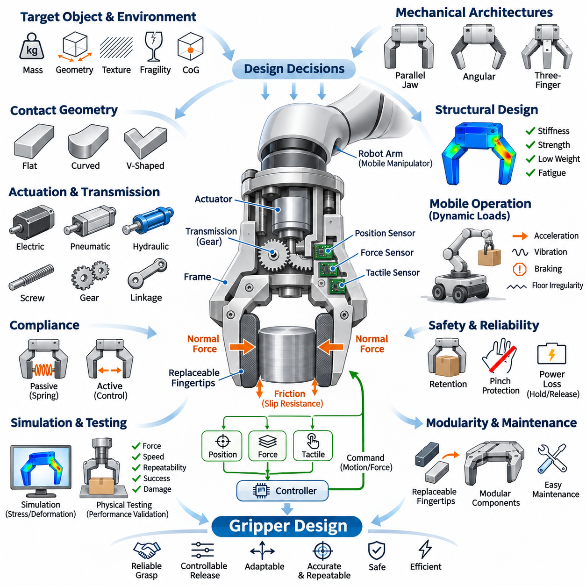
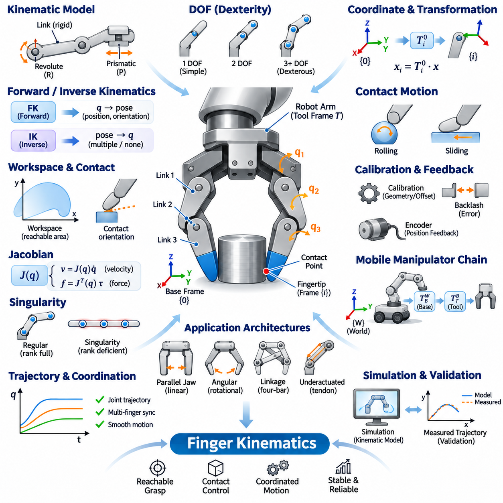
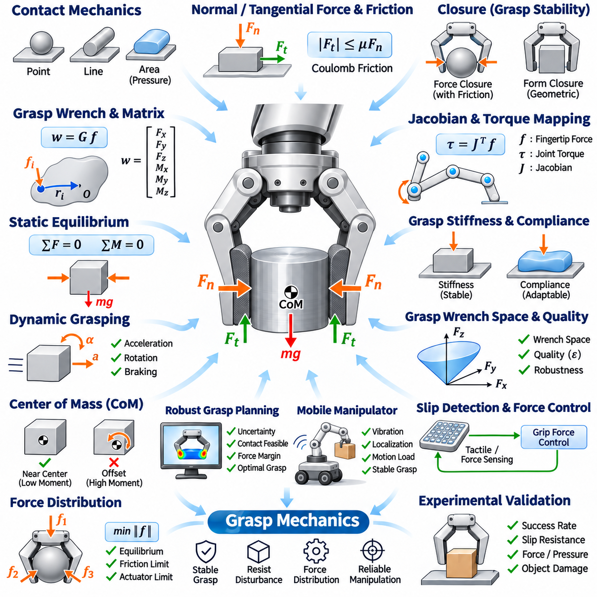
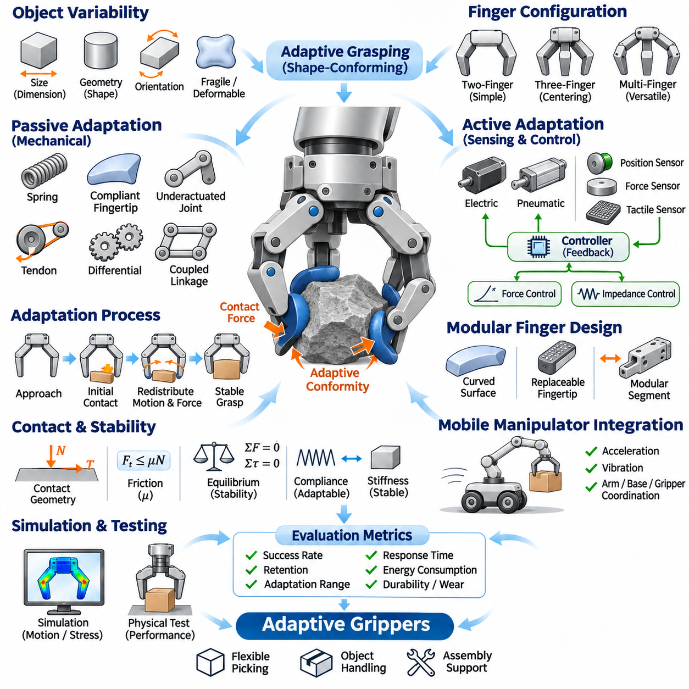
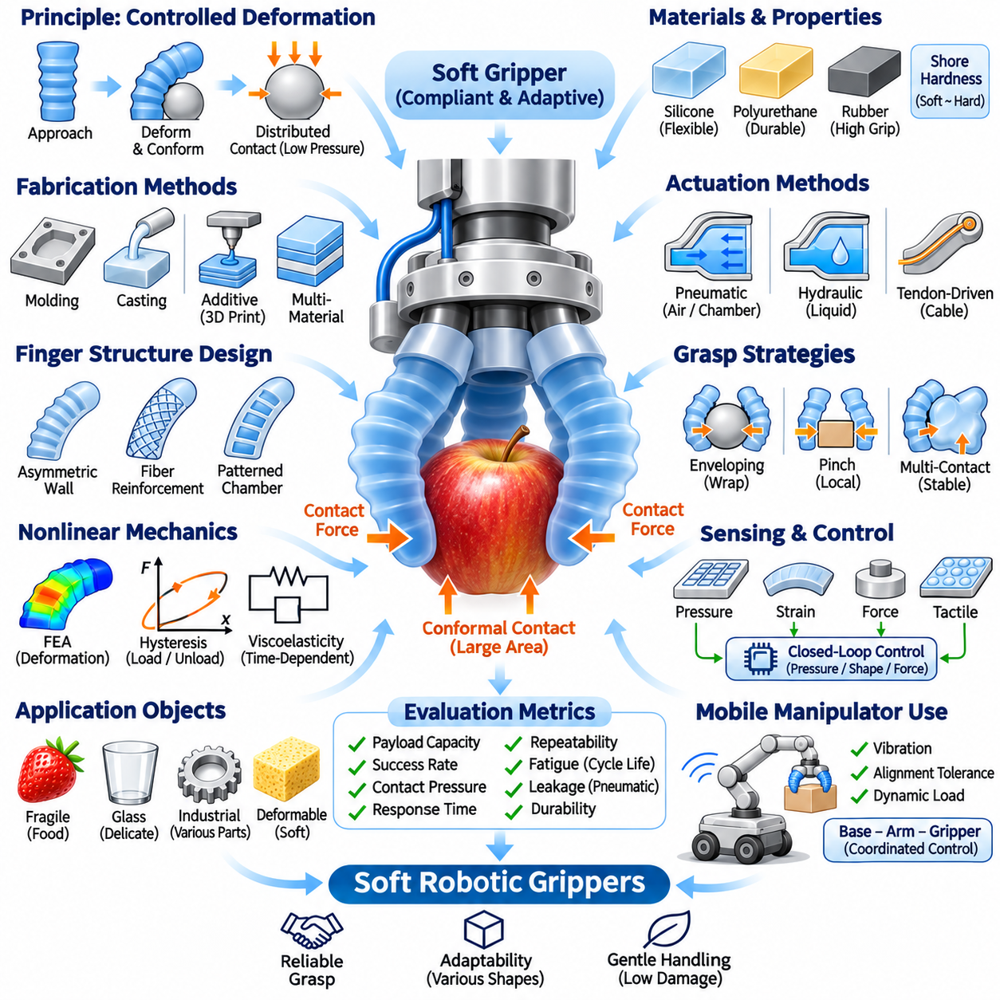
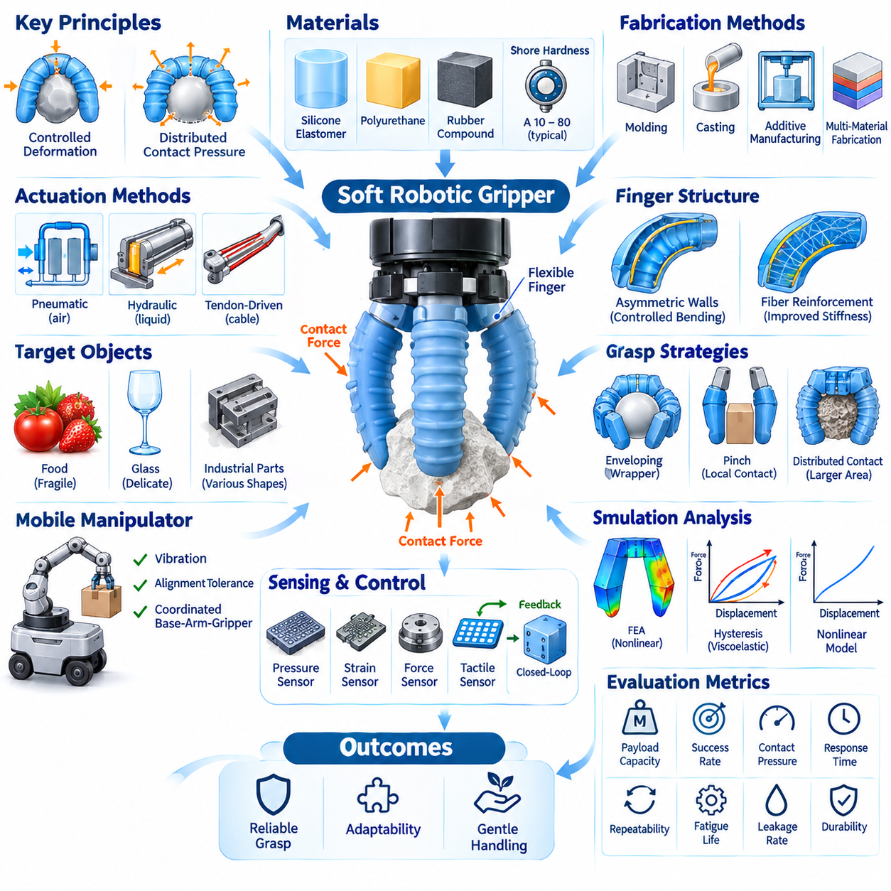
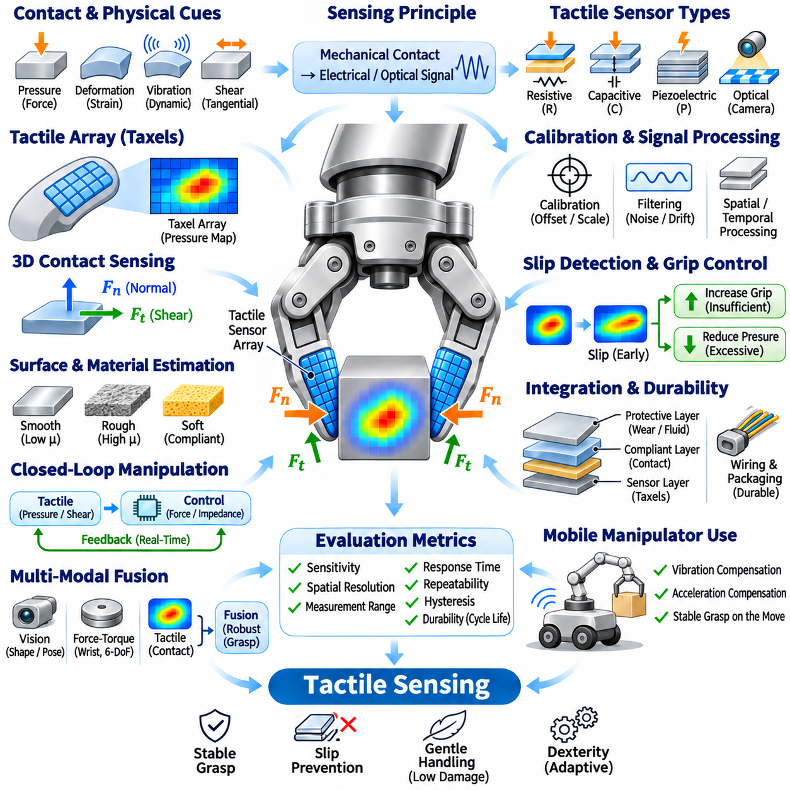
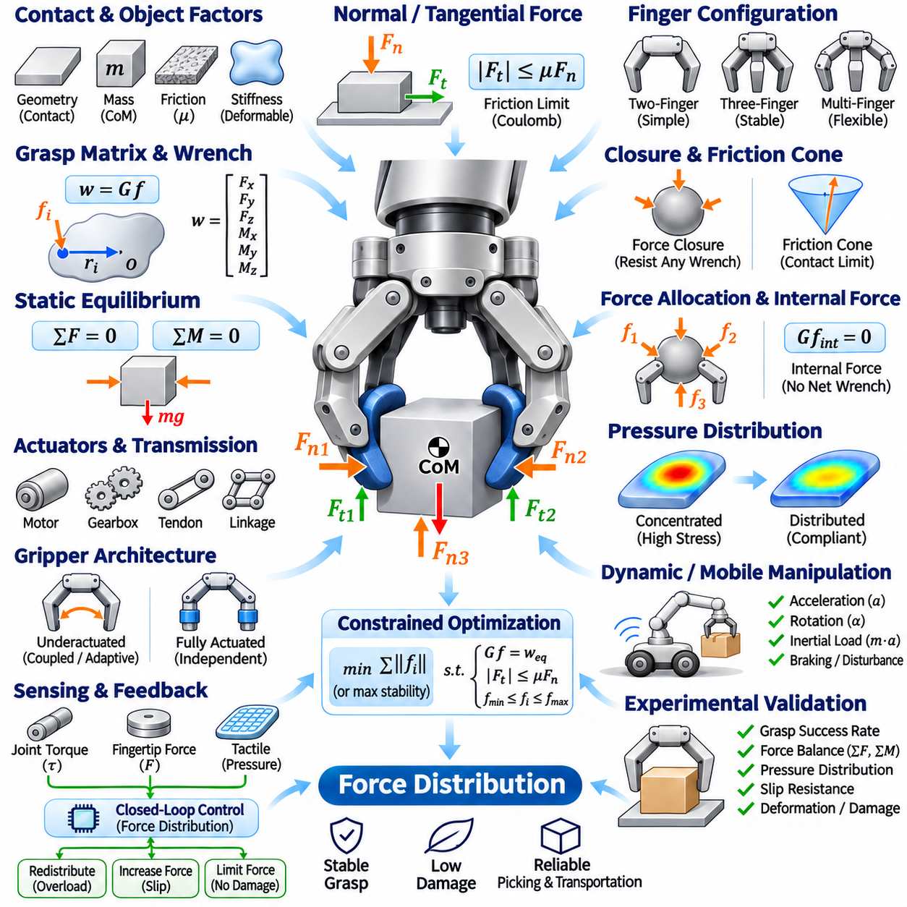
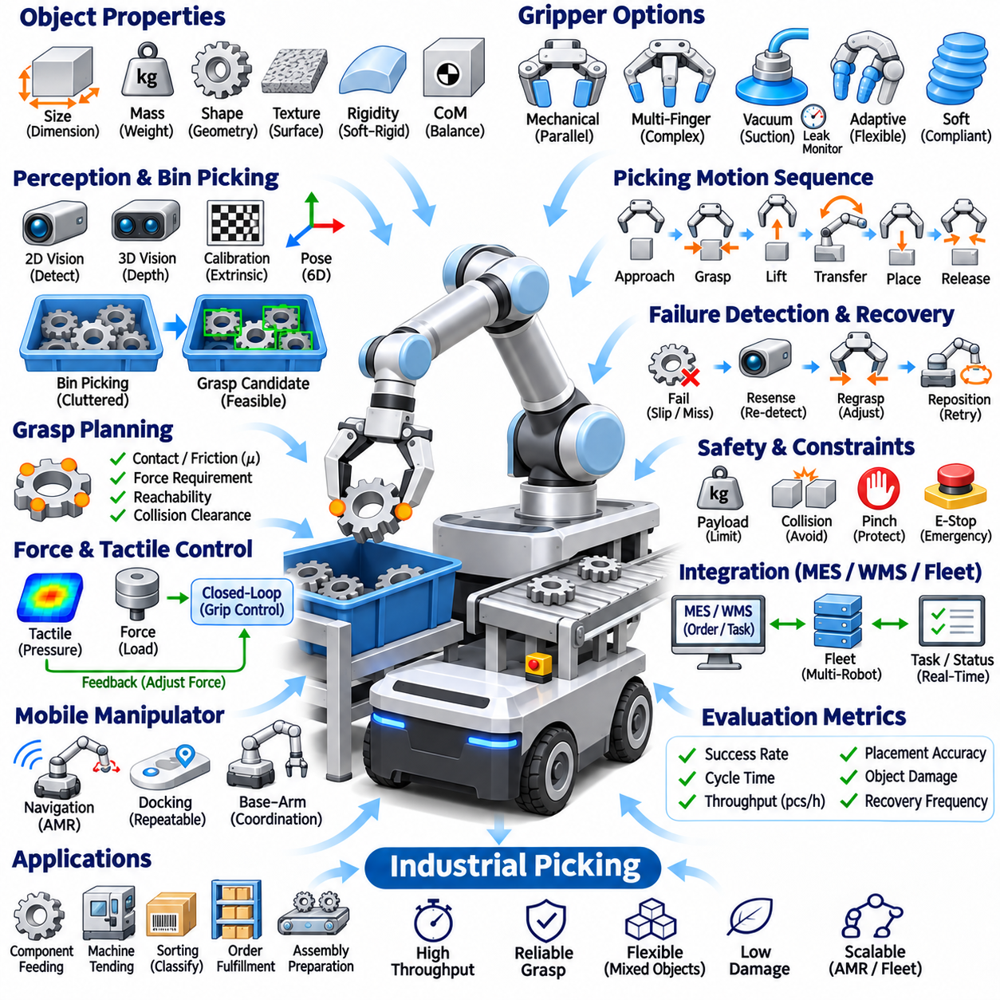
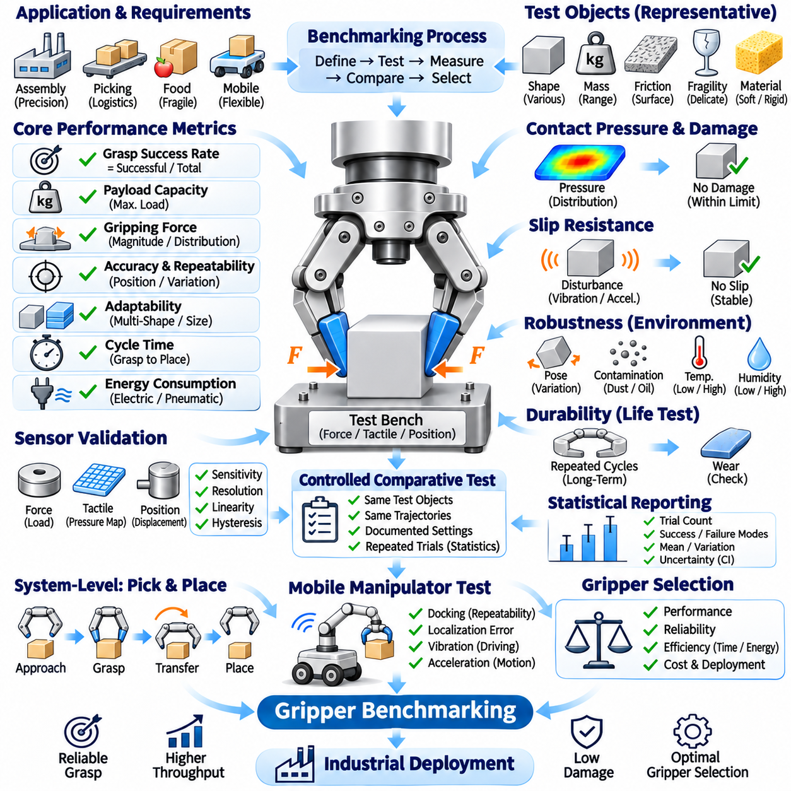

**Volume 02. Manipulator Mechanics and Control**

# Chapter 11. Grippers

## 01 Gripper Design

{width="7.268055555555556in" height="7.268055555555556in"}

Gripper design is a fundamental discipline in robotic manipulation because the gripper establishes the physical interface between a robot and the objects it handles. A successful design must provide reliable grasping, controlled release, and sufficient adaptability to different object geometries. In mobile manipulators, gripper performance also influences arm dynamics, positioning accuracy, operational safety, and overall task efficiency.

The design process begins by identifying the characteristics of the target objects and the operational environment. Important parameters include object mass, dimensions, geometry, surface texture, stiffness, fragility, and center of gravity. Engineers must also consider whether objects are rigid, deformable, slippery, or irregularly shaped. These properties determine the required gripping mechanism, contact geometry, force capacity, and sensing capabilities.

A gripper generally consists of mechanical fingers or contact surfaces, an actuation mechanism, structural components, transmission elements, and optional sensors. The mechanical structure determines how contact forces are transferred to an object, while the actuator generates the motion and force required for grasping. Effective integration of these components minimizes mechanical losses, reduces unnecessary mass, and improves repeatability during manipulation.

Mechanical architecture is one of the earliest design decisions. Parallel-jaw grippers use opposing fingers that translate toward each other, making them suitable for many industrial objects with predictable dimensions. Angular grippers rotate their fingers around mechanical pivots, providing alternative access geometries. Multi-finger designs offer additional contact configurations but introduce greater mechanical complexity and control requirements.

The number of fingers and their arrangement influence grasp stability and object accessibility. Two-finger grippers provide a compact and relatively simple solution for many industrial operations, while three-finger configurations can improve centering and contact distribution for suitable geometries. More complex arrangements may support irregular objects, although additional fingers do not automatically guarantee a stronger or more stable grasp.

Finger geometry must be designed around the intended contact conditions. Flat surfaces are effective for objects with parallel sides, while curved or V-shaped contact surfaces can improve positioning of cylindrical components. Replaceable fingertips allow a single gripper body to accommodate different products. Designers must balance contact area, accessibility, mechanical stiffness, and the possibility of interference with nearby objects.

Gripping force is a critical engineering parameter because insufficient force can cause slipping, while excessive force may damage objects or deform sensitive components. Force requirements depend on payload weight, contact orientation, friction coefficient, acceleration, and grasp geometry. A suitable design accounts for dynamic loading rather than relying exclusively on static object weight, especially when the robot performs rapid movements.

Friction plays a major role in force-closure grasping, where contact forces must resist external disturbances. The effective friction coefficient depends on the materials, surface condition, contamination, and contact pressure. Rubberized fingertips may improve traction, but their deformation and wear must be considered. Mechanical features that provide geometric constraint can reduce dependence on friction alone.

Actuator selection determines the available gripping force, closing speed, positional resolution, and energy consumption. Electric grippers provide programmable motion and convenient integration with digital controllers. Pneumatic mechanisms offer compact actuation and rapid operation when compressed air is available. Hydraulic systems can generate substantial forces, although their supporting equipment may be unsuitable for compact mobile platforms.

Transmission mechanisms convert actuator output into the motion required by the fingers. Common approaches include lead screws, gears, belts, linkages, and rack-and-pinion assemblies. Each mechanism introduces tradeoffs involving efficiency, backlash, stiffness, speed, and mechanical complexity. Transmission selection should also consider maintenance requirements, lubrication, wear, and the ability to maintain a grasp during power interruptions.

Structural design must ensure that the gripper withstands expected loads without excessive deformation. Finger bending, joint compliance, and mounting deflection can reduce grasp accuracy and alter contact forces. Engineers commonly use analytical calculations and finite element analysis to evaluate stress concentrations and displacement. Lightweight structural materials can reduce arm loading, but stiffness and fatigue resistance must remain sufficient.

The relationship between gripper mass and robot payload capacity is particularly important in mobile manipulation. A heavier gripper reduces the remaining payload available for objects and increases inertia at the robot wrist. This can affect acceleration, braking, positioning accuracy, and energy consumption. Compact designs with efficient actuator placement help preserve manipulator performance while limiting unnecessary mechanical loading.

Gripper design must also consider the interaction between the robotic arm and the mobile base. Acceleration, vibration, floor irregularities, and emergency braking can introduce disturbances that are absent in stationary manipulation systems. A grasp that remains stable during laboratory testing may become unreliable during mobile operation. Dynamic load cases must therefore be included in mechanical sizing and validation.

Compliance can improve grasp reliability when object geometry or positioning is uncertain. Passive compliance may be introduced through flexible fingertips, springs, or mechanical joints that accommodate small alignment errors. Active compliance uses sensor feedback and controlled actuation to regulate interaction forces. The appropriate compliance level depends on object fragility, positioning uncertainty, and the precision required by the manipulation task.

Sensor integration enables the gripper to detect its mechanical state and evaluate grasp quality. Position sensors measure finger displacement, while force sensors estimate applied contact loads. Tactile sensors can provide information about pressure distribution and contact changes. These measurements support grasp confirmation, object detection, force regulation, and recovery when the object moves unexpectedly during handling.

Control requirements should influence mechanical design from the beginning rather than being considered after hardware development. The gripper controller may support position control, force control, or combined operating modes. Mechanical backlash, friction, actuator response, and sensor resolution affect achievable control performance. A well-designed interface allows the robot controller to coordinate finger motion with arm trajectories and task execution.

Safety considerations include mechanical pinch points, excessive gripping force, dropped objects, and unexpected actuator movement. Designers should evaluate the consequences of power loss, communication failure, and emergency stopping. Depending on the application, spring retention, mechanical locking, or monitored holding mechanisms may be necessary. Safety measures must reflect the object hazards and the surrounding operating environment.

Manufacturability and maintenance strongly influence the practical success of a gripper. Designs with excessive part counts, difficult assembly procedures, or specialized replacement components can increase lifecycle costs. Modular fingers, standardized fasteners, accessible sensors, and replaceable wear surfaces simplify maintenance. Consistent manufacturing tolerances also help preserve alignment and repeatable gripping performance across production units.

Simulation provides an efficient method for evaluating design alternatives before physical prototypes are manufactured. Kinematic models describe finger motion and accessible grasp configurations, while dynamic models estimate actuator loads and transient forces. Contact simulations can reveal potential slipping or excessive deformation, although results depend on accurate friction and material parameters. Physical testing remains essential for validating simulated behavior.

Prototype evaluation should reproduce realistic operational conditions, including variations in object dimensions, placement uncertainty, surface contamination, and manipulation speed. Engineers measure gripping force, closing time, positioning repeatability, grasp success rate, and object damage. Repeated trials help identify mechanical wear, thermal limitations, and inconsistent contact behavior that may not appear during initial demonstrations.

An effective gripper design ultimately balances mechanical simplicity, gripping reliability, adaptability, sensing, safety, and cost. No single configuration is optimal for every manipulation task, so engineering decisions must follow clearly defined operational requirements. For mobile manipulators, the most successful designs integrate lightweight construction, dependable grasp retention, robust control interfaces, and validated performance under dynamic operating conditions.

## 02 Finger Kinematics

{width="7.268055555555556in" height="7.268055555555556in"}

Finger kinematics describes the geometric relationships between joint motion, finger configuration, and contact-point position in a robotic gripper. It provides the mathematical foundation for predicting how fingers move during opening, closing, and object manipulation. Accurate kinematic modeling allows engineers to determine reachable grasp positions, coordinate multiple fingers, and design mechanisms that maintain reliable contact with objects of different shapes.

A robotic finger can be represented as a sequence of rigid links connected by joints. Each link has defined geometric properties, while each joint introduces a controlled or constrained degree of freedom. Revolute joints produce rotational motion, whereas prismatic joints generate linear displacement. The arrangement of these joints determines the finger workspace, available contact orientations, and mechanical adaptability of the gripper.

The number of degrees of freedom determines how independently a finger can move. A simple industrial gripper may use one actuated degree of freedom to control opposing fingers through a shared transmission. More advanced robotic hands employ multiple joints to control finger curvature and contact orientation. Additional degrees of freedom increase dexterity but also introduce greater complexity in actuation, sensing, and motion coordination.

Coordinate frames provide a systematic method for describing finger geometry and motion. A reference frame is typically attached to the gripper base, while additional frames are assigned to individual links and joints. Homogeneous transformation matrices represent relative positions and orientations between these frames. By multiplying successive transformations, engineers can calculate the position and orientation of a fingertip relative to the gripper base.

Forward kinematics determines fingertip position from known joint coordinates. For a finger containing multiple revolute joints, each joint angle contributes to the final fingertip configuration. The resulting transformation depends on link lengths, joint-axis orientations, and mechanical offsets. Forward kinematic models support motion prediction, collision checking, contact planning, and verification of the finger geometry during mechanical design.

Inverse kinematics determines the joint coordinates required to achieve a desired fingertip position or contact configuration. Unlike forward kinematics, inverse kinematics may produce multiple solutions, no feasible solution, or a continuous family of solutions. Mechanical joint limits and geometric constraints restrict the valid configurations. Numerical methods are often used when analytical solutions are unavailable or the finger mechanism contains complex linkages.

Finger workspace represents the region that a fingertip can reach within its mechanical constraints. Workspace boundaries depend on link lengths, joint ranges, transmission geometry, and possible interference between adjacent fingers. A large workspace does not necessarily guarantee effective grasping because useful contact orientations may be limited. Engineers therefore evaluate both fingertip reachability and the ability to establish appropriate contact with target objects.

The Jacobian matrix describes the differential relationship between joint velocities and fingertip motion. It maps small changes in joint coordinates into corresponding changes in fingertip position and orientation. This relationship is essential for velocity control, trajectory generation, and local motion adjustment. The Jacobian also provides information about how joint forces or torques relate to forces applied at the fingertip.

Kinematic singularities occur when the finger mechanism loses the ability to generate motion in certain directions or when the Jacobian becomes rank deficient. Near singular configurations, small desired fingertip movements may require large joint velocities. Singularities can also change the relationship between actuator effort and contact force. Mechanical design and control strategies should therefore identify and avoid problematic configurations whenever possible.

Parallel-jaw grippers provide a relatively simple example of constrained finger kinematics. Their opposing contact surfaces are designed to remain approximately parallel during opening and closing. A single actuator may drive both fingers through a synchronized mechanical transmission. The resulting motion can often be described using one independent displacement variable, simplifying position control and grasp-width estimation.

Angular grippers use rotational finger motion around fixed pivot points. Their fingertip trajectories follow circular arcs rather than straight lines, causing contact orientation and separation to change during closing. The relationship between actuator displacement and fingertip position depends on the pivot geometry and transmission mechanism. These characteristics must be considered when approaching objects in confined environments.

Linkage-driven fingers introduce additional geometric constraints between joint movements. Four-bar linkages, coupled joints, and tendon-driven mechanisms can coordinate multiple finger segments using a limited number of actuators. The resulting motion is determined by linkage dimensions, tendon routing, and mechanical coupling relationships. Accurate kinematic models help predict finger posture and identify configurations where mechanical interference may occur.

Underactuated fingers contain more mechanical degrees of freedom than independently controlled actuators. Their joint configurations may change according to contact conditions, elastic elements, and transmission constraints. Before contact, the fingers may follow a predictable closing trajectory, while contact with an object can redistribute motion among joints. Consequently, rigid geometric kinematics alone may not fully determine the final grasp configuration.

Finger trajectory planning determines how joints move between initial and target configurations. Smooth trajectories reduce mechanical shock, unnecessary vibration, and abrupt contact with objects. Joint velocity and acceleration limits must be respected to maintain actuator performance and mechanical reliability. Coordinated trajectory generation is especially important when multiple fingers must approach an object simultaneously without producing unwanted collisions.

Contact-point kinematics extends fingertip modeling to the actual locations where the finger surfaces interact with an object. The contact point may differ from the nominal fingertip reference frame, particularly when curved or compliant surfaces are used. Changes in contact location can alter the effective moment arms and required joint torques. Accurate contact modeling is therefore important for grasp planning and force distribution.

Rolling and sliding contacts introduce additional kinematic considerations during manipulation. Rolling contact changes the contact location while maintaining a no-slip relationship under ideal conditions. Sliding contact permits relative tangential motion between the finger and object surfaces. These behaviors influence object repositioning and in-hand manipulation, requiring models that combine finger geometry with contact constraints and friction assumptions.

Mechanical tolerances influence the accuracy of finger kinematic models. Manufacturing variation, joint backlash, bearing clearance, and structural deformation can cause actual fingertip positions to differ from theoretical predictions. Calibration procedures estimate geometric parameters and compensate for systematic errors. Sensor feedback can further improve positioning accuracy by detecting deviations during operation.

Finger kinematics must also be integrated with the kinematics of the robotic arm. The gripper mounting transformation establishes the relationship between the arm tool frame and the finger reference frames. This combined model allows manipulation software to predict contact positions in the robot base or world coordinate system. Accurate integration supports collision avoidance, object approach planning, and coordinated arm-gripper motion.

Mobile manipulators introduce additional coordinate transformations because the robotic arm is mounted on a moving platform. The estimated mobile-base pose, arm configuration, and finger joint coordinates jointly determine the fingertip position in the environment. Localization errors and platform motion can therefore affect grasp alignment. Coordinated control should account for these uncertainties when executing precision manipulation tasks.

Simulation and experimental validation are essential for verifying finger kinematic models. Engineers compare predicted fingertip trajectories with measurements obtained from encoders, cameras, or external tracking systems. Testing across the full joint range helps identify geometric errors, singularities, and unexpected mechanical constraints. Validated models provide a dependable foundation for grasp planning, force control, and reliable industrial manipulation.

## 03 Grasp Mechanics

{width="7.268055555555556in" height="7.268055555555556in"}

Grasp mechanics describes the physical principles governing how robotic fingers establish, maintain, and release contact with objects. It combines rigid-body mechanics, contact geometry, friction, and force transmission to explain grasp stability. Understanding these relationships allows engineers to design grippers that securely manipulate objects while resisting gravity, acceleration, and external disturbances encountered during industrial operations.

A grasp is established when one or more gripper surfaces apply contact forces to an object. Each contact generates forces whose directions and magnitudes depend on local surface geometry, material properties, and loading conditions. These forces collectively determine whether the object remains stationary, moves predictably, or slips. Grasp analysis therefore considers both the individual contacts and their combined mechanical effects.

Contact mechanics provides the foundation for describing interactions between gripper fingers and object surfaces. Idealized models may represent contact as a point, line, or distributed area, depending on geometry and material behavior. Real contacts involve localized deformation and pressure distribution. The selected model influences predictions of friction, contact stiffness, stress concentration, and the forces that can be transmitted.

Normal force acts perpendicular to the contact surface, while tangential force acts along that surface. Normal force creates contact pressure and supports frictional resistance, whereas tangential force can oppose sliding motion. Under a simplified Coulomb friction model, the magnitude of tangential friction force is limited by the friction coefficient multiplied by the normal force. Exceeding this limit can initiate slipping.

The friction coefficient depends on the contacting materials, surface roughness, contamination, and environmental conditions. Rubber fingertips may increase friction against smooth objects, while oily or dusty surfaces can reduce effective traction. Friction coefficients are not always constant across operating conditions. Reliable grasp design should therefore consider uncertainty in friction rather than assuming ideal contact properties.

Force closure describes a grasp configuration capable of resisting arbitrary external forces and torques within the assumptions of the contact model and available force limits. Achieving force closure depends on contact locations, contact normals, and frictional capabilities. A geometrically symmetric grasp does not automatically provide force closure. Engineers must evaluate whether the available contact forces can balance disturbances in every relevant direction.

Form closure represents a different stability mechanism in which geometric constraints prevent object motion without relying on friction. Multiple contacts or enclosing surfaces restrict the object\'s possible movements through mechanical geometry. Form closure can provide strong resistance to disturbances but may require specialized finger shapes. Many industrial grippers combine geometric constraint with frictional holding to improve reliability.

The grasp wrench represents the combined force and torque applied to an object by its contacts. Each contact force contributes both a translational force and a moment determined by its position relative to a reference point. The grasp matrix maps individual contact forces into the resulting object wrench. This mathematical representation enables systematic analysis of equilibrium, stability, and force distribution.

Static equilibrium occurs when the total external and contact forces and torques acting on an object are balanced. During stationary holding, the gripper must counteract gravity and any additional applied loads. Contact forces must also satisfy friction constraints and actuator limitations. A grasp may satisfy overall force equilibrium while remaining vulnerable to slipping at an individual contact.

Dynamic grasping introduces inertial forces and moments caused by object acceleration and rotation. Rapid robot-arm movements can substantially increase the required gripping force compared with stationary holding. Emergency braking and sudden direction changes may produce particularly demanding load cases. Gripper sizing should therefore account for expected motion profiles and peak dynamic disturbances.

The center of mass strongly influences grasp mechanics because its location determines how gravitational and inertial loads generate moments about contact points. Grasping far from the center of mass can increase rotational loading and create uneven contact forces. Appropriate grasp placement reduces unnecessary torque and improves stability. For irregular objects, estimating the center of mass may require geometric or experimental analysis.

Contact force distribution determines how the total gripping effort is shared among multiple fingers. Uneven distribution may overload individual contacts while leaving others insufficiently engaged. Multi-finger systems can redistribute forces to improve stability, provided their actuation and contact geometry permit suitable adjustments. Force optimization methods can select contact loads that satisfy equilibrium while respecting friction and actuator limits.

The relationship between joint torque and fingertip force is governed by finger kinematics and the Jacobian matrix. Joint torques generate contact forces through mechanical transmission, with the exact relationship depending on configuration and contact constraints. Changes in finger posture can therefore alter the available gripping force. Actuator capacity must be evaluated across the intended grasping workspace rather than at a single nominal position.

Grasp stiffness describes resistance to small object displacements under applied disturbances. It depends on contact stiffness, finger structure, actuator behavior, and the geometry of the grasp. Higher stiffness can improve positional stability but may increase contact stress or sensitivity to alignment errors. Controlled compliance can accommodate geometric uncertainty while maintaining sufficient resistance to unwanted object motion.

Soft fingertips modify contact mechanics by deforming around object surfaces and increasing the effective contact area. This deformation can reduce localized pressure and improve handling of fragile objects. However, compliant materials introduce nonlinear stiffness, hysteresis, and time-dependent behavior. Accurate modeling may require experimentally identified material properties rather than purely rigid-contact assumptions.

Grasp stability can be evaluated using the grasp wrench space, which describes the set of object forces and torques achievable through admissible contact forces. A larger disturbance-resistant region generally indicates greater grasp robustness under the chosen normalization and force constraints. Quality metrics may consider the minimum disturbance that causes failure. Such measures support comparison of candidate grasp configurations.

Slip occurs when contact conditions no longer support the required tangential force. Incipient slip may begin locally before the entire object moves relative to the fingers. Tactile sensing, force measurements, and vibration analysis can help identify these early changes. Closed-loop grip-force control can increase normal force when necessary, while avoiding excessive pressure that could damage the object.

Grasp planning must account for uncertainty in object pose, geometry, mass, and friction. Small positioning errors may shift contact locations and change the resulting force distribution. Robust grasp configurations maintain acceptable stability across plausible variations rather than depending on exact nominal conditions. Mechanical compliance and sensor feedback can further improve tolerance to uncertainty during execution.

Mobile manipulators face additional grasp disturbances because the robotic arm operates on a moving platform. Base acceleration, vibration, floor irregularities, and localization errors can influence contact conditions and object stability. A grasp suitable for a stationary robot may require additional force margins during mobile operation. Coordinated motion planning can reduce unnecessary disturbances while preserving safe payload handling.

Experimental validation is essential because theoretical contact models simplify real material behavior and mechanical imperfections. Engineers evaluate grasp success, slip resistance, contact force, object damage, and stability under controlled disturbances. Tests should include variations in payload, acceleration, surface condition, and grasp location. Repeated measurements reveal whether predicted safety margins remain valid during practical operation.

Effective grasp mechanics integrates contact modeling, force equilibrium, friction analysis, actuator capabilities, and dynamic loading into a unified engineering framework. Reliable grasping requires more than applying sufficient closing force; contact geometry and force distribution must also support stable object handling. For industrial mobile manipulators, these principles enable secure manipulation, predictable performance, and safer operation across changing environments.

## 04 Adaptive Grippers

{width="7.268055555555556in" height="7.268055555555556in"}

Adaptive grippers are robotic grasping devices designed to accommodate variations in object geometry, dimensions, orientation, and surface characteristics without requiring extensive mechanical reconfiguration. Unlike conventional grippers with fixed finger configurations, adaptive mechanisms can modify their contact arrangement according to the shape of the target object. This capability improves grasp reliability in environments where objects are diverse, irregular, or insufficiently constrained.

The fundamental principle of adaptive grasping is mechanical or controlled adjustment of finger configurations during object contact. When a gripper approaches an object, its fingers respond to geometric constraints and distribute contact forces according to the available contact surfaces. This allows the gripper to accommodate objects with different widths, profiles, and orientations. Adaptation may be achieved through passive mechanical mechanisms, active actuation, or a combination of both.

Passive adaptation uses mechanical compliance, springs, linkages, and underactuated joints to allow fingers to conform naturally to object geometry. When one finger encounters an object before another, the mechanism can redistribute motion rather than forcing all fingers to maintain identical positions. This behavior reduces the need for independent actuators at every joint and can simplify mechanical architecture while improving contact consistency.

Underactuated grippers are an important category of adaptive grippers. They contain more mechanical degrees of freedom than independently controlled actuators, allowing multiple joints to respond naturally to object contact. Tendon-driven transmissions, differential mechanisms, and coupled linkages can distribute actuator motion across several finger segments. The resulting configuration depends on object geometry, contact location, mechanical constraints, and the properties of elastic components.

Active adaptive grippers use sensors, actuators, and control algorithms to modify finger positions and gripping forces according to the detected object characteristics. Position sensors provide information about finger displacement, while force and tactile sensors identify contact conditions. The controller can adjust finger movement, regulate contact pressure, and coordinate multiple actuators. This approach provides greater flexibility when object geometry and grasping conditions vary significantly.

Mechanical compliance is a central design consideration in adaptive grippers. Flexible joints, elastic elements, and compliant fingertips allow the mechanism to accommodate small geometric variations and positioning errors. Compliance also reduces concentrated contact pressure, which is particularly important when handling fragile or deformable objects. However, excessive compliance may reduce positioning accuracy and gripping stiffness, requiring an appropriate balance between adaptability and structural stability.

Adaptive finger geometry determines how effectively a gripper conforms to different object shapes. Curved contact surfaces can improve grasping of cylindrical objects, while articulated fingers can accommodate irregular profiles. Replaceable fingertips and modular finger segments provide additional flexibility for application-specific requirements. The design should ensure sufficient contact area and prevent mechanical interference throughout the intended range of finger motion.

The number and arrangement of fingers influence the adaptability and stability of a grasp. Two-finger adaptive grippers provide relatively simple mechanical structures and are suitable for many industrial picking operations. Three-finger configurations can improve object centering and distribute contact forces across multiple surfaces. More complex multi-finger arrangements provide additional grasp configurations but increase mechanical complexity, actuator requirements, and control challenges.

Adaptive grasping requires appropriate coordination between finger motion and contact force. During initial contact, fingers should approach the object without generating excessive pressure. Once contact is established, the mechanism can redistribute motion and force to achieve a stable configuration. Force control and impedance control can support this process by regulating interaction behavior rather than relying exclusively on predetermined finger positions.

Sensor integration improves the ability of adaptive grippers to recognize changing contact conditions. Tactile sensors provide information about pressure distribution, contact location, and local deformation. Force sensors measure the interaction loads applied to the object, while position encoders monitor joint configurations. Combining these measurements allows the controller to estimate grasp quality, detect incomplete contact, and identify potential slipping during manipulation.

Object variability is one of the primary reasons for adopting adaptive gripper architectures. Industrial environments frequently contain products with different dimensions, surface materials, and geometric tolerances. A fixed-width gripper may require mechanical adjustment or tool replacement whenever the target changes. Adaptive mechanisms can accommodate a wider range of objects within their mechanical limits, reducing changeover time and supporting flexible manufacturing operations.

Adaptive grippers are particularly useful for handling irregular and deformable objects. Conventional rigid fingers may produce unstable contact when interacting with objects that have uneven surfaces or variable dimensions. Adaptive fingers can establish multiple contact points and distribute forces according to the available geometry. For deformable products, controlled compliance helps reduce damage while maintaining sufficient holding force throughout the manipulation process.

Grasp stability depends on the relationship between contact geometry, friction, mechanical compliance, and force distribution. Adaptive mechanisms can improve stability by allowing fingers to establish contact at different positions instead of relying on a single predetermined configuration. However, adaptation alone does not guarantee a stable grasp. The resulting contact forces must still satisfy equilibrium conditions and provide sufficient resistance to external disturbances.

Actuator selection affects the performance and complexity of adaptive grippers. Electric actuators provide programmable positioning and force regulation, making them suitable for applications requiring precise control. Pneumatic actuators offer rapid operation and relatively simple mechanical integration, although accurate force regulation may require additional control components. Underactuated designs can reduce actuator count, but their behavior may be more difficult to predict under varying contact conditions.

Adaptive gripper control should account for the relationship between actuator motion, joint configuration, and fingertip contact. Mechanical coupling can cause the movement of one finger segment to influence other segments. Consequently, the controller must understand the mechanism\'s kinematic and dynamic characteristics. Accurate models help predict finger movement, estimate contact forces, and avoid configurations that produce excessive mechanical stress or unstable grasping.

In mobile manipulation, adaptive grippers must operate under disturbances caused by platform acceleration, vibration, and variations in object positioning. These conditions can change contact forces after the initial grasp has been established. Adaptive mechanisms can accommodate some of these variations through passive compliance or active force adjustment. Coordinated control between the mobile base, robotic arm, and gripper is essential for maintaining object stability during transportation.

Simulation and experimental evaluation are important for validating adaptive gripper performance. Engineers examine finger trajectories, contact configurations, gripping forces, and mechanical constraints across different object geometries. Physical experiments should include variations in object dimensions, mass, surface friction, and positioning uncertainty. Repeated trials help determine whether the gripper can maintain reliable grasping performance under realistic industrial conditions.

Performance evaluation should consider grasp success rate, object retention, force consistency, adaptation range, response time, and energy consumption. Mechanical durability and maintenance requirements are also important because adaptive mechanisms often contain multiple joints, springs, tendons, or transmission components. Long-term testing can identify wear, deformation, backlash, and changes in mechanical response that influence grasp repeatability.

Effective adaptive gripper design integrates mechanical adaptability, controlled compliance, sensing, and reliable force transmission into a coordinated grasping system. The objective is not simply to increase the number of movable joints, but to achieve dependable object handling across a wide range of operating conditions. In industrial mobile manipulators, adaptive grippers provide an important foundation for flexible picking, handling, assembly, and autonomous manipulation of objects with varying physical characteristics.

## 05 Soft Robotic Grippers

{width="7.268055555555556in" height="7.268055555555556in"}

{width="7.268055555555556in" height="7.268055555555556in"}

Soft robotic grippers are robotic grasping devices that use flexible materials and compliant structures to interact with objects through controlled deformation. Unlike conventional rigid grippers, which rely primarily on fixed mechanical geometries, soft grippers adapt their shapes to the surfaces of target objects. This characteristic makes them particularly suitable for handling fragile, irregular, deformable, and geometrically complex objects while reducing the risk of mechanical damage.

The fundamental principle of soft robotic grasping is the controlled deformation of compliant structures during contact. When a soft finger approaches an object, its material deforms according to the object\'s geometry and the applied force. This deformation increases the effective contact area and allows the gripper to establish multiple contact regions. The resulting interaction can improve grasp stability while distributing pressure more evenly across delicate surfaces.

Material selection is one of the most important aspects of soft gripper design. Common materials include silicone elastomers, polyurethane, rubber compounds, and other flexible polymers. Their mechanical properties determine deformation behavior, elasticity, tensile strength, durability, and resistance to environmental conditions. Designers must select materials that provide sufficient flexibility while maintaining structural integrity under repeated grasping cycles and operational loads.

Silicone elastomers are widely used because they provide high flexibility, relatively low manufacturing complexity, and useful elastic recovery characteristics. Different silicone formulations offer different levels of softness, stiffness, and tear resistance. Material hardness is often characterized using the Shore hardness scale. Selecting an appropriate hardness is essential because excessively soft materials may deform unpredictably, while overly stiff materials may reduce the adaptability that distinguishes soft grippers.

Soft gripper structures can be manufactured using molding, casting, additive manufacturing, and multi-material fabrication techniques. Molding and casting are suitable for producing continuous flexible structures with embedded internal channels or reinforcement elements. Additive manufacturing enables complex geometries and rapid design iteration. Multi-material fabrication allows flexible and rigid regions to be integrated into a single structure, providing controlled deformation in selected areas.

Pneumatic actuation is one of the most common methods used in soft robotic grippers. Compressed air is introduced into internal chambers, causing the flexible structure to expand or bend. The resulting motion depends on chamber geometry, wall thickness, material properties, and applied pressure. Pneumatic actuation can generate distributed deformation without requiring conventional rigid joints, making it suitable for grasping objects with varying shapes.

Hydraulic actuation provides another approach to controlling soft robotic structures. Instead of compressed air, liquid pressure produces deformation within flexible chambers. Because liquids are less compressible than gases, hydraulic systems can offer different force transmission and response characteristics. However, they require fluid management components, sealing, and additional maintenance considerations. The choice between pneumatic and hydraulic actuation depends on required force, response speed, precision, and system complexity.

Tendon-driven soft grippers use flexible cables or tendons to generate bending and contraction. When a tendon is pulled, the soft structure deforms along a preferred direction determined by its mechanical design. This approach allows relatively precise control without distributing pneumatic chambers throughout the finger. However, tendon friction, cable routing, mechanical wear, and tension management must be considered to maintain consistent motion and repeatability.

The internal structure of a soft finger strongly influences its deformation characteristics. Asymmetric wall thickness, embedded fibers, reinforcement layers, and patterned chambers can control the direction and magnitude of bending. Fiber reinforcement can restrict expansion in selected directions while allowing deformation in others. Such structural arrangements enable designers to create predictable bending patterns and improve the mechanical efficiency of soft grasping mechanisms.

Soft grippers can employ different grasping strategies depending on object geometry and material properties. Enveloping grasps allow flexible fingers to wrap around an object and establish multiple contact points. Pinching grasps use localized deformation to hold objects between opposing surfaces. Distributed surface contact can reduce concentrated pressure, while geometric wrapping can improve resistance to object displacement. Selecting an appropriate strategy requires consideration of object weight, shape, friction, and fragility.

The mechanical behavior of soft grippers is highly nonlinear because large deformations change the geometry and stress distribution of the structure. Conventional rigid-body kinematic models are therefore insufficient for accurately predicting all finger configurations. Finite element analysis and nonlinear material models can be used to estimate deformation, stress, and contact pressure. Accurate simulation requires appropriate material parameters and realistic boundary and contact conditions.

Soft gripper control presents additional challenges because deformation is not always directly related to actuator input. The same applied pressure or tendon displacement may produce different finger configurations depending on contact conditions and material history. Hysteresis, viscoelasticity, and nonlinear elasticity can introduce differences between loading and unloading behavior. Feedback from pressure sensors, force sensors, and position measurements can improve control consistency and grasp reliability.

Sensor integration enables soft grippers to monitor deformation and interaction with objects. Flexible pressure sensors can measure distributed contact forces, while embedded strain sensors can estimate local deformation. Pneumatic pressure measurements provide indirect information about internal chamber conditions. Combining these measurements allows the controller to estimate contact state, regulate gripping force, and detect unexpected changes during manipulation.

Tactile sensing is particularly important because soft materials naturally create distributed contact regions. Unlike rigid fingertips with relatively localized contact, soft surfaces can generate complex pressure patterns across their deformable areas. Tactile sensor arrays can identify contact locations, pressure distribution, and potential slipping. These measurements support more informed grasp adjustment and improve the ability to handle objects with uncertain geometry.

Soft robotic grippers offer significant advantages when handling fragile products such as food, biological samples, glass components, and delicate industrial parts. Their compliant surfaces can reduce localized contact stress and accommodate dimensional variations without requiring precise mechanical alignment. However, soft materials may be vulnerable to punctures, abrasion, chemical exposure, and long-term deformation. Material durability and application-specific environmental resistance must therefore be evaluated.

In mobile manipulation, soft grippers can provide additional tolerance to positioning errors and disturbances generated by platform motion. Flexible contact structures may absorb small vibrations and accommodate minor alignment differences during grasping. However, excessive deformation can introduce uncertainty in object positioning and force transmission. Coordinated control between the mobile base, robotic arm, and gripper is necessary to maintain stable manipulation during transportation.

Performance evaluation should consider grasp success rate, maximum payload, contact pressure, deformation range, response time, repeatability, and material durability. Testing should include objects with different geometries, masses, surface properties, and levels of fragility. Long-term experiments are particularly important because repeated deformation can cause material fatigue, permanent set, leakage, or changes in mechanical response. These factors determine whether a soft gripper can operate reliably in industrial environments.

Effective soft robotic gripper design requires an integrated understanding of compliant materials, structural geometry, actuation methods, contact mechanics, and feedback control. The objective is to achieve reliable grasping while preserving the adaptability and safety advantages of flexible structures. In industrial mobile manipulators, soft grippers can complement conventional mechanical grippers by enabling more versatile handling of fragile, irregular, and deformable objects across diverse manipulation tasks.

## 06 Tactile Sensing

{width="7.268055555555556in" height="7.268055555555556in"}

Tactile sensing is an essential technology in robotic manipulation that enables grippers to perceive physical contact with objects through specialized sensors embedded in or attached to their contact surfaces. Unlike conventional vision systems, which primarily provide information about objects before contact, tactile sensors detect physical interactions during grasping and manipulation. This capability allows robots to estimate contact conditions, recognize surface characteristics, and adjust gripping behavior according to real-time interaction feedback.

The fundamental principle of tactile sensing is the conversion of mechanical interactions into measurable electrical or optical signals. When a robotic finger touches an object, the contact produces pressure, deformation, vibration, or shear forces at the interface. Tactile sensors detect these physical changes and transform them into signals that can be processed by the robot controller. The resulting measurements provide information about contact location, pressure distribution, force magnitude, and changes in surface interaction.

Tactile sensors can be classified according to their sensing mechanisms and physical principles. Resistive sensors detect changes in electrical resistance caused by applied pressure or deformation. Capacitive sensors measure variations in electrical capacitance between conductive elements. Piezoelectric sensors generate electrical signals in response to mechanical stress, making them suitable for detecting dynamic contact events. Optical tactile sensors use changes in light transmission or reflection to estimate contact conditions across a sensing surface.

Resistive tactile sensors are widely used because of their relatively simple structure and straightforward electronic integration. Their sensing elements typically contain pressure-sensitive materials whose electrical resistance changes under mechanical loading. Sensor arrays can provide spatial pressure measurements across the fingertip surface. However, nonlinear responses, hysteresis, temperature sensitivity, and long-term material degradation must be considered when designing reliable tactile sensing systems.

Capacitive tactile sensors provide another approach by measuring changes in capacitance associated with contact-induced deformation. Their structures commonly consist of conductive electrodes separated by a dielectric material. When pressure is applied, the distance or effective geometry between the electrodes changes, producing a measurable capacitance variation. These sensors can offer good sensitivity and repeatability, although electrical noise, parasitic capacitance, and mechanical packaging require careful consideration.

Piezoelectric tactile sensors are particularly useful for detecting dynamic contact information. Mechanical stress applied to piezoelectric materials generates electrical charge, allowing the sensor to detect impacts, vibration, and rapid force changes. These characteristics support contact event detection and early slip recognition. However, conventional piezoelectric sensing is less suitable for measuring constant static pressure over extended periods without additional signal conditioning or alternative sensing arrangements.

Optical tactile sensors use cameras, light sources, and deformable sensing surfaces to capture contact information. When an object presses against the sensor surface, deformation changes the observed light patterns, allowing contact geometry and pressure distribution to be estimated. Camera-based tactile systems can provide high spatial resolution and rich contact information. Their implementation requires careful optical alignment, image processing, illumination control, and compact mechanical integration.

Tactile sensor arrays enable the measurement of distributed contact conditions rather than relying on a single measurement point. Multiple sensing elements arranged across a fingertip generate spatial information about pressure distribution and contact geometry. This information helps identify whether an object is properly positioned, whether contact is concentrated in a small region, and whether the applied gripping force is distributed evenly. Sensor density and arrangement directly influence spatial resolution and measurement quality.

Three-dimensional tactile sensing extends conventional pressure measurement by estimating normal and shear components of contact forces. Normal force acts perpendicular to the contact surface, while shear forces act tangentially. Measuring both components provides a more complete understanding of object interaction. This capability is particularly important for detecting incipient slipping, estimating frictional behavior, and maintaining stable grasps during object transportation.

Tactile sensing also supports the estimation of object surface properties. Changes in local pressure patterns, vibration responses, and contact deformation can provide information about surface texture, roughness, and material characteristics. A robot may use these measurements to distinguish between smooth, rough, soft, or rigid contact surfaces. Although tactile measurements alone may not uniquely identify a material, they provide useful complementary information for object recognition and manipulation.

Slip detection is one of the most important applications of tactile sensing in robotic grasping. When an object begins to move relative to a fingertip, local contact forces and vibration patterns may change before visible displacement becomes significant. Tactile sensors can detect these early variations and provide feedback to the grasp controller. The controller can then increase gripping force or modify finger motion to prevent object loss while avoiding unnecessary pressure.

Tactile feedback enables closed-loop force control during grasping and manipulation. Instead of relying exclusively on predefined actuator positions, the robot can continuously adjust gripping force according to measured contact conditions. If the contact pressure becomes excessive, the controller can reduce the applied force. If insufficient contact is detected, it can increase the gripping effort. This approach improves adaptability to object variations and reduces the likelihood of damage to fragile products.

Sensor calibration is essential for obtaining reliable tactile measurements. Individual sensing elements may exhibit different sensitivity, offset, nonlinear response, and temperature dependence. Calibration procedures establish the relationship between sensor output and applied mechanical quantities under controlled conditions. Spatial calibration is also necessary for mapping sensor measurements to physical contact locations. Periodic recalibration may be required when sensors experience mechanical aging or environmental changes.

Signal processing plays an important role in converting raw tactile measurements into useful information for robotic control. Filtering techniques can reduce electrical noise and unwanted vibration, while normalization and compensation methods improve measurement consistency. Spatial processing can identify contact regions and pressure distributions across sensor arrays. Temporal analysis can detect contact transitions, impacts, and slipping events. These processing methods must operate efficiently enough to support real-time manipulation.

Integration of tactile sensors into robotic grippers introduces mechanical and electrical design challenges. Sensors must remain sufficiently sensitive while withstanding repeated contact forces, abrasion, deformation, and environmental exposure. Flexible wiring, protective layers, connector placement, and electronic packaging influence overall reliability. The sensor structure should also avoid significantly changing the compliance and contact characteristics of the fingertip.

Tactile sensing becomes particularly valuable when combined with visual perception and force-torque sensing. Vision provides information about object geometry and approximate grasp location before contact, while tactile sensing provides direct feedback about actual physical interaction. Force-torque sensors measure interaction loads at the wrist or tool interface, whereas tactile sensors provide more localized information across contact surfaces. Combining these sensing modalities improves grasp estimation and supports more reliable manipulation under uncertainty.

In mobile manipulation, tactile sensing helps maintain grasp stability despite platform acceleration, vibration, and small positioning errors. During transportation, tactile feedback can identify changes in contact pressure or early object displacement caused by external disturbances. The robot can compensate by adjusting finger forces or modifying its motion. Coordinating tactile feedback with mobile-base and robotic-arm control is important for safely transporting objects across changing environments.

Experimental evaluation of tactile sensing systems should examine sensitivity, spatial resolution, measurement range, response time, repeatability, hysteresis, and durability. Tests should include different contact materials, applied forces, loading conditions, and environmental temperatures. Long-term evaluation is necessary because repeated mechanical loading can change sensor characteristics. Reliable performance requires not only accurate initial measurements but also consistent operation throughout the intended service life.

Effective tactile sensing integrates sensor technology, mechanical design, signal processing, and feedback control into a unified perception system for robotic manipulation. Its primary value lies in providing direct information about physical contact that cannot always be obtained through vision alone. In industrial and mobile manipulators, tactile sensing improves grasp reliability, supports slip prevention, enables controlled interaction with fragile objects, and provides an important foundation for more autonomous and dexterous robotic manipulation.

## 07 Force Distribution

{width="7.268055555555556in" height="7.268055555555556in"}

Force distribution is a fundamental principle of robotic grasping that determines how contact forces are shared among gripper fingers and object surfaces. A stable grasp requires sufficient forces to resist gravity, external disturbances, and manipulation loads without damaging the object. Proper distribution reduces localized stress, improves frictional stability, and supports reliable handling of objects with different shapes, masses, and mechanical properties.

The mechanics of force distribution depend on contact geometry, finger configuration, surface friction, and object mass properties. Each contact point generates a force that contributes to the overall equilibrium of the grasped object. These forces may contain normal and tangential components, depending on the contact model. Their combined effect must balance external forces and moments while satisfying the mechanical limitations of the gripper.

Normal contact forces act perpendicular to the object surface and generate the pressure required to maintain contact. Tangential forces act along the surface and provide resistance to sliding through friction. The available frictional force generally increases with normal force, subject to the friction coefficient and contact conditions. Excessive normal force, however, can deform or damage fragile objects, making controlled force allocation essential.

Static grasp equilibrium requires the combined contact forces and moments to balance the external wrench acting on the object. A wrench represents the combination of translational force and rotational moment. Contact locations and force directions determine how individual contact forces contribute to the resulting wrench. Grasp analysis therefore considers both force magnitude and the geometric relationship between contact points and the object\'s reference frame.

The grasp matrix provides a mathematical representation of the relationship between individual contact forces and the resultant object wrench. Each contact force contributes according to its direction and position relative to the object reference frame. The matrix enables analysis of equilibrium conditions and force allocation across multiple contacts. It also supports optimization methods that calculate feasible contact forces under friction and actuator constraints.

Force closure describes the ability of a grasp to resist arbitrary external wrenches within the assumed contact and friction model. Achieving force closure depends on contact placement, friction properties, and available force directions. A grasp with several contact points is not necessarily stable if those contacts cannot generate the required resisting wrench. Force distribution analysis helps identify configurations that provide sufficient resistance to expected disturbances.

Multi-finger grippers introduce additional freedom in distributing forces across contact surfaces. Different fingers may contribute unequal forces depending on their positions, orientations, and mechanical capabilities. An optimization algorithm can select force combinations that maintain equilibrium while minimizing actuator effort or peak contact pressure. Such allocation is especially useful when objects have irregular geometries or sensitive surfaces.

Internal forces are contact forces that do not change the net wrench applied to the grasped object. These forces can increase contact pressure and improve resistance to slipping without directly accelerating the object. However, excessive internal forces may increase mechanical stress and energy consumption. Proper internal-force regulation allows a gripper to maintain stable contact while avoiding unnecessary compression of the object.

Contact pressure distribution is particularly important when grasping deformable or fragile materials. Even when the total gripping force is acceptable, concentration over a small area can produce excessive local stress. Compliant fingertips and larger contact surfaces can spread loads more evenly. Material stiffness, fingertip geometry, and object curvature influence the resulting pressure pattern and must be considered during mechanical design.

Friction constraints limit the tangential forces that each contact can support before sliding occurs. These constraints are commonly represented using friction cones, which describe admissible contact-force directions under a Coulomb friction model. Force allocation must remain within these limits to prevent slipping. Conservative friction estimates and appropriate safety margins improve robustness when surface conditions are uncertain.

Force distribution is closely related to actuator selection and mechanical transmission design. Motor torque, gearbox ratios, tendon routing, and linkage geometry determine the forces available at individual fingers. Underactuated grippers distribute actuator effort through coupled mechanisms, often producing contact forces that depend on object geometry. Fully actuated systems provide more independent control but require additional sensors and control coordination.

Force and tactile sensors provide essential feedback for monitoring how loads are distributed during grasping. Joint torque sensors estimate actuator effort, while fingertip force sensors measure local interaction forces. Tactile arrays reveal spatial pressure patterns and changing contact regions. Combining these measurements enables the controller to identify uneven loading, insufficient contact, and potential object deformation before grasp failure occurs.

Closed-loop force distribution control continuously adjusts finger forces according to measured contact conditions. When one contact becomes overloaded, the controller may redistribute force toward other available contacts. If slipping is detected, gripping forces can be increased selectively while respecting object damage limits. Such control requires accurate sensing, stable feedback dynamics, and coordinated commands across the gripper\'s actuators.

Optimization-based force allocation can incorporate equilibrium requirements, friction limits, actuator capacities, and object-specific pressure constraints. Common objectives include minimizing total force, reducing peak pressure, or maximizing the margin against slipping. The resulting problem may be formulated as a constrained optimization task. Its effectiveness depends on realistic contact models, reliable parameter estimates, and computational efficiency.

Dynamic manipulation introduces additional force distribution requirements because acceleration and rotation generate inertial loads on the grasped object. Contact forces must compensate for these loads while maintaining frictional stability. Rapid arm motion or abrupt mobile-platform acceleration can alter the required force allocation. Coordinated motion planning and grasp-force control help prevent slipping during transportation and object repositioning.

Experimental evaluation of force distribution should measure grasp success, contact-force balance, pressure concentration, slip resistance, and object deformation. Tests should include variations in payload, surface friction, object geometry, and external disturbance. Repeated experiments reveal whether the gripper maintains consistent force allocation under changing conditions. Sensor calibration and measurement uncertainty must be considered when interpreting the results.

Reliable force distribution requires an integrated approach combining grasp mechanics, contact modeling, actuator capabilities, sensing, and feedback control. The objective is not simply to maximize gripping force but to apply the minimum appropriate forces while maintaining stability and protecting the object. In industrial mobile manipulators, effective force distribution enables dependable picking, transportation, assembly, and handling across diverse operational environments.

## 08 Industrial Picking

{width="7.268055555555556in" height="7.268055555555556in"}

Industrial picking is a fundamental robotic manipulation task in which a robot identifies, grasps, transfers, and places objects within manufacturing and logistics environments. It includes component feeding, machine tending, order fulfillment, sorting, and assembly preparation. Reliable picking requires coordinated perception, grasp planning, motion control, and end-effector operation to handle variations in object geometry, position, material, and production conditions.

Industrial picking systems typically integrate robotic manipulators, grippers, vision sensors, controllers, and material-handling equipment. The manipulator positions the gripper near the target object, while perception systems estimate its location and orientation. The gripper establishes secure contact, and the robot transfers the object to a designated destination. Overall performance depends on the accuracy and reliability of each subsystem and their coordination.

Object characteristics strongly influence industrial picking strategies. Size, mass, shape, surface texture, rigidity, and center of gravity determine suitable gripping methods and required forces. Rigid components may be handled using mechanical fingers, while smooth surfaces may support vacuum gripping. Fragile or irregular products may require compliant or adaptive grippers. Selecting an appropriate grasping mechanism reduces damage risk and improves operational reliability.

Mechanical grippers are widely used for industrial picking because they provide predictable contact forces and secure object retention. Parallel-jaw grippers are suitable for components with accessible opposing surfaces, while multi-finger grippers can accommodate more complex geometries. Finger shape, contact material, opening width, and gripping force must match the target objects. Improper mechanical design can cause slipping, excessive deformation, or unsuccessful grasping.

Vacuum grippers provide an alternative for handling objects with suitable accessible surfaces. Suction cups create a pressure difference that generates holding force between the gripper and the object. Their effectiveness depends on surface roughness, porosity, curvature, and available sealing area. Vacuum systems require appropriate pressure generation, monitoring, and release control. Leakage detection is important for preventing unexpected object loss during transportation.

Adaptive and soft robotic grippers are increasingly valuable in applications involving mixed products and uncertain object geometries. Their compliant structures conform to different shapes and distribute contact pressure across larger areas. This adaptability can reduce the need for frequent tooling changes. However, gripping capacity, deformation behavior, cycle time, and material durability must be evaluated to determine suitability for industrial production.

Vision-guided picking uses cameras and image-processing algorithms to locate target objects and estimate their grasp poses. Two-dimensional vision is effective when object orientation and working surfaces are sufficiently constrained. Three-dimensional perception provides depth and spatial geometry for handling randomly arranged objects. Accurate camera calibration and coordinate transformation are necessary to convert perception results into executable robotic motions.

Bin picking is a challenging industrial application in which robots retrieve objects from containers containing randomly oriented and partially occluded items. Objects may overlap, touch surrounding surfaces, or restrict gripper access. The perception system must identify feasible grasp candidates, while the planner evaluates reachability and collision risk. Successful bin picking requires repeated sensing, grasp execution, and recovery when initial attempts fail.

Grasp planning determines where and how the gripper should contact an object to achieve stable handling. Candidate grasps are evaluated using contact geometry, friction, force requirements, collision clearance, and manipulator reachability. The selected grasp should provide sufficient resistance to expected disturbances while avoiding excessive contact pressure. Planning may also consider the destination pose to reduce unnecessary regrasping.

Picking motion planning must coordinate approach, grasp, lifting, transfer, and placement movements. The approach trajectory should provide sufficient clearance around obstacles and nearby objects. During lifting, the robot must maintain stable contact and avoid sudden accelerations that could cause slipping. Transfer trajectories should respect joint limits, payload capacity, and collision constraints. Placement requires controlled release and accurate final positioning.

Force control improves picking reliability by adjusting gripper effort according to object characteristics and measured contact conditions. Excessive force may damage fragile components, while insufficient force can cause slipping. Force sensors and tactile sensors provide feedback about contact pressure, load distribution, and potential movement. Closed-loop control allows the robot to compensate for uncertainty in object dimensions, friction, and initial grasp configuration.

Industrial picking performance is strongly influenced by cycle time and throughput. Each operation includes perception, planning, approach, grasping, transfer, release, and possible recovery. Reducing unnecessary robot motion and optimizing sensing sequences can improve productivity. However, aggressive acceleration and shortened contact verification may increase failure rates. Effective optimization balances operational speed with grasp reliability and equipment safety.

Mobile manipulators extend industrial picking beyond fixed workstations by combining autonomous navigation with robotic grasping. A mobile platform can travel between storage racks, machines, and production stations to perform distributed picking tasks. Navigation accuracy, docking repeatability, and manipulator reachability influence the available grasp configurations. Coordinated base positioning and arm motion are necessary for reliable operation.

Base positioning is particularly important when a mobile manipulator approaches a picking location. Small localization errors may place objects near the edge of the manipulator workspace or create unfavorable joint configurations. The system should evaluate reachability, collision clearance, and grasp quality before execution. If the target cannot be reached safely, the mobile base may reposition itself to establish a more suitable manipulation configuration.

Industrial picking systems must include mechanisms for detecting and recovering from operational failures. Common failures include incorrect object localization, unsuccessful gripping, object slipping, collision risk, and placement errors. Sensors can identify abnormal contact conditions or unexpected object movement. Recovery strategies may involve releasing the object, selecting another grasp, repeating perception, or repositioning the robot before attempting the operation again.

Safety requirements influence the design and operation of industrial picking systems. Robots must respect workspace boundaries, actuator limits, payload restrictions, and emergency stopping conditions. Collaborative environments require appropriate risk assessment and protective measures for human interaction. Gripper-specific hazards, including excessive clamping force, dropped objects, and unintended release, must be addressed through mechanical safeguards and control logic.

System integration connects picking operations with manufacturing execution systems, warehouse management systems, and robotic fleet controllers. Task commands specify target objects, source locations, destination locations, and operational priorities. Execution feedback reports picking success, object identification, and exception conditions. Standardized communication interfaces support traceability, coordinated scheduling, and efficient deployment across multiple robotic workstations.

Performance evaluation should measure picking success rate, cycle time, throughput, placement accuracy, object damage, and recovery frequency. Testing should include variations in object geometry, surface conditions, lighting, arrangement, and payload. Long-duration trials reveal reliability problems that may not appear during short demonstrations. Benchmarking under representative production conditions provides a stronger basis for assessing practical deployment readiness.

Effective industrial picking requires the integration of perception, grasp mechanics, end-effector design, motion planning, feedback control, and operational management. The objective is to achieve consistent object handling while minimizing damage, downtime, and unnecessary intervention. In industrial mobile manipulators, reliable picking enables flexible material handling, machine servicing, inventory operations, and autonomous production support across changing factory environments.

## 09 Gripper Benchmarking

{width="7.268055555555556in" height="7.268055555555556in"}

Gripper benchmarking is a systematic evaluation process used to measure and compare the performance of robotic grasping devices under controlled and repeatable conditions. It provides quantitative evidence about gripping capability, reliability, precision, adaptability, and durability. Standardized benchmarking helps engineers select appropriate grippers, validate mechanical designs, identify performance limitations, and determine whether a grasping system meets industrial application requirements.

A reliable benchmarking methodology begins by defining the intended application and its operational requirements. Grippers designed for precision assembly, warehouse picking, food handling, and mobile manipulation face different mechanical and environmental challenges. Evaluation criteria should reflect expected object properties, payload ranges, cycle times, positioning uncertainty, and operating conditions. Without clearly defined requirements, benchmark results may not represent practical performance.

Grasp success rate is one of the most important benchmarking metrics because it directly measures the ability of a gripper to acquire and retain objects. It is commonly calculated as the proportion of successful grasping attempts within a defined test set. A successful grasp should include secure acquisition, stable lifting, and retention throughout the required movement. Testing should distinguish initial grasp failures from slipping, dropping, and unsuccessful placement.

Payload capacity measures the maximum object mass that a gripper can handle under specified operating conditions. However, maximum payload alone does not fully characterize gripping performance because object geometry, friction, acceleration, and grasp orientation influence stability. Benchmark procedures should specify object dimensions, center of gravity, contact materials, and motion profiles. Safety margins must be considered when translating laboratory payload measurements into industrial operating limits.

Gripping force is another fundamental performance indicator that describes the mechanical effort applied to an object. Force measurements should consider both maximum available force and the accuracy of force regulation. Excessive gripping force can damage fragile objects, while insufficient force increases slipping risk. Benchmarking should evaluate force consistency, distribution across contact surfaces, and the ability to maintain commanded force during repeated operations.

Positioning accuracy and repeatability describe how consistently a gripper reaches commanded finger positions or object grasp configurations. Accuracy represents the difference between commanded and actual positions, while repeatability measures variation across repeated attempts. These metrics are especially important for precision assembly and small-component handling. Measurements should account for mechanical backlash, actuator resolution, structural compliance, and sensor uncertainty.

Grasp adaptability evaluates the ability of a gripper to handle objects with different geometries, dimensions, materials, and surface characteristics. Test sets should include representative variations rather than relying on a small collection of favorable objects. Adaptive and soft grippers may demonstrate advantages when handling irregular or deformable products. However, adaptability must be assessed together with grasp stability, payload capability, and operational speed.

Cycle time measures the duration required to complete a defined grasping operation, including finger opening, approach, closure, object acquisition, release, and return movements when applicable. Shorter cycle times can improve industrial throughput, but excessive operating speed may reduce reliability or increase mechanical wear. Benchmarking should report both average execution time and variability across repeated trials under equivalent conditions.

Energy consumption provides insight into the operating efficiency of different gripper technologies. Electric grippers consume electrical energy through motors and control electronics, while pneumatic systems require compressed-air generation and distribution. A fair comparison should consider the relevant energy supplied by supporting infrastructure. Measurements may be normalized per successful grasp or completed handling cycle to evaluate operational efficiency.

Contact pressure and object damage are particularly important when evaluating grippers intended for fragile or deformable products. Pressure-sensitive materials and tactile sensor arrays can reveal localized loading and uneven force distribution. Damage evaluation may include permanent deformation, scratches, surface marks, or structural failure. Benchmark procedures should define acceptable damage thresholds and distinguish temporary elastic deformation from irreversible changes.

Slip resistance measures a gripper\'s ability to maintain object retention when subjected to external disturbances. Tests may apply controlled forces, vibrations, accelerations, or changes in orientation to determine the onset of slipping. Results depend on contact geometry, friction, gripping force, and object mass. Evaluating slip resistance under representative disturbances is particularly important for mobile manipulators operating during navigation and transportation.

Robustness testing examines gripper performance under uncertainty and changing environmental conditions. Variations in object position, orientation, surface contamination, temperature, and humidity can influence grasping behavior. Controlled perturbations help identify operating limits and sensitivity to external factors. A robust gripper should maintain acceptable performance across the expected application envelope rather than only under ideal laboratory conditions.

Durability benchmarking evaluates mechanical and functional degradation during repeated grasping cycles. Motors, gearboxes, bearings, tendons, seals, and flexible materials may experience wear or fatigue over time. Long-duration tests should monitor gripping force, positioning repeatability, response time, and failure occurrence. Maintenance requirements and component replacement intervals are important when estimating the practical service life of industrial grippers.

Sensor performance should also be evaluated when grippers incorporate force, tactile, or position feedback. Important characteristics include sensitivity, measurement range, resolution, response time, hysteresis, and calibration stability. Sensor accuracy influences closed-loop grasp control and fault detection. Benchmarking should distinguish the mechanical capability of the gripper from improvements achieved through sensing and control algorithms.

Comparative benchmarking requires consistent test objects, mounting conditions, actuator settings, motion trajectories, and evaluation procedures. Different gripper technologies may require different operating pressures or control parameters, but these conditions must be documented. Repeated trials and statistical analysis help distinguish meaningful performance differences from measurement variability. Reporting uncertainty and failure cases improves the credibility of comparative results.

System-level benchmarking extends beyond the gripper to evaluate its interaction with the robotic manipulator and surrounding equipment. A gripper that performs well in isolation may encounter limitations related to arm reachability, collision clearance, communication latency, or payload distribution. Integrated tests should measure complete picking and placement operations. This approach provides a more realistic assessment of industrial deployment performance.

For mobile manipulators, benchmarking must additionally consider platform localization error, docking repeatability, vibration, and motion-induced disturbances. Grasp success may vary when the mobile base stops at slightly different positions or when objects are approached from changing orientations. Testing should include coordinated base positioning, arm motion, grasp execution, and transportation. These conditions reveal integration challenges that stationary gripper tests cannot capture.

Benchmark results should be documented using clearly defined metrics, test procedures, environmental conditions, and statistical summaries. Reporting the number of trials, object categories, failure classifications, and measurement uncertainty supports reproducibility. Performance comparisons should avoid relying on a single aggregate score when important tradeoffs exist. Transparent documentation enables engineers to interpret results according to specific operational priorities.

Effective gripper benchmarking combines mechanical performance evaluation, sensing validation, reliability testing, and application-level assessment. Its purpose is not simply to identify the strongest or fastest gripper but to determine which design provides the most suitable balance of capability, precision, adaptability, durability, and operating cost. For industrial mobile manipulators, systematic benchmarking supports informed gripper selection and reliable deployment across diverse handling tasks.
