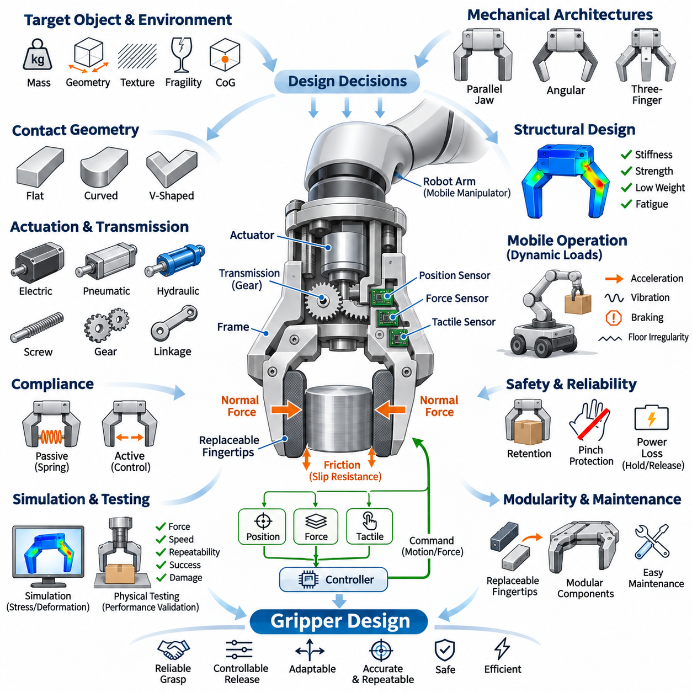
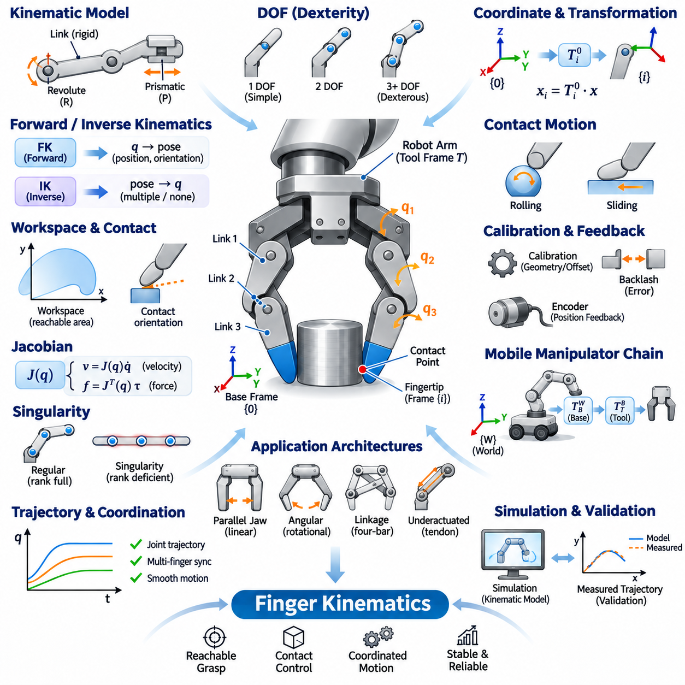
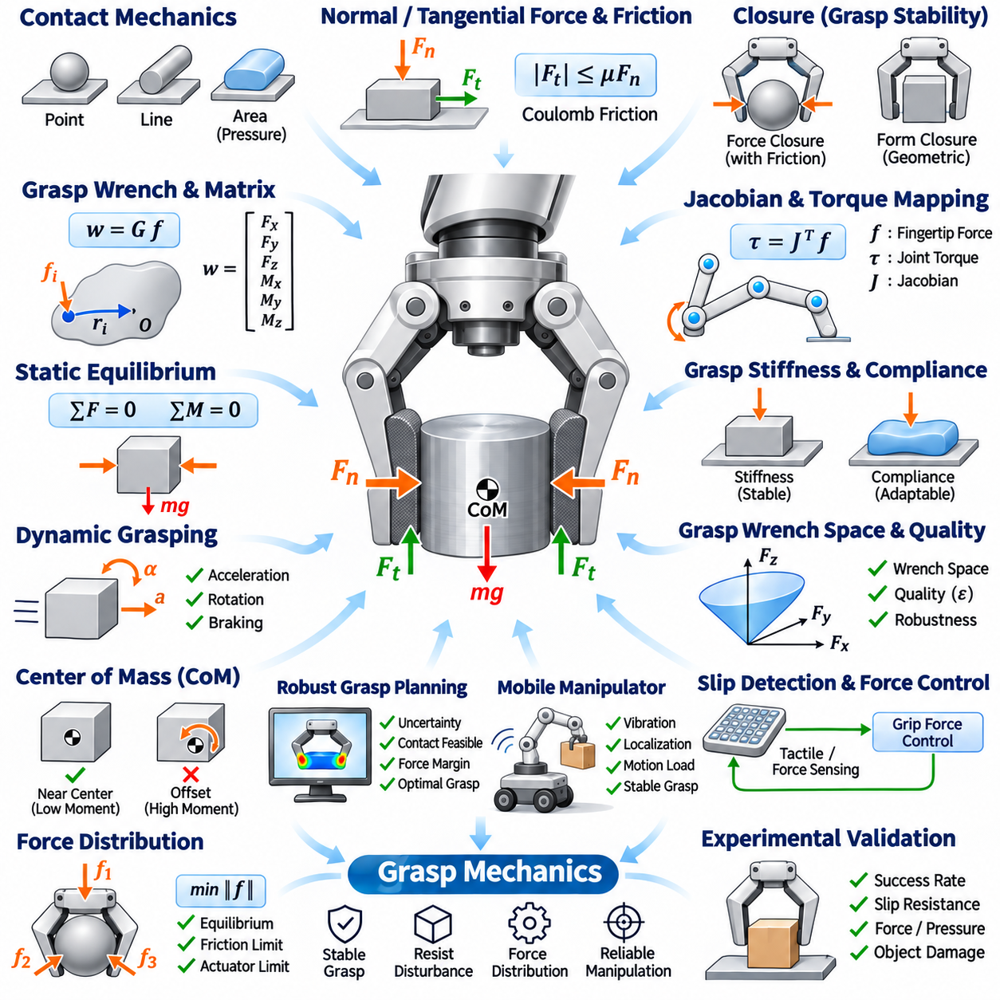
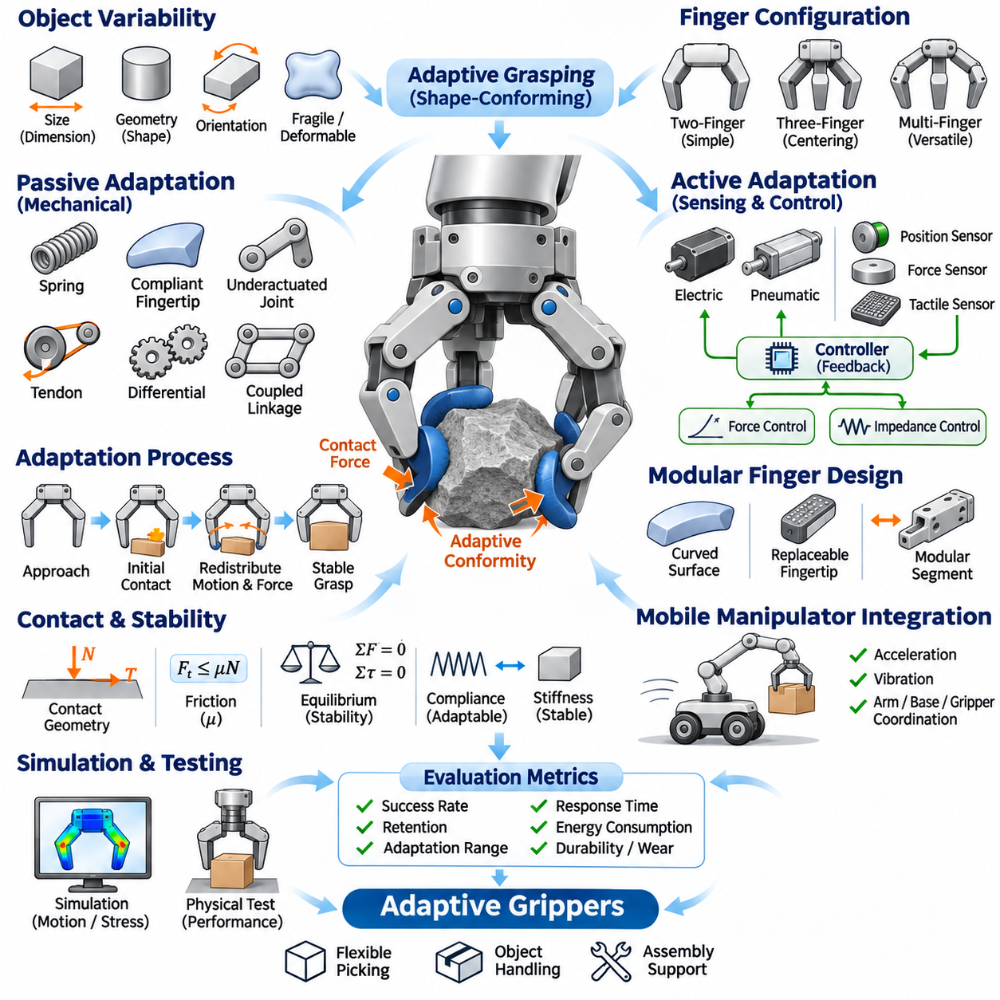
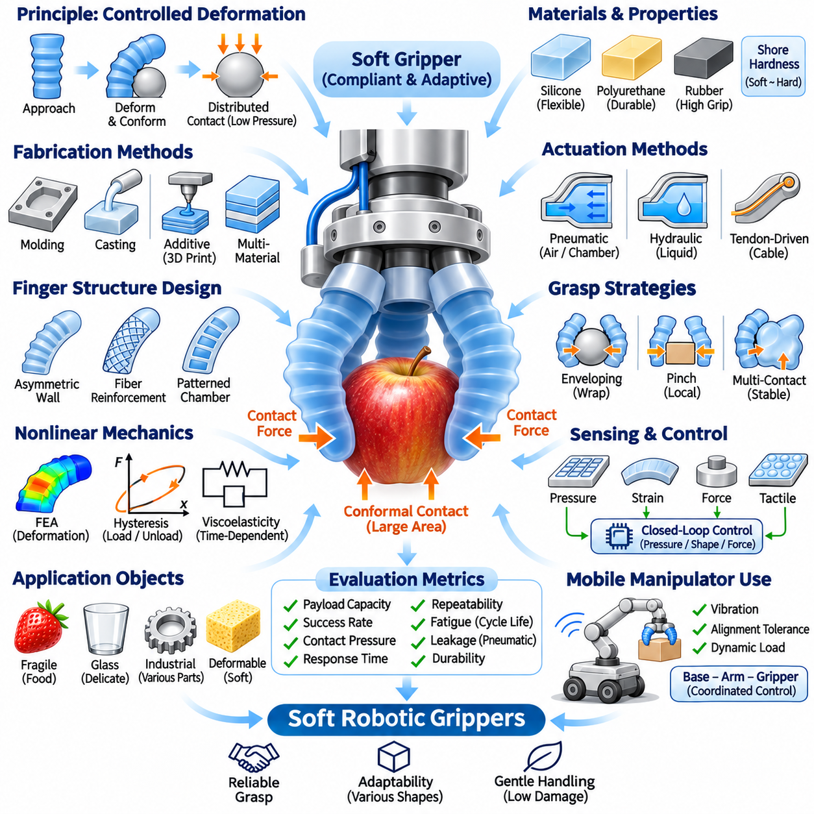
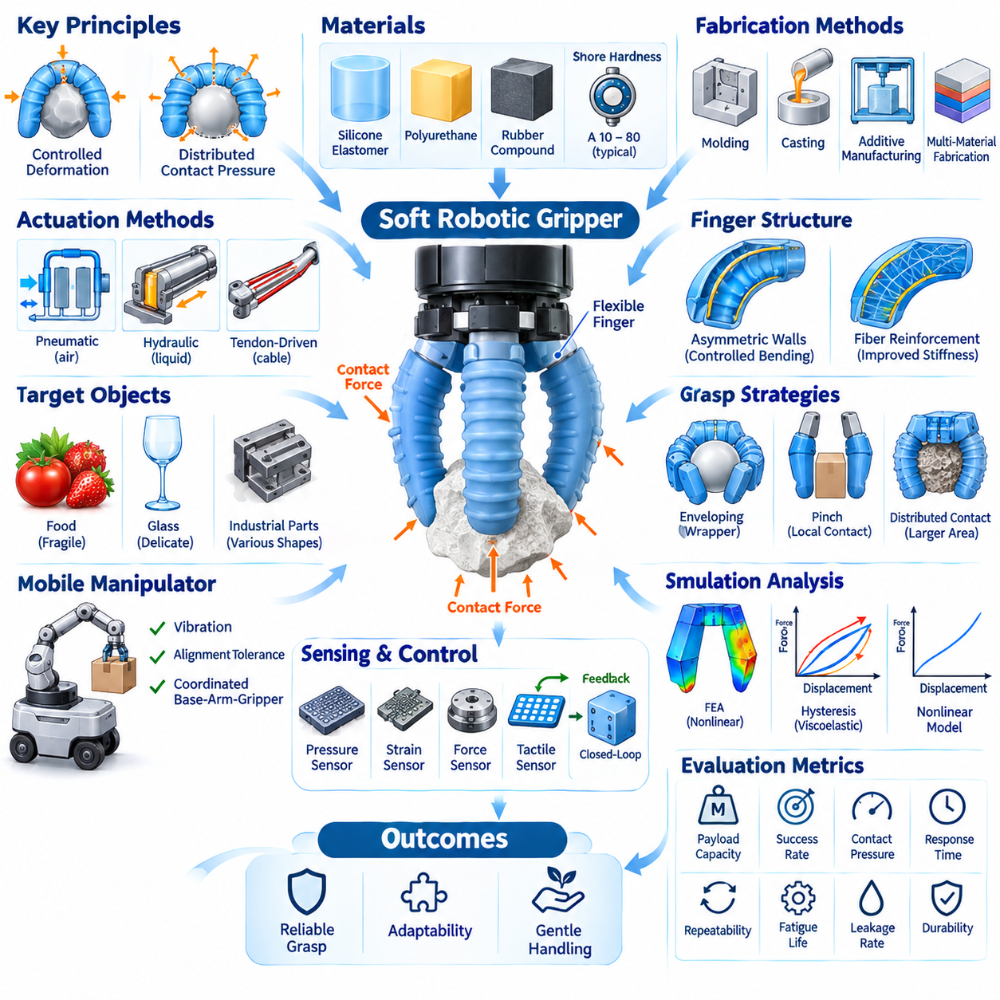
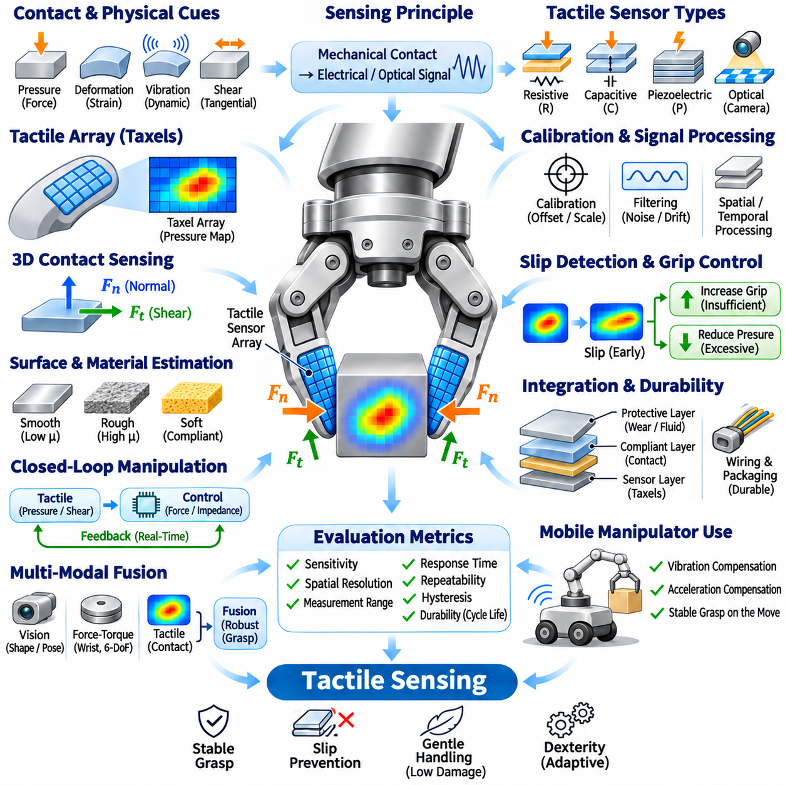
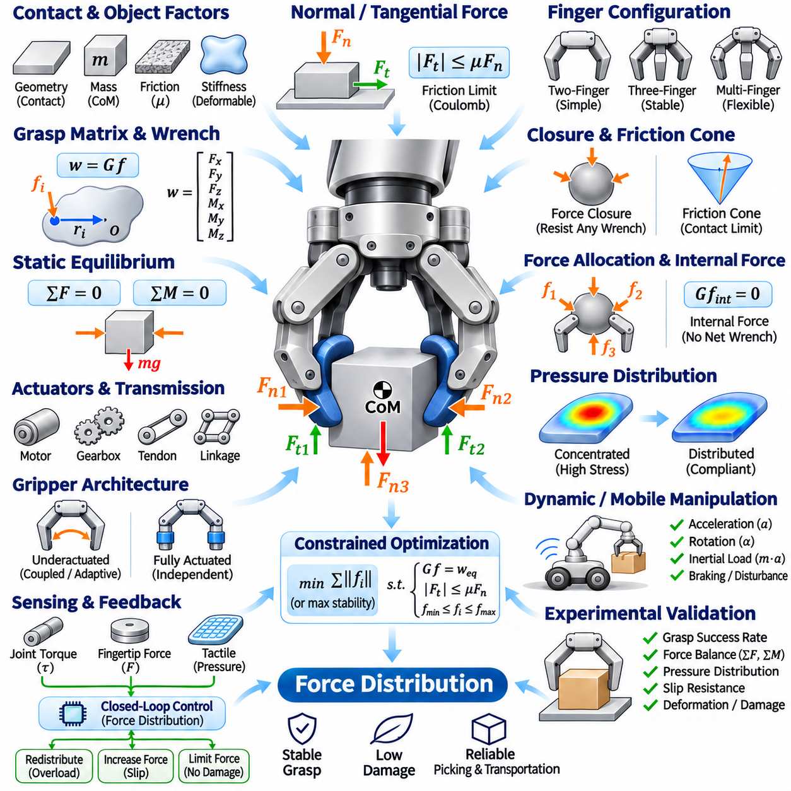
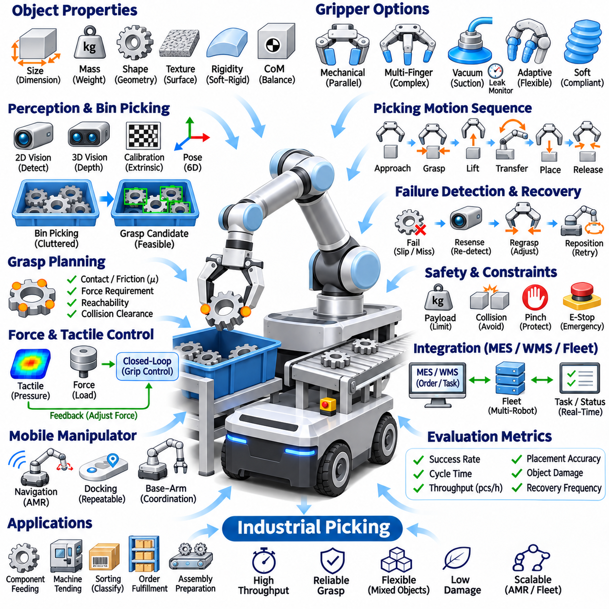
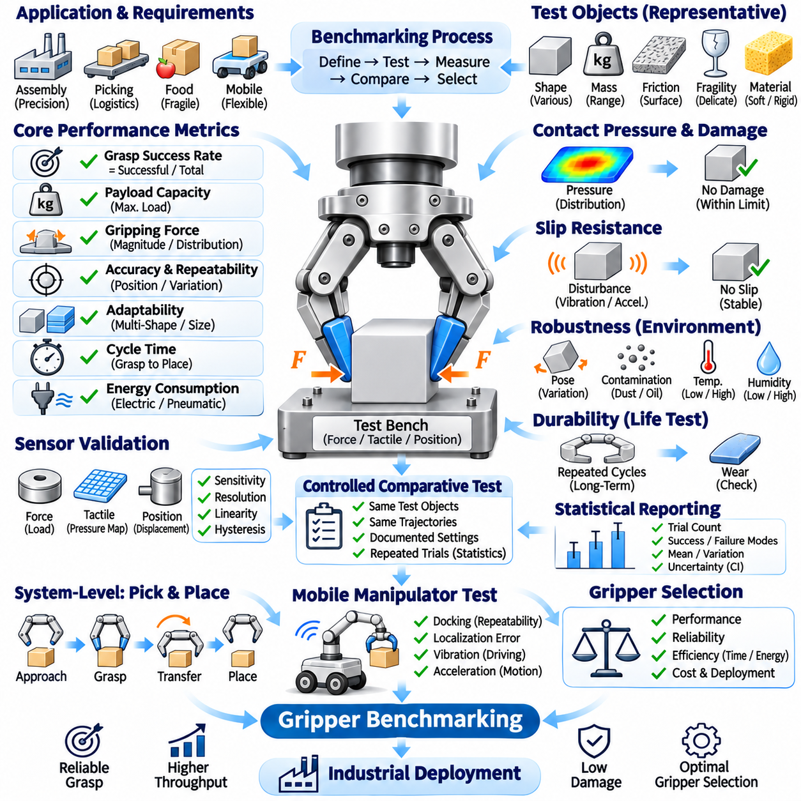

# Chapter 11. Grippers

## 01 Gripper Design

{width="7.268055555555556in" height="7.268055555555556in"}

그리퍼 설계(Gripper Design)는 로봇과 로봇이 취급하는 물체 사이의 물리적 인터페이스(Physical Interface)를 형성하기 때문에 로봇 조작(Robotic Manipulation)의 핵심 분야이다. 성공적인 설계는 안정적인 파지(Grasping), 제어된 해제(Controlled Release), 다양한 물체 형상(Object Geometry)에 대한 충분한 적응성을 제공해야 한다. 모바일 매니퓰레이터(Mobile Manipulator)에서는 그리퍼 성능이 로봇 팔 동역학(Arm Dynamics), 위치 정확도(Positioning Accuracy), 작업 안전성(Operational Safety), 전체 작업 효율성(Task Efficiency)에도 영향을 미친다.

설계 과정은 대상 물체(Target Object)의 특성과 작업 환경(Operational Environment)을 파악하는 것에서 시작된다. 주요 매개변수(Parameter)에는 물체의 질량(Mass), 치수(Dimensions), 형상(Geometry), 표면 질감(Surface Texture), 강성(Stiffness), 취약성(Fragility), 무게중심(Center of Gravity)이 포함된다. 엔지니어는 물체가 강체(Rigid Body), 변형 가능 물체(Deformable Object), 미끄러운 물체(Slippery Object), 불규칙한 형상의 물체인지도 고려해야 한다. 이러한 특성은 필요한 파지 메커니즘(Gripping Mechanism), 접촉 형상(Contact Geometry), 파지력 용량(Force Capacity), 센싱 기능(Sensing Capabilities)을 결정한다.

그리퍼(Gripper)는 일반적으로 기계식 핑거(Mechanical Finger) 또는 접촉면(Contact Surface), 구동 메커니즘(Actuation Mechanism), 구조 부품(Structural Components), 동력 전달 요소(Transmission Elements), 선택적인 센서(Sensor)로 구성된다. 기계적 구조(Mechanical Structure)는 접촉력(Contact Force)이 물체에 전달되는 방식을 결정하며, 액추에이터(Actuator)는 파지에 필요한 운동과 힘을 생성한다. 이러한 구성요소를 효과적으로 통합하면 기계적 손실(Mechanical Loss)을 최소화하고 불필요한 질량을 줄이며 조작 과정의 반복 정밀도(Repeatability)를 향상시킬 수 있다.

기계적 아키텍처(Mechanical Architecture)는 설계 초기 단계에서 결정해야 하는 중요한 요소이다. 평행 조 그리퍼(Parallel-Jaw Gripper)는 서로 마주 보는 핑거가 병진 이동(Translational Motion)하면서 물체를 파지하므로 형상이 일정한 다양한 산업용 물체에 적합하다. 각도형 그리퍼(Angular Gripper)는 기계적 회전축(Mechanical Pivot)을 중심으로 핑거를 회전시켜 다른 접근 형상(Access Geometry)을 제공한다. 다지형 그리퍼(Multi-Finger Gripper)는 추가적인 접촉 구성을 제공하지만 기계적 복잡성과 제어 요구사항이 증가한다.

핑거의 개수와 배치(Finger Arrangement)는 파지 안정성(Grasp Stability)과 물체 접근성(Object Accessibility)에 영향을 미친다. 2지형 그리퍼(Two-Finger Gripper)는 많은 산업 작업에서 간결하고 비교적 단순한 해결책을 제공하며, 3지형 그리퍼(Three-Finger Gripper)는 적절한 물체 형상에 대해 중심 정렬(Centering)과 접촉력 분포(Contact Force Distribution)를 개선할 수 있다. 더 복잡한 핑거 구성은 불규칙한 물체를 취급하는 데 유용하지만, 핑거 수가 증가한다고 반드시 더 강하거나 안정적인 파지가 보장되는 것은 아니다.

핑거 형상(Finger Geometry)은 의도한 접촉 조건(Contact Conditions)을 중심으로 설계해야 한다. 평평한 접촉면(Flat Contact Surface)은 평행한 측면을 가진 물체에 효과적이며, 곡면(Curved Surface)이나 V자형 접촉면(V-Shaped Contact Surface)은 원통형 부품(Cylindrical Components)의 위치 정렬을 개선할 수 있다. 교체형 핑거팁(Replaceable Fingertip)을 사용하면 하나의 그리퍼 본체로 다양한 제품을 취급할 수 있다. 설계자는 접촉 면적(Contact Area), 접근성(Accessibility), 기계적 강성(Mechanical Stiffness), 주변 물체와의 간섭(Interference) 가능성 사이에서 균형을 유지해야 한다.

파지력(Gripping Force)은 부족할 경우 미끄러짐(Slipping)을 유발하고 과도할 경우 물체를 손상시키거나 민감한 부품을 변형시킬 수 있으므로 중요한 설계 매개변수이다. 필요한 파지력은 페이로드 중량(Payload Weight), 접촉 방향(Contact Orientation), 마찰계수(Friction Coefficient), 가속도(Acceleration), 파지 형상(Grasp Geometry)에 따라 달라진다. 적절한 설계는 정적인 물체 중량(Static Object Weight)에만 의존하지 않고 동적 하중(Dynamic Loading)을 고려해야 하며, 특히 로봇이 빠르게 움직이는 경우 이러한 고려가 중요하다.

마찰(Friction)은 접촉력이 외부 교란(External Disturbance)에 저항해야 하는 힘 폐쇄 파지(Force-Closure Grasping)에서 중요한 역할을 한다. 유효 마찰계수(Effective Friction Coefficient)는 재료(Material), 표면 상태(Surface Condition), 오염(Contamination), 접촉 압력(Contact Pressure)에 따라 달라진다. 고무 재질의 핑거팁(Rubberized Fingertip)은 마찰력을 향상시킬 수 있지만 변형(Deformation)과 마모(Wear)를 고려해야 한다. 기하학적 구속(Geometric Constraint)을 제공하는 기계적 구조는 마찰에 대한 의존도를 줄일 수 있다.

액추에이터 선정(Actuator Selection)은 사용 가능한 파지력(Gripping Force), 폐쇄 속도(Closing Speed), 위치 분해능(Positional Resolution), 에너지 소비(Energy Consumption)를 결정한다. 전동 그리퍼(Electric Gripper)는 프로그래밍 가능한 운동과 디지털 제어기(Digital Controller)와의 편리한 통합을 제공한다. 공압식 메커니즘(Pneumatic Mechanism)은 압축공기(Compressed Air)를 사용할 수 있는 환경에서 소형 구동과 빠른 작동을 제공한다. 유압 시스템(Hydraulic System)은 큰 힘을 생성할 수 있지만 지원 장비가 소형 모바일 플랫폼(Compact Mobile Platform)에 적합하지 않을 수 있다.

동력 전달 메커니즘(Transmission Mechanism)은 액추에이터 출력을 핑거에 필요한 운동으로 변환한다. 대표적인 방식에는 리드 스크루(Lead Screw), 기어(Gear), 벨트(Belt), 링크 기구(Linkage), 랙 앤 피니언(Rack-and-Pinion)이 포함된다. 각 메커니즘은 효율(Efficiency), 백래시(Backlash), 강성(Stiffness), 속도(Speed), 기계적 복잡성(Mechanical Complexity) 측면에서 서로 다른 절충 관계(Tradeoff)를 가진다. 동력 전달 방식의 선정에서는 유지보수 요구사항(Maintenance Requirements), 윤활(Lubrication), 마모(Wear), 전원 차단 시 파지 유지 능력(Grasp Retention)도 고려해야 한다.

구조 설계(Structural Design)는 그리퍼가 과도한 변형 없이 예상 하중(Expected Load)을 견딜 수 있도록 해야 한다. 핑거 굽힘(Finger Bending), 관절 컴플라이언스(Joint Compliance), 장착부 변형(Mounting Deflection)은 파지 정확도(Grasp Accuracy)를 저하시키고 접촉력(Contact Force)을 변화시킬 수 있다. 엔지니어는 일반적으로 해석적 계산(Analytical Calculation)과 유한요소해석(Finite Element Analysis)을 활용하여 응력 집중(Stress Concentration)과 변위(Displacement)를 평가한다. 경량 구조 재료(Lightweight Structural Material)는 로봇 팔의 하중을 줄일 수 있지만 충분한 강성과 피로 저항성(Fatigue Resistance)을 유지해야 한다.

그리퍼 질량(Gripper Mass)과 로봇 페이로드 용량(Robot Payload Capacity)의 관계는 모바일 조작(Mobile Manipulation)에서 특히 중요하다. 무거운 그리퍼는 물체를 운반하는 데 사용할 수 있는 잔여 페이로드(Remaining Payload)를 감소시키고 로봇 손목(Robot Wrist)의 관성(Inertia)을 증가시킨다. 이는 가속(Acceleration), 제동(Braking), 위치 정확도(Positioning Accuracy), 에너지 소비(Energy Consumption)에 영향을 줄 수 있다. 효율적인 액추에이터 배치(Actuator Placement)를 적용한 소형 설계(Compact Design)는 불필요한 기계적 하중을 제한하면서 매니퓰레이터 성능을 유지하는 데 도움이 된다.

그리퍼 설계에서는 로봇 팔(Robotic Arm)과 모바일 베이스(Mobile Base) 사이의 상호작용(Interaction)도 고려해야 한다. 가속(Acceleration), 진동(Vibration), 바닥 불규칙성(Floor Irregularities), 비상 제동(Emergency Braking)은 고정형 조작 시스템(Stationary Manipulation System)에서는 나타나지 않는 교란(Disturbance)을 발생시킬 수 있다. 실험실 시험(Laboratory Testing)에서 안정적으로 유지되는 파지가 실제 이동 작업에서는 불안정해질 수 있다. 따라서 동적 하중 조건(Dynamic Load Cases)을 기계적 용량 산정(Mechanical Sizing)과 검증(Validation)에 포함해야 한다.

컴플라이언스(Compliance)는 물체 형상(Object Geometry)이나 위치(Position)에 불확실성이 존재할 때 파지 신뢰성(Grasp Reliability)을 향상시킬 수 있다. 수동 컴플라이언스(Passive Compliance)는 유연한 핑거팁(Flexible Fingertip), 스프링(Spring), 기계적 관절(Mechanical Joint)을 통해 작은 정렬 오차(Alignment Error)를 흡수하도록 구현할 수 있다. 능동 컴플라이언스(Active Compliance)는 센서 피드백(Sensor Feedback)과 제어된 구동(Controlled Actuation)을 이용하여 상호작용 힘(Interaction Force)을 조절한다. 적절한 컴플라이언스 수준은 물체의 취약성(Fragility), 위치 불확실성(Positioning Uncertainty), 작업에 필요한 정밀도(Precision)에 따라 결정된다.

센서 통합(Sensor Integration)은 그리퍼가 기계적 상태(Mechanical State)를 감지하고 파지 품질(Grasp Quality)을 평가할 수 있도록 한다. 위치 센서(Position Sensor)는 핑거 변위(Finger Displacement)를 측정하고, 힘 센서(Force Sensor)는 적용된 접촉 하중(Contact Load)을 추정한다. 촉각 센서(Tactile Sensor)는 압력 분포(Pressure Distribution)와 접촉 변화(Contact Changes)에 관한 정보를 제공할 수 있다. 이러한 측정값은 파지 확인(Grasp Confirmation), 물체 감지(Object Detection), 힘 조절(Force Regulation), 물체가 예기치 않게 이동할 때의 복구 동작(Recovery Action)을 지원한다.

제어 요구사항(Control Requirements)은 하드웨어 개발 이후에 고려하는 것이 아니라 초기 기계 설계 단계부터 반영해야 한다. 그리퍼 제어기(Gripper Controller)는 위치 제어(Position Control), 힘 제어(Force Control), 또는 결합된 운전 모드(Combined Operating Modes)를 지원할 수 있다. 기계적 백래시(Mechanical Backlash), 마찰(Friction), 액추에이터 응답(Actuator Response), 센서 분해능(Sensor Resolution)은 달성 가능한 제어 성능(Control Performance)에 영향을 미친다. 잘 설계된 인터페이스(Interface)는 로봇 제어기가 핑거 운동(Finger Motion)을 로봇 팔 궤적(Arm Trajectory) 및 작업 실행(Task Execution)과 연계할 수 있도록 한다.

안전 고려사항(Safety Considerations)에는 기계적 끼임 지점(Mechanical Pinch Point), 과도한 파지력(Excessive Gripping Force), 물체 낙하(Dropped Object), 예기치 않은 액추에이터 운동(Unexpected Actuator Movement)이 포함된다. 설계자는 전원 손실(Power Loss), 통신 장애(Communication Failure), 비상 정지(Emergency Stop)의 결과를 평가해야 한다. 적용 분야에 따라 스프링 유지 장치(Spring Retention), 기계적 잠금 장치(Mechanical Locking), 감시형 파지 유지 메커니즘(Monitored Holding Mechanism)이 필요할 수 있다. 안전 대책(Safety Measures)은 물체의 위험 요소(Object Hazards)와 주변 작업 환경(Operating Environment)을 반영해야 한다.

제조 용이성(Manufacturability)과 유지보수성(Maintainability)은 그리퍼의 실제 운용 성공에 큰 영향을 미친다. 부품 수(Part Count)가 지나치게 많거나 조립 절차(Assembly Procedure)가 복잡하고 특수 교체 부품(Specialized Replacement Component)이 필요한 설계는 수명주기 비용(Lifecycle Cost)을 증가시킬 수 있다. 모듈형 핑거(Modular Finger), 표준 체결 부품(Standardized Fastener), 접근하기 쉬운 센서(Accessible Sensor), 교체 가능한 마모 표면(Replaceable Wear Surface)은 유지보수를 단순화한다. 일관된 제조 공차(Manufacturing Tolerance)는 생산된 여러 장치에서 정렬(Alignment)과 반복적인 파지 성능(Repeatable Gripping Performance)을 유지하는 데 도움이 된다.

시뮬레이션(Simulation)은 실제 시제품(Physical Prototype)을 제작하기 전에 설계 대안(Design Alternative)을 효율적으로 평가하는 방법을 제공한다. 운동학 모델(Kinematic Model)은 핑거 운동(Finger Motion)과 접근 가능한 파지 구성(Grasp Configuration)을 설명하며, 동역학 모델(Dynamic Model)은 액추에이터 하중(Actuator Load)과 과도 힘(Transient Force)을 추정한다. 접촉 시뮬레이션(Contact Simulation)은 잠재적인 미끄러짐(Slipping)이나 과도한 변형(Excessive Deformation)을 파악하는 데 도움이 되지만, 결과는 마찰 및 재료 매개변수(Friction and Material Parameters)의 정확도에 따라 달라진다. 시뮬레이션된 동작을 검증하려면 물리적 시험(Physical Testing)이 필수적이다.

시제품 평가(Prototype Evaluation)는 물체 치수 변화(Object Dimension Variation), 배치 불확실성(Placement Uncertainty), 표면 오염(Surface Contamination), 조작 속도(Manipulation Speed)를 포함한 실제 작업 조건(Realistic Operational Conditions)을 재현해야 한다. 엔지니어는 파지력(Gripping Force), 폐쇄 시간(Closing Time), 위치 반복 정밀도(Positioning Repeatability), 파지 성공률(Grasp Success Rate), 물체 손상(Object Damage)을 측정한다. 반복 시험(Repeated Trials)은 초기 시연(Initial Demonstration)에서 나타나지 않을 수 있는 기계적 마모(Mechanical Wear), 열적 한계(Thermal Limitations), 불규칙한 접촉 거동(Inconsistent Contact Behavior)을 식별하는 데 도움이 된다.

효과적인 그리퍼 설계(Effective Gripper Design)는 궁극적으로 기계적 단순성(Mechanical Simplicity), 파지 신뢰성(Gripping Reliability), 적응성(Adaptability), 센싱(Sensing), 안전성(Safety), 비용(Cost) 사이의 균형을 달성해야 한다. 모든 조작 작업(Manipulation Task)에 최적인 단일 구성은 존재하지 않으므로 엔지니어링 의사결정(Engineering Decision)은 명확하게 정의된 작업 요구사항(Operational Requirements)을 따라야 한다. 모바일 매니퓰레이터(Mobile Manipulator)에서 성공적인 설계는 경량 구조(Lightweight Construction), 안정적인 파지 유지(Dependable Grasp Retention), 견고한 제어 인터페이스(Robust Control Interface), 동적 운용 조건(Dynamic Operating Conditions)에서 검증된 성능(Validated Performance)을 통합하는 것이다.

## 02 Finger Kinematics

{width="7.268055555555556in" height="7.268055555555556in"}

핑거 운동학(Finger Kinematics)은 로봇 그리퍼(Robotic Gripper)에서 관절 운동(Joint Motion), 핑거 구성(Finger Configuration), 접촉점 위치(Contact-Point Position) 사이의 기하학적 관계(Geometric Relationship)를 설명한다. 이는 핑거가 열리고 닫히거나 물체를 조작하는 동안 어떻게 움직이는지 예측하기 위한 수학적 기반(Mathematical Foundation)을 제공한다. 정확한 운동학 모델링(Kinematic Modeling)을 통해 엔지니어는 도달 가능한 파지 위치(Reachable Grasp Position)를 결정하고, 여러 핑거의 움직임을 조정하며, 다양한 형상의 물체와 안정적인 접촉을 유지하는 메커니즘을 설계할 수 있다.

로봇 핑거(Robotic Finger)는 관절(Joint)로 연결된 일련의 강체 링크(Rigid Link)로 표현할 수 있다. 각 링크는 정의된 기하학적 특성(Geometric Properties)을 가지며, 각 관절은 제어되거나 구속된 자유도(Degree of Freedom)를 제공한다. 회전 관절(Revolute Joint)은 회전 운동(Rotational Motion)을 생성하고, 직동 관절(Prismatic Joint)은 선형 변위(Linear Displacement)를 발생시킨다. 이러한 관절의 배치는 핑거 작업공간(Finger Workspace), 가능한 접촉 방향(Contact Orientation), 그리퍼의 기계적 적응성(Mechanical Adaptability)을 결정한다.

자유도(Degrees of Freedom)의 수는 핑거가 얼마나 독립적으로 움직일 수 있는지를 결정한다. 단순한 산업용 그리퍼(Industrial Gripper)는 공통 동력 전달 장치(Shared Transmission)를 통해 마주 보는 핑거를 제어하기 위해 하나의 구동 자유도(Actuated Degree of Freedom)를 사용할 수 있다. 고급 로봇 핸드(Robotic Hand)는 여러 관절을 사용하여 핑거의 굽힘(Finger Curvature)과 접촉 방향(Contact Orientation)을 제어한다. 자유도가 증가하면 조작성(Dexterity)이 향상되지만 구동(Actuation), 센싱(Sensing), 운동 조정(Motion Coordination)의 복잡성도 증가한다.

좌표계(Coordinate Frame)는 핑거의 형상과 운동을 체계적으로 설명하는 방법을 제공한다. 기준 좌표계(Reference Frame)는 일반적으로 그리퍼 베이스(Gripper Base)에 부착되며, 추가 좌표계는 개별 링크(Link)와 관절(Joint)에 할당된다. 동차 변환 행렬(Homogeneous Transformation Matrix)은 이러한 좌표계 사이의 상대 위치(Relative Position)와 방향(Orientation)을 표현한다. 연속된 변환 행렬을 곱하면 그리퍼 베이스를 기준으로 핑거 끝단(Fingertip)의 위치와 방향을 계산할 수 있다.

순기구학(Forward Kinematics)은 알려진 관절 좌표(Joint Coordinates)로부터 핑거 끝단 위치(Fingertip Position)를 계산한다. 여러 회전 관절(Revolute Joint)을 포함하는 핑거에서는 각 관절 각도(Joint Angle)가 최종 핑거 끝단 구성(Fingertip Configuration)에 영향을 미친다. 결과 변환(Resulting Transformation)은 링크 길이(Link Length), 관절축 방향(Joint-Axis Orientation), 기계적 오프셋(Mechanical Offset)에 따라 결정된다. 순기구학 모델(Forward Kinematic Model)은 운동 예측(Motion Prediction), 충돌 검사(Collision Checking), 접촉 계획(Contact Planning), 기계 설계 과정의 핑거 형상 검증(Geometry Verification)을 지원한다.

역기구학(Inverse Kinematics)은 원하는 핑거 끝단 위치(Desired Fingertip Position) 또는 접촉 구성(Contact Configuration)을 달성하는 데 필요한 관절 좌표(Joint Coordinates)를 결정한다. 순기구학과 달리 역기구학은 여러 해(Multiple Solutions), 실행 가능한 해가 없는 경우(No Feasible Solution), 또는 연속적인 해 집합(Continuous Family of Solutions)을 생성할 수 있다. 기계적 관절 한계(Mechanical Joint Limits)와 기하학적 제약조건(Geometric Constraints)은 유효한 구성을 제한한다. 해석적 해법(Analytical Solution)을 사용할 수 없거나 핑거 메커니즘에 복잡한 링크 기구(Complex Linkage)가 포함된 경우에는 수치해석 방법(Numerical Methods)이 자주 사용된다.

핑거 작업공간(Finger Workspace)은 기계적 제약조건(Mechanical Constraints) 내에서 핑거 끝단이 도달할 수 있는 영역을 의미한다. 작업공간 경계(Workspace Boundary)는 링크 길이(Link Length), 관절 운동 범위(Joint Range), 동력 전달 형상(Transmission Geometry), 인접 핑거 사이의 간섭(Interference)에 따라 결정된다. 넓은 작업공간이 반드시 효과적인 파지를 보장하는 것은 아니며, 실제로 유용한 접촉 방향(Contact Orientation)이 제한될 수 있다. 따라서 엔지니어는 핑거 끝단 도달 가능성(Fingertip Reachability)과 대상 물체에 적절한 접촉을 형성하는 능력을 함께 평가한다.

자코비안 행렬(Jacobian Matrix)은 관절 속도(Joint Velocity)와 핑거 끝단 운동(Fingertip Motion) 사이의 미분 관계(Differential Relationship)를 설명한다. 이는 관절 좌표의 작은 변화(Small Joint Coordinate Changes)를 핑거 끝단 위치와 방향의 변화로 변환한다. 이러한 관계는 속도 제어(Velocity Control), 궤적 생성(Trajectory Generation), 국소 운동 조정(Local Motion Adjustment)에 필수적이다. 자코비안은 관절 힘(Joint Force) 또는 토크(Torque)가 핑거 끝단에 작용하는 힘과 어떤 관계를 가지는지도 설명한다.

운동학적 특이점(Kinematic Singularity)은 핑거 메커니즘이 특정 방향으로 운동을 생성하는 능력을 상실하거나 자코비안 행렬(Jacobian Matrix)의 계수(Rank)가 감소할 때 발생한다. 특이점 부근에서는 작은 핑거 끝단 이동을 위해 매우 큰 관절 속도(Joint Velocity)가 필요할 수 있다. 특이점은 액추에이터 구동력(Actuator Effort)과 접촉력(Contact Force) 사이의 관계도 변화시킬 수 있다. 따라서 기계 설계(Mechanical Design)와 제어 전략(Control Strategy)은 가능한 경우 문제가 되는 특이 구성을 식별하고 회피해야 한다.

평행 조 그리퍼(Parallel-Jaw Gripper)는 구속된 핑거 운동학(Constrained Finger Kinematics)의 비교적 단순한 사례이다. 마주 보는 접촉면(Contact Surface)은 열림과 닫힘 과정에서 거의 평행한 상태를 유지하도록 설계된다. 하나의 액추에이터(Actuator)가 동기화된 기계적 동력 전달 장치(Synchronized Mechanical Transmission)를 통해 두 핑거를 구동할 수 있다. 이러한 운동은 일반적으로 하나의 독립적인 변위 변수(Independent Displacement Variable)로 표현할 수 있어 위치 제어(Position Control)와 파지 폭 추정(Grasp-Width Estimation)을 단순화한다.

각도형 그리퍼(Angular Gripper)는 고정된 회전 중심(Fixed Pivot Point)을 기준으로 핑거를 회전시킨다. 핑거 끝단 궤적(Fingertip Trajectory)은 직선이 아닌 원호(Circular Arc)를 따르므로 닫힘 과정에서 접촉 방향(Contact Orientation)과 핑거 사이의 간격(Separation)이 변화한다. 액추에이터 변위(Actuator Displacement)와 핑거 끝단 위치 사이의 관계는 회전축 형상(Pivot Geometry)과 동력 전달 메커니즘(Transmission Mechanism)에 따라 결정된다. 이러한 특성은 제한된 공간(Confined Environment)에서 물체에 접근할 때 고려해야 한다.

링크 구동 핑거(Linkage-Driven Finger)는 관절 운동 사이에 추가적인 기하학적 제약조건(Geometric Constraints)을 도입한다. 4절 링크 기구(Four-Bar Linkage), 결합 관절(Coupled Joint), 텐던 구동 메커니즘(Tendon-Driven Mechanism)은 제한된 수의 액추에이터를 사용하여 여러 핑거 세그먼트(Finger Segment)를 조정할 수 있다. 결과적인 운동은 링크 치수(Linkage Dimensions), 텐던 배치(Tendon Routing), 기계적 결합 관계(Mechanical Coupling Relationships)에 의해 결정된다. 정확한 운동학 모델은 핑거 자세(Finger Posture)를 예측하고 기계적 간섭(Mechanical Interference)이 발생할 수 있는 구성을 식별하는 데 도움이 된다.

저구동 핑거(Underactuated Finger)는 독립적으로 제어되는 액추에이터 수보다 많은 기계적 자유도(Mechanical Degrees of Freedom)를 가진다. 관절 구성(Joint Configuration)은 접촉 조건(Contact Conditions), 탄성 요소(Elastic Elements), 동력 전달 제약조건(Transmission Constraints)에 따라 변화할 수 있다. 접촉 전에는 핑거가 예측 가능한 닫힘 궤적(Closing Trajectory)을 따르지만, 물체와 접촉하면 관절 사이의 운동이 재분배될 수 있다. 따라서 강체 기하학 운동학(Rigid Geometric Kinematics)만으로는 최종 파지 구성(Final Grasp Configuration)을 완전히 결정하지 못할 수 있다.

핑거 궤적 계획(Finger Trajectory Planning)은 초기 구성(Initial Configuration)에서 목표 구성(Target Configuration)까지 관절이 어떻게 움직이는지를 결정한다. 부드러운 궤적(Smooth Trajectory)은 기계적 충격(Mechanical Shock), 불필요한 진동(Unnecessary Vibration), 물체와의 급격한 접촉(Abrupt Contact)을 줄인다. 액추에이터 성능(Actuator Performance)과 기계적 신뢰성(Mechanical Reliability)을 유지하려면 관절 속도 제한(Joint Velocity Limits)과 가속도 제한(Acceleration Limits)을 준수해야 한다. 여러 핑거가 원하지 않는 충돌 없이 동시에 물체에 접근해야 하는 경우에는 조정된 궤적 생성(Coordinated Trajectory Generation)이 특히 중요하다.

접촉점 운동학(Contact-Point Kinematics)은 핑거 끝단 모델링(Fingertip Modeling)을 핑거 표면과 물체가 실제로 상호작용하는 위치까지 확장한다. 특히 곡면(Curved Surface)이나 유연한 표면(Compliant Surface)을 사용하는 경우 접촉점(Contact Point)은 명목상 핑거 끝단 기준 좌표계(Nominal Fingertip Reference Frame)와 다를 수 있다. 접촉 위치(Contact Location)의 변화는 유효 모멘트 암(Effective Moment Arm)과 필요한 관절 토크(Required Joint Torque)를 변화시킬 수 있다. 따라서 정확한 접촉 모델링(Contact Modeling)은 파지 계획(Grasp Planning)과 힘 분포(Force Distribution)에 중요하다.

구름 접촉(Rolling Contact)과 미끄럼 접촉(Sliding Contact)은 조작 과정에서 추가적인 운동학적 고려사항(Kinematic Considerations)을 발생시킨다. 구름 접촉은 이상적인 조건에서 미끄러짐이 없는 관계(No-Slip Relationship)를 유지하면서 접촉 위치를 변화시킨다. 미끄럼 접촉은 핑거 표면과 물체 표면 사이의 상대적인 접선 운동(Relative Tangential Motion)을 허용한다. 이러한 거동은 물체 재배치(Object Repositioning)와 손안 조작(In-Hand Manipulation)에 영향을 미치므로 핑거 형상과 접촉 제약조건(Contact Constraints), 마찰 가정(Friction Assumptions)을 결합한 모델이 필요하다.

기계적 공차(Mechanical Tolerance)는 핑거 운동학 모델(Finger Kinematic Model)의 정확도에 영향을 미친다. 제조 편차(Manufacturing Variation), 관절 백래시(Joint Backlash), 베어링 간극(Bearing Clearance), 구조적 변형(Structural Deformation)은 실제 핑거 끝단 위치(Actual Fingertip Position)가 이론적 예측(Theoretical Prediction)과 달라지게 할 수 있다. 보정 절차(Calibration Procedure)는 기하학적 매개변수(Geometric Parameters)를 추정하고 체계적 오차(Systematic Error)를 보상한다. 센서 피드백(Sensor Feedback)은 운용 중 편차(Deviation)를 감지하여 위치 정확도(Positioning Accuracy)를 추가로 개선할 수 있다.

핑거 운동학(Finger Kinematics)은 로봇 팔 운동학(Robotic Arm Kinematics)과도 통합되어야 한다. 그리퍼 장착 변환(Gripper Mounting Transformation)은 로봇 팔 도구 좌표계(Arm Tool Frame)와 핑거 기준 좌표계(Finger Reference Frame) 사이의 관계를 설정한다. 이러한 통합 모델(Combined Model)을 통해 조작 소프트웨어(Manipulation Software)는 로봇 베이스 좌표계(Robot Base Coordinate System) 또는 월드 좌표계(World Coordinate System)에서 접촉 위치(Contact Position)를 예측할 수 있다. 정확한 통합은 충돌 회피(Collision Avoidance), 물체 접근 계획(Object Approach Planning), 로봇 팔과 그리퍼의 협조 운동(Coordinated Arm-Gripper Motion)을 지원한다.

모바일 매니퓰레이터(Mobile Manipulator)는 로봇 팔이 이동 플랫폼(Moving Platform)에 장착되어 있기 때문에 추가적인 좌표 변환(Coordinate Transformation)이 필요하다. 추정된 모바일 베이스 자세(Estimated Mobile-Base Pose), 로봇 팔 구성(Arm Configuration), 핑거 관절 좌표(Finger Joint Coordinates)가 함께 환경 내 핑거 끝단 위치(Fingertip Position)를 결정한다. 따라서 위치 추정 오차(Localization Error)와 플랫폼 운동(Platform Motion)은 파지 정렬(Grasp Alignment)에 영향을 미칠 수 있다. 정밀 조작 작업(Precision Manipulation Task)을 수행할 때 협조 제어(Coordinated Control)는 이러한 불확실성(Uncertainty)을 고려해야 한다.

시뮬레이션(Simulation)과 실험적 검증(Experimental Validation)은 핑거 운동학 모델(Finger Kinematic Model)을 검증하는 데 필수적이다. 엔지니어는 예측된 핑거 끝단 궤적(Predicted Fingertip Trajectory)을 엔코더(Encoder), 카메라(Camera), 외부 추적 시스템(External Tracking System)으로 측정한 결과와 비교한다. 전체 관절 운동 범위(Full Joint Range)에 걸친 시험은 기하학적 오차(Geometric Error), 특이점(Singularity), 예상하지 못한 기계적 제약조건(Mechanical Constraints)을 식별하는 데 도움이 된다. 검증된 모델(Validated Model)은 파지 계획(Grasp Planning), 힘 제어(Force Control), 신뢰성 높은 산업용 조작(Reliable Industrial Manipulation)을 위한 안정적인 기반을 제공한다.

## 03 Grasp Mechanics

{width="7.268055555555556in" height="7.268055555555556in"}

파지 역학(Grasp Mechanics)은 로봇 핑거(Robotic Finger)가 물체와 접촉을 형성하고 유지하며 해제하는 과정을 지배하는 물리적 원리를 설명한다. 이는 강체 역학(Rigid-Body Mechanics), 접촉 기하학(Contact Geometry), 마찰(Friction), 힘 전달(Force Transmission)을 결합하여 파지 안정성(Grasp Stability)을 설명한다. 이러한 관계를 이해하면 엔지니어는 산업 작업에서 발생하는 중력(Gravity), 가속도(Acceleration), 외부 교란(External Disturbance)에 저항하면서 물체를 안전하게 조작할 수 있는 그리퍼(Gripper)를 설계할 수 있다.

파지(Grasp)는 하나 이상의 그리퍼 접촉면(Gripper Contact Surface)이 물체에 접촉력(Contact Force)을 가할 때 형성된다. 각 접촉은 국소 표면 형상(Local Surface Geometry), 재료 특성(Material Properties), 하중 조건(Loading Conditions)에 따라 방향과 크기가 결정되는 힘을 발생시킨다. 이러한 힘은 물체가 정지 상태를 유지하는지, 예측 가능한 방식으로 움직이는지, 또는 미끄러지는지를 종합적으로 결정한다. 따라서 파지 해석(Grasp Analysis)은 개별 접촉과 이들이 결합하여 발생시키는 기계적 효과(Mechanical Effects)를 모두 고려한다.

접촉 역학(Contact Mechanics)은 그리퍼 핑거(Gripper Finger)와 물체 표면(Object Surface) 사이의 상호작용을 설명하는 기반을 제공한다. 이상화된 모델(Idealized Model)은 형상과 재료 거동에 따라 접촉을 점 접촉(Point Contact), 선 접촉(Line Contact), 분포 면 접촉(Distributed Area Contact)으로 표현할 수 있다. 실제 접촉에서는 국소 변형(Localized Deformation)과 압력 분포(Pressure Distribution)가 발생한다. 선택한 접촉 모델(Contact Model)은 마찰(Friction), 접촉 강성(Contact Stiffness), 응력 집중(Stress Concentration), 전달 가능한 힘에 대한 예측에 영향을 미친다.

법선력(Normal Force)은 접촉면에 수직으로 작용하며, 접선력(Tangential Force)은 접촉면을 따라 작용한다. 법선력은 접촉 압력(Contact Pressure)을 생성하고 마찰 저항(Frictional Resistance)을 지원하는 반면, 접선력은 미끄럼 운동(Sliding Motion)에 저항할 수 있다. 단순화된 쿨롱 마찰 모델(Coulomb Friction Model)에서는 접선 방향 마찰력(Tangential Friction Force)의 크기가 마찰계수(Friction Coefficient)와 법선력의 곱으로 제한된다. 이 한계를 초과하면 미끄러짐(Slipping)이 시작될 수 있다.

마찰계수(Friction Coefficient)는 접촉 재료(Contacting Materials), 표면 거칠기(Surface Roughness), 오염(Contamination), 환경 조건(Environmental Conditions)에 따라 달라진다. 고무 핑거팁(Rubber Fingertip)은 매끄러운 물체에 대한 마찰력을 증가시킬 수 있지만, 기름이나 먼지가 있는 표면은 유효 마찰력(Effective Traction)을 감소시킬 수 있다. 마찰계수는 모든 작업 조건에서 일정하지 않을 수 있다. 따라서 신뢰성 높은 파지 설계(Reliable Grasp Design)는 이상적인 접촉 특성(Ideal Contact Properties)을 가정하기보다 마찰의 불확실성(Friction Uncertainty)을 고려해야 한다.

힘 폐쇄(Force Closure)는 접촉 모델(Contact Model)의 가정과 사용 가능한 힘의 한계(Force Limits) 내에서 임의의 외력(External Force)과 토크(Torque)에 저항할 수 있는 파지 구성을 의미한다. 힘 폐쇄의 달성 여부는 접촉 위치(Contact Location), 접촉 법선(Contact Normal), 마찰 능력(Frictional Capability)에 따라 결정된다. 기하학적으로 대칭인 파지(Geometrically Symmetric Grasp)가 반드시 힘 폐쇄를 제공하는 것은 아니다. 엔지니어는 사용 가능한 접촉력이 모든 관련 방향에서 교란(Disturbance)을 균형 있게 상쇄할 수 있는지 평가해야 한다.

형상 폐쇄(Form Closure)는 마찰에 의존하지 않고 기하학적 제약조건(Geometric Constraints)을 통해 물체의 운동을 방지하는 또 다른 안정성 메커니즘(Stability Mechanism)이다. 여러 접촉점(Multiple Contacts)이나 물체를 둘러싸는 표면(Enclosing Surfaces)은 기계적 형상(Mechanical Geometry)을 통해 물체의 가능한 운동을 제한한다. 형상 폐쇄는 외부 교란에 대한 강한 저항을 제공할 수 있지만 특수한 핑거 형상(Finger Shape)이 필요할 수 있다. 많은 산업용 그리퍼는 신뢰성을 향상시키기 위해 기하학적 구속(Geometric Constraint)과 마찰 기반 유지(Frictional Holding)를 결합한다.

파지 렌치(Grasp Wrench)는 접촉점들이 물체에 가하는 힘(Force)과 토크(Torque)의 합성 결과를 나타낸다. 각 접촉력(Contact Force)은 병진력(Translational Force)과 기준점(Reference Point)에 대한 위치에 의해 결정되는 모멘트(Moment)를 함께 발생시킨다. 파지 행렬(Grasp Matrix)은 개별 접촉력을 결과적인 물체 렌치(Object Wrench)로 변환한다. 이러한 수학적 표현(Mathematical Representation)은 평형(Equilibrium), 안정성(Stability), 힘 분포(Force Distribution)를 체계적으로 분석할 수 있도록 한다.

정적 평형(Static Equilibrium)은 물체에 작용하는 모든 외력(External Force), 접촉력(Contact Force), 토크(Torque)의 합이 균형을 이룰 때 성립한다. 정지 상태에서 물체를 유지하는 동안 그리퍼는 중력(Gravity)과 추가적인 작용 하중(Applied Load)을 상쇄해야 한다. 접촉력은 마찰 제약조건(Friction Constraints)과 액추에이터 한계(Actuator Limitations)도 만족해야 한다. 전체적인 힘의 평형(Force Equilibrium)을 만족하는 파지라도 개별 접촉점에서는 미끄러짐(Slipping)에 취약할 수 있다.

동적 파지(Dynamic Grasping)는 물체의 가속(Acceleration)과 회전(Rotation)에 의해 발생하는 관성력(Inertial Force)과 관성 모멘트(Inertial Moment)를 포함한다. 빠른 로봇 팔 운동(Robot-Arm Motion)은 정지 상태에서 물체를 유지할 때보다 필요한 파지력(Gripping Force)을 크게 증가시킬 수 있다. 비상 제동(Emergency Braking)과 갑작스러운 방향 전환(Sudden Direction Change)은 특히 높은 하중 조건(Load Cases)을 발생시킬 수 있다. 따라서 그리퍼 용량 산정(Gripper Sizing)은 예상 운동 프로파일(Motion Profile)과 최대 동적 교란(Peak Dynamic Disturbance)을 고려해야 한다.

무게중심(Center of Mass)은 중력 하중(Gravitational Load)과 관성 하중(Inertial Load)이 접촉점을 기준으로 모멘트(Moment)를 생성하는 방식을 결정하므로 파지 역학에 큰 영향을 미친다. 무게중심에서 멀리 떨어진 위치를 파지하면 회전 하중(Rotational Loading)이 증가하고 접촉력 분포(Contact Force Distribution)가 불균일해질 수 있다. 적절한 파지 위치(Grasp Placement)는 불필요한 토크(Torque)를 줄이고 안정성(Stability)을 향상시킨다. 불규칙한 물체(Irregular Object)의 경우 무게중심 추정(Center-of-Mass Estimation)에 기하학적 분석(Geometric Analysis)이나 실험적 분석(Experimental Analysis)이 필요할 수 있다.

접촉력 분포(Contact Force Distribution)는 전체 파지력(Gripping Effort)이 여러 핑거 사이에 어떻게 분배되는지를 결정한다. 불균일한 힘 분포(Uneven Force Distribution)는 일부 접촉점에 과부하(Overload)를 발생시키는 동시에 다른 접촉점에서는 충분한 접촉력이 형성되지 않게 할 수 있다. 다지형 시스템(Multi-Finger System)은 구동 방식(Actuation)과 접촉 형상(Contact Geometry)이 적절한 조정을 허용하는 경우 힘을 재분배하여 안정성을 개선할 수 있다. 힘 최적화 방법(Force Optimization Methods)은 마찰 및 액추에이터 한계를 준수하면서 평형 조건을 만족하는 접촉 하중(Contact Load)을 선택할 수 있다.

관절 토크(Joint Torque)와 핑거 끝단 힘(Fingertip Force) 사이의 관계는 핑거 운동학(Finger Kinematics)과 자코비안 행렬(Jacobian Matrix)에 의해 결정된다. 관절 토크는 기계적 동력 전달(Mechanical Transmission)을 통해 접촉력을 생성하며, 정확한 관계는 핑거 구성(Finger Configuration)과 접촉 제약조건(Contact Constraints)에 따라 달라진다. 따라서 핑거 자세(Finger Posture)의 변화는 사용 가능한 파지력(Available Gripping Force)을 변화시킬 수 있다. 액추에이터 용량(Actuator Capacity)은 하나의 명목 위치(Nominal Position)가 아니라 의도한 전체 파지 작업공간(Grasping Workspace)에 걸쳐 평가해야 한다.

파지 강성(Grasp Stiffness)은 외부 교란이 가해졌을 때 물체의 작은 변위(Small Object Displacement)에 저항하는 능력을 나타낸다. 이는 접촉 강성(Contact Stiffness), 핑거 구조(Finger Structure), 액추에이터 거동(Actuator Behavior), 파지 형상(Grasp Geometry)에 따라 결정된다. 높은 강성은 위치 안정성(Positional Stability)을 향상시킬 수 있지만 접촉 응력(Contact Stress)이나 정렬 오차(Alignment Error)에 대한 민감도를 증가시킬 수 있다. 제어된 컴플라이언스(Controlled Compliance)는 원하지 않는 물체 운동에 대한 충분한 저항을 유지하면서 기하학적 불확실성(Geometric Uncertainty)을 수용할 수 있다.

소프트 핑거팁(Soft Fingertip)은 물체 표면을 따라 변형되면서 유효 접촉 면적(Effective Contact Area)을 증가시켜 접촉 역학(Contact Mechanics)을 변화시킨다. 이러한 변형은 국소 압력(Localized Pressure)을 줄이고 취약한 물체(Fragile Object)의 취급 성능을 향상시킬 수 있다. 그러나 유연한 재료(Compliant Material)는 비선형 강성(Nonlinear Stiffness), 히스테리시스(Hysteresis), 시간 의존적 거동(Time-Dependent Behavior)을 발생시킨다. 정확한 모델링을 위해서는 순수한 강체 접촉 가정(Rigid-Contact Assumptions)보다 실험적으로 식별된 재료 특성(Material Properties)이 필요할 수 있다.

파지 안정성(Grasp Stability)은 허용 가능한 접촉력(Admissible Contact Forces)을 통해 생성할 수 있는 물체 힘과 토크의 집합을 나타내는 파지 렌치 공간(Grasp Wrench Space)을 사용하여 평가할 수 있다. 교란에 저항할 수 있는 영역(Disturbance-Resistant Region)이 클수록 선택한 정규화(Normalization)와 힘 제약조건(Force Constraints)에서 일반적으로 더 높은 파지 강건성(Grasp Robustness)을 나타낸다. 품질 지표(Quality Metrics)는 파지 실패(Grasp Failure)를 발생시키는 최소 교란(Minimum Disturbance)을 고려할 수 있다. 이러한 지표는 후보 파지 구성(Candidate Grasp Configuration)을 비교하는 데 활용된다.

미끄러짐(Slip)은 접촉 조건(Contact Conditions)이 필요한 접선력(Tangential Force)을 더 이상 지탱하지 못할 때 발생한다. 초기 미끄러짐(Incipient Slip)은 물체 전체가 핑거에 대해 상대적으로 움직이기 전에 국소적으로 시작될 수 있다. 촉각 센싱(Tactile Sensing), 힘 측정(Force Measurement), 진동 분석(Vibration Analysis)은 이러한 초기 변화를 식별하는 데 도움이 된다. 폐루프 파지력 제어(Closed-Loop Grip-Force Control)는 필요할 때 법선력(Normal Force)을 증가시키면서 물체를 손상시킬 수 있는 과도한 압력(Excessive Pressure)을 방지할 수 있다.

파지 계획(Grasp Planning)은 물체 자세(Object Pose), 형상(Geometry), 질량(Mass), 마찰(Friction)의 불확실성(Uncertainty)을 고려해야 한다. 작은 위치 오차(Positioning Error)도 접촉 위치(Contact Location)를 변화시키고 결과적인 힘 분포(Force Distribution)에 영향을 미칠 수 있다. 강건한 파지 구성(Robust Grasp Configuration)은 정확한 명목 조건(Nominal Conditions)에 의존하기보다 발생 가능한 변동(Plausible Variations) 전반에서 허용 가능한 안정성을 유지한다. 기계적 컴플라이언스(Mechanical Compliance)와 센서 피드백(Sensor Feedback)은 실행 과정에서 불확실성에 대한 허용 능력을 추가로 향상시킬 수 있다.

모바일 매니퓰레이터(Mobile Manipulator)는 로봇 팔이 이동 플랫폼(Moving Platform) 위에서 작동하기 때문에 추가적인 파지 교란(Grasp Disturbance)에 직면한다. 베이스 가속도(Base Acceleration), 진동(Vibration), 바닥 불규칙성(Floor Irregularities), 위치 추정 오차(Localization Error)는 접촉 조건(Contact Conditions)과 물체 안정성(Object Stability)에 영향을 미칠 수 있다. 고정형 로봇(Stationary Robot)에 적합한 파지라도 이동 작업 중에는 추가적인 힘 여유도(Force Margin)가 필요할 수 있다. 협조 운동 계획(Coordinated Motion Planning)은 안전한 페이로드 취급(Safe Payload Handling)을 유지하면서 불필요한 교란을 줄일 수 있다.

실험적 검증(Experimental Validation)은 이론적 접촉 모델(Theoretical Contact Model)이 실제 재료 거동(Material Behavior)과 기계적 불완전성(Mechanical Imperfections)을 단순화하기 때문에 필수적이다. 엔지니어는 제어된 교란(Controlled Disturbance) 조건에서 파지 성공률(Grasp Success), 미끄럼 저항(Slip Resistance), 접촉력(Contact Force), 물체 손상(Object Damage), 안정성(Stability)을 평가한다. 시험에는 페이로드(Payload), 가속도(Acceleration), 표면 상태(Surface Condition), 파지 위치(Grasp Location)의 변화를 포함해야 한다. 반복 측정(Repeated Measurements)은 예측된 안전 여유도(Safety Margin)가 실제 운용에서도 유효하게 유지되는지 확인하는 데 도움이 된다.

효과적인 파지 역학(Effective Grasp Mechanics)은 접촉 모델링(Contact Modeling), 힘의 평형(Force Equilibrium), 마찰 해석(Friction Analysis), 액추에이터 성능(Actuator Capabilities), 동적 하중(Dynamic Loading)을 통합된 엔지니어링 프레임워크(Unified Engineering Framework)로 결합한다. 신뢰성 높은 파지(Reliable Grasping)는 충분한 닫힘 힘(Closing Force)을 적용하는 것만으로 달성되지 않으며, 접촉 형상(Contact Geometry)과 힘 분포(Force Distribution)도 안정적인 물체 취급을 지원해야 한다. 산업용 모바일 매니퓰레이터(Industrial Mobile Manipulator)에서 이러한 원리는 변화하는 환경에서도 안전한 조작(Secure Manipulation), 예측 가능한 성능(Predictable Performance), 향상된 작업 안전성(Safer Operation)을 실현하는 기반이 된다.

## 04 Adaptive Grippers

{width="7.268055555555556in" height="7.268055555555556in"}

적응형 그리퍼(Adaptive Gripper)는 물체의 형상(Geometry), 치수(Dimensions), 방향(Orientation), 표면 특성(Surface Characteristics)의 변화에 대응하면서 광범위한 기계적 재구성 없이 물체를 파지하도록 설계된 로봇 파지 장치(Robotic Grasping Device)이다. 핑거 구성이 고정된 기존 그리퍼와 달리 적응형 메커니즘(Adaptive Mechanism)은 대상 물체의 형상에 따라 접촉 구성을 변경할 수 있다. 이러한 기능은 물체의 종류가 다양하거나 형상이 불규칙하고 위치가 충분히 제약되지 않은 환경에서 파지 신뢰성(Grasp Reliability)을 향상시킨다.

적응형 파지(Adaptive Grasping)의 기본 원리는 물체와 접촉하는 과정에서 핑거 구성을 기계적 또는 제어적으로 조정하는 것이다. 그리퍼가 물체에 접근하면 핑거는 기하학적 제약조건(Geometric Constraints)에 반응하고 사용 가능한 접촉면(Contact Surface)에 따라 접촉력을 분배한다. 이를 통해 그리퍼는 폭, 윤곽(Profile), 방향이 서로 다른 물체에 대응할 수 있다. 적응 기능은 수동 기계 메커니즘(Passive Mechanical Mechanism), 능동 구동(Active Actuation), 또는 두 방식을 결합하여 구현할 수 있다.

수동 적응(Passive Adaptation)은 기계적 컴플라이언스(Mechanical Compliance), 스프링(Spring), 링크 기구(Linkage), 저구동 관절(Underactuated Joint)을 활용하여 핑거가 물체 형상에 자연스럽게 맞춰지도록 한다. 한쪽 핑거가 다른 핑거보다 먼저 물체에 접촉하면 모든 핑거가 동일한 위치를 유지하도록 강제하는 대신 메커니즘이 운동을 재분배할 수 있다. 이러한 동작은 모든 관절에 독립적인 액추에이터를 설치할 필요성을 줄이고, 접촉 일관성(Contact Consistency)을 향상시키면서 기계적 아키텍처(Mechanical Architecture)를 단순화할 수 있다.

저구동 그리퍼(Underactuated Gripper)는 적응형 그리퍼의 중요한 유형이다. 독립적으로 제어되는 액추에이터보다 더 많은 기계적 자유도(Mechanical Degrees of Freedom)를 가지므로 여러 관절이 물체 접촉에 자연스럽게 반응할 수 있다. 텐던 구동 전달 장치(Tendon-Driven Transmission), 차동 메커니즘(Differential Mechanism), 결합 링크 기구(Coupled Linkage)는 제한된 액추에이터 운동을 여러 핑거 세그먼트(Finger Segment)에 분배할 수 있다. 결과적인 구성은 물체 형상(Object Geometry), 접촉 위치(Contact Location), 기계적 제약조건(Mechanical Constraints), 탄성 부품(Elastic Components)의 특성에 따라 결정된다.

능동 적응형 그리퍼(Active Adaptive Gripper)는 센서(Sensor), 액추에이터(Actuator), 제어 알고리즘(Control Algorithm)을 사용하여 감지된 물체 특성에 따라 핑거 위치와 파지력을 변경한다. 위치 센서(Position Sensor)는 핑거 변위(Finger Displacement)에 관한 정보를 제공하며, 힘 센서(Force Sensor)와 촉각 센서(Tactile Sensor)는 접촉 상태(Contact Condition)를 감지한다. 제어기는 핑거 운동을 조정하고 접촉 압력(Contact Pressure)을 제어하며 여러 액추에이터의 동작을 조정할 수 있다. 이러한 접근 방식은 물체 형상과 파지 조건이 크게 달라지는 환경에서 더 높은 유연성을 제공한다.

기계적 컴플라이언스(Mechanical Compliance)는 적응형 그리퍼 설계에서 핵심적인 고려사항이다. 유연 관절(Flexible Joint), 탄성 요소(Elastic Element), 컴플라이언트 핑거팁(Compliant Fingertip)은 작은 기하학적 편차와 위치 오차(Positioning Error)를 수용할 수 있도록 한다. 또한 접촉 압력(Contact Pressure)의 집중을 줄여 취약하거나 변형 가능한 물체를 취급할 때 특히 중요하다. 그러나 과도한 컴플라이언스는 위치 정확도(Positioning Accuracy)와 파지 강성(Gripping Stiffness)을 저하시킬 수 있으므로 적응성과 구조적 안정성(Structural Stability) 사이에서 적절한 균형을 유지해야 한다.

적응형 핑거 형상(Adaptive Finger Geometry)은 그리퍼가 다양한 물체 형상에 얼마나 효과적으로 대응하는지를 결정한다. 곡면 접촉 구조(Curved Contact Surface)는 원통형 물체(Cylindrical Object)의 파지 성능을 향상시킬 수 있으며, 관절형 핑거(Articulated Finger)는 불규칙한 윤곽에 대응할 수 있다. 교체형 핑거팁(Replaceable Fingertip)과 모듈형 핑거 세그먼트(Modular Finger Segment)는 응용 분야별 요구사항에 추가적인 유연성을 제공한다. 설계 과정에서는 핑거 운동의 전체 범위에서 충분한 접촉 면적(Contact Area)을 확보하고 기계적 간섭(Mechanical Interference)을 방지해야 한다.

핑거의 개수와 배치(Finger Arrangement)는 파지의 적응성과 안정성에 영향을 미친다. 2지형 적응 그리퍼(Two-Finger Adaptive Gripper)는 비교적 단순한 기계 구조를 제공하며 다양한 산업용 피킹 작업(Industrial Picking Operation)에 적합하다. 3지형 구성(Three-Finger Configuration)은 물체 중심 정렬(Object Centering)을 개선하고 여러 표면에 접촉력을 분배할 수 있다. 더 복잡한 다지형 구성(Multi-Finger Configuration)은 추가적인 파지 구성을 제공하지만 기계적 복잡성, 액추에이터 요구사항, 제어상의 어려움을 증가시킨다.

적응형 파지(Adaptive Grasping)는 핑거 운동과 접촉력 사이의 적절한 조정을 필요로 한다. 초기 접촉 단계에서 핑거는 과도한 압력을 발생시키지 않으면서 물체에 접근해야 한다. 접촉이 형성되면 메커니즘은 운동과 힘을 재분배하여 안정적인 구성을 달성할 수 있다. 힘 제어(Force Control)와 임피던스 제어(Impedance Control)는 사전에 지정된 핑거 위치에만 의존하지 않고 상호작용 거동(Interaction Behavior)을 조절함으로써 이러한 과정을 지원할 수 있다.

센서 통합(Sensor Integration)은 적응형 그리퍼가 변화하는 접촉 상태를 인식하는 능력을 향상시킨다. 촉각 센서(Tactile Sensor)는 압력 분포(Pressure Distribution), 접촉 위치(Contact Location), 국소 변형(Local Deformation)에 관한 정보를 제공한다. 힘 센서(Force Sensor)는 물체에 작용하는 상호작용 하중(Interaction Load)을 측정하며, 위치 엔코더(Position Encoder)는 관절 구성을 감시한다. 이러한 측정값을 결합하면 제어기는 파지 품질(Grasp Quality)을 추정하고 불완전한 접촉(Incomplete Contact)을 감지하며 조작 중 발생할 수 있는 미끄러짐(Slipping)을 식별할 수 있다.

물체의 다양성(Object Variability)은 적응형 그리퍼 아키텍처(Adaptive Gripper Architecture)를 채택하는 주요 이유 중 하나이다. 산업 환경에는 치수, 표면 재료(Surface Material), 기하학적 공차(Geometric Tolerance)가 서로 다른 제품이 빈번하게 존재한다. 고정 폭 그리퍼(Fixed-Width Gripper)는 대상 물체가 변경될 때마다 기계적 조정이나 공구 교체(Tool Replacement)가 필요할 수 있다. 적응형 메커니즘은 기계적 한계 내에서 더 다양한 물체를 취급할 수 있어 제품 교체 시간(Changeover Time)을 줄이고 유연 제조 작업(Flexible Manufacturing Operation)을 지원한다.

적응형 그리퍼는 불규칙하거나 변형 가능한 물체(Irregular and Deformable Object)를 취급하는 데 특히 유용하다. 기존의 강체 핑거(Rigid Finger)는 표면이 고르지 않거나 치수가 다양한 물체와 상호작용할 때 불안정한 접촉을 발생시킬 수 있다. 적응형 핑거는 여러 접촉점을 형성하고 사용 가능한 형상에 따라 힘을 분배할 수 있다. 변형 가능한 제품(Deformable Product)을 취급할 때는 제어된 컴플라이언스(Controlled Compliance)를 통해 충분한 유지력을 확보하면서 물체 손상을 줄일 수 있다.

파지 안정성(Grasp Stability)은 접촉 형상(Contact Geometry), 마찰(Friction), 기계적 컴플라이언스(Mechanical Compliance), 힘 분포(Force Distribution) 사이의 관계에 따라 결정된다. 적응형 메커니즘은 하나의 사전 지정된 구성에 의존하는 대신 핑거가 서로 다른 위치에서 접촉하도록 하여 안정성을 향상시킬 수 있다. 그러나 적응 기능만으로 안정적인 파지가 보장되는 것은 아니다. 결과적인 접촉력(Contact Force)은 여전히 평형 조건(Equilibrium Condition)을 만족하고 외부 교란(External Disturbance)에 충분히 저항할 수 있어야 한다.

액추에이터 선정(Actuator Selection)은 적응형 그리퍼의 성능과 복잡성에 영향을 미친다. 전동 액추에이터(Electric Actuator)는 프로그래밍 가능한 위치 제어와 힘 조절을 제공하므로 정밀 제어가 필요한 응용 분야에 적합하다. 공압 액추에이터(Pneumatic Actuator)는 빠른 작동과 비교적 단순한 기계적 통합을 제공하지만, 정확한 힘 조절을 위해 추가적인 제어 구성요소가 필요할 수 있다. 저구동 설계(Underactuated Design)는 액추에이터 수를 줄일 수 있지만 다양한 접촉 조건에서의 동작을 예측하기가 더 어려울 수 있다.

적응형 그리퍼 제어(Adaptive Gripper Control)는 액추에이터 운동, 관절 구성, 핑거 끝단 접촉(Fingertip Contact) 사이의 관계를 고려해야 한다. 기계적 결합(Mechanical Coupling)은 한 핑거 세그먼트의 움직임이 다른 세그먼트에도 영향을 미치도록 할 수 있다. 따라서 제어기는 메커니즘의 운동학적 및 동역학적 특성(Kinematic and Dynamic Characteristics)을 이해해야 한다. 정확한 모델은 핑거 운동을 예측하고 접촉력을 추정하며 과도한 기계적 응력이나 불안정한 파지를 발생시키는 구성을 방지하는 데 도움이 된다.

모바일 조작(Mobile Manipulation)에서 적응형 그리퍼는 플랫폼 가속도(Platform Acceleration), 진동(Vibration), 물체 위치 변화(Object Positioning Variation)로 인해 발생하는 교란 조건에서 작동해야 한다. 이러한 조건은 초기 파지가 형성된 이후에도 접촉력을 변화시킬 수 있다. 적응형 메커니즘은 수동 컴플라이언스(Passive Compliance) 또는 능동 힘 조절(Active Force Adjustment)을 통해 일부 변화를 수용할 수 있다. 물체를 운반하는 동안 안정성을 유지하려면 모바일 베이스(Mobile Base), 로봇 팔(Robotic Arm), 그리퍼(Gripper) 사이의 협조 제어(Coordinated Control)가 필수적이다.

시뮬레이션(Simulation)과 실험적 평가는 적응형 그리퍼의 성능을 검증하는 데 중요하다. 엔지니어는 다양한 물체 형상에 대해 핑거 궤적(Finger Trajectory), 접촉 구성(Contact Configuration), 파지력(Gripping Force), 기계적 제약조건(Mechanical Constraints)을 평가한다. 실제 시험에서는 물체 치수, 질량, 표면 마찰(Surface Friction), 위치 불확실성(Positioning Uncertainty)의 변화를 포함해야 한다. 반복 시험(Repeated Trials)은 실제 산업 환경 조건에서 그리퍼가 신뢰성 높은 파지 성능을 유지할 수 있는지 판단하는 데 도움이 된다.

성능 평가는 파지 성공률(Grasp Success Rate), 물체 유지 능력(Object Retention), 힘의 일관성(Force Consistency), 적응 범위(Adaptation Range), 응답 시간(Response Time), 에너지 소비(Energy Consumption)를 고려해야 한다. 적응형 메커니즘은 여러 관절, 스프링, 텐던, 동력 전달 부품을 포함하는 경우가 많으므로 기계적 내구성(Mechanical Durability)과 유지보수 요구사항(Maintenance Requirements)도 중요하다. 장기 시험(Long-Term Testing)은 파지 반복 정밀도(Grasp Repeatability)에 영향을 미치는 마모(Wear), 변형(Deformation), 백래시(Backlash), 기계적 응답 변화(Mechanical Response Change)를 식별할 수 있다.

효과적인 적응형 그리퍼 설계(Adaptive Gripper Design)는 기계적 적응성(Mechanical Adaptability), 제어된 컴플라이언스(Controlled Compliance), 센싱(Sensing), 신뢰성 높은 힘 전달(Force Transmission)을 하나의 통합된 파지 시스템(Coordinated Grasping System)으로 결합한다. 목표는 단순히 움직일 수 있는 관절의 수를 늘리는 것이 아니라 다양한 운용 조건에서 신뢰할 수 있는 물체 취급을 달성하는 것이다. 산업용 모바일 매니퓰레이터(Industrial Mobile Manipulator)에서 적응형 그리퍼는 물리적 특성이 서로 다른 물체를 대상으로 유연한 피킹(Flexible Picking), 핸들링(Handling), 조립(Assembly), 자율 조작(Autonomous Manipulation)을 구현하는 중요한 기반을 제공한다.

## 05 Soft Robotic Grippers

{width="7.268055555555556in" height="7.268055555555556in"}

{width="7.268055555555556in" height="7.268055555555556in"}

소프트 로봇 그리퍼(Soft Robotic Gripper)는 유연한 재료(Flexible Material)와 컴플라이언트 구조(Compliant Structure)를 사용하여 제어된 변형(Controlled Deformation)을 통해 물체와 상호작용하는 로봇 파지 장치(Robotic Grasping Device)이다. 고정된 기계적 형상(Fixed Mechanical Geometry)에 주로 의존하는 기존의 강체 그리퍼(Rigid Gripper)와 달리 소프트 그리퍼(Soft Gripper)는 대상 물체의 표면에 맞춰 형상을 조정한다. 이러한 특성은 기계적 손상 위험을 줄이면서 취약하거나 불규칙하고 변형 가능하며 기하학적으로 복잡한 물체를 취급하는 데 특히 적합하다.

소프트 로봇 파지(Soft Robotic Grasping)의 기본 원리는 접촉 과정에서 컴플라이언트 구조(Compliant Structure)를 제어된 방식으로 변형시키는 것이다. 소프트 핑거(Soft Finger)가 물체에 접근하면 재료는 물체의 형상과 적용된 힘에 따라 변형된다. 이러한 변형은 유효 접촉 면적(Effective Contact Area)을 증가시키고 그리퍼가 여러 접촉 영역(Contact Region)을 형성할 수 있도록 한다. 결과적으로 물체의 섬세한 표면 전체에 압력을 보다 균일하게 분산시키면서 파지 안정성(Grasp Stability)을 향상시킬 수 있다.

재료 선정(Material Selection)은 소프트 그리퍼 설계(Soft Gripper Design)에서 가장 중요한 요소 중 하나이다. 일반적으로 사용되는 재료에는 실리콘 엘라스토머(Silicone Elastomer), 폴리우레탄(Polyurethane), 고무 화합물(Rubber Compound), 기타 유연한 고분자 재료(Flexible Polymer)가 포함된다. 재료의 기계적 특성(Mechanical Properties)은 변형 거동(Deformation Behavior), 탄성(Elasticity), 인장 강도(Tensile Strength), 내구성(Durability), 환경 저항성(Environmental Resistance)을 결정한다. 설계자는 반복적인 파지 주기(Grasping Cycle)와 운용 하중(Operational Load)에서도 충분한 유연성을 제공하면서 구조적 무결성(Structural Integrity)을 유지할 수 있는 재료를 선정해야 한다.

실리콘 엘라스토머(Silicone Elastomer)는 높은 유연성, 비교적 낮은 제조 복잡성, 우수한 탄성 복원 특성(Elastic Recovery Characteristics)을 제공하기 때문에 널리 사용된다. 다양한 실리콘 배합(Silicone Formulation)은 서로 다른 수준의 부드러움(Softness), 강성(Stiffness), 인열 저항성(Tear Resistance)을 제공한다. 재료 경도(Material Hardness)는 일반적으로 쇼어 경도 척도(Shore Hardness Scale)를 사용하여 평가한다. 지나치게 부드러운 재료는 예측하기 어려운 변형을 발생시킬 수 있으며, 지나치게 단단한 재료는 소프트 그리퍼의 핵심 특성인 적응성을 감소시킬 수 있으므로 적절한 경도 선정이 중요하다.

소프트 그리퍼 구조(Soft Gripper Structure)는 성형(Molding), 주조(Casting), 적층 제조(Additive Manufacturing), 다중 재료 제조(Multi-Material Fabrication) 기술을 사용하여 제작할 수 있다. 성형과 주조는 내부 채널(Internal Channel)이나 보강 요소(Reinforcement Element)가 포함된 연속적인 유연 구조를 제작하는 데 적합하다. 적층 제조는 복잡한 형상과 신속한 설계 반복(Design Iteration)을 가능하게 한다. 다중 재료 제조는 유연한 영역과 강체 영역을 하나의 구조에 통합하여 특정 영역에서 제어된 변형을 구현할 수 있도록 한다.

공압 구동(Pneumatic Actuation)은 소프트 로봇 그리퍼에서 가장 일반적으로 사용되는 구동 방식 중 하나이다. 압축공기(Compressed Air)를 내부 챔버(Internal Chamber)에 공급하면 유연한 구조가 팽창하거나 굽어진다. 결과적인 운동은 챔버 형상(Chamber Geometry), 벽 두께(Wall Thickness), 재료 특성(Material Properties), 적용 압력(Applied Pressure)에 따라 달라진다. 공압 구동은 기존의 강체 관절(Rigid Joint)을 사용하지 않고도 분포된 변형(Distributed Deformation)을 생성할 수 있어 다양한 형상의 물체를 파지하는 데 적합하다.

유압 구동(Hydraulic Actuation)은 소프트 로봇 구조를 제어하는 또 다른 방법이다. 압축공기 대신 액체 압력(Liquid Pressure)을 사용하여 유연한 챔버 내부에서 변형을 발생시킨다. 액체는 기체보다 압축성이 낮기 때문에 유압 시스템은 서로 다른 힘 전달 특성(Force Transmission Characteristics)과 응답 특성(Response Characteristics)을 제공할 수 있다. 그러나 유체 관리 구성요소(Fluid Management Component), 밀봉(Sealing), 추가적인 유지보수 고려사항이 필요하다. 공압과 유압 방식의 선택은 요구되는 힘, 응답 속도(Response Speed), 정밀도(Precision), 시스템 복잡성(System Complexity)에 따라 결정된다.

텐던 구동 소프트 그리퍼(Tendon-Driven Soft Gripper)는 유연한 케이블(Flexible Cable)이나 텐던(Tendon)을 사용하여 굽힘과 수축을 발생시킨다. 텐던을 당기면 기계적 설계에 따라 결정된 특정 방향으로 소프트 구조가 변형된다. 이 방식은 핑거 내부에 공압 챔버를 여러 개 배치하지 않고도 비교적 정밀한 제어를 가능하게 한다. 그러나 일관된 운동과 반복 정밀도(Repeatability)를 유지하려면 텐던 마찰(Tendon Friction), 케이블 배선(Cable Routing), 기계적 마모(Mechanical Wear), 장력 관리(Tension Management)를 고려해야 한다.

소프트 핑거(Soft Finger)의 내부 구조는 변형 특성(Deformation Characteristics)에 큰 영향을 미친다. 비대칭 벽 두께(Asymmetric Wall Thickness), 내장 섬유(Embedded Fiber), 보강층(Reinforcement Layer), 패턴형 챔버(Patterned Chamber)는 굽힘의 방향과 크기를 제어할 수 있다. 섬유 보강(Fiber Reinforcement)은 특정 방향의 팽창을 제한하면서 다른 방향의 변형을 허용할 수 있다. 이러한 구조적 배치를 통해 설계자는 예측 가능한 굽힘 패턴(Bending Pattern)을 구현하고 소프트 파지 메커니즘(Soft Grasping Mechanism)의 기계적 효율성을 향상시킬 수 있다.

소프트 그리퍼는 물체의 형상과 재료 특성에 따라 다양한 파지 전략(Grasping Strategy)을 사용할 수 있다. 감싸기 파지(Enveloping Grasp)는 유연한 핑거가 물체를 둘러싸 여러 접촉점을 형성하도록 한다. 집기 파지(Pinching Grasp)는 서로 마주 보는 표면 사이에서 국소적인 변형을 이용하여 물체를 유지한다. 분포 접촉(Distributed Surface Contact)은 집중된 압력을 줄일 수 있으며, 기하학적 감싸기(Geometric Wrapping)는 물체의 변위에 대한 저항력을 향상시킬 수 있다. 적절한 파지 전략을 선정하려면 물체의 중량, 형상, 마찰, 취약성을 고려해야 한다.

소프트 그리퍼의 기계적 거동(Mechanical Behavior)은 큰 변형으로 인해 구조의 형상과 응력 분포(Stress Distribution)가 변화하므로 비선형성이 매우 크다. 따라서 기존의 강체 운동학 모델(Rigid-Body Kinematic Model)만으로는 모든 핑거 구성을 정확하게 예측하기 어렵다. 유한요소해석(Finite Element Analysis)과 비선형 재료 모델(Nonlinear Material Model)을 사용하여 변형, 응력, 접촉 압력을 추정할 수 있다. 정확한 시뮬레이션을 위해서는 적절한 재료 매개변수(Material Parameter)와 현실적인 경계 조건(Boundary Condition) 및 접촉 조건(Contact Condition)이 필요하다.

소프트 그리퍼 제어(Soft Gripper Control)는 변형이 항상 액추에이터 입력(Actuator Input)과 직접적인 관계를 가지는 것은 아니기 때문에 추가적인 어려움이 있다. 동일한 압력이나 텐던 변위(Tendon Displacement)를 적용하더라도 접촉 조건과 재료의 이력(Material History)에 따라 서로 다른 핑거 구성이 발생할 수 있다. 히스테리시스(Hysteresis), 점탄성(Viscoelasticity), 비선형 탄성(Nonlinear Elasticity)은 하중을 가하는 과정과 제거하는 과정 사이에 차이를 발생시킬 수 있다. 압력 센서(Pressure Sensor), 힘 센서(Force Sensor), 위치 측정(Position Measurement)을 통한 피드백은 제어 일관성과 파지 신뢰성(Grasp Reliability)을 향상시킬 수 있다.

센서 통합(Sensor Integration)은 소프트 그리퍼가 변형 상태와 물체와의 상호작용을 감시할 수 있도록 한다. 유연 압력 센서(Flexible Pressure Sensor)는 분포된 접촉력을 측정할 수 있으며, 내장형 변형 센서(Embedded Strain Sensor)는 국소 변형을 추정할 수 있다. 공압 압력 측정(Pneumatic Pressure Measurement)은 내부 챔버 상태에 관한 간접적인 정보를 제공한다. 이러한 측정값을 결합하면 제어기는 접촉 상태(Contact State)를 추정하고 파지력을 조절하며 조작 과정에서 발생하는 예기치 않은 변화를 감지할 수 있다.

촉각 센싱(Tactile Sensing)은 소프트 재료가 자연스럽게 분포된 접촉 영역(Distributed Contact Region)을 형성하기 때문에 특히 중요하다. 비교적 국소적인 접촉을 형성하는 강체 핑거팁(Rigid Fingertip)과 달리 소프트 표면은 변형 가능한 넓은 영역에 복잡한 압력 패턴(Pressure Pattern)을 생성할 수 있다. 촉각 센서 배열(Tactile Sensor Array)은 접촉 위치(Contact Location), 압력 분포(Pressure Distribution), 잠재적인 미끄러짐(Potential Slipping)을 식별할 수 있다. 이러한 측정값은 보다 정확한 파지 조정(Grasp Adjustment)을 지원하고 형상이 불확실한 물체를 취급하는 능력을 향상시킨다.

소프트 로봇 그리퍼(Soft Robotic Gripper)는 식품(Food), 생물학적 샘플(Biological Sample), 유리 부품(Glass Component), 섬세한 산업용 부품(Delicate Industrial Part)과 같은 취약한 제품을 취급할 때 상당한 장점을 제공한다. 컴플라이언트 표면(Compliant Surface)은 국소 접촉 응력(Localized Contact Stress)을 줄이고 정밀한 기계적 정렬 없이도 치수 편차(Dimensional Variation)를 수용할 수 있다. 그러나 소프트 재료는 천공(Puncture), 마모(Abrasion), 화학물질 노출(Chemical Exposure), 장기 변형(Long-Term Deformation)에 취약할 수 있다. 따라서 재료 내구성(Material Durability)과 응용 분야별 환경 저항성(Environmental Resistance)을 평가해야 한다.

모바일 조작(Mobile Manipulation)에서 소프트 그리퍼는 플랫폼 운동으로 발생하는 위치 오차(Positioning Error)와 교란(Disturbance)에 대한 추가적인 허용 능력을 제공할 수 있다. 유연한 접촉 구조(Flexible Contact Structure)는 파지 과정에서 작은 진동을 흡수하고 미세한 정렬 차이를 수용할 수 있다. 그러나 과도한 변형은 물체 위치 추정(Object Positioning)과 힘 전달(Force Transmission)에 불확실성을 발생시킬 수 있다. 운반 과정에서 안정적인 조작을 유지하려면 모바일 베이스(Mobile Base), 로봇 팔(Robotic Arm), 그리퍼(Gripper) 사이의 협조 제어(Coordinated Control)가 필요하다.

성능 평가는 파지 성공률(Grasp Success Rate), 최대 페이로드(Maximum Payload), 접촉 압력(Contact Pressure), 변형 범위(Deformation Range), 응답 시간(Response Time), 반복 정밀도(Repeatability), 재료 내구성(Material Durability)을 고려해야 한다. 시험에는 형상, 질량, 표면 특성, 취약성 수준이 서로 다른 물체를 포함해야 한다. 반복적인 변형은 재료 피로(Material Fatigue), 영구 변형(Permanent Set), 누설(Leakage), 기계적 응답 변화(Mechanical Response Change)를 발생시킬 수 있으므로 장기 실험(Long-Term Experiment)이 특히 중요하다. 이러한 요소는 소프트 그리퍼가 산업 환경에서 신뢰성 있게 작동할 수 있는지를 결정한다.

효과적인 소프트 로봇 그리퍼 설계(Soft Robotic Gripper Design)는 컴플라이언트 재료(Compliant Material), 구조 형상(Structural Geometry), 구동 방식(Actuation Method), 접촉 역학(Contact Mechanics), 피드백 제어(Feedback Control)에 대한 통합적인 이해를 필요로 한다. 설계 목표는 유연한 구조가 제공하는 적응성과 안전성의 장점을 유지하면서 신뢰성 높은 파지를 달성하는 것이다. 산업용 모바일 매니퓰레이터(Industrial Mobile Manipulator)에서 소프트 그리퍼는 기존의 기계식 그리퍼(Conventional Mechanical Gripper)를 보완하여 취약하거나 불규칙하고 변형 가능한 물체를 다양한 조작 작업에서 더욱 유연하게 취급할 수 있도록 한다.

## 06 Tactile Sensing

{width="7.268055555555556in" height="7.268055555555556in"}

촉각 센싱(Tactile Sensing)은 로봇 조작(Robotic Manipulation)에서 중요한 기술로, 그리퍼(Gripper)의 접촉면에 내장되거나 부착된 특수 센서(Specialized Sensor)를 통해 물체와의 물리적 접촉(Physical Contact)을 인식할 수 있도록 한다. 주로 접촉 이전의 물체 정보를 제공하는 기존 비전 시스템(Vision System)과 달리 촉각 센서(Tactile Sensor)는 파지와 조작 과정에서 발생하는 물리적 상호작용(Physical Interaction)을 감지한다. 이를 통해 로봇은 접촉 상태(Contact Condition)를 추정하고 표면 특성(Surface Characteristics)을 인식하며 실시간 상호작용 피드백(Real-Time Interaction Feedback)에 따라 파지 동작을 조정할 수 있다.

촉각 센싱(Tactile Sensing)의 기본 원리는 기계적 상호작용(Mechanical Interaction)을 측정 가능한 전기적 또는 광학적 신호(Electrical or Optical Signal)로 변환하는 것이다. 로봇 핑거(Robotic Finger)가 물체에 접촉하면 접촉면에서 압력(Pressure), 변형(Deformation), 진동(Vibration), 전단력(Shear Force)이 발생한다. 촉각 센서는 이러한 물리적 변화를 감지하여 로봇 제어기(Robot Controller)가 처리할 수 있는 신호로 변환한다. 측정된 정보는 접촉 위치(Contact Location), 압력 분포(Pressure Distribution), 힘의 크기(Force Magnitude), 표면 상호작용의 변화에 관한 정보를 제공한다.

촉각 센서(Tactile Sensor)는 감지 메커니즘(Sensing Mechanism)과 물리적 원리(Physical Principle)에 따라 분류할 수 있다. 저항식 센서(Resistive Sensor)는 압력이나 변형에 의해 발생하는 전기 저항(Electrical Resistance)의 변화를 감지한다. 정전용량식 센서(Capacitive Sensor)는 도전성 요소(Conductive Element) 사이의 정전용량(Electrical Capacitance) 변화를 측정한다. 압전 센서(Piezoelectric Sensor)는 기계적 응력(Mechanical Stress)에 반응하여 전기 신호를 생성하므로 동적 접촉 이벤트(Dynamic Contact Event)를 감지하는 데 적합하다. 광학식 촉각 센서(Optical Tactile Sensor)는 빛의 투과(Transmission)나 반사(Reflection) 변화를 이용하여 접촉면의 상태를 추정한다.

저항식 촉각 센서(Resistive Tactile Sensor)는 비교적 단순한 구조와 편리한 전자적 통합(Electronic Integration) 때문에 널리 사용된다. 감지 요소(Sensing Element)는 일반적으로 기계적 하중(Mechanical Loading)에 따라 전기 저항이 변화하는 압력 감응 재료(Pressure-Sensitive Material)를 포함한다. 센서 배열(Sensor Array)은 핑거팁 표면(Fingertip Surface) 전체에 걸친 공간적 압력 측정(Spatial Pressure Measurement)을 제공할 수 있다. 그러나 신뢰성 높은 촉각 센싱 시스템을 설계하려면 비선형 응답(Nonlinear Response), 히스테리시스(Hysteresis), 온도 민감도(Temperature Sensitivity), 장기적인 재료 열화(Material Degradation)를 고려해야 한다.

정전용량식 촉각 센서(Capacitive Tactile Sensor)는 접촉으로 인한 변형과 관련된 정전용량(Capacitance)의 변화를 측정하는 방식이다. 일반적인 구조는 유전체 재료(Dielectric Material)를 사이에 둔 도전성 전극(Conductive Electrode)으로 구성된다. 압력이 가해지면 전극 사이의 거리 또는 유효 형상(Effective Geometry)이 변화하여 측정 가능한 정전용량 변화(Capacitance Variation)가 발생한다. 이러한 센서는 우수한 감도(Sensitivity)와 반복 정밀도(Repeatability)를 제공할 수 있지만 전기적 잡음(Electrical Noise), 기생 정전용량(Parasitic Capacitance), 기계적 패키징(Mechanical Packaging)을 신중하게 고려해야 한다.

압전 촉각 센서(Piezoelectric Tactile Sensor)는 동적 접촉 정보(Dynamic Contact Information)를 감지하는 데 특히 유용하다. 압전 재료(Piezoelectric Material)에 기계적 응력이 가해지면 전하(Electrical Charge)가 생성되어 충격(Impact), 진동(Vibration), 급격한 힘의 변화(Rapid Force Change)를 감지할 수 있다. 이러한 특성은 접촉 이벤트 감지(Contact Event Detection)와 초기 미끄러짐 인식(Early Slip Recognition)을 지원한다. 그러나 기존 압전 센싱(Piezoelectric Sensing)은 추가적인 신호 조절(Signal Conditioning)이나 대체 감지 구조가 없는 경우 장시간 일정한 정적 압력(Constant Static Pressure)을 측정하는 데 적합하지 않다.

광학식 촉각 센서(Optical Tactile Sensor)는 카메라(Camera), 광원(Light Source), 변형 가능한 감지 표면(Deformable Sensing Surface)을 사용하여 접촉 정보를 획득한다. 물체가 센서 표면을 누르면 변형으로 인해 관찰되는 빛의 패턴(Light Pattern)이 변화하며, 이를 통해 접촉 형상(Contact Geometry)과 압력 분포(Pressure Distribution)를 추정할 수 있다. 카메라 기반 촉각 시스템(Camera-Based Tactile System)은 높은 공간 해상도(Spatial Resolution)와 풍부한 접촉 정보를 제공할 수 있다. 구현 과정에서는 정밀한 광학 정렬(Optical Alignment), 영상 처리(Image Processing), 조명 제어(Illumination Control), 소형 기계적 통합(Compact Mechanical Integration)이 필요하다.

촉각 센서 배열(Tactile Sensor Array)은 단일 측정점(Single Measurement Point)에 의존하지 않고 분포된 접촉 상태(Distributed Contact Condition)를 측정할 수 있도록 한다. 핑거팁 전체에 배치된 여러 감지 요소(Sensing Element)는 압력 분포(Pressure Distribution)와 접촉 형상(Contact Geometry)에 관한 공간적 정보(Spatial Information)를 생성한다. 이러한 정보는 물체가 올바르게 배치되었는지, 접촉이 작은 영역에 집중되는지, 적용된 파지력(Gripping Force)이 균일하게 분포하는지를 식별하는 데 도움이 된다. 센서 밀도(Sensor Density)와 배치(Arrangement)는 공간 해상도와 측정 품질(Measurement Quality)에 직접적인 영향을 미친다.

3차원 촉각 센싱(Three-Dimensional Tactile Sensing)은 기존의 압력 측정을 확장하여 접촉력(Contact Force)의 법선 성분(Normal Component)과 전단 성분(Shear Component)을 추정한다. 법선력(Normal Force)은 접촉면에 수직으로 작용하며, 전단력(Shear Force)은 접촉면의 접선 방향으로 작용한다. 두 성분을 모두 측정하면 물체와의 상호작용(Object Interaction)을 더욱 완전하게 이해할 수 있다. 이러한 기능은 초기 미끄러짐(Incipient Slipping)을 감지하고 마찰 거동(Frictional Behavior)을 추정하며 물체 운반 중 안정적인 파지(Stable Grasp)를 유지하는 데 특히 중요하다.

촉각 센싱(Tactile Sensing)은 물체 표면 특성(Object Surface Properties)의 추정도 지원한다. 국소 압력 패턴(Local Pressure Pattern), 진동 응답(Vibration Response), 접촉 변형(Contact Deformation)의 변화는 표면 질감(Surface Texture), 거칠기(Roughness), 재료 특성(Material Characteristics)에 관한 정보를 제공할 수 있다. 로봇은 이러한 측정값을 사용하여 매끄러운 표면(Smooth Surface), 거친 표면(Rough Surface), 부드러운 표면(Soft Surface), 단단한 표면(Rigid Surface)을 구별할 수 있다. 촉각 측정만으로 재료를 고유하게 식별하지 못할 수 있지만 물체 인식(Object Recognition)과 조작(Manipulation)에 유용한 보완 정보를 제공한다.

미끄러짐 감지(Slip Detection)는 로봇 파지(Robotic Grasping)에서 촉각 센싱의 가장 중요한 응용 분야 중 하나이다. 물체가 핑거팁에 대해 상대적으로 움직이기 시작하면 눈에 보이는 변위(Visible Displacement)가 커지기 전에 국소 접촉력(Local Contact Force)과 진동 패턴(Vibration Pattern)이 변화할 수 있다. 촉각 센서는 이러한 초기 변화를 감지하여 파지 제어기(Grasp Controller)에 피드백을 제공한다. 제어기는 불필요한 압력을 피하면서 파지력을 증가시키거나 핑거 운동(Finger Motion)을 조정하여 물체의 이탈(Object Loss)을 방지할 수 있다.

촉각 피드백(Tactile Feedback)은 파지와 조작 과정에서 폐루프 힘 제어(Closed-Loop Force Control)를 가능하게 한다. 로봇은 사전에 정의된 액추에이터 위치(Predefined Actuator Position)에만 의존하지 않고 측정된 접촉 상태에 따라 파지력을 지속적으로 조정할 수 있다. 접촉 압력(Contact Pressure)이 과도해지면 제어기는 적용된 힘을 감소시킬 수 있다. 충분한 접촉이 감지되지 않으면 파지력을 증가시킬 수 있다. 이러한 접근 방식은 물체의 변화에 대한 적응성(Adaptability)을 향상시키고 취약한 제품(Fragile Product)의 손상 가능성을 줄인다.

센서 보정(Sensor Calibration)은 신뢰성 높은 촉각 측정(Tactile Measurement)을 확보하는 데 필수적이다. 개별 감지 요소(Sensing Element)는 서로 다른 감도(Sensitivity), 오프셋(Offset), 비선형 응답(Nonlinear Response), 온도 의존성(Temperature Dependence)을 나타낼 수 있다. 보정 절차(Calibration Procedure)는 제어된 조건에서 센서 출력(Sensor Output)과 적용된 기계적 물리량(Mechanical Quantity) 사이의 관계를 설정한다. 센서 측정값을 실제 접촉 위치(Physical Contact Location)에 대응시키기 위해서는 공간 보정(Spatial Calibration)도 필요하다. 센서가 기계적 노화(Mechanical Aging)나 환경 변화(Environmental Change)를 겪는 경우 주기적인 재보정(Recalibration)이 필요할 수 있다.

신호 처리(Signal Processing)는 원시 촉각 측정값(Raw Tactile Measurement)을 로봇 제어에 유용한 정보로 변환하는 데 중요한 역할을 한다. 필터링 기법(Filtering Technique)은 전기적 잡음(Electrical Noise)과 불필요한 진동을 줄일 수 있으며, 정규화(Normalization)와 보상 방법(Compensation Method)은 측정 일관성(Measurement Consistency)을 향상시킨다. 공간 처리(Spatial Processing)는 센서 배열 전체의 접촉 영역(Contact Region)과 압력 분포를 식별할 수 있다. 시간적 분석(Temporal Analysis)은 접촉 전이(Contact Transition), 충격(Impact), 미끄러짐 이벤트(Slipping Event)를 감지할 수 있다. 이러한 처리 방법은 실시간 조작(Real-Time Manipulation)을 지원할 수 있을 만큼 효율적으로 작동해야 한다.

촉각 센서를 로봇 그리퍼(Robotic Gripper)에 통합하는 과정에서는 기계적 및 전기적 설계 과제(Mechanical and Electrical Design Challenges)가 발생한다. 센서는 충분한 감도를 유지하면서 반복적인 접촉력(Repeated Contact Force), 마모(Abrasion), 변형(Deformation), 환경 노출(Environmental Exposure)을 견뎌야 한다. 유연 배선(Flexible Wiring), 보호층(Protective Layer), 커넥터 배치(Connector Placement), 전자 패키징(Electronic Packaging)은 전체 신뢰성(Overall Reliability)에 영향을 미친다. 또한 센서 구조는 핑거팁의 컴플라이언스(Compliance)와 접촉 특성(Contact Characteristics)을 크게 변화시키지 않도록 설계해야 한다.

촉각 센싱(Tactile Sensing)은 시각 인식(Visual Perception) 및 힘·토크 센싱(Force-Torque Sensing)과 결합할 때 특히 높은 가치를 제공한다. 비전(Vision)은 접촉 전에 물체 형상(Object Geometry)과 대략적인 파지 위치(Approximate Grasp Location)에 관한 정보를 제공하며, 촉각 센싱은 실제 물리적 상호작용에 대한 직접적인 피드백을 제공한다. 힘·토크 센서(Force-Torque Sensor)는 손목 또는 도구 인터페이스(Wrist or Tool Interface)에서 상호작용 하중(Interaction Load)을 측정하는 반면, 촉각 센서는 접촉면 전체에 걸친 보다 국소적인 정보(Localized Information)를 제공한다. 이러한 감지 방식(Sensing Modality)을 결합하면 파지 상태 추정(Grasp Estimation)이 개선되고 불확실한 조건에서 더욱 신뢰성 높은 조작을 지원할 수 있다.

모바일 조작(Mobile Manipulation)에서 촉각 센싱은 플랫폼 가속도(Platform Acceleration), 진동(Vibration), 작은 위치 오차(Positioning Error)가 존재하더라도 파지 안정성(Grasp Stability)을 유지하는 데 도움이 된다. 운반 과정에서 촉각 피드백은 외부 교란(External Disturbance)으로 인한 접촉 압력 변화(Contact Pressure Change)나 초기 물체 변위(Early Object Displacement)를 식별할 수 있다. 로봇은 핑거 힘(Finger Force)을 조정하거나 운동을 수정하여 이를 보상할 수 있다. 변화하는 환경에서 물체를 안전하게 운반하려면 촉각 피드백을 모바일 베이스(Mobile Base) 및 로봇 팔 제어(Robotic-Arm Control)와 연계하는 것이 중요하다.

촉각 센싱 시스템(Tactile Sensing System)의 실험적 평가(Experimental Evaluation)에서는 감도(Sensitivity), 공간 해상도(Spatial Resolution), 측정 범위(Measurement Range), 응답 시간(Response Time), 반복 정밀도(Repeatability), 히스테리시스(Hysteresis), 내구성(Durability)을 검토해야 한다. 시험에는 서로 다른 접촉 재료(Contact Material), 적용 힘(Applied Force), 하중 조건(Loading Condition), 환경 온도(Environmental Temperature)를 포함해야 한다. 반복적인 기계적 하중은 센서 특성(Sensor Characteristics)을 변화시킬 수 있으므로 장기 평가(Long-Term Evaluation)가 필요하다. 신뢰성 높은 성능을 확보하려면 초기 측정의 정확성뿐만 아니라 의도한 사용 수명(Service Life) 전체에서 일관된 작동을 유지해야 한다.

효과적인 촉각 센싱(Effective Tactile Sensing)은 센서 기술(Sensor Technology), 기계 설계(Mechanical Design), 신호 처리(Signal Processing), 피드백 제어(Feedback Control)를 로봇 조작을 위한 통합 인식 시스템(Unified Perception System)으로 결합한다. 핵심 가치는 비전만으로 항상 확보할 수 없는 물리적 접촉 정보를 직접 제공하는 데 있다. 산업용 및 모바일 매니퓰레이터(Industrial and Mobile Manipulator)에서 촉각 센싱은 파지 신뢰성(Grasp Reliability)을 향상시키고 미끄러짐 방지(Slip Prevention)를 지원하며 취약한 물체와의 제어된 상호작용(Controlled Interaction)을 가능하게 한다. 또한 더욱 자율적이고 정교한 로봇 조작(Autonomous and Dexterous Robotic Manipulation)을 위한 중요한 기반을 제공한다.

## 07 Force Distribution

{width="7.268055555555556in" height="7.268055555555556in"}

힘 분배(Force Distribution)는 로봇 파지(Robotic Grasping)의 기본 원리로, 그리퍼 핑거(Gripper Finger)와 물체 표면(Object Surface) 사이에서 접촉력(Contact Force)이 어떻게 분담되는지를 결정한다. 안정적인 파지(Stable Grasp)를 위해서는 물체를 손상시키지 않으면서 중력(Gravity), 외부 교란(External Disturbance), 조작 하중(Manipulation Load)에 저항할 수 있는 충분한 힘이 필요하다. 적절한 힘 분배는 국소 응력(Localized Stress)을 줄이고 마찰 안정성(Frictional Stability)을 향상시키며 서로 다른 형상, 질량, 기계적 특성(Mechanical Properties)을 가진 물체를 신뢰성 있게 취급할 수 있도록 지원한다.

힘 분배의 역학(Mechanics of Force Distribution)은 접촉 형상(Contact Geometry), 핑거 구성(Finger Configuration), 표면 마찰(Surface Friction), 물체의 질량 특성(Mass Properties)에 따라 결정된다. 각 접촉점(Contact Point)에서 발생하는 힘은 파지된 물체의 전체 평형(Overall Equilibrium)에 기여한다. 이러한 힘은 접촉 모델(Contact Model)에 따라 법선 성분(Normal Component)과 접선 성분(Tangential Component)을 포함할 수 있다. 이 힘들의 합성 효과는 그리퍼의 기계적 한계(Mechanical Limitations)를 만족하면서 외부 힘(External Force)과 모멘트(Moment)의 균형을 유지해야 한다.

법선 접촉력(Normal Contact Force)은 물체 표면에 수직으로 작용하며 접촉을 유지하는 데 필요한 압력(Pressure)을 생성한다. 접선력(Tangential Force)은 표면을 따라 작용하며 마찰(Friction)을 통해 미끄러짐(Sliding)에 저항한다. 사용 가능한 마찰력(Frictional Force)은 일반적으로 마찰계수(Friction Coefficient)와 접촉 조건(Contact Condition)에 따라 법선력이 증가할수록 커진다. 그러나 과도한 법선력은 취약한 물체(Fragile Object)를 변형시키거나 손상시킬 수 있으므로 제어된 힘 할당(Controlled Force Allocation)이 필수적이다.

정적 파지 평형(Static Grasp Equilibrium)을 유지하려면 접촉력과 모멘트의 합이 물체에 작용하는 외부 렌치(External Wrench)와 균형을 이루어야 한다. 렌치(Wrench)는 병진력(Translational Force)과 회전 모멘트(Rotational Moment)를 결합한 물리량이다. 접촉 위치(Contact Location)와 힘의 방향(Force Direction)은 개별 접촉력이 결과 렌치(Resultant Wrench)에 어떻게 기여하는지를 결정한다. 따라서 파지 분석(Grasp Analysis)에서는 힘의 크기뿐만 아니라 접촉점과 물체 기준 좌표계(Object Reference Frame) 사이의 기하학적 관계(Geometric Relationship)도 고려한다.

파지 행렬(Grasp Matrix)은 개별 접촉력(Individual Contact Force)과 물체에 작용하는 결과 렌치(Resultant Object Wrench) 사이의 관계를 수학적으로 표현한다. 각 접촉력은 물체 기준 좌표계(Object Reference Frame)에 대한 방향과 위치에 따라 기여한다. 이 행렬은 평형 조건(Equilibrium Condition)과 여러 접촉점 사이의 힘 할당(Force Allocation)을 분석할 수 있도록 한다. 또한 마찰 제약조건(Friction Constraint)과 액추에이터 제약조건(Actuator Constraint) 아래에서 실현 가능한 접촉력(Feasible Contact Force)을 계산하는 최적화 방법(Optimization Method)을 지원한다.

힘 폐쇄(Force Closure)는 가정된 접촉 모델(Contact Model)과 마찰 모델(Friction Model) 내에서 파지가 임의의 외부 렌치(External Wrench)에 저항할 수 있는 능력을 의미한다. 힘 폐쇄의 달성 여부는 접촉점 배치(Contact Placement), 마찰 특성(Friction Properties), 사용 가능한 힘의 방향(Available Force Direction)에 따라 결정된다. 여러 접촉점을 가진 파지라도 필요한 저항 렌치(Resisting Wrench)를 생성할 수 없다면 반드시 안정적인 것은 아니다. 힘 분배 분석(Force Distribution Analysis)은 예상되는 교란(Expected Disturbance)에 충분히 저항할 수 있는 파지 구성을 식별하는 데 도움이 된다.

다지형 그리퍼(Multi-Finger Gripper)는 접촉면 사이에서 힘을 분배하는 데 추가적인 자유도(Freedom)를 제공한다. 각 핑거는 위치(Position), 방향(Orientation), 기계적 능력(Mechanical Capability)에 따라 서로 다른 크기의 힘을 제공할 수 있다. 최적화 알고리즘(Optimization Algorithm)은 평형을 유지하면서 액추에이터 구동 노력(Actuator Effort)이나 최대 접촉 압력(Peak Contact Pressure)을 최소화하는 힘의 조합을 선택할 수 있다. 이러한 힘 할당은 불규칙한 형상(Irregular Geometry)이나 민감한 표면(Sensitive Surface)을 가진 물체를 취급할 때 특히 유용하다.

내부력(Internal Force)은 파지된 물체에 작용하는 순 렌치(Net Wrench)를 변화시키지 않는 접촉력을 의미한다. 이러한 힘은 물체를 직접 가속시키지 않으면서 접촉 압력(Contact Pressure)을 증가시키고 미끄러짐에 대한 저항력(Slip Resistance)을 향상시킬 수 있다. 그러나 과도한 내부력은 기계적 응력(Mechanical Stress)과 에너지 소비(Energy Consumption)를 증가시킬 수 있다. 적절한 내부력 조절(Internal-Force Regulation)은 물체에 불필요한 압축(Compression)을 가하지 않으면서 안정적인 접촉을 유지할 수 있도록 한다.

접촉 압력 분포(Contact Pressure Distribution)는 변형 가능하거나 취약한 재료(Deformable or Fragile Material)를 파지할 때 특히 중요하다. 전체 파지력(Total Gripping Force)이 허용 가능한 수준이더라도 작은 면적에 힘이 집중되면 과도한 국소 응력(Local Stress)이 발생할 수 있다. 컴플라이언트 핑거팁(Compliant Fingertip)과 넓은 접촉면(Larger Contact Surface)은 하중을 더욱 균일하게 분산시킬 수 있다. 재료 강성(Material Stiffness), 핑거팁 형상(Fingertip Geometry), 물체 곡률(Object Curvature)은 결과적인 압력 패턴(Pressure Pattern)에 영향을 미치므로 기계 설계(Mechanical Design) 과정에서 고려해야 한다.

마찰 제약조건(Friction Constraint)은 각 접촉점이 미끄러짐이 발생하기 전에 지탱할 수 있는 접선력(Tangential Force)을 제한한다. 이러한 제약조건은 일반적으로 쿨롱 마찰 모델(Coulomb Friction Model)에서 허용 가능한 접촉력 방향을 나타내는 마찰 원뿔(Friction Cone)을 사용하여 표현한다. 미끄러짐을 방지하려면 힘 할당(Force Allocation)이 이러한 한계 내에서 유지되어야 한다. 표면 상태(Surface Condition)가 불확실한 경우 보수적인 마찰 추정(Conservative Friction Estimate)과 적절한 안전 여유(Safety Margin)를 적용하면 강건성(Robustness)을 향상시킬 수 있다.

힘 분배(Force Distribution)는 액추에이터 선정(Actuator Selection) 및 기계적 동력 전달 설계(Mechanical Transmission Design)와 밀접하게 관련된다. 모터 토크(Motor Torque), 기어박스 감속비(Gearbox Ratio), 텐던 배선(Tendon Routing), 링크 기구 형상(Linkage Geometry)은 개별 핑거에서 사용할 수 있는 힘을 결정한다. 저구동 그리퍼(Underactuated Gripper)는 결합 메커니즘(Coupled Mechanism)을 통해 액추에이터의 구동력을 분배하며, 접촉력은 물체 형상(Object Geometry)에 따라 달라지는 경우가 많다. 완전 구동 시스템(Fully Actuated System)은 보다 독립적인 제어를 제공하지만 추가적인 센서와 제어 협조(Control Coordination)가 필요하다.

힘 센서(Force Sensor)와 촉각 센서(Tactile Sensor)는 파지 과정에서 하중이 어떻게 분배되는지를 감시하는 데 필수적인 피드백(Feedback)을 제공한다. 관절 토크 센서(Joint Torque Sensor)는 액추에이터 구동 노력(Actuator Effort)을 추정하며, 핑거팁 힘 센서(Fingertip Force Sensor)는 국소 상호작용력(Local Interaction Force)을 측정한다. 촉각 센서 배열(Tactile Array)은 공간적 압력 패턴(Spatial Pressure Pattern)과 변화하는 접촉 영역(Contact Region)을 나타낸다. 이러한 측정값을 결합하면 제어기는 파지 실패(Grasp Failure)가 발생하기 전에 불균일한 하중(Uneven Loading), 불충분한 접촉(Insufficient Contact), 잠재적인 물체 변형(Potential Object Deformation)을 식별할 수 있다.

폐루프 힘 분배 제어(Closed-Loop Force Distribution Control)는 측정된 접촉 상태(Contact Condition)에 따라 핑거 힘(Finger Force)을 지속적으로 조정한다. 특정 접촉점에 과도한 하중(Overload)이 발생하면 제어기는 다른 접촉점으로 힘을 재분배할 수 있다. 미끄러짐(Slipping)이 감지되면 물체의 손상 한계(Object Damage Limit)를 준수하면서 선택적으로 파지력을 증가시킬 수 있다. 이러한 제어에는 정확한 센싱(Accurate Sensing), 안정적인 피드백 동특성(Stable Feedback Dynamics), 그리퍼 액추에이터 사이의 협조된 명령(Coordinated Command)이 필요하다.

최적화 기반 힘 할당(Optimization-Based Force Allocation)은 평형 요구조건(Equilibrium Requirement), 마찰 한계(Friction Limit), 액추에이터 용량(Actuator Capacity), 물체별 압력 제약조건(Object-Specific Pressure Constraint)을 통합할 수 있다. 일반적인 최적화 목표(Optimization Objective)에는 전체 힘 최소화(Minimizing Total Force), 최대 압력 감소(Reducing Peak Pressure), 미끄러짐에 대한 여유도 최대화(Maximizing Slip Margin)가 포함된다. 이러한 문제는 제약 최적화 문제(Constrained Optimization Problem)로 정식화할 수 있다. 그 효과는 현실적인 접촉 모델(Realistic Contact Model), 신뢰성 높은 매개변수 추정(Parameter Estimation), 계산 효율성(Computational Efficiency)에 따라 결정된다.

동적 조작(Dynamic Manipulation)에서는 가속도(Acceleration)와 회전(Rotation)이 파지된 물체에 관성 하중(Inertial Load)을 발생시키므로 추가적인 힘 분배 요구사항이 발생한다. 접촉력(Contact Force)은 마찰 안정성(Frictional Stability)을 유지하면서 이러한 하중을 보상해야 한다. 빠른 로봇 팔 운동(Rapid Arm Motion)이나 급격한 모바일 플랫폼 가속도(Abrupt Mobile-Platform Acceleration)는 필요한 힘 할당을 변화시킬 수 있다. 협조된 운동 계획(Coordinated Motion Planning)과 파지력 제어(Grasp-Force Control)는 운반 및 물체 재배치(Object Repositioning) 과정에서 미끄러짐을 방지하는 데 도움이 된다.

힘 분배의 실험적 평가(Experimental Evaluation)는 파지 성공률(Grasp Success Rate), 접촉력 균형(Contact-Force Balance), 압력 집중(Pressure Concentration), 미끄러짐 저항(Slip Resistance), 물체 변형(Object Deformation)을 측정해야 한다. 시험에는 페이로드(Payload), 표면 마찰(Surface Friction), 물체 형상(Object Geometry), 외부 교란(External Disturbance)의 변화를 포함해야 한다. 반복 실험(Repeated Experiment)은 변화하는 조건에서도 그리퍼가 일관된 힘 할당(Consistent Force Allocation)을 유지하는지를 보여준다. 결과를 해석할 때는 센서 보정(Sensor Calibration)과 측정 불확실성(Measurement Uncertainty)을 고려해야 한다.

신뢰성 높은 힘 분배(Reliable Force Distribution)를 위해서는 파지 역학(Grasp Mechanics), 접촉 모델링(Contact Modeling), 액추에이터 성능(Actuator Capabilities), 센싱(Sensing), 피드백 제어(Feedback Control)를 결합한 통합적 접근 방식(Integrated Approach)이 필요하다. 목표는 단순히 파지력을 최대화하는 것이 아니라 안정성을 유지하고 물체를 보호하면서 필요한 최소한의 적절한 힘(Minimum Appropriate Force)을 적용하는 것이다. 산업용 모바일 매니퓰레이터(Industrial Mobile Manipulator)에서 효과적인 힘 분배는 다양한 운용 환경(Operational Environment)에 걸쳐 신뢰성 높은 피킹(Picking), 운반(Transportation), 조립(Assembly), 핸들링(Handling)을 가능하게 한다.

## 08 Industrial Picking

{width="7.268055555555556in" height="7.268055555555556in"}

산업용 피킹(Industrial Picking)은 로봇이 제조 및 물류 환경(Manufacturing and Logistics Environment)에서 물체를 식별하고 파지하며 이송하고 배치하는 기본적인 로봇 조작 작업(Robotic Manipulation Task)이다. 여기에는 부품 공급(Component Feeding), 기계 작업 지원(Machine Tending), 주문 이행(Order Fulfillment), 분류(Sorting), 조립 준비(Assembly Preparation)가 포함된다. 신뢰성 높은 피킹을 위해서는 물체의 형상, 위치, 재료, 생산 조건의 변화에 대응할 수 있도록 인식(Perception), 파지 계획(Grasp Planning), 운동 제어(Motion Control), 엔드 이펙터 작동(End-Effector Operation)이 유기적으로 조정되어야 한다.

산업용 피킹 시스템(Industrial Picking System)은 일반적으로 로봇 매니퓰레이터(Robotic Manipulator), 그리퍼(Gripper), 비전 센서(Vision Sensor), 제어기(Controller), 자재 취급 장비(Material-Handling Equipment)를 통합한다. 매니퓰레이터는 그리퍼를 대상 물체 근처에 위치시키고, 인식 시스템(Perception System)은 물체의 위치(Location)와 방향(Orientation)을 추정한다. 그리퍼는 안정적인 접촉(Secure Contact)을 형성하며 로봇은 물체를 지정된 목적지(Destination)로 이송한다. 전체 성능은 각 하위 시스템(Subsystem)의 정확성과 신뢰성, 그리고 이들 사이의 협조(Coordinated Operation)에 따라 결정된다.

물체 특성(Object Characteristics)은 산업용 피킹 전략(Industrial Picking Strategy)에 큰 영향을 미친다. 크기(Size), 질량(Mass), 형상(Shape), 표면 질감(Surface Texture), 강성(Rigidity), 무게중심(Center of Gravity)은 적절한 파지 방식(Gripping Method)과 필요한 힘을 결정한다. 강체 부품(Rigid Component)은 기계식 핑거(Mechanical Finger)를 사용하여 취급할 수 있으며, 매끄러운 표면(Smooth Surface)은 진공 파지(Vacuum Gripping)에 적합할 수 있다. 취약하거나 불규칙한 제품은 컴플라이언트 그리퍼(Compliant Gripper) 또는 적응형 그리퍼(Adaptive Gripper)가 필요할 수 있다. 적절한 파지 메커니즘(Grasping Mechanism)을 선정하면 손상 위험을 줄이고 운용 신뢰성(Operational Reliability)을 향상시킬 수 있다.

기계식 그리퍼(Mechanical Gripper)는 예측 가능한 접촉력(Contact Force)과 안정적인 물체 유지(Object Retention)를 제공하므로 산업용 피킹에서 널리 사용된다. 평행 조 그리퍼(Parallel-Jaw Gripper)는 서로 마주 보는 접근 가능한 표면을 가진 부품에 적합하며, 다지형 그리퍼(Multi-Finger Gripper)는 더욱 복잡한 형상을 수용할 수 있다. 핑거 형상(Finger Shape), 접촉 재료(Contact Material), 개구 폭(Opening Width), 파지력(Gripping Force)은 대상 물체의 특성과 일치해야 한다. 부적절한 기계 설계(Mechanical Design)는 미끄러짐(Slipping), 과도한 변형(Excessive Deformation), 파지 실패(Unsuccessful Grasping)를 발생시킬 수 있다.

진공 그리퍼(Vacuum Gripper)는 접근 가능한 적절한 표면을 가진 물체를 취급하기 위한 대안적인 방법을 제공한다. 흡착컵(Suction Cup)은 압력 차이(Pressure Difference)를 형성하여 그리퍼와 물체 사이에 유지력(Holding Force)을 발생시킨다. 효과는 표면 거칠기(Surface Roughness), 다공성(Porosity), 곡률(Curvature), 사용 가능한 밀봉 면적(Sealing Area)에 따라 결정된다. 진공 시스템(Vacuum System)은 적절한 압력 생성(Pressure Generation), 모니터링(Monitoring), 해제 제어(Release Control)를 필요로 한다. 누설 감지(Leakage Detection)는 운반 과정에서 예기치 않은 물체 이탈(Unexpected Object Loss)을 방지하는 데 중요하다.

적응형 그리퍼(Adaptive Gripper)와 소프트 로봇 그리퍼(Soft Robotic Gripper)는 혼합 제품(Mixed Product)과 불확실한 물체 형상(Uncertain Object Geometry)을 취급하는 응용 분야에서 점점 더 중요한 역할을 한다. 컴플라이언트 구조(Compliant Structure)는 서로 다른 형상에 맞춰 변형되며 더 넓은 영역에 접촉 압력(Contact Pressure)을 분산시킨다. 이러한 적응성(Adaptability)은 빈번한 공구 교체(Tooling Change)의 필요성을 줄일 수 있다. 그러나 산업 생산(Industrial Production)에 적합한지를 판단하려면 파지 용량(Gripping Capacity), 변형 거동(Deformation Behavior), 사이클 타임(Cycle Time), 재료 내구성(Material Durability)을 평가해야 한다.

비전 유도 피킹(Vision-Guided Picking)은 카메라(Camera)와 영상 처리 알고리즘(Image-Processing Algorithm)을 사용하여 대상 물체의 위치를 파악하고 파지 자세(Grasp Pose)를 추정한다. 2차원 비전(Two-Dimensional Vision)은 물체의 방향과 작업 표면(Working Surface)이 충분히 제한된 환경에서 효과적이다. 3차원 인식(Three-Dimensional Perception)은 무작위로 배치된 물체를 취급하기 위한 깊이 정보(Depth Information)와 공간 형상(Spatial Geometry)을 제공한다. 인식 결과를 실행 가능한 로봇 운동(Executable Robotic Motion)으로 변환하려면 정확한 카메라 보정(Camera Calibration)과 좌표 변환(Coordinate Transformation)이 필요하다.

빈 피킹(Bin Picking)은 무작위 방향으로 배치되고 부분적으로 가려진 물체가 들어 있는 컨테이너(Container)에서 로봇이 물체를 꺼내는 어려운 산업용 응용 분야이다. 물체들은 서로 겹치거나 주변 표면과 접촉하거나 그리퍼의 접근을 제한할 수 있다. 인식 시스템(Perception System)은 실현 가능한 파지 후보(Feasible Grasp Candidate)를 식별해야 하며, 계획기(Planner)는 도달 가능성(Reachability)과 충돌 위험(Collision Risk)을 평가해야 한다. 성공적인 빈 피킹을 위해서는 반복적인 센싱(Sensing), 파지 실행(Grasp Execution), 초기 시도 실패 시 복구(Recovery)가 필요하다.

파지 계획(Grasp Planning)은 안정적인 물체 취급을 달성하기 위해 그리퍼가 물체의 어느 위치에 어떤 방식으로 접촉해야 하는지를 결정한다. 파지 후보(Grasp Candidate)는 접촉 형상(Contact Geometry), 마찰(Friction), 힘 요구사항(Force Requirement), 충돌 여유 공간(Collision Clearance), 매니퓰레이터 도달 가능성(Manipulator Reachability)을 기준으로 평가된다. 선택된 파지는 과도한 접촉 압력을 피하면서 예상되는 교란(Expected Disturbance)에 충분히 저항할 수 있어야 한다. 계획 과정에서는 불필요한 재파지(Regrasping)를 줄이기 위해 목적지 자세(Destination Pose)도 고려할 수 있다.

피킹 운동 계획(Picking Motion Planning)은 접근(Approach), 파지(Grasp), 들어 올리기(Lifting), 이송(Transfer), 배치(Placement) 동작을 조정해야 한다. 접근 궤적(Approach Trajectory)은 장애물(Obstacle)과 주변 물체(Nearby Object)로부터 충분한 여유 공간을 확보해야 한다. 들어 올리는 과정에서 로봇은 안정적인 접촉을 유지하고 미끄러짐을 유발할 수 있는 급격한 가속도(Sudden Acceleration)를 피해야 한다. 이송 궤적(Transfer Trajectory)은 관절 한계(Joint Limit), 페이로드 용량(Payload Capacity), 충돌 제약조건(Collision Constraint)을 준수해야 한다. 배치 과정에서는 제어된 해제(Controlled Release)와 정확한 최종 위치 결정(Final Positioning)이 필요하다.

힘 제어(Force Control)는 물체 특성(Object Characteristics)과 측정된 접촉 상태(Measured Contact Condition)에 따라 그리퍼의 구동력(Gripper Effort)을 조정하여 피킹 신뢰성(Picking Reliability)을 향상시킨다. 과도한 힘은 취약한 부품(Fragile Component)을 손상시킬 수 있으며, 불충분한 힘은 미끄러짐(Slipping)을 발생시킬 수 있다. 힘 센서(Force Sensor)와 촉각 센서(Tactile Sensor)는 접촉 압력(Contact Pressure), 하중 분포(Load Distribution), 잠재적인 물체 움직임(Potential Object Movement)에 관한 피드백을 제공한다. 폐루프 제어(Closed-Loop Control)는 물체 치수, 마찰, 초기 파지 구성(Initial Grasp Configuration)의 불확실성을 보상할 수 있도록 한다.

산업용 피킹 성능(Industrial Picking Performance)은 사이클 타임(Cycle Time)과 처리량(Throughput)에 큰 영향을 받는다. 각 작업에는 인식(Perception), 계획(Planning), 접근(Approach), 파지(Grasping), 이송(Transfer), 해제(Release), 필요한 경우 복구(Recovery)가 포함된다. 불필요한 로봇 운동(Robot Motion)을 줄이고 센싱 순서(Sensing Sequence)를 최적화하면 생산성(Productivity)을 향상시킬 수 있다. 그러나 과도한 가속도(Aggressive Acceleration)와 접촉 검증(Contact Verification) 시간의 단축은 실패율(Failure Rate)을 증가시킬 수 있다. 효과적인 최적화는 운용 속도(Operational Speed), 파지 신뢰성(Grasp Reliability), 장비 안전성(Equipment Safety) 사이의 균형을 유지해야 한다.

모바일 매니퓰레이터(Mobile Manipulator)는 자율 주행(Autonomous Navigation)과 로봇 파지(Robotic Grasping)를 결합하여 산업용 피킹을 고정된 작업장(Fixed Workstation) 밖으로 확장한다. 모바일 플랫폼(Mobile Platform)은 보관 랙(Storage Rack), 기계(Machine), 생산 스테이션(Production Station) 사이를 이동하며 분산된 피킹 작업(Distributed Picking Task)을 수행할 수 있다. 주행 정확도(Navigation Accuracy), 도킹 반복 정밀도(Docking Repeatability), 매니퓰레이터 도달 가능성(Manipulator Reachability)은 사용 가능한 파지 구성(Grasp Configuration)에 영향을 미친다. 신뢰성 높은 운용을 위해서는 베이스 위치 결정(Base Positioning)과 로봇 팔 운동(Arm Motion)의 협조가 필요하다.

베이스 위치 결정(Base Positioning)은 모바일 매니퓰레이터가 피킹 위치(Picking Location)에 접근할 때 특히 중요하다. 작은 위치 추정 오차(Localization Error)도 물체를 매니퓰레이터 작업 공간(Manipulator Workspace)의 경계 근처에 배치하거나 불리한 관절 구성(Joint Configuration)을 발생시킬 수 있다. 시스템은 실행 전에 도달 가능성(Reachability), 충돌 여유 공간(Collision Clearance), 파지 품질(Grasp Quality)을 평가해야 한다. 대상 물체에 안전하게 도달할 수 없다면 모바일 베이스는 더욱 적절한 조작 구성(Manipulation Configuration)을 확보하기 위해 위치를 재조정할 수 있다.

산업용 피킹 시스템(Industrial Picking System)에는 운용 실패(Operational Failure)를 감지하고 복구하는 메커니즘(Recovery Mechanism)이 포함되어야 한다. 일반적인 실패에는 잘못된 물체 위치 추정(Incorrect Object Localization), 파지 실패(Unsuccessful Gripping), 물체 미끄러짐(Object Slipping), 충돌 위험(Collision Risk), 배치 오류(Placement Error)가 포함된다. 센서는 비정상적인 접촉 상태(Abnormal Contact Condition)나 예상하지 못한 물체 움직임(Unexpected Object Movement)을 식별할 수 있다. 복구 전략(Recovery Strategy)에는 물체 해제(Object Release), 다른 파지 선택(Alternative Grasp Selection), 인식 재수행(Repeated Perception), 재시도 전 로봇 위치 재조정(Robot Repositioning)이 포함될 수 있다.

안전 요구사항(Safety Requirements)은 산업용 피킹 시스템의 설계와 운용에 영향을 미친다. 로봇은 작업 공간 경계(Workspace Boundary), 액추에이터 한계(Actuator Limit), 페이로드 제한(Payload Restriction), 비상 정지 조건(Emergency Stopping Condition)을 준수해야 한다. 협동 작업 환경(Collaborative Environment)에서는 인간과의 상호작용(Human Interaction)에 대한 적절한 위험 평가(Risk Assessment)와 보호 조치(Protective Measure)가 필요하다. 과도한 클램핑 힘(Excessive Clamping Force), 물체 낙하(Dropped Object), 의도하지 않은 해제(Unintended Release)와 같은 그리퍼 관련 위험(Gripper-Specific Hazard)은 기계적 안전장치(Mechanical Safeguard)와 제어 로직(Control Logic)을 통해 대응해야 한다.

시스템 통합(System Integration)은 피킹 작업을 제조 실행 시스템(Manufacturing Execution System), 창고 관리 시스템(Warehouse Management System), 로봇 플릿 제어기(Robotic Fleet Controller)와 연결한다. 작업 명령(Task Command)은 대상 물체(Target Object), 출발 위치(Source Location), 목적지 위치(Destination Location), 운용 우선순위(Operational Priority)를 지정한다. 실행 피드백(Execution Feedback)은 피킹 성공 여부(Picking Success), 물체 식별(Object Identification), 예외 상태(Exception Condition)를 보고한다. 표준화된 통신 인터페이스(Standardized Communication Interface)는 추적성(Traceability), 협조된 일정 관리(Coordinated Scheduling), 여러 로봇 작업장에 걸친 효율적인 배포(Efficient Deployment)를 지원한다.

성능 평가(Performance Evaluation)에서는 피킹 성공률(Picking Success Rate), 사이클 타임(Cycle Time), 처리량(Throughput), 배치 정확도(Placement Accuracy), 물체 손상(Object Damage), 복구 빈도(Recovery Frequency)를 측정해야 한다. 시험에는 물체 형상(Object Geometry), 표면 상태(Surface Condition), 조명(Lighting), 배치 상태(Arrangement), 페이로드(Payload)의 변화를 포함해야 한다. 장시간 시험(Long-Duration Trial)은 짧은 시연(Short Demonstration)에서는 나타나지 않을 수 있는 신뢰성 문제(Reliability Problem)를 드러낸다. 실제 생산 조건(Representative Production Condition)에서의 벤치마킹(Benchmarking)은 실용적인 배포 준비 수준(Deployment Readiness)을 평가하기 위한 더욱 신뢰성 높은 근거를 제공한다.

효과적인 산업용 피킹(Effective Industrial Picking)을 위해서는 인식(Perception), 파지 역학(Grasp Mechanics), 엔드 이펙터 설계(End-Effector Design), 운동 계획(Motion Planning), 피드백 제어(Feedback Control), 운용 관리(Operational Management)의 통합이 필요하다. 목표는 물체 손상(Object Damage), 가동 중단 시간(Downtime), 불필요한 개입(Unnecessary Intervention)을 최소화하면서 일관된 물체 취급(Consistent Object Handling)을 달성하는 것이다. 산업용 모바일 매니퓰레이터(Industrial Mobile Manipulator)에서 신뢰성 높은 피킹은 변화하는 공장 환경(Factory Environment) 전반에 걸쳐 유연한 자재 취급(Flexible Material Handling), 기계 작업 지원(Machine Servicing), 재고 관리 작업(Inventory Operation), 자율 생산 지원(Autonomous Production Support)을 가능하게 한다.

## 09 Gripper Benchmarking

{width="7.268055555555556in" height="7.268055555555556in"}

그리퍼 벤치마킹(Gripper Benchmarking)은 통제되고 반복 가능한 조건에서 로봇 파지 장치(Robotic Grasping Device)의 성능을 측정하고 비교하기 위한 체계적인 평가 과정(Systematic Evaluation Process)이다. 이는 파지 능력(Gripping Capability), 신뢰성(Reliability), 정밀도(Precision), 적응성(Adaptability), 내구성(Durability)에 관한 정량적 근거(Quantitative Evidence)를 제공한다. 표준화된 벤치마킹(Standardized Benchmarking)은 엔지니어가 적절한 그리퍼를 선정하고 기계 설계(Mechanical Design)를 검증하며 성능 한계(Performance Limitation)를 식별하고 파지 시스템(Grasping System)이 산업 응용 요구사항(Industrial Application Requirements)을 충족하는지 판단하는 데 도움이 된다.

신뢰성 높은 벤치마킹 방법론(Benchmarking Methodology)은 대상 응용 분야(Intended Application)와 운용 요구사항(Operational Requirements)을 정의하는 것에서 시작한다. 정밀 조립(Precision Assembly), 창고 피킹(Warehouse Picking), 식품 취급(Food Handling), 모바일 조작(Mobile Manipulation)을 위해 설계된 그리퍼는 서로 다른 기계적 및 환경적 과제(Mechanical and Environmental Challenges)에 직면한다. 평가 기준(Evaluation Criteria)은 예상되는 물체 특성(Object Properties), 페이로드 범위(Payload Range), 사이클 타임(Cycle Time), 위치 불확실성(Positioning Uncertainty), 운용 조건(Operating Conditions)을 반영해야 한다. 요구사항이 명확하게 정의되지 않으면 벤치마크 결과(Benchmark Results)가 실제 성능(Practical Performance)을 적절하게 나타내지 못할 수 있다.

파지 성공률(Grasp Success Rate)은 그리퍼가 물체를 획득하고 유지하는 능력을 직접적으로 측정하므로 가장 중요한 벤치마킹 지표(Benchmarking Metric) 중 하나이다. 일반적으로 정의된 시험 집합(Test Set)에서 전체 파지 시도(Grasping Attempt) 중 성공한 시도의 비율로 계산한다. 성공적인 파지(Successful Grasp)는 안정적인 물체 획득(Secure Acquisition), 안정적인 들어 올리기(Stable Lifting), 요구되는 운동 과정 전체에서의 물체 유지(Object Retention)를 포함해야 한다. 시험에서는 초기 파지 실패(Initial Grasp Failure)를 미끄러짐(Slipping), 낙하(Dropping), 배치 실패(Unsuccessful Placement)와 구분해야 한다.

페이로드 용량(Payload Capacity)은 지정된 운용 조건(Operating Conditions)에서 그리퍼가 취급할 수 있는 최대 물체 질량(Maximum Object Mass)을 측정한다. 그러나 최대 페이로드(Maximum Payload)만으로는 파지 성능(Gripping Performance)을 완전히 설명할 수 없다. 물체 형상(Object Geometry), 마찰(Friction), 가속도(Acceleration), 파지 방향(Grasp Orientation)이 안정성에 영향을 미치기 때문이다. 벤치마크 절차(Benchmark Procedure)에서는 물체 치수(Object Dimensions), 무게중심(Center of Gravity), 접촉 재료(Contact Materials), 운동 프로파일(Motion Profiles)을 명시해야 한다. 실험실 페이로드 측정값(Laboratory Payload Measurement)을 산업 운용 한계(Industrial Operating Limit)로 적용할 때는 안전 여유(Safety Margin)를 고려해야 한다.

파지력(Gripping Force)은 물체에 적용되는 기계적 구동력(Mechanical Effort)을 나타내는 또 다른 기본 성능 지표(Performance Indicator)이다. 힘 측정(Force Measurement)에서는 사용 가능한 최대 힘(Maximum Available Force)과 힘 조절 정확도(Force Regulation Accuracy)를 모두 고려해야 한다. 과도한 파지력은 취약한 물체(Fragile Object)를 손상시킬 수 있으며, 불충분한 힘은 미끄러짐 위험(Slipping Risk)을 증가시킨다. 벤치마킹에서는 반복 작업 중 힘의 일관성(Force Consistency), 접촉면 전체의 힘 분포(Force Distribution), 명령된 힘(Commanded Force)을 유지하는 능력을 평가해야 한다.

위치 정확도(Positioning Accuracy)와 반복 정밀도(Repeatability)는 그리퍼가 명령된 핑거 위치(Commanded Finger Position) 또는 물체 파지 구성(Object Grasp Configuration)에 얼마나 일관되게 도달하는지를 나타낸다. 정확도(Accuracy)는 명령 위치와 실제 위치(Actual Position) 사이의 차이를 의미하며, 반복 정밀도는 반복 시도(Repeated Attempt) 사이에서 발생하는 변동(Variation)을 측정한다. 이러한 지표는 정밀 조립(Precision Assembly)과 소형 부품 취급(Small-Component Handling)에서 특히 중요하다. 측정 과정에서는 기계적 백래시(Mechanical Backlash), 액추에이터 분해능(Actuator Resolution), 구조적 컴플라이언스(Structural Compliance), 센서 불확실성(Sensor Uncertainty)을 고려해야 한다.

파지 적응성(Grasp Adaptability)은 서로 다른 형상(Geometry), 치수(Dimensions), 재료(Materials), 표면 특성(Surface Characteristics)을 가진 물체를 취급하는 그리퍼의 능력을 평가한다. 시험 집합(Test Set)은 소수의 유리한 물체(Favorable Object)에만 의존하지 않고 대표적인 변형 조건(Representative Variations)을 포함해야 한다. 적응형 그리퍼(Adaptive Gripper)와 소프트 그리퍼(Soft Gripper)는 불규칙하거나 변형 가능한 제품(Irregular or Deformable Product)을 취급할 때 장점을 나타낼 수 있다. 그러나 적응성은 파지 안정성(Grasp Stability), 페이로드 능력(Payload Capability), 운용 속도(Operational Speed)와 함께 평가해야 한다.

사이클 타임(Cycle Time)은 핑거 개방(Finger Opening), 접근(Approach), 폐쇄(Closure), 물체 획득(Object Acquisition), 해제(Release), 필요한 경우 복귀 운동(Return Movement)을 포함하는 정의된 파지 작업(Grasping Operation)을 완료하는 데 필요한 시간을 측정한다. 짧은 사이클 타임은 산업 처리량(Industrial Throughput)을 향상시킬 수 있지만 과도한 작동 속도(Operating Speed)는 신뢰성을 저하시키거나 기계적 마모(Mechanical Wear)를 증가시킬 수 있다. 벤치마킹에서는 동일한 조건에서 반복 시험(Repeated Trial)을 수행하여 평균 실행 시간(Average Execution Time)과 시간 변동성(Time Variability)을 모두 보고해야 한다.

에너지 소비(Energy Consumption)는 서로 다른 그리퍼 기술(Gripper Technology)의 운용 효율성(Operating Efficiency)을 이해하는 데 중요한 정보를 제공한다. 전동 그리퍼(Electric Gripper)는 모터(Motor)와 제어 전자장치(Control Electronics)를 통해 전기 에너지(Electrical Energy)를 소비하며, 공압 시스템(Pneumatic System)은 압축공기 생성(Compressed-Air Generation)과 분배(Distribution)를 필요로 한다. 공정한 비교(Fair Comparison)를 위해서는 지원 인프라(Supporting Infrastructure)에서 공급되는 관련 에너지도 고려해야 한다. 측정값은 성공적인 파지(Successful Grasp) 또는 완료된 취급 사이클(Completed Handling Cycle)당 에너지 소비량으로 정규화(Normalization)하여 운용 효율성을 평가할 수 있다.

접촉 압력(Contact Pressure)과 물체 손상(Object Damage)은 취약하거나 변형 가능한 제품(Fragile or Deformable Product)을 취급하는 그리퍼를 평가할 때 특히 중요하다. 압력 감응 재료(Pressure-Sensitive Material)와 촉각 센서 배열(Tactile Sensor Array)은 국소 하중(Localized Loading)과 불균일한 힘 분포(Uneven Force Distribution)를 나타낼 수 있다. 손상 평가(Damage Evaluation)에는 영구 변형(Permanent Deformation), 긁힘(Scratch), 표면 흔적(Surface Mark), 구조적 파손(Structural Failure)이 포함될 수 있다. 벤치마크 절차에서는 허용 가능한 손상 임계값(Acceptable Damage Threshold)을 정의하고 일시적인 탄성 변형(Temporary Elastic Deformation)과 비가역적 변화(Irreversible Change)를 구분해야 한다.

미끄러짐 저항(Slip Resistance)은 외부 교란(External Disturbance)이 가해졌을 때 그리퍼가 물체를 안정적으로 유지하는 능력을 측정한다. 시험에서는 제어된 힘(Controlled Force), 진동(Vibration), 가속도(Acceleration), 방향 변화(Orientation Change)를 적용하여 미끄러짐이 시작되는 시점(Onset of Slipping)을 확인할 수 있다. 결과는 접촉 형상(Contact Geometry), 마찰(Friction), 파지력(Gripping Force), 물체 질량(Object Mass)에 따라 달라진다. 대표적인 교란 조건(Representative Disturbance)에서 미끄러짐 저항을 평가하는 것은 주행과 운반 과정에서 작동하는 모바일 매니퓰레이터(Mobile Manipulator)에 특히 중요하다.

강건성 시험(Robustness Testing)은 불확실성(Uncertainty)과 변화하는 환경 조건(Environmental Conditions)에서 그리퍼의 성능을 평가한다. 물체 위치(Object Position), 방향(Orientation), 표면 오염(Surface Contamination), 온도(Temperature), 습도(Humidity)의 변화는 파지 거동(Grasping Behavior)에 영향을 미칠 수 있다. 제어된 교란(Controlled Perturbation)은 운용 한계(Operating Limit)와 외부 요인(External Factor)에 대한 민감도(Sensitivity)를 식별하는 데 도움이 된다. 강건한 그리퍼(Robust Gripper)는 이상적인 실험실 조건에서뿐만 아니라 예상되는 운용 범위(Application Envelope) 전체에서 허용 가능한 성능(Acceptable Performance)을 유지해야 한다.

내구성 벤치마킹(Durability Benchmarking)은 반복적인 파지 사이클(Grasping Cycle) 동안 발생하는 기계적 및 기능적 성능 저하(Mechanical and Functional Degradation)를 평가한다. 모터(Motor), 기어박스(Gearbox), 베어링(Bearing), 텐던(Tendon), 밀봉 부품(Seal), 유연 재료(Flexible Material)는 시간이 지남에 따라 마모(Wear)나 피로(Fatigue)를 겪을 수 있다. 장시간 시험(Long-Duration Test)에서는 파지력(Gripping Force), 위치 반복 정밀도(Positioning Repeatability), 응답 시간(Response Time), 고장 발생(Failure Occurrence)을 감시해야 한다. 유지보수 요구사항(Maintenance Requirements)과 부품 교체 주기(Component Replacement Interval)는 산업용 그리퍼의 실제 사용 수명(Practical Service Life)을 추정할 때 중요한 요소이다.

그리퍼에 힘 피드백(Force Feedback), 촉각 피드백(Tactile Feedback), 위치 피드백(Position Feedback)이 포함된 경우 센서 성능(Sensor Performance)도 평가해야 한다. 중요한 특성에는 감도(Sensitivity), 측정 범위(Measurement Range), 분해능(Resolution), 응답 시간(Response Time), 히스테리시스(Hysteresis), 보정 안정성(Calibration Stability)이 포함된다. 센서 정확도(Sensor Accuracy)는 폐루프 파지 제어(Closed-Loop Grasp Control)와 고장 감지(Fault Detection)에 영향을 미친다. 벤치마킹에서는 그리퍼 자체의 기계적 능력(Mechanical Capability)과 센싱 및 제어 알고리즘(Sensing and Control Algorithm)을 통해 달성된 성능 향상을 구분해야 한다.

비교 벤치마킹(Comparative Benchmarking)을 위해서는 일관된 시험 물체(Test Object), 장착 조건(Mounting Condition), 액추에이터 설정(Actuator Setting), 운동 궤적(Motion Trajectory), 평가 절차(Evaluation Procedure)가 필요하다. 서로 다른 그리퍼 기술은 각기 다른 작동 압력(Operating Pressure)이나 제어 매개변수(Control Parameter)를 필요로 할 수 있지만 이러한 조건은 반드시 문서화해야 한다. 반복 시험(Repeated Trial)과 통계 분석(Statistical Analysis)은 의미 있는 성능 차이(Performance Difference)를 측정 변동성(Measurement Variability)과 구분하는 데 도움이 된다. 불확실성(Uncertainty)과 실패 사례(Failure Case)를 보고하면 비교 결과의 신뢰성(Credibility)을 향상시킬 수 있다.

시스템 수준 벤치마킹(System-Level Benchmarking)은 그리퍼 자체를 넘어 로봇 매니퓰레이터(Robotic Manipulator) 및 주변 장비(Surrounding Equipment)와의 상호작용을 평가한다. 독립적인 시험에서 우수한 성능을 보이는 그리퍼도 로봇 팔 도달 가능성(Arm Reachability), 충돌 여유 공간(Collision Clearance), 통신 지연(Communication Latency), 페이로드 분포(Payload Distribution)와 관련된 한계에 직면할 수 있다. 통합 시험(Integrated Test)에서는 완전한 피킹 및 배치 작업(Picking and Placement Operation)을 측정해야 한다. 이러한 접근 방식은 산업 현장 배포 성능(Industrial Deployment Performance)을 보다 현실적으로 평가할 수 있도록 한다.

모바일 매니퓰레이터(Mobile Manipulator)의 벤치마킹에서는 플랫폼 위치 추정 오차(Platform Localization Error), 도킹 반복 정밀도(Docking Repeatability), 진동(Vibration), 운동으로 인한 교란(Motion-Induced Disturbance)을 추가로 고려해야 한다. 모바일 베이스(Mobile Base)가 조금씩 다른 위치에 정지하거나 변화하는 방향에서 물체에 접근하면 파지 성공률(Grasp Success Rate)이 달라질 수 있다. 시험에는 협조된 베이스 위치 결정(Coordinated Base Positioning), 로봇 팔 운동(Arm Motion), 파지 실행(Grasp Execution), 운반(Transportation)을 포함해야 한다. 이러한 조건은 고정형 그리퍼 시험(Stationary Gripper Test)만으로는 확인할 수 없는 통합상의 과제(Integration Challenge)를 드러낸다.

벤치마크 결과(Benchmark Results)는 명확하게 정의된 지표(Metrics), 시험 절차(Test Procedure), 환경 조건(Environmental Condition), 통계 요약(Statistical Summary)을 사용하여 문서화해야 한다. 시험 횟수(Number of Trials), 물체 범주(Object Category), 실패 분류(Failure Classification), 측정 불확실성(Measurement Uncertainty)을 보고하면 재현성(Reproducibility)을 확보하는 데 도움이 된다. 중요한 절충 관계(Tradeoff)가 존재하는 경우 성능 비교(Performance Comparison)는 단일 종합 점수(Aggregate Score)에만 의존해서는 안 된다. 투명한 문서화(Transparent Documentation)는 엔지니어가 특정 운용 우선순위(Operational Priority)에 따라 결과를 해석할 수 있도록 한다.

효과적인 그리퍼 벤치마킹(Effective Gripper Benchmarking)은 기계적 성능 평가(Mechanical Performance Evaluation), 센싱 검증(Sensing Validation), 신뢰성 시험(Reliability Testing), 응용 수준 평가(Application-Level Assessment)를 결합한다. 목적은 단순히 가장 강력하거나 빠른 그리퍼를 식별하는 것이 아니라 능력(Capability), 정밀도(Precision), 적응성(Adaptability), 내구성(Durability), 운용 비용(Operating Cost) 사이에서 가장 적절한 균형을 제공하는 설계를 결정하는 것이다. 산업용 모바일 매니퓰레이터(Industrial Mobile Manipulator)에서 체계적인 벤치마킹(Systematic Benchmarking)은 다양한 취급 작업(Handling Task)에 적합한 그리퍼 선정(Gripper Selection)과 신뢰성 높은 현장 배포(Reliable Deployment)를 지원한다.
