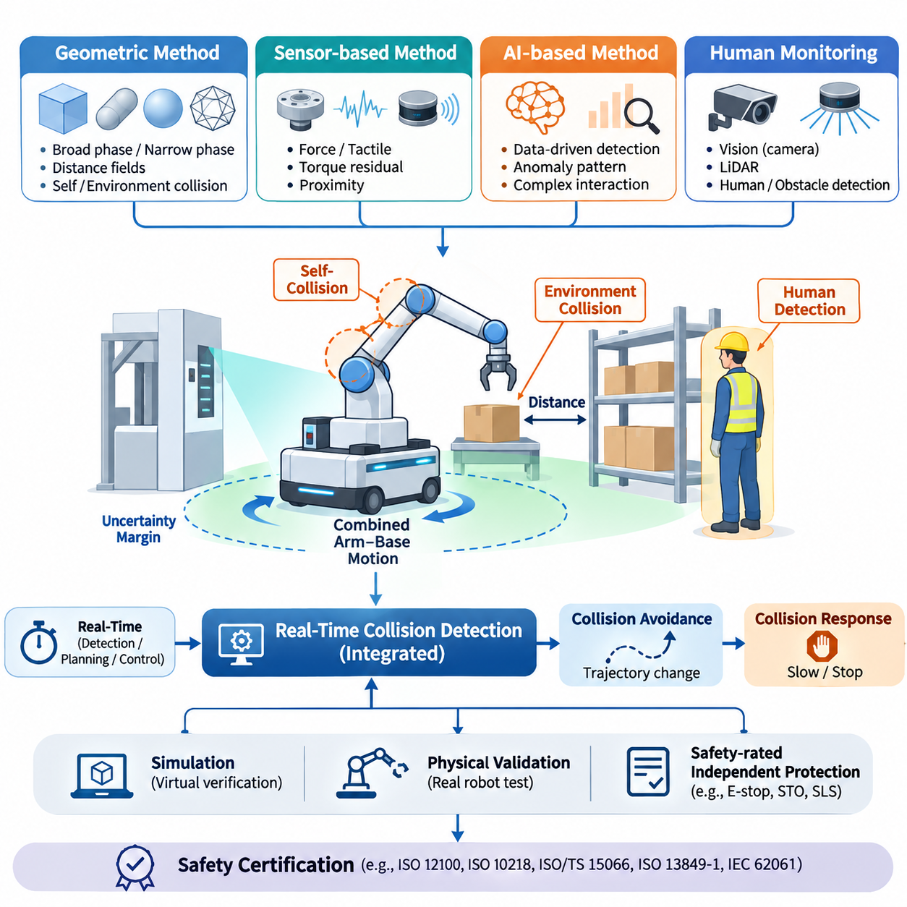
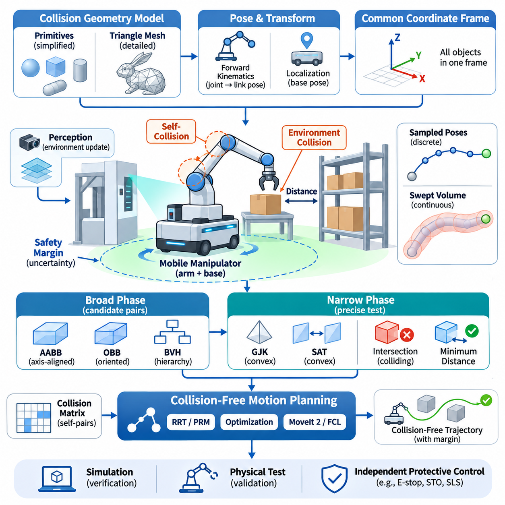
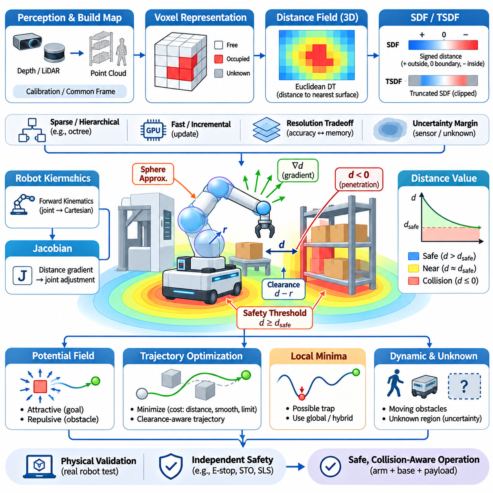
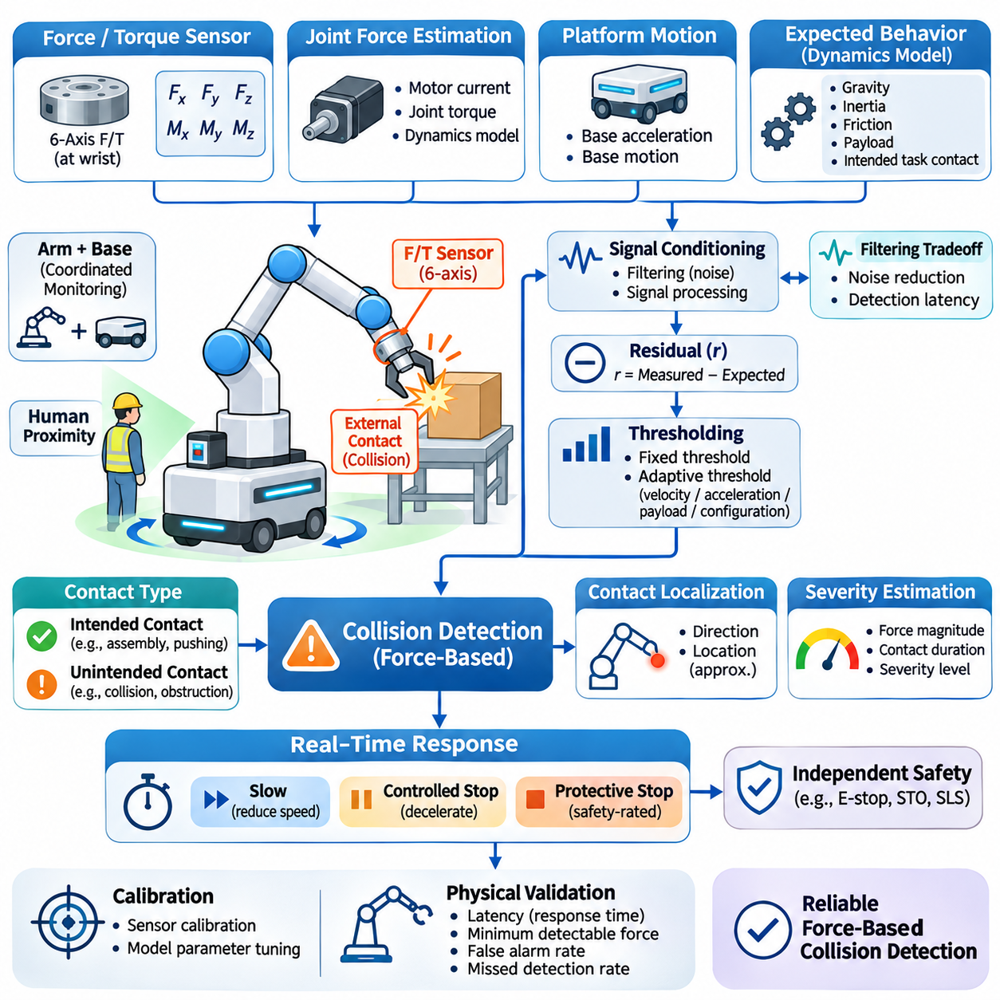
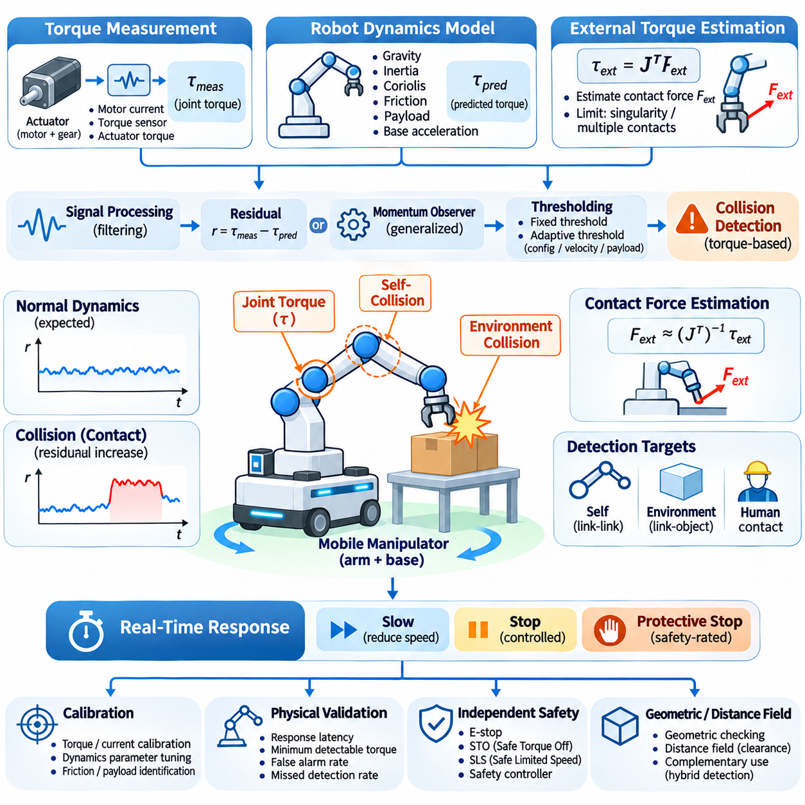
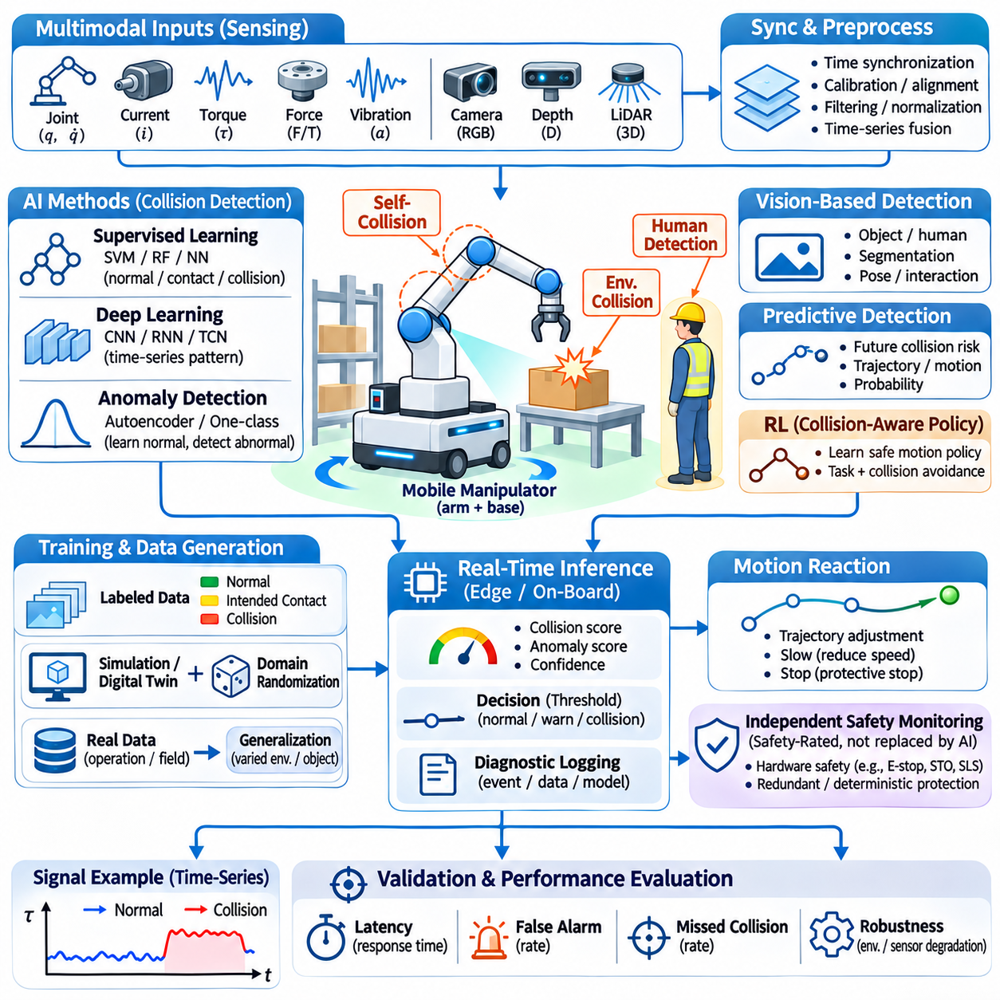
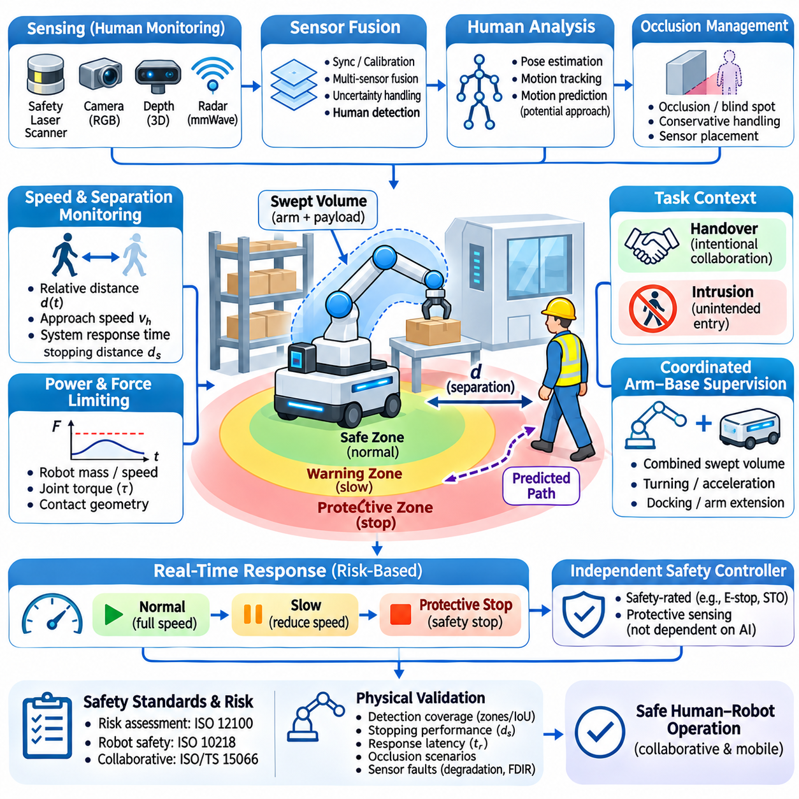
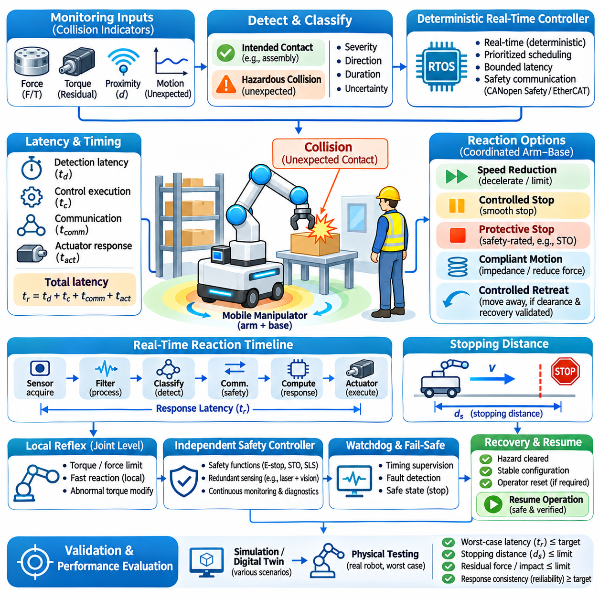
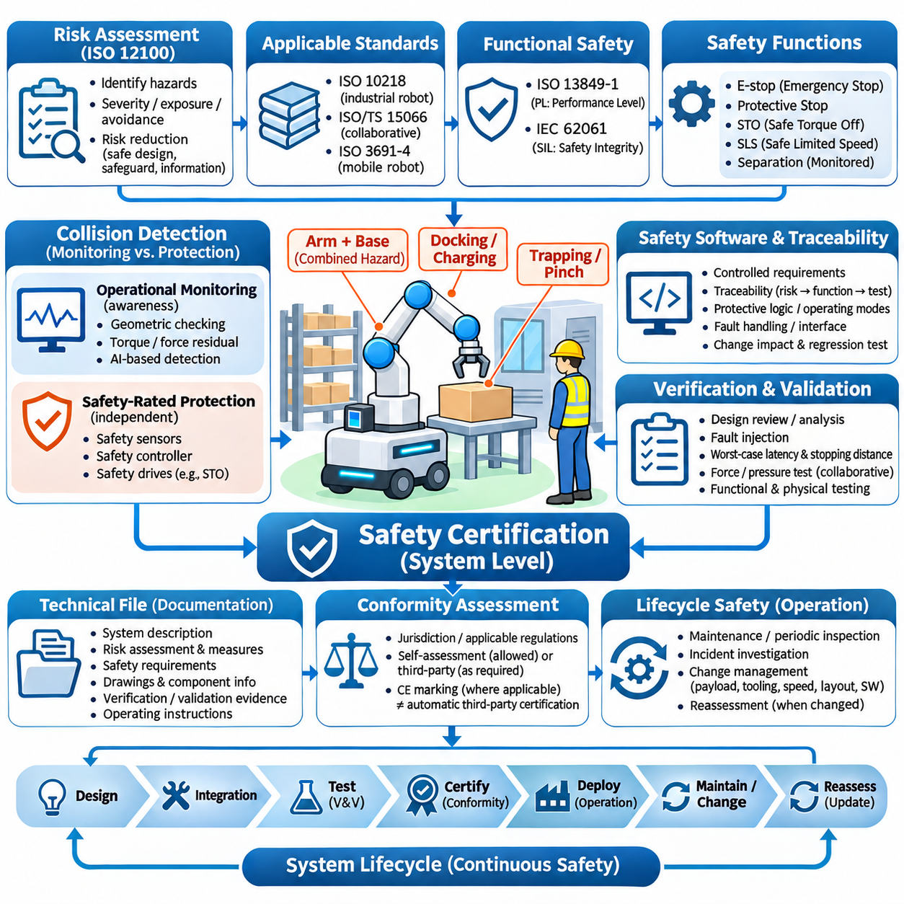

**Volume 02. Manipulator Mechanics and Control**


# Chapter 12. Collision Detection

##  

## 01 Collision Detection Overview

{width="7.268055555555556in" height="7.268055555555556in"}

Collision detection is a fundamental capability in robotic manipulation systems, enabling robots to identify, predict, and respond to physical interactions with surrounding objects, equipment, and humans. It provides the foundation for safe motion planning, reliable task execution, and damage prevention. In industrial and mobile manipulation environments, collision detection must operate across complex geometries, changing workspaces, and unpredictable operating conditions.

A collision occurs when two physical bodies occupy overlapping spatial regions or establish unintended mechanical contact. In robotic systems, these bodies may include manipulator links, end effectors, transported objects, environmental structures, or human operators. Collision detection determines whether such interactions exist or are likely to occur, while collision avoidance modifies robot behavior to prevent hazardous contact before it develops.

Collision detection differs from collision avoidance and collision response, although these functions operate together. Detection identifies geometric interference or unexpected physical contact, avoidance generates alternative motions or modifies trajectories, and response determines the appropriate action after a hazardous condition is recognized. An effective robotic safety architecture integrates these functions through coordinated perception, planning, control, and monitoring mechanisms.

Robotic collision detection generally operates through geometric, sensor-based, and model-based approaches. Geometric methods evaluate spatial relationships between modeled objects, while sensor-based methods observe physical interactions through force, torque, tactile, or proximity measurements. Model-based techniques compare expected robot behavior against measured responses to identify abnormal interactions that may indicate unexpected contact or mechanical interference.

Geometric collision detection represents robot components and environmental objects using mathematical shapes or three-dimensional models. These representations may include spheres, capsules, boxes, convex polyhedra, or detailed triangle meshes. Collision-checking algorithms determine whether modeled bodies intersect or approach within a specified safety margin, allowing motion planners to reject configurations that violate geometric constraints.

Collision checking can be performed at different levels of computational complexity. Broad-phase detection rapidly eliminates object pairs that cannot intersect using bounding volumes or spatial partitioning structures. Narrow-phase detection performs more precise geometric calculations on potentially interacting pairs. This hierarchical organization reduces computational requirements while maintaining sufficient accuracy for complex robotic assemblies and dynamically changing environments.

Distance-based collision detection extends geometric intersection testing by measuring separation between robot surfaces and surrounding obstacles. Signed distance fields, occupancy representations, and nearest-point calculations provide continuous information about obstacle proximity. Such information supports predictive avoidance, trajectory optimization, and safety-margin enforcement, particularly when manipulators operate near machinery, shelves, workpieces, or restricted workspace boundaries.

Self-collision detection is particularly important for manipulators with multiple joints and redundant degrees of freedom. During complex movements, nonadjacent robot links may approach or intersect even when the end effector follows a valid trajectory. Self-collision checking evaluates the spatial relationships among robot components and excludes mechanically connected pairs where appropriate, preventing configurations that could damage the robot itself.

Environmental collision detection considers interactions between the manipulator and external objects. These objects may be stationary, such as fixtures and machine frames, or dynamic, such as moving vehicles and human workers. Accurate environmental representations require consistent coordinate transformations, updated perception information, and appropriate uncertainty margins. Outdated obstacle information can cause otherwise valid trajectories to become unsafe during execution.

Collision detection in mobile manipulators introduces additional complexity because both the robotic arm and mobile platform contribute to the overall motion. Base translation, platform rotation, arm articulation, and payload movement continuously change the occupied workspace. Consequently, collision checking must consider the combined robot configuration rather than treating navigation and manipulation as completely independent processes.

Force-based collision detection identifies unexpected contact by monitoring interaction forces or deviations from expected mechanical behavior. Force and torque sensors mounted at joints or end effectors provide measurements that can reveal contact events. However, measured forces may also reflect payload changes, acceleration, friction, or normal task interactions. Reliable detection therefore requires suitable thresholds, filtering, and interpretation of operational context.

Torque-based collision detection uses actuator measurements and robot dynamic models to estimate external disturbances. Differences between predicted and measured joint torques can indicate unexpected contact with environmental objects. Residual observers and momentum-based monitoring techniques are commonly used to improve sensitivity. Detection performance depends on model accuracy, sensor quality, friction compensation, and the ability to distinguish collisions from normal dynamic disturbances.

Artificial intelligence introduces data-driven methods for identifying collision patterns that may be difficult to characterize through fixed thresholds. Machine learning models can analyze joint currents, torque signals, vibration measurements, and motion histories to recognize abnormal behavior. These approaches may improve detection under varying operating conditions, but require representative training data, uncertainty evaluation, and rigorous validation before safety-critical deployment.

Human safety monitoring extends collision detection beyond mechanical interference to include proximity awareness and predictive risk assessment. Cameras, depth sensors, LiDAR, and other sensing technologies can estimate human positions and movements around robotic equipment. Safety monitoring systems use this information to support protective separation, speed adjustment, or controlled stopping according to the application and applicable safety requirements.

Real-time collision detection must operate within the timing constraints of the robot control architecture. Detection latency, sensor update rates, communication delays, and actuator response times determine how quickly the system can react to emerging hazards. A computationally accurate algorithm may still be unsuitable if its execution time prevents timely intervention. Practical implementations therefore balance geometric precision, detection sensitivity, and deterministic execution.

Collision response strategies depend on the severity of the detected condition and the operating mode of the robot. Responses may include trajectory modification, speed reduction, controlled stopping, or activation of a protective stop function. Unexpected contact during force-controlled assembly may require a different response from contact during high-speed transportation. The control architecture must distinguish permitted task contact from hazardous collisions.

Collision detection must also account for uncertainty arising from sensor noise, calibration errors, mechanical flexibility, and imperfect environmental models. Safety margins help compensate for these uncertainties, but excessively conservative margins can reduce workspace utilization and task efficiency. Robust systems combine geometric clearance, sensor confidence, dynamic constraints, and operational risk assessments to establish appropriate detection and intervention boundaries.

Simulation provides an important environment for evaluating collision detection before physical deployment. Digital robot models can reproduce joint movements, obstacle configurations, payload variations, and representative contact scenarios. Simulation enables repeated testing of geometric algorithms and motion-planning strategies without exposing equipment to unnecessary risks. Nevertheless, simulated performance must be verified against physical measurements and real operating conditions.

Industrial collision detection systems require systematic validation across normal operation, abnormal motion, sensor failures, and environmental disturbances. Evaluation metrics may include detection latency, missed collision rate, false alarm rate, minimum separation distance, and computational load. Testing should cover different robot configurations, operating speeds, payload conditions, and contact directions to establish confidence in system behavior.

Safety certification introduces additional requirements beyond algorithmic performance. Collision detection functions used for personnel protection must be incorporated into an appropriate safety-related control architecture and evaluated against applicable robotic safety standards. General-purpose perception or artificial intelligence software cannot automatically be considered a certified protective function. Safety integrity depends on the complete implementation, including hardware, diagnostics, response mechanisms, and validation evidence.

The overall objective of collision detection is to maintain safe and productive robotic operation while preserving flexibility in complex workspaces. Effective systems integrate geometric reasoning, physical sensing, dynamic modeling, real-time control, and safety supervision. As mobile manipulators become more autonomous, collision detection increasingly serves as a continuous operational capability connecting environmental understanding, motion execution, human interaction, and reliable robotic decision-making.

충돌 감지(Collision Detection)는 로봇 조작 시스템(Robotic Manipulation System)의 핵심 기능으로, 로봇이 주변 물체, 장비 및 사람과의 물리적 상호작용(Physical Interaction)을 식별하고 예측하며 대응할 수 있도록 한다. 이는 안전한 동작 계획(Motion Planning), 신뢰성 있는 작업 수행(Task Execution), 장비 손상 방지(Damage Prevention)의 기반을 제공한다. 산업용 로봇(Industrial Robot)과 모바일 매니퓰레이터(Mobile Manipulator) 환경에서는 복잡한 기하학적 구조(Geometry), 변화하는 작업 공간(Workspace), 예측하기 어려운 운영 조건(Operating Conditions)에 대응할 수 있는 충돌 감지 기능이 필요하다.

충돌(Collision)은 두 물리적 물체(Physical Body)가 동일한 공간 영역을 점유하거나 의도하지 않은 기계적 접촉(Mechanical Contact)을 발생시키는 현상이다. 로봇 시스템에서 이러한 물체에는 매니퓰레이터 링크(Manipulator Link), 엔드 이펙터(End Effector), 운반 물체(Transported Object), 주변 구조물(Environmental Structure), 작업자(Human Operator) 등이 포함된다. 충돌 감지는 이러한 상호작용이 발생했거나 발생할 가능성이 있는지를 판단하며, 충돌 회피(Collision Avoidance)는 위험한 접촉이 발생하기 전에 로봇의 동작을 수정한다.

충돌 감지(Collision Detection)는 충돌 회피(Collision Avoidance) 및 충돌 대응(Collision Response)과 밀접하게 연관되지만 서로 다른 기능을 수행한다. 충돌 감지는 기하학적 간섭(Geometric Interference)이나 예상하지 못한 물리적 접촉을 식별하고, 충돌 회피는 대체 경로를 생성하거나 궤적(Trajectory)을 수정하며, 충돌 대응은 위험 상황이 인식된 이후 적절한 조치를 결정한다. 효과적인 로봇 안전 아키텍처(Robot Safety Architecture)는 인지(Perception), 계획(Planning), 제어(Control), 모니터링(Monitoring)을 통합하여 이러한 기능을 유기적으로 수행한다.

로봇의 충돌 감지는 일반적으로 기하학적 접근법(Geometric Approach), 센서 기반 접근법(Sensor-Based Approach), 모델 기반 접근법(Model-Based Approach)으로 구분된다. 기하학적 방법은 모델링된 물체 사이의 공간 관계를 평가하며, 센서 기반 방법은 힘(Force), 토크(Torque), 촉각(Tactile), 근접 센서(Proximity Sensor)를 통해 물리적 상호작용을 관측한다. 모델 기반 기법은 예상되는 로봇 동작과 실제 측정 결과를 비교하여 비정상적인 접촉이나 기계적 간섭을 나타내는 이상 상태를 식별한다.

기하학적 충돌 감지(Geometric Collision Detection)는 로봇 구성 요소와 주변 물체를 수학적 형상(Mathematical Shape) 또는 3차원 모델(3D Model)로 표현한다. 이러한 표현에는 구(Sphere), 캡슐(Capsule), 상자(Box), 볼록 다면체(Convex Polyhedron), 삼각형 메시(Triangle Mesh) 등이 포함된다. 충돌 검사 알고리즘(Collision Checking Algorithm)은 모델링된 물체가 서로 교차하거나 지정된 안전 여유 거리(Safety Margin) 이내로 접근하는지를 판단하여 기하학적 제약 조건(Geometric Constraint)을 위반하는 로봇 자세를 배제한다.

충돌 검사(Collision Checking)는 계산 복잡도(Computational Complexity)에 따라 여러 단계로 수행될 수 있다. 광역 충돌 검사(Broad-Phase Detection)는 경계 볼륨(Bounding Volume)이나 공간 분할 구조(Spatial Partitioning Structure)를 사용하여 충돌 가능성이 없는 물체 쌍을 신속하게 제외한다. 정밀 충돌 검사(Narrow-Phase Detection)는 충돌 가능성이 있는 물체 쌍에 대해 더욱 정확한 기하학적 계산을 수행한다. 이러한 계층적 구성(Hierarchical Organization)은 복잡한 로봇 구조와 동적으로 변화하는 환경에서도 계산 부담을 줄이면서 필요한 정확도를 유지한다.

거리 기반 충돌 감지(Distance-Based Collision Detection)는 로봇 표면과 주변 장애물 사이의 이격 거리(Separation Distance)를 측정하여 기하학적 교차 검사 기능을 확장한다. 부호 거리장(Signed Distance Field), 점유 공간 표현(Occupancy Representation), 최근접점 계산(Nearest-Point Calculation)은 장애물과의 근접 정도에 대한 연속적인 정보를 제공한다. 이러한 정보는 예측 기반 충돌 회피(Predictive Collision Avoidance), 궤적 최적화(Trajectory Optimization), 안전 거리 유지에 활용되며, 특히 기계 설비나 선반, 작업물 주변에서 동작하는 매니퓰레이터에 중요하다.

자기 충돌 감지(Self-Collision Detection)는 다수의 관절(Joint)과 여유 자유도(Redundant Degrees of Freedom)를 가진 매니퓰레이터에서 특히 중요하다. 복잡한 동작 중에는 엔드 이펙터가 유효한 궤적을 따라 이동하더라도 서로 인접하지 않은 로봇 링크가 접근하거나 교차할 수 있다. 자기 충돌 검사는 로봇 구성 요소 사이의 공간 관계를 평가하고, 필요한 경우 기계적으로 연결된 일부 링크 쌍을 검사 대상에서 제외하여 로봇 자체에 손상을 줄 수 있는 자세가 생성되지 않도록 한다.

환경 충돌 감지(Environmental Collision Detection)는 매니퓰레이터와 외부 물체 사이의 상호작용을 고려한다. 외부 물체는 고정 장치(Fixture)나 기계 프레임(Machine Frame)과 같은 정적 물체(Static Object)일 수도 있고, 이동 차량이나 작업자와 같은 동적 물체(Dynamic Object)일 수도 있다. 정확한 환경 표현을 위해서는 일관된 좌표 변환(Coordinate Transformation), 최신 인지 정보(Perception Information), 적절한 불확실성 여유(Uncertainty Margin)가 필요하다. 오래된 장애물 정보는 기존에 유효했던 궤적을 실행 중 위험한 상태로 만들 수 있다.

모바일 매니퓰레이터(Mobile Manipulator)의 충돌 감지는 로봇 팔(Robot Arm)과 이동 플랫폼(Mobile Platform)이 모두 전체 동작에 영향을 미치기 때문에 추가적인 복잡성을 가진다. 베이스 병진 이동(Base Translation), 플랫폼 회전(Platform Rotation), 로봇 팔 관절 운동(Arm Articulation), 적재물 이동(Payload Movement)은 로봇이 점유하는 작업 공간을 지속적으로 변화시킨다. 따라서 충돌 검사는 주행(Navigation)과 조작(Manipulation)을 완전히 독립적으로 처리하기보다 결합된 로봇 구성 상태(Combined Robot Configuration)를 고려해야 한다.

힘 기반 충돌 감지(Force-Based Collision Detection)는 상호작용 힘(Interaction Force)이나 예상되는 기계적 동작에서 발생하는 편차를 모니터링하여 예상하지 못한 접촉을 식별한다. 관절이나 엔드 이펙터에 장착된 힘·토크 센서(Force/Torque Sensor)는 접촉 이벤트(Contact Event)를 감지할 수 있는 측정값을 제공한다. 그러나 측정된 힘에는 적재물 변화(Payload Variation), 가속도(Acceleration), 마찰(Friction), 정상적인 작업 상호작용도 반영될 수 있으므로 적절한 임계값(Threshold), 필터링(Filtering), 운영 상황에 대한 해석이 필요하다.

토크 기반 충돌 감지(Torque-Based Collision Detection)는 액추에이터 측정값(Actuator Measurement)과 로봇 동역학 모델(Robot Dynamic Model)을 사용하여 외부 교란(External Disturbance)을 추정한다. 예측 관절 토크(Predicted Joint Torque)와 실제 측정 토크(Measured Joint Torque)의 차이는 주변 물체와의 예상하지 못한 접촉을 나타낼 수 있다. 잔차 관측기(Residual Observer)와 운동량 기반 모니터링(Momentum-Based Monitoring)은 감지 민감도를 높이는 데 활용된다. 감지 성능은 모델 정확도, 센서 품질, 마찰 보상(Friction Compensation), 정상적인 동적 교란과 충돌을 구별하는 능력에 따라 달라진다.

인공지능(Artificial Intelligence)은 고정 임계값(Fixed Threshold)만으로 구분하기 어려운 충돌 패턴을 식별하기 위한 데이터 기반 방법(Data-Driven Method)을 제공한다. 기계학습 모델(Machine Learning Model)은 관절 전류(Joint Current), 토크 신호(Torque Signal), 진동 측정값(Vibration Measurement), 동작 이력(Motion History)을 분석하여 비정상적인 동작을 인식할 수 있다. 이러한 접근법은 다양한 운영 조건에서 감지 성능을 향상시킬 가능성이 있지만, 안전 필수 시스템(Safety-Critical System)에 적용하기 전에 대표성 있는 학습 데이터, 불확실성 평가(Uncertainty Evaluation), 엄격한 검증(Validation)이 필요하다.

인간 안전 모니터링(Human Safety Monitoring)은 충돌 감지를 기계적 간섭의 식별에서 근접 상황 인식(Proximity Awareness)과 예측 위험 평가(Predictive Risk Assessment)까지 확장한다. 카메라(Camera), 깊이 센서(Depth Sensor), 라이다(LiDAR) 등의 센싱 기술은 로봇 주변 작업자의 위치와 움직임을 추정할 수 있다. 안전 모니터링 시스템은 이러한 정보를 활용하여 작업 환경과 적용 가능한 안전 요구사항에 따라 보호 이격 거리(Protective Separation), 속도 조정(Speed Adjustment), 제어 정지(Controlled Stop)를 지원한다.

실시간 충돌 감지(Real-Time Collision Detection)는 로봇 제어 아키텍처(Robot Control Architecture)의 시간 제약 조건(Timing Constraint) 내에서 수행되어야 한다. 감지 지연(Detection Latency), 센서 갱신 주기(Sensor Update Rate), 통신 지연(Communication Delay), 액추에이터 응답 시간(Actuator Response Time)은 위험 상황에 대응할 수 있는 속도를 결정한다. 계산 정확도가 높은 알고리즘이라도 실행 시간이 길어 적시에 개입할 수 없다면 적합하지 않을 수 있다. 따라서 실제 구현에서는 기하학적 정밀도, 감지 민감도, 결정적 실행 특성(Deterministic Execution)의 균형이 필요하다.

충돌 대응 전략(Collision Response Strategy)은 감지된 상황의 심각도와 로봇의 운영 모드(Operating Mode)에 따라 달라진다. 대응 방법에는 궤적 수정(Trajectory Modification), 속도 감소(Speed Reduction), 제어 정지(Controlled Stop), 보호 정지 기능(Protective Stop Function)의 활성화 등이 포함된다. 힘 제어 조립(Force-Controlled Assembly) 과정에서 발생한 예상하지 못한 접촉은 고속 운송 작업 중 발생한 접촉과 다른 대응을 요구할 수 있다. 제어 아키텍처는 허용된 작업 접촉(Permitted Task Contact)과 위험한 충돌(Hazardous Collision)을 구별해야 한다.

충돌 감지는 센서 잡음(Sensor Noise), 보정 오차(Calibration Error), 기계적 유연성(Mechanical Flexibility), 불완전한 환경 모델(Environmental Model)에서 발생하는 불확실성(Uncertainty)도 고려해야 한다. 안전 여유 거리(Safety Margin)는 이러한 불확실성을 보완하지만, 지나치게 보수적인 여유 거리는 작업 공간 활용도와 작업 효율성을 감소시킬 수 있다. 견고한 시스템(Robust System)은 기하학적 이격 거리(Geometric Clearance), 센서 신뢰도(Sensor Confidence), 동적 제약 조건(Dynamic Constraint), 운영 위험 평가(Operational Risk Assessment)를 결합하여 적절한 감지 및 개입 기준을 설정한다.

시뮬레이션(Simulation)은 실제 장비에 적용하기 전에 충돌 감지 기능을 평가할 수 있는 중요한 환경을 제공한다. 디지털 로봇 모델(Digital Robot Model)은 관절 운동(Joint Motion), 장애물 배치(Obstacle Configuration), 적재물 변화(Payload Variation), 대표적인 접촉 상황(Contact Scenario)을 재현할 수 있다. 시뮬레이션을 활용하면 장비를 불필요한 위험에 노출하지 않고 기하학적 알고리즘과 동작 계획 전략을 반복적으로 시험할 수 있다. 그러나 시뮬레이션 성능은 실제 측정값과 운영 조건을 통해 검증되어야 한다.

산업용 충돌 감지 시스템(Industrial Collision Detection System)은 정상 동작(Normal Operation), 비정상 동작(Abnormal Motion), 센서 고장(Sensor Failure), 환경 교란(Environmental Disturbance)에 대한 체계적인 검증이 필요하다. 평가 지표(Evaluation Metric)에는 감지 지연 시간(Detection Latency), 충돌 미검출률(Missed Collision Rate), 오경보율(False Alarm Rate), 최소 이격 거리(Minimum Separation Distance), 계산 부하(Computational Load) 등이 포함된다. 시스템 동작에 대한 신뢰성을 확보하기 위해 다양한 로봇 자세, 동작 속도, 적재 조건, 접촉 방향을 시험해야 한다.

안전 인증(Safety Certification)은 알고리즘 성능 이상의 추가적인 요구사항을 포함한다. 작업자 보호(Personnel Protection)에 사용되는 충돌 감지 기능은 적절한 안전 관련 제어 아키텍처(Safety-Related Control Architecture)에 통합되어야 하며, 적용 가능한 로봇 안전 표준(Robot Safety Standard)에 따라 평가되어야 한다. 범용 인지 소프트웨어(General-Purpose Perception Software)나 인공지능 소프트웨어가 자동으로 인증된 보호 기능(Certified Protective Function)으로 인정되는 것은 아니다. 안전 무결성(Safety Integrity)은 하드웨어, 진단 기능(Diagnostics), 대응 메커니즘(Response Mechanism), 검증 증거(Validation Evidence)를 포함한 전체 구현에 의해 결정된다.

충돌 감지(Collision Detection)의 궁극적인 목적은 복잡한 작업 공간에서 로봇의 유연성을 유지하면서 안전하고 생산적인 운영을 보장하는 것이다. 효과적인 시스템은 기하학적 추론(Geometric Reasoning), 물리적 센싱(Physical Sensing), 동역학 모델링(Dynamic Modeling), 실시간 제어(Real-Time Control), 안전 감독(Safety Supervision)을 통합한다. 모바일 매니퓰레이터의 자율성(Autonomy)이 높아질수록 충돌 감지는 환경 이해(Environmental Understanding), 동작 실행(Motion Execution), 인간과의 상호작용(Human Interaction), 신뢰성 있는 로봇 의사결정(Robotic Decision-Making)을 연결하는 지속적인 운영 기능으로 중요성이 커지고 있다.

##  

## 02 Geometric Collision Checking

{width="7.268055555555556in" height="7.268055555555556in"}

Geometric collision checking is a fundamental technique in robotic manipulation that determines whether the physical volumes of robot components and surrounding objects intersect. It relies on mathematical representations of three-dimensional geometry to evaluate spatial relationships during motion planning and execution. In industrial manipulators and mobile robotic systems, geometric collision checking supports safe trajectory generation, workspace analysis, and prevention of unintended mechanical interference.

The primary objective of geometric collision checking is to identify configurations in which robot links, end effectors, payloads, or environmental objects occupy overlapping regions. A collision-free configuration satisfies geometric constraints defined by the robot structure and surrounding workspace. These constraints must be evaluated repeatedly as joint positions and mobile platform poses change, ensuring that planned movements remain physically feasible throughout the complete trajectory.

Geometric representations determine both the accuracy and computational efficiency of collision checking. Simple primitives such as spheres, boxes, cylinders, and capsules provide efficient approximations of robot components. More complex shapes can be represented using convex polyhedra, triangle meshes, or combinations of primitives. The selection of geometry depends on required precision, available computing resources, and the complexity of the robot and its operating environment.

Simplified collision geometry is commonly used to reduce computational requirements. A robot arm link may be approximated by a capsule, while a mobile platform may be represented by a rectangular box or multiple convex shapes. These approximations allow rapid intersection testing without processing detailed mechanical surfaces. However, simplified models must be constructed carefully because excessive approximation can produce false collision warnings or overlook critical geometric features.

Detailed collision models use polygonal meshes to describe complex surfaces and irregular mechanical structures. Triangle meshes are particularly useful for representing industrial equipment, grippers, fixtures, and transported objects. Although mesh-based checking provides greater geometric fidelity, it requires additional computational resources. Practical robotic systems often combine simplified representations for frequent checks with detailed models for operations requiring higher spatial accuracy.

Collision checking depends on consistent coordinate transformations between robot components and environmental objects. Each collision geometry is associated with a coordinate frame that defines its position and orientation. Forward kinematics computes the transformations of robot links from joint configurations, while localization provides the pose of a mobile platform. These transformations place all relevant geometries into a common reference frame for spatial intersection testing.

Broad-phase collision detection reduces computational complexity by identifying object pairs that may potentially intersect. Bounding spheres, axis-aligned bounding boxes, and oriented bounding boxes are frequently used to approximate spatial regions. If bounding volumes do not overlap, the corresponding objects cannot collide. This filtering process eliminates unnecessary detailed calculations and becomes particularly important when a robotic system contains numerous links, obstacles, and environmental structures.

Spatial acceleration structures further improve broad-phase performance by organizing collision objects hierarchically. Bounding volume hierarchies, spatial grids, and tree-based partitioning methods allow algorithms to exclude large groups of objects from consideration. Instead of comparing every possible object pair, collision checking traverses only potentially overlapping regions. This approach improves scalability in complex industrial workspaces and dynamically updated environments.

Narrow-phase collision detection performs precise geometric tests on object pairs selected during broad-phase processing. Algorithms evaluate whether primitive shapes, convex bodies, or polygonal surfaces intersect. For convex objects, the Gilbert--Johnson--Keerthi algorithm can determine intersection or minimum separation distance. Other methods, including the Separating Axis Theorem, provide efficient collision tests for suitable geometric representations.

The Separating Axis Theorem determines whether two convex objects are separated by examining candidate projection axes. If an axis exists along which the projected intervals do not overlap, the objects are not colliding. When no separating axis is found among the required candidate axes, intersection is established. This method is especially effective for convex polygons, polyhedra, and oriented bounding boxes commonly used in robotic collision models.

Distance computation extends geometric collision checking beyond binary intersection decisions. Rather than reporting only collision or noncollision, distance-based algorithms estimate the minimum separation between objects. This information supports safety margins, proximity monitoring, and trajectory optimization. A manipulator can therefore adjust its motion before physical contact occurs, improving operational robustness when working near fixtures or sensitive equipment.

Self-collision checking evaluates possible intersections between different components of the same robot. In articulated manipulators, nonadjacent links may collide during complex joint movements, particularly near workspace boundaries or highly folded configurations. Collision matrices identify which link pairs require testing and which pairs may be excluded because of permanent mechanical adjacency. Correct configuration of these relationships improves both safety and computational efficiency.

Environmental collision checking evaluates the interaction between the robot and external workspace geometry. Obstacles may include machine frames, shelves, worktables, walls, and temporary objects. Static environments can be represented using predefined models, while changing environments require updates from perception systems. Accurate geometric registration is essential because errors in object position or orientation can produce incorrect collision-checking results.

Mobile manipulators require geometric collision checking across the combined configuration of the mobile base and robotic arm. Platform translation and rotation modify the global positions of every manipulator link, while arm movements alter the occupied volume above and around the platform. Collision checking must therefore evaluate the complete robotic structure, including mounted sensors, tools, payloads, and mechanical attachments.

Discrete collision checking evaluates individual robot configurations sampled along a planned trajectory. Although computationally efficient, this approach may miss collisions occurring between consecutive samples, particularly during rapid movements or near narrow obstacles. Increasing sampling density improves detection reliability but also increases computational cost. Sampling strategies should therefore consider joint velocities, geometric clearance, and the complexity of surrounding obstacles.

Continuous collision detection addresses limitations of discrete sampling by evaluating geometric motion between configurations. Instead of testing only selected poses, continuous methods determine whether moving bodies intersect at any point during a motion interval. Techniques such as conservative advancement and swept-volume analysis help identify intermediate collisions. These methods are particularly valuable for fast motion, large joint displacements, and operations requiring strict clearance guarantees.

Collision checking is closely integrated with robotic motion planning algorithms. Sampling-based planners, including rapidly exploring random trees and probabilistic roadmaps, use collision tests to determine whether candidate configurations and connections are valid. Optimization-based planners use geometric distance information to penalize obstacle proximity. The computational performance of collision checking directly influences planning speed, solution quality, and the feasibility of real-time replanning.

Practical implementations often use dedicated collision libraries integrated with robot description and planning frameworks. The Flexible Collision Library provides geometric collision and distance computation capabilities, while MoveIt 2 integrates collision checking into robotic planning scenes. Robot descriptions commonly define separate visual and collision geometries, allowing detailed visualization while maintaining efficient collision evaluation during planning and execution.

Geometric collision checking must account for modeling uncertainty, calibration errors, localization drift, and mechanical tolerances. Collision geometry may be expanded using conservative margins to compensate for these effects. However, excessive margins can unnecessarily restrict reachable workspace and reduce task efficiency. Appropriate margin selection requires balancing safety requirements, geometric accuracy, sensing uncertainty, and operational performance.

Validation of geometric collision checking involves testing representative robot configurations, obstacle arrangements, and motion trajectories. Important evaluation measures include collision detection accuracy, false positive rates, missed intersections, minimum clearance, and computation time. Simulated tests should be supplemented with controlled physical experiments to verify model alignment and identify discrepancies caused by mechanical deformation or inaccurate calibration.

Geometric collision checking provides a computational foundation for safe robotic motion, but it does not independently guarantee physical safety. Its effectiveness depends on accurate models, reliable state estimation, appropriate update frequencies, and integration with monitoring and protective control functions. When combined with perception, dynamic planning, and safety supervision, geometric collision checking enables manipulators and mobile robotic systems to operate efficiently within complex and constrained environments.

기하학적 충돌 검사(Geometric Collision Checking)는 로봇 조작(Robotic Manipulation)에서 로봇 구성 요소와 주변 물체의 물리적 체적(Physical Volume)이 서로 교차하는지를 판단하는 핵심 기술이다. 이 기술은 3차원 기하학(Three-Dimensional Geometry)의 수학적 표현을 활용하여 동작 계획(Motion Planning)과 실행 과정에서 공간적 관계(Spatial Relationship)를 평가한다. 산업용 매니퓰레이터(Industrial Manipulator)와 모바일 로봇 시스템(Mobile Robotic System)에서 기하학적 충돌 검사는 안전한 궤적 생성(Trajectory Generation), 작업 공간 분석(Workspace Analysis), 의도하지 않은 기계적 간섭(Mechanical Interference) 방지를 지원한다.

기하학적 충돌 검사의 주요 목적은 로봇 링크(Robot Link), 엔드 이펙터(End Effector), 적재물(Payload), 주변 물체(Environmental Object)가 서로 중첩된 공간 영역을 점유하는 로봇 구성 상태(Configuration)를 식별하는 것이다. 충돌이 없는 구성 상태(Collision-Free Configuration)는 로봇 구조와 주변 작업 공간에 의해 정의된 기하학적 제약 조건(Geometric Constraint)을 만족한다. 이러한 제약 조건은 관절 위치(Joint Position)와 이동 플랫폼 자세(Mobile Platform Pose)가 변화함에 따라 반복적으로 평가되어야 하며, 계획된 전체 궤적에서 물리적으로 실행 가능한 동작이 유지되도록 해야 한다.

기하학적 표현(Geometric Representation)은 충돌 검사의 정확도와 계산 효율성(Computational Efficiency)을 결정한다. 구(Sphere), 상자(Box), 원기둥(Cylinder), 캡슐(Capsule)과 같은 단순 기본 형상(Primitive Shape)은 로봇 구성 요소를 효율적으로 근사하는 데 사용된다. 복잡한 형상은 볼록 다면체(Convex Polyhedron), 삼각형 메시(Triangle Mesh), 여러 기본 형상의 조합으로 표현할 수 있다. 기하학적 모델의 선택은 요구되는 정밀도(Precision), 사용 가능한 계산 자원(Computing Resource), 로봇과 운영 환경의 복잡성에 따라 결정된다.

단순화된 충돌 형상(Simplified Collision Geometry)은 계산 요구량을 줄이기 위해 일반적으로 사용된다. 로봇 팔 링크(Robot Arm Link)는 캡슐 형상으로 근사할 수 있으며, 이동 플랫폼(Mobile Platform)은 직육면체 또는 여러 볼록 형상(Convex Shape)으로 표현할 수 있다. 이러한 근사 표현은 상세한 기계 표면을 처리하지 않고도 빠른 교차 검사(Intersection Testing)를 가능하게 한다. 그러나 지나친 단순화는 잘못된 충돌 경고(False Collision Warning)를 발생시키거나 중요한 기하학적 특징(Geometric Feature)을 누락할 수 있으므로 충돌 모델을 신중하게 구성해야 한다.

상세 충돌 모델(Detailed Collision Model)은 다각형 메시(Polygonal Mesh)를 사용하여 복잡한 표면과 불규칙한 기계 구조를 표현한다. 삼각형 메시(Triangle Mesh)는 산업용 장비(Industrial Equipment), 그리퍼(Gripper), 고정 장치(Fixture), 운반 물체(Transported Object)를 표현하는 데 특히 유용하다. 메시 기반 충돌 검사(Mesh-Based Collision Checking)는 높은 기하학적 충실도(Geometric Fidelity)를 제공하지만 추가적인 계산 자원이 필요하다. 실제 로봇 시스템에서는 빈번한 검사에 단순화된 모델을 사용하고, 높은 공간 정확도가 필요한 작업에는 상세 모델을 적용하는 방식이 일반적이다.

충돌 검사는 로봇 구성 요소와 주변 물체 사이의 일관된 좌표 변환(Coordinate Transformation)에 의존한다. 각 충돌 형상(Collision Geometry)은 위치(Position)와 방향(Orientation)을 정의하는 좌표계(Coordinate Frame)에 연결된다. 순기구학(Forward Kinematics)은 관절 구성 상태(Joint Configuration)로부터 로봇 링크의 변환 관계를 계산하며, 위치 추정(Localization)은 이동 플랫폼의 자세(Pose)를 제공한다. 이러한 변환을 통해 모든 관련 기하학적 형상을 공통 기준 좌표계(Common Reference Frame)에 배치하여 공간 교차 검사를 수행할 수 있다.

광역 충돌 검사(Broad-Phase Collision Detection)는 충돌 가능성이 있는 물체 쌍(Object Pair)을 식별하여 계산 복잡도(Computational Complexity)를 줄인다. 경계 구(Bounding Sphere), 축 정렬 경계 상자(Axis-Aligned Bounding Box), 방향성 경계 상자(Oriented Bounding Box)는 공간 영역을 근사하는 데 자주 사용된다. 경계 볼륨(Bounding Volume)이 서로 중첩되지 않으면 해당 물체는 충돌하지 않는다. 이러한 필터링 과정(Filtering Process)은 불필요한 상세 계산을 제거하며, 로봇 링크와 장애물 및 주변 구조물이 많은 시스템에서 특히 중요하다.

공간 가속 구조(Spatial Acceleration Structure)는 충돌 물체를 계층적으로 구성하여 광역 충돌 검사의 성능을 더욱 향상시킨다. 경계 볼륨 계층 구조(Bounding Volume Hierarchy), 공간 격자(Spatial Grid), 트리 기반 공간 분할(Tree-Based Partitioning)은 알고리즘이 많은 물체 집합을 검사 대상에서 제외할 수 있도록 한다. 모든 물체 쌍을 비교하는 대신 충돌 가능성이 있는 공간 영역만 탐색한다. 이러한 접근법은 복잡한 산업 작업 공간과 동적으로 갱신되는 환경에서 확장성(Scalability)을 향상시킨다.

정밀 충돌 검사(Narrow-Phase Collision Detection)는 광역 검사에서 선택된 물체 쌍에 대해 정확한 기하학적 검사를 수행한다. 알고리즘은 기본 형상(Primitive Shape), 볼록 물체(Convex Body), 다각형 표면(Polygonal Surface)이 서로 교차하는지를 평가한다. 볼록 물체에 대해서는 길버트-존슨-키어시 알고리즘(Gilbert--Johnson--Keerthi Algorithm, GJK)을 사용하여 교차 여부 또는 최소 이격 거리(Minimum Separation Distance)를 계산할 수 있다. 분리축 정리(Separating Axis Theorem, SAT)를 포함한 다른 방법도 적절한 기하학적 표현에 대해 효율적인 충돌 검사를 제공한다.

분리축 정리(Separating Axis Theorem)는 후보 투영축(Candidate Projection Axis)을 검사하여 두 볼록 물체(Convex Object)가 분리되어 있는지를 판단한다. 투영된 구간(Projected Interval)이 서로 중첩되지 않는 축이 존재하면 두 물체는 충돌하지 않는다. 필요한 모든 후보 축에서 분리축(Separating Axis)이 발견되지 않으면 두 물체가 교차한다고 판단한다. 이 방법은 로봇 충돌 모델에서 일반적으로 사용하는 볼록 다각형(Convex Polygon), 볼록 다면체(Convex Polyhedron), 방향성 경계 상자(Oriented Bounding Box)에 특히 효과적이다.

거리 계산(Distance Computation)은 단순한 이진 교차 판단(Binary Intersection Decision)을 넘어 기하학적 충돌 검사의 기능을 확장한다. 충돌 여부만 보고하는 대신 거리 기반 알고리즘(Distance-Based Algorithm)은 물체 사이의 최소 이격 거리(Minimum Separation Distance)를 추정한다. 이러한 정보는 안전 여유 거리(Safety Margin), 근접 모니터링(Proximity Monitoring), 궤적 최적화(Trajectory Optimization)를 지원한다. 따라서 매니퓰레이터는 실제 접촉이 발생하기 전에 동작을 조정할 수 있으며, 고정 장치나 민감한 장비 주변에서 작업할 때 운영 견고성(Operational Robustness)을 향상시킬 수 있다.

자기 충돌 검사(Self-Collision Checking)는 동일한 로봇의 서로 다른 구성 요소 사이에서 발생할 수 있는 교차를 평가한다. 관절형 매니퓰레이터(Articulated Manipulator)에서는 복잡한 관절 운동 중 인접하지 않은 링크가 충돌할 수 있으며, 특히 작업 공간 경계(Workspace Boundary)나 크게 접힌 구성 상태(Folded Configuration)에서 이러한 가능성이 높아진다. 충돌 행렬(Collision Matrix)은 검사가 필요한 링크 쌍과 영구적인 기계적 인접 관계로 인해 제외할 수 있는 링크 쌍을 정의한다. 이러한 관계를 올바르게 설정하면 안전성과 계산 효율성을 동시에 향상시킬 수 있다.

환경 충돌 검사(Environmental Collision Checking)는 로봇과 외부 작업 공간 형상(External Workspace Geometry) 사이의 상호작용을 평가한다. 장애물(Obstacle)에는 기계 프레임(Machine Frame), 선반(Shelf), 작업대(Worktable), 벽(Wall), 임시 물체(Temporary Object) 등이 포함된다. 정적 환경(Static Environment)은 사전에 정의된 모델로 표현할 수 있지만, 변화하는 환경은 인지 시스템(Perception System)을 통한 갱신이 필요하다. 물체의 위치나 방향에 오차가 발생하면 잘못된 충돌 검사 결과가 생성될 수 있으므로 정확한 기하학적 정합(Geometric Registration)이 필수적이다.

모바일 매니퓰레이터(Mobile Manipulator)는 이동 베이스(Mobile Base)와 로봇 팔(Robot Arm)의 결합된 구성 상태(Combined Configuration)에 대해 기하학적 충돌 검사를 수행해야 한다. 플랫폼의 병진 이동(Platform Translation)과 회전(Rotation)은 모든 매니퓰레이터 링크의 전역 위치(Global Position)를 변화시키며, 로봇 팔의 움직임은 플랫폼 위와 주변에서 점유하는 공간을 변화시킨다. 따라서 충돌 검사는 장착된 센서(Mounted Sensor), 도구(Tool), 적재물(Payload), 기계적 부착물(Mechanical Attachment)을 포함한 전체 로봇 구조를 평가해야 한다.

이산 충돌 검사(Discrete Collision Checking)는 계획된 궤적을 따라 샘플링된 개별 로봇 구성 상태를 평가한다. 이 방법은 계산 효율성이 높지만 연속된 샘플 사이에서 발생하는 충돌을 놓칠 수 있으며, 특히 빠른 동작이나 좁은 장애물 주변에서 이러한 문제가 발생한다. 샘플링 밀도(Sampling Density)를 높이면 감지 신뢰성(Detection Reliability)이 향상되지만 계산 비용(Computational Cost)도 증가한다. 따라서 샘플링 전략(Sampling Strategy)은 관절 속도(Joint Velocity), 기하학적 이격 거리(Geometric Clearance), 주변 장애물의 복잡성을 고려해야 한다.

연속 충돌 감지(Continuous Collision Detection)는 구성 상태 사이의 기하학적 움직임을 평가하여 이산 샘플링(Discrete Sampling)의 한계를 보완한다. 선택된 자세만 검사하는 대신 연속 충돌 감지는 동작 구간(Motion Interval)의 어느 시점에서든 이동 물체가 교차하는지를 판단한다. 보수적 전진 기법(Conservative Advancement)과 스윕 볼륨 분석(Swept-Volume Analysis)은 중간 구간에서 발생하는 충돌을 식별하는 데 도움이 된다. 이러한 방법은 빠른 동작, 큰 관절 변위(Joint Displacement), 엄격한 이격 거리 보장(Clearance Guarantee)이 필요한 작업에서 특히 중요하다.

충돌 검사는 로봇 동작 계획 알고리즘(Robotic Motion Planning Algorithm)과 밀접하게 통합된다. 급속 탐색 랜덤 트리(Rapidly Exploring Random Tree, RRT)와 확률적 로드맵(Probabilistic Roadmap, PRM)을 포함한 샘플링 기반 계획기(Sampling-Based Planner)는 충돌 검사를 사용하여 후보 구성 상태와 연결 경로의 유효성을 판단한다. 최적화 기반 계획기(Optimization-Based Planner)는 기하학적 거리 정보를 활용하여 장애물 근접에 불이익을 부여한다. 충돌 검사의 계산 성능은 계획 속도(Planning Speed), 해의 품질(Solution Quality), 실시간 재계획(Real-Time Replanning)의 실행 가능성에 직접적인 영향을 미친다.

실제 구현에서는 로봇 기술 및 계획 프레임워크(Robot Description and Planning Framework)와 통합된 전용 충돌 라이브러리(Collision Library)를 사용하는 경우가 많다. 유연 충돌 라이브러리(Flexible Collision Library, FCL)는 기하학적 충돌 및 거리 계산 기능을 제공하며, MoveIt 2는 충돌 검사를 로봇 계획 장면(Planning Scene)에 통합한다. 로봇 기술 모델(Robot Description Model)은 일반적으로 시각화 형상(Visual Geometry)과 충돌 형상(Collision Geometry)을 별도로 정의하여 상세한 시각화를 유지하면서 계획 및 실행 과정에서 효율적인 충돌 평가를 수행하도록 한다.

기하학적 충돌 검사는 모델링 불확실성(Modeling Uncertainty), 보정 오차(Calibration Error), 위치 추정 드리프트(Localization Drift), 기계적 공차(Mechanical Tolerance)를 고려해야 한다. 이러한 영향을 보완하기 위해 보수적인 여유 거리(Conservative Margin)를 적용하여 충돌 형상을 확장할 수 있다. 그러나 지나치게 큰 여유 거리는 도달 가능한 작업 공간(Reachable Workspace)을 불필요하게 제한하고 작업 효율성을 감소시킬 수 있다. 적절한 여유 거리 선택에는 안전 요구사항(Safety Requirement), 기하학적 정확도(Geometric Accuracy), 센싱 불확실성(Sensing Uncertainty), 운영 성능(Operational Performance) 사이의 균형이 필요하다.

기하학적 충돌 검사의 검증(Validation)은 대표적인 로봇 구성 상태(Robot Configuration), 장애물 배치(Obstacle Arrangement), 동작 궤적(Motion Trajectory)을 시험하는 과정으로 이루어진다. 주요 평가 지표(Evaluation Measure)에는 충돌 감지 정확도(Collision Detection Accuracy), 오탐률(False Positive Rate), 충돌 미검출(Missed Intersection), 최소 이격 거리(Minimum Clearance), 계산 시간(Computation Time)이 포함된다. 시뮬레이션 시험(Simulation Test)은 제어된 실제 실험(Controlled Physical Experiment)으로 보완하여 모델 정렬(Model Alignment)을 검증하고 기계적 변형(Mechanical Deformation)이나 부정확한 보정으로 발생하는 차이를 식별해야 한다.

기하학적 충돌 검사(Geometric Collision Checking)는 안전한 로봇 동작을 위한 계산적 기반(Computational Foundation)을 제공하지만, 그 자체만으로 물리적 안전(Physical Safety)을 보장하지는 않는다. 효과적인 충돌 검사는 정확한 모델(Accurate Model), 신뢰성 있는 상태 추정(State Estimation), 적절한 갱신 주기(Update Frequency), 모니터링 및 보호 제어 기능(Protective Control Function)과의 통합에 의존한다. 인지(Perception), 동적 계획(Dynamic Planning), 안전 감독(Safety Supervision)과 결합하면 기하학적 충돌 검사는 매니퓰레이터와 모바일 로봇 시스템이 복잡하고 제약이 많은 환경에서 효율적으로 작동하도록 지원한다.

##  

## 03 Distance Field Methods

{width="7.268055555555556in" height="7.268055555555556in"}

Distance field methods provide a continuous geometric representation of spatial relationships between robotic components and surrounding obstacles. Unlike binary collision checking, which determines whether objects intersect, distance fields estimate the separation between positions in space and nearby surfaces. This information enables manipulators to anticipate potential collisions, maintain clearance, and optimize motion trajectories before physical contact occurs.

A distance field assigns a scalar distance value to each location within a defined workspace. The value typically represents the shortest Euclidean distance from that location to the nearest obstacle surface. By evaluating these values at points associated with robot links or collision geometries, a motion planner can estimate obstacle proximity. Distance fields therefore transform complex geometric relationships into spatial functions suitable for efficient numerical evaluation.

Signed distance fields distinguish occupied and free regions by assigning distances with opposite signs. Under a common convention, positive values indicate positions outside obstacles, negative values indicate positions inside obstacles, and zero represents the obstacle boundary. This representation provides both proximity and penetration information. The sign convention must remain consistent throughout the planning and control system to avoid incorrect interpretations of collision conditions.

An Euclidean distance field represents the shortest straight-line distance between each workspace location and the nearest obstacle. Such fields can be generated from occupancy grids, voxel maps, or geometric surface models. Euclidean distance transforms efficiently propagate distance information across discretized environments. The resulting representation supports rapid proximity queries without repeatedly performing detailed geometric intersection tests against every environmental object.

Voxel-based distance fields divide three-dimensional space into discrete volumetric cells. Each voxel stores occupancy information, distance values, or additional environmental attributes. Higher spatial resolution improves representation accuracy around narrow passages and irregular surfaces but increases memory consumption and processing requirements. Lower resolution reduces computational cost while introducing geometric approximation errors that must be considered when defining collision margins.

Distance fields may be constructed from point clouds acquired through depth cameras, LiDAR sensors, or three-dimensional scanning systems. Sensor measurements are transformed into a common coordinate frame and integrated into an environmental representation. Distance values are then calculated relative to observed surfaces or occupied regions. Reliable construction requires accurate sensor calibration, consistent coordinate transformations, and appropriate handling of incomplete observations.

The gradient of a distance field describes the direction in which the distance value increases most rapidly. In regions where the field is differentiable, this gradient provides a local direction away from the nearest obstacle. Motion optimization algorithms can use gradient information to modify robot configurations and increase clearance. However, gradients may become discontinuous or ambiguous near equidistant surfaces, requiring numerical smoothing or robust optimization strategies.

Distance-based collision avoidance commonly defines a safety threshold around obstacles. When the estimated separation exceeds the threshold, motion may proceed without additional proximity penalties. As the distance approaches the threshold, an optimization cost or corrective action increases. This approach creates a continuous transition between unrestricted motion and obstacle avoidance, allowing manipulators to maintain clearance while preserving task-oriented movement.

Artificial potential fields use distance information to generate virtual repulsive effects around obstacles. A robot experiences an increasing repulsive influence as it approaches an occupied region, while an attractive component encourages movement toward the target. Although computationally efficient, potential field methods may encounter local minima or unstable behavior in complex environments. Distance fields provide useful geometric information but do not independently guarantee globally collision-free paths.

Trajectory optimization methods incorporate distance fields into objective functions that penalize obstacle proximity. Robot configurations are evaluated along candidate trajectories, and distance gradients guide adjustments toward safer regions. Optimization-based planning can produce smooth motions that balance collision clearance, path length, joint limits, and task accuracy. The resulting trajectory must still be validated because local optimization may converge to an infeasible solution.

Distance field evaluation for manipulators requires mapping robot configurations into Cartesian workspace positions. Forward kinematics determines the locations of selected points on robot links, end effectors, and attached tools. Distance values are queried at these positions to estimate environmental clearance. For gradient-based optimization, geometric Jacobians relate workspace distance gradients to joint-space adjustments, enabling collision avoidance within the robot\'s configuration space.

Robot geometry can be approximated using spheres or other simplified collision primitives when querying environmental distance fields. A sphere-based representation evaluates the distance from each sphere center to nearby obstacles and subtracts the sphere radius to estimate clearance. This method reduces computation while accounting for robot volume. The quality of the approximation depends on primitive placement, geometric coverage, and the treatment of unmodeled surfaces.

Signed distance fields also support penetration analysis when modeled objects overlap. Negative distance values can indicate how deeply a query point lies inside an occupied region, while local gradients provide approximate directions for resolving interference. Such information is useful for trajectory correction and geometric optimization. However, point-based penetration estimates do not necessarily equal the exact minimum translation required to separate complex rigid bodies.

Dynamic environments require distance fields to be updated as obstacles move or new objects are detected. Incremental mapping methods modify affected spatial regions rather than rebuilding the entire representation. Efficient updates are important for mobile manipulators operating around moving equipment and personnel. Nevertheless, sensing latency and incomplete observations can cause the distance field to differ from the actual environment, requiring conservative safety measures.

Mobile manipulation introduces additional challenges because the robot base and arm continuously change their positions relative to environmental obstacles. Distance fields can support coordinated navigation and manipulation by providing a shared representation of obstacle proximity. Base placement, arm configuration, and payload geometry can be evaluated together. This enables motion planners to identify configurations that improve reachability while maintaining clearance around the complete robotic system.

Distance field methods must account for unknown and partially observed regions. A location without sensor measurements cannot automatically be classified as collision-free. Mapping systems may distinguish occupied, free, and unknown space, applying different planning policies to each category. Conservative applications treat unknown regions as potentially hazardous, while exploratory systems may permit controlled movement under additional sensing and risk constraints.

Computational performance depends on workspace dimensions, voxel resolution, update frequency, and query complexity. Dense three-dimensional fields provide direct access to distance values but may require substantial memory. Sparse voxel structures, hierarchical representations, and truncated signed distance fields reduce storage requirements by concentrating information in relevant regions. GPU acceleration and parallel processing can further improve performance for large environments and frequent distance queries.

Truncated signed distance fields represent signed distances only within a limited range around observed surfaces. Values beyond the truncation distance are clipped or left unspecified, reducing the amount of detailed information required. These representations are widely used in three-dimensional reconstruction and sensor fusion. For collision avoidance, planners must distinguish locally accurate surface distances from regions where reliable global obstacle clearance is unavailable.

Distance field accuracy depends on sensor resolution, map discretization, calibration quality, and environmental dynamics. Interpolation between voxel centers can provide smoother distance estimates, but interpolation introduces approximation errors. Safety margins should account for these errors and for uncertainty in robot localization and mechanical geometry. Experimental validation is necessary to establish whether calculated clearances correspond sufficiently well to actual physical separation.

Distance field methods provide a powerful connection between environmental perception, geometric collision checking, and optimization-based motion control. Their continuous distance representation supports proactive obstacle avoidance, smooth trajectory generation, and coordinated mobile manipulation. When combined with accurate mapping, robust state estimation, and independent safety mechanisms, distance fields improve the efficiency and reliability of robotic operation in complex industrial environments.

거리장 기법(Distance Field Methods)은 로봇 구성 요소와 주변 장애물 사이의 공간적 관계(Spatial Relationship)를 연속적인 기하학적 표현(Continuous Geometric Representation)으로 제공한다. 물체의 교차 여부만 판단하는 이진 충돌 검사(Binary Collision Checking)와 달리, 거리장(Distance Field)은 공간상의 위치와 주변 표면 사이의 이격 거리(Separation Distance)를 추정한다. 이러한 정보는 매니퓰레이터(Manipulator)가 물리적 접촉이 발생하기 전에 잠재적인 충돌을 예측하고, 안전 이격 거리를 유지하며, 동작 궤적(Motion Trajectory)을 최적화할 수 있도록 한다.

거리장(Distance Field)은 정의된 작업 공간(Workspace) 내의 각 위치에 스칼라 거리값(Scalar Distance Value)을 할당한다. 이 값은 일반적으로 해당 위치에서 가장 가까운 장애물 표면(Obstacle Surface)까지의 최단 유클리드 거리(Euclidean Distance)를 나타낸다. 동작 계획기(Motion Planner)는 로봇 링크(Robot Link)나 충돌 형상(Collision Geometry)에 연결된 지점에서 이러한 거리값을 평가하여 장애물과의 근접 정도를 추정할 수 있다. 따라서 거리장은 복잡한 기하학적 관계를 효율적인 수치 계산(Numerical Evaluation)에 적합한 공간 함수(Spatial Function)로 변환한다.

부호 거리장(Signed Distance Field, SDF)은 서로 반대되는 부호의 거리값을 할당하여 점유 영역(Occupied Region)과 자유 공간(Free Space)을 구분한다. 일반적인 부호 규약(Sign Convention)에서는 양수 값이 장애물 외부, 음수 값이 장애물 내부를 나타내며, 0은 장애물 경계(Obstacle Boundary)를 의미한다. 이러한 표현은 근접 정보(Proximity Information)와 침투 정보(Penetration Information)를 모두 제공한다. 충돌 상태를 잘못 해석하지 않도록 계획 및 제어 시스템 전체에서 부호 규약을 일관되게 유지해야 한다.

유클리드 거리장(Euclidean Distance Field, EDF)은 작업 공간의 각 위치에서 가장 가까운 장애물까지의 최단 직선거리(Straight-Line Distance)를 표현한다. 이러한 거리장은 점유 격자(Occupancy Grid), 복셀 지도(Voxel Map), 기하학적 표면 모델(Geometric Surface Model)로부터 생성할 수 있다. 유클리드 거리 변환(Euclidean Distance Transform)은 이산화된 환경 전체에 거리 정보를 효율적으로 전파한다. 생성된 표현을 사용하면 모든 환경 물체에 대해 상세한 기하학적 교차 검사를 반복하지 않고도 빠른 근접 거리 조회(Proximity Query)가 가능하다.

복셀 기반 거리장(Voxel-Based Distance Field)은 3차원 공간을 이산적인 체적 셀(Volumetric Cell)로 분할한다. 각 복셀(Voxel)은 점유 정보(Occupancy Information), 거리값(Distance Value), 추가적인 환경 속성(Environmental Attribute)을 저장한다. 높은 공간 해상도(Spatial Resolution)는 좁은 통로와 불규칙한 표면 주변의 표현 정확도를 향상시키지만 메모리 사용량과 처리 요구량을 증가시킨다. 낮은 해상도는 계산 비용(Computational Cost)을 줄이는 대신 기하학적 근사 오차(Geometric Approximation Error)를 발생시키므로 충돌 여유 거리(Collision Margin)를 설정할 때 이를 고려해야 한다.

거리장은 깊이 카메라(Depth Camera), 라이다(LiDAR), 3차원 스캐닝 시스템(3D Scanning System)에서 획득한 점군(Point Cloud)으로부터 생성할 수 있다. 센서 측정값(Sensor Measurement)은 공통 좌표계(Common Coordinate Frame)로 변환되어 환경 표현(Environmental Representation)에 통합된다. 이후 관측된 표면이나 점유 영역을 기준으로 거리값을 계산한다. 신뢰성 있는 거리장 생성을 위해서는 정확한 센서 보정(Sensor Calibration), 일관된 좌표 변환(Coordinate Transformation), 불완전한 관측(Incomplete Observation)에 대한 적절한 처리가 필요하다.

거리장의 기울기(Distance Field Gradient)는 거리값이 가장 빠르게 증가하는 방향을 나타낸다. 거리장이 미분 가능한 영역(Differentiable Region)에서는 이러한 기울기가 가장 가까운 장애물에서 멀어지는 국소 방향(Local Direction)을 제공한다. 동작 최적화 알고리즘(Motion Optimization Algorithm)은 기울기 정보를 활용하여 로봇 구성 상태(Robot Configuration)를 수정하고 이격 거리를 증가시킬 수 있다. 그러나 여러 표면까지의 거리가 동일한 영역에서는 기울기가 불연속적이거나 모호해질 수 있으므로 수치적 평활화(Numerical Smoothing) 또는 강건한 최적화 전략(Robust Optimization Strategy)이 필요하다.

거리 기반 충돌 회피(Distance-Based Collision Avoidance)는 일반적으로 장애물 주변에 안전 임계값(Safety Threshold)을 정의한다. 추정된 이격 거리가 임계값보다 크면 추가적인 근접 페널티(Proximity Penalty) 없이 동작을 수행할 수 있다. 거리가 임계값에 가까워질수록 최적화 비용(Optimization Cost)이나 보정 동작(Corrective Action)이 증가한다. 이러한 접근법은 제한 없는 동작(Unrestricted Motion)과 장애물 회피(Obstacle Avoidance) 사이의 연속적인 전환을 제공하여 매니퓰레이터가 작업 목적에 따른 움직임을 유지하면서 안전 이격 거리를 확보하도록 한다.

인공 퍼텐셜 필드(Artificial Potential Field)는 거리 정보를 사용하여 장애물 주변에 가상의 반발 효과(Virtual Repulsive Effect)를 생성한다. 로봇이 점유 영역(Occupied Region)에 접근할수록 반발 영향(Repulsive Influence)이 증가하며, 인력 성분(Attractive Component)은 목표 지점(Target)으로의 이동을 유도한다. 이 방법은 계산 효율성이 높지만 복잡한 환경에서는 국소 최솟값(Local Minimum)이나 불안정한 동작(Unstable Behavior)이 발생할 수 있다. 거리장은 유용한 기하학적 정보를 제공하지만 그 자체로 전역적인 무충돌 경로(Globally Collision-Free Path)를 보장하지는 않는다.

궤적 최적화 기법(Trajectory Optimization Method)은 거리장을 목적 함수(Objective Function)에 통합하여 장애물 근접에 대한 페널티를 부여한다. 후보 궤적(Candidate Trajectory)을 따라 로봇 구성 상태를 평가하고, 거리 기울기(Distance Gradient)를 활용하여 더 안전한 영역으로 궤적을 조정한다. 최적화 기반 계획(Optimization-Based Planning)은 충돌 이격 거리(Collision Clearance), 경로 길이(Path Length), 관절 제한(Joint Limit), 작업 정확도(Task Accuracy)의 균형을 고려한 부드러운 동작을 생성할 수 있다. 그러나 국소 최적화(Local Optimization)가 실행 불가능한 해(Infeasible Solution)에 수렴할 수 있으므로 결과 궤적에 대한 검증이 필요하다.

매니퓰레이터의 거리장 평가(Distance Field Evaluation)는 로봇 구성 상태를 데카르트 작업 공간(Cartesian Workspace)의 위치로 변환하는 과정이 필요하다. 순기구학(Forward Kinematics)은 로봇 링크, 엔드 이펙터(End Effector), 부착 도구(Attached Tool)에 선택된 지점의 위치를 계산한다. 이러한 위치에서 거리값을 조회하여 환경과의 이격 거리를 추정한다. 기울기 기반 최적화(Gradient-Based Optimization)에서는 기하학적 자코비안(Geometric Jacobian)을 사용하여 작업 공간의 거리 기울기를 관절 공간 조정(Joint-Space Adjustment)과 연결함으로써 로봇 구성 공간(Configuration Space)에서 충돌 회피를 수행할 수 있다.

환경 거리장을 조회할 때 로봇 형상(Robot Geometry)은 구(Sphere) 또는 기타 단순화된 충돌 기본 형상(Collision Primitive)으로 근사할 수 있다. 구 기반 표현(Sphere-Based Representation)은 각 구의 중심에서 주변 장애물까지의 거리를 평가하고 구의 반지름(Radius)을 차감하여 이격 거리를 추정한다. 이 방법은 로봇의 체적(Robot Volume)을 고려하면서 계산량을 줄인다. 근사 품질(Approximation Quality)은 기본 형상의 배치(Primitive Placement), 기하학적 포함 범위(Geometric Coverage), 모델링되지 않은 표면(Unmodeled Surface)의 처리 방식에 따라 달라진다.

부호 거리장(Signed Distance Field)은 모델링된 물체가 중첩되는 경우 침투 분석(Penetration Analysis)도 지원한다. 음수 거리값(Negative Distance Value)은 조회 지점(Query Point)이 점유 영역 내부로 얼마나 깊이 들어갔는지를 나타낼 수 있으며, 국소 기울기(Local Gradient)는 간섭을 해소하기 위한 대략적인 방향을 제공한다. 이러한 정보는 궤적 보정(Trajectory Correction)과 기하학적 최적화(Geometric Optimization)에 유용하다. 그러나 점 기반 침투 추정(Point-Based Penetration Estimate)이 복잡한 강체(Rigid Body)를 분리하는 데 필요한 정확한 최소 병진 이동(Minimum Translation)과 반드시 일치하는 것은 아니다.

동적 환경(Dynamic Environment)에서는 장애물이 이동하거나 새로운 물체가 감지될 때 거리장을 갱신해야 한다. 증분 지도 작성 기법(Incremental Mapping Method)은 전체 환경 표현을 다시 생성하는 대신 영향을 받은 공간 영역만 수정한다. 효율적인 갱신은 이동 장비와 작업자 주변에서 동작하는 모바일 매니퓰레이터(Mobile Manipulator)에 중요하다. 그러나 센싱 지연(Sensing Latency)과 불완전한 관측(Incomplete Observation)으로 인해 거리장이 실제 환경과 달라질 수 있으므로 보수적인 안전 조치(Conservative Safety Measure)가 필요하다.

모바일 매니퓰레이션(Mobile Manipulation)은 로봇 베이스(Robot Base)와 로봇 팔(Robot Arm)이 주변 장애물에 대해 지속적으로 위치를 변경하기 때문에 추가적인 과제를 가진다. 거리장은 장애물 근접 정보를 공유하는 표현을 제공하여 주행(Navigation)과 조작(Manipulation)의 협조 제어를 지원할 수 있다. 베이스 배치(Base Placement), 로봇 팔 구성 상태(Arm Configuration), 적재물 형상(Payload Geometry)을 함께 평가할 수 있다. 이를 통해 동작 계획기는 전체 로봇 시스템의 이격 거리를 유지하면서 도달 가능성(Reachability)을 향상시키는 구성 상태를 식별할 수 있다.

거리장 기법은 미지 영역(Unknown Region)과 부분 관측 영역(Partially Observed Region)을 고려해야 한다. 센서 측정값이 없는 위치를 자동으로 충돌이 없는 공간(Collision-Free Space)으로 분류할 수는 없다. 지도 작성 시스템(Mapping System)은 점유 공간(Occupied Space), 자유 공간(Free Space), 미지 공간(Unknown Space)을 구분하고 각 범주에 서로 다른 계획 정책(Planning Policy)을 적용할 수 있다. 보수적인 응용 시스템(Conservative Application)은 미지 영역을 잠재적인 위험 영역으로 처리하지만, 탐색 시스템(Exploratory System)은 추가적인 센싱과 위험 제약 조건(Risk Constraint)하에서 제어된 이동을 허용할 수 있다.

계산 성능(Computational Performance)은 작업 공간 크기(Workspace Dimension), 복셀 해상도(Voxel Resolution), 갱신 주기(Update Frequency), 조회 복잡도(Query Complexity)에 따라 달라진다. 밀집 3차원 거리장(Dense 3D Distance Field)은 거리값에 직접 접근할 수 있지만 상당한 메모리가 필요할 수 있다. 희소 복셀 구조(Sparse Voxel Structure), 계층적 표현(Hierarchical Representation), 절단 부호 거리장(Truncated Signed Distance Field)은 관련 영역에 정보를 집중하여 저장 요구량을 줄인다. GPU 가속(GPU Acceleration)과 병렬 처리(Parallel Processing)는 대규모 환경과 빈번한 거리 조회에서 성능을 더욱 향상시킬 수 있다.

절단 부호 거리장(Truncated Signed Distance Field, TSDF)은 관측된 표면 주변의 제한된 범위에서만 부호 거리값(Signed Distance Value)을 표현한다. 절단 거리(Truncation Distance)를 초과하는 값은 제한되거나 정의되지 않은 상태로 남아 상세 정보의 저장 요구량을 줄인다. 이러한 표현은 3차원 재구성(3D Reconstruction)과 센서 융합(Sensor Fusion)에 널리 사용된다. 충돌 회피(Collision Avoidance)를 위해서는 계획기가 국소적으로 정확한 표면 거리(Local Surface Distance)와 신뢰성 있는 전역 장애물 이격 거리(Global Obstacle Clearance)를 확보할 수 없는 영역을 구분해야 한다.

거리장 정확도(Distance Field Accuracy)는 센서 해상도(Sensor Resolution), 지도 이산화(Map Discretization), 보정 품질(Calibration Quality), 환경 동역학(Environmental Dynamics)에 따라 달라진다. 복셀 중심(Voxel Center) 사이의 보간(Interpolation)은 더 부드러운 거리 추정(Distance Estimation)을 제공할 수 있지만 근사 오차(Approximation Error)를 발생시킨다. 안전 여유 거리(Safety Margin)는 이러한 오차와 로봇 위치 추정(Robot Localization) 및 기계적 형상(Mechanical Geometry)의 불확실성을 고려해야 한다. 계산된 이격 거리가 실제 물리적 분리 거리(Physical Separation)와 충분히 일치하는지 확인하기 위해 실험적 검증(Experimental Validation)이 필요하다.

거리장 기법(Distance Field Methods)은 환경 인지(Environmental Perception), 기하학적 충돌 검사(Geometric Collision Checking), 최적화 기반 동작 제어(Optimization-Based Motion Control)를 연결하는 강력한 기반을 제공한다. 연속적인 거리 표현(Continuous Distance Representation)은 선제적 장애물 회피(Proactive Obstacle Avoidance), 부드러운 궤적 생성(Smooth Trajectory Generation), 협조 모바일 매니퓰레이션(Coordinated Mobile Manipulation)을 지원한다. 정확한 지도 작성(Accurate Mapping), 강건한 상태 추정(Robust State Estimation), 독립적인 안전 메커니즘(Independent Safety Mechanism)과 결합하면 거리장은 복잡한 산업 환경에서 로봇 운영의 효율성과 신뢰성을 향상시킨다.

##  

## 04 Force Based Detection

{width="7.268055555555556in" height="7.268055555555556in"}

Force-based collision detection identifies unexpected physical contact by monitoring forces generated between a robot and its surrounding environment. Unlike geometric collision checking, which predicts interference from spatial models, force-based detection relies on measured mechanical interactions. It enables robots to recognize collisions that occur during actual operation, including contact with unmodeled objects, fixtures, equipment, and human operators.

The fundamental principle is that a robot normally experiences predictable forces during planned movements and task execution. When unexpected contact occurs, additional external forces modify the robot\'s mechanical response. By measuring these deviations, the control system can identify potential collisions and determine whether corrective actions are necessary. This approach is particularly useful when environmental geometry is incomplete or uncertain.

Force-based collision detection commonly uses force and torque sensors installed at the robot wrist, end effector, or mechanical interfaces. A six-axis force/torque sensor measures three translational force components and three rotational torque components. These measurements provide information about external interactions and allow the controller to distinguish unexpected contact from normal manipulation forces under appropriate operating conditions.

Wrist-mounted force/torque sensors are widely used because they measure interaction forces close to the end effector. During assembly, insertion, pushing, and surface-following operations, these sensors provide valuable feedback about contact conditions. Unexpected force increases or abnormal torque patterns can indicate collisions, misalignment, excessive contact pressure, or mechanical obstruction. Sensor placement and measurement range must be selected according to the robot\'s payload and application requirements.

Joint-level force estimation provides another approach when dedicated force sensors are unavailable. Motor current, actuator torque measurements, and robot dynamic models can be used to estimate the external forces acting on the manipulator. The estimated interaction is obtained by comparing measured actuator behavior with the torque predicted by the dynamic model. This method reduces additional hardware requirements but depends strongly on model accuracy and actuator measurement quality.

A fundamental challenge is distinguishing collision forces from normal operational forces. Robot motion naturally produces inertial forces, gravitational effects, friction, and dynamic coupling between joints. Contact during a planned manipulation task may also generate substantial forces without representing a hazardous collision. Therefore, collision detection must consider the expected mechanical behavior associated with the current robot configuration, velocity, acceleration, and task state.

Threshold-based detection is one of the simplest force-based approaches. The system defines acceptable force and torque limits for different operating conditions and identifies potential collisions when measured values exceed these thresholds. Separate thresholds can be established for individual axes or combined force magnitudes. Although straightforward to implement, fixed thresholds may generate false alarms during rapid motion or fail to detect low-force collisions in sensitive applications.

Adaptive thresholding improves detection reliability by adjusting acceptable force limits according to operating conditions. The system may consider robot velocity, acceleration, payload, joint configuration, and expected contact behavior when calculating detection thresholds. This allows greater sensitivity during slow and precise manipulation while avoiding unnecessary collision warnings during normal dynamic movements. Adaptive thresholds must nevertheless remain within validated safety limits.

Signal processing plays an important role in reliable force-based detection. Raw sensor measurements may contain electrical noise, vibration, mechanical resonance, and transient disturbances. Low-pass filters and appropriate signal conditioning can reduce unwanted fluctuations before collision evaluation. However, excessive filtering introduces detection delay and may suppress short-duration contact events. Filter characteristics must therefore balance noise reduction and response speed.

Residual-based detection compares measured interaction behavior with the response predicted by a robot dynamics model. The difference between expected and observed measurements forms a residual signal that indicates possible external disturbances. When the residual exceeds an appropriate threshold, the system identifies a potential collision. This approach can detect unexpected contact without requiring a dedicated external force sensor, provided that model uncertainty and normal dynamic disturbances are adequately addressed.

Force-based collision detection can also support collision localization and severity estimation. Multiple force and torque measurements, combined with robot kinematics, provide information about the direction and approximate location of external contact. The magnitude and duration of the measured interaction can help estimate collision severity. However, accurately identifying the contact location is difficult when several links interact simultaneously or when the robot structure exhibits mechanical flexibility.

In mobile manipulators, force-based collision detection must consider interactions involving both the robotic arm and the mobile platform. Unexpected contact may occur through the end effector, arm links, payload, or platform structure. Motion of the mobile base can also introduce inertial disturbances that influence force measurements. Coordinated monitoring of arm dynamics, base motion, and platform acceleration is therefore important for reliable collision identification.

Human-robot interaction introduces additional requirements for force-based collision detection. Contact with a human body must be evaluated according to the location, direction, magnitude, and duration of the applied force. Sensitive detection thresholds and rapid protective responses are particularly important in collaborative environments. Nevertheless, force sensing alone cannot guarantee human safety because hazardous proximity may exist before physical contact occurs. It should be combined with appropriate proximity monitoring and certified protective functions.

Real-time collision response requires the detection system to communicate with the robot controller within predictable timing constraints. Once abnormal contact is identified, the controller may reduce motion speed, stop the current trajectory, release commanded torque, or activate an appropriate protective stop. The response depends on collision severity, task requirements, and the safety architecture. Detection algorithms must be designed to avoid unnecessary delays between contact recognition and protective action.

Force-based detection requires systematic calibration and validation. Sensor bias, temperature variation, mounting stiffness, mechanical wear, and payload changes can influence measurement accuracy. Calibration procedures should establish reliable force and torque references under representative operating conditions. Testing should include different robot configurations, movement speeds, payloads, and contact directions to evaluate detection sensitivity and false alarm behavior.

Performance evaluation commonly considers detection latency, minimum detectable force, false positive rate, missed collision rate, and response consistency. Experiments should distinguish intentional task contact from unexpected collision events and include representative dynamic conditions. Simulation can support preliminary algorithm development, but physical testing remains essential because real sensor noise, structural vibration, and mechanical interactions are difficult to reproduce accurately.

Force-based collision detection provides an important layer of physical interaction awareness in robotic systems. By combining direct measurements, dynamic model estimation, signal processing, and real-time control, robots can recognize unexpected contact and respond appropriately during manipulation. When integrated with geometric collision checking, distance-based monitoring, and independent safety mechanisms, force-based detection improves operational robustness and supports safer collaboration in complex industrial environments.

힘 기반 충돌 감지(Force-Based Collision Detection)는 로봇과 주변 환경 사이에서 발생하는 예상하지 못한 물리적 접촉(Physical Contact)을 감지하기 위해 생성되는 힘(Force)을 모니터링하는 기술이다. 공간 모델을 기반으로 간섭을 예측하는 기하학적 충돌 검사(Geometric Collision Checking)와 달리, 힘 기반 감지는 실제 작동 중 발생하는 기계적 상호작용(Mechanical Interaction)을 측정한다. 이를 통해 모델링되지 않은 물체, 고정 장치(Fixture), 장비 및 작업자와의 접촉을 포함하여 실제 환경에서 발생하는 충돌을 인식할 수 있다.

힘 기반 충돌 감지의 기본 원리는 로봇이 계획된 동작과 작업을 수행하는 동안 일반적으로 예측 가능한 힘을 경험한다는 것이다. 예상하지 못한 접촉이 발생하면 추가적인 외력이 로봇의 기계적 응답(Mechanical Response)을 변화시킨다. 제어 시스템(Control System)은 이러한 편차를 측정하여 잠재적인 충돌을 식별하고 보정 조치(Corrective Action)가 필요한지를 판단한다. 이 접근법은 환경의 기하학적 정보가 불완전하거나 불확실한 경우에 특히 유용하다.

힘 기반 충돌 감지(Force-Based Collision Detection)는 일반적으로 로봇 손목(Robot Wrist), 엔드 이펙터(End Effector), 기계적 연결부(Mechanical Interface)에 장착된 힘·토크 센서(Force/Torque Sensor)를 사용한다. 6축 힘·토크 센서(Six-Axis Force/Torque Sensor)는 세 개의 병진 방향 힘 성분(Translational Force Component)과 세 개의 회전 방향 토크 성분(Rotational Torque Component)을 측정한다. 이러한 측정값은 외부 상호작용에 대한 정보를 제공하며, 적절한 운영 조건에서 제어기가 예상하지 못한 접촉과 정상적인 조작 과정에서 발생하는 힘을 구별하도록 지원한다.

손목 장착형 힘·토크 센서(Wrist-Mounted Force/Torque Sensor)는 엔드 이펙터에 가까운 위치에서 상호작용 힘(Interaction Force)을 측정하기 때문에 널리 사용된다. 조립(Assembly), 삽입(Insertion), 밀기(Pushing), 표면 추종(Surface Following) 작업에서 이러한 센서는 접촉 상태(Contact Condition)에 대한 중요한 피드백을 제공한다. 예상하지 못한 힘의 증가나 비정상적인 토크 패턴은 충돌, 정렬 불량(Misalignment), 과도한 접촉 압력(Excessive Contact Pressure), 기계적 장애물(Mechanical Obstruction)을 나타낼 수 있다. 센서의 장착 위치와 측정 범위(Measurement Range)는 로봇의 적재 하중(Payload)과 적용 분야의 요구사항에 따라 선정해야 한다.

관절 수준 힘 추정(Joint-Level Force Estimation)은 전용 힘 센서(Dedicated Force Sensor)를 사용할 수 없는 경우에 적용할 수 있는 또 다른 접근법이다. 모터 전류(Motor Current), 액추에이터 토크 측정값(Actuator Torque Measurement), 로봇 동역학 모델(Robot Dynamic Model)을 활용하여 매니퓰레이터에 작용하는 외력을 추정할 수 있다. 추정된 상호작용은 동역학 모델이 예측한 토크와 실제 액추에이터 동작을 비교하여 계산한다. 이 방법은 추가 하드웨어 요구사항을 줄일 수 있지만 모델 정확도와 액추에이터 측정 품질에 크게 의존한다.

힘 기반 충돌 감지의 근본적인 과제는 충돌에 의한 힘과 정상적인 작업 과정에서 발생하는 힘을 구별하는 것이다. 로봇의 움직임은 관성력(Inertial Force), 중력 효과(Gravitational Effect), 마찰(Friction), 관절 간 동적 결합(Dynamic Coupling)에 의해 자연스럽게 힘을 발생시킨다. 계획된 조작 작업 중 발생하는 접촉 역시 위험한 충돌을 의미하지 않으면서 상당한 힘을 생성할 수 있다. 따라서 충돌 감지는 현재 로봇 구성 상태(Robot Configuration), 속도(Velocity), 가속도(Acceleration), 작업 상태(Task State)에 따른 예상 기계적 동작을 고려해야 한다.

임계값 기반 감지(Threshold-Based Detection)는 가장 단순한 힘 기반 접근법 중 하나이다. 시스템은 다양한 운영 조건에 대해 허용 가능한 힘과 토크 한계를 정의하고, 측정값이 이러한 임계값을 초과하면 잠재적인 충돌로 식별한다. 각 축(Axis)에 대해 개별 임계값을 설정하거나 전체 힘의 크기(Force Magnitude)를 기준으로 통합 임계값을 설정할 수 있다. 구현이 간단하다는 장점이 있지만, 고정 임계값(Fixed Threshold)은 빠른 동작 중 오경보(False Alarm)를 발생시키거나 정밀한 작업이 필요한 환경에서 낮은 힘으로 발생하는 충돌을 감지하지 못할 수 있다.

적응형 임계값 설정(Adaptive Thresholding)은 운영 조건에 따라 허용 가능한 힘의 한계를 조정하여 감지 신뢰성(Detection Reliability)을 향상시킨다. 시스템은 감지 임계값을 계산할 때 로봇 속도, 가속도, 적재 하중(Payload), 관절 구성 상태, 예상 접촉 특성(Expected Contact Behavior)을 고려할 수 있다. 이를 통해 느리고 정밀한 조작 중에는 감도를 높이고, 정상적인 동적 동작 중에는 불필요한 충돌 경고를 방지할 수 있다. 다만 적응형 임계값도 검증된 안전 한계(Validated Safety Limit) 내에서 유지되어야 한다.

신호 처리(Signal Processing)는 신뢰성 있는 힘 기반 충돌 감지에서 중요한 역할을 한다. 원시 센서 측정값(Raw Sensor Measurement)에는 전기적 잡음(Electrical Noise), 진동(Vibration), 기계적 공진(Mechanical Resonance), 일시적인 교란(Transient Disturbance)이 포함될 수 있다. 저역 통과 필터(Low-Pass Filter)와 적절한 신호 조정(Signal Conditioning)을 사용하면 충돌 평가 전에 불필요한 변동을 줄일 수 있다. 그러나 과도한 필터링은 감지 지연(Detection Delay)을 발생시키고 짧은 접촉 이벤트를 제거할 수 있다. 따라서 필터 특성(Filter Characteristic)은 잡음 감소와 응답 속도(Response Speed) 사이의 균형을 고려하여 설정해야 한다.

잔차 기반 감지(Residual-Based Detection)는 측정된 상호작용 동작과 로봇 동역학 모델이 예측한 응답을 비교한다. 예상값과 관측값의 차이는 외부 교란(External Disturbance)의 가능성을 나타내는 잔차 신호(Residual Signal)를 형성한다. 잔차가 적절한 임계값을 초과하면 시스템은 잠재적인 충돌로 판단한다. 이 접근법은 전용 외부 힘 센서 없이도 예상하지 못한 접촉을 감지할 수 있지만, 모델 불확실성(Model Uncertainty)과 정상적인 동적 교란을 적절히 고려해야 한다.

힘 기반 충돌 감지는 충돌 위치 추정(Collision Localization)과 심각도 평가(Severity Estimation)도 지원할 수 있다. 여러 힘·토크 측정값을 로봇 기구학(Robot Kinematics)과 결합하면 외부 접촉의 방향과 대략적인 위치에 대한 정보를 얻을 수 있다. 측정된 상호작용의 크기와 지속 시간(Duration)은 충돌의 심각도를 추정하는 데 활용할 수 있다. 그러나 여러 링크가 동시에 접촉하거나 로봇 구조에 기계적 유연성(Mechanical Flexibility)이 존재하는 경우 정확한 접촉 위치를 식별하기 어렵다.

모바일 매니퓰레이터(Mobile Manipulator)에서는 힘 기반 충돌 감지가 로봇 팔과 이동 플랫폼(Mobile Platform) 모두에서 발생하는 상호작용을 고려해야 한다. 예상하지 못한 접촉은 엔드 이펙터, 로봇 팔 링크, 적재물(Payload), 플랫폼 구조(Platform Structure)를 통해 발생할 수 있다. 이동 베이스(Mobile Base)의 움직임은 힘 측정값에 영향을 주는 관성 교란(Inertial Disturbance)을 발생시킬 수도 있다. 따라서 신뢰성 있는 충돌 식별을 위해 로봇 팔의 동역학, 베이스 움직임, 플랫폼 가속도를 통합적으로 모니터링하는 것이 중요하다.

인간-로봇 상호작용(Human-Robot Interaction)은 힘 기반 충돌 감지에 추가적인 요구사항을 부여한다. 인체와의 접촉은 작용하는 힘의 위치, 방향, 크기, 지속 시간에 따라 평가해야 한다. 협동 작업 환경(Collaborative Environment)에서는 민감한 감지 임계값과 신속한 보호 대응(Protective Response)이 특히 중요하다. 그러나 물리적 접촉이 발생하기 전에도 위험한 근접 상황이 존재할 수 있으므로 힘 감지만으로 인간의 안전을 보장할 수는 없다. 따라서 적절한 근접 모니터링(Proximity Monitoring) 및 인증된 보호 기능(Certified Protective Function)과 결합해야 한다.

실시간 충돌 대응(Real-Time Collision Response)을 위해서는 감지 시스템이 예측 가능한 시간 제약(Timing Constraint) 내에 로봇 제어기(Robot Controller)와 통신해야 한다. 비정상적인 접촉이 식별되면 제어기는 동작 속도를 줄이거나, 현재 궤적을 정지하거나, 명령 토크(Commanded Torque)를 해제하거나, 적절한 보호 정지(Protective Stop)를 활성화할 수 있다. 대응 방식은 충돌 심각도, 작업 요구사항, 안전 아키텍처(Safety Architecture)에 따라 결정된다. 감지 알고리즘은 접촉 인식과 보호 조치 사이에 불필요한 지연이 발생하지 않도록 설계해야 한다.

힘 기반 감지는 체계적인 보정(Calibration)과 검증(Validation)이 필요하다. 센서 바이어스(Sensor Bias), 온도 변화(Temperature Variation), 장착 강성(Mounting Stiffness), 기계적 마모(Mechanical Wear), 적재물 변화(Payload Change)는 측정 정확도에 영향을 줄 수 있다. 보정 절차(Calibration Procedure)는 대표적인 운영 조건에서 신뢰성 있는 힘과 토크 기준값(Reference Value)을 설정해야 한다. 감지 민감도(Detection Sensitivity)와 오경보 동작(False Alarm Behavior)을 평가하기 위해 다양한 로봇 구성 상태, 이동 속도, 적재 하중, 접촉 방향을 포함한 시험을 수행해야 한다.

성능 평가는 일반적으로 감지 지연 시간(Detection Latency), 최소 감지 가능 힘(Minimum Detectable Force), 오탐률(False Positive Rate), 충돌 미검출률(Missed Collision Rate), 응답 일관성(Response Consistency)을 고려한다. 실험에서는 의도된 작업 접촉(Intentional Task Contact)과 예상하지 못한 충돌 이벤트를 구별하고 대표적인 동적 조건을 포함해야 한다. 시뮬레이션(Simulation)은 초기 알고리즘 개발을 지원할 수 있지만, 실제 센서 잡음, 구조적 진동(Structural Vibration), 기계적 상호작용은 정확하게 재현하기 어렵기 때문에 물리적 시험(Physical Testing)이 필수적이다.

힘 기반 충돌 감지(Force-Based Collision Detection)는 로봇 시스템에서 물리적 상호작용을 인식하는 중요한 계층을 제공한다. 직접 측정(Direct Measurement), 동역학 모델 추정(Dynamic Model Estimation), 신호 처리(Signal Processing), 실시간 제어(Real-Time Control)를 결합하면 로봇은 조작 작업 중 예상하지 못한 접촉을 인식하고 적절하게 대응할 수 있다. 기하학적 충돌 검사(Geometric Collision Checking), 거리 기반 모니터링(Distance-Based Monitoring), 독립적인 안전 메커니즘(Independent Safety Mechanism)과 통합하면 힘 기반 감지는 운영 견고성(Operational Robustness)을 향상시키고 복잡한 산업 환경에서 더욱 안전한 협업을 지원한다.

##  

## 05 Torque Based Detection

{width="7.268055555555556in" height="7.268055555555556in"}

Torque-based collision detection is an important technique for identifying unexpected physical interactions in robotic manipulators by monitoring joint torque behavior. It estimates external disturbances through actuator torque measurements and robot dynamic models rather than relying exclusively on dedicated force sensors. By comparing expected and measured torque values, the controller can recognize abnormal mechanical responses that may indicate collisions, unintended contact, or excessive external loading during robot operation.

The fundamental principle is based on the relationship between joint torque and robot motion. During normal operation, each joint generates torque to overcome gravity, inertia, friction, and dynamic coupling effects. When an unexpected collision occurs, an additional external torque is introduced into the mechanical system. Torque-based detection identifies this disturbance by analyzing deviations between predicted joint torque and actual measured torque.

Joint torque measurements can be obtained from motor current sensors, integrated torque sensors, or actuator-level measurement systems. In electric actuators, motor current is closely related to electromagnetic torque through the motor torque constant. After considering gear ratios and transmission efficiency, the controller can estimate the torque delivered to each joint. The accuracy of this estimation depends on actuator characteristics, current measurement resolution, and mechanical transmission behavior.

Robot dynamics models provide the theoretical reference required for torque-based collision detection. These models describe the relationship between joint positions, velocities, accelerations, and the torques required to produce a particular movement. Gravity compensation, inertial effects, Coriolis forces, centrifugal forces, and friction must be considered when predicting normal joint behavior. Inaccurate dynamic models can produce residual errors that reduce collision detection reliability.

Residual-based torque detection compares measured joint torque with the torque predicted by the dynamic model. The difference between these values is defined as the external torque residual. Under normal operating conditions, the residual should remain within an expected range determined by model accuracy and measurement uncertainty. When an unexpected contact introduces additional torque, the residual may increase beyond a predefined threshold, indicating a possible collision event.

Momentum-based observers provide another approach to estimating external joint disturbances. Instead of directly calculating all dynamic terms at every control cycle, these observers use robot momentum and measured actuator torque to estimate discrepancies between expected and actual mechanical behavior. Generalized momentum observers are particularly useful for detecting external interactions because they can reduce dependence on direct acceleration measurements, which are often sensitive to sensor noise.

Threshold-based torque detection identifies collisions when estimated external torque exceeds predefined limits. Individual thresholds can be assigned to different joints according to their mechanical characteristics, payload conditions, and expected operating loads. A combined threshold may also be used to evaluate disturbances across multiple joints. Threshold selection must balance sensitivity and robustness because excessively low values generate false alarms, while excessively high values may delay or miss collision detection.

Adaptive torque thresholds improve detection performance under changing operating conditions. Joint acceleration, robot configuration, payload mass, and movement speed influence the expected torque distribution throughout the manipulator. An adaptive detection system adjusts its reference values according to these conditions, allowing it to distinguish normal dynamic torque variations from unexpected external disturbances. However, adaptive thresholds must remain constrained by validated safety limits.

Signal processing is essential for interpreting torque measurements reliably. Motor current fluctuations, gearbox vibration, mechanical backlash, electrical interference, and transmission friction can introduce noise into measured torque signals. Filtering and signal conditioning reduce these disturbances before residual evaluation. However, excessive filtering may delay collision recognition, particularly when contact occurs suddenly. Detection algorithms must therefore maintain sufficient sensitivity while suppressing normal measurement variations.

External joint torque can be related to Cartesian contact forces through the robot Jacobian. The relationship between end-effector wrench and joint torque is expressed through the transposed Jacobian matrix. This relationship allows the controller to estimate the direction and magnitude of external interaction forces from joint-level torque disturbances. Nevertheless, force reconstruction becomes less reliable near singular configurations or when multiple contact points generate simultaneous mechanical interactions.

Self-collision and environmental collision detection can both benefit from torque-based monitoring. Unexpected contact between robot links, end effectors, payloads, and external structures may introduce abnormal joint torque patterns. Unlike purely geometric methods, torque-based detection can identify physical contact even when environmental geometry is incomplete or inaccurately modeled. However, it generally detects contact after mechanical interaction has begun rather than predicting every potential collision in advance.

In mobile manipulators, torque-based collision detection must account for disturbances introduced by both the robotic arm and the moving platform. Base acceleration, platform vibration, payload movement, and changes in gravitational loading can influence joint torque measurements. The dynamic model should therefore consider the combined mechanical behavior of the mobile base and manipulator. Coordinated monitoring helps distinguish environmental contact from disturbances caused by normal platform motion.

Real-time torque-based detection requires continuous monitoring within the robot control loop. Joint torque measurements and dynamic predictions must be processed at sufficiently high frequencies to identify abnormal interactions before they become hazardous. Once a collision is detected, the controller may reduce joint velocity, stop the current trajectory, modify commanded torque, or activate a protective response. The appropriate action depends on collision severity, robot configuration, and task requirements.

Torque-based detection has several practical limitations. Model inaccuracies, uncertain payload properties, joint friction, transmission compliance, and temperature-dependent actuator characteristics can affect residual estimation. Low-force collisions may be difficult to distinguish from normal dynamic disturbances, while sudden high-acceleration movements can produce large residuals without actual contact. Reliable implementations require accurate parameter identification, appropriate filtering, and systematic evaluation under representative operating conditions.

Validation of torque-based collision detection involves testing different robot configurations, payloads, motion speeds, and external contact conditions. Important performance indicators include detection latency, minimum detectable external torque, false alarm rate, missed collision rate, and consistency across repeated experiments. Testing should also evaluate whether collision detection remains reliable during acceleration, deceleration, direction changes, and contact with objects of different stiffness.

Torque-based collision detection provides an effective approach to robot interaction monitoring without necessarily requiring additional force-sensing hardware. By combining actuator measurements, dynamic modeling, disturbance observers, and real-time control, robotic systems can identify unexpected external interactions and respond appropriately. When integrated with geometric collision checking, distance field methods, and independent safety functions, torque-based detection strengthens collision awareness and improves the reliability of industrial and mobile manipulation systems.

토크 기반 충돌 감지(Torque-Based Collision Detection)는 로봇 매니퓰레이터(Robotic Manipulator)의 관절 토크(Joint Torque) 동작을 모니터링하여 예상하지 못한 물리적 상호작용(Physical Interaction)을 식별하는 중요한 기술이다. 전용 힘 센서(Dedicated Force Sensor)에만 의존하는 대신 액추에이터 토크 측정값(Actuator Torque Measurement)과 로봇 동역학 모델(Robot Dynamic Model)을 통해 외부 교란(External Disturbance)을 추정한다. 예측된 토크와 실제 측정된 토크를 비교함으로써 제어기는 로봇 작동 중 충돌, 의도하지 않은 접촉, 과도한 외부 하중을 나타낼 수 있는 비정상적인 기계적 응답을 인식할 수 있다.

기본 원리는 관절 토크(Joint Torque)와 로봇 운동(Robot Motion) 사이의 관계에 기반한다. 정상적인 작동 중 각 관절은 중력(Gravity), 관성(Inertia), 마찰(Friction), 동적 결합(Dynamic Coupling)을 극복하기 위해 토크를 생성한다. 예상하지 못한 충돌이 발생하면 기계 시스템에 추가적인 외부 토크(External Torque)가 작용한다. 토크 기반 감지(Torque-Based Detection)는 예측된 관절 토크와 실제 측정된 관절 토크 사이의 편차를 분석하여 이러한 교란을 식별한다.

관절 토크 측정값(Joint Torque Measurement)은 모터 전류 센서(Motor Current Sensor), 통합형 토크 센서(Integrated Torque Sensor), 액추에이터 수준 측정 시스템(Actuator-Level Measurement System)을 통해 획득할 수 있다. 전기 액추에이터(Electric Actuator)에서는 모터 전류(Motor Current)가 모터 토크 상수(Motor Torque Constant)를 통해 전자기 토크(Electromagnetic Torque)와 밀접하게 연결된다. 기어비(Gear Ratio)와 전달 효율(Transmission Efficiency)을 고려하면 제어기는 각 관절에 전달되는 토크를 추정할 수 있다. 이러한 추정의 정확도는 액추에이터 특성, 전류 측정 해상도(Current Measurement Resolution), 기계적 전달 특성(Mechanical Transmission Behavior)에 따라 달라진다.

로봇 동역학 모델(Robot Dynamics Model)은 토크 기반 충돌 감지에 필요한 이론적 기준을 제공한다. 이러한 모델은 관절 위치(Joint Position), 속도(Velocity), 가속도(Acceleration)와 특정 동작을 생성하는 데 필요한 토크 사이의 관계를 설명한다. 정상적인 관절 동작을 예측할 때는 중력 보상(Gravity Compensation), 관성 효과(Inertial Effect), 코리올리 힘(Coriolis Force), 원심력(Centrifugal Force), 마찰을 고려해야 한다. 동역학 모델이 부정확하면 잔차 오차(Residual Error)가 발생하여 충돌 감지의 신뢰성이 저하될 수 있다.

잔차 기반 토크 감지(Residual-Based Torque Detection)는 측정된 관절 토크와 동역학 모델이 예측한 토크를 비교한다. 두 값의 차이는 외부 토크 잔차(External Torque Residual)로 정의된다. 정상적인 작동 조건에서 잔차는 모델 정확도와 측정 불확실성(Measurement Uncertainty)에 의해 결정되는 예상 범위 내에 유지되어야 한다. 예상하지 못한 접촉으로 추가 토크가 발생하면 잔차가 사전에 정의된 임계값(Threshold)을 초과할 수 있으며, 이는 잠재적인 충돌 이벤트(Collision Event)를 나타낸다.

운동량 기반 관측기(Momentum-Based Observer)는 외부 관절 교란(External Joint Disturbance)을 추정하는 또 다른 접근법을 제공한다. 이러한 관측기는 매 제어 주기마다 모든 동역학 항을 직접 계산하는 대신 로봇의 운동량(Robot Momentum)과 측정된 액추에이터 토크를 사용하여 예상된 기계적 동작과 실제 동작 사이의 차이를 추정한다. 일반화 운동량 관측기(Generalized Momentum Observer)는 외부 상호작용을 감지하는 데 특히 유용하다. 직접적인 가속도 측정은 센서 잡음(Sensor Noise)에 민감한 경우가 많으므로 이러한 측정에 대한 의존성을 줄일 수 있기 때문이다.

임계값 기반 토크 감지(Threshold-Based Torque Detection)는 추정된 외부 토크가 사전에 정의된 한계를 초과할 때 충돌을 식별한다. 각 관절의 기계적 특성, 적재 조건(Payload Condition), 예상 작동 하중에 따라 개별 임계값을 설정할 수 있다. 여러 관절에 걸친 교란을 평가하기 위해 통합 임계값(Combined Threshold)을 사용할 수도 있다. 임계값 설정에서는 민감도(Sensitivity)와 강건성(Robustness)의 균형이 필요하다. 지나치게 낮은 값은 오경보(False Alarm)를 발생시키고, 지나치게 높은 값은 충돌 감지를 지연시키거나 충돌을 놓칠 수 있다.

적응형 토크 임계값(Adaptive Torque Threshold)은 변화하는 작동 조건에서 감지 성능을 향상시킨다. 관절 가속도, 로봇 구성 상태(Robot Configuration), 적재물 질량(Payload Mass), 이동 속도는 매니퓰레이터 전체의 예상 토크 분포에 영향을 미친다. 적응형 감지 시스템(Adaptive Detection System)은 이러한 조건에 따라 기준값(Reference Value)을 조정하여 정상적인 동적 토크 변화와 예상하지 못한 외부 교란을 구별할 수 있다. 그러나 적응형 임계값도 검증된 안전 한계(Validated Safety Limit) 내에서 유지되어야 한다.

토크 측정값을 신뢰성 있게 해석하려면 신호 처리(Signal Processing)가 필수적이다. 모터 전류 변동(Motor Current Fluctuation), 기어박스 진동(Gearbox Vibration), 기계적 백래시(Mechanical Backlash), 전기적 간섭(Electrical Interference), 전달 마찰(Transmission Friction)은 측정된 토크 신호에 잡음을 발생시킬 수 있다. 필터링(Filtering)과 신호 조정(Signal Conditioning)은 잔차 평가(Residual Evaluation) 전에 이러한 교란을 줄이는 데 사용된다. 그러나 과도한 필터링은 특히 접촉이 갑자기 발생하는 경우 충돌 인식을 지연시킬 수 있다. 따라서 감지 알고리즘은 정상적인 측정 변동을 억제하면서 충분한 감도를 유지해야 한다.

외부 관절 토크(External Joint Torque)는 로봇 자코비안(Robot Jacobian)을 통해 데카르트 접촉력(Cartesian Contact Force)과 연관시킬 수 있다. 엔드 이펙터 렌치(End-Effector Wrench)와 관절 토크 사이의 관계는 자코비안 행렬의 전치(Transposed Jacobian Matrix)를 통해 표현된다. 이러한 관계를 이용하면 제어기는 관절 수준의 토크 교란으로부터 외부 상호작용 힘의 방향과 크기를 추정할 수 있다. 그러나 특이 구성(Singular Configuration) 근처에서는 힘 재구성(Force Reconstruction)의 신뢰성이 저하될 수 있으며, 여러 접촉 지점에서 동시에 기계적 상호작용이 발생하는 경우에도 정확도가 떨어질 수 있다.

자기 충돌(Self-Collision)과 환경 충돌(Environmental Collision)은 모두 토크 기반 모니터링의 이점을 얻을 수 있다. 로봇 링크, 엔드 이펙터, 적재물(Payload), 외부 구조물 사이에서 예상하지 못한 접촉이 발생하면 비정상적인 관절 토크 패턴이 나타날 수 있다. 순수한 기하학적 방법과 달리 토크 기반 감지는 환경의 기하학적 정보가 불완전하거나 부정확하게 모델링된 경우에도 물리적 접촉을 식별할 수 있다. 그러나 일반적으로 모든 잠재적 충돌을 사전에 예측하기보다는 기계적 상호작용이 시작된 이후 접촉을 감지한다.

모바일 매니퓰레이터(Mobile Manipulator)에서는 토크 기반 충돌 감지가 로봇 팔과 이동 플랫폼(Mobile Platform) 모두에서 발생하는 교란을 고려해야 한다. 베이스 가속도(Base Acceleration), 플랫폼 진동(Platform Vibration), 적재물 이동(Payload Movement), 중력 하중의 변화(Gravitational Loading Variation)는 관절 토크 측정값에 영향을 줄 수 있다. 따라서 동역학 모델은 이동 베이스와 매니퓰레이터의 결합된 기계적 동작(Combined Mechanical Behavior)을 고려해야 한다. 통합 모니터링(Coordinated Monitoring)은 환경과의 접촉으로 발생한 교란과 정상적인 플랫폼 움직임에서 발생한 교란을 구별하는 데 도움이 된다.

실시간 토크 기반 감지(Real-Time Torque-Based Detection)는 로봇 제어 루프(Robot Control Loop) 내에서 지속적인 모니터링을 요구한다. 관절 토크 측정값과 동역학 예측값은 비정상적인 상호작용이 위험한 수준으로 발전하기 전에 식별할 수 있을 만큼 충분히 높은 주파수로 처리되어야 한다. 충돌이 감지되면 제어기는 관절 속도를 줄이거나, 현재 궤적을 정지하거나, 명령 토크(Commanded Torque)를 수정하거나, 보호 대응(Protective Response)을 활성화할 수 있다. 적절한 조치는 충돌의 심각도, 로봇 구성 상태, 작업 요구사항에 따라 결정된다.

토크 기반 감지에는 몇 가지 실질적인 한계가 있다. 모델 부정확성(Model Inaccuracy), 불확실한 적재물 특성(Uncertain Payload Property), 관절 마찰(Joint Friction), 전달 장치의 유연성(Transmission Compliance), 온도에 따라 변화하는 액추에이터 특성(Temperature-Dependent Actuator Characteristic)은 잔차 추정에 영향을 줄 수 있다. 낮은 힘으로 발생하는 충돌은 정상적인 동적 교란과 구별하기 어려울 수 있으며, 실제 접촉이 없더라도 갑작스러운 고가속도 동작은 큰 잔차를 발생시킬 수 있다. 신뢰성 있는 구현을 위해서는 정확한 파라미터 식별(Parameter Identification), 적절한 필터링, 대표적인 작동 조건에서의 체계적인 평가가 필요하다.

토크 기반 충돌 감지의 검증(Validation)은 다양한 로봇 구성 상태, 적재물, 이동 속도, 외부 접촉 조건을 시험하는 과정을 포함한다. 주요 성능 지표(Performance Indicator)에는 감지 지연 시간(Detection Latency), 최소 감지 가능 외부 토크(Minimum Detectable External Torque), 오경보율(False Alarm Rate), 충돌 미검출률(Missed Collision Rate), 반복 실험 간 일관성(Consistency Across Repeated Experiments)이 포함된다. 또한 가속, 감속, 방향 전환, 서로 다른 강성(Stiffness)을 가진 물체와의 접촉 중에도 충돌 감지가 신뢰성 있게 유지되는지를 평가해야 한다.

토크 기반 충돌 감지(Torque-Based Collision Detection)는 반드시 추가적인 힘 감지 하드웨어(Force-Sensing Hardware)를 요구하지 않으면서 로봇의 상호작용을 모니터링할 수 있는 효과적인 접근법을 제공한다. 액추에이터 측정값(Actuator Measurement), 동역학 모델링(Dynamic Modeling), 교란 관측기(Disturbance Observer), 실시간 제어(Real-Time Control)를 결합하면 로봇 시스템은 예상하지 못한 외부 상호작용을 식별하고 적절하게 대응할 수 있다. 기하학적 충돌 검사(Geometric Collision Checking), 거리장 기법(Distance Field Methods), 독립적인 안전 기능(Independent Safety Function)과 통합하면 토크 기반 감지는 충돌 인식 능력을 강화하고 산업용 및 모바일 매니퓰레이션 시스템의 신뢰성을 향상시킨다.

##  

## 06 AI Based Collision Detection

{width="7.268055555555556in" height="7.268055555555556in"}

AI-based collision detection applies machine learning and artificial intelligence techniques to identify unexpected physical interactions between robots and their surrounding environments. Unlike conventional methods that depend primarily on predefined geometric models, fixed thresholds, or explicit dynamic equations, AI-based approaches learn collision-related patterns from sensor measurements and operational data. These methods can recognize complex interactions and abnormal behaviors that are difficult to describe using traditional analytical models.

The fundamental principle is to analyze multiple sensor signals and identify deviations from normal robotic operation. Input data may include joint positions, velocities, motor currents, estimated torques, force measurements, vibrations, and visual observations. Machine learning models learn the relationships between these signals and different operating conditions. When an observed pattern differs significantly from expected behavior, the system can classify it as a potential collision or abnormal interaction.

Supervised learning provides a common approach to AI-based collision detection. Training datasets contain labeled examples of normal operation, intentional contact, unexpected collisions, and different levels of mechanical disturbance. Classification algorithms learn to distinguish these conditions from sensor measurements. Models such as support vector machines, random forests, and neural networks can be trained to recognize collision patterns and estimate their severity under representative operating conditions.

Deep learning extends these capabilities by automatically extracting complex features from high-dimensional sensor data. Convolutional neural networks can identify characteristic patterns in time-frequency representations of vibration and torque signals, while recurrent neural networks and temporal convolutional networks can analyze sequential measurements. These architectures capture temporal dependencies that may indicate the development of an unexpected collision rather than relying on individual sensor readings.

Anomaly detection is particularly useful when comprehensive collision datasets are unavailable. Instead of learning every possible collision pattern, the model learns the statistical characteristics of normal robot operation. Autoencoders, one-class classification methods, and probabilistic models can identify observations that differ significantly from learned normal behavior. This approach is valuable for detecting previously unseen interactions, although abnormal operating conditions may also produce false collision alarms.

Time-series analysis plays an important role because collision events typically produce changes in sensor signals over time. A sudden increase in joint torque, motor current, or vibration may indicate contact, while the subsequent signal evolution can provide information about the interaction. Temporal models analyze these patterns across multiple sampling intervals, improving the ability to distinguish short collision events from ordinary mechanical fluctuations and operational disturbances.

Multimodal sensor fusion combines information from different sensing modalities to improve collision detection reliability. Force sensors, joint torque measurements, motor currents, cameras, depth sensors, and LiDAR provide complementary information about physical interactions and environmental conditions. AI models can integrate these inputs to identify collisions that may not be clearly observable through a single sensor. Effective fusion requires accurate time synchronization, coordinate alignment, and consistent sensor calibration.

Vision-based collision detection uses cameras and deep learning models to recognize potentially hazardous spatial interactions. Object detection, semantic segmentation, and pose estimation can identify people, equipment, obstacles, and moving objects around a robot. By analyzing relative positions and motion patterns, the system can estimate potential collision risks before physical contact occurs. However, visual detection alone may be insufficient when objects are occluded, lighting conditions are poor, or camera observations are delayed.

Predictive collision detection uses learned models to estimate the probability of future contact based on current motion and environmental observations. The system analyzes robot trajectories, obstacle movements, relative velocities, and spatial relationships to identify potentially hazardous situations. Recurrent models and temporal prediction networks can estimate future interaction states, allowing motion planners to modify trajectories or reduce speed before a collision occurs.

Reinforcement learning can contribute to collision-aware robotic behavior by learning policies that balance task completion and collision avoidance. An agent receives rewards or penalties according to task progress, movement efficiency, and collision-related events. Through repeated interaction in simulation or controlled environments, it learns motion strategies that reduce collision risk. However, reward design, exploration safety, and transfer from simulation to physical robots require careful consideration.

AI-based collision detection can also use digital twins and simulation environments to generate diverse training data. Simulated robots can be exposed to different obstacle arrangements, payload conditions, joint configurations, and contact scenarios. Synthetic sensor measurements provide labeled examples for training and preliminary evaluation. Domain randomization can introduce variations in physical parameters and sensor characteristics, helping models generalize beyond a single simulated environment.

A major challenge is the availability and quality of training datasets. Collision events are relatively rare in normal industrial operation, and deliberately collecting collision data can damage equipment or create safety risks. Datasets should therefore include representative normal movements, intentional task contacts, abnormal disturbances, and controlled collision experiments. Data diversity is essential because models trained under limited conditions may fail when robot configurations, payloads, environmental structures, or operating speeds change.

Model generalization determines whether an AI-based detector remains reliable under conditions different from those represented in its training data. Changes in payload mass, mechanical wear, temperature, actuator characteristics, and sensor calibration can modify normal signal patterns. Domain adaptation, transfer learning, and periodic model evaluation can help address these variations. Nevertheless, models must be tested under representative deployment conditions rather than assuming that training accuracy guarantees operational reliability.

Real-time implementation introduces additional computational and architectural requirements. AI inference must operate within the available control and monitoring time budgets without introducing excessive latency. Lightweight neural networks, optimized inference engines, edge computing, and hardware acceleration can support deployment on embedded robotic controllers. The detection system should also define how model outputs are communicated to motion planners, joint controllers, and independent safety functions.

AI-based collision detection requires careful attention to uncertainty and explainability. A model may produce a collision probability or abnormality score rather than a definitive physical interpretation. Confidence estimation and decision thresholds help determine when additional verification or protective action is necessary. Interpretable features, signal attribution, and diagnostic logging can assist engineers in understanding why a collision was detected and distinguishing genuine contact from unexpected but harmless operating conditions.

Safety validation is essential before AI-based collision detection is used in industrial or collaborative robotic applications. Evaluation should include detection accuracy, false positive rate, missed collision rate, response latency, robustness, and performance under sensor degradation. AI predictions should not automatically replace certified safety functions. Safety-related protective actions must remain supported by an appropriately validated architecture, including independent monitoring and deterministic response mechanisms where required.

AI-based collision detection provides an adaptive approach to recognizing complex and previously unmodeled physical interactions in robotic systems. By combining machine learning, temporal signal analysis, multimodal sensor fusion, and predictive modeling, it can complement geometric, force-based, and torque-based detection methods. When supported by representative datasets, reliable real-time implementation, and rigorous safety validation, AI-based collision detection improves environmental awareness and enables more robust operation of industrial manipulators and mobile robotic systems.

인공지능 기반 충돌 감지(AI-Based Collision Detection)는 기계학습(Machine Learning)과 인공지능(Artificial Intelligence) 기술을 적용하여 로봇과 주변 환경 사이에서 발생하는 예상하지 못한 물리적 상호작용(Physical Interaction)을 식별한다. 사전에 정의된 기하학적 모델(Geometric Model), 고정 임계값(Fixed Threshold), 명시적인 동역학 방정식(Dynamic Equation)에 주로 의존하는 기존 방법과 달리, 인공지능 기반 접근법은 센서 측정값(Sensor Measurement)과 운영 데이터(Operational Data)로부터 충돌 관련 패턴을 학습한다. 이러한 방법은 기존의 해석적 모델(Analytical Model)로 설명하기 어려운 복잡한 상호작용과 비정상적인 동작을 인식할 수 있다.

기본 원리는 여러 센서 신호(Sensor Signal)를 분석하고 정상적인 로봇 작동에서 벗어나는 편차(Deviation)를 식별하는 것이다. 입력 데이터(Input Data)에는 관절 위치(Joint Position), 속도(Velocity), 모터 전류(Motor Current), 추정 토크(Estimated Torque), 힘 측정값(Force Measurement), 진동(Vibration), 시각적 관측값(Visual Observation) 등이 포함될 수 있다. 기계학습 모델(Machine Learning Model)은 이러한 신호와 다양한 작동 조건 사이의 관계를 학습한다. 관측된 패턴이 예상되는 동작과 크게 다르면 시스템은 이를 잠재적인 충돌 또는 비정상적인 상호작용으로 분류할 수 있다.

지도학습(Supervised Learning)은 인공지능 기반 충돌 감지에서 일반적으로 사용되는 접근법이다. 학습 데이터셋(Training Dataset)에는 정상 작동(Normal Operation), 의도된 접촉(Intentional Contact), 예상하지 못한 충돌(Unexpected Collision), 다양한 수준의 기계적 교란(Mechanical Disturbance)에 대한 레이블이 지정된 사례가 포함된다. 분류 알고리즘(Classification Algorithm)은 센서 측정값으로부터 이러한 상태를 구별하는 방법을 학습한다. 서포트 벡터 머신(Support Vector Machine), 랜덤 포레스트(Random Forest), 신경망(Neural Network) 등의 모델은 대표적인 작동 조건에서 충돌 패턴을 인식하고 심각도를 추정하도록 학습할 수 있다.

딥러닝(Deep Learning)은 고차원 센서 데이터(High-Dimensional Sensor Data)에서 복잡한 특징(Feature)을 자동으로 추출하여 이러한 기능을 확장한다. 합성곱 신경망(Convolutional Neural Network, CNN)은 진동 및 토크 신호의 시간-주파수 표현(Time-Frequency Representation)에서 특징적인 패턴을 식별할 수 있으며, 순환 신경망(Recurrent Neural Network, RNN)과 시간 합성곱 신경망(Temporal Convolutional Network, TCN)은 연속적인 측정값을 분석할 수 있다. 이러한 구조는 개별 센서 측정값에만 의존하지 않고 예상하지 못한 충돌의 발생 과정을 나타내는 시간적 의존성(Temporal Dependency)을 포착한다.

이상 감지(Anomaly Detection)는 포괄적인 충돌 데이터셋을 확보하기 어려운 경우에 특히 유용하다. 모든 가능한 충돌 패턴을 학습하는 대신 모델은 정상적인 로봇 작동의 통계적 특성(Statistical Characteristic)을 학습한다. 오토인코더(Autoencoder), 단일 클래스 분류(One-Class Classification), 확률 모델(Probabilistic Model)은 학습된 정상 동작과 크게 다른 관측값을 식별할 수 있다. 이러한 접근법은 이전에 관측되지 않은 상호작용을 감지하는 데 유용하지만, 비정상적인 작동 조건이 충돌 오경보(False Collision Alarm)를 발생시킬 수도 있다.

시계열 분석(Time-Series Analysis)은 충돌 이벤트(Collision Event)가 일반적으로 시간에 따른 센서 신호의 변화를 발생시키기 때문에 중요한 역할을 한다. 관절 토크(Joint Torque), 모터 전류(Motor Current), 진동(Vibration)의 갑작스러운 증가는 접촉을 나타낼 수 있으며, 이후의 신호 변화는 상호작용에 대한 추가 정보를 제공할 수 있다. 시간 모델(Temporal Model)은 여러 샘플링 구간(Sampling Interval)에 걸쳐 이러한 패턴을 분석하여 짧은 충돌 이벤트와 일반적인 기계적 변동(Mechanical Fluctuation) 및 운영 교란(Operational Disturbance)을 구별하는 능력을 향상시킨다.

다중 모달 센서 융합(Multimodal Sensor Fusion)은 서로 다른 센싱 방식(Sensing Modality)의 정보를 결합하여 충돌 감지 신뢰성(Detection Reliability)을 향상시킨다. 힘 센서(Force Sensor), 관절 토크 측정값(Joint Torque Measurement), 모터 전류, 카메라(Camera), 깊이 센서(Depth Sensor), 라이다(LiDAR)는 물리적 상호작용과 환경 조건에 대한 상호 보완적인 정보를 제공한다. 인공지능 모델은 이러한 입력을 통합하여 단일 센서로는 명확하게 관측하기 어려운 충돌을 식별할 수 있다. 효과적인 융합을 위해서는 정확한 시간 동기화(Time Synchronization), 좌표 정렬(Coordinate Alignment), 일관된 센서 보정(Sensor Calibration)이 필요하다.

비전 기반 충돌 감지(Vision-Based Collision Detection)는 카메라와 딥러닝 모델을 사용하여 잠재적으로 위험한 공간적 상호작용(Spatial Interaction)을 인식한다. 객체 감지(Object Detection), 의미론적 분할(Semantic Segmentation), 자세 추정(Pose Estimation)은 로봇 주변의 사람, 장비, 장애물, 이동 물체를 식별할 수 있다. 상대 위치(Relative Position)와 움직임 패턴(Motion Pattern)을 분석하면 물리적 접촉이 발생하기 전에 잠재적인 충돌 위험(Collision Risk)을 추정할 수 있다. 그러나 물체가 가려지거나(Occlusion), 조명 조건(Lighting Condition)이 나쁘거나, 카메라 관측이 지연되는 경우에는 시각적 감지만으로 충분하지 않을 수 있다.

예측 기반 충돌 감지(Predictive Collision Detection)는 학습된 모델을 사용하여 현재 움직임과 환경 관측값을 기반으로 미래 접촉 가능성(Probability of Future Contact)을 추정한다. 시스템은 로봇 궤적(Robot Trajectory), 장애물 움직임(Obstacle Movement), 상대 속도(Relative Velocity), 공간적 관계(Spatial Relationship)를 분석하여 잠재적인 위험 상황을 식별한다. 순환 모델(Recurrent Model)과 시간 예측 네트워크(Temporal Prediction Network)는 미래 상호작용 상태(Future Interaction State)를 추정할 수 있으며, 이를 통해 동작 계획기(Motion Planner)가 충돌 발생 전에 궤적을 수정하거나 속도를 줄일 수 있다.

강화학습(Reinforcement Learning)은 작업 완료(Task Completion)와 충돌 회피(Collision Avoidance) 사이의 균형을 유지하는 정책(Policy)을 학습함으로써 충돌 인식 기반 로봇 동작(Collision-Aware Robotic Behavior)에 기여할 수 있다. 에이전트(Agent)는 작업 진행도(Task Progress), 이동 효율성(Movement Efficiency), 충돌 관련 이벤트에 따라 보상(Reward)이나 페널티(Penalty)를 받는다. 시뮬레이션(Simulation) 또는 통제된 환경(Controlled Environment)에서 반복적인 상호작용을 수행하면서 충돌 위험을 줄이는 동작 전략을 학습한다. 그러나 보상 설계(Reward Design), 탐색 안전성(Exploration Safety), 시뮬레이션에서 실제 로봇으로의 전이(Sim-to-Real Transfer)는 신중하게 고려해야 한다.

인공지능 기반 충돌 감지는 디지털 트윈(Digital Twin)과 시뮬레이션 환경(Simulation Environment)을 활용하여 다양한 학습 데이터를 생성할 수도 있다. 시뮬레이션된 로봇은 서로 다른 장애물 배치(Obstacle Arrangement), 적재 조건(Payload Condition), 관절 구성 상태(Joint Configuration), 접촉 시나리오(Contact Scenario)에 노출될 수 있다. 합성 센서 측정값(Synthetic Sensor Measurement)은 학습과 초기 평가를 위한 레이블이 지정된 사례를 제공한다. 도메인 무작위화(Domain Randomization)는 물리적 파라미터(Physical Parameter)와 센서 특성(Sensor Characteristic)에 변화를 도입하여 모델이 특정 시뮬레이션 환경을 넘어 일반화(Generalization)할 수 있도록 지원한다.

주요 과제 중 하나는 학습 데이터셋(Training Dataset)의 확보 가능성과 품질이다. 정상적인 산업 운영에서 충돌 이벤트는 상대적으로 드물며, 충돌 데이터를 의도적으로 수집하는 과정은 장비 손상이나 안전 위험을 발생시킬 수 있다. 따라서 데이터셋에는 대표적인 정상 동작(Normal Movement), 의도된 작업 접촉(Intentional Task Contact), 비정상적인 교란(Abnormal Disturbance), 통제된 충돌 실험(Controlled Collision Experiment)이 포함되어야 한다. 제한된 조건에서 학습된 모델은 로봇 구성 상태, 적재물, 환경 구조, 작동 속도가 변화할 때 실패할 수 있으므로 데이터 다양성(Data Diversity)이 필수적이다.

모델 일반화(Model Generalization)는 학습 데이터에 포함된 조건과 다른 환경에서도 인공지능 기반 감지기가 신뢰성 있게 작동하는지를 결정한다. 적재물 질량(Payload Mass), 기계적 마모(Mechanical Wear), 온도(Temperature), 액추에이터 특성(Actuator Characteristic), 센서 보정 상태의 변화는 정상적인 신호 패턴을 수정할 수 있다. 도메인 적응(Domain Adaptation), 전이학습(Transfer Learning), 주기적인 모델 평가(Periodic Model Evaluation)는 이러한 변화에 대응하는 데 도움이 된다. 그러나 학습 정확도(Training Accuracy)가 운영 신뢰성(Operational Reliability)을 보장한다고 가정하지 말고 대표적인 실제 배포 조건(Deployment Condition)에서 모델을 시험해야 한다.

실시간 구현(Real-Time Implementation)은 추가적인 계산 및 아키텍처 요구사항(Architectural Requirement)을 발생시킨다. 인공지능 추론(AI Inference)은 과도한 지연(Latency)을 유발하지 않으면서 사용 가능한 제어 및 모니터링 시간 예산(Time Budget) 내에서 수행되어야 한다. 경량 신경망(Lightweight Neural Network), 최적화된 추론 엔진(Optimized Inference Engine), 엣지 컴퓨팅(Edge Computing), 하드웨어 가속(Hardware Acceleration)은 임베디드 로봇 제어기(Embedded Robotic Controller)에 모델을 배포하는 데 도움이 된다. 감지 시스템은 모델 출력이 동작 계획기, 관절 제어기(Joint Controller), 독립적인 안전 기능(Independent Safety Function)에 전달되는 방식도 정의해야 한다.

인공지능 기반 충돌 감지는 불확실성(Uncertainty)과 설명 가능성(Explainability)을 신중하게 고려해야 한다. 모델은 확정적인 물리적 해석 대신 충돌 확률(Collision Probability)이나 이상 점수(Abnormality Score)를 출력할 수 있다. 신뢰도 추정(Confidence Estimation)과 의사결정 임계값(Decision Threshold)은 추가적인 검증이나 보호 조치가 필요한 시점을 결정하는 데 도움이 된다. 해석 가능한 특징(Interpretable Feature), 신호 기여도 분석(Signal Attribution), 진단 로그(Diagnostic Logging)는 엔지니어가 충돌이 감지된 이유를 이해하고 실제 접촉과 예상하지 못했지만 무해한 작동 조건을 구별하도록 지원한다.

산업용 로봇(Industrial Robot)이나 협동 로봇(Collaborative Robot)에 인공지능 기반 충돌 감지를 적용하기 전에는 안전 검증(Safety Validation)이 필수적이다. 평가에는 감지 정확도(Detection Accuracy), 오탐률(False Positive Rate), 충돌 미검출률(Missed Collision Rate), 응답 지연(Response Latency), 강건성(Robustness), 센서 성능 저하(Sensor Degradation) 조건에서의 성능이 포함되어야 한다. 인공지능 예측(AI Prediction)이 인증된 안전 기능(Certified Safety Function)을 자동으로 대체해서는 안 된다. 안전 관련 보호 조치(Safety-Related Protective Action)는 필요한 경우 독립적인 모니터링(Independent Monitoring)과 결정적 응답 메커니즘(Deterministic Response Mechanism)을 포함하여 적절하게 검증된 아키텍처(Validated Architecture)에 의해 지원되어야 한다.

인공지능 기반 충돌 감지(AI-Based Collision Detection)는 로봇 시스템에서 복잡하고 이전에 모델링되지 않은 물리적 상호작용을 인식하기 위한 적응형 접근법(Adaptive Approach)을 제공한다. 기계학습(Machine Learning), 시간적 신호 분석(Temporal Signal Analysis), 다중 모달 센서 융합(Multimodal Sensor Fusion), 예측 모델링(Predictive Modeling)을 결합함으로써 기하학적 충돌 감지(Geometric Collision Detection), 힘 기반 감지(Force-Based Detection), 토크 기반 감지(Torque-Based Detection)를 보완할 수 있다. 대표성 있는 데이터셋, 신뢰성 있는 실시간 구현, 엄격한 안전 검증이 뒷받침되면 인공지능 기반 충돌 감지는 환경 인식(Environmental Awareness)을 향상시키고 산업용 매니퓰레이터와 모바일 로봇 시스템의 더욱 강건한 운영을 가능하게 한다.

##  

## 07 Human Safety Monitoring

{width="7.268055555555556in" height="7.268055555555556in"}

Human safety monitoring is a fundamental requirement in robotic systems operating near people, particularly collaborative robots and mobile manipulators. It involves continuously observing human presence, movement, proximity, and interaction conditions to prevent hazardous contact. Unlike collision detection that responds after physical interaction occurs, human safety monitoring emphasizes early hazard recognition and preventive action before a dangerous situation develops.

The primary objective is to maintain safe separation between humans and moving robotic components while allowing productive cooperation. Monitoring systems evaluate the positions and movements of operators, robot arms, end effectors, mobile platforms, and transported objects. Safety decisions depend on relative distance, movement direction, velocity, and the potential consequences of contact. These measurements support dynamic adjustment of robot behavior according to human activity.

Human detection commonly relies on safety laser scanners, cameras, depth sensors, radar, and other proximity sensing technologies. Safety-rated laser scanners can monitor defined protective fields and trigger appropriate safety functions when a person enters a hazardous region. Cameras and depth sensors provide richer spatial information for recognizing human bodies and movements. However, ordinary perception sensors should not be assumed to provide certified protective functions without appropriate validation.

Safety monitoring systems frequently divide the robot workspace into regions associated with different levels of risk. Warning zones may indicate that a person is approaching an operating robot, while protective zones require predefined safety responses. The size and shape of these regions depend on robot speed, stopping performance, sensor coverage, and environmental conditions. Dynamic zones can improve productivity, but their safety-related implementation requires validated monitoring and control.

Speed and separation monitoring is an important strategy for maintaining safe human-robot interaction. The robot continuously evaluates the distance between moving components and nearby people, accounting for human approach speed, robot movement, system response time, and stopping distance. When separation decreases, the robot may reduce speed or initiate a protective stop. Safety-rated implementations must satisfy the applicable requirements for protective separation distances.

Power and force limiting provides another approach to collaborative operation by restricting the mechanical energy and contact forces associated with robot movement. This strategy considers robot mass, velocity, joint torque, contact geometry, and the characteristics of potentially exposed body regions. Properly designed systems may permit certain forms of contact within validated limits. However, acceptable conditions depend on the specific application and cannot be determined from force measurements alone.

Human pose estimation can improve awareness of operator movements and body configurations. Computer vision models identify body landmarks, estimate skeletal positions, and track motion patterns during interaction with robots. This information can help distinguish ordinary movement from potentially hazardous actions, such as reaching into an active workspace. Nevertheless, pose estimation may become unreliable under occlusion, unusual postures, or difficult lighting conditions.

Predictive human motion analysis extends monitoring beyond current positions by estimating possible future movements. Temporal models analyze walking direction, body orientation, velocity, and recent motion history to anticipate entry into hazardous regions. These predictions can support early robot deceleration or trajectory adjustment. Because human behavior is uncertain, predictive estimates should complement rather than replace validated protective monitoring.

Sensor fusion improves human safety monitoring by combining measurements from multiple independent sensing technologies. Laser scanners provide reliable planar coverage within their specified operating conditions, while depth cameras and three-dimensional sensors offer additional spatial information. Radar may support detection in environments where optical sensing is difficult. Fusion algorithms must account for sensor uncertainty, calibration errors, synchronization, and overlapping coverage.

Occlusion management is particularly important in industrial environments containing equipment, storage racks, workpieces, and moving vehicles. A person may become temporarily hidden behind an obstacle while remaining close to a robot\'s operating region. Monitoring systems should identify unobservable areas and apply conservative assumptions when human presence cannot be excluded. Sensor placement and workspace design should minimize blind spots and support predictable protective behavior.

Mobile manipulators introduce additional safety challenges because both the mobile base and robotic arm can move simultaneously. Human safety monitoring must consider the combined swept volume of the platform, manipulator links, end effector, and payload. Turning, acceleration, docking, and arm extension can create changing hazard regions. Coordinated motion supervision is necessary to prevent unsafe interactions caused by independently planned base and arm movements.

Human safety monitoring must also distinguish intentional collaboration from unintended intrusion. During handovers, assisted assembly, and shared manipulation tasks, operators may deliberately approach the robot or enter its working area. The control architecture should recognize authorized task states and apply the appropriate collaborative operating mode. However, task recognition must not bypass protective functions or permit unsafe contact simply because an interaction appears intentional.

Real-time safety monitoring requires predictable communication between sensors, safety controllers, and robotic actuators. When a protective condition is detected, the system must initiate the required response within its validated timing constraints. Safety-related communication and control functions should address faults, delayed messages, sensor failures, and unexpected operating states. Independent protective mechanisms remain important when higher-level perception or planning software becomes unavailable.

Risk assessment provides the foundation for selecting appropriate human safety monitoring strategies. Engineers evaluate foreseeable hazards, operating modes, exposure frequency, possible injury severity, and opportunities for hazard avoidance. Standards such as ISO 12100, ISO 10218, and ISO/TS 15066 provide relevant frameworks for machinery risk assessment and industrial collaborative robot applications. Mobile platforms may also require consideration of applicable driverless industrial truck safety standards.

Validation should examine human detection coverage, protective separation, stopping performance, response latency, and behavior under realistic environmental conditions. Testing must include different approach directions, movement speeds, body postures, occlusions, and sensor degradation scenarios. Safety performance should be verified across representative robot configurations and payload conditions. Simulation supports development, but physical validation remains necessary for safety-related functions.

Human safety monitoring increasingly incorporates AI-based perception and behavior prediction to improve situational awareness. Learning-based models can recognize human activities, estimate movement intentions, and identify unusual interactions. These capabilities may improve productivity by enabling context-sensitive robot behavior. However, AI outputs introduce uncertainty and should not be treated as equivalent to certified safety sensing or deterministic protective control without suitable assurance.

Effective human safety monitoring combines preventive sensing, risk-aware motion control, validated protective functions, and systematic operational procedures. No single sensor or algorithm can address every hazard associated with human-robot interaction. By integrating proximity monitoring, collision detection, motion prediction, and independent safety mechanisms, robotic systems can support productive collaboration while maintaining appropriate protection for operators and nearby personnel.

인간 안전 모니터링(Human Safety Monitoring)은 사람과 가까운 환경에서 작동하는 로봇 시스템, 특히 협동 로봇(Collaborative Robot)과 모바일 매니퓰레이터(Mobile Manipulator)의 기본적인 요구사항이다. 이는 위험한 접촉을 방지하기 위해 사람의 존재(Human Presence), 움직임(Movement), 근접 상태(Proximity), 상호작용 조건(Interaction Condition)을 지속적으로 관찰하는 과정을 포함한다. 물리적 상호작용이 발생한 이후 대응하는 충돌 감지(Collision Detection)와 달리, 인간 안전 모니터링은 위험 상황이 발생하기 전에 조기 위험 인식(Early Hazard Recognition)과 예방 조치(Preventive Action)를 수행하는 데 중점을 둔다.

주요 목표는 생산적인 협업(Productive Cooperation)을 허용하면서 사람과 움직이는 로봇 구성요소 사이의 안전 이격거리(Safe Separation Distance)를 유지하는 것이다. 모니터링 시스템은 작업자, 로봇 팔(Robot Arm), 엔드 이펙터(End Effector), 이동 플랫폼(Mobile Platform), 운반 물체(Transported Object)의 위치와 움직임을 평가한다. 안전 의사결정(Safety Decision)은 상대 거리(Relative Distance), 이동 방향(Movement Direction), 속도(Velocity), 접촉으로 발생할 수 있는 결과에 따라 달라진다. 이러한 측정값은 사람의 활동에 따라 로봇 동작을 동적으로 조정하는 데 활용된다.

사람 감지(Human Detection)는 일반적으로 안전 레이저 스캐너(Safety Laser Scanner), 카메라(Camera), 깊이 센서(Depth Sensor), 레이더(Radar), 기타 근접 감지 기술(Proximity Sensing Technology)에 의존한다. 안전 등급 레이저 스캐너(Safety-Rated Laser Scanner)는 정의된 보호 영역(Protective Field)을 모니터링하고 사람이 위험 구역에 진입하면 적절한 안전 기능(Safety Function)을 작동시킬 수 있다. 카메라와 깊이 센서는 인체와 움직임을 인식하기 위한 풍부한 공간 정보(Spatial Information)를 제공한다. 그러나 일반적인 인지 센서(Perception Sensor)는 적절한 검증 없이 인증된 보호 기능(Certified Protective Function)을 제공한다고 가정해서는 안 된다.

안전 모니터링 시스템(Safety Monitoring System)은 로봇 작업 공간(Robot Workspace)을 위험 수준에 따라 여러 영역으로 구분하는 경우가 많다. 경고 영역(Warning Zone)은 사람이 작동 중인 로봇에 접근하고 있음을 나타내며, 보호 영역(Protective Zone)은 사전에 정의된 안전 대응(Safety Response)을 요구한다. 이러한 영역의 크기와 형태는 로봇 속도(Robot Speed), 정지 성능(Stopping Performance), 센서 감지 범위(Sensor Coverage), 환경 조건(Environmental Condition)에 따라 결정된다. 동적 영역(Dynamic Zone)은 생산성을 향상시킬 수 있지만, 안전 관련 구현에는 검증된 모니터링과 제어가 필요하다.

속도 및 이격거리 감시(Speed and Separation Monitoring)는 안전한 인간-로봇 상호작용(Human-Robot Interaction)을 유지하기 위한 중요한 전략이다. 로봇은 사람의 접근 속도(Human Approach Speed), 로봇 움직임(Robot Movement), 시스템 응답 시간(System Response Time), 정지 거리(Stopping Distance)를 고려하여 움직이는 구성요소와 주변 사람 사이의 거리를 지속적으로 평가한다. 이격거리가 감소하면 로봇은 속도를 줄이거나 보호 정지(Protective Stop)를 시작할 수 있다. 안전 등급 구현(Safety-Rated Implementation)은 보호 이격거리(Protective Separation Distance)에 적용되는 요구사항을 충족해야 한다.

동력 및 힘 제한(Power and Force Limiting)은 로봇 움직임과 관련된 기계적 에너지(Mechanical Energy)와 접촉력(Contact Force)을 제한하여 협동 작업(Collaborative Operation)을 지원하는 또 다른 접근법이다. 이 전략은 로봇 질량(Robot Mass), 속도(Velocity), 관절 토크(Joint Torque), 접촉 형상(Contact Geometry), 잠재적으로 노출되는 신체 부위(Body Region)의 특성을 고려한다. 적절하게 설계된 시스템은 검증된 한계 내에서 특정 형태의 접촉을 허용할 수 있다. 그러나 허용 가능한 조건은 구체적인 적용 분야에 따라 달라지며 힘 측정값만으로 결정할 수 없다.

인간 자세 추정(Human Pose Estimation)은 작업자의 움직임과 신체 구성 상태(Body Configuration)에 대한 인식 능력을 향상시킬 수 있다. 컴퓨터 비전 모델(Computer Vision Model)은 신체 랜드마크(Body Landmark)를 식별하고 골격 위치(Skeletal Position)를 추정하며 로봇과 상호작용하는 동안 움직임 패턴(Motion Pattern)을 추적한다. 이러한 정보는 활성 작업 공간(Active Workspace)에 손을 뻗는 행동과 같이 잠재적으로 위험한 동작을 일반적인 움직임과 구별하는 데 도움이 된다. 그러나 가림 현상(Occlusion), 비정상적인 자세(Unusual Posture), 열악한 조명 조건(Difficult Lighting Condition)에서는 자세 추정의 신뢰성이 저하될 수 있다.

예측 기반 인간 움직임 분석(Predictive Human Motion Analysis)은 미래의 움직임을 추정함으로써 현재 위치를 넘어 모니터링 범위를 확장한다. 시간 모델(Temporal Model)은 보행 방향(Walking Direction), 신체 방향(Body Orientation), 속도(Velocity), 최근 움직임 이력(Motion History)을 분석하여 위험 영역(Hazardous Region)으로의 진입 가능성을 예측한다. 이러한 예측은 로봇의 조기 감속(Early Deceleration)이나 궤적 조정(Trajectory Adjustment)을 지원할 수 있다. 인간 행동(Human Behavior)에는 불확실성이 존재하므로 예측 결과는 검증된 보호 모니터링(Validated Protective Monitoring)을 대체하기보다 보완하는 역할을 해야 한다.

센서 융합(Sensor Fusion)은 여러 독립적인 센싱 기술(Independent Sensing Technology)의 측정값을 결합하여 인간 안전 모니터링의 성능을 향상시킨다. 레이저 스캐너(Laser Scanner)는 지정된 작동 조건에서 신뢰성 있는 평면 감지 범위(Planar Coverage)를 제공하며, 깊이 카메라(Depth Camera)와 3차원 센서(Three-Dimensional Sensor)는 추가적인 공간 정보를 제공한다. 레이더(Radar)는 광학 센싱(Optical Sensing)이 어려운 환경에서 감지를 지원할 수 있다. 융합 알고리즘(Fusion Algorithm)은 센서 불확실성(Sensor Uncertainty), 보정 오차(Calibration Error), 동기화(Synchronization), 중첩 감지 범위(Overlapping Coverage)를 고려해야 한다.

가림 현상 관리(Occlusion Management)는 장비, 보관 선반(Storage Rack), 작업물(Workpiece), 이동 차량(Moving Vehicle)이 존재하는 산업 환경에서 특히 중요하다. 사람은 장애물 뒤에 일시적으로 가려지더라도 로봇의 작동 영역(Operating Region) 가까이에 머물러 있을 수 있다. 모니터링 시스템은 관측 불가능 영역(Unobservable Area)을 식별하고 사람의 존재 가능성을 배제할 수 없는 경우 보수적인 가정(Conservative Assumption)을 적용해야 한다. 센서 배치(Sensor Placement)와 작업 공간 설계(Workspace Design)는 사각지대(Blind Spot)를 최소화하고 예측 가능한 보호 동작(Protective Behavior)을 지원해야 한다.

모바일 매니퓰레이터(Mobile Manipulator)는 이동 베이스(Mobile Base)와 로봇 팔(Robot Arm)이 동시에 움직일 수 있기 때문에 추가적인 안전 문제를 발생시킨다. 인간 안전 모니터링은 플랫폼, 매니퓰레이터 링크(Manipulator Link), 엔드 이펙터(End Effector), 적재물(Payload)이 이동하면서 차지하는 전체 공간(Swept Volume)을 고려해야 한다. 회전(Turning), 가속(Acceleration), 도킹(Docking), 로봇 팔의 확장(Arm Extension)은 지속적으로 변화하는 위험 영역(Hazard Region)을 생성할 수 있다. 독립적으로 계획된 베이스와 로봇 팔의 움직임으로 인해 불안전한 상호작용이 발생하지 않도록 통합 동작 감독(Coordinated Motion Supervision)이 필요하다.

인간 안전 모니터링은 의도된 협업(Intentional Collaboration)과 의도하지 않은 침입(Unintended Intrusion)도 구별해야 한다. 물체 전달(Handover), 보조 조립(Assisted Assembly), 공동 조작 작업(Shared Manipulation Task) 중에는 작업자가 의도적으로 로봇에 접근하거나 작업 영역에 진입할 수 있다. 제어 아키텍처(Control Architecture)는 승인된 작업 상태(Authorized Task State)를 인식하고 적절한 협동 작동 모드(Collaborative Operating Mode)를 적용해야 한다. 그러나 상호작용이 의도된 것으로 보인다는 이유만으로 작업 인식(Task Recognition)이 보호 기능을 우회하거나 안전하지 않은 접촉을 허용해서는 안 된다.

실시간 안전 모니터링(Real-Time Safety Monitoring)은 센서(Sensor), 안전 제어기(Safety Controller), 로봇 액추에이터(Robotic Actuator) 사이의 예측 가능한 통신을 요구한다. 보호 조건(Protective Condition)이 감지되면 시스템은 검증된 시간 제약(Validated Timing Constraint) 내에서 필요한 대응을 시작해야 한다. 안전 관련 통신(Safety-Related Communication)과 제어 기능(Control Function)은 고장(Fault), 메시지 지연(Delayed Message), 센서 장애(Sensor Failure), 예상하지 못한 작동 상태(Unexpected Operating State)에 대응할 수 있어야 한다. 상위 수준 인지 소프트웨어(Perception Software)나 계획 소프트웨어(Planning Software)를 사용할 수 없는 경우에도 독립적인 보호 메커니즘(Independent Protective Mechanism)은 중요하다.

위험성 평가(Risk Assessment)는 적절한 인간 안전 모니터링 전략을 선정하기 위한 기반을 제공한다. 엔지니어는 예측 가능한 위험(Foreseeable Hazard), 작동 모드(Operating Mode), 위험 노출 빈도(Exposure Frequency), 잠재적인 상해 심각도(Possible Injury Severity), 위험 회피 가능성(Opportunity for Hazard Avoidance)을 평가한다. ISO 12100, ISO 10218, ISO/TS 15066과 같은 표준은 기계류 위험성 평가(Machinery Risk Assessment)와 산업용 협동 로봇 적용(Industrial Collaborative Robot Application)에 관련된 체계를 제공한다. 이동 플랫폼(Mobile Platform)의 경우 무인 산업용 트럭 안전 표준(Driverless Industrial Truck Safety Standard)의 적용 가능성도 고려해야 한다.

검증(Validation)은 사람 감지 범위(Human Detection Coverage), 보호 이격거리(Protective Separation), 정지 성능(Stopping Performance), 응답 지연 시간(Response Latency), 실제 환경 조건에서의 동작을 평가해야 한다. 시험에는 다양한 접근 방향(Approach Direction), 이동 속도(Movement Speed), 신체 자세(Body Posture), 가림 현상(Occlusion), 센서 성능 저하(Sensor Degradation) 시나리오가 포함되어야 한다. 안전 성능(Safety Performance)은 대표적인 로봇 구성 상태(Robot Configuration)와 적재 조건(Payload Condition) 전반에 걸쳐 검증되어야 한다. 시뮬레이션(Simulation)은 개발을 지원하지만 안전 관련 기능(Safety-Related Function)에는 물리적 검증(Physical Validation)이 여전히 필요하다.

인간 안전 모니터링은 상황 인식(Situational Awareness)을 향상시키기 위해 인공지능 기반 인지(AI-Based Perception)와 행동 예측(Behavior Prediction)을 점차 도입하고 있다. 학습 기반 모델(Learning-Based Model)은 인간 활동(Human Activity)을 인식하고 움직임 의도(Movement Intention)를 추정하며 비정상적인 상호작용(Unusual Interaction)을 식별할 수 있다. 이러한 기능은 상황 인식 기반 로봇 동작(Context-Sensitive Robot Behavior)을 가능하게 하여 생산성을 향상시킬 수 있다. 그러나 인공지능 출력(AI Output)에는 불확실성(Uncertainty)이 존재하므로 적절한 안전성 보증(Safety Assurance) 없이 인증된 안전 센싱(Certified Safety Sensing)이나 결정적 보호 제어(Deterministic Protective Control)와 동등하게 취급해서는 안 된다.

효과적인 인간 안전 모니터링(Human Safety Monitoring)은 예방적 센싱(Preventive Sensing), 위험 인식 기반 동작 제어(Risk-Aware Motion Control), 검증된 보호 기능(Validated Protective Function), 체계적인 운영 절차(Systematic Operational Procedure)를 결합한다. 단일 센서나 알고리즘만으로 인간-로봇 상호작용과 관련된 모든 위험을 해결할 수는 없다. 근접 모니터링(Proximity Monitoring), 충돌 감지(Collision Detection), 움직임 예측(Motion Prediction), 독립적인 안전 메커니즘(Independent Safety Mechanism)을 통합함으로써 로봇 시스템은 작업자와 주변 인력에 대한 적절한 보호를 유지하면서 생산적인 협업을 지원할 수 있다.

##  

## 08 Real Time Reaction

{width="7.268055555555556in" height="7.268055555555556in"}

Real-time reaction is a critical capability in robotic collision detection systems because identifying a hazardous interaction is insufficient unless the robot responds quickly and predictably. It connects collision recognition with immediate control actions that reduce the consequences of unexpected contact. In industrial manipulators and mobile robotic platforms, effective reaction mechanisms must consider detection latency, controller execution time, actuator response, and mechanical stopping behavior.

The fundamental objective is to minimize the time between detecting an abnormal condition and initiating an appropriate protective response. A real-time reaction system continuously monitors collision indicators such as external force, joint torque residuals, proximity measurements, and unexpected motion. When a hazardous condition is identified, the controller evaluates the required response and activates predefined actions according to the robot\'s operating state and safety requirements.

Reaction latency consists of several contributing delays throughout the sensing and control architecture. Sensor acquisition, signal filtering, collision classification, communication, control computation, and actuator activation all influence the total response time. Even small delays can become significant when a robot moves at high speed or carries a heavy payload. Therefore, system designers must evaluate end-to-end timing rather than considering detection algorithm performance in isolation.

Deterministic execution is essential for safety-related real-time reaction. The controller must perform critical monitoring and response operations within defined timing constraints, even when computational workloads vary. Real-time operating systems, prioritized scheduling, bounded communication delays, and dedicated safety controllers can improve timing predictability. Average processing speed alone is insufficient because occasional excessive delays may compromise protective performance.

Protective stopping is one of the most common responses to detected collisions or hazardous proximity. Depending on the application and safety architecture, the system may initiate a controlled stop, activate a safety-rated monitored stop, or remove actuator power through an appropriate safety function. Different stopping methods produce different mechanical consequences. The selected response must consider stopping distance, gravity loading, payload retention, and the possibility of uncontrolled movement.

Speed reduction provides an alternative when immediate stopping is unnecessary and continued motion remains safe. The robot may decrease joint velocity, platform speed, or acceleration limits as a person approaches or an uncertain obstacle is detected. Progressive deceleration can reduce unnecessary interruptions while maintaining appropriate separation. However, speed adaptation must be based on validated safety constraints rather than relying solely on non-safety-rated perception outputs.

Collision severity assessment helps determine whether the system should slow down, stop, or initiate another protective action. Relevant indicators include estimated external force, joint torque disturbance, relative velocity, contact duration, and affected robot components. A minor unexpected contact may require a different response from a high-energy impact. Nevertheless, safety-critical decisions must use conservative assumptions when measurements are uncertain or incomplete.

Reflex-like control mechanisms enable robots to react locally without waiting for high-level task planning. Joint controllers can detect abnormal torque behavior and immediately modify commanded motion, while dedicated safety controllers supervise protective limits independently. This layered architecture reduces dependence on slower perception and planning processes. However, local reflex actions must remain coordinated with the overall safety system to avoid introducing additional hazards.

Contact-aware reaction may include compliant motion, impedance adjustment, or controlled retreat after unexpected interaction. These strategies can reduce sustained contact forces when the robot\'s mechanical configuration and environment permit safe movement. However, retreating blindly may cause secondary collisions or worsen entrapment. Any post-contact motion must therefore consider contact direction, available clearance, actuator limitations, and validated recovery conditions.

Mobile manipulators require coordinated reactions because the robotic arm and mobile base form a coupled mechanical system. Stopping the base while the arm continues moving may create instability or unexpected contact, while abrupt arm motion can influence platform balance. A coordinated controller should evaluate base velocity, arm configuration, payload inertia, and surrounding obstacles. Protective responses must account for the complete robot rather than treating each subsystem independently.

Safety communication is another essential component of real-time reaction. Collision indicators and protective commands must travel reliably between sensors, controllers, drives, and mobile platform subsystems. Safety-related networks and protocols can support fault detection, message integrity, and predictable response behavior. Communication loss, stale sensor data, or inconsistent controller states should trigger predefined fault-handling procedures appropriate to the system\'s risk assessment.

Real-time reaction systems must distinguish ordinary task contact from hazardous collisions. Assembly, insertion, polishing, and collaborative manipulation may intentionally generate substantial interaction forces. A controller that reacts identically to every contact event can interrupt normal operation unnecessarily. Task-aware monitoring can improve discrimination, but authorized contact conditions must remain within validated mechanical and safety limits.

Recovery after a protective reaction requires careful state assessment before normal operation resumes. The controller should determine whether contact remains present, whether the robot configuration is stable, and whether the surrounding workspace is clear. Depending on the event, recovery may require operator acknowledgment, fault diagnosis, repositioning, or manual intervention. Automatic restart must not occur when the safety architecture requires a deliberate reset or when hazards remain unresolved.

Fault tolerance strengthens reaction reliability when sensors, processors, or actuators behave unexpectedly. Watchdog monitoring, redundant sensing, diagnostic checks, and independent protective circuits can detect failures that might otherwise prevent timely intervention. A fault should lead to a defined safe response appropriate to the hazard. The architecture must also account for common-cause failures and situations in which stopping itself introduces mechanical risks.

Performance evaluation focuses on total reaction latency, stopping distance, residual contact force, response consistency, and successful activation of protective functions. Testing should include different robot speeds, payloads, joint configurations, collision directions, and environmental conditions. Worst-case timing and mechanical behavior are particularly important because average performance may conceal rare but hazardous failures. Physical experiments remain necessary to validate actual stopping and contact dynamics.

Simulation and digital twins can support the development of real-time reaction strategies before physical testing. Engineers can examine collision scenarios, controller delays, actuator dynamics, and coordinated arm-base responses under controlled conditions. These tools help identify potentially unsafe control sequences and refine reaction policies. Nevertheless, simulated results must be verified against physical hardware because friction, structural compliance, and communication timing may differ from modeled behavior.

Effective real-time reaction integrates rapid collision recognition, deterministic control execution, coordinated mechanical responses, and validated protective functions. Its purpose is not merely to stop robot movement but to transition the complete system toward a safer condition without creating additional hazards. When combined with geometric monitoring, force and torque sensing, human safety monitoring, and independent safety mechanisms, real-time reaction improves operational resilience and supports safer robotic interaction.

실시간 대응(Real-Time Reaction)은 로봇 충돌 감지 시스템(Robotic Collision Detection System)의 핵심 기능이다. 위험한 상호작용(Hazardous Interaction)을 식별하더라도 로봇이 신속하고 예측 가능하게 대응하지 못하면 충분하지 않기 때문이다. 실시간 대응은 충돌 인식(Collision Recognition)을 예상하지 못한 접촉의 영향을 줄이기 위한 즉각적인 제어 동작(Control Action)과 연결한다. 산업용 매니퓰레이터(Industrial Manipulator)와 모바일 로봇 플랫폼(Mobile Robotic Platform)에서 효과적인 대응 메커니즘(Reaction Mechanism)은 감지 지연 시간(Detection Latency), 제어기 실행 시간(Controller Execution Time), 액추에이터 응답(Actuator Response), 기계적 정지 특성(Mechanical Stopping Behavior)을 고려해야 한다.

기본 목표는 비정상적인 상태(Abnormal Condition)를 감지한 시점부터 적절한 보호 대응(Protective Response)을 시작하기까지의 시간을 최소화하는 것이다. 실시간 대응 시스템(Real-Time Reaction System)은 외력(External Force), 관절 토크 잔차(Joint Torque Residual), 근접 측정값(Proximity Measurement), 예상하지 못한 움직임(Unexpected Motion)과 같은 충돌 지표(Collision Indicator)를 지속적으로 모니터링한다. 위험 상태가 식별되면 제어기는 로봇의 작동 상태(Operating State)와 안전 요구사항(Safety Requirement)에 따라 필요한 대응을 평가하고 사전에 정의된 동작을 활성화한다.

대응 지연 시간(Reaction Latency)은 센싱 및 제어 아키텍처(Sensing and Control Architecture) 전반에서 발생하는 여러 지연 요소로 구성된다. 센서 데이터 획득(Sensor Acquisition), 신호 필터링(Signal Filtering), 충돌 분류(Collision Classification), 통신(Communication), 제어 연산(Control Computation), 액추에이터 활성화(Actuator Activation)는 모두 전체 응답 시간(Total Response Time)에 영향을 준다. 로봇이 고속으로 이동하거나 무거운 적재물(Heavy Payload)을 운반하는 경우 작은 지연도 중요한 문제가 될 수 있다. 따라서 시스템 설계자는 감지 알고리즘의 성능만 개별적으로 고려하지 않고 종단 간 시간 특성(End-to-End Timing)을 평가해야 한다.

결정적 실행(Deterministic Execution)은 안전 관련 실시간 대응(Safety-Related Real-Time Reaction)에 필수적이다. 제어기는 계산 부하(Computational Workload)가 변화하더라도 정의된 시간 제약(Timing Constraint) 내에서 중요한 모니터링과 대응 작업을 수행해야 한다. 실시간 운영체제(Real-Time Operating System), 우선순위 기반 스케줄링(Prioritized Scheduling), 제한된 통신 지연(Bounded Communication Delay), 전용 안전 제어기(Dedicated Safety Controller)는 시간 예측 가능성(Timing Predictability)을 향상시킬 수 있다. 평균 처리 속도(Average Processing Speed)만으로는 충분하지 않으며, 간헐적으로 발생하는 과도한 지연도 보호 성능(Protective Performance)을 저하시킬 수 있다.

보호 정지(Protective Stopping)는 충돌이나 위험한 근접 상태(Hazardous Proximity)가 감지되었을 때 가장 일반적으로 사용되는 대응 중 하나이다. 적용 분야와 안전 아키텍처(Safety Architecture)에 따라 시스템은 제어 정지(Controlled Stop), 안전 등급 감시 정지(Safety-Rated Monitored Stop)를 시작하거나 적절한 안전 기능(Safety Function)을 통해 액추에이터 전원(Actuator Power)을 차단할 수 있다. 서로 다른 정지 방식(Stopping Method)은 서로 다른 기계적 결과(Mechanical Consequence)를 발생시킨다. 선택된 대응 방식은 정지 거리(Stopping Distance), 중력 하중(Gravity Loading), 적재물 유지(Payload Retention), 제어되지 않은 움직임(Uncontrolled Movement)의 가능성을 고려해야 한다.

즉각적인 정지가 필요하지 않고 계속 움직이는 것이 안전한 경우에는 속도 감소(Speed Reduction)를 대안으로 사용할 수 있다. 사람이 접근하거나 불확실한 장애물(Uncertain Obstacle)이 감지되면 로봇은 관절 속도(Joint Velocity), 플랫폼 속도(Platform Speed), 가속도 한계(Acceleration Limit)를 낮출 수 있다. 점진적 감속(Progressive Deceleration)은 적절한 이격거리(Separation Distance)를 유지하면서 불필요한 작업 중단을 줄일 수 있다. 그러나 속도 적응(Speed Adaptation)은 안전 등급이 없는 인지 출력(Non-Safety-Rated Perception Output)에만 의존하지 않고 검증된 안전 제약조건(Validated Safety Constraint)을 기반으로 수행되어야 한다.

충돌 심각도 평가(Collision Severity Assessment)는 시스템이 감속, 정지 또는 다른 보호 조치를 수행해야 하는지 결정하는 데 도움이 된다. 관련 지표에는 추정 외력(Estimated External Force), 관절 토크 교란(Joint Torque Disturbance), 상대 속도(Relative Velocity), 접촉 지속 시간(Contact Duration), 영향을 받는 로봇 구성요소(Affected Robot Component)가 포함된다. 경미한 예상 밖의 접촉(Minor Unexpected Contact)은 고에너지 충격(High-Energy Impact)과 다른 대응이 필요할 수 있다. 그러나 측정값이 불확실하거나 불완전한 경우 안전 필수 의사결정(Safety-Critical Decision)에는 보수적인 가정(Conservative Assumption)을 적용해야 한다.

반사 동작형 제어 메커니즘(Reflex-Like Control Mechanism)은 상위 수준 작업 계획(High-Level Task Planning)을 기다리지 않고 로봇이 국부적으로 대응하도록 한다. 관절 제어기(Joint Controller)는 비정상적인 토크 동작(Abnormal Torque Behavior)을 감지하고 명령된 움직임(Commanded Motion)을 즉시 수정할 수 있으며, 전용 안전 제어기(Dedicated Safety Controller)는 보호 한계(Protective Limit)를 독립적으로 감독한다. 이러한 계층형 아키텍처(Layered Architecture)는 상대적으로 느린 인지 및 계획 프로세스(Perception and Planning Process)에 대한 의존성을 줄인다. 그러나 국부적인 반사 동작(Local Reflex Action)은 추가적인 위험을 발생시키지 않도록 전체 안전 시스템(Overall Safety System)과 조정되어야 한다.

접촉 인식 기반 대응(Contact-Aware Reaction)에는 예상하지 못한 상호작용 이후의 순응 동작(Compliant Motion), 임피던스 조정(Impedance Adjustment), 제어된 후퇴(Controlled Retreat)가 포함될 수 있다. 이러한 전략은 로봇의 기계적 구성 상태(Mechanical Configuration)와 주변 환경이 안전한 움직임을 허용하는 경우 지속적인 접촉력(Sustained Contact Force)을 줄일 수 있다. 그러나 주변 상황을 고려하지 않은 후퇴는 2차 충돌(Secondary Collision)을 발생시키거나 끼임 상태(Entrapment)를 악화시킬 수 있다. 따라서 접촉 이후의 모든 움직임(Post-Contact Motion)은 접촉 방향(Contact Direction), 사용 가능한 여유 공간(Available Clearance), 액추에이터 한계(Actuator Limitation), 검증된 복구 조건(Validated Recovery Condition)을 고려해야 한다.

모바일 매니퓰레이터(Mobile Manipulator)는 로봇 팔(Robotic Arm)과 이동 베이스(Mobile Base)가 결합된 기계 시스템(Coupled Mechanical System)을 형성하므로 통합된 대응(Coordinated Reaction)이 필요하다. 로봇 팔이 계속 움직이는 동안 베이스만 정지하면 불안정성(Instability)이나 예상하지 못한 접촉이 발생할 수 있으며, 갑작스러운 로봇 팔 움직임은 플랫폼 균형(Platform Balance)에 영향을 줄 수 있다. 통합 제어기(Coordinated Controller)는 베이스 속도(Base Velocity), 로봇 팔 구성 상태(Arm Configuration), 적재물 관성(Payload Inertia), 주변 장애물(Surrounding Obstacle)을 평가해야 한다. 보호 대응은 각 하위 시스템(Subsystem)을 독립적으로 취급하지 않고 전체 로봇(Complete Robot)을 고려해야 한다.

안전 통신(Safety Communication)은 실시간 대응의 또 다른 필수 구성요소이다. 충돌 지표(Collision Indicator)와 보호 명령(Protective Command)은 센서, 제어기, 구동 장치(Drive), 이동 플랫폼 하위 시스템 사이에서 신뢰성 있게 전달되어야 한다. 안전 관련 네트워크(Safety-Related Network)와 프로토콜(Protocol)은 고장 감지(Fault Detection), 메시지 무결성(Message Integrity), 예측 가능한 응답 동작(Predictable Response Behavior)을 지원할 수 있다. 통신 손실(Communication Loss), 오래된 센서 데이터(Stale Sensor Data), 일관되지 않은 제어기 상태(Inconsistent Controller State)가 발생하면 시스템의 위험성 평가(Risk Assessment)에 적합한 사전 정의된 고장 처리 절차(Fault-Handling Procedure)를 실행해야 한다.

실시간 대응 시스템은 정상적인 작업 접촉(Ordinary Task Contact)과 위험한 충돌(Hazardous Collision)을 구별해야 한다. 조립(Assembly), 삽입(Insertion), 연마(Polishing), 협동 조작(Collaborative Manipulation)에서는 의도적으로 상당한 상호작용 힘(Interaction Force)이 발생할 수 있다. 모든 접촉 이벤트(Contact Event)에 동일하게 대응하는 제어기는 정상적인 작업을 불필요하게 중단시킬 수 있다. 작업 인식 기반 모니터링(Task-Aware Monitoring)은 이러한 구별 능력을 향상시킬 수 있지만, 허용된 접촉 조건(Authorized Contact Condition)은 검증된 기계적 한계(Mechanical Limit)와 안전 한계(Safety Limit) 내에서 유지되어야 한다.

보호 대응 이후의 복구(Recovery)는 정상 작동을 재개하기 전에 신중한 상태 평가(State Assessment)를 요구한다. 제어기는 접촉이 여전히 존재하는지, 로봇 구성 상태(Robot Configuration)가 안정적인지, 주변 작업 공간(Workspace)이 안전하게 확보되었는지를 판단해야 한다. 이벤트에 따라 복구 과정에는 작업자 확인(Operator Acknowledgment), 고장 진단(Fault Diagnosis), 위치 재조정(Repositioning), 수동 개입(Manual Intervention)이 필요할 수 있다. 안전 아키텍처가 의도적인 재설정(Deliberate Reset)을 요구하거나 위험이 해결되지 않은 경우에는 자동 재시작(Automatic Restart)이 발생해서는 안 된다.

내결함성(Fault Tolerance)은 센서, 프로세서(Processor), 액추에이터가 예상과 다르게 동작할 때 대응 신뢰성(Reaction Reliability)을 강화한다. 워치독 모니터링(Watchdog Monitoring), 중복 센싱(Redundant Sensing), 진단 검사(Diagnostic Check), 독립적인 보호 회로(Independent Protective Circuit)는 적시에 개입하지 못하게 만드는 고장을 감지할 수 있다. 고장이 발생하면 해당 위험에 적합한 사전에 정의된 안전 대응(Safe Response)이 수행되어야 한다. 또한 아키텍처는 공통 원인 고장(Common-Cause Failure)과 정지 자체가 기계적 위험(Mechanical Risk)을 발생시키는 상황도 고려해야 한다.

성능 평가(Performance Evaluation)는 전체 대응 지연 시간(Total Reaction Latency), 정지 거리(Stopping Distance), 잔류 접촉력(Residual Contact Force), 응답 일관성(Response Consistency), 보호 기능의 성공적인 활성화(Successful Activation of Protective Function)에 중점을 둔다. 시험에는 다양한 로봇 속도(Robot Speed), 적재물(Payload), 관절 구성 상태(Joint Configuration), 충돌 방향(Collision Direction), 환경 조건(Environmental Condition)이 포함되어야 한다. 평균 성능(Average Performance)은 드물지만 위험한 고장을 감출 수 있으므로 최악 조건의 시간 특성(Worst-Case Timing)과 기계적 동작(Mechanical Behavior)이 특히 중요하다. 실제 정지 및 접촉 동역학(Contact Dynamics)을 검증하기 위해서는 물리적 실험(Physical Experiment)이 여전히 필요하다.

시뮬레이션(Simulation)과 디지털 트윈(Digital Twin)은 물리적 시험(Physical Testing)에 앞서 실시간 대응 전략(Real-Time Reaction Strategy)의 개발을 지원할 수 있다. 엔지니어는 통제된 조건에서 충돌 시나리오(Collision Scenario), 제어기 지연(Controller Delay), 액추에이터 동역학(Actuator Dynamics), 로봇 팔과 베이스의 통합 대응(Coordinated Arm-Base Response)을 분석할 수 있다. 이러한 도구는 잠재적으로 안전하지 않은 제어 순서(Unsafe Control Sequence)를 식별하고 대응 정책(Reaction Policy)을 개선하는 데 도움이 된다. 그러나 마찰(Friction), 구조적 순응성(Structural Compliance), 통신 시간 특성(Communication Timing)이 모델링된 동작과 다를 수 있으므로 시뮬레이션 결과는 실제 하드웨어(Physical Hardware)를 통해 검증해야 한다.

효과적인 실시간 대응(Real-Time Reaction)은 신속한 충돌 인식(Rapid Collision Recognition), 결정적 제어 실행(Deterministic Control Execution), 통합된 기계적 대응(Coordinated Mechanical Response), 검증된 보호 기능(Validated Protective Function)을 결합한다. 그 목적은 단순히 로봇의 움직임을 정지시키는 것이 아니라 추가적인 위험을 발생시키지 않으면서 전체 시스템을 더욱 안전한 상태(Safer Condition)로 전환하는 것이다. 기하학적 모니터링(Geometric Monitoring), 힘 및 토크 센싱(Force and Torque Sensing), 인간 안전 모니터링(Human Safety Monitoring), 독립적인 안전 메커니즘(Independent Safety Mechanism)과 결합하면 실시간 대응은 운영 복원력(Operational Resilience)을 향상시키고 더욱 안전한 로봇 상호작용(Robotic Interaction)을 지원한다.

##  

## 09 Safety Certification

{width="7.268055555555556in" height="7.268055555555556in"}

Safety certification establishes documented evidence that a robotic system satisfies applicable safety requirements for its intended use. In collision detection and mobile manipulation, certification-related activities examine mechanical hazards, control reliability, protective functions, and foreseeable human interactions. Certification is not achieved merely by installing safety sensors. It requires systematic risk assessment, verified engineering controls, documented testing, and conformity with relevant regulations.

The foundation of robotic safety engineering is a structured risk assessment covering the complete system lifecycle. Engineers identify hazards during installation, operation, maintenance, recovery, and foreseeable misuse. Each hazard is evaluated according to potential injury severity, exposure frequency, and possibilities for avoidance. Risk reduction measures are then selected through inherently safe design, protective safeguards, and information for use, with residual risks documented.

ISO 12100 provides general principles for machinery safety, including hazard identification, risk estimation, and risk reduction. It encourages designers to eliminate hazards through engineering decisions before relying on protective devices or operating instructions. For robotic applications, this process considers moving joints, crushing regions, sharp tools, payload instability, and unexpected motion. The resulting risk assessment guides the selection and validation of safety functions.

ISO 10218 establishes important safety requirements for industrial robots and robot applications. Its provisions address robot design, integration, protective measures, operating modes, and safety-related control functions. Collaborative operation requires particular attention because humans and robots may share a workspace. The applicable edition, national adoption, and integration responsibilities must be identified before using the standard as evidence of conformity.

ISO/TS 15066 provides supplementary guidance for collaborative industrial robot applications, including power and force limiting and speed and separation monitoring. It addresses contact conditions and biomechanical considerations relevant to human-robot interaction. Permissible operating conditions depend on body region, contact geometry, and application-specific risks. Compliance cannot be established solely by comparing a single force measurement with a universal threshold.

Functional safety standards address the reliability of control systems that perform protective functions. ISO 13849-1 uses performance levels to specify required safety-related control performance, while IEC 62061 provides a machinery functional safety framework using safety integrity concepts. Required performance is determined through risk assessment and supported by suitable architectures, diagnostics, component reliability, and systematic measures. Validation must demonstrate that implemented functions meet their specified requirements.

Safety functions in robotic systems may include emergency stopping, protective stopping, safe torque off, safe limited speed, and monitored separation. Each function must have a clearly defined triggering condition, response behavior, and safe state. Safety-rated sensors, controllers, communication interfaces, and drives may be required depending on the risk. A standard industrial controller or AI-based collision detector should not be assumed to provide equivalent functional safety performance.

Collision detection certification requires distinguishing operational monitoring from safety-related protection. Geometric checking, torque residual estimation, and machine learning models may improve awareness but do not automatically qualify as certified protective functions. Their reliability must be evaluated against the intended safety requirements. Where adequate assurance is unavailable, independent safety-rated mechanisms should provide the required protective response.

Mobile manipulators introduce certification challenges because the mobile platform and robotic arm create combined hazards. Base navigation, manipulator motion, payload handling, docking, and charging can interact in unexpected ways. Applicable requirements may involve ISO 10218 and ISO 3691-4, depending on system classification and intended application. The integrated machine must be assessed as a whole rather than relying only on certificates for individual components.

Safety-related software development requires controlled requirements, traceability, verification, and configuration management. Developers should document protective logic, operating modes, fault handling, and interfaces between safety and non-safety systems. Software changes can alter reaction timing or invalidate previous assumptions. Therefore, updates to collision detection algorithms, control parameters, or communication architectures require impact assessment and appropriate regression testing.

Verification and validation serve different but complementary purposes in safety engineering. Verification confirms that implementation satisfies specified technical requirements, while validation determines whether the safety functions adequately address intended hazards. Activities may include design reviews, analytical calculations, fault injection, functional testing, and stopping-distance measurements. Evidence should demonstrate performance under representative normal and abnormal operating conditions.

Stopping performance is particularly important when collision prevention depends on protective separation. Engineers must evaluate sensor detection time, communication delay, controller processing, drive response, and mechanical braking behavior. Maximum stopping distance may vary with velocity, payload, surface conditions, and robot configuration. Conservative assumptions and worst-case testing help establish protective field dimensions and operational speed limits.

Human-robot collaborative applications require additional evaluation of contact and proximity hazards. Risk assessment must consider transient impacts, constrained contact, body accessibility, and potential trapping between moving and fixed structures. Force and pressure measurements may support validation of power and force limiting. However, contact testing must represent realistic application conditions, and noncontact protective measures remain necessary where contact risks cannot be adequately controlled.

Documentation is a central part of safety certification and conformity assessment. A technical file typically contains system descriptions, risk assessments, applicable standards, safety requirements, engineering drawings, component information, verification results, and operating instructions. Traceability connects identified hazards to protective measures and validation evidence. Accurate documentation also supports maintenance, modification control, audits, and future reassessment.

Regulatory conformity depends on the jurisdiction where the robotic system is placed on the market or operated. European machinery requirements, national occupational safety regulations, and applicable electrical or electromagnetic compatibility rules may impose different obligations. CE marking, where applicable, represents a manufacturer\'s declaration of conformity rather than automatic third-party certification. The required assessment route must be determined from the product classification and governing legislation.

Independent assessment can provide additional confidence in safety-related design and implementation. Accredited testing laboratories, certification organizations, and competent assessors may review technical documentation and perform relevant tests. Third-party involvement may be mandatory for certain products or conformity assessment routes, while other systems permit manufacturer self-assessment. The scope of any certificate must be examined carefully because component approval does not automatically establish system-level conformity.

Safety certification is not a one-time engineering activity. Changes in payload, tooling, robot speed, workspace layout, software, or operating procedures can introduce new hazards and invalidate previous assumptions. Periodic inspection, preventive maintenance, incident investigation, and change management help maintain safety throughout operation. Reassessment should determine whether modified conditions require additional validation, documentation updates, or renewed conformity procedures.

Effective safety certification integrates risk assessment, functional safety engineering, protective system design, verification, validation, and regulatory compliance. For mobile manipulators, particular attention must be given to combined arm-base behavior, human proximity, collision response, and system-level integration. When supported by documented evidence and appropriate independent safeguards, certification activities help establish trustworthy robotic operation and sustainable industrial deployment.

안전 인증(Safety Certification)은 로봇 시스템이 의도된 사용 목적(Intended Use)에 적용되는 안전 요구사항(Safety Requirement)을 충족한다는 문서화된 증거(Documented Evidence)를 확립하는 과정이다. 충돌 감지(Collision Detection)와 모바일 매니퓰레이션(Mobile Manipulation)에서는 기계적 위험(Mechanical Hazard), 제어 신뢰성(Control Reliability), 보호 기능(Protective Function), 예측 가능한 인간 상호작용(Foreseeable Human Interaction)을 평가한다. 안전 센서(Safety Sensor)를 설치하는 것만으로 안전 인증을 획득할 수는 없다. 체계적인 위험성 평가(Risk Assessment), 검증된 공학적 제어(Verified Engineering Control), 문서화된 시험(Documented Testing), 관련 규정 준수(Regulatory Conformity)가 필요하다.

로봇 안전 공학(Robotic Safety Engineering)의 기반은 전체 시스템 수명주기(System Lifecycle)를 포괄하는 체계적인 위험성 평가(Structured Risk Assessment)이다. 엔지니어는 설치(Installation), 운영(Operation), 유지보수(Maintenance), 복구(Recovery), 합리적으로 예측 가능한 오사용(Foreseeable Misuse) 과정에서 발생할 수 있는 위험을 식별한다. 각 위험은 잠재적인 상해 심각도(Injury Severity), 노출 빈도(Exposure Frequency), 위험 회피 가능성(Possibility of Avoidance)에 따라 평가된다. 이후 본질적으로 안전한 설계(Inherently Safe Design), 보호 장치(Protective Safeguard), 사용 정보(Information for Use)를 통해 위험 감소 조치(Risk Reduction Measure)를 선정하고 잔여 위험(Residual Risk)을 문서화한다.

ISO 12100은 위험 식별(Hazard Identification), 위험 추정(Risk Estimation), 위험 감소(Risk Reduction)를 포함하는 기계류 안전(Machinery Safety)의 일반 원칙을 제공한다. 이 표준은 보호 장치나 운영 지침에 의존하기 전에 공학적 설계 결정(Engineering Design Decision)을 통해 위험을 제거하도록 권장한다. 로봇 적용 분야에서는 움직이는 관절(Moving Joint), 압착 위험 영역(Crushing Region), 날카로운 공구(Sharp Tool), 적재물 불안정성(Payload Instability), 예상하지 못한 움직임(Unexpected Motion)을 고려한다. 이러한 위험성 평가 결과는 안전 기능(Safety Function)의 선정과 검증을 위한 기준이 된다.

ISO 10218은 산업용 로봇(Industrial Robot)과 로봇 응용 시스템(Robot Application)에 대한 중요한 안전 요구사항을 규정한다. 이 표준은 로봇 설계(Robot Design), 시스템 통합(System Integration), 보호 조치(Protective Measure), 작동 모드(Operating Mode), 안전 관련 제어 기능(Safety-Related Control Function)을 다룬다. 협동 작업(Collaborative Operation)에서는 사람과 로봇이 작업 공간(Workspace)을 공유할 수 있으므로 특별한 주의가 필요하다. 표준을 적합성 증거(Evidence of Conformity)로 활용하기 전에 적용되는 판본(Applicable Edition), 국가별 채택 표준(National Adoption), 시스템 통합 책임(Integration Responsibility)을 확인해야 한다.

ISO/TS 15066은 동력 및 힘 제한(Power and Force Limiting)과 속도 및 이격거리 감시(Speed and Separation Monitoring)를 포함하여 산업용 협동 로봇 적용(Collaborative Industrial Robot Application)에 대한 보완 지침을 제공한다. 이 표준은 인간-로봇 상호작용(Human-Robot Interaction)과 관련된 접촉 조건(Contact Condition)과 생체역학적 고려사항(Biomechanical Consideration)을 다룬다. 허용 가능한 작동 조건(Permissible Operating Condition)은 신체 부위(Body Region), 접촉 형상(Contact Geometry), 적용 분야별 위험(Application-Specific Risk)에 따라 달라진다. 단일 힘 측정값을 보편적인 임계값(Universal Threshold)과 비교하는 것만으로 적합성을 입증할 수는 없다.

기능 안전 표준(Functional Safety Standard)은 보호 기능을 수행하는 제어 시스템(Control System)의 신뢰성을 다룬다. ISO 13849-1은 성능 수준(Performance Level, PL)을 사용하여 요구되는 안전 관련 제어 성능(Safety-Related Control Performance)을 규정하며, IEC 62061은 안전 무결성(Safety Integrity) 개념을 활용하는 기계류 기능 안전 체계(Machinery Functional Safety Framework)를 제공한다. 요구 성능(Required Performance)은 위험성 평가를 통해 결정되며 적절한 아키텍처(Architecture), 진단 기능(Diagnostics), 구성요소 신뢰성(Component Reliability), 체계적인 조치(Systematic Measure)에 의해 뒷받침된다. 검증(Validation)은 구현된 기능이 명시된 요구사항을 충족한다는 것을 입증해야 한다.

로봇 시스템의 안전 기능(Safety Function)에는 비상 정지(Emergency Stop), 보호 정지(Protective Stop), 안전 토크 차단(Safe Torque Off, STO), 안전 제한 속도(Safely Limited Speed, SLS), 감시 이격거리(Monitored Separation) 등이 포함될 수 있다. 각 기능에는 명확하게 정의된 작동 조건(Triggering Condition), 대응 동작(Response Behavior), 안전 상태(Safe State)가 있어야 한다. 위험 수준에 따라 안전 등급 센서(Safety-Rated Sensor), 제어기(Controller), 통신 인터페이스(Communication Interface), 구동 장치(Drive)가 필요할 수 있다. 일반적인 산업용 제어기(Standard Industrial Controller)나 인공지능 기반 충돌 감지기(AI-Based Collision Detector)가 동등한 기능 안전 성능을 제공한다고 가정해서는 안 된다.

충돌 감지 인증(Collision Detection Certification)에서는 운영 모니터링(Operational Monitoring)과 안전 관련 보호(Safety-Related Protection)를 구별해야 한다. 기하학적 충돌 검사(Geometric Collision Checking), 토크 잔차 추정(Torque Residual Estimation), 기계학습 모델(Machine Learning Model)은 상황 인식 능력을 향상시킬 수 있지만 자동으로 인증된 보호 기능(Certified Protective Function)에 해당하지는 않는다. 이러한 기술의 신뢰성은 의도된 안전 요구사항에 따라 평가되어야 한다. 충분한 안전성 보증(Safety Assurance)을 확보할 수 없는 경우에는 독립적인 안전 등급 메커니즘(Independent Safety-Rated Mechanism)이 필요한 보호 대응(Protective Response)을 제공해야 한다.

모바일 매니퓰레이터(Mobile Manipulator)는 이동 플랫폼(Mobile Platform)과 로봇 팔(Robotic Arm)이 결합된 위험(Combined Hazard)을 발생시키므로 인증 과정에서 추가적인 문제가 발생한다. 베이스 내비게이션(Base Navigation), 매니퓰레이터 움직임(Manipulator Motion), 적재물 취급(Payload Handling), 도킹(Docking), 충전(Charging)은 예상하지 못한 방식으로 상호작용할 수 있다. 시스템 분류(System Classification)와 의도된 적용 분야(Intended Application)에 따라 ISO 10218 및 ISO 3691-4의 요구사항이 적용될 수 있다. 개별 구성요소(Component)의 인증서에만 의존하지 않고 통합된 기계(Integrated Machine) 전체를 평가해야 한다.

안전 관련 소프트웨어 개발(Safety-Related Software Development)에는 통제된 요구사항(Controlled Requirement), 추적성(Traceability), 검증(Verification), 형상 관리(Configuration Management)가 필요하다. 개발자는 보호 로직(Protective Logic), 작동 모드(Operating Mode), 고장 처리(Fault Handling), 안전 시스템과 비안전 시스템 사이의 인터페이스(Interface)를 문서화해야 한다. 소프트웨어 변경(Software Change)은 대응 시간 특성(Reaction Timing)을 변화시키거나 이전에 설정된 가정(Assumption)을 무효화할 수 있다. 따라서 충돌 감지 알고리즘(Collision Detection Algorithm), 제어 파라미터(Control Parameter), 통신 아키텍처(Communication Architecture)를 변경할 때는 영향 평가(Impact Assessment)와 적절한 회귀 시험(Regression Testing)이 필요하다.

확인(Verification)과 타당성 검증(Validation)은 안전 공학에서 서로 다르지만 상호 보완적인 목적을 가진다. 확인은 구현 결과(Implementation)가 명시된 기술 요구사항(Technical Requirement)을 충족하는지 확인하며, 타당성 검증은 안전 기능이 의도된 위험에 적절하게 대응하는지를 판단한다. 관련 활동에는 설계 검토(Design Review), 해석적 계산(Analytical Calculation), 고장 주입(Fault Injection), 기능 시험(Functional Testing), 정지 거리 측정(Stopping-Distance Measurement)이 포함될 수 있다. 검증 증거(Validation Evidence)는 대표적인 정상 및 비정상 작동 조건에서의 성능을 입증해야 한다.

정지 성능(Stopping Performance)은 충돌 방지(Collision Prevention)가 보호 이격거리(Protective Separation)에 의존하는 경우 특히 중요하다. 엔지니어는 센서 감지 시간(Sensor Detection Time), 통신 지연(Communication Delay), 제어기 처리 시간(Controller Processing Time), 구동 장치 응답(Drive Response), 기계적 제동 동작(Mechanical Braking Behavior)을 평가해야 한다. 최대 정지 거리(Maximum Stopping Distance)는 속도(Velocity), 적재물(Payload), 바닥 상태(Surface Condition), 로봇 구성 상태(Robot Configuration)에 따라 달라질 수 있다. 보수적인 가정(Conservative Assumption)과 최악 조건 시험(Worst-Case Testing)은 보호 영역 크기(Protective Field Dimension)와 작동 속도 한계(Operational Speed Limit)를 설정하는 데 도움이 된다.

인간-로봇 협동 작업(Human-Robot Collaborative Application)에서는 접촉 및 근접 위험(Contact and Proximity Hazard)에 대한 추가 평가가 필요하다. 위험성 평가는 순간 충격(Transient Impact), 구속 접촉(Constrained Contact), 신체 접근 가능성(Body Accessibility), 움직이는 구조물과 고정 구조물 사이의 끼임 가능성(Potential Trapping)을 고려해야 한다. 힘 및 압력 측정(Force and Pressure Measurement)은 동력 및 힘 제한(Power and Force Limiting)의 검증을 지원할 수 있다. 그러나 접촉 시험(Contact Testing)은 실제 적용 조건을 대표해야 하며, 접촉 위험을 충분히 제어할 수 없는 경우에는 비접촉 보호 조치(Noncontact Protective Measure)가 여전히 필요하다.

문서화(Documentation)는 안전 인증(Safety Certification)과 적합성 평가(Conformity Assessment)의 핵심 요소이다. 기술 문서(Technical File)에는 일반적으로 시스템 설명(System Description), 위험성 평가(Risk Assessment), 적용 표준(Applicable Standard), 안전 요구사항(Safety Requirement), 공학 도면(Engineering Drawing), 구성요소 정보(Component Information), 확인 결과(Verification Result), 사용 설명서(Operating Instruction)가 포함된다. 추적성(Traceability)은 식별된 위험을 보호 조치(Protective Measure) 및 검증 증거(Validation Evidence)와 연결한다. 정확한 문서화는 유지보수(Maintenance), 변경 관리(Modification Control), 감사(Audit), 향후 재평가(Reassessment)도 지원한다.

규제 적합성(Regulatory Conformity)은 로봇 시스템이 시장에 출시되거나 운영되는 국가 및 지역(Jurisdiction)에 따라 달라진다. 유럽의 기계류 관련 요구사항(European Machinery Requirement), 국가별 산업안전 규정(National Occupational Safety Regulation), 적용 가능한 전기 및 전자기 적합성 규칙(Electrical and Electromagnetic Compatibility Rule)은 서로 다른 의무사항을 부과할 수 있다. CE 마킹(CE Marking)은 적용되는 경우 제조자의 적합성 선언(Manufacturer\'s Declaration of Conformity)을 나타내며, 자동으로 제3자 인증(Third-Party Certification)을 의미하지는 않는다. 필요한 적합성 평가 절차(Conformity Assessment Route)는 제품 분류(Product Classification)와 적용 법규(Governing Legislation)에 따라 결정해야 한다.

독립적인 평가(Independent Assessment)는 안전 관련 설계(Safety-Related Design)와 구현에 대한 추가적인 신뢰를 제공할 수 있다. 공인 시험기관(Accredited Testing Laboratory), 인증기관(Certification Organization), 자격을 갖춘 평가자(Competent Assessor)는 기술 문서를 검토하고 관련 시험을 수행할 수 있다. 특정 제품이나 적합성 평가 절차에서는 제3자 참여(Third-Party Involvement)가 의무적일 수 있지만, 다른 시스템에서는 제조자 자체 평가(Manufacturer Self-Assessment)가 허용될 수 있다. 구성요소 승인(Component Approval)이 시스템 수준의 적합성(System-Level Conformity)을 자동으로 보장하지는 않으므로 모든 인증서의 적용 범위(Certificate Scope)를 신중하게 검토해야 한다.

안전 인증(Safety Certification)은 일회성 공학 활동(One-Time Engineering Activity)이 아니다. 적재물(Payload), 공구(Tooling), 로봇 속도(Robot Speed), 작업 공간 배치(Workspace Layout), 소프트웨어(Software), 운영 절차(Operating Procedure)의 변경은 새로운 위험을 발생시키고 기존의 가정을 무효화할 수 있다. 정기 점검(Periodic Inspection), 예방 정비(Preventive Maintenance), 사고 조사(Incident Investigation), 변경 관리(Change Management)는 운영 전반에 걸쳐 안전을 유지하는 데 도움이 된다. 재평가(Reassessment)는 변경된 조건에 따라 추가적인 타당성 검증(Validation), 문서 업데이트(Documentation Update), 적합성 평가 절차의 갱신(Renewed Conformity Procedure)이 필요한지를 판단해야 한다.

효과적인 안전 인증(Safety Certification)은 위험성 평가(Risk Assessment), 기능 안전 공학(Functional Safety Engineering), 보호 시스템 설계(Protective System Design), 확인(Verification), 타당성 검증(Validation), 규제 준수(Regulatory Compliance)를 통합한다. 모바일 매니퓰레이터(Mobile Manipulator)에서는 로봇 팔과 베이스의 결합 동작(Combined Arm-Base Behavior), 인간 근접 상태(Human Proximity), 충돌 대응(Collision Response), 시스템 수준 통합(System-Level Integration)에 특별한 주의를 기울여야 한다. 문서화된 증거(Documented Evidence)와 적절한 독립적 보호 장치(Independent Safeguard)가 뒷받침되면 안전 인증 활동은 신뢰할 수 있는 로봇 운영(Trustworthy Robotic Operation)과 지속 가능한 산업 현장 배포(Sustainable Industrial Deployment)를 확립하는 데 기여한다.
