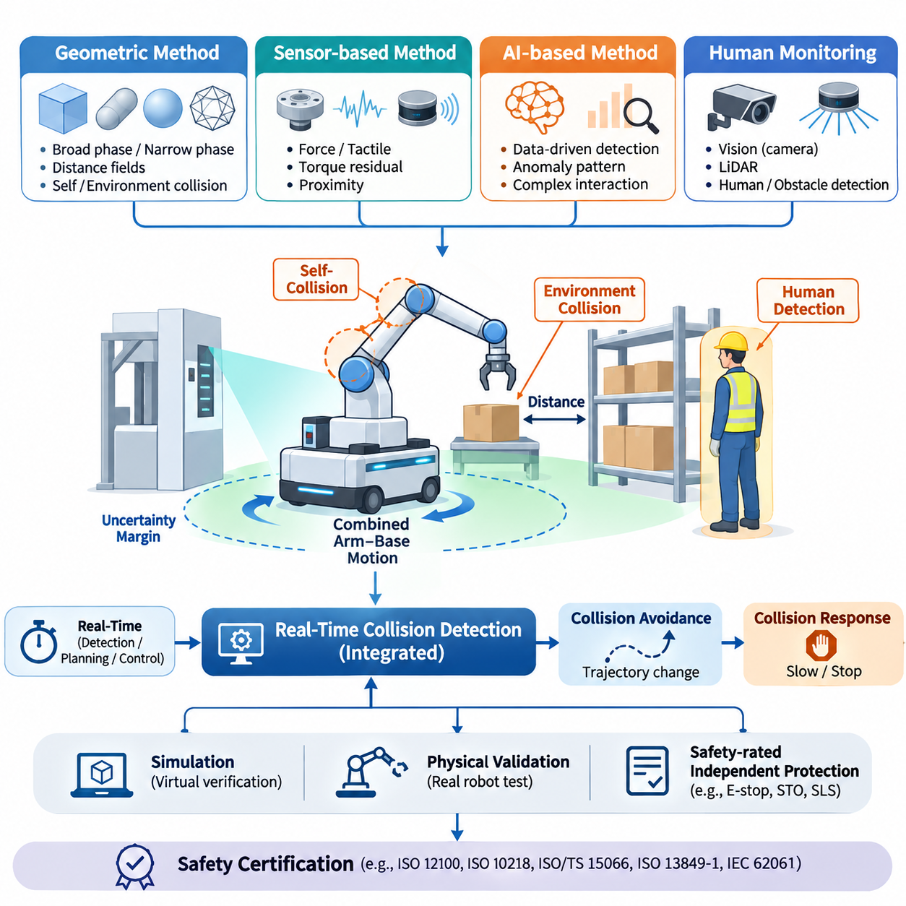
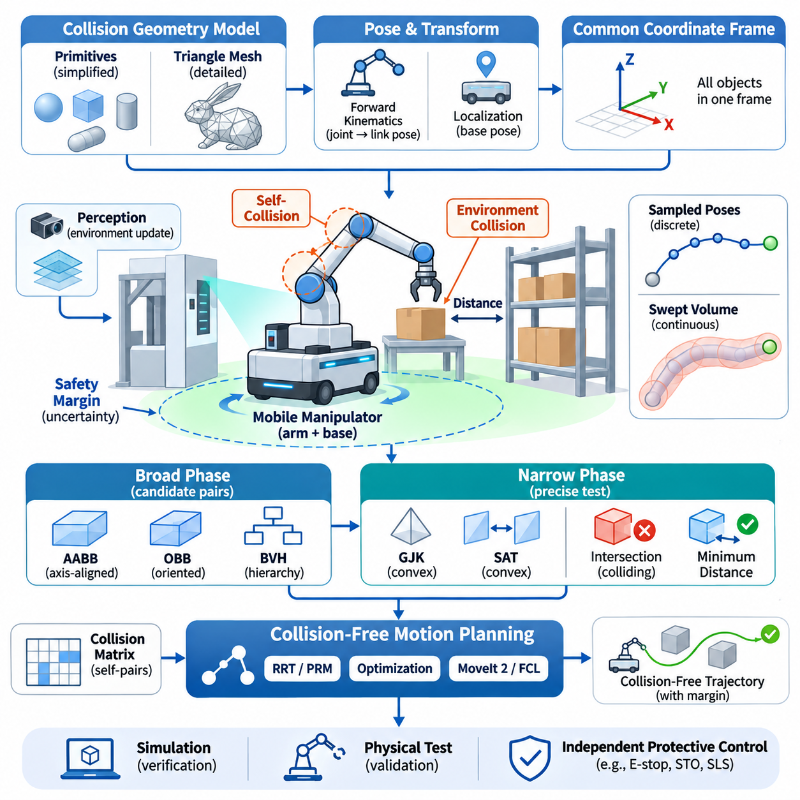
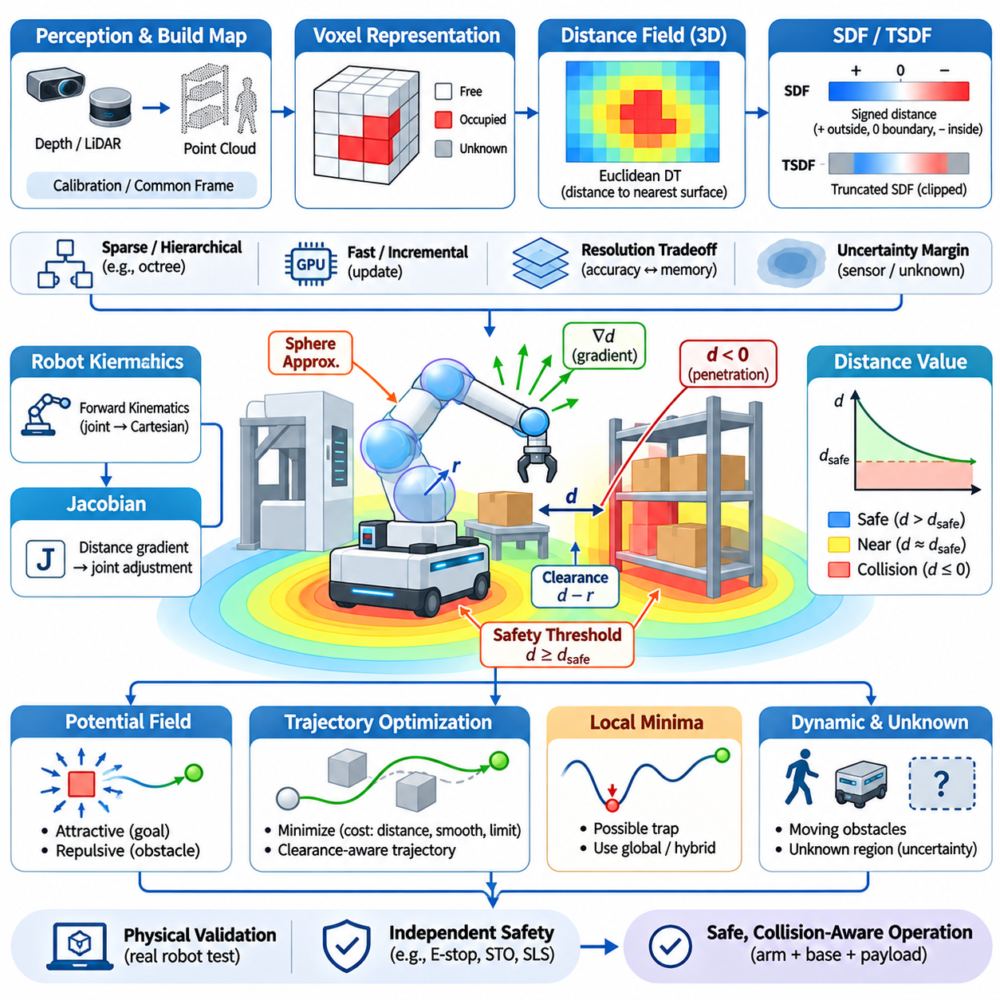
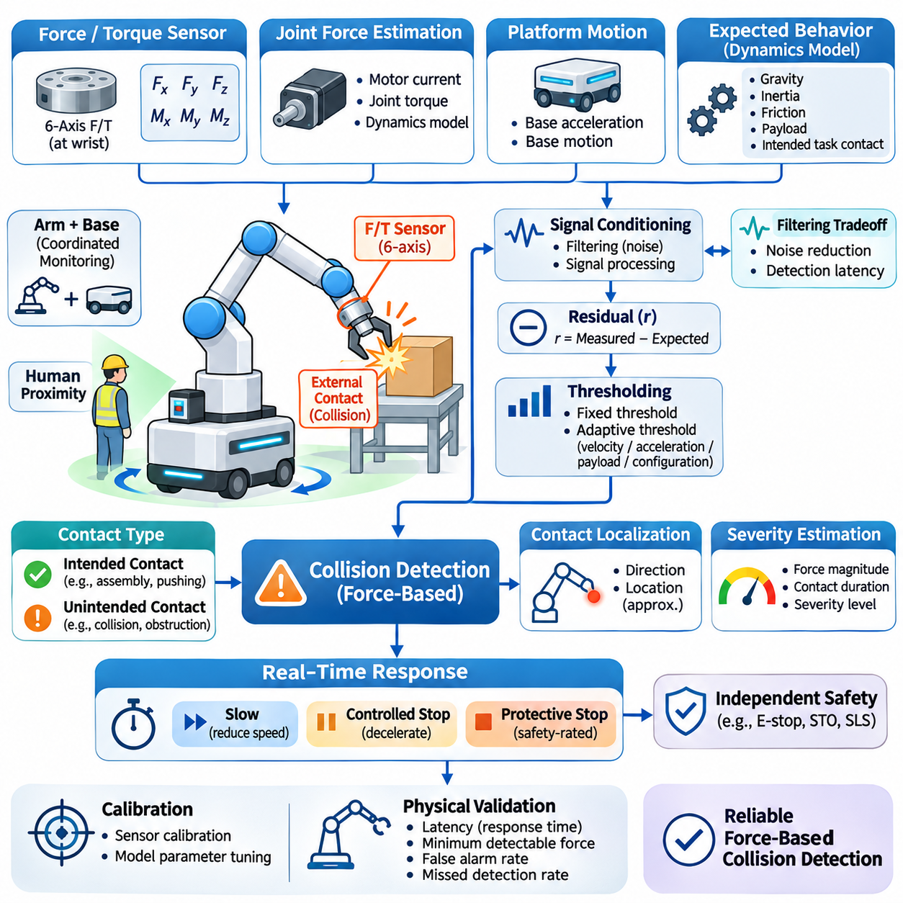
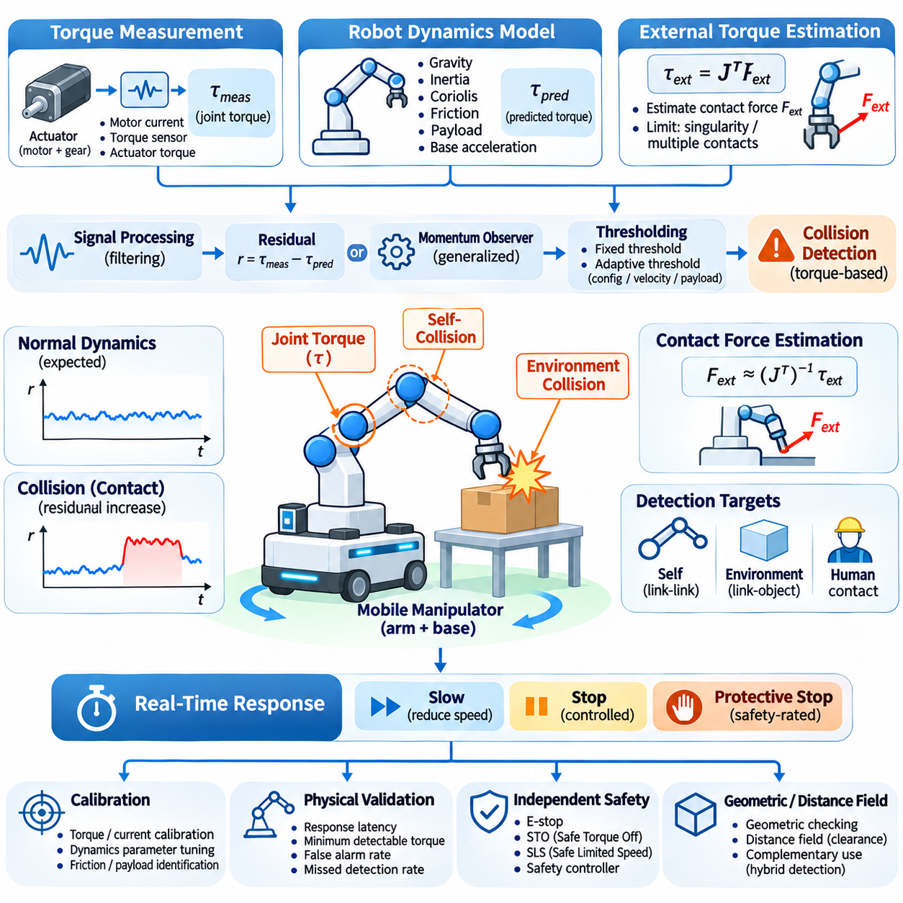
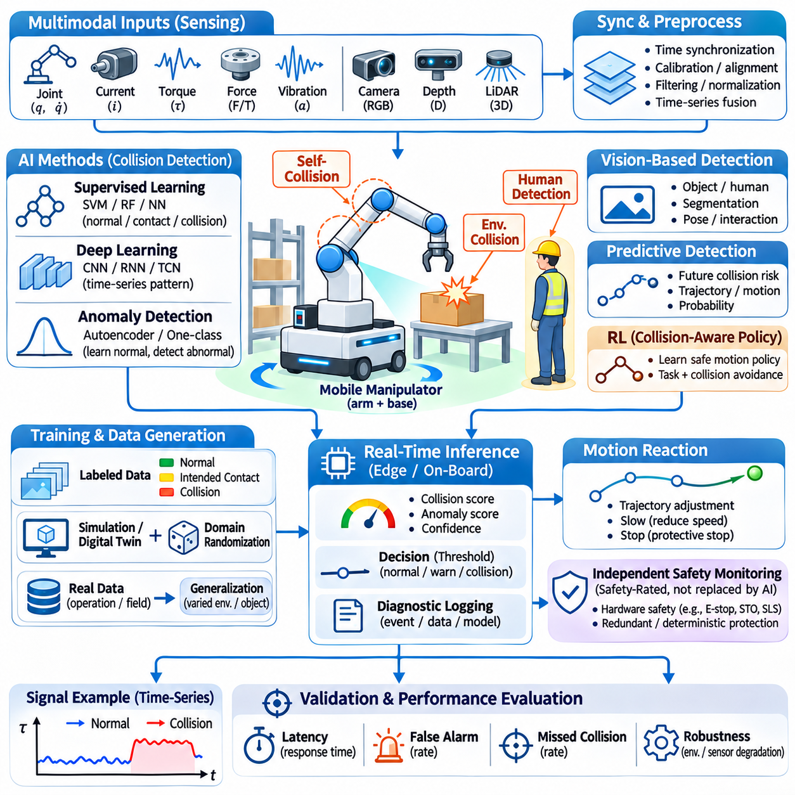
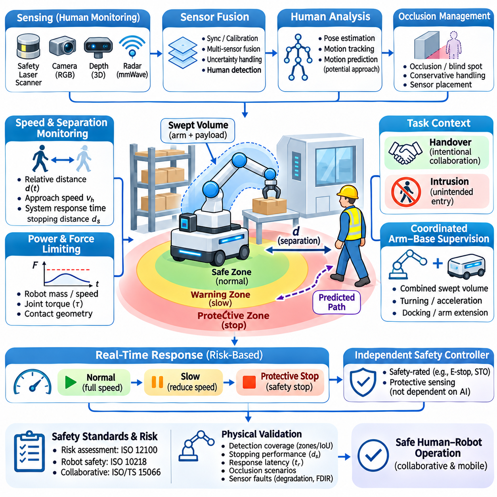
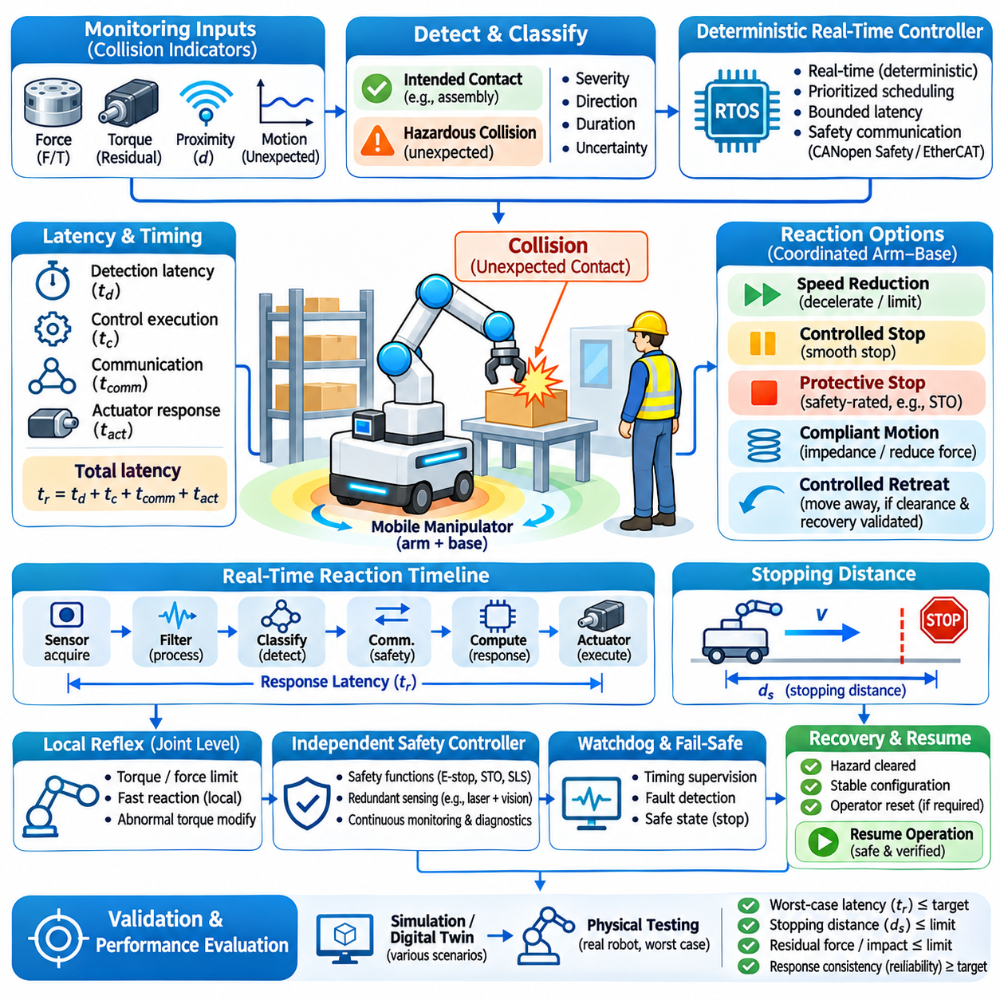
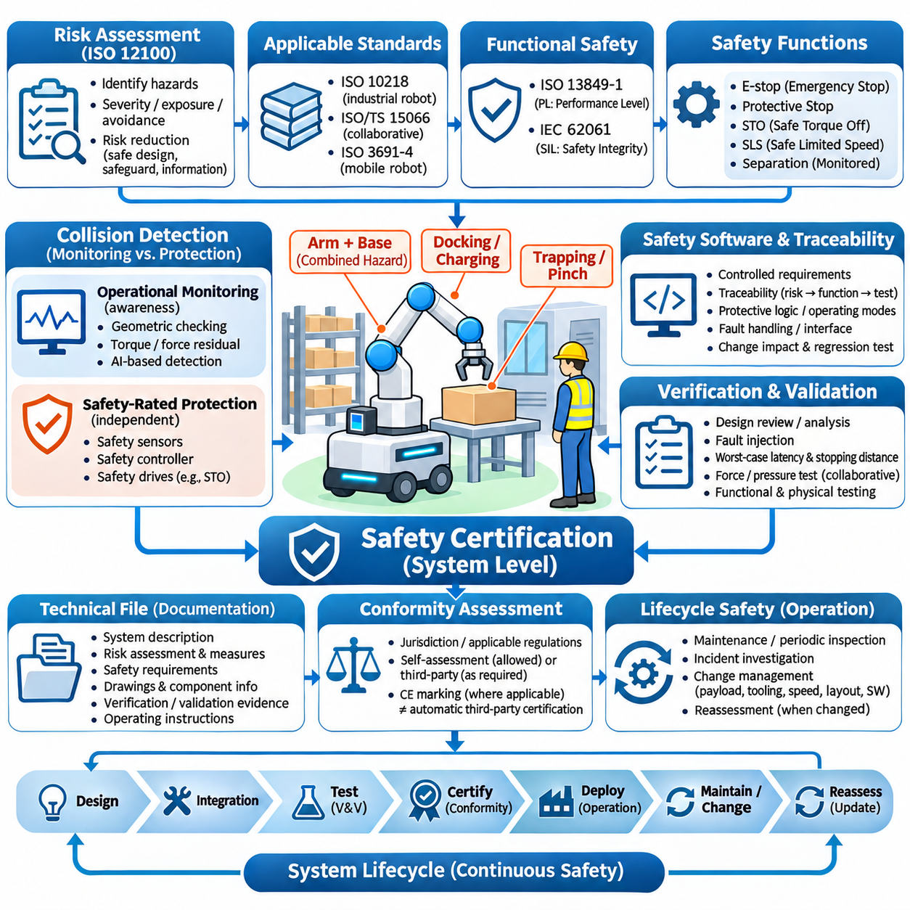

**Volume 02. Manipulator Mechanics and Control**

# Chapter 12. Collision Detection

## 01 Collision Detection Overview

{width="7.268055555555556in" height="7.268055555555556in"}

Collision detection is a fundamental capability in robotic manipulation systems, enabling robots to identify, predict, and respond to physical interactions with surrounding objects, equipment, and humans. It provides the foundation for safe motion planning, reliable task execution, and damage prevention. In industrial and mobile manipulation environments, collision detection must operate across complex geometries, changing workspaces, and unpredictable operating conditions.

A collision occurs when two physical bodies occupy overlapping spatial regions or establish unintended mechanical contact. In robotic systems, these bodies may include manipulator links, end effectors, transported objects, environmental structures, or human operators. Collision detection determines whether such interactions exist or are likely to occur, while collision avoidance modifies robot behavior to prevent hazardous contact before it develops.

Collision detection differs from collision avoidance and collision response, although these functions operate together. Detection identifies geometric interference or unexpected physical contact, avoidance generates alternative motions or modifies trajectories, and response determines the appropriate action after a hazardous condition is recognized. An effective robotic safety architecture integrates these functions through coordinated perception, planning, control, and monitoring mechanisms.

Robotic collision detection generally operates through geometric, sensor-based, and model-based approaches. Geometric methods evaluate spatial relationships between modeled objects, while sensor-based methods observe physical interactions through force, torque, tactile, or proximity measurements. Model-based techniques compare expected robot behavior against measured responses to identify abnormal interactions that may indicate unexpected contact or mechanical interference.

Geometric collision detection represents robot components and environmental objects using mathematical shapes or three-dimensional models. These representations may include spheres, capsules, boxes, convex polyhedra, or detailed triangle meshes. Collision-checking algorithms determine whether modeled bodies intersect or approach within a specified safety margin, allowing motion planners to reject configurations that violate geometric constraints.

Collision checking can be performed at different levels of computational complexity. Broad-phase detection rapidly eliminates object pairs that cannot intersect using bounding volumes or spatial partitioning structures. Narrow-phase detection performs more precise geometric calculations on potentially interacting pairs. This hierarchical organization reduces computational requirements while maintaining sufficient accuracy for complex robotic assemblies and dynamically changing environments.

Distance-based collision detection extends geometric intersection testing by measuring separation between robot surfaces and surrounding obstacles. Signed distance fields, occupancy representations, and nearest-point calculations provide continuous information about obstacle proximity. Such information supports predictive avoidance, trajectory optimization, and safety-margin enforcement, particularly when manipulators operate near machinery, shelves, workpieces, or restricted workspace boundaries.

Self-collision detection is particularly important for manipulators with multiple joints and redundant degrees of freedom. During complex movements, nonadjacent robot links may approach or intersect even when the end effector follows a valid trajectory. Self-collision checking evaluates the spatial relationships among robot components and excludes mechanically connected pairs where appropriate, preventing configurations that could damage the robot itself.

Environmental collision detection considers interactions between the manipulator and external objects. These objects may be stationary, such as fixtures and machine frames, or dynamic, such as moving vehicles and human workers. Accurate environmental representations require consistent coordinate transformations, updated perception information, and appropriate uncertainty margins. Outdated obstacle information can cause otherwise valid trajectories to become unsafe during execution.

Collision detection in mobile manipulators introduces additional complexity because both the robotic arm and mobile platform contribute to the overall motion. Base translation, platform rotation, arm articulation, and payload movement continuously change the occupied workspace. Consequently, collision checking must consider the combined robot configuration rather than treating navigation and manipulation as completely independent processes.

Force-based collision detection identifies unexpected contact by monitoring interaction forces or deviations from expected mechanical behavior. Force and torque sensors mounted at joints or end effectors provide measurements that can reveal contact events. However, measured forces may also reflect payload changes, acceleration, friction, or normal task interactions. Reliable detection therefore requires suitable thresholds, filtering, and interpretation of operational context.

Torque-based collision detection uses actuator measurements and robot dynamic models to estimate external disturbances. Differences between predicted and measured joint torques can indicate unexpected contact with environmental objects. Residual observers and momentum-based monitoring techniques are commonly used to improve sensitivity. Detection performance depends on model accuracy, sensor quality, friction compensation, and the ability to distinguish collisions from normal dynamic disturbances.

Artificial intelligence introduces data-driven methods for identifying collision patterns that may be difficult to characterize through fixed thresholds. Machine learning models can analyze joint currents, torque signals, vibration measurements, and motion histories to recognize abnormal behavior. These approaches may improve detection under varying operating conditions, but require representative training data, uncertainty evaluation, and rigorous validation before safety-critical deployment.

Human safety monitoring extends collision detection beyond mechanical interference to include proximity awareness and predictive risk assessment. Cameras, depth sensors, LiDAR, and other sensing technologies can estimate human positions and movements around robotic equipment. Safety monitoring systems use this information to support protective separation, speed adjustment, or controlled stopping according to the application and applicable safety requirements.

Real-time collision detection must operate within the timing constraints of the robot control architecture. Detection latency, sensor update rates, communication delays, and actuator response times determine how quickly the system can react to emerging hazards. A computationally accurate algorithm may still be unsuitable if its execution time prevents timely intervention. Practical implementations therefore balance geometric precision, detection sensitivity, and deterministic execution.

Collision response strategies depend on the severity of the detected condition and the operating mode of the robot. Responses may include trajectory modification, speed reduction, controlled stopping, or activation of a protective stop function. Unexpected contact during force-controlled assembly may require a different response from contact during high-speed transportation. The control architecture must distinguish permitted task contact from hazardous collisions.

Collision detection must also account for uncertainty arising from sensor noise, calibration errors, mechanical flexibility, and imperfect environmental models. Safety margins help compensate for these uncertainties, but excessively conservative margins can reduce workspace utilization and task efficiency. Robust systems combine geometric clearance, sensor confidence, dynamic constraints, and operational risk assessments to establish appropriate detection and intervention boundaries.

Simulation provides an important environment for evaluating collision detection before physical deployment. Digital robot models can reproduce joint movements, obstacle configurations, payload variations, and representative contact scenarios. Simulation enables repeated testing of geometric algorithms and motion-planning strategies without exposing equipment to unnecessary risks. Nevertheless, simulated performance must be verified against physical measurements and real operating conditions.

Industrial collision detection systems require systematic validation across normal operation, abnormal motion, sensor failures, and environmental disturbances. Evaluation metrics may include detection latency, missed collision rate, false alarm rate, minimum separation distance, and computational load. Testing should cover different robot configurations, operating speeds, payload conditions, and contact directions to establish confidence in system behavior.

Safety certification introduces additional requirements beyond algorithmic performance. Collision detection functions used for personnel protection must be incorporated into an appropriate safety-related control architecture and evaluated against applicable robotic safety standards. General-purpose perception or artificial intelligence software cannot automatically be considered a certified protective function. Safety integrity depends on the complete implementation, including hardware, diagnostics, response mechanisms, and validation evidence.

The overall objective of collision detection is to maintain safe and productive robotic operation while preserving flexibility in complex workspaces. Effective systems integrate geometric reasoning, physical sensing, dynamic modeling, real-time control, and safety supervision. As mobile manipulators become more autonomous, collision detection increasingly serves as a continuous operational capability connecting environmental understanding, motion execution, human interaction, and reliable robotic decision-making.

## 02 Geometric Collision Checking

{width="7.268055555555556in" height="7.268055555555556in"}

Geometric collision checking is a fundamental technique in robotic manipulation that determines whether the physical volumes of robot components and surrounding objects intersect. It relies on mathematical representations of three-dimensional geometry to evaluate spatial relationships during motion planning and execution. In industrial manipulators and mobile robotic systems, geometric collision checking supports safe trajectory generation, workspace analysis, and prevention of unintended mechanical interference.

The primary objective of geometric collision checking is to identify configurations in which robot links, end effectors, payloads, or environmental objects occupy overlapping regions. A collision-free configuration satisfies geometric constraints defined by the robot structure and surrounding workspace. These constraints must be evaluated repeatedly as joint positions and mobile platform poses change, ensuring that planned movements remain physically feasible throughout the complete trajectory.

Geometric representations determine both the accuracy and computational efficiency of collision checking. Simple primitives such as spheres, boxes, cylinders, and capsules provide efficient approximations of robot components. More complex shapes can be represented using convex polyhedra, triangle meshes, or combinations of primitives. The selection of geometry depends on required precision, available computing resources, and the complexity of the robot and its operating environment.

Simplified collision geometry is commonly used to reduce computational requirements. A robot arm link may be approximated by a capsule, while a mobile platform may be represented by a rectangular box or multiple convex shapes. These approximations allow rapid intersection testing without processing detailed mechanical surfaces. However, simplified models must be constructed carefully because excessive approximation can produce false collision warnings or overlook critical geometric features.

Detailed collision models use polygonal meshes to describe complex surfaces and irregular mechanical structures. Triangle meshes are particularly useful for representing industrial equipment, grippers, fixtures, and transported objects. Although mesh-based checking provides greater geometric fidelity, it requires additional computational resources. Practical robotic systems often combine simplified representations for frequent checks with detailed models for operations requiring higher spatial accuracy.

Collision checking depends on consistent coordinate transformations between robot components and environmental objects. Each collision geometry is associated with a coordinate frame that defines its position and orientation. Forward kinematics computes the transformations of robot links from joint configurations, while localization provides the pose of a mobile platform. These transformations place all relevant geometries into a common reference frame for spatial intersection testing.

Broad-phase collision detection reduces computational complexity by identifying object pairs that may potentially intersect. Bounding spheres, axis-aligned bounding boxes, and oriented bounding boxes are frequently used to approximate spatial regions. If bounding volumes do not overlap, the corresponding objects cannot collide. This filtering process eliminates unnecessary detailed calculations and becomes particularly important when a robotic system contains numerous links, obstacles, and environmental structures.

Spatial acceleration structures further improve broad-phase performance by organizing collision objects hierarchically. Bounding volume hierarchies, spatial grids, and tree-based partitioning methods allow algorithms to exclude large groups of objects from consideration. Instead of comparing every possible object pair, collision checking traverses only potentially overlapping regions. This approach improves scalability in complex industrial workspaces and dynamically updated environments.

Narrow-phase collision detection performs precise geometric tests on object pairs selected during broad-phase processing. Algorithms evaluate whether primitive shapes, convex bodies, or polygonal surfaces intersect. For convex objects, the Gilbert--Johnson--Keerthi algorithm can determine intersection or minimum separation distance. Other methods, including the Separating Axis Theorem, provide efficient collision tests for suitable geometric representations.

The Separating Axis Theorem determines whether two convex objects are separated by examining candidate projection axes. If an axis exists along which the projected intervals do not overlap, the objects are not colliding. When no separating axis is found among the required candidate axes, intersection is established. This method is especially effective for convex polygons, polyhedra, and oriented bounding boxes commonly used in robotic collision models.

Distance computation extends geometric collision checking beyond binary intersection decisions. Rather than reporting only collision or noncollision, distance-based algorithms estimate the minimum separation between objects. This information supports safety margins, proximity monitoring, and trajectory optimization. A manipulator can therefore adjust its motion before physical contact occurs, improving operational robustness when working near fixtures or sensitive equipment.

Self-collision checking evaluates possible intersections between different components of the same robot. In articulated manipulators, nonadjacent links may collide during complex joint movements, particularly near workspace boundaries or highly folded configurations. Collision matrices identify which link pairs require testing and which pairs may be excluded because of permanent mechanical adjacency. Correct configuration of these relationships improves both safety and computational efficiency.

Environmental collision checking evaluates the interaction between the robot and external workspace geometry. Obstacles may include machine frames, shelves, worktables, walls, and temporary objects. Static environments can be represented using predefined models, while changing environments require updates from perception systems. Accurate geometric registration is essential because errors in object position or orientation can produce incorrect collision-checking results.

Mobile manipulators require geometric collision checking across the combined configuration of the mobile base and robotic arm. Platform translation and rotation modify the global positions of every manipulator link, while arm movements alter the occupied volume above and around the platform. Collision checking must therefore evaluate the complete robotic structure, including mounted sensors, tools, payloads, and mechanical attachments.

Discrete collision checking evaluates individual robot configurations sampled along a planned trajectory. Although computationally efficient, this approach may miss collisions occurring between consecutive samples, particularly during rapid movements or near narrow obstacles. Increasing sampling density improves detection reliability but also increases computational cost. Sampling strategies should therefore consider joint velocities, geometric clearance, and the complexity of surrounding obstacles.

Continuous collision detection addresses limitations of discrete sampling by evaluating geometric motion between configurations. Instead of testing only selected poses, continuous methods determine whether moving bodies intersect at any point during a motion interval. Techniques such as conservative advancement and swept-volume analysis help identify intermediate collisions. These methods are particularly valuable for fast motion, large joint displacements, and operations requiring strict clearance guarantees.

Collision checking is closely integrated with robotic motion planning algorithms. Sampling-based planners, including rapidly exploring random trees and probabilistic roadmaps, use collision tests to determine whether candidate configurations and connections are valid. Optimization-based planners use geometric distance information to penalize obstacle proximity. The computational performance of collision checking directly influences planning speed, solution quality, and the feasibility of real-time replanning.

Practical implementations often use dedicated collision libraries integrated with robot description and planning frameworks. The Flexible Collision Library provides geometric collision and distance computation capabilities, while MoveIt 2 integrates collision checking into robotic planning scenes. Robot descriptions commonly define separate visual and collision geometries, allowing detailed visualization while maintaining efficient collision evaluation during planning and execution.

Geometric collision checking must account for modeling uncertainty, calibration errors, localization drift, and mechanical tolerances. Collision geometry may be expanded using conservative margins to compensate for these effects. However, excessive margins can unnecessarily restrict reachable workspace and reduce task efficiency. Appropriate margin selection requires balancing safety requirements, geometric accuracy, sensing uncertainty, and operational performance.

Validation of geometric collision checking involves testing representative robot configurations, obstacle arrangements, and motion trajectories. Important evaluation measures include collision detection accuracy, false positive rates, missed intersections, minimum clearance, and computation time. Simulated tests should be supplemented with controlled physical experiments to verify model alignment and identify discrepancies caused by mechanical deformation or inaccurate calibration.

Geometric collision checking provides a computational foundation for safe robotic motion, but it does not independently guarantee physical safety. Its effectiveness depends on accurate models, reliable state estimation, appropriate update frequencies, and integration with monitoring and protective control functions. When combined with perception, dynamic planning, and safety supervision, geometric collision checking enables manipulators and mobile robotic systems to operate efficiently within complex and constrained environments.

## 03 Distance Field Methods

{width="7.268055555555556in" height="7.268055555555556in"}

Distance field methods provide a continuous geometric representation of spatial relationships between robotic components and surrounding obstacles. Unlike binary collision checking, which determines whether objects intersect, distance fields estimate the separation between positions in space and nearby surfaces. This information enables manipulators to anticipate potential collisions, maintain clearance, and optimize motion trajectories before physical contact occurs.

A distance field assigns a scalar distance value to each location within a defined workspace. The value typically represents the shortest Euclidean distance from that location to the nearest obstacle surface. By evaluating these values at points associated with robot links or collision geometries, a motion planner can estimate obstacle proximity. Distance fields therefore transform complex geometric relationships into spatial functions suitable for efficient numerical evaluation.

Signed distance fields distinguish occupied and free regions by assigning distances with opposite signs. Under a common convention, positive values indicate positions outside obstacles, negative values indicate positions inside obstacles, and zero represents the obstacle boundary. This representation provides both proximity and penetration information. The sign convention must remain consistent throughout the planning and control system to avoid incorrect interpretations of collision conditions.

An Euclidean distance field represents the shortest straight-line distance between each workspace location and the nearest obstacle. Such fields can be generated from occupancy grids, voxel maps, or geometric surface models. Euclidean distance transforms efficiently propagate distance information across discretized environments. The resulting representation supports rapid proximity queries without repeatedly performing detailed geometric intersection tests against every environmental object.

Voxel-based distance fields divide three-dimensional space into discrete volumetric cells. Each voxel stores occupancy information, distance values, or additional environmental attributes. Higher spatial resolution improves representation accuracy around narrow passages and irregular surfaces but increases memory consumption and processing requirements. Lower resolution reduces computational cost while introducing geometric approximation errors that must be considered when defining collision margins.

Distance fields may be constructed from point clouds acquired through depth cameras, LiDAR sensors, or three-dimensional scanning systems. Sensor measurements are transformed into a common coordinate frame and integrated into an environmental representation. Distance values are then calculated relative to observed surfaces or occupied regions. Reliable construction requires accurate sensor calibration, consistent coordinate transformations, and appropriate handling of incomplete observations.

The gradient of a distance field describes the direction in which the distance value increases most rapidly. In regions where the field is differentiable, this gradient provides a local direction away from the nearest obstacle. Motion optimization algorithms can use gradient information to modify robot configurations and increase clearance. However, gradients may become discontinuous or ambiguous near equidistant surfaces, requiring numerical smoothing or robust optimization strategies.

Distance-based collision avoidance commonly defines a safety threshold around obstacles. When the estimated separation exceeds the threshold, motion may proceed without additional proximity penalties. As the distance approaches the threshold, an optimization cost or corrective action increases. This approach creates a continuous transition between unrestricted motion and obstacle avoidance, allowing manipulators to maintain clearance while preserving task-oriented movement.

Artificial potential fields use distance information to generate virtual repulsive effects around obstacles. A robot experiences an increasing repulsive influence as it approaches an occupied region, while an attractive component encourages movement toward the target. Although computationally efficient, potential field methods may encounter local minima or unstable behavior in complex environments. Distance fields provide useful geometric information but do not independently guarantee globally collision-free paths.

Trajectory optimization methods incorporate distance fields into objective functions that penalize obstacle proximity. Robot configurations are evaluated along candidate trajectories, and distance gradients guide adjustments toward safer regions. Optimization-based planning can produce smooth motions that balance collision clearance, path length, joint limits, and task accuracy. The resulting trajectory must still be validated because local optimization may converge to an infeasible solution.

Distance field evaluation for manipulators requires mapping robot configurations into Cartesian workspace positions. Forward kinematics determines the locations of selected points on robot links, end effectors, and attached tools. Distance values are queried at these positions to estimate environmental clearance. For gradient-based optimization, geometric Jacobians relate workspace distance gradients to joint-space adjustments, enabling collision avoidance within the robot\'s configuration space.

Robot geometry can be approximated using spheres or other simplified collision primitives when querying environmental distance fields. A sphere-based representation evaluates the distance from each sphere center to nearby obstacles and subtracts the sphere radius to estimate clearance. This method reduces computation while accounting for robot volume. The quality of the approximation depends on primitive placement, geometric coverage, and the treatment of unmodeled surfaces.

Signed distance fields also support penetration analysis when modeled objects overlap. Negative distance values can indicate how deeply a query point lies inside an occupied region, while local gradients provide approximate directions for resolving interference. Such information is useful for trajectory correction and geometric optimization. However, point-based penetration estimates do not necessarily equal the exact minimum translation required to separate complex rigid bodies.

Dynamic environments require distance fields to be updated as obstacles move or new objects are detected. Incremental mapping methods modify affected spatial regions rather than rebuilding the entire representation. Efficient updates are important for mobile manipulators operating around moving equipment and personnel. Nevertheless, sensing latency and incomplete observations can cause the distance field to differ from the actual environment, requiring conservative safety measures.

Mobile manipulation introduces additional challenges because the robot base and arm continuously change their positions relative to environmental obstacles. Distance fields can support coordinated navigation and manipulation by providing a shared representation of obstacle proximity. Base placement, arm configuration, and payload geometry can be evaluated together. This enables motion planners to identify configurations that improve reachability while maintaining clearance around the complete robotic system.

Distance field methods must account for unknown and partially observed regions. A location without sensor measurements cannot automatically be classified as collision-free. Mapping systems may distinguish occupied, free, and unknown space, applying different planning policies to each category. Conservative applications treat unknown regions as potentially hazardous, while exploratory systems may permit controlled movement under additional sensing and risk constraints.

Computational performance depends on workspace dimensions, voxel resolution, update frequency, and query complexity. Dense three-dimensional fields provide direct access to distance values but may require substantial memory. Sparse voxel structures, hierarchical representations, and truncated signed distance fields reduce storage requirements by concentrating information in relevant regions. GPU acceleration and parallel processing can further improve performance for large environments and frequent distance queries.

Truncated signed distance fields represent signed distances only within a limited range around observed surfaces. Values beyond the truncation distance are clipped or left unspecified, reducing the amount of detailed information required. These representations are widely used in three-dimensional reconstruction and sensor fusion. For collision avoidance, planners must distinguish locally accurate surface distances from regions where reliable global obstacle clearance is unavailable.

Distance field accuracy depends on sensor resolution, map discretization, calibration quality, and environmental dynamics. Interpolation between voxel centers can provide smoother distance estimates, but interpolation introduces approximation errors. Safety margins should account for these errors and for uncertainty in robot localization and mechanical geometry. Experimental validation is necessary to establish whether calculated clearances correspond sufficiently well to actual physical separation.

Distance field methods provide a powerful connection between environmental perception, geometric collision checking, and optimization-based motion control. Their continuous distance representation supports proactive obstacle avoidance, smooth trajectory generation, and coordinated mobile manipulation. When combined with accurate mapping, robust state estimation, and independent safety mechanisms, distance fields improve the efficiency and reliability of robotic operation in complex industrial environments.

## 04 Force Based Detection

{width="7.268055555555556in" height="7.268055555555556in"}

Force-based collision detection identifies unexpected physical contact by monitoring forces generated between a robot and its surrounding environment. Unlike geometric collision checking, which predicts interference from spatial models, force-based detection relies on measured mechanical interactions. It enables robots to recognize collisions that occur during actual operation, including contact with unmodeled objects, fixtures, equipment, and human operators.

The fundamental principle is that a robot normally experiences predictable forces during planned movements and task execution. When unexpected contact occurs, additional external forces modify the robot\'s mechanical response. By measuring these deviations, the control system can identify potential collisions and determine whether corrective actions are necessary. This approach is particularly useful when environmental geometry is incomplete or uncertain.

Force-based collision detection commonly uses force and torque sensors installed at the robot wrist, end effector, or mechanical interfaces. A six-axis force/torque sensor measures three translational force components and three rotational torque components. These measurements provide information about external interactions and allow the controller to distinguish unexpected contact from normal manipulation forces under appropriate operating conditions.

Wrist-mounted force/torque sensors are widely used because they measure interaction forces close to the end effector. During assembly, insertion, pushing, and surface-following operations, these sensors provide valuable feedback about contact conditions. Unexpected force increases or abnormal torque patterns can indicate collisions, misalignment, excessive contact pressure, or mechanical obstruction. Sensor placement and measurement range must be selected according to the robot\'s payload and application requirements.

Joint-level force estimation provides another approach when dedicated force sensors are unavailable. Motor current, actuator torque measurements, and robot dynamic models can be used to estimate the external forces acting on the manipulator. The estimated interaction is obtained by comparing measured actuator behavior with the torque predicted by the dynamic model. This method reduces additional hardware requirements but depends strongly on model accuracy and actuator measurement quality.

A fundamental challenge is distinguishing collision forces from normal operational forces. Robot motion naturally produces inertial forces, gravitational effects, friction, and dynamic coupling between joints. Contact during a planned manipulation task may also generate substantial forces without representing a hazardous collision. Therefore, collision detection must consider the expected mechanical behavior associated with the current robot configuration, velocity, acceleration, and task state.

Threshold-based detection is one of the simplest force-based approaches. The system defines acceptable force and torque limits for different operating conditions and identifies potential collisions when measured values exceed these thresholds. Separate thresholds can be established for individual axes or combined force magnitudes. Although straightforward to implement, fixed thresholds may generate false alarms during rapid motion or fail to detect low-force collisions in sensitive applications.

Adaptive thresholding improves detection reliability by adjusting acceptable force limits according to operating conditions. The system may consider robot velocity, acceleration, payload, joint configuration, and expected contact behavior when calculating detection thresholds. This allows greater sensitivity during slow and precise manipulation while avoiding unnecessary collision warnings during normal dynamic movements. Adaptive thresholds must nevertheless remain within validated safety limits.

Signal processing plays an important role in reliable force-based detection. Raw sensor measurements may contain electrical noise, vibration, mechanical resonance, and transient disturbances. Low-pass filters and appropriate signal conditioning can reduce unwanted fluctuations before collision evaluation. However, excessive filtering introduces detection delay and may suppress short-duration contact events. Filter characteristics must therefore balance noise reduction and response speed.

Residual-based detection compares measured interaction behavior with the response predicted by a robot dynamics model. The difference between expected and observed measurements forms a residual signal that indicates possible external disturbances. When the residual exceeds an appropriate threshold, the system identifies a potential collision. This approach can detect unexpected contact without requiring a dedicated external force sensor, provided that model uncertainty and normal dynamic disturbances are adequately addressed.

Force-based collision detection can also support collision localization and severity estimation. Multiple force and torque measurements, combined with robot kinematics, provide information about the direction and approximate location of external contact. The magnitude and duration of the measured interaction can help estimate collision severity. However, accurately identifying the contact location is difficult when several links interact simultaneously or when the robot structure exhibits mechanical flexibility.

In mobile manipulators, force-based collision detection must consider interactions involving both the robotic arm and the mobile platform. Unexpected contact may occur through the end effector, arm links, payload, or platform structure. Motion of the mobile base can also introduce inertial disturbances that influence force measurements. Coordinated monitoring of arm dynamics, base motion, and platform acceleration is therefore important for reliable collision identification.

Human-robot interaction introduces additional requirements for force-based collision detection. Contact with a human body must be evaluated according to the location, direction, magnitude, and duration of the applied force. Sensitive detection thresholds and rapid protective responses are particularly important in collaborative environments. Nevertheless, force sensing alone cannot guarantee human safety because hazardous proximity may exist before physical contact occurs. It should be combined with appropriate proximity monitoring and certified protective functions.

Real-time collision response requires the detection system to communicate with the robot controller within predictable timing constraints. Once abnormal contact is identified, the controller may reduce motion speed, stop the current trajectory, release commanded torque, or activate an appropriate protective stop. The response depends on collision severity, task requirements, and the safety architecture. Detection algorithms must be designed to avoid unnecessary delays between contact recognition and protective action.

Force-based detection requires systematic calibration and validation. Sensor bias, temperature variation, mounting stiffness, mechanical wear, and payload changes can influence measurement accuracy. Calibration procedures should establish reliable force and torque references under representative operating conditions. Testing should include different robot configurations, movement speeds, payloads, and contact directions to evaluate detection sensitivity and false alarm behavior.

Performance evaluation commonly considers detection latency, minimum detectable force, false positive rate, missed collision rate, and response consistency. Experiments should distinguish intentional task contact from unexpected collision events and include representative dynamic conditions. Simulation can support preliminary algorithm development, but physical testing remains essential because real sensor noise, structural vibration, and mechanical interactions are difficult to reproduce accurately.

Force-based collision detection provides an important layer of physical interaction awareness in robotic systems. By combining direct measurements, dynamic model estimation, signal processing, and real-time control, robots can recognize unexpected contact and respond appropriately during manipulation. When integrated with geometric collision checking, distance-based monitoring, and independent safety mechanisms, force-based detection improves operational robustness and supports safer collaboration in complex industrial environments.

## 05 Torque Based Detection

{width="7.268055555555556in" height="7.268055555555556in"}

Torque-based collision detection is an important technique for identifying unexpected physical interactions in robotic manipulators by monitoring joint torque behavior. It estimates external disturbances through actuator torque measurements and robot dynamic models rather than relying exclusively on dedicated force sensors. By comparing expected and measured torque values, the controller can recognize abnormal mechanical responses that may indicate collisions, unintended contact, or excessive external loading during robot operation.

The fundamental principle is based on the relationship between joint torque and robot motion. During normal operation, each joint generates torque to overcome gravity, inertia, friction, and dynamic coupling effects. When an unexpected collision occurs, an additional external torque is introduced into the mechanical system. Torque-based detection identifies this disturbance by analyzing deviations between predicted joint torque and actual measured torque.

Joint torque measurements can be obtained from motor current sensors, integrated torque sensors, or actuator-level measurement systems. In electric actuators, motor current is closely related to electromagnetic torque through the motor torque constant. After considering gear ratios and transmission efficiency, the controller can estimate the torque delivered to each joint. The accuracy of this estimation depends on actuator characteristics, current measurement resolution, and mechanical transmission behavior.

Robot dynamics models provide the theoretical reference required for torque-based collision detection. These models describe the relationship between joint positions, velocities, accelerations, and the torques required to produce a particular movement. Gravity compensation, inertial effects, Coriolis forces, centrifugal forces, and friction must be considered when predicting normal joint behavior. Inaccurate dynamic models can produce residual errors that reduce collision detection reliability.

Residual-based torque detection compares measured joint torque with the torque predicted by the dynamic model. The difference between these values is defined as the external torque residual. Under normal operating conditions, the residual should remain within an expected range determined by model accuracy and measurement uncertainty. When an unexpected contact introduces additional torque, the residual may increase beyond a predefined threshold, indicating a possible collision event.

Momentum-based observers provide another approach to estimating external joint disturbances. Instead of directly calculating all dynamic terms at every control cycle, these observers use robot momentum and measured actuator torque to estimate discrepancies between expected and actual mechanical behavior. Generalized momentum observers are particularly useful for detecting external interactions because they can reduce dependence on direct acceleration measurements, which are often sensitive to sensor noise.

Threshold-based torque detection identifies collisions when estimated external torque exceeds predefined limits. Individual thresholds can be assigned to different joints according to their mechanical characteristics, payload conditions, and expected operating loads. A combined threshold may also be used to evaluate disturbances across multiple joints. Threshold selection must balance sensitivity and robustness because excessively low values generate false alarms, while excessively high values may delay or miss collision detection.

Adaptive torque thresholds improve detection performance under changing operating conditions. Joint acceleration, robot configuration, payload mass, and movement speed influence the expected torque distribution throughout the manipulator. An adaptive detection system adjusts its reference values according to these conditions, allowing it to distinguish normal dynamic torque variations from unexpected external disturbances. However, adaptive thresholds must remain constrained by validated safety limits.

Signal processing is essential for interpreting torque measurements reliably. Motor current fluctuations, gearbox vibration, mechanical backlash, electrical interference, and transmission friction can introduce noise into measured torque signals. Filtering and signal conditioning reduce these disturbances before residual evaluation. However, excessive filtering may delay collision recognition, particularly when contact occurs suddenly. Detection algorithms must therefore maintain sufficient sensitivity while suppressing normal measurement variations.

External joint torque can be related to Cartesian contact forces through the robot Jacobian. The relationship between end-effector wrench and joint torque is expressed through the transposed Jacobian matrix. This relationship allows the controller to estimate the direction and magnitude of external interaction forces from joint-level torque disturbances. Nevertheless, force reconstruction becomes less reliable near singular configurations or when multiple contact points generate simultaneous mechanical interactions.

Self-collision and environmental collision detection can both benefit from torque-based monitoring. Unexpected contact between robot links, end effectors, payloads, and external structures may introduce abnormal joint torque patterns. Unlike purely geometric methods, torque-based detection can identify physical contact even when environmental geometry is incomplete or inaccurately modeled. However, it generally detects contact after mechanical interaction has begun rather than predicting every potential collision in advance.

In mobile manipulators, torque-based collision detection must account for disturbances introduced by both the robotic arm and the moving platform. Base acceleration, platform vibration, payload movement, and changes in gravitational loading can influence joint torque measurements. The dynamic model should therefore consider the combined mechanical behavior of the mobile base and manipulator. Coordinated monitoring helps distinguish environmental contact from disturbances caused by normal platform motion.

Real-time torque-based detection requires continuous monitoring within the robot control loop. Joint torque measurements and dynamic predictions must be processed at sufficiently high frequencies to identify abnormal interactions before they become hazardous. Once a collision is detected, the controller may reduce joint velocity, stop the current trajectory, modify commanded torque, or activate a protective response. The appropriate action depends on collision severity, robot configuration, and task requirements.

Torque-based detection has several practical limitations. Model inaccuracies, uncertain payload properties, joint friction, transmission compliance, and temperature-dependent actuator characteristics can affect residual estimation. Low-force collisions may be difficult to distinguish from normal dynamic disturbances, while sudden high-acceleration movements can produce large residuals without actual contact. Reliable implementations require accurate parameter identification, appropriate filtering, and systematic evaluation under representative operating conditions.

Validation of torque-based collision detection involves testing different robot configurations, payloads, motion speeds, and external contact conditions. Important performance indicators include detection latency, minimum detectable external torque, false alarm rate, missed collision rate, and consistency across repeated experiments. Testing should also evaluate whether collision detection remains reliable during acceleration, deceleration, direction changes, and contact with objects of different stiffness.

Torque-based collision detection provides an effective approach to robot interaction monitoring without necessarily requiring additional force-sensing hardware. By combining actuator measurements, dynamic modeling, disturbance observers, and real-time control, robotic systems can identify unexpected external interactions and respond appropriately. When integrated with geometric collision checking, distance field methods, and independent safety functions, torque-based detection strengthens collision awareness and improves the reliability of industrial and mobile manipulation systems.

## 06 AI Based Collision Detection

{width="7.268055555555556in" height="7.268055555555556in"}

AI-based collision detection applies machine learning and artificial intelligence techniques to identify unexpected physical interactions between robots and their surrounding environments. Unlike conventional methods that depend primarily on predefined geometric models, fixed thresholds, or explicit dynamic equations, AI-based approaches learn collision-related patterns from sensor measurements and operational data. These methods can recognize complex interactions and abnormal behaviors that are difficult to describe using traditional analytical models.

The fundamental principle is to analyze multiple sensor signals and identify deviations from normal robotic operation. Input data may include joint positions, velocities, motor currents, estimated torques, force measurements, vibrations, and visual observations. Machine learning models learn the relationships between these signals and different operating conditions. When an observed pattern differs significantly from expected behavior, the system can classify it as a potential collision or abnormal interaction.

Supervised learning provides a common approach to AI-based collision detection. Training datasets contain labeled examples of normal operation, intentional contact, unexpected collisions, and different levels of mechanical disturbance. Classification algorithms learn to distinguish these conditions from sensor measurements. Models such as support vector machines, random forests, and neural networks can be trained to recognize collision patterns and estimate their severity under representative operating conditions.

Deep learning extends these capabilities by automatically extracting complex features from high-dimensional sensor data. Convolutional neural networks can identify characteristic patterns in time-frequency representations of vibration and torque signals, while recurrent neural networks and temporal convolutional networks can analyze sequential measurements. These architectures capture temporal dependencies that may indicate the development of an unexpected collision rather than relying on individual sensor readings.

Anomaly detection is particularly useful when comprehensive collision datasets are unavailable. Instead of learning every possible collision pattern, the model learns the statistical characteristics of normal robot operation. Autoencoders, one-class classification methods, and probabilistic models can identify observations that differ significantly from learned normal behavior. This approach is valuable for detecting previously unseen interactions, although abnormal operating conditions may also produce false collision alarms.

Time-series analysis plays an important role because collision events typically produce changes in sensor signals over time. A sudden increase in joint torque, motor current, or vibration may indicate contact, while the subsequent signal evolution can provide information about the interaction. Temporal models analyze these patterns across multiple sampling intervals, improving the ability to distinguish short collision events from ordinary mechanical fluctuations and operational disturbances.

Multimodal sensor fusion combines information from different sensing modalities to improve collision detection reliability. Force sensors, joint torque measurements, motor currents, cameras, depth sensors, and LiDAR provide complementary information about physical interactions and environmental conditions. AI models can integrate these inputs to identify collisions that may not be clearly observable through a single sensor. Effective fusion requires accurate time synchronization, coordinate alignment, and consistent sensor calibration.

Vision-based collision detection uses cameras and deep learning models to recognize potentially hazardous spatial interactions. Object detection, semantic segmentation, and pose estimation can identify people, equipment, obstacles, and moving objects around a robot. By analyzing relative positions and motion patterns, the system can estimate potential collision risks before physical contact occurs. However, visual detection alone may be insufficient when objects are occluded, lighting conditions are poor, or camera observations are delayed.

Predictive collision detection uses learned models to estimate the probability of future contact based on current motion and environmental observations. The system analyzes robot trajectories, obstacle movements, relative velocities, and spatial relationships to identify potentially hazardous situations. Recurrent models and temporal prediction networks can estimate future interaction states, allowing motion planners to modify trajectories or reduce speed before a collision occurs.

Reinforcement learning can contribute to collision-aware robotic behavior by learning policies that balance task completion and collision avoidance. An agent receives rewards or penalties according to task progress, movement efficiency, and collision-related events. Through repeated interaction in simulation or controlled environments, it learns motion strategies that reduce collision risk. However, reward design, exploration safety, and transfer from simulation to physical robots require careful consideration.

AI-based collision detection can also use digital twins and simulation environments to generate diverse training data. Simulated robots can be exposed to different obstacle arrangements, payload conditions, joint configurations, and contact scenarios. Synthetic sensor measurements provide labeled examples for training and preliminary evaluation. Domain randomization can introduce variations in physical parameters and sensor characteristics, helping models generalize beyond a single simulated environment.

A major challenge is the availability and quality of training datasets. Collision events are relatively rare in normal industrial operation, and deliberately collecting collision data can damage equipment or create safety risks. Datasets should therefore include representative normal movements, intentional task contacts, abnormal disturbances, and controlled collision experiments. Data diversity is essential because models trained under limited conditions may fail when robot configurations, payloads, environmental structures, or operating speeds change.

Model generalization determines whether an AI-based detector remains reliable under conditions different from those represented in its training data. Changes in payload mass, mechanical wear, temperature, actuator characteristics, and sensor calibration can modify normal signal patterns. Domain adaptation, transfer learning, and periodic model evaluation can help address these variations. Nevertheless, models must be tested under representative deployment conditions rather than assuming that training accuracy guarantees operational reliability.

Real-time implementation introduces additional computational and architectural requirements. AI inference must operate within the available control and monitoring time budgets without introducing excessive latency. Lightweight neural networks, optimized inference engines, edge computing, and hardware acceleration can support deployment on embedded robotic controllers. The detection system should also define how model outputs are communicated to motion planners, joint controllers, and independent safety functions.

AI-based collision detection requires careful attention to uncertainty and explainability. A model may produce a collision probability or abnormality score rather than a definitive physical interpretation. Confidence estimation and decision thresholds help determine when additional verification or protective action is necessary. Interpretable features, signal attribution, and diagnostic logging can assist engineers in understanding why a collision was detected and distinguishing genuine contact from unexpected but harmless operating conditions.

Safety validation is essential before AI-based collision detection is used in industrial or collaborative robotic applications. Evaluation should include detection accuracy, false positive rate, missed collision rate, response latency, robustness, and performance under sensor degradation. AI predictions should not automatically replace certified safety functions. Safety-related protective actions must remain supported by an appropriately validated architecture, including independent monitoring and deterministic response mechanisms where required.

AI-based collision detection provides an adaptive approach to recognizing complex and previously unmodeled physical interactions in robotic systems. By combining machine learning, temporal signal analysis, multimodal sensor fusion, and predictive modeling, it can complement geometric, force-based, and torque-based detection methods. When supported by representative datasets, reliable real-time implementation, and rigorous safety validation, AI-based collision detection improves environmental awareness and enables more robust operation of industrial manipulators and mobile robotic systems.

## 07 Human Safety Monitoring

{width="7.268055555555556in" height="7.268055555555556in"}

Human safety monitoring is a fundamental requirement in robotic systems operating near people, particularly collaborative robots and mobile manipulators. It involves continuously observing human presence, movement, proximity, and interaction conditions to prevent hazardous contact. Unlike collision detection that responds after physical interaction occurs, human safety monitoring emphasizes early hazard recognition and preventive action before a dangerous situation develops.

The primary objective is to maintain safe separation between humans and moving robotic components while allowing productive cooperation. Monitoring systems evaluate the positions and movements of operators, robot arms, end effectors, mobile platforms, and transported objects. Safety decisions depend on relative distance, movement direction, velocity, and the potential consequences of contact. These measurements support dynamic adjustment of robot behavior according to human activity.

Human detection commonly relies on safety laser scanners, cameras, depth sensors, radar, and other proximity sensing technologies. Safety-rated laser scanners can monitor defined protective fields and trigger appropriate safety functions when a person enters a hazardous region. Cameras and depth sensors provide richer spatial information for recognizing human bodies and movements. However, ordinary perception sensors should not be assumed to provide certified protective functions without appropriate validation.

Safety monitoring systems frequently divide the robot workspace into regions associated with different levels of risk. Warning zones may indicate that a person is approaching an operating robot, while protective zones require predefined safety responses. The size and shape of these regions depend on robot speed, stopping performance, sensor coverage, and environmental conditions. Dynamic zones can improve productivity, but their safety-related implementation requires validated monitoring and control.

Speed and separation monitoring is an important strategy for maintaining safe human-robot interaction. The robot continuously evaluates the distance between moving components and nearby people, accounting for human approach speed, robot movement, system response time, and stopping distance. When separation decreases, the robot may reduce speed or initiate a protective stop. Safety-rated implementations must satisfy the applicable requirements for protective separation distances.

Power and force limiting provides another approach to collaborative operation by restricting the mechanical energy and contact forces associated with robot movement. This strategy considers robot mass, velocity, joint torque, contact geometry, and the characteristics of potentially exposed body regions. Properly designed systems may permit certain forms of contact within validated limits. However, acceptable conditions depend on the specific application and cannot be determined from force measurements alone.

Human pose estimation can improve awareness of operator movements and body configurations. Computer vision models identify body landmarks, estimate skeletal positions, and track motion patterns during interaction with robots. This information can help distinguish ordinary movement from potentially hazardous actions, such as reaching into an active workspace. Nevertheless, pose estimation may become unreliable under occlusion, unusual postures, or difficult lighting conditions.

Predictive human motion analysis extends monitoring beyond current positions by estimating possible future movements. Temporal models analyze walking direction, body orientation, velocity, and recent motion history to anticipate entry into hazardous regions. These predictions can support early robot deceleration or trajectory adjustment. Because human behavior is uncertain, predictive estimates should complement rather than replace validated protective monitoring.

Sensor fusion improves human safety monitoring by combining measurements from multiple independent sensing technologies. Laser scanners provide reliable planar coverage within their specified operating conditions, while depth cameras and three-dimensional sensors offer additional spatial information. Radar may support detection in environments where optical sensing is difficult. Fusion algorithms must account for sensor uncertainty, calibration errors, synchronization, and overlapping coverage.

Occlusion management is particularly important in industrial environments containing equipment, storage racks, workpieces, and moving vehicles. A person may become temporarily hidden behind an obstacle while remaining close to a robot\'s operating region. Monitoring systems should identify unobservable areas and apply conservative assumptions when human presence cannot be excluded. Sensor placement and workspace design should minimize blind spots and support predictable protective behavior.

Mobile manipulators introduce additional safety challenges because both the mobile base and robotic arm can move simultaneously. Human safety monitoring must consider the combined swept volume of the platform, manipulator links, end effector, and payload. Turning, acceleration, docking, and arm extension can create changing hazard regions. Coordinated motion supervision is necessary to prevent unsafe interactions caused by independently planned base and arm movements.

Human safety monitoring must also distinguish intentional collaboration from unintended intrusion. During handovers, assisted assembly, and shared manipulation tasks, operators may deliberately approach the robot or enter its working area. The control architecture should recognize authorized task states and apply the appropriate collaborative operating mode. However, task recognition must not bypass protective functions or permit unsafe contact simply because an interaction appears intentional.

Real-time safety monitoring requires predictable communication between sensors, safety controllers, and robotic actuators. When a protective condition is detected, the system must initiate the required response within its validated timing constraints. Safety-related communication and control functions should address faults, delayed messages, sensor failures, and unexpected operating states. Independent protective mechanisms remain important when higher-level perception or planning software becomes unavailable.

Risk assessment provides the foundation for selecting appropriate human safety monitoring strategies. Engineers evaluate foreseeable hazards, operating modes, exposure frequency, possible injury severity, and opportunities for hazard avoidance. Standards such as ISO 12100, ISO 10218, and ISO/TS 15066 provide relevant frameworks for machinery risk assessment and industrial collaborative robot applications. Mobile platforms may also require consideration of applicable driverless industrial truck safety standards.

Validation should examine human detection coverage, protective separation, stopping performance, response latency, and behavior under realistic environmental conditions. Testing must include different approach directions, movement speeds, body postures, occlusions, and sensor degradation scenarios. Safety performance should be verified across representative robot configurations and payload conditions. Simulation supports development, but physical validation remains necessary for safety-related functions.

Human safety monitoring increasingly incorporates AI-based perception and behavior prediction to improve situational awareness. Learning-based models can recognize human activities, estimate movement intentions, and identify unusual interactions. These capabilities may improve productivity by enabling context-sensitive robot behavior. However, AI outputs introduce uncertainty and should not be treated as equivalent to certified safety sensing or deterministic protective control without suitable assurance.

Effective human safety monitoring combines preventive sensing, risk-aware motion control, validated protective functions, and systematic operational procedures. No single sensor or algorithm can address every hazard associated with human-robot interaction. By integrating proximity monitoring, collision detection, motion prediction, and independent safety mechanisms, robotic systems can support productive collaboration while maintaining appropriate protection for operators and nearby personnel.

## 08 Real Time Reaction

{width="7.268055555555556in" height="7.268055555555556in"}

Real-time reaction is a critical capability in robotic collision detection systems because identifying a hazardous interaction is insufficient unless the robot responds quickly and predictably. It connects collision recognition with immediate control actions that reduce the consequences of unexpected contact. In industrial manipulators and mobile robotic platforms, effective reaction mechanisms must consider detection latency, controller execution time, actuator response, and mechanical stopping behavior.

The fundamental objective is to minimize the time between detecting an abnormal condition and initiating an appropriate protective response. A real-time reaction system continuously monitors collision indicators such as external force, joint torque residuals, proximity measurements, and unexpected motion. When a hazardous condition is identified, the controller evaluates the required response and activates predefined actions according to the robot\'s operating state and safety requirements.

Reaction latency consists of several contributing delays throughout the sensing and control architecture. Sensor acquisition, signal filtering, collision classification, communication, control computation, and actuator activation all influence the total response time. Even small delays can become significant when a robot moves at high speed or carries a heavy payload. Therefore, system designers must evaluate end-to-end timing rather than considering detection algorithm performance in isolation.

Deterministic execution is essential for safety-related real-time reaction. The controller must perform critical monitoring and response operations within defined timing constraints, even when computational workloads vary. Real-time operating systems, prioritized scheduling, bounded communication delays, and dedicated safety controllers can improve timing predictability. Average processing speed alone is insufficient because occasional excessive delays may compromise protective performance.

Protective stopping is one of the most common responses to detected collisions or hazardous proximity. Depending on the application and safety architecture, the system may initiate a controlled stop, activate a safety-rated monitored stop, or remove actuator power through an appropriate safety function. Different stopping methods produce different mechanical consequences. The selected response must consider stopping distance, gravity loading, payload retention, and the possibility of uncontrolled movement.

Speed reduction provides an alternative when immediate stopping is unnecessary and continued motion remains safe. The robot may decrease joint velocity, platform speed, or acceleration limits as a person approaches or an uncertain obstacle is detected. Progressive deceleration can reduce unnecessary interruptions while maintaining appropriate separation. However, speed adaptation must be based on validated safety constraints rather than relying solely on non-safety-rated perception outputs.

Collision severity assessment helps determine whether the system should slow down, stop, or initiate another protective action. Relevant indicators include estimated external force, joint torque disturbance, relative velocity, contact duration, and affected robot components. A minor unexpected contact may require a different response from a high-energy impact. Nevertheless, safety-critical decisions must use conservative assumptions when measurements are uncertain or incomplete.

Reflex-like control mechanisms enable robots to react locally without waiting for high-level task planning. Joint controllers can detect abnormal torque behavior and immediately modify commanded motion, while dedicated safety controllers supervise protective limits independently. This layered architecture reduces dependence on slower perception and planning processes. However, local reflex actions must remain coordinated with the overall safety system to avoid introducing additional hazards.

Contact-aware reaction may include compliant motion, impedance adjustment, or controlled retreat after unexpected interaction. These strategies can reduce sustained contact forces when the robot\'s mechanical configuration and environment permit safe movement. However, retreating blindly may cause secondary collisions or worsen entrapment. Any post-contact motion must therefore consider contact direction, available clearance, actuator limitations, and validated recovery conditions.

Mobile manipulators require coordinated reactions because the robotic arm and mobile base form a coupled mechanical system. Stopping the base while the arm continues moving may create instability or unexpected contact, while abrupt arm motion can influence platform balance. A coordinated controller should evaluate base velocity, arm configuration, payload inertia, and surrounding obstacles. Protective responses must account for the complete robot rather than treating each subsystem independently.

Safety communication is another essential component of real-time reaction. Collision indicators and protective commands must travel reliably between sensors, controllers, drives, and mobile platform subsystems. Safety-related networks and protocols can support fault detection, message integrity, and predictable response behavior. Communication loss, stale sensor data, or inconsistent controller states should trigger predefined fault-handling procedures appropriate to the system\'s risk assessment.

Real-time reaction systems must distinguish ordinary task contact from hazardous collisions. Assembly, insertion, polishing, and collaborative manipulation may intentionally generate substantial interaction forces. A controller that reacts identically to every contact event can interrupt normal operation unnecessarily. Task-aware monitoring can improve discrimination, but authorized contact conditions must remain within validated mechanical and safety limits.

Recovery after a protective reaction requires careful state assessment before normal operation resumes. The controller should determine whether contact remains present, whether the robot configuration is stable, and whether the surrounding workspace is clear. Depending on the event, recovery may require operator acknowledgment, fault diagnosis, repositioning, or manual intervention. Automatic restart must not occur when the safety architecture requires a deliberate reset or when hazards remain unresolved.

Fault tolerance strengthens reaction reliability when sensors, processors, or actuators behave unexpectedly. Watchdog monitoring, redundant sensing, diagnostic checks, and independent protective circuits can detect failures that might otherwise prevent timely intervention. A fault should lead to a defined safe response appropriate to the hazard. The architecture must also account for common-cause failures and situations in which stopping itself introduces mechanical risks.

Performance evaluation focuses on total reaction latency, stopping distance, residual contact force, response consistency, and successful activation of protective functions. Testing should include different robot speeds, payloads, joint configurations, collision directions, and environmental conditions. Worst-case timing and mechanical behavior are particularly important because average performance may conceal rare but hazardous failures. Physical experiments remain necessary to validate actual stopping and contact dynamics.

Simulation and digital twins can support the development of real-time reaction strategies before physical testing. Engineers can examine collision scenarios, controller delays, actuator dynamics, and coordinated arm-base responses under controlled conditions. These tools help identify potentially unsafe control sequences and refine reaction policies. Nevertheless, simulated results must be verified against physical hardware because friction, structural compliance, and communication timing may differ from modeled behavior.

Effective real-time reaction integrates rapid collision recognition, deterministic control execution, coordinated mechanical responses, and validated protective functions. Its purpose is not merely to stop robot movement but to transition the complete system toward a safer condition without creating additional hazards. When combined with geometric monitoring, force and torque sensing, human safety monitoring, and independent safety mechanisms, real-time reaction improves operational resilience and supports safer robotic interaction.

## 09 Safety Certification

{width="7.268055555555556in" height="7.268055555555556in"}

Safety certification establishes documented evidence that a robotic system satisfies applicable safety requirements for its intended use. In collision detection and mobile manipulation, certification-related activities examine mechanical hazards, control reliability, protective functions, and foreseeable human interactions. Certification is not achieved merely by installing safety sensors. It requires systematic risk assessment, verified engineering controls, documented testing, and conformity with relevant regulations.

The foundation of robotic safety engineering is a structured risk assessment covering the complete system lifecycle. Engineers identify hazards during installation, operation, maintenance, recovery, and foreseeable misuse. Each hazard is evaluated according to potential injury severity, exposure frequency, and possibilities for avoidance. Risk reduction measures are then selected through inherently safe design, protective safeguards, and information for use, with residual risks documented.

ISO 12100 provides general principles for machinery safety, including hazard identification, risk estimation, and risk reduction. It encourages designers to eliminate hazards through engineering decisions before relying on protective devices or operating instructions. For robotic applications, this process considers moving joints, crushing regions, sharp tools, payload instability, and unexpected motion. The resulting risk assessment guides the selection and validation of safety functions.

ISO 10218 establishes important safety requirements for industrial robots and robot applications. Its provisions address robot design, integration, protective measures, operating modes, and safety-related control functions. Collaborative operation requires particular attention because humans and robots may share a workspace. The applicable edition, national adoption, and integration responsibilities must be identified before using the standard as evidence of conformity.

ISO/TS 15066 provides supplementary guidance for collaborative industrial robot applications, including power and force limiting and speed and separation monitoring. It addresses contact conditions and biomechanical considerations relevant to human-robot interaction. Permissible operating conditions depend on body region, contact geometry, and application-specific risks. Compliance cannot be established solely by comparing a single force measurement with a universal threshold.

Functional safety standards address the reliability of control systems that perform protective functions. ISO 13849-1 uses performance levels to specify required safety-related control performance, while IEC 62061 provides a machinery functional safety framework using safety integrity concepts. Required performance is determined through risk assessment and supported by suitable architectures, diagnostics, component reliability, and systematic measures. Validation must demonstrate that implemented functions meet their specified requirements.

Safety functions in robotic systems may include emergency stopping, protective stopping, safe torque off, safe limited speed, and monitored separation. Each function must have a clearly defined triggering condition, response behavior, and safe state. Safety-rated sensors, controllers, communication interfaces, and drives may be required depending on the risk. A standard industrial controller or AI-based collision detector should not be assumed to provide equivalent functional safety performance.

Collision detection certification requires distinguishing operational monitoring from safety-related protection. Geometric checking, torque residual estimation, and machine learning models may improve awareness but do not automatically qualify as certified protective functions. Their reliability must be evaluated against the intended safety requirements. Where adequate assurance is unavailable, independent safety-rated mechanisms should provide the required protective response.

Mobile manipulators introduce certification challenges because the mobile platform and robotic arm create combined hazards. Base navigation, manipulator motion, payload handling, docking, and charging can interact in unexpected ways. Applicable requirements may involve ISO 10218 and ISO 3691-4, depending on system classification and intended application. The integrated machine must be assessed as a whole rather than relying only on certificates for individual components.

Safety-related software development requires controlled requirements, traceability, verification, and configuration management. Developers should document protective logic, operating modes, fault handling, and interfaces between safety and non-safety systems. Software changes can alter reaction timing or invalidate previous assumptions. Therefore, updates to collision detection algorithms, control parameters, or communication architectures require impact assessment and appropriate regression testing.

Verification and validation serve different but complementary purposes in safety engineering. Verification confirms that implementation satisfies specified technical requirements, while validation determines whether the safety functions adequately address intended hazards. Activities may include design reviews, analytical calculations, fault injection, functional testing, and stopping-distance measurements. Evidence should demonstrate performance under representative normal and abnormal operating conditions.

Stopping performance is particularly important when collision prevention depends on protective separation. Engineers must evaluate sensor detection time, communication delay, controller processing, drive response, and mechanical braking behavior. Maximum stopping distance may vary with velocity, payload, surface conditions, and robot configuration. Conservative assumptions and worst-case testing help establish protective field dimensions and operational speed limits.

Human-robot collaborative applications require additional evaluation of contact and proximity hazards. Risk assessment must consider transient impacts, constrained contact, body accessibility, and potential trapping between moving and fixed structures. Force and pressure measurements may support validation of power and force limiting. However, contact testing must represent realistic application conditions, and noncontact protective measures remain necessary where contact risks cannot be adequately controlled.

Documentation is a central part of safety certification and conformity assessment. A technical file typically contains system descriptions, risk assessments, applicable standards, safety requirements, engineering drawings, component information, verification results, and operating instructions. Traceability connects identified hazards to protective measures and validation evidence. Accurate documentation also supports maintenance, modification control, audits, and future reassessment.

Regulatory conformity depends on the jurisdiction where the robotic system is placed on the market or operated. European machinery requirements, national occupational safety regulations, and applicable electrical or electromagnetic compatibility rules may impose different obligations. CE marking, where applicable, represents a manufacturer\'s declaration of conformity rather than automatic third-party certification. The required assessment route must be determined from the product classification and governing legislation.

Independent assessment can provide additional confidence in safety-related design and implementation. Accredited testing laboratories, certification organizations, and competent assessors may review technical documentation and perform relevant tests. Third-party involvement may be mandatory for certain products or conformity assessment routes, while other systems permit manufacturer self-assessment. The scope of any certificate must be examined carefully because component approval does not automatically establish system-level conformity.

Safety certification is not a one-time engineering activity. Changes in payload, tooling, robot speed, workspace layout, software, or operating procedures can introduce new hazards and invalidate previous assumptions. Periodic inspection, preventive maintenance, incident investigation, and change management help maintain safety throughout operation. Reassessment should determine whether modified conditions require additional validation, documentation updates, or renewed conformity procedures.

Effective safety certification integrates risk assessment, functional safety engineering, protective system design, verification, validation, and regulatory compliance. For mobile manipulators, particular attention must be given to combined arm-base behavior, human proximity, collision response, and system-level integration. When supported by documented evidence and appropriate independent safeguards, certification activities help establish trustworthy robotic operation and sustainable industrial deployment.
