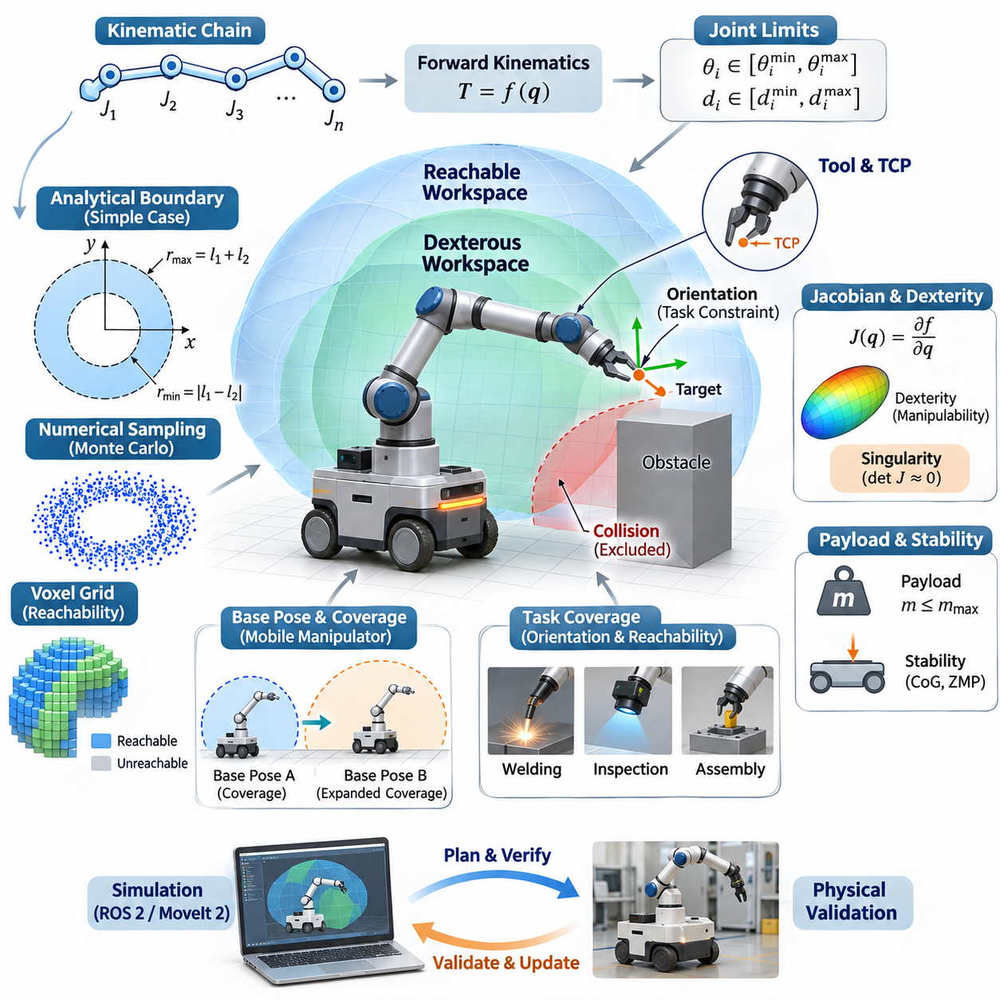
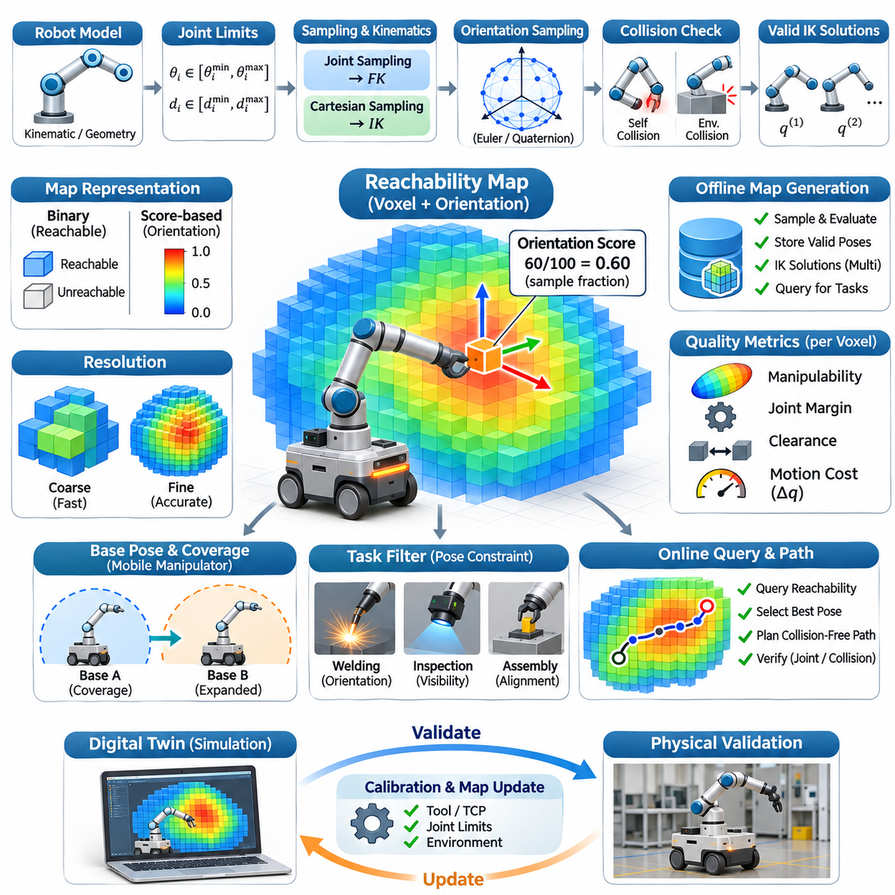
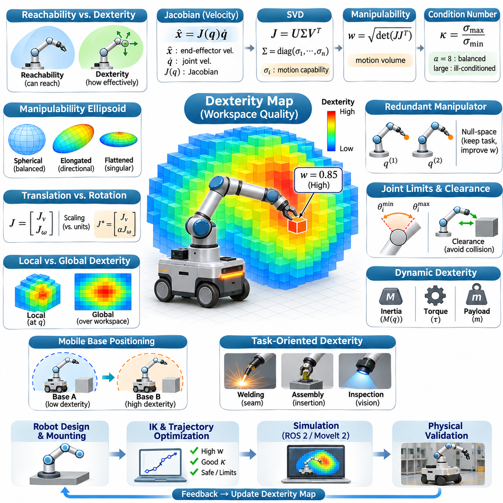
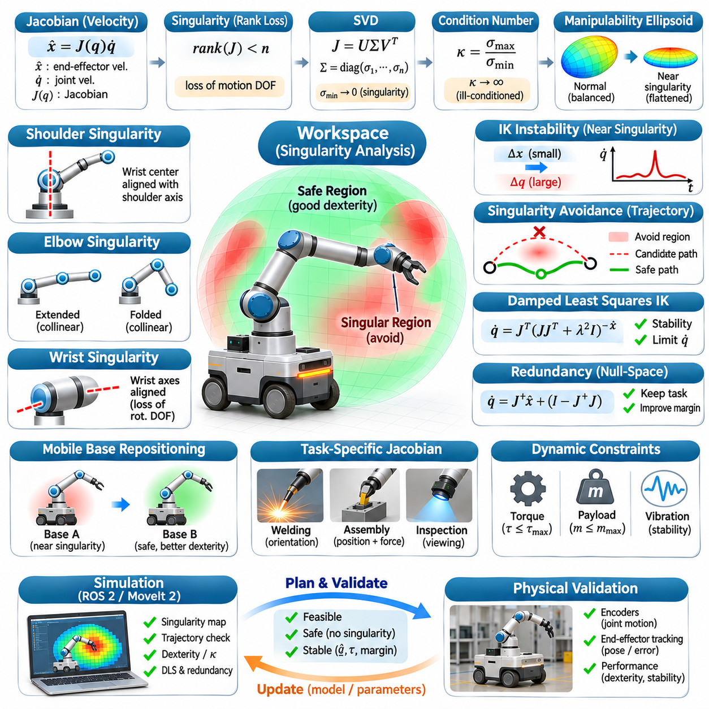
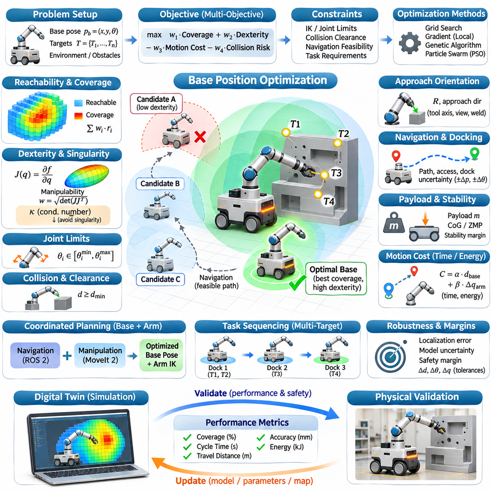
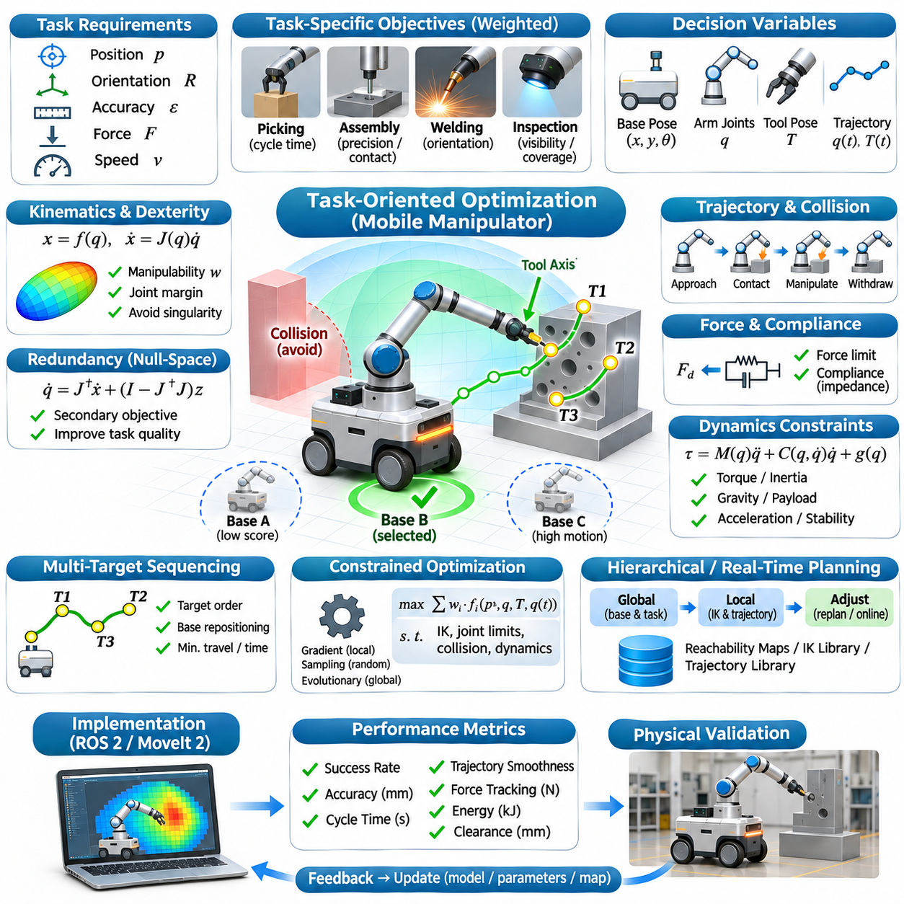
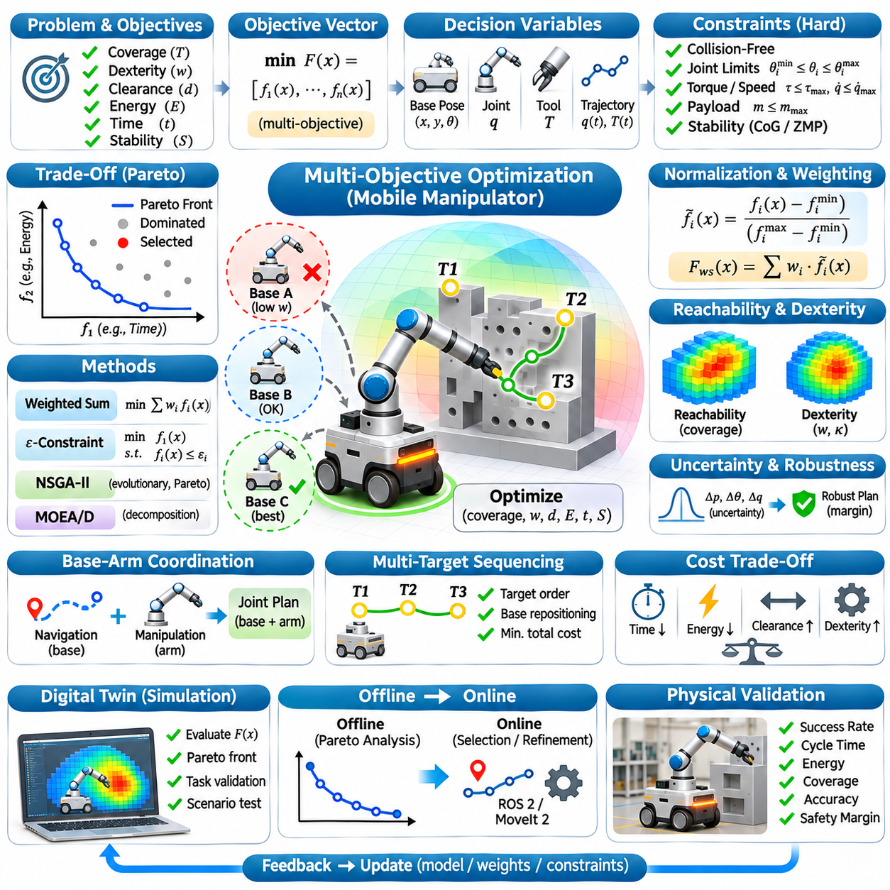
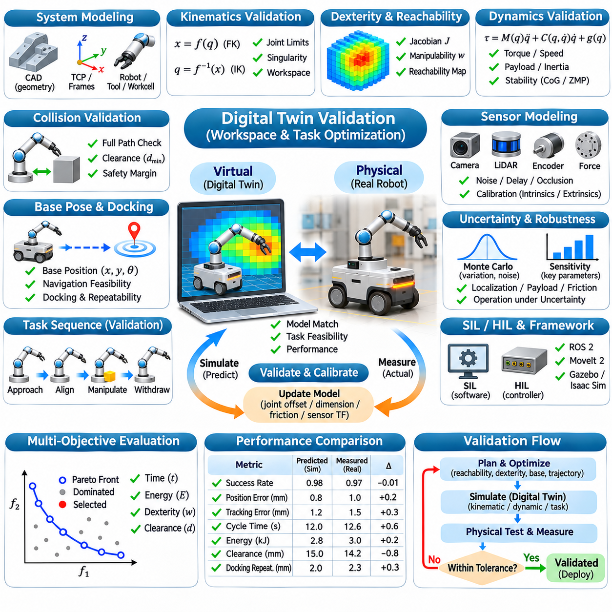
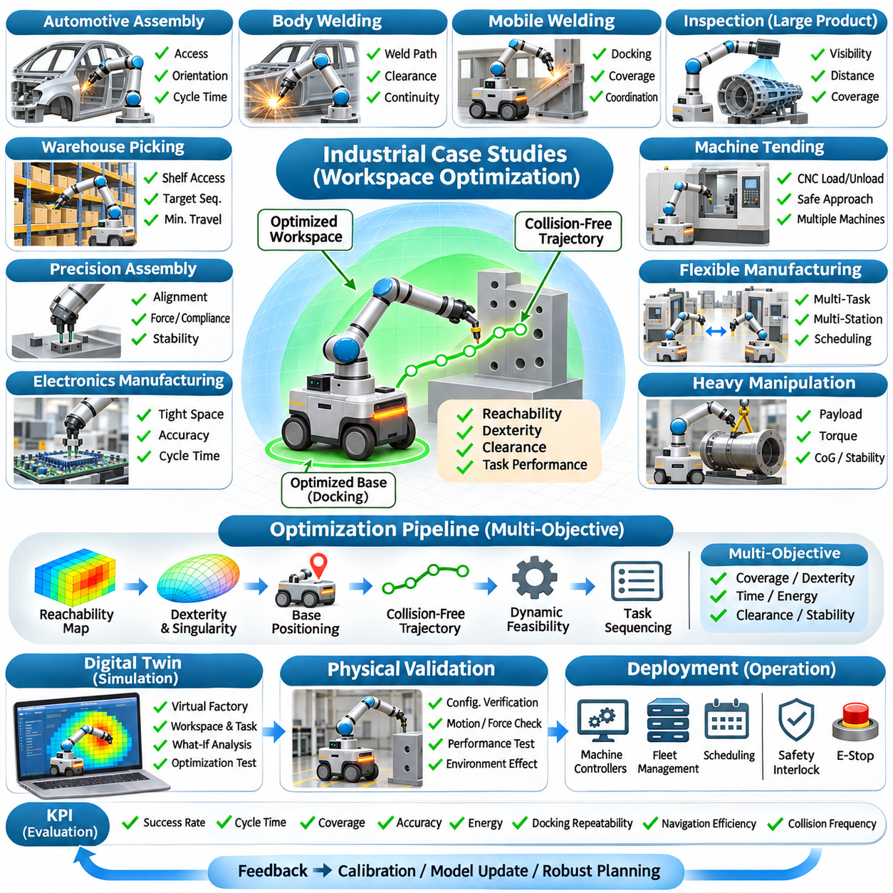

**Volume 02. Manipulator Mechanics and Control**


# Chapter 13. Workspace Optimization

##  

## 01 Workspace Analysis

{width="7.268055555555556in" height="7.268055555555556in"}

Workspace analysis is a fundamental process in manipulator engineering that determines the spatial regions a robot can reach and operate within effectively. It provides the geometric and kinematic foundation for evaluating robot configurations, selecting installation positions, and planning manipulation tasks. In mobile manipulators, workspace analysis must consider both the articulated robot arm and the movable base.

The workspace of a robotic manipulator is defined as the collection of positions or poses attainable by its end effector under specified joint constraints. Its geometry depends on link lengths, joint types, joint limits, and mechanical arrangements. Although a robot may possess a large theoretical workspace, only a portion may be practically usable because of obstacles, joint restrictions, singularities, and operational safety requirements.

Two important workspace categories are reachable workspace and dexterous workspace. Reachable workspace contains all positions that the end effector can attain with at least one valid orientation. Dexterous workspace contains positions where the end effector can achieve every orientation within a specified orientation set. Distinguishing these regions is essential because reaching a target position does not guarantee that the robot can perform the required manipulation operation.

Workspace analysis begins with a mathematical representation of the manipulator\'s kinematic chain. Forward kinematics maps joint configurations into end-effector poses, allowing engineers to determine the spatial locations associated with different joint values. By systematically evaluating feasible joint configurations, the resulting positions can be collected to approximate the workspace boundary and identify regions where manipulation tasks are geometrically possible.

Joint limits strongly influence workspace geometry and operational capability. Revolute joints are restricted by angular ranges, while prismatic joints operate within allowable linear displacements. Mechanical stops, cable routing, actuator limitations, and self-collision constraints further restrict feasible configurations. Accurate workspace analysis must incorporate these limitations rather than assuming unrestricted joint motion throughout the manipulator structure.

Analytical workspace methods derive geometric boundaries directly from manipulator dimensions and joint relationships. These approaches are particularly effective for simple robotic structures with limited degrees of freedom and regular geometric arrangements. For example, a planar two-link manipulator produces a reachable region determined by the sum and difference of its link lengths, although joint limits may remove substantial portions of that region.

Numerical workspace analysis provides greater flexibility for complex manipulators. Joint configurations can be sampled using uniform grids, random sampling, or low-discrepancy sequences, followed by forward kinematic evaluation. Valid end-effector poses are stored as spatial samples that approximate reachable regions. Sampling density determines the resolution of the resulting representation and influences computational cost and boundary accuracy.

Monte Carlo sampling is frequently employed when analytical workspace boundaries are difficult to calculate. Random joint configurations are generated within allowable limits, and their corresponding end-effector positions are computed. Repeated sampling produces a statistical approximation of workspace coverage. However, insufficient samples may overlook narrow reachable regions, while uneven sampling can distort estimates of spatial accessibility.

Workspace representations may use point clouds, voxel grids, occupancy structures, or geometric meshes. Point clouds preserve sampled positions, while voxel grids divide the environment into discrete spatial cells for efficient indexing. Each cell can store information about reachability, orientation availability, collision status, or configuration quality. These representations support subsequent reachability mapping and task-oriented optimization.

A critical distinction exists between geometric reachability and collision-free reachability. A target may lie within the theoretical workspace but remain inaccessible because the robot arm intersects its own structure, nearby machinery, or environmental obstacles. Collision-aware workspace analysis evaluates the complete robot configuration, including links, joints, tools, and surrounding objects, to determine whether a valid configuration can be executed safely.

End-effector geometry must also be included when evaluating practical workspace boundaries. Grippers, welding torches, inspection cameras, and other tools introduce additional dimensions and orientation requirements. The tool center point may extend beyond the wrist frame, changing the reachable region and collision envelope. Consequently, workspace calculations should use the actual tool configuration rather than relying exclusively on the nominal robot flange.

Workspace analysis becomes more complex when task execution requires specific end-effector orientations. Welding, assembly, surface inspection, and precision insertion often impose strict tool-axis constraints. A position that is reachable with an arbitrary orientation may be unsuitable for the intended operation. Evaluating position and orientation together provides a more realistic assessment of task feasibility than position-only workspace calculations.

For mobile manipulators, the robot base introduces additional degrees of freedom that significantly expand operational coverage. The effective workspace depends on the combination of base pose and arm configuration. Moving the base changes the arm\'s reachable region relative to the environment, allowing tasks beyond the fixed-base workspace. However, navigation constraints, docking accuracy, platform stability, and localization uncertainty must be considered.

The relationship between base placement and manipulator workspace is especially important in industrial environments. A poorly positioned mobile platform may force the arm toward joint limits or singular configurations even when the target remains geometrically reachable. Appropriate base placement can increase accessible task locations, improve manipulation flexibility, and reduce unnecessary joint movement while maintaining adequate clearance from surrounding equipment.

Workspace boundaries alone do not fully describe manipulation performance. Some reachable regions require extreme joint configurations, produce poor force transmission, or offer limited freedom for orientation changes. Other regions permit multiple configurations and smoother motion. Therefore, workspace analysis should distinguish simple geometric accessibility from the quality of manipulation that can be achieved within different spatial regions.

The manipulator Jacobian provides additional information about local motion capability throughout the workspace. It relates joint velocities to end-effector linear and angular velocities. Near singular configurations, certain Cartesian motions become difficult or impossible to generate instantaneously, and numerical control may become poorly conditioned. Incorporating Jacobian-based measures helps identify workspace regions that are reachable but operationally undesirable.

Dynamic constraints can further reduce the usable workspace during actual operation. Joint torque limits, actuator speeds, payload mass, gravitational loading, and acceleration requirements affect whether a robot can perform a task at a particular configuration. A pose may be kinematically feasible but dynamically unsuitable for lifting or manipulating a heavy object. Practical workspace evaluation therefore benefits from integrating dynamic feasibility.

Workspace analysis also supports the evaluation of robot design alternatives. Engineers can compare different link lengths, joint arrangements, mounting heights, and arm orientations to determine how structural choices influence task coverage. Increasing reach does not automatically improve overall performance because longer links may introduce additional inertia, structural deflection, and collision risks. Design decisions must balance reachability with mechanical capability.

Simulation environments provide an effective means of evaluating workspace characteristics before physical deployment. Robot models defined through URDF or comparable descriptions can be analyzed using forward kinematics, inverse kinematics, and collision-checking tools. ROS 2 and MoveIt 2 can support configuration feasibility testing and motion planning, while simulation results help engineers identify inaccessible targets and problematic operating regions.

Workspace analysis should be validated against physical robot behavior because mathematical models may not capture every practical limitation. Calibration errors, structural compliance, manufacturing tolerances, and joint-position uncertainty can shift the effective reachable region. Experimental measurements at representative workspace locations help identify discrepancies between predicted and actual end-effector positions and establish confidence in the model.

Industrial workspace evaluation often focuses on task coverage rather than maximizing total reachable volume. In inspection applications, the robot must access specified measurement points with suitable sensor orientations and viewing distances. In assembly operations, insertion directions and approach clearances determine usable configurations. These requirements demonstrate why workspace analysis must be connected directly to the geometry and constraints of the intended task.

A systematic workspace analysis process combines kinematic modeling, configuration sampling, collision evaluation, orientation feasibility, and performance assessment. The resulting information provides a foundation for reachability maps, dexterity analysis, singularity evaluation, and base-position optimization. By identifying both accessible and restricted regions, engineers can develop manipulators that execute industrial tasks more reliably, efficiently, and safely.

작업공간 분석(Workspace Analysis)은 로봇 매니퓰레이터(Manipulator)가 도달하고 효과적으로 작업할 수 있는 공간 영역을 결정하는 로봇 공학(Robot Engineering)의 핵심 과정이다. 이는 로봇 구성(Configuration)을 평가하고, 설치 위치를 선정하며, 조작 작업(Manipulation Task)을 계획하기 위한 기하학적(Geometric) 및 운동학적(Kinematic) 기반을 제공한다. 모바일 매니퓰레이터(Mobile Manipulator)에서는 관절형 로봇 팔(Articulated Robot Arm)과 이동형 베이스(Mobile Base)를 모두 고려해야 한다.

로봇 매니퓰레이터의 작업공간(Workspace)은 지정된 관절 제약조건(Joint Constraints) 내에서 말단장치(End Effector)가 도달할 수 있는 모든 위치(Position) 또는 자세(Pose)의 집합으로 정의된다. 작업공간의 형상은 링크 길이(Link Length), 관절 유형(Joint Type), 관절 제한(Joint Limits), 기계적 배치(Mechanical Arrangement)에 따라 달라진다. 로봇이 넓은 이론적 작업공간(Theoretical Workspace)을 갖더라도 장애물, 관절 제약, 특이점(Singularity), 운용 안전 요구사항으로 인해 실제 사용 가능한 영역은 제한될 수 있다.

작업공간의 중요한 두 가지 유형은 도달 가능 작업공간(Reachable Workspace)과 자유 자세 작업공간(Dexterous Workspace)이다. 도달 가능 작업공간은 말단장치가 하나 이상의 유효한 방향(Orientation)으로 도달할 수 있는 모든 위치를 포함한다. 자유 자세 작업공간은 지정된 방향 집합 내의 모든 방향을 구현할 수 있는 위치를 포함한다. 이러한 구분은 목표 위치에 도달할 수 있다는 사실만으로 필요한 조작 작업을 수행할 수 있다고 보장할 수 없기 때문에 중요하다.

작업공간 분석은 매니퓰레이터의 운동학적 체인(Kinematic Chain)을 수학적으로 표현하는 것에서 시작한다. 순기구학(Forward Kinematics)은 관절 구성(Joint Configuration)을 말단장치 자세(End-Effector Pose)로 변환하여 서로 다른 관절 값에 대응하는 공간 위치를 계산한다. 실행 가능한 관절 구성을 체계적으로 평가하면 해당 위치들을 수집하여 작업공간 경계(Workspace Boundary)를 근사하고, 조작 작업이 기하학적으로 가능한 영역을 식별할 수 있다.

관절 제한(Joint Limits)은 작업공간의 형상과 운용 능력에 큰 영향을 미친다. 회전 관절(Revolute Joint)은 허용 각도 범위에 의해 제한되며, 직동 관절(Prismatic Joint)은 허용 선형 변위(Linear Displacement) 범위 내에서 작동한다. 기계적 스토퍼(Mechanical Stop), 케이블 배선(Cable Routing), 액추에이터 제한(Actuator Limitations), 자체 충돌 제약(Self-Collision Constraints)은 실행 가능한 구성을 추가로 제한한다. 정확한 작업공간 분석에서는 관절이 무제한으로 움직인다고 가정하지 않고 이러한 제약조건을 반영해야 한다.

해석적 작업공간 분석 방법(Analytical Workspace Methods)은 매니퓰레이터의 치수와 관절 관계를 이용하여 기하학적 경계를 직접 도출한다. 이러한 접근법은 자유도(Degrees of Freedom)가 제한되고 기하학적 구조가 규칙적인 단순 로봇에 특히 효과적이다. 예를 들어 평면 2링크 매니퓰레이터(Planar Two-Link Manipulator)의 도달 가능 영역은 두 링크 길이의 합과 차이에 의해 결정되지만, 관절 제한으로 인해 해당 영역의 상당 부분이 제외될 수 있다.

수치적 작업공간 분석(Numerical Workspace Analysis)은 복잡한 매니퓰레이터에 더 높은 유연성을 제공한다. 관절 구성은 균일 격자(Uniform Grid), 무작위 샘플링(Random Sampling), 저불일치 수열(Low-Discrepancy Sequence)을 사용하여 추출할 수 있으며, 이후 순기구학 계산을 수행한다. 유효한 말단장치 자세는 도달 가능 영역을 근사하는 공간 샘플(Spatial Samples)로 저장된다. 샘플링 밀도(Sampling Density)는 표현 해상도(Resolution), 계산 비용(Computational Cost), 경계 정확도(Boundary Accuracy)에 영향을 준다.

몬테카를로 샘플링(Monte Carlo Sampling)은 해석적으로 작업공간 경계를 계산하기 어려운 경우 자주 사용된다. 허용된 관절 범위 내에서 무작위 관절 구성을 생성하고, 이에 대응하는 말단장치 위치를 계산한다. 반복적인 샘플링을 통해 작업공간 범위에 대한 통계적 근사(Statistical Approximation)를 얻을 수 있다. 그러나 샘플 수가 부족하면 좁은 도달 가능 영역을 놓칠 수 있으며, 불균일한 샘플링은 공간 접근성(Spatial Accessibility)에 대한 추정 결과를 왜곡할 수 있다.

작업공간 표현(Workspace Representation)에는 점군(Point Cloud), 복셀 격자(Voxel Grid), 점유 구조(Occupancy Structure), 기하학적 메시(Geometric Mesh) 등을 사용할 수 있다. 점군은 샘플링된 위치를 보존하고, 복셀 격자는 환경을 개별 공간 셀(Spatial Cell)로 분할하여 효율적인 인덱싱(Indexing)을 지원한다. 각 셀에는 도달 가능성(Reachability), 방향 가용성(Orientation Availability), 충돌 상태(Collision Status), 구성 품질(Configuration Quality) 등의 정보를 저장할 수 있다. 이러한 표현은 후속 도달 가능성 지도(Reachability Map)와 작업 지향 최적화(Task-Oriented Optimization)를 지원한다.

기하학적 도달 가능성(Geometric Reachability)과 충돌 없는 도달 가능성(Collision-Free Reachability)은 명확하게 구분해야 한다. 목표가 이론적 작업공간 내에 있더라도 로봇 팔이 자체 구조물, 주변 기계 또는 환경 장애물과 충돌하면 접근할 수 없다. 충돌 인식 작업공간 분석(Collision-Aware Workspace Analysis)은 링크, 관절, 도구, 주변 물체를 포함한 전체 로봇 구성을 평가하여 해당 구성을 안전하게 실행할 수 있는지 판단한다.

실제 작업공간 경계를 평가할 때는 말단장치 형상(End-Effector Geometry)도 포함해야 한다. 그리퍼(Gripper), 용접 토치(Welding Torch), 검사 카메라(Inspection Camera) 및 기타 도구는 추가적인 치수와 방향 요구사항을 발생시킨다. 도구 중심점(Tool Center Point, TCP)은 손목 좌표계(Wrist Frame)를 넘어 확장될 수 있으며, 이에 따라 도달 가능 영역과 충돌 영역(Collision Envelope)이 달라진다. 따라서 작업공간 계산에는 로봇 플랜지(Robot Flange)만이 아니라 실제 도구 구성을 반영해야 한다.

작업 수행에 특정 말단장치 방향이 필요한 경우 작업공간 분석은 더욱 복잡해진다. 용접(Welding), 조립(Assembly), 표면 검사(Surface Inspection), 정밀 삽입(Precision Insertion) 작업은 엄격한 도구 축 제약조건(Tool-Axis Constraints)을 요구하는 경우가 많다. 임의의 방향으로 도달할 수 있는 위치라도 의도한 작업에는 적합하지 않을 수 있다. 위치와 방향을 함께 평가하면 위치만 고려하는 작업공간 계산보다 작업 실행 가능성(Task Feasibility)을 더욱 현실적으로 판단할 수 있다.

모바일 매니퓰레이터에서는 이동형 베이스(Mobile Base)가 추가적인 자유도를 제공하여 운용 범위를 크게 확장한다. 유효 작업공간(Effective Workspace)은 베이스 자세(Base Pose)와 로봇 팔 구성(Arm Configuration)의 조합에 따라 결정된다. 베이스가 이동하면 환경에 대한 로봇 팔의 도달 가능 영역이 변경되어 고정형 베이스(Fixed Base)의 작업공간을 벗어난 작업도 수행할 수 있다. 그러나 주행 제약(Navigation Constraints), 도킹 정확도(Docking Accuracy), 플랫폼 안정성(Platform Stability), 위치 추정 불확실성(Localization Uncertainty)을 함께 고려해야 한다.

베이스 배치(Base Placement)와 매니퓰레이터 작업공간의 관계는 산업 환경에서 특히 중요하다. 이동형 플랫폼의 위치가 적절하지 않으면 목표에 기하학적으로 도달할 수 있더라도 로봇 팔이 관절 한계 또는 특이 구성(Singular Configuration)에 가까워질 수 있다. 적절한 베이스 배치는 접근 가능한 작업 위치를 늘리고, 조작 유연성(Manipulation Flexibility)을 향상시키며, 주변 설비와 충분한 간격을 유지하면서 불필요한 관절 움직임을 줄일 수 있다.

작업공간 경계만으로는 조작 성능(Manipulation Performance)을 완전히 설명할 수 없다. 일부 도달 가능 영역은 극단적인 관절 구성을 요구하거나 힘 전달 성능(Force Transmission)이 낮으며, 방향 변경의 자유도가 제한된다. 반면 다른 영역에서는 여러 관절 구성이 가능하고 더욱 부드러운 움직임을 구현할 수 있다. 따라서 작업공간 분석에서는 단순한 기하학적 접근 가능성과 공간별 조작 품질(Manipulation Quality)을 구분해야 한다.

매니퓰레이터 자코비안(Jacobian)은 작업공간 전체에서 국소 운동 능력(Local Motion Capability)에 관한 추가 정보를 제공한다. 자코비안은 관절 속도(Joint Velocity)를 말단장치의 선속도(Linear Velocity) 및 각속도(Angular Velocity)와 연결한다. 특이 구성 근처에서는 특정 데카르트 공간 운동(Cartesian Motion)을 순간적으로 생성하기 어렵거나 불가능해지고, 수치 제어(Numerical Control)의 조건 상태가 나빠질 수 있다. 자코비안 기반 지표(Jacobian-Based Metrics)를 적용하면 도달은 가능하지만 운용상 바람직하지 않은 영역을 식별할 수 있다.

동적 제약조건(Dynamic Constraints)은 실제 운용 중 사용 가능한 작업공간을 더욱 제한할 수 있다. 관절 토크 제한(Joint Torque Limits), 액추에이터 속도(Actuator Speed), 탑재 하중(Payload Mass), 중력 부하(Gravitational Loading), 가속도 요구사항(Acceleration Requirements)은 특정 구성에서 작업을 수행할 수 있는지에 영향을 준다. 어떤 자세는 운동학적으로 가능하더라도 무거운 물체를 들어 올리거나 조작하는 데 동역학적으로 적합하지 않을 수 있다. 따라서 실용적인 작업공간 평가에는 동적 실행 가능성(Dynamic Feasibility)을 통합하는 것이 유리하다.

작업공간 분석은 로봇 설계 대안(Design Alternatives)을 평가하는 데에도 활용된다. 엔지니어는 서로 다른 링크 길이, 관절 배치, 장착 높이(Mounting Height), 로봇 팔 방향(Arm Orientation)을 비교하여 구조적 선택이 작업 범위에 미치는 영향을 판단할 수 있다. 도달 거리를 늘린다고 전체 성능이 자동으로 향상되는 것은 아니다. 긴 링크는 관성(Inertia), 구조적 변형(Structural Deflection), 충돌 위험(Collision Risk)을 증가시킬 수 있기 때문이다. 설계 결정에서는 도달 가능성과 기계적 성능(Mechanical Capability)의 균형을 유지해야 한다.

시뮬레이션 환경(Simulation Environment)은 실제 배치 전에 작업공간 특성을 평가하는 효과적인 수단이다. URDF(Unified Robot Description Format) 또는 유사한 형식으로 정의된 로봇 모델은 순기구학, 역기구학(Inverse Kinematics), 충돌 검사(Collision Checking) 도구를 이용하여 분석할 수 있다. ROS 2와 MoveIt 2는 구성 실행 가능성 검사(Configuration Feasibility Testing)와 동작 계획(Motion Planning)을 지원할 수 있으며, 시뮬레이션 결과는 접근할 수 없는 목표와 문제가 있는 운용 영역을 식별하는 데 도움을 준다.

수학적 모델(Mathematical Model)이 모든 실제 제약조건을 반영하지 못할 수 있으므로 작업공간 분석 결과는 물리적 로봇 동작(Physical Robot Behavior)을 통해 검증해야 한다. 보정 오차(Calibration Error), 구조적 유연성(Structural Compliance), 제조 공차(Manufacturing Tolerance), 관절 위치 불확실성(Joint-Position Uncertainty)은 실제 도달 가능 영역을 변화시킬 수 있다. 대표적인 작업공간 위치에서 실험 측정을 수행하면 예측된 말단장치 위치와 실제 위치의 차이를 확인하고 모델의 신뢰도를 확보할 수 있다.

산업용 작업공간 평가(Industrial Workspace Evaluation)는 전체 도달 가능 체적(Reachable Volume)을 최대화하는 것보다 작업 범위(Task Coverage)를 확보하는 데 중점을 두는 경우가 많다. 검사 응용(Inspection Application)에서는 로봇이 적절한 센서 방향과 관측 거리(Viewing Distance)를 유지하면서 지정된 측정 지점에 접근해야 한다. 조립 작업에서는 삽입 방향(Insertion Direction)과 접근 여유 공간(Approach Clearance)이 사용 가능한 구성을 결정한다. 이러한 요구사항은 작업공간 분석이 의도한 작업의 형상과 제약조건에 직접 연결되어야 함을 보여준다.

체계적인 작업공간 분석(Systematic Workspace Analysis)은 운동학적 모델링(Kinematic Modeling), 구성 샘플링(Configuration Sampling), 충돌 평가(Collision Evaluation), 방향 실행 가능성(Orientation Feasibility), 성능 평가(Performance Assessment)를 통합한다. 분석 결과는 도달 가능성 지도(Reachability Maps), 조작성 분석(Dexterity Analysis), 특이점 분석(Singularity Analysis), 베이스 위치 최적화(Base-Position Optimization)의 기반을 제공한다. 접근 가능한 영역과 제한 영역을 함께 식별함으로써 엔지니어는 산업 작업을 더욱 신뢰성 있고 효율적이며 안전하게 수행하는 매니퓰레이터를 개발할 수 있다.

##  

## 02 Reachability Maps

{width="7.268055555555556in" height="7.268055555555556in"}

Reachability maps are spatial representations that describe where a robotic manipulator can position its end effector and how effectively it can achieve different orientations. Unlike conventional workspace boundaries, reachability maps provide detailed information about accessibility within individual spatial regions. They support robot design, motion planning, base placement, and task feasibility evaluation in fixed and mobile manipulation systems.

A reachability map is constructed by dividing the manipulator workspace into discrete spatial regions and evaluating feasible robot configurations within each region. These regions are commonly represented using three-dimensional voxels or sampled Cartesian positions. Each location stores information about whether the end effector can reach that position, often together with orientation coverage and additional measures of manipulation capability.

The mathematical foundation of reachability mapping is based on forward and inverse kinematics. Forward kinematics transforms joint configurations into end-effector poses, while inverse kinematics determines whether a desired pose can be achieved by valid joint values. By evaluating many candidate configurations, the mapping process establishes relationships between spatial positions, tool orientations, and feasible robot postures.

A basic reachability map uses binary classification to distinguish reachable and unreachable locations. A spatial cell is marked reachable when at least one valid joint configuration places the end effector within that region. Although binary maps provide useful geometric information, they do not indicate how many orientations are available or whether the robot can execute the required operation with adequate clearance and stability.

Probabilistic or score-based reachability maps provide richer information than binary representations. A reachability score may represent the fraction of sampled orientations that can be achieved at a particular location. For example, if a robot successfully reaches 60 of 100 uniformly sampled target orientations, the estimated orientation reachability score is 0.60. Such scores depend on the sampling strategy and should not automatically be interpreted as physical success probabilities.

Orientation sampling is essential because robotic manipulation requires both position and orientation control. At each spatial location, candidate end-effector orientations can be generated using Euler angles, quaternions, or rotation matrices. Uniformly distributed rotation samples are particularly useful for reducing directional bias. Each candidate pose is evaluated against joint limits, inverse kinematics feasibility, and applicable collision constraints.

Reachability map resolution influences both computational efficiency and geometric accuracy. Fine voxel grids capture narrow accessible regions and workspace boundaries more precisely but require greater memory and processing time. Coarse grids reduce computational requirements while potentially overlooking small reachable regions or collision-sensitive areas. Resolution selection should reflect task precision, robot dimensions, and available computing resources.

Offline reachability map generation is commonly performed before deployment. A robot model is loaded, its kinematic parameters and joint limits are defined, and candidate positions and orientations are evaluated systematically. Valid solutions are stored in a structured database or spatial index. Once generated, the map can be queried repeatedly without solving the complete workspace problem for every new task.

Sampling-based reachability generation can use random joint configurations, structured joint grids, or Cartesian pose sampling. Joint-space sampling naturally produces feasible forward-kinematic poses, but it may distribute samples unevenly across Cartesian space. Cartesian sampling provides more direct control over spatial coverage but requires inverse kinematics evaluation. Combining both approaches can improve coverage and computational efficiency.

Collision-aware reachability maps incorporate geometric constraints from the robot and its environment. A pose may satisfy inverse kinematics but remain unusable because a robot link intersects another link, a machine enclosure, or nearby equipment. Self-collision checks can be included during offline generation, while environment-dependent collision checks may need to be repeated whenever obstacles or operating conditions change.

Reachability maps may store multiple inverse kinematics solutions for the same target pose. This is important for redundant manipulators, where several joint configurations can produce identical end-effector positions and orientations. Different solutions may offer different collision clearances, joint-limit margins, or motion continuity. Retaining representative configurations enables planners to select postures that satisfy additional operational requirements.

Reachability maps can also incorporate quality metrics beyond simple geometric feasibility. Common measures include manipulability, distance from joint limits, collision clearance, and estimated joint displacement. These values help distinguish highly accessible regions from locations that are technically reachable but difficult to use. A task planner can combine such measures to prioritize configurations with greater operational flexibility.

For mobile manipulators, reachability maps provide a connection between navigation and manipulation planning. A map generated relative to the robot base can be transformed into the environment coordinate frame for different base poses. This allows the system to evaluate which platform locations provide access to required targets. The combined analysis supports coordinated base positioning and robotic arm configuration selection.

Base placement optimization can use reachability maps to identify platform positions that maximize task coverage. Candidate base poses are evaluated against the target locations and orientations required by the operation. A base position is considered favorable when it enables the arm to reach more task poses while preserving suitable manipulation quality. Navigation accessibility, docking constraints, and platform stability must also be considered.

Task-specific reachability maps are particularly useful in industrial applications. Welding requires suitable torch orientations and approach directions, while inspection requires appropriate camera viewpoints and working distances. Assembly operations may require restricted insertion directions and collision-free approach paths. By incorporating these requirements, reachability analysis becomes more representative of actual task feasibility than unrestricted geometric mapping.

Reachability information can accelerate motion planning by rejecting infeasible targets before computationally expensive trajectory generation. When a requested pose falls outside the reachable region, the planner can immediately consider alternative orientations, base positions, or task strategies. However, a reachable target does not guarantee that a continuous collision-free trajectory exists between the current configuration and the desired configuration.

Reachability maps are especially valuable for systems that perform repeated operations across large industrial structures. A mobile inspection robot can evaluate whether measurement points are accessible from a selected docking position before initiating an inspection sequence. If some targets are unreachable, the system can select another base position or divide the operation into multiple inspection stages to improve overall coverage.

Digital twin environments provide an effective platform for generating and validating reachability maps. Robot geometry, joint constraints, tool configurations, and environmental models can be integrated into a virtual system. Simulation tools can evaluate candidate poses and visualize accessibility distributions. Comparing simulated predictions with physical robot measurements helps identify calibration errors, model inaccuracies, and practical workspace limitations.

Reachability maps must be updated when robot configuration changes significantly. Installing a different gripper, modifying the tool center point, changing joint limits, or relocating the arm mounting position can alter reachable poses. Environmental changes may also invalidate collision-related information. Separating robot-intrinsic reachability from environment-specific feasibility allows systems to reuse geometric maps while updating operational constraints.

The accuracy of a reachability map depends on model fidelity, sampling density, inverse kinematics reliability, and collision-checking precision. Sparse sampling may underestimate accessibility, while inaccurate geometry or incomplete constraints may overestimate usable regions. Validation should therefore include representative reachable and unreachable poses, boundary conditions, and configurations near joint limits or singularities.

Efficient reachability map implementation requires careful data management. Sparse voxel structures, spatial indexing, compressed orientation sets, and hierarchical representations can reduce memory consumption and improve query speed. For real-time applications, precomputed scores and representative configurations allow planners to retrieve useful feasibility information quickly while reserving detailed kinematic and collision verification for selected candidates.

Reachability maps provide a practical bridge between theoretical workspace analysis and operational manipulation planning. By associating spatial locations with orientation feasibility, robot configurations, and performance measures, they support more informed decisions about task allocation, base placement, and motion generation. Their greatest value emerges when geometric accessibility is combined with collision safety, manipulation quality, and task-specific requirements.

도달 가능성 지도(Reachability Map)는 로봇 매니퓰레이터(Robotic Manipulator)의 말단장치(End Effector)가 도달할 수 있는 위치와 다양한 방향(Orientation)을 얼마나 효과적으로 구현할 수 있는지를 나타내는 공간 표현(Spatial Representation)이다. 기존의 작업공간 경계(Workspace Boundary)와 달리 도달 가능성 지도는 개별 공간 영역의 접근 가능성(Accessibility)에 대한 상세한 정보를 제공한다. 이는 고정형 및 모바일 매니퓰레이터 시스템에서 로봇 설계(Robot Design), 동작 계획(Motion Planning), 베이스 배치(Base Placement), 작업 실행 가능성 평가(Task Feasibility Evaluation)를 지원한다.

도달 가능성 지도는 매니퓰레이터의 작업공간(Workspace)을 개별 공간 영역으로 분할하고, 각 영역에서 실행 가능한 로봇 구성(Robot Configuration)을 평가하여 생성한다. 이러한 영역은 일반적으로 3차원 복셀(Three-Dimensional Voxel) 또는 샘플링된 데카르트 좌표(Cartesian Position)로 표현된다. 각 위치에는 말단장치가 해당 위치에 도달할 수 있는지에 대한 정보가 저장되며, 방향 범위(Orientation Coverage)와 추가적인 조작 능력(Manipulation Capability) 지표가 함께 포함되는 경우가 많다.

도달 가능성 지도 생성의 수학적 기반은 순기구학(Forward Kinematics)과 역기구학(Inverse Kinematics)에 있다. 순기구학은 관절 구성(Joint Configuration)을 말단장치 자세(End-Effector Pose)로 변환하며, 역기구학은 원하는 자세를 유효한 관절 값으로 구현할 수 있는지 판단한다. 다양한 후보 구성을 평가함으로써 지도 생성 과정은 공간 위치, 도구 방향(Tool Orientation), 실행 가능한 로봇 자세(Robot Posture) 사이의 관계를 설정한다.

기본적인 도달 가능성 지도는 이진 분류(Binary Classification)를 사용하여 도달 가능한 위치와 도달할 수 없는 위치를 구분한다. 하나 이상의 유효한 관절 구성이 말단장치를 해당 공간 영역에 배치할 수 있으면 해당 셀(Cell)은 도달 가능한 것으로 표시된다. 이진 지도는 유용한 기하학적 정보를 제공하지만, 사용 가능한 방향의 수나 충분한 여유 공간(Clearance)과 안정성(Stability)을 확보하면서 필요한 작업을 수행할 수 있는지는 나타내지 못한다.

확률 기반 또는 점수 기반 도달 가능성 지도(Probabilistic or Score-Based Reachability Map)는 이진 표현보다 풍부한 정보를 제공한다. 도달 가능성 점수(Reachability Score)는 특정 위치에서 구현할 수 있는 샘플링된 방향의 비율을 나타낼 수 있다. 예를 들어 균일하게 샘플링한 100개의 목표 방향 중 60개에 성공적으로 도달한다면 추정 방향 도달 가능성 점수(Orientation Reachability Score)는 0.60이다. 이러한 점수는 샘플링 전략(Sampling Strategy)에 따라 달라지며, 실제 작업 성공 확률(Physical Success Probability)로 자동 해석해서는 안 된다.

방향 샘플링(Orientation Sampling)은 로봇 조작에 위치와 방향 제어(Position and Orientation Control)가 모두 필요하기 때문에 필수적이다. 각 공간 위치에서 오일러 각(Euler Angles), 쿼터니언(Quaternion), 회전 행렬(Rotation Matrix)을 사용하여 말단장치의 후보 방향을 생성할 수 있다. 균일하게 분포된 회전 샘플(Uniformly Distributed Rotation Samples)은 방향 편향(Directional Bias)을 줄이는 데 특히 유용하다. 각 후보 자세는 관절 제한(Joint Limits), 역기구학 실행 가능성(IK Feasibility), 적용 가능한 충돌 제약조건(Collision Constraints)을 기준으로 평가된다.

도달 가능성 지도의 해상도(Reachability Map Resolution)는 계산 효율성(Computational Efficiency)과 기하학적 정확도(Geometric Accuracy)에 영향을 미친다. 세밀한 복셀 격자(Fine Voxel Grid)는 좁은 접근 가능 영역과 작업공간 경계를 더욱 정밀하게 표현하지만 더 많은 메모리와 처리 시간이 필요하다. 반면 거친 격자(Coarse Grid)는 계산 요구량을 줄이지만 작은 도달 가능 영역이나 충돌에 민감한 영역을 놓칠 수 있다. 해상도는 작업 정밀도(Task Precision), 로봇 크기(Robot Dimensions), 사용 가능한 컴퓨팅 자원(Computing Resources)을 고려하여 선정해야 한다.

오프라인 도달 가능성 지도 생성(Offline Reachability Map Generation)은 일반적으로 실제 배치 전에 수행된다. 로봇 모델(Robot Model)을 불러오고 운동학적 매개변수(Kinematic Parameters)와 관절 제한을 정의한 다음, 후보 위치와 방향을 체계적으로 평가한다. 유효한 해(Valid Solutions)는 구조화된 데이터베이스(Structured Database) 또는 공간 인덱스(Spatial Index)에 저장된다. 생성된 지도는 새로운 작업마다 전체 작업공간 문제를 다시 계산하지 않고 반복적으로 조회할 수 있다.

샘플링 기반 도달 가능성 지도 생성(Sampling-Based Reachability Generation)에는 무작위 관절 구성(Random Joint Configurations), 구조화된 관절 격자(Structured Joint Grids), 데카르트 자세 샘플링(Cartesian Pose Sampling)을 사용할 수 있다. 관절 공간 샘플링(Joint-Space Sampling)은 순기구학적으로 유효한 자세를 자연스럽게 생성하지만, 데카르트 공간에서 샘플이 불균일하게 분포할 수 있다. 데카르트 샘플링은 공간 범위를 직접 제어할 수 있지만 역기구학 계산이 필요하다. 두 접근법을 결합하면 범위와 계산 효율성을 향상시킬 수 있다.

충돌 인식 도달 가능성 지도(Collision-Aware Reachability Map)는 로봇과 환경의 기하학적 제약조건(Geometric Constraints)을 통합한다. 특정 자세가 역기구학 조건을 만족하더라도 로봇 링크(Robot Link)가 다른 링크, 기계 외함(Machine Enclosure), 주변 장비와 교차하면 사용할 수 없다. 자체 충돌 검사(Self-Collision Checking)는 오프라인 생성 과정에 포함할 수 있지만, 환경 의존적 충돌 검사(Environment-Dependent Collision Checking)는 장애물이나 운용 조건이 변경될 때마다 다시 수행해야 할 수 있다.

도달 가능성 지도는 동일한 목표 자세(Target Pose)에 대한 여러 역기구학 해(Inverse Kinematics Solutions)를 저장할 수 있다. 이는 여러 관절 구성이 동일한 말단장치 위치와 방향을 구현할 수 있는 여유 자유도 매니퓰레이터(Redundant Manipulator)에서 중요하다. 서로 다른 해는 충돌 여유 거리(Collision Clearance), 관절 한계 여유(Joint-Limit Margin), 동작 연속성(Motion Continuity)에서 차이를 보일 수 있다. 대표적인 관절 구성을 보존하면 계획기가 추가적인 운용 요구사항을 만족하는 자세를 선택할 수 있다.

도달 가능성 지도에는 단순한 기하학적 실행 가능성을 넘어서는 품질 지표(Quality Metrics)를 포함할 수도 있다. 대표적인 지표에는 조작성(Manipulability), 관절 한계까지의 거리(Distance from Joint Limits), 충돌 여유 거리, 예상 관절 변위(Estimated Joint Displacement)가 있다. 이러한 값은 접근성이 높은 영역과 기술적으로는 도달 가능하지만 사용하기 어려운 위치를 구분하는 데 도움을 준다. 작업 계획기(Task Planner)는 이러한 지표를 결합하여 운용 유연성(Operational Flexibility)이 높은 구성을 우선 선택할 수 있다.

모바일 매니퓰레이터(Mobile Manipulator)에서 도달 가능성 지도는 주행 계획(Navigation Planning)과 조작 계획(Manipulation Planning)을 연결하는 역할을 한다. 로봇 베이스를 기준으로 생성한 지도는 서로 다른 베이스 자세(Base Pose)에 대해 환경 좌표계(Environment Coordinate Frame)로 변환할 수 있다. 이를 통해 시스템은 필요한 목표에 접근할 수 있는 플랫폼 위치를 평가할 수 있다. 이러한 통합 분석은 베이스 위치 선정과 로봇 팔 구성 선택을 조정하는 데 활용된다.

베이스 배치 최적화(Base Placement Optimization)는 도달 가능성 지도를 활용하여 작업 범위(Task Coverage)를 최대화하는 플랫폼 위치를 식별할 수 있다. 후보 베이스 자세는 작업에 필요한 목표 위치와 방향을 기준으로 평가된다. 적절한 조작 품질(Manipulation Quality)을 유지하면서 더 많은 작업 자세에 도달할 수 있는 베이스 위치가 유리한 것으로 평가된다. 이와 함께 주행 접근성(Navigation Accessibility), 도킹 제약조건(Docking Constraints), 플랫폼 안정성(Platform Stability)도 고려해야 한다.

작업별 도달 가능성 지도(Task-Specific Reachability Map)는 산업 응용(Industrial Applications)에서 특히 유용하다. 용접(Welding)에는 적절한 토치 방향(Torch Orientation)과 접근 방향(Approach Direction)이 필요하며, 검사(Inspection)에는 적절한 카메라 시점(Camera Viewpoint)과 작업 거리(Working Distance)가 요구된다. 조립 작업(Assembly Operation)에는 제한된 삽입 방향(Insertion Direction)과 충돌 없는 접근 경로(Collision-Free Approach Path)가 필요할 수 있다. 이러한 요구사항을 반영하면 도달 가능성 분석은 제한 없는 기하학적 지도보다 실제 작업 실행 가능성을 더 정확하게 나타낸다.

도달 가능성 정보(Reachability Information)는 계산 비용이 높은 궤적 생성(Trajectory Generation)을 수행하기 전에 실행 불가능한 목표를 제외하여 동작 계획을 가속할 수 있다. 요청된 자세가 도달 가능 영역 밖에 있으면 계획기는 대체 방향(Alternative Orientation), 베이스 위치 또는 작업 전략(Task Strategy)을 즉시 검토할 수 있다. 그러나 목표 자세에 도달할 수 있다는 사실만으로 현재 구성에서 목표 구성까지 연속적이고 충돌 없는 궤적(Continuous Collision-Free Trajectory)이 존재한다고 보장할 수는 없다.

도달 가능성 지도는 대형 산업 구조물(Large Industrial Structure)을 대상으로 반복 작업을 수행하는 시스템에서 특히 가치가 높다. 모바일 검사 로봇(Mobile Inspection Robot)은 검사 절차를 시작하기 전에 선택된 도킹 위치(Docking Position)에서 측정 지점(Measurement Point)에 접근할 수 있는지 평가할 수 있다. 일부 목표에 도달할 수 없다면 시스템은 다른 베이스 위치를 선택하거나 작업을 여러 검사 단계(Inspection Stages)로 분할하여 전체 검사 범위를 향상시킬 수 있다.

디지털 트윈 환경(Digital Twin Environment)은 도달 가능성 지도를 생성하고 검증하는 효과적인 플랫폼을 제공한다. 로봇 형상(Robot Geometry), 관절 제약조건(Joint Constraints), 도구 구성(Tool Configuration), 환경 모델(Environmental Model)을 가상 시스템(Virtual System)에 통합할 수 있다. 시뮬레이션 도구(Simulation Tools)는 후보 자세를 평가하고 접근 가능성 분포(Accessibility Distribution)를 시각화할 수 있다. 시뮬레이션 예측과 실제 로봇 측정 결과를 비교하면 보정 오차(Calibration Error), 모델 부정확성(Model Inaccuracy), 실제 작업공간 제한(Practical Workspace Limitations)을 식별하는 데 도움이 된다.

로봇 구성이 크게 변경되면 도달 가능성 지도도 갱신해야 한다. 다른 그리퍼(Gripper)를 설치하거나 도구 중심점(Tool Center Point, TCP)을 변경하거나 관절 제한을 수정하거나 로봇 팔 장착 위치(Arm Mounting Position)를 이동하면 도달 가능한 자세가 달라질 수 있다. 환경 변화 역시 충돌 관련 정보를 무효화할 수 있다. 로봇 고유의 도달 가능성(Robot-Intrinsic Reachability)과 환경별 실행 가능성(Environment-Specific Feasibility)을 분리하면 기하학적 지도를 재사용하면서 운용 제약조건을 갱신할 수 있다.

도달 가능성 지도의 정확도는 모델 충실도(Model Fidelity), 샘플링 밀도(Sampling Density), 역기구학 신뢰성(Inverse Kinematics Reliability), 충돌 검사 정밀도(Collision-Checking Precision)에 따라 달라진다. 희소 샘플링(Sparse Sampling)은 접근 가능성을 과소평가할 수 있으며, 부정확한 형상이나 불완전한 제약조건은 사용 가능한 영역을 과대평가할 수 있다. 따라서 검증에는 대표적인 도달 가능 자세와 도달 불가능 자세, 경계 조건(Boundary Conditions), 관절 한계 또는 특이점(Singularity) 근처의 구성을 포함해야 한다.

효율적인 도달 가능성 지도 구현(Efficient Reachability Map Implementation)에는 신중한 데이터 관리(Data Management)가 필요하다. 희소 복셀 구조(Sparse Voxel Structure), 공간 인덱싱(Spatial Indexing), 압축된 방향 집합(Compressed Orientation Set), 계층적 표현(Hierarchical Representation)은 메모리 사용량을 줄이고 조회 속도(Query Speed)를 향상시킬 수 있다. 실시간 응용(Real-Time Applications)에서는 사전 계산된 점수(Precomputed Scores)와 대표 구성을 활용하여 유용한 실행 가능성 정보를 신속하게 검색하고, 선택된 후보에 대해서만 상세한 운동학 및 충돌 검증을 수행할 수 있다.

도달 가능성 지도는 이론적 작업공간 분석(Theoretical Workspace Analysis)과 실제 조작 계획(Operational Manipulation Planning)을 연결하는 실용적인 수단이다. 공간 위치를 방향 실행 가능성(Orientation Feasibility), 로봇 구성(Robot Configuration), 성능 지표(Performance Measures)와 연결함으로써 작업 할당(Task Allocation), 베이스 배치(Base Placement), 동작 생성(Motion Generation)에 관한 더욱 합리적인 의사결정을 지원한다. 기하학적 접근 가능성(Geometric Accessibility)을 충돌 안전성(Collision Safety), 조작 품질(Manipulation Quality), 작업별 요구사항(Task-Specific Requirements)과 결합할 때 도달 가능성 지도의 활용 가치가 극대화된다.

##  

## 03 Dexterity Analysis

{width="7.268055555555556in" height="7.268055555555556in"}

Dexterity analysis evaluates the ability of a robotic manipulator to generate controlled movements and orientations at different locations within its workspace. While reachability analysis determines whether a target pose can be achieved, dexterity analysis examines how effectively the robot can move and manipulate objects around that pose. It provides essential information for robot design, task planning, and workspace optimization.

Robot dexterity depends on the manipulator\'s kinematic structure, joint configuration, degrees of freedom, and proximity to singularities. A robot may reach a particular position but have limited freedom to change its end-effector orientation or movement direction. High dexterity indicates that the manipulator can perform diverse local motions without excessive joint movement, while low dexterity indicates restricted or poorly conditioned motion.

The mathematical foundation of dexterity analysis is the manipulator Jacobian, which relates joint velocities to end-effector linear and angular velocities. For a manipulator with joint velocity vector q̇ and end-effector velocity vector ẋ, the relationship is expressed as ẋ = J(q)q̇. The Jacobian matrix J(q) changes with the robot configuration, making dexterity dependent on the current joint positions.

The Jacobian provides information about how efficiently joint motion produces Cartesian movement. When the Jacobian is well conditioned, the robot can generate movements in different directions with relatively balanced joint velocities. When it becomes poorly conditioned, certain movement directions require disproportionately large joint velocities. This behavior becomes especially important near singular configurations where independent motion capabilities are reduced.

Manipulability is one of the most widely used quantitative measures of robot dexterity. Yoshikawa\'s manipulability index is commonly defined as w = √det(JJᵀ) for a task Jacobian with full row rank. This index describes the volume scaling of the velocity manipulability ellipsoid. Larger values generally indicate greater instantaneous motion capability, although meaningful comparisons require consistent units and coordinate scaling.

The manipulability ellipsoid provides a geometric interpretation of local motion capability. It represents the Cartesian velocities achievable when joint velocities satisfy a normalized Euclidean bound. The ellipsoid\'s principal axes indicate directions of greater or smaller motion capability. A nearly spherical ellipsoid suggests balanced directional mobility, while an elongated ellipsoid indicates substantial directional differences.

Singular value decomposition provides a systematic method for examining the Jacobian and its associated manipulability ellipsoid. By decomposing the Jacobian into orthogonal matrices and singular values, engineers can identify principal movement directions and their relative capabilities. Small singular values indicate directions where Cartesian velocity generation is weak, while zero singular values identify lost instantaneous motion directions.

The Jacobian condition number is another important dexterity metric. It is commonly calculated as the ratio between the largest and smallest singular values of an appropriately scaled Jacobian. A condition number near one indicates balanced velocity transmission, while a large condition number indicates directional sensitivity. At a singular configuration, the condition number becomes unbounded when the smallest relevant singular value approaches zero.

Dexterity analysis must distinguish translational and rotational capabilities because linear and angular velocities have different physical units. Directly combining them in a single Jacobian metric may produce misleading comparisons. Engineers may analyze translational and rotational Jacobians separately or introduce characteristic lengths and task-specific scaling factors. These choices ensure that dexterity scores reflect meaningful physical requirements.

Local dexterity describes manipulation capability at a particular joint configuration, while global dexterity summarizes performance across a larger workspace region. Global measures may be calculated by averaging local manipulability, evaluating worst-case conditioning, or measuring the proportion of configurations satisfying dexterity thresholds. Such measures help compare robot designs and identify regions suitable for demanding manipulation operations.

Dexterity maps extend reachability maps by associating workspace locations with quantitative manipulation quality. Each spatial cell may store the maximum, average, or minimum dexterity score among valid configurations reaching that location. These maps reveal regions where the robot can move efficiently and regions where motion becomes restricted. They are particularly useful for selecting working positions and optimizing repetitive industrial tasks.

For redundant manipulators, multiple joint configurations may achieve the same end-effector pose while exhibiting different dexterity characteristics. Redundancy resolution can exploit this flexibility by selecting configurations that improve manipulability or avoid singularities. Null-space control allows certain joint adjustments without changing the primary end-effector task, provided sufficient redundancy and appropriate constraints are available.

Dexterity optimization can be integrated into inverse kinematics and trajectory planning. Instead of selecting any valid joint configuration, an optimization algorithm may prefer solutions with higher manipulability, better conditioning, or greater distance from joint limits. Gradient-based methods can adjust joint configurations to improve local dexterity while preserving the required task pose and satisfying collision and mechanical constraints.

Joint limits significantly influence practical dexterity even when the Jacobian indicates favorable local motion properties. A robot near its mechanical joint boundaries may be unable to continue moving in certain directions despite having a mathematically well-conditioned Jacobian. Joint-limit-aware dexterity measures account for remaining joint travel and provide a more realistic description of usable motion capability.

Collision constraints also affect dexterity in real environments. A manipulator may possess favorable kinematic dexterity but lack sufficient clearance to execute movements around its current pose. Nearby equipment, workpieces, and the robot\'s own structure can restrict feasible joint motions. Collision-aware dexterity analysis therefore combines local kinematic capability with environmental constraints and available movement directions.

In mobile manipulators, dexterity depends on both arm configuration and mobile base placement. Changing the base position alters the relative geometry between the manipulator and its task targets, potentially improving orientation flexibility and avoiding poorly conditioned configurations. Coordinated base and arm optimization can increase task coverage while maintaining favorable manipulation characteristics throughout the operation.

Task-oriented dexterity analysis evaluates motion capability according to the directions required by a specific operation. Welding may prioritize smooth tool motion along a seam, while assembly may require precise axial insertion and controlled lateral compliance. Inspection tasks may emphasize camera orientation flexibility and stable viewpoint adjustment. Task-weighted dexterity metrics provide more relevant evaluations than unrestricted isotropic measures.

Dynamic dexterity extends purely kinematic analysis by considering inertia, actuator torque limits, and acceleration capability. A configuration with favorable velocity manipulability may still exhibit poor acceleration or force-generation performance under significant payloads. Dynamic manipulability measures can incorporate the mass matrix and actuator constraints, allowing engineers to assess whether the robot can execute demanding motions effectively.

Dexterity evaluation is particularly valuable during robot design and mounting configuration selection. Link lengths, joint-axis arrangements, arm mounting height, and tool geometry influence dexterity distributions across the workspace. Engineers can compare candidate designs using workspace-averaged scores and task-specific performance thresholds. The objective is not necessarily maximum dexterity everywhere but sufficient capability throughout critical operating regions.

Simulation environments support dexterity analysis by computing Jacobians, singular values, and manipulability metrics across sampled configurations. Robot descriptions and kinematic libraries can be integrated with ROS 2, MoveIt 2, or dedicated numerical tools. Visualization of dexterity distributions helps identify weak operating regions, while physical experiments verify whether predicted motion characteristics correspond to actual robot behavior.

A comprehensive dexterity assessment combines Jacobian conditioning, manipulability, joint-limit margins, collision clearance, and task-specific motion requirements. No single metric fully describes manipulation performance, particularly when position, orientation, force, and dynamic constraints interact. Integrating these measures with reachability maps and workspace optimization enables robots to perform industrial manipulation tasks with greater flexibility, stability, and reliability.

조작성 분석(Dexterity Analysis)은 로봇 매니퓰레이터(Robotic Manipulator)가 작업공간(Workspace) 내의 서로 다른 위치에서 제어된 움직임과 방향을 생성할 수 있는 능력을 평가한다. 도달 가능성 분석(Reachability Analysis)이 목표 자세(Target Pose)를 구현할 수 있는지 판단하는 반면, 조작성 분석은 해당 자세 주변에서 로봇이 얼마나 효과적으로 움직이고 물체를 조작할 수 있는지 평가한다. 이는 로봇 설계(Robot Design), 작업 계획(Task Planning), 작업공간 최적화(Workspace Optimization)에 필수적인 정보를 제공한다.

로봇의 조작성(Robot Dexterity)은 매니퓰레이터의 운동학적 구조(Kinematic Structure), 관절 구성(Joint Configuration), 자유도(Degrees of Freedom), 특이점(Singularity)과의 근접성에 따라 달라진다. 로봇이 특정 위치에 도달할 수 있더라도 말단장치(End Effector)의 방향이나 이동 방향을 변경하는 자유도가 제한될 수 있다. 높은 조작성(High Dexterity)은 과도한 관절 움직임 없이 다양한 국소 운동(Local Motion)을 수행할 수 있음을 의미하며, 낮은 조작성(Low Dexterity)은 움직임이 제한되거나 수치적으로 불안정한 운동 특성을 나타낸다.

조작성 분석의 수학적 기반은 관절 속도(Joint Velocity)와 말단장치의 선속도(Linear Velocity) 및 각속도(Angular Velocity)를 연결하는 매니퓰레이터 자코비안(Manipulator Jacobian)이다. 관절 속도 벡터(Joint Velocity Vector)를 q̇, 말단장치 속도 벡터(End-Effector Velocity Vector)를 ẋ라고 하면 두 벡터의 관계는 ẋ = J(q)q̇로 표현된다. 자코비안 행렬(Jacobian Matrix) J(q)는 로봇 구성에 따라 변화하므로 조작성은 현재 관절 위치에 의존한다.

자코비안(Jacobian)은 관절 움직임이 데카르트 공간 운동(Cartesian Movement)을 얼마나 효율적으로 생성하는지에 대한 정보를 제공한다. 자코비안의 조건 상태가 양호하면 로봇은 서로 다른 방향으로 비교적 균형 잡힌 관절 속도를 사용하여 움직일 수 있다. 반대로 조건 상태가 나쁘면 특정 이동 방향을 구현하기 위해 불균형적으로 큰 관절 속도가 필요하다. 이러한 현상은 독립적인 운동 능력이 감소하는 특이 구성(Singular Configuration) 근처에서 특히 중요하다.

조작성 지수(Manipulability Index)는 로봇 조작 능력을 정량적으로 평가하는 가장 널리 사용되는 지표 중 하나이다. 요시카와 조작성 지수(Yoshikawa\'s Manipulability Index)는 전체 행 계수(Full Row Rank)를 갖는 작업 자코비안(Task Jacobian)에 대해 일반적으로 w = √det(JJᵀ)로 정의된다. 이 지수는 속도 조작성 타원체(Velocity Manipulability Ellipsoid)의 체적 확대 비율(Volume Scaling)을 나타낸다. 값이 클수록 일반적으로 순간 운동 능력이 높지만, 의미 있는 비교를 위해서는 일관된 단위와 좌표 스케일링(Coordinate Scaling)이 필요하다.

조작성 타원체(Manipulability Ellipsoid)는 국소 운동 능력(Local Motion Capability)을 기하학적으로 해석할 수 있도록 한다. 이는 관절 속도가 정규화된 유클리드 노름 제한(Normalized Euclidean Bound)을 만족할 때 구현 가능한 데카르트 속도(Cartesian Velocity)를 나타낸다. 타원체의 주축(Principal Axes)은 운동 능력이 상대적으로 높거나 낮은 방향을 나타낸다. 구형에 가까운 타원체는 방향별 이동 능력이 균형 잡혀 있음을 의미하며, 길게 늘어난 타원체는 방향에 따른 운동 능력 차이가 크다는 것을 의미한다.

특이값 분해(Singular Value Decomposition, SVD)는 자코비안과 관련 조작성 타원체를 체계적으로 분석하는 방법을 제공한다. 자코비안을 직교 행렬(Orthogonal Matrices)과 특이값(Singular Values)으로 분해하면 엔지니어는 주요 운동 방향(Principal Movement Directions)과 상대적인 운동 능력을 식별할 수 있다. 작은 특이값은 데카르트 속도 생성 능력이 낮은 방향을 나타내며, 특이값이 0이면 순간적으로 상실된 운동 방향을 의미한다.

자코비안 조건수(Jacobian Condition Number)는 또 다른 중요한 조작성 지표이다. 일반적으로 적절하게 스케일링된 자코비안의 최대 특이값(Largest Singular Value)과 최소 특이값(Smallest Singular Value)의 비율로 계산된다. 조건수가 1에 가까우면 속도 전달(Velocity Transmission)이 균형 잡혀 있음을 의미하며, 조건수가 크면 방향에 따른 민감도(Directional Sensitivity)가 높다는 것을 나타낸다. 특이 구성에서는 관련 최소 특이값이 0에 가까워지면서 조건수가 무한대로 증가한다.

조작성 분석에서는 선형 운동 능력(Translational Capability)과 회전 운동 능력(Rotational Capability)을 구분해야 한다. 선속도와 각속도는 서로 다른 물리적 단위(Physical Units)를 사용하기 때문이다. 이를 단일 자코비안 지표로 직접 결합하면 잘못된 비교 결과가 발생할 수 있다. 엔지니어는 병진 자코비안(Translational Jacobian)과 회전 자코비안(Rotational Jacobian)을 별도로 분석하거나 특성 길이(Characteristic Length)와 작업별 스케일링 계수(Task-Specific Scaling Factors)를 도입할 수 있다. 이러한 방법은 조작성 점수가 실제 물리적 요구사항을 반영하도록 한다.

국소 조작성(Local Dexterity)은 특정 관절 구성에서의 조작 능력을 나타내며, 전역 조작성(Global Dexterity)은 더 넓은 작업공간 영역에서의 성능을 요약한다. 전역 지표(Global Measures)는 국소 조작성의 평균을 계산하거나, 최악 조건의 조건수(Worst-Case Conditioning)를 평가하거나, 조작성 임계값(Dexterity Threshold)을 만족하는 구성의 비율을 측정하여 산출할 수 있다. 이러한 지표는 로봇 설계를 비교하고 높은 조작 능력이 필요한 작업에 적합한 영역을 식별하는 데 도움을 준다.

조작성 지도(Dexterity Map)는 작업공간 위치에 정량적인 조작 품질(Manipulation Quality)을 연결하여 도달 가능성 지도(Reachability Map)를 확장한다. 각 공간 셀(Spatial Cell)에는 해당 위치에 도달하는 유효한 구성들의 최대, 평균 또는 최소 조작성 점수를 저장할 수 있다. 이러한 지도는 로봇이 효율적으로 움직일 수 있는 영역과 움직임이 제한되는 영역을 보여준다. 특히 작업 위치 선정(Working Position Selection)과 반복적인 산업 작업(Repetitive Industrial Tasks)의 최적화에 유용하다.

여유 자유도 매니퓰레이터(Redundant Manipulator)는 동일한 말단장치 자세를 구현하는 여러 관절 구성을 가질 수 있으며, 각 구성의 조작성 특성은 서로 다를 수 있다. 여유 자유도 해소(Redundancy Resolution)는 이러한 유연성을 활용하여 조작성을 향상시키거나 특이점을 회피하는 구성을 선택할 수 있다. 영공간 제어(Null-Space Control)는 충분한 여유 자유도와 적절한 제약조건이 존재하는 경우 주요 말단장치 작업을 변경하지 않으면서 특정 관절을 조정할 수 있도록 한다.

조작성 최적화(Dexterity Optimization)는 역기구학(Inverse Kinematics)과 궤적 계획(Trajectory Planning)에 통합할 수 있다. 최적화 알고리즘(Optimization Algorithm)은 단순히 유효한 관절 구성을 선택하는 대신 조작성 지수가 높거나 조건수가 양호하거나 관절 한계에서 충분히 떨어진 해를 우선 선택할 수 있다. 기울기 기반 방법(Gradient-Based Methods)은 필요한 작업 자세를 유지하고 충돌 및 기계적 제약조건을 만족하면서 관절 구성을 조정하여 국소 조작성을 향상시킬 수 있다.

관절 제한(Joint Limits)은 자코비안이 양호한 국소 운동 특성을 나타내더라도 실제 조작성에 큰 영향을 미친다. 로봇이 기계적 관절 경계(Mechanical Joint Boundary)에 가까워지면 수학적으로 자코비안의 조건 상태가 양호하더라도 특정 방향으로 계속 움직이지 못할 수 있다. 관절 제한 인식 조작성 지표(Joint-Limit-Aware Dexterity Metrics)는 남아 있는 관절 이동 범위(Remaining Joint Travel)를 고려하여 실제 사용 가능한 운동 능력을 더욱 현실적으로 설명한다.

충돌 제약조건(Collision Constraints)도 실제 환경에서 조작성에 영향을 미친다. 매니퓰레이터가 운동학적으로 양호한 조작성을 갖더라도 현재 자세 주변에서 움직임을 실행할 충분한 여유 공간(Clearance)이 없을 수 있다. 주변 장비, 작업물(Workpiece), 로봇 자체 구조는 실행 가능한 관절 움직임을 제한할 수 있다. 따라서 충돌 인식 조작성 분석(Collision-Aware Dexterity Analysis)은 국소 운동학적 능력과 환경 제약조건 및 사용 가능한 이동 방향을 결합한다.

모바일 매니퓰레이터(Mobile Manipulator)의 조작성은 로봇 팔 구성(Arm Configuration)과 이동형 베이스 배치(Mobile Base Placement)에 모두 의존한다. 베이스 위치를 변경하면 매니퓰레이터와 작업 목표 사이의 상대적인 기하학적 관계(Relative Geometry)가 달라져 방향 유연성(Orientation Flexibility)을 향상시키고 조건 상태가 좋지 않은 구성을 회피할 수 있다. 베이스와 로봇 팔의 협조 최적화(Coordinated Base and Arm Optimization)는 작업 전반에서 양호한 조작 특성을 유지하면서 작업 범위를 확장할 수 있다.

작업 지향 조작성 분석(Task-Oriented Dexterity Analysis)은 특정 작업에 필요한 운동 방향을 기준으로 조작 능력을 평가한다. 용접(Welding)은 용접선(Seam)을 따라 부드러운 도구 움직임을 우선할 수 있으며, 조립(Assembly)은 정밀한 축 방향 삽입(Axial Insertion)과 제어된 횡방향 순응성(Lateral Compliance)을 요구할 수 있다. 검사 작업(Inspection Task)은 카메라 방향 유연성(Camera Orientation Flexibility)과 안정적인 시점 조정(Viewpoint Adjustment)을 중요하게 평가할 수 있다. 작업 가중 조작성 지표(Task-Weighted Dexterity Metrics)는 제한 없는 등방성 지표(Isotropic Measures)보다 실제 작업에 적합한 평가를 제공한다.

동적 조작성(Dynamic Dexterity)은 관성(Inertia), 액추에이터 토크 제한(Actuator Torque Limits), 가속 능력(Acceleration Capability)을 고려하여 순수한 운동학적 분석을 확장한다. 속도 조작성(Velocity Manipulability)이 양호한 구성이라도 큰 탑재 하중(Payload)이 작용하면 가속 성능이나 힘 생성 성능(Force-Generation Performance)이 낮을 수 있다. 동적 조작성 지표(Dynamic Manipulability Measures)는 질량 행렬(Mass Matrix)과 액추에이터 제약조건을 포함하여 로봇이 높은 부하의 움직임을 효과적으로 수행할 수 있는지 평가하도록 한다.

조작성 평가는 로봇 설계(Robot Design)와 장착 구성 선정(Mounting Configuration Selection) 과정에서 특히 중요하다. 링크 길이(Link Length), 관절 축 배치(Joint-Axis Arrangement), 로봇 팔 장착 높이(Arm Mounting Height), 도구 형상(Tool Geometry)은 작업공간 전체의 조작성 분포(Dexterity Distribution)에 영향을 미친다. 엔지니어는 작업공간 평균 점수(Workspace-Averaged Scores)와 작업별 성능 임계값(Task-Specific Performance Thresholds)을 이용하여 후보 설계를 비교할 수 있다. 목표는 모든 영역에서 조작성을 최대화하는 것이 아니라 핵심 운용 영역(Critical Operating Regions)에서 충분한 능력을 확보하는 것이다.

시뮬레이션 환경(Simulation Environment)은 샘플링된 구성 전체에서 자코비안, 특이값, 조작성 지표를 계산하여 조작성 분석을 지원한다. 로봇 기술 모델(Robot Description)과 운동학 라이브러리(Kinematic Library)는 ROS 2, MoveIt 2 또는 전용 수치 해석 도구(Dedicated Numerical Tools)와 통합할 수 있다. 조작성 분포의 시각화(Visualization)는 성능이 취약한 운용 영역을 식별하는 데 도움을 주며, 물리적 실험(Physical Experiments)은 예측된 운동 특성이 실제 로봇 동작과 일치하는지 검증한다.

종합적인 조작성 평가(Comprehensive Dexterity Assessment)는 자코비안 조건 상태(Jacobian Conditioning), 조작성 지수(Manipulability), 관절 한계 여유(Joint-Limit Margins), 충돌 여유 거리(Collision Clearance), 작업별 운동 요구사항(Task-Specific Motion Requirements)을 결합한다. 위치, 방향, 힘, 동적 제약조건이 상호작용하는 환경에서는 단일 지표만으로 조작 성능을 완전히 설명할 수 없다. 이러한 지표를 도달 가능성 지도(Reachability Maps) 및 작업공간 최적화(Workspace Optimization)와 통합하면 로봇이 산업용 조작 작업을 더욱 유연하고 안정적이며 신뢰성 있게 수행할 수 있다.

##  

## 04 Singularity Analysis

{width="7.268055555555556in" height="7.268055555555556in"}

Singularity analysis is an essential aspect of robotic manipulator engineering that identifies configurations where the robot loses one or more independent motion capabilities. A singularity occurs when the manipulator\'s Jacobian matrix becomes rank deficient, preventing certain end-effector motions from being generated through joint movements. Understanding singularities is critical for reliable inverse kinematics, trajectory planning, dexterity evaluation, and safe robot operation.

The mathematical foundation of singularity analysis is the relationship between joint velocities and Cartesian end-effector velocities. This relationship is expressed as ẋ = J(q)q̇, where J(q) represents the manipulator Jacobian. Under normal configurations, the Jacobian provides sufficient independent motion directions. At singular configurations, its rank decreases, indicating that one or more Cartesian motion directions become unavailable or require theoretically unbounded joint velocities.

Singularities are closely related to the geometric structure and kinematic arrangement of a robot arm. They typically occur at specific combinations of joint angles where multiple joint axes become aligned, links reach particular geometric relationships, or the manipulator loses independent control over certain directions. Their locations depend on link dimensions, joint arrangements, degrees of freedom, and mechanical constraints.

For a typical six-degree-of-freedom industrial manipulator, singularities are commonly classified into shoulder, elbow, and wrist singularities. Shoulder singularities occur when the wrist center aligns with or approaches the robot\'s shoulder axis. Elbow singularities arise when the arm approaches a fully extended or folded configuration. Wrist singularities occur when two wrist joint axes become aligned, reducing independent rotational motion.

Shoulder singularities can significantly affect the robot\'s ability to position its wrist center in certain directions. When the wrist center approaches the shoulder axis, different shoulder configurations may become indistinguishable or require substantial joint movement to produce small Cartesian changes. These conditions can introduce instability into inverse kinematics solutions and complicate trajectory execution near the affected region.

Elbow singularities generally occur when the upper arm and forearm become nearly collinear or reach a folded alignment. In these configurations, the manipulator loses an independent direction of movement because the contributions of certain joints become geometrically dependent. Small changes in the desired end-effector position may consequently require large joint rotations, increasing sensitivity and reducing motion stability.

Wrist singularities occur when rotational axes within the wrist mechanism become aligned. This condition reduces the ability to independently control the end-effector orientation around certain rotational directions. Industrial manipulators may experience abrupt changes in wrist joint angles when passing near these configurations, even when the Cartesian trajectory appears smooth. Appropriate orientation planning is therefore important for maintaining continuous robot motion.

The singular value decomposition of the Jacobian provides a systematic method for detecting and characterizing singular configurations. By decomposing the Jacobian into orthogonal matrices and singular values, engineers can examine the independent motion directions available to the manipulator. When the smallest singular value approaches zero, the robot approaches a singularity. A zero singular value indicates that at least one instantaneous Cartesian motion direction has been lost.

The Jacobian condition number is widely used to evaluate proximity to singularities. It is calculated as the ratio between the largest and smallest singular values of an appropriately scaled Jacobian. A rapidly increasing condition number indicates deteriorating numerical conditioning and reduced motion capability in certain directions. Monitoring this value allows motion planners and controllers to identify configurations that should be avoided during normal operation.

Near a singularity, inverse kinematics calculations can become numerically unstable. Small changes in the desired end-effector position or orientation may produce disproportionately large changes in the calculated joint angles. Numerical solvers may also converge slowly, oscillate, or fail to find a suitable solution. These problems can result in unexpected joint movements, trajectory discontinuities, and degraded positioning accuracy.

Singularity analysis is closely connected to robot manipulability. The manipulability ellipsoid becomes increasingly elongated as the manipulator approaches a singular configuration, indicating that motion capability is becoming strongly direction-dependent. The corresponding manipulability measure decreases as the Jacobian loses rank. Combining manipulability analysis with singularity detection provides a more complete assessment of local robot motion quality.

Singularity avoidance is an important requirement in practical motion planning. One approach is to define a safety threshold for the smallest Jacobian singular value or the Jacobian condition number. Candidate trajectories can then be evaluated to ensure that the manipulator maintains an acceptable distance from singular configurations. This approach reduces the likelihood of unstable joint velocities and helps maintain predictable motion throughout task execution.

Damped least-squares inverse kinematics is commonly used to improve numerical stability near singularities. Instead of directly applying the Jacobian pseudoinverse, the method introduces a damping factor that limits excessive joint velocity responses. The damping factor can be adjusted according to the smallest singular value or other conditioning measures. Although this method improves numerical robustness, it may introduce small Cartesian tracking errors.

Null-space control provides another method for managing singularity-related constraints in redundant manipulators. The primary task controls the desired end-effector motion, while secondary objectives modify redundant joint movements without changing the primary task, within the available null space. These objectives may include increasing distance from singular configurations, avoiding joint limits, and improving collision clearance.

Trajectory planning should consider singularity avoidance over the complete motion path rather than evaluating only the initial and final configurations. A trajectory may begin and end in well-conditioned configurations but pass through a singular region during execution. Continuous monitoring of Jacobian properties allows planners to modify intermediate configurations, select alternative inverse kinematics solutions, or generate different motion paths.

Singularity analysis becomes more complex in mobile manipulators because both the robot arm and mobile base influence the overall motion capability. Base movement can change the relative geometry between the arm and target, allowing the system to avoid problematic arm configurations. Coordinated base and arm planning can therefore provide additional flexibility when approaching targets that would otherwise require operation near singularities.

Task-specific singularity evaluation is particularly important in industrial applications. Welding, precision assembly, inspection, and surface processing require different combinations of translational and rotational motion. A configuration that is poorly conditioned for unrestricted six-dimensional movement may remain acceptable for a task requiring only a limited set of motion directions. Therefore, singularity analysis should consider the task Jacobian and actual operational requirements whenever appropriate.

Dynamic effects can further amplify the consequences of singular configurations. Near singularities, the large joint velocities required to produce certain Cartesian movements may exceed actuator limits or introduce excessive acceleration and mechanical stress. Under substantial payloads, these conditions can reduce positioning accuracy and increase the risk of vibration or structural deformation. Dynamic constraints should therefore be considered alongside purely kinematic singularity measures.

Simulation tools provide an effective environment for identifying singular regions before physical deployment. Robot models can be evaluated across sampled joint configurations, with Jacobian rank, singular values, and condition numbers calculated automatically. ROS 2, MoveIt 2, and numerical robotics libraries can support these evaluations. Visualizing singularity distributions across the workspace helps engineers select suitable operating regions and motion strategies.

Experimental validation is necessary to confirm that singularity analysis accurately reflects real robot behavior. Joint encoder measurements, end-effector tracking, and commanded velocity responses can reveal unexpected behavior near predicted singular configurations. Model inaccuracies, mechanical tolerances, controller limitations, and structural compliance may influence actual performance. Testing representative configurations provides practical evidence for validating the analytical model.

A comprehensive singularity management strategy combines Jacobian analysis, condition number monitoring, manipulability evaluation, inverse kinematics robustness, and trajectory optimization. No single detection method is sufficient for every manipulator structure or application. Integrating these techniques into the control and planning architecture helps maintain continuous motion, prevent excessive joint velocities, and improve the reliability and safety of industrial robotic manipulation.

특이점 분석(Singularity Analysis)은 로봇 매니퓰레이터(Robotic Manipulator)가 하나 이상의 독립적인 운동 능력을 상실하는 구성을 식별하는 로봇 공학(Robotics Engineering)의 핵심 분야이다. 특이점(Singularity)은 매니퓰레이터의 자코비안 행렬(Jacobian Matrix)이 계수 부족(Rank Deficient) 상태가 되어 특정 말단장치 운동(End-Effector Motion)을 관절 움직임으로 생성할 수 없게 되는 경우 발생한다. 특이점에 대한 이해는 신뢰성 있는 역기구학(Inverse Kinematics), 궤적 계획(Trajectory Planning), 조작성 평가(Dexterity Evaluation), 안전한 로봇 운용(Safe Robot Operation)에 필수적이다.

특이점 분석의 수학적 기반은 관절 속도(Joint Velocity)와 데카르트 공간 말단장치 속도(Cartesian End-Effector Velocity) 사이의 관계이다. 이 관계는 ẋ = J(q)q̇로 표현되며, 여기서 J(q)는 매니퓰레이터 자코비안(Manipulator Jacobian)을 나타낸다. 일반적인 구성에서는 자코비안이 충분한 독립 운동 방향을 제공한다. 특이 구성(Singular Configuration)에서는 자코비안의 계수가 감소하여 하나 이상의 데카르트 운동 방향을 사용할 수 없거나 이론적으로 무한히 큰 관절 속도가 필요하게 된다.

특이점은 로봇 팔의 기하학적 구조와 운동학적 배치(Kinematic Arrangement)와 밀접하게 관련되어 있다. 일반적으로 여러 관절 각도가 특정 조합을 이루어 관절 축이 정렬되거나, 링크가 특정 기하학적 관계에 도달하거나, 매니퓰레이터가 특정 방향에 대한 독립적인 제어 능력을 상실할 때 발생한다. 특이점의 위치는 링크 치수(Link Dimensions), 관절 배치(Joint Arrangements), 자유도(Degrees of Freedom), 기계적 제약조건(Mechanical Constraints)에 따라 달라진다.

일반적인 6자유도 산업용 매니퓰레이터(Six-Degree-of-Freedom Industrial Manipulator)의 특이점은 일반적으로 어깨 특이점(Shoulder Singularity), 팔꿈치 특이점(Elbow Singularity), 손목 특이점(Wrist Singularity)으로 분류된다. 어깨 특이점은 손목 중심(Wrist Center)이 로봇의 어깨 축(Shoulder Axis)과 일치하거나 가까워질 때 발생한다. 팔꿈치 특이점은 팔이 완전히 펼쳐지거나 접히는 구성에 접근할 때 발생한다. 손목 특이점은 두 손목 관절 축(Wrist Joint Axes)이 정렬되어 독립적인 회전 운동 능력이 감소할 때 발생한다.

어깨 특이점(Shoulder Singularity)은 특정 방향으로 손목 중심을 위치시키는 로봇의 능력에 상당한 영향을 미칠 수 있다. 손목 중심이 어깨 축에 가까워지면 서로 다른 어깨 구성이 구별되지 않거나, 작은 데카르트 공간 변화(Cartesian Changes)를 생성하기 위해 상당한 관절 움직임이 필요할 수 있다. 이러한 조건은 역기구학 해(Inverse Kinematics Solutions)의 불안정성을 유발하고 해당 영역 근처에서 궤적 실행(Trajectory Execution)을 복잡하게 만들 수 있다.

팔꿈치 특이점(Elbow Singularity)은 일반적으로 상완(Upper Arm)과 전완(Forearm)이 거의 일직선이 되거나 접힌 상태에 도달할 때 발생한다. 이러한 구성에서는 특정 관절의 운동 기여도가 기하학적으로 종속되기 때문에 매니퓰레이터가 독립적인 운동 방향 하나를 상실한다. 그 결과 말단장치의 목표 위치가 조금만 변경되어도 큰 관절 회전이 필요할 수 있으며, 민감도가 증가하고 운동 안정성이 감소한다.

손목 특이점(Wrist Singularity)은 손목 메커니즘(Wrist Mechanism) 내부의 회전축이 정렬될 때 발생한다. 이러한 조건은 특정 회전 방향에 대한 말단장치 방향(End-Effector Orientation)의 독립적인 제어 능력을 감소시킨다. 산업용 매니퓰레이터는 이러한 구성 근처를 통과할 때 데카르트 공간 궤적(Cartesian Trajectory)이 부드럽게 보이더라도 손목 관절 각도가 급격하게 변할 수 있다. 따라서 연속적인 로봇 움직임을 유지하려면 적절한 방향 계획(Orientation Planning)이 중요하다.

자코비안의 특이값 분해(Singular Value Decomposition, SVD)는 특이 구성을 탐지하고 특성을 분석하는 체계적인 방법을 제공한다. 자코비안을 직교 행렬(Orthogonal Matrices)과 특이값(Singular Values)으로 분해하면 매니퓰레이터가 사용할 수 있는 독립적인 운동 방향을 확인할 수 있다. 최소 특이값(Smallest Singular Value)이 0에 가까워지면 로봇은 특이점에 접근하고 있음을 의미한다. 특이값이 0이면 적어도 하나의 순간적인 데카르트 공간 운동 방향을 상실한 상태이다.

자코비안 조건수(Jacobian Condition Number)는 특이점과의 근접성을 평가하는 데 널리 사용된다. 일반적으로 적절하게 스케일링된 자코비안의 최대 특이값(Largest Singular Value)과 최소 특이값(Smallest Singular Value)의 비율로 계산된다. 조건수가 급격히 증가하면 수치적 조건 상태(Numerical Conditioning)가 악화되고 특정 방향의 운동 능력이 감소하고 있음을 나타낸다. 이 값을 모니터링하면 동작 계획기(Motion Planner)와 제어기가 정상 운용 중 회피해야 하는 구성을 식별할 수 있다.

특이점 근처에서는 역기구학 계산(Inverse Kinematics Calculation)이 수치적으로 불안정해질 수 있다. 말단장치의 목표 위치나 방향이 조금만 변경되어도 계산된 관절 각도가 불균형적으로 크게 변할 수 있다. 수치 해법(Numerical Solver)이 느리게 수렴하거나 진동하거나 적절한 해를 찾지 못하는 경우도 발생할 수 있다. 이러한 문제는 예상하지 못한 관절 움직임, 궤적 불연속성(Trajectory Discontinuities), 위치 정밀도 저하(Degraded Positioning Accuracy)로 이어질 수 있다.

특이점 분석은 로봇 조작성(Robot Manipulability)과 밀접하게 연결되어 있다. 매니퓰레이터가 특이 구성에 접근하면 조작성 타원체(Manipulability Ellipsoid)가 점차 길게 늘어나며, 이는 운동 능력이 특정 방향에 강하게 의존하게 됨을 나타낸다. 자코비안의 계수가 감소하면 이에 대응하는 조작성 지수(Manipulability Measure)도 감소한다. 조작성 분석과 특이점 탐지를 결합하면 로봇의 국소 운동 품질(Local Motion Quality)을 더욱 종합적으로 평가할 수 있다.

특이점 회피(Singularity Avoidance)는 실제 동작 계획에서 중요한 요구사항이다. 한 가지 접근법은 자코비안의 최소 특이값 또는 자코비안 조건수에 대한 안전 임계값(Safety Threshold)을 설정하는 것이다. 이후 후보 궤적을 평가하여 매니퓰레이터가 특이 구성으로부터 허용 가능한 거리를 유지하는지 확인할 수 있다. 이러한 접근법은 불안정한 관절 속도의 발생 가능성을 줄이고 작업 수행 전체에서 예측 가능한 움직임을 유지하는 데 도움을 준다.

감쇠 최소제곱 역기구학(Damped Least-Squares Inverse Kinematics)은 특이점 근처에서 수치적 안정성을 향상시키기 위해 일반적으로 사용된다. 이 방법은 자코비안의 유사역행렬(Jacobian Pseudoinverse)을 직접 적용하는 대신 감쇠 계수(Damping Factor)를 도입하여 과도한 관절 속도 응답을 제한한다. 감쇠 계수는 최소 특이값 또는 다른 조건 평가 지표에 따라 조정할 수 있다. 이 방법은 수치적 강건성(Numerical Robustness)을 향상시키지만 작은 데카르트 공간 추종 오차(Cartesian Tracking Error)를 발생시킬 수 있다.

영공간 제어(Null-Space Control)는 여유 자유도 매니퓰레이터(Redundant Manipulator)에서 특이점 관련 제약조건을 관리하는 또 다른 방법이다. 주 작업(Primary Task)은 원하는 말단장치 움직임을 제어하고, 보조 목표(Secondary Objectives)는 사용 가능한 영공간(Null Space) 내에서 주 작업을 변경하지 않으면서 여유 관절 움직임을 조정한다. 이러한 보조 목표에는 특이 구성으로부터의 거리 증가, 관절 제한 회피, 충돌 여유 공간(Collision Clearance) 향상 등이 포함될 수 있다.

궤적 계획(Trajectory Planning)은 초기 및 최종 구성만 평가하는 것이 아니라 전체 이동 경로에서 특이점 회피를 고려해야 한다. 궤적이 조건 상태가 양호한 구성에서 시작하고 종료하더라도 실행 중 특이 영역을 통과할 수 있다. 자코비안 특성을 지속적으로 모니터링하면 계획기는 중간 구성을 수정하거나 대체 역기구학 해(Alternative Inverse Kinematics Solutions)를 선택하거나 다른 이동 경로를 생성할 수 있다.

모바일 매니퓰레이터(Mobile Manipulator)에서는 로봇 팔과 이동형 베이스(Mobile Base)가 모두 전체 운동 능력에 영향을 미치므로 특이점 분석이 더욱 복잡해진다. 베이스 이동은 로봇 팔과 목표 사이의 상대적인 기하학적 관계(Relative Geometry)를 변경하여 문제가 되는 로봇 팔 구성을 회피할 수 있도록 한다. 따라서 베이스와 로봇 팔의 협조 계획(Coordinated Base and Arm Planning)은 기존에 특이점 근처에서만 수행할 수 있었던 목표 접근 작업에 추가적인 유연성을 제공할 수 있다.

작업별 특이점 평가(Task-Specific Singularity Evaluation)는 산업 응용(Industrial Applications)에서 특히 중요하다. 용접(Welding), 정밀 조립(Precision Assembly), 검사(Inspection), 표면 가공(Surface Processing)은 서로 다른 병진 운동과 회전 운동 조합을 요구한다. 제한 없는 6차원 운동(Six-Dimensional Motion)에서는 조건 상태가 좋지 않은 구성이라도 제한된 운동 방향만 필요한 작업에서는 허용될 수 있다. 따라서 적절한 경우 특이점 분석에서는 작업 자코비안(Task Jacobian)과 실제 운용 요구사항을 고려해야 한다.

동적 영향(Dynamic Effects)은 특이 구성의 결과를 더욱 악화시킬 수 있다. 특이점 근처에서는 특정 데카르트 공간 움직임을 생성하기 위해 필요한 큰 관절 속도가 액추에이터 제한(Actuator Limits)을 초과하거나 과도한 가속도 및 기계적 응력(Mechanical Stress)을 유발할 수 있다. 상당한 탑재 하중(Substantial Payload)이 작용하는 경우 이러한 조건은 위치 정밀도를 저하시키고 진동이나 구조적 변형(Structural Deformation)의 위험을 증가시킬 수 있다. 따라서 순수한 운동학적 특이점 지표와 함께 동적 제약조건(Dynamic Constraints)도 고려해야 한다.

시뮬레이션 도구(Simulation Tools)는 실제 배치 전에 특이 영역을 식별할 수 있는 효과적인 환경을 제공한다. 로봇 모델은 샘플링된 관절 구성을 대상으로 평가할 수 있으며, 자코비안 계수(Jacobian Rank), 특이값, 조건수를 자동으로 계산할 수 있다. ROS 2, MoveIt 2, 수치 로봇 공학 라이브러리(Numerical Robotics Libraries)는 이러한 평가를 지원할 수 있다. 작업공간 전체의 특이점 분포(Singularity Distribution)를 시각화하면 엔지니어가 적절한 운용 영역과 동작 전략을 선택하는 데 도움이 된다.

특이점 분석이 실제 로봇 동작을 정확하게 반영하는지 확인하려면 실험적 검증(Experimental Validation)이 필요하다. 관절 엔코더 측정(Joint Encoder Measurements), 말단장치 추적(End-Effector Tracking), 명령 속도 응답(Commanded Velocity Responses)을 통해 예측된 특이 구성 근처에서 예상하지 못한 동작을 확인할 수 있다. 모델 부정확성(Model Inaccuracies), 기계적 공차(Mechanical Tolerances), 제어기 제한(Controller Limitations), 구조적 유연성(Structural Compliance)은 실제 성능에 영향을 미칠 수 있다. 대표적인 구성을 대상으로 시험하면 해석 모델(Analytical Model)을 검증하기 위한 실질적인 근거를 확보할 수 있다.

종합적인 특이점 관리 전략(Comprehensive Singularity Management Strategy)은 자코비안 분석(Jacobian Analysis), 조건수 모니터링(Condition Number Monitoring), 조작성 평가(Manipulability Evaluation), 역기구학 강건성(Inverse Kinematics Robustness), 궤적 최적화(Trajectory Optimization)를 결합한다. 모든 매니퓰레이터 구조와 응용 분야에 적합한 단일 탐지 방법은 존재하지 않는다. 이러한 기술을 제어 및 계획 아키텍처(Control and Planning Architecture)에 통합하면 연속적인 움직임을 유지하고 과도한 관절 속도를 방지하며 산업용 로봇 조작(Industrial Robotic Manipulation)의 신뢰성과 안전성을 향상시킬 수 있다.

##  

## 05 Base Position Optimization

{width="7.268055555555556in" height="7.268055555555556in"}

Base position optimization is a fundamental component of mobile manipulator planning that determines the most suitable location and orientation of the mobile platform for executing manipulation tasks. Unlike fixed-base robots, mobile manipulators can reposition their platforms to improve arm reachability, dexterity, and collision clearance. Selecting an appropriate base position directly influences task coverage, motion efficiency, operational stability, and overall manipulation performance.

The optimization process considers the geometric relationship between the mobile base, robot arm, target objects, and surrounding environment. A candidate base pose is typically represented by its position and orientation in the environment coordinate frame. For each candidate pose, the system evaluates whether the manipulator can reach the required targets while satisfying joint limits, orientation constraints, and collision avoidance requirements.

Kinematic reachability is one of the primary criteria for evaluating candidate base positions. The robot arm must be capable of reaching target locations from the selected platform pose without exceeding its joint limits or entering invalid configurations. Reachability maps can be used to estimate the accessible task region for different base positions, allowing the planner to identify locations that provide sufficient coverage of the required manipulation targets.

Dexterity is another important consideration in base position optimization. A platform position may provide geometric access to a target while forcing the robot arm into configurations with poor manipulability or proximity to singularities. Evaluating Jacobian-based dexterity measures helps identify base positions that allow the arm to maintain balanced movement capability and sufficient orientation flexibility throughout task execution.

The relative orientation of the mobile base significantly affects the manipulator\'s effective workspace. Rotating the platform can change the relationship between the arm\'s kinematic structure and the target object, improving approach directions and reducing joint movement requirements. For operations such as inspection, welding, and assembly, selecting an appropriate base orientation is often as important as selecting the platform\'s translational position.

Base position optimization can be formulated as a constrained optimization problem. The objective function may combine target reachability, manipulability, distance from singular configurations, collision clearance, and expected motion cost. Constraints represent navigation feasibility, platform dimensions, joint limits, environmental obstacles, and task-specific requirements. The optimization algorithm searches for a base pose that provides the best overall operational performance.

Target coverage is particularly important when a mobile manipulator must perform multiple operations from a single docking position. A suitable base location should allow the robot arm to access as many required targets as possible without unnecessary platform movement. Coverage-based optimization evaluates the number or weighted importance of reachable targets and identifies positions that reduce the need for repeated repositioning.

Collision avoidance must be considered when evaluating candidate base positions. The mobile platform may collide with nearby equipment, walls, workpieces, or other robots, while the manipulator may encounter obstacles during arm extension and retraction. Collision checking should therefore consider both the platform geometry and the complete manipulator configuration. Sufficient clearance is necessary to maintain safe and reliable operation.

Navigation feasibility introduces additional constraints that distinguish mobile manipulator optimization from conventional fixed-base manipulation planning. A theoretically favorable base pose may be inaccessible because of narrow passages, restricted turning areas, floor conditions, or obstacles. The navigation planner must identify collision-free paths to candidate positions and verify that the platform can approach and leave the selected location safely.

Docking accuracy also influences the quality of base position optimization. The actual platform position may differ from its commanded pose because of localization uncertainty, wheel slip, floor irregularities, or positioning errors. Manipulation planning should account for these uncertainties by maintaining adequate reachability and collision margins. Fine positioning or visual alignment may be required when the task demands high end-effector accuracy.

For industrial applications, base position optimization should consider the relationship between the platform and the workpiece rather than relying only on geometric distance. The closest platform position is not necessarily the best because it may restrict arm movement, reduce visibility, or create unfavorable approach angles. A slightly more distant position may provide better dexterity, improved collision clearance, and more efficient task execution.

Multiple target optimization becomes necessary when the robot must manipulate objects distributed across a large working area. The system may evaluate candidate base positions according to their ability to cover several targets within a single operating region. Weighted coverage functions can assign different importance to targets based on task priority, processing time, inspection requirements, or operational sequence.

Motion cost is another important optimization criterion. Moving the mobile base consumes time and energy, while excessive arm movement increases joint activity and may reduce mechanical efficiency. A combined cost function can consider base travel distance, arm joint displacement, trajectory duration, and expected energy consumption. This approach helps balance navigation effort against manipulation efficiency.

For redundant mobile manipulators, base position and arm configuration should be optimized together. A base pose that appears unfavorable under one arm configuration may become suitable when the arm uses a different inverse kinematics solution. Coordinated optimization can exploit the combined degrees of freedom of the mobile platform and manipulator, improving reachability and dexterity while avoiding singularities and joint limits.

Sequential manipulation tasks require additional consideration of base repositioning between operations. The optimal base position for one target may not be suitable for the next target, particularly when objects are distributed across different workstations. Task planning can determine whether several operations should be completed from one position or whether the platform should move between multiple optimized docking locations.

Dynamic and mechanical constraints also influence the selection of suitable base positions. Manipulator extension can shift the system\'s center of gravity and affect platform stability, particularly when handling heavy payloads or operating at elevated positions. The optimization process should consider payload capacity, support geometry, acceleration limits, and stability margins to prevent unsafe configurations during manipulation.

Uncertainty-aware optimization improves robustness under real operating conditions. Localization errors, target pose estimation uncertainty, structural deformation, and mechanical tolerances can reduce the accuracy of predicted manipulation performance. Instead of selecting a base position that only satisfies ideal geometric conditions, the system should prefer solutions that preserve sufficient operational margins under expected disturbances.

Optimization algorithms can range from exhaustive candidate evaluation to numerical and heuristic search methods. Grid-based search provides a straightforward approach for evaluating discrete base positions, while gradient-based methods can refine continuous position and orientation variables when the objective function is sufficiently smooth. Genetic algorithms, particle swarm optimization, and other population-based methods can also explore complex optimization spaces with multiple competing objectives.

In practical mobile manipulation systems, base position optimization can be integrated with ROS 2 navigation and MoveIt 2 motion planning. The navigation system provides feasible platform poses and paths, while the manipulation planner evaluates arm reachability, inverse kinematics, collision conditions, and trajectory feasibility. A coordination layer combines these results to select suitable base positions and execute the overall task sequence.

Digital twin environments support the development and validation of base position optimization algorithms. Virtual models of the mobile platform, manipulator, workpieces, and surrounding equipment allow candidate positions to be evaluated before physical deployment. Simulation can measure task coverage, motion duration, collision clearance, and manipulation quality, while physical experiments verify the accuracy of predicted performance.

Experimental evaluation should compare optimized base positions with manually selected or conventional positioning strategies. Relevant performance indicators include target coverage, task completion time, base travel distance, arm joint displacement, positioning accuracy, collision frequency, and energy consumption. Repeated experiments under different environmental conditions help determine whether the optimization method provides consistent improvements.

An effective base position optimization strategy integrates reachability, dexterity, singularity avoidance, collision clearance, navigation feasibility, and task-specific performance requirements. Rather than selecting a platform position based on a single geometric criterion, the system evaluates the combined behavior of the mobile base and manipulator. This integrated approach enables mobile manipulators to achieve more reliable task execution, efficient movement, and flexible operation in complex industrial environments.

베이스 위치 최적화(Base Position Optimization)는 조작 작업(Manipulation Task)을 수행하기 위해 이동형 플랫폼(Mobile Platform)의 가장 적합한 위치와 방향을 결정하는 모바일 매니퓰레이터 계획(Mobile Manipulator Planning)의 핵심 요소이다. 고정형 베이스 로봇(Fixed-Base Robot)과 달리 모바일 매니퓰레이터는 로봇 팔의 도달 가능성(Reachability), 조작성(Dexterity), 충돌 여유 공간(Collision Clearance)을 향상시키기 위해 플랫폼 위치를 변경할 수 있다. 적절한 베이스 위치 선정은 작업 범위(Task Coverage), 이동 효율성(Motion Efficiency), 운용 안정성(Operational Stability), 전체 조작 성능(Manipulation Performance)에 직접적인 영향을 미친다.

최적화 과정에서는 이동형 베이스, 로봇 팔, 목표 물체(Target Object), 주변 환경 사이의 기하학적 관계(Geometric Relationship)를 고려한다. 후보 베이스 자세(Candidate Base Pose)는 일반적으로 환경 좌표계(Environment Coordinate Frame)에서 위치와 방향으로 표현된다. 각 후보 자세에 대해 시스템은 관절 제한(Joint Limits), 방향 제약조건(Orientation Constraints), 충돌 회피 요구사항(Collision Avoidance Requirements)을 만족하면서 매니퓰레이터가 필요한 목표에 도달할 수 있는지 평가한다.

운동학적 도달 가능성(Kinematic Reachability)은 후보 베이스 위치를 평가하는 주요 기준 중 하나이다. 로봇 팔은 관절 제한을 초과하거나 유효하지 않은 구성(Invalid Configuration)에 진입하지 않고 선택된 플랫폼 자세에서 목표 위치에 도달할 수 있어야 한다. 도달 가능성 지도(Reachability Map)를 사용하면 서로 다른 베이스 위치에서 접근 가능한 작업 영역을 추정할 수 있으며, 이를 통해 계획기는 필요한 조작 목표에 대해 충분한 작업 범위를 제공하는 위치를 식별할 수 있다.

조작성(Dexterity)은 베이스 위치 최적화에서 고려해야 할 또 다른 중요한 요소이다. 플랫폼 위치에 따라 목표에 기하학적으로 접근할 수 있더라도 로봇 팔이 조작성(Manipulability)이 낮거나 특이점(Singularity)에 가까운 구성으로 강제될 수 있다. 자코비안 기반 조작성 지표(Jacobian-Based Dexterity Measures)를 평가하면 로봇 팔이 균형 잡힌 운동 능력과 충분한 방향 유연성(Orientation Flexibility)을 유지할 수 있는 베이스 위치를 식별하는 데 도움이 된다.

이동형 베이스의 상대적인 방향(Relative Orientation)은 매니퓰레이터의 유효 작업공간(Effective Workspace)에 상당한 영향을 미친다. 플랫폼을 회전시키면 로봇 팔의 운동학적 구조(Kinematic Structure)와 목표 물체 사이의 관계가 변경되어 접근 방향(Approach Direction)이 개선되고 필요한 관절 움직임을 줄일 수 있다. 검사(Inspection), 용접(Welding), 조립(Assembly)과 같은 작업에서는 적절한 베이스 방향을 선택하는 것이 플랫폼의 이동 위치를 선택하는 것만큼 중요할 수 있다.

베이스 위치 최적화는 제약조건이 포함된 최적화 문제(Constrained Optimization Problem)로 정식화할 수 있다. 목적 함수(Objective Function)는 목표 도달 가능성(Target Reachability), 조작성(Manipulability), 특이 구성으로부터의 거리(Distance from Singular Configurations), 충돌 여유 거리(Collision Clearance), 예상 이동 비용(Expected Motion Cost)을 결합할 수 있다. 제약조건은 주행 실행 가능성(Navigation Feasibility), 플랫폼 치수(Platform Dimensions), 관절 제한, 환경 장애물(Environmental Obstacles), 작업별 요구사항(Task-Specific Requirements)을 나타낸다. 최적화 알고리즘은 전체 운용 성능이 가장 우수한 베이스 자세를 탐색한다.

단일 도킹 위치(Single Docking Position)에서 여러 작업을 수행해야 하는 경우 목표 범위(Target Coverage)가 특히 중요하다. 적절한 베이스 위치는 불필요한 플랫폼 이동 없이 로봇 팔이 가능한 한 많은 필수 목표에 접근할 수 있도록 해야 한다. 범위 기반 최적화(Coverage-Based Optimization)는 도달 가능한 목표의 수 또는 가중 중요도(Weighted Importance)를 평가하여 반복적인 플랫폼 재배치의 필요성을 줄이는 위치를 식별한다.

후보 베이스 위치를 평가할 때 충돌 회피(Collision Avoidance)를 반드시 고려해야 한다. 이동형 플랫폼은 주변 장비, 벽, 작업물(Workpiece), 다른 로봇과 충돌할 수 있으며, 로봇 팔은 확장 및 수축 과정에서 장애물과 접촉할 수 있다. 따라서 충돌 검사는 플랫폼 형상(Platform Geometry)과 매니퓰레이터의 전체 구성을 모두 고려해야 한다. 안전하고 신뢰성 있는 운용을 유지하려면 충분한 여유 거리(Clearance)가 필요하다.

주행 실행 가능성(Navigation Feasibility)은 모바일 매니퓰레이터 최적화와 기존 고정형 베이스 조작 계획(Fixed-Base Manipulation Planning)을 구분하는 추가적인 제약조건이다. 이론적으로 유리한 베이스 자세라도 좁은 통로, 제한된 회전 공간, 바닥 상태(Floor Conditions), 장애물 때문에 접근할 수 없을 수 있다. 주행 계획기(Navigation Planner)는 후보 위치까지의 충돌 없는 경로(Collision-Free Path)를 식별하고 플랫폼이 선택된 위치에 안전하게 접근하고 이탈할 수 있는지 검증해야 한다.

도킹 정확도(Docking Accuracy)도 베이스 위치 최적화의 품질에 영향을 미친다. 실제 플랫폼 위치는 위치 추정 불확실성(Localization Uncertainty), 바퀴 미끄러짐(Wheel Slip), 바닥의 불규칙성(Floor Irregularities), 위치 결정 오차(Positioning Errors)로 인해 명령된 자세와 달라질 수 있다. 조작 계획(Manipulation Planning)은 이러한 불확실성을 고려하여 충분한 도달 가능성 여유(Reachability Margin)와 충돌 여유(Collision Margin)를 확보해야 한다. 높은 말단장치 정밀도(End-Effector Accuracy)가 요구되는 작업에서는 정밀 위치 결정(Fine Positioning)이나 시각적 정렬(Visual Alignment)이 필요할 수 있다.

산업 응용(Industrial Applications)에서는 단순히 기하학적 거리만을 기준으로 삼기보다 플랫폼과 작업물 사이의 관계를 고려하여 베이스 위치를 최적화해야 한다. 가장 가까운 플랫폼 위치가 반드시 최선의 위치는 아니다. 해당 위치가 로봇 팔의 움직임을 제한하거나 시야를 감소시키거나 불리한 접근 각도를 만들 수 있기 때문이다. 약간 더 먼 위치라도 더 높은 조작성, 향상된 충돌 여유 공간, 효율적인 작업 수행을 제공할 수 있다.

넓은 작업 영역에 분포된 여러 물체를 조작해야 하는 경우 다중 목표 최적화(Multiple Target Optimization)가 필요하다. 시스템은 하나의 베이스 위치에서 여러 목표에 접근할 수 있는 능력을 기준으로 후보 위치를 평가할 수 있다. 가중 범위 함수(Weighted Coverage Function)는 작업 우선순위(Task Priority), 처리 시간(Processing Time), 검사 요구사항(Inspection Requirements), 운용 순서(Operational Sequence)에 따라 각 목표에 서로 다른 중요도를 부여할 수 있다.

이동 비용(Motion Cost)은 또 다른 중요한 최적화 기준이다. 이동형 베이스의 이동에는 시간과 에너지가 소비되며, 과도한 로봇 팔의 움직임은 관절 작동량(Joint Activity)을 증가시키고 기계적 효율성을 감소시킬 수 있다. 통합 비용 함수(Combined Cost Function)는 베이스 이동 거리(Base Travel Distance), 로봇 팔의 관절 변위(Arm Joint Displacement), 궤적 소요 시간(Trajectory Duration), 예상 에너지 소비량(Expected Energy Consumption)을 고려할 수 있다. 이러한 접근법은 주행에 필요한 노력과 조작 효율성 사이의 균형을 유지하는 데 도움을 준다.

여유 자유도 모바일 매니퓰레이터(Redundant Mobile Manipulator)에서는 베이스 위치와 로봇 팔 구성을 함께 최적화해야 한다. 특정 로봇 팔 구성에서는 불리해 보이는 베이스 자세라도 다른 역기구학 해(Inverse Kinematics Solution)를 사용하면 적합한 위치가 될 수 있다. 협조 최적화(Coordinated Optimization)는 이동형 플랫폼과 매니퓰레이터의 결합 자유도(Combined Degrees of Freedom)를 활용하여 특이점과 관절 제한을 회피하면서 도달 가능성과 조작성을 향상시킬 수 있다.

순차적 조작 작업(Sequential Manipulation Task)에서는 작업 사이의 베이스 재배치(Base Repositioning)를 추가로 고려해야 한다. 특히 여러 작업물이 서로 다른 작업장에 분포되어 있으면 하나의 목표에 최적인 베이스 위치가 다음 목표에는 적합하지 않을 수 있다. 작업 계획(Task Planning)은 여러 작업을 하나의 위치에서 완료할 것인지, 아니면 여러 개의 최적화된 도킹 위치 사이에서 플랫폼을 이동시킬 것인지 결정할 수 있다.

동적 및 기계적 제약조건(Dynamic and Mechanical Constraints)도 적절한 베이스 위치 선정에 영향을 미친다. 로봇 팔의 확장은 시스템의 무게중심(Center of Gravity)을 이동시키고 플랫폼 안정성(Platform Stability)에 영향을 줄 수 있으며, 특히 무거운 탑재 하중(Heavy Payload)을 취급하거나 높은 위치에서 작업할 때 이러한 영향이 커질 수 있다. 최적화 과정에서는 안전하지 않은 구성에서 조작이 이루어지는 것을 방지하기 위해 탑재 하중 용량(Payload Capacity), 지지 구조(Support Geometry), 가속도 제한(Acceleration Limits), 안정성 여유(Stability Margins)를 고려해야 한다.

불확실성 인식 최적화(Uncertainty-Aware Optimization)는 실제 운용 조건에서 시스템의 강건성(Robustness)을 향상시킨다. 위치 추정 오차(Localization Errors), 목표 자세 추정 불확실성(Target Pose Estimation Uncertainty), 구조적 변형(Structural Deformation), 기계적 공차(Mechanical Tolerances)는 예측된 조작 성능의 정확도를 저하시킬 수 있다. 시스템은 이상적인 기하학적 조건만 만족하는 베이스 위치를 선택하기보다 예상되는 외란(Disturbances)에서도 충분한 운용 여유(Operational Margins)를 유지하는 해를 우선해야 한다.

최적화 알고리즘은 모든 후보를 평가하는 전수 탐색(Exhaustive Candidate Evaluation)부터 수치적 탐색 및 휴리스틱 탐색(Numerical and Heuristic Search)까지 다양하게 구성할 수 있다. 격자 기반 탐색(Grid-Based Search)은 이산적인 베이스 위치를 평가하는 간단한 방법이며, 기울기 기반 방법(Gradient-Based Methods)은 목적 함수가 충분히 연속적이고 미분 가능한 경우 연속적인 위치 및 방향 변수를 정밀하게 조정할 수 있다. 유전 알고리즘(Genetic Algorithm), 입자 군집 최적화(Particle Swarm Optimization) 및 기타 집단 기반 방법(Population-Based Methods)도 여러 경쟁 목적이 존재하는 복잡한 최적화 공간을 탐색하는 데 활용할 수 있다.

실제 모바일 매니퓰레이션 시스템에서는 베이스 위치 최적화를 ROS 2 주행(Navigation) 및 MoveIt 2 동작 계획(Motion Planning)과 통합할 수 있다. 주행 시스템은 실행 가능한 플랫폼 자세와 경로를 제공하며, 조작 계획기는 로봇 팔의 도달 가능성, 역기구학, 충돌 조건, 궤적 실행 가능성을 평가한다. 협조 계층(Coordination Layer)은 이러한 결과를 결합하여 적절한 베이스 위치를 선택하고 전체 작업 순서를 실행한다.

디지털 트윈 환경(Digital Twin Environment)은 베이스 위치 최적화 알고리즘의 개발과 검증을 지원한다. 이동형 플랫폼, 매니퓰레이터, 작업물, 주변 장비의 가상 모델(Virtual Model)을 사용하면 실제 배치 전에 후보 위치를 평가할 수 있다. 시뮬레이션을 통해 작업 범위, 이동 소요 시간, 충돌 여유 거리, 조작 품질을 측정할 수 있으며, 물리적 실험(Physical Experiments)을 통해 예측된 성능의 정확성을 검증할 수 있다.

실험적 평가는 최적화된 베이스 위치를 수동으로 선정한 위치 또는 기존 위치 결정 전략과 비교해야 한다. 주요 성능 지표(Performance Indicators)에는 목표 범위(Target Coverage), 작업 완료 시간(Task Completion Time), 베이스 이동 거리(Base Travel Distance), 로봇 팔 관절 변위(Arm Joint Displacement), 위치 결정 정확도(Positioning Accuracy), 충돌 빈도(Collision Frequency), 에너지 소비량(Energy Consumption)이 포함된다. 서로 다른 환경 조건에서 반복 실험을 수행하면 최적화 방법이 일관된 성능 향상을 제공하는지 판단할 수 있다.

효과적인 베이스 위치 최적화 전략(Effective Base Position Optimization Strategy)은 도달 가능성(Reachability), 조작성(Dexterity), 특이점 회피(Singularity Avoidance), 충돌 여유 공간(Collision Clearance), 주행 실행 가능성(Navigation Feasibility), 작업별 성능 요구사항(Task-Specific Performance Requirements)을 통합한다. 단일 기하학적 기준으로 플랫폼 위치를 선정하는 대신 이동형 베이스와 매니퓰레이터의 결합된 동작 특성을 종합적으로 평가한다. 이러한 통합 접근법은 복잡한 산업 환경에서 모바일 매니퓰레이터가 더욱 신뢰성 높은 작업 수행, 효율적인 이동, 유연한 운용을 실현하도록 한다.

##  

## 06 Task Oriented Optimization

{width="7.268055555555556in" height="7.268055555555556in"}

Task-oriented optimization focuses on improving robotic manipulator performance according to the specific requirements of an intended operation rather than maximizing general workspace or kinematic performance. Different industrial tasks impose different constraints on position, orientation, force, speed, accuracy, and motion continuity. Therefore, optimization objectives must reflect the actual operational requirements of applications such as assembly, welding, inspection, material handling, and precision manipulation.

The fundamental principle of task-oriented optimization is that the best robot configuration depends on the task being performed. A configuration suitable for high-speed material handling may not be appropriate for precision assembly or force-controlled insertion. Similarly, an arm posture that provides excellent geometric reachability may produce poor tool orientation or insufficient collision clearance. Optimization must therefore evaluate robot performance in the context of specific task objectives.

Task requirements are first translated into mathematical constraints and performance objectives. These requirements may include target positions, end-effector orientations, allowable position errors, force limits, velocity profiles, and collision avoidance conditions. The resulting task specification defines the feasible operating region and provides measurable criteria for comparing alternative robot configurations and motion trajectories.

End-effector pose optimization is an important component of task-oriented planning. The robot must reach each target with an appropriate position and orientation while maintaining sufficient flexibility for subsequent movements. For example, an assembly operation may require a precisely aligned insertion direction, whereas an inspection operation may prioritize camera visibility and a suitable viewing angle. These differences directly influence optimal manipulator configurations.

Kinematic optimization evaluates how effectively the manipulator can perform the required task within its joint constraints. Inverse kinematics generates candidate joint configurations, while Jacobian-based measures evaluate local motion capability. Configurations with favorable manipulability, adequate joint-limit margins, and sufficient distance from singularities are generally preferred when they support the required task performance.

Trajectory optimization extends configuration optimization across the complete execution process. Instead of evaluating only individual target poses, the planner considers the continuous movement between successive targets. Relevant objectives include minimizing travel distance, joint displacement, execution time, acceleration, and unnecessary changes in orientation. Maintaining smooth trajectories reduces mechanical stress and improves repeatability in repetitive industrial operations.

Task-oriented optimization must also consider collision constraints throughout the entire motion. A target configuration may be reachable and kinematically favorable but inaccessible through a collision-free trajectory. The optimization process therefore evaluates the geometry of the robot links, end effector, workpiece, and surrounding equipment. Sufficient clearance must be maintained during approach, contact, manipulation, and withdrawal phases.

Force and contact requirements are particularly important in assembly, insertion, polishing, and surface-following operations. These tasks may require controlled interaction forces rather than purely position-based motion. Task-oriented optimization can incorporate force limits, contact direction, compliance characteristics, and interaction stability into its objectives. The selected trajectory should provide accurate positioning while avoiding excessive contact forces or unstable mechanical interactions.

Different tasks require different weighting of optimization objectives. High-speed picking may prioritize cycle time and motion efficiency, while precision assembly may emphasize positional accuracy, orientation consistency, and controlled contact forces. Inspection operations may prioritize visibility, sensor positioning, and coverage. A weighted objective function allows engineers to represent these priorities and balance competing performance requirements.

For mobile manipulators, task-oriented optimization must coordinate the mobile base and robotic arm. The base position determines the arm\'s relative geometry to the target, while the arm configuration determines the available manipulation poses. A suitable solution considers both navigation and manipulation requirements, selecting base positions that provide effective task coverage, favorable arm dexterity, and collision-free access to the required working locations.

Multi-target tasks introduce additional optimization requirements because the robot must execute several operations in a predefined or dynamically determined sequence. The planner may optimize target ordering, intermediate configurations, base repositioning, and overall execution time. Grouping nearby targets into a single operating region can reduce unnecessary navigation, while selecting appropriate arm configurations can minimize repeated joint movements.

Redundant manipulators provide additional flexibility for task-oriented optimization. Multiple joint configurations may achieve the same end-effector pose, but they can differ in collision clearance, manipulability, joint-limit proximity, and force transmission. Optimization algorithms can exploit this redundancy to select configurations that improve task execution while preserving the required end-effector trajectory. Null-space optimization is particularly useful when secondary objectives must be satisfied without disturbing the primary task.

Dynamic constraints should be included when tasks involve significant payloads, rapid movements, or sustained contact forces. Joint torque limits, actuator capabilities, link inertia, gravity, and acceleration requirements influence whether a candidate trajectory can be executed reliably. A kinematically valid solution may still be dynamically infeasible. Integrating dynamic models into task-oriented optimization improves motion feasibility and reduces excessive mechanical loading.

Task-oriented optimization can be formulated as a constrained numerical optimization problem. Decision variables may include joint configurations, trajectory parameters, end-effector poses, and mobile base positions. The objective function represents task-specific performance, while constraints enforce kinematic feasibility, collision avoidance, actuator limits, and operational safety. Depending on the problem structure, gradient-based optimization, sampling-based methods, or evolutionary algorithms may be applied.

Real-time task-oriented optimization requires balancing solution quality against computational cost. Complex optimization algorithms may produce excellent trajectories but require excessive processing time for time-critical applications. Practical systems often combine precomputed reachability maps, inverse kinematics solutions, trajectory libraries, and local optimization. This hierarchical approach provides efficient initial solutions while allowing adjustments when environmental conditions or task requirements change.

Simulation and digital twin environments support task-oriented optimization by allowing candidate configurations and trajectories to be evaluated before physical execution. Robot geometry, tool characteristics, workpiece models, and environmental constraints can be represented in a virtual environment. Simulation enables engineers to compare task completion time, positioning accuracy, collision clearance, and manipulation quality under repeatable conditions.

In ROS 2 and MoveIt 2-based systems, task-oriented optimization can be integrated with motion planning, inverse kinematics, collision checking, and trajectory execution components. Task-level planners define the required operations, while lower-level planning modules generate feasible robot motions. For mobile manipulators, navigation and manipulation planning must exchange information to ensure that the selected base position supports the complete task sequence.

Performance evaluation should verify whether optimization produces measurable improvements in actual task execution. Relevant indicators include task success rate, positioning accuracy, cycle time, trajectory smoothness, force regulation accuracy, energy consumption, and collision avoidance performance. Repeated experiments under different operating conditions help determine whether the selected optimization strategy remains effective despite variations in payload, target location, and environmental conditions.

An effective task-oriented optimization framework integrates task specifications, kinematic feasibility, dexterity, singularity avoidance, collision constraints, dynamic performance, and execution efficiency. Its objective is not to identify a universally optimal robot configuration but to select the most appropriate configuration and motion strategy for each operation. This approach enables robotic manipulators and mobile manipulation systems to achieve higher productivity, precision, flexibility, and operational reliability in complex industrial environments.

작업 지향 최적화(Task-Oriented Optimization)는 일반적인 작업공간(Workspace)이나 운동학적 성능(Kinematic Performance)을 최대화하는 대신, 의도한 작업의 구체적인 요구사항에 따라 로봇 매니퓰레이터(Robotic Manipulator)의 성능을 향상시키는 데 중점을 둔다. 산업 작업마다 위치(Position), 방향(Orientation), 힘(Force), 속도(Speed), 정확도(Accuracy), 운동 연속성(Motion Continuity)에 대한 제약조건이 다르다. 따라서 최적화 목표(Optimization Objectives)는 조립(Assembly), 용접(Welding), 검사(Inspection), 자재 취급(Material Handling), 정밀 조작(Precision Manipulation)과 같은 응용 분야의 실제 운용 요구사항을 반영해야 한다.

작업 지향 최적화의 기본 원칙은 최적의 로봇 구성(Robot Configuration)이 수행하는 작업에 따라 달라진다는 것이다. 고속 자재 취급(High-Speed Material Handling)에 적합한 구성이 정밀 조립(Precision Assembly)이나 힘 제어 삽입(Force-Controlled Insertion)에는 적합하지 않을 수 있다. 마찬가지로 기하학적 도달 가능성(Geometric Reachability)이 우수한 로봇 팔 자세(Arm Posture)라도 도구 방향(Tool Orientation)이 부적절하거나 충돌 여유 공간(Collision Clearance)이 부족할 수 있다. 따라서 최적화는 구체적인 작업 목표(Task Objectives)를 기준으로 로봇 성능을 평가해야 한다.

작업 요구사항(Task Requirements)은 먼저 수학적 제약조건(Mathematical Constraints)과 성능 목표(Performance Objectives)로 변환된다. 이러한 요구사항에는 목표 위치(Target Positions), 말단장치 방향(End-Effector Orientations), 허용 위치 오차(Allowable Position Errors), 힘 제한(Force Limits), 속도 프로파일(Velocity Profiles), 충돌 회피 조건(Collision Avoidance Conditions)이 포함될 수 있다. 이렇게 정의된 작업 명세(Task Specification)는 실행 가능한 운용 영역(Feasible Operating Region)을 결정하고, 대체 로봇 구성과 이동 궤적(Motion Trajectories)을 비교하기 위한 측정 가능한 기준을 제공한다.

말단장치 자세 최적화(End-Effector Pose Optimization)는 작업 지향 계획(Task-Oriented Planning)의 중요한 구성 요소이다. 로봇은 후속 움직임에 필요한 충분한 유연성을 유지하면서 적절한 위치와 방향으로 각 목표에 도달해야 한다. 예를 들어 조립 작업에서는 정밀하게 정렬된 삽입 방향(Insertion Direction)이 필요할 수 있지만, 검사 작업에서는 카메라 가시성(Camera Visibility)과 적절한 관측 각도(Viewing Angle)가 우선될 수 있다. 이러한 차이는 최적의 매니퓰레이터 구성(Manipulator Configuration)에 직접적인 영향을 미친다.

운동학적 최적화(Kinematic Optimization)는 관절 제약조건(Joint Constraints) 내에서 매니퓰레이터가 필요한 작업을 얼마나 효과적으로 수행할 수 있는지 평가한다. 역기구학(Inverse Kinematics)은 후보 관절 구성(Candidate Joint Configurations)을 생성하며, 자코비안 기반 지표(Jacobian-Based Measures)는 국소 운동 능력(Local Motion Capability)을 평가한다. 필요한 작업 성능을 지원하는 경우, 조작성(Manipulability)이 우수하고 관절 한계 여유(Joint-Limit Margins)가 충분하며 특이점(Singularities)에서 충분히 떨어진 구성이 일반적으로 선호된다.

궤적 최적화(Trajectory Optimization)는 구성 최적화(Configuration Optimization)를 전체 작업 실행 과정으로 확장한다. 계획기(Planner)는 개별 목표 자세(Target Poses)만 평가하는 대신 연속된 목표 사이의 지속적인 움직임을 고려한다. 주요 최적화 목표에는 이동 거리(Travel Distance), 관절 변위(Joint Displacement), 실행 시간(Execution Time), 가속도(Acceleration), 불필요한 방향 변화(Unnecessary Orientation Changes)의 최소화가 포함된다. 부드러운 궤적(Smooth Trajectories)을 유지하면 기계적 응력(Mechanical Stress)이 감소하고 반복적인 산업 작업에서 반복 정밀도(Repeatability)가 향상된다.

작업 지향 최적화는 전체 움직임에 걸쳐 충돌 제약조건(Collision Constraints)도 고려해야 한다. 목표 구성이 도달 가능하고 운동학적으로 유리하더라도 충돌 없는 궤적(Collision-Free Trajectory)을 통해 접근할 수 없을 수 있다. 따라서 최적화 과정에서는 로봇 링크(Robot Links), 말단장치(End Effector), 작업물(Workpiece), 주변 장비(Surrounding Equipment)의 형상을 평가한다. 접근(Approach), 접촉(Contact), 조작(Manipulation), 이탈(Withdrawal) 단계 전체에서 충분한 충돌 여유 거리(Collision Clearance)를 유지해야 한다.

힘과 접촉 요구사항(Force and Contact Requirements)은 조립(Assembly), 삽입(Insertion), 연마(Polishing), 표면 추종(Surface Following) 작업에서 특히 중요하다. 이러한 작업에는 순수한 위치 기반 운동(Position-Based Motion)보다 제어된 상호작용 힘(Controlled Interaction Forces)이 필요할 수 있다. 작업 지향 최적화는 힘 제한(Force Limits), 접촉 방향(Contact Direction), 순응성 특성(Compliance Characteristics), 상호작용 안정성(Interaction Stability)을 최적화 목표에 포함할 수 있다. 선택된 궤적은 과도한 접촉력이나 불안정한 기계적 상호작용을 방지하면서 정확한 위치 결정을 제공해야 한다.

작업마다 최적화 목표에 적용되는 가중치(Weighting)가 다르다. 고속 피킹(High-Speed Picking)은 사이클 시간(Cycle Time)과 이동 효율성(Motion Efficiency)을 우선할 수 있지만, 정밀 조립은 위치 정확도(Positional Accuracy), 방향 일관성(Orientation Consistency), 제어된 접촉력(Controlled Contact Forces)을 강조할 수 있다. 검사 작업은 가시성(Visibility), 센서 위치 결정(Sensor Positioning), 검사 범위(Coverage)를 우선할 수 있다. 가중 목적 함수(Weighted Objective Function)를 사용하면 엔지니어가 이러한 우선순위를 표현하고 서로 경쟁하는 성능 요구사항 사이의 균형을 조정할 수 있다.

모바일 매니퓰레이터(Mobile Manipulator)의 작업 지향 최적화에서는 이동형 베이스(Mobile Base)와 로봇 팔(Robotic Arm)을 협조적으로 제어해야 한다. 베이스 위치(Base Position)는 목표에 대한 로봇 팔의 상대적인 기하학적 관계(Relative Geometry)를 결정하며, 로봇 팔 구성(Arm Configuration)은 사용 가능한 조작 자세(Manipulation Poses)를 결정한다. 적절한 해(Solution)는 주행(Navigation)과 조작(Manipulation) 요구사항을 모두 고려하여 효과적인 작업 범위(Task Coverage), 우수한 로봇 팔 조작성(Arm Dexterity), 필요한 작업 위치까지의 충돌 없는 접근(Collision-Free Access)을 제공하는 베이스 위치를 선택한다.

다중 목표 작업(Multi-Target Tasks)에서는 로봇이 미리 정의되거나 동적으로 결정되는 순서에 따라 여러 작업을 수행해야 하므로 추가적인 최적화 요구사항이 발생한다. 계획기는 목표 순서(Target Ordering), 중간 구성(Intermediate Configurations), 베이스 재배치(Base Repositioning), 전체 실행 시간(Overall Execution Time)을 최적화할 수 있다. 가까운 목표들을 하나의 운용 영역(Operating Region)으로 묶으면 불필요한 주행을 줄일 수 있으며, 적절한 로봇 팔 구성을 선택하면 반복적인 관절 움직임을 최소화할 수 있다.

여유 자유도 매니퓰레이터(Redundant Manipulator)는 작업 지향 최적화에 추가적인 유연성을 제공한다. 여러 관절 구성이 동일한 말단장치 자세를 구현할 수 있지만, 충돌 여유 거리(Collision Clearance), 조작성(Manipulability), 관절 한계 근접도(Joint-Limit Proximity), 힘 전달 특성(Force Transmission)에서는 차이가 발생할 수 있다. 최적화 알고리즘(Optimization Algorithm)은 이러한 여유 자유도(Redundancy)를 활용하여 필요한 말단장치 궤적(End-Effector Trajectory)을 유지하면서 작업 실행 성능을 향상시키는 구성을 선택할 수 있다. 영공간 최적화(Null-Space Optimization)는 주 작업(Primary Task)을 방해하지 않으면서 보조 목표(Secondary Objectives)를 만족해야 할 때 특히 유용하다.

상당한 탑재 하중(Payload), 빠른 움직임(Rapid Movements), 지속적인 접촉력(Sustained Contact Forces)이 포함된 작업에서는 동적 제약조건(Dynamic Constraints)을 고려해야 한다. 관절 토크 제한(Joint Torque Limits), 액추에이터 성능(Actuator Capabilities), 링크 관성(Link Inertia), 중력(Gravity), 가속도 요구사항(Acceleration Requirements)은 후보 궤적을 신뢰성 있게 실행할 수 있는지에 영향을 미친다. 운동학적으로 유효한 해(Kinematically Valid Solution)라도 동역학적으로 실행 불가능할 수 있다. 동적 모델(Dynamic Models)을 작업 지향 최적화에 통합하면 운동 실행 가능성(Motion Feasibility)이 향상되고 과도한 기계적 부하(Mechanical Loading)를 줄일 수 있다.

작업 지향 최적화는 제약조건이 포함된 수치 최적화 문제(Constrained Numerical Optimization Problem)로 정식화할 수 있다. 결정 변수(Decision Variables)에는 관절 구성(Joint Configurations), 궤적 매개변수(Trajectory Parameters), 말단장치 자세(End-Effector Poses), 이동형 베이스 위치(Mobile Base Positions)가 포함될 수 있다. 목적 함수(Objective Function)는 작업별 성능(Task-Specific Performance)을 나타내며, 제약조건은 운동학적 실행 가능성(Kinematic Feasibility), 충돌 회피(Collision Avoidance), 액추에이터 제한(Actuator Limits), 운용 안전성(Operational Safety)을 보장한다. 문제 구조에 따라 기울기 기반 최적화(Gradient-Based Optimization), 샘플링 기반 방법(Sampling-Based Methods), 진화 알고리즘(Evolutionary Algorithms)을 적용할 수 있다.

실시간 작업 지향 최적화(Real-Time Task-Oriented Optimization)에서는 해의 품질(Solution Quality)과 계산 비용(Computational Cost) 사이의 균형을 유지해야 한다. 복잡한 최적화 알고리즘은 우수한 궤적을 생성할 수 있지만, 시간 제약이 엄격한 응용 분야(Time-Critical Applications)에서는 과도한 처리 시간이 필요할 수 있다. 실제 시스템은 사전 계산된 도달 가능성 지도(Precomputed Reachability Maps), 역기구학 해(Inverse Kinematics Solutions), 궤적 라이브러리(Trajectory Libraries), 국소 최적화(Local Optimization)를 결합하는 경우가 많다. 이러한 계층적 접근법(Hierarchical Approach)은 효율적인 초기 해를 제공하면서 환경 조건이나 작업 요구사항이 변경될 때 조정할 수 있도록 한다.

시뮬레이션(Simulation)과 디지털 트윈 환경(Digital Twin Environment)은 실제 실행 전에 후보 구성과 궤적을 평가할 수 있도록 하여 작업 지향 최적화를 지원한다. 로봇 형상(Robot Geometry), 도구 특성(Tool Characteristics), 작업물 모델(Workpiece Models), 환경 제약조건(Environmental Constraints)을 가상 환경(Virtual Environment)에 표현할 수 있다. 시뮬레이션을 통해 반복 가능한 조건에서 작업 완료 시간(Task Completion Time), 위치 정확도(Positioning Accuracy), 충돌 여유 거리(Collision Clearance), 조작 품질(Manipulation Quality)을 비교할 수 있다.

ROS 2 및 MoveIt 2 기반 시스템에서는 작업 지향 최적화를 동작 계획(Motion Planning), 역기구학(Inverse Kinematics), 충돌 검사(Collision Checking), 궤적 실행(Trajectory Execution) 구성 요소와 통합할 수 있다. 작업 수준 계획기(Task-Level Planner)는 필요한 작업을 정의하며, 하위 수준 계획 모듈(Lower-Level Planning Modules)은 실행 가능한 로봇 움직임을 생성한다. 모바일 매니퓰레이터에서는 선택된 베이스 위치가 전체 작업 순서를 지원하도록 주행 계획(Navigation Planning)과 조작 계획(Manipulation Planning) 사이에 정보를 교환해야 한다.

성능 평가(Performance Evaluation)에서는 최적화가 실제 작업 실행에서 측정 가능한 개선을 제공하는지 검증해야 한다. 주요 지표에는 작업 성공률(Task Success Rate), 위치 정확도(Positioning Accuracy), 사이클 시간(Cycle Time), 궤적 부드러움(Trajectory Smoothness), 힘 조절 정확도(Force Regulation Accuracy), 에너지 소비량(Energy Consumption), 충돌 회피 성능(Collision Avoidance Performance)이 포함된다. 서로 다른 운용 조건에서 반복 실험을 수행하면 탑재 하중, 목표 위치, 환경 조건이 달라지더라도 선택한 최적화 전략이 효과를 유지하는지 판단할 수 있다.

효과적인 작업 지향 최적화 프레임워크(Effective Task-Oriented Optimization Framework)는 작업 명세(Task Specifications), 운동학적 실행 가능성(Kinematic Feasibility), 조작성(Dexterity), 특이점 회피(Singularity Avoidance), 충돌 제약조건(Collision Constraints), 동적 성능(Dynamic Performance), 실행 효율성(Execution Efficiency)을 통합한다. 목표는 모든 작업에 보편적으로 최적인 로봇 구성을 찾는 것이 아니라 각 작업에 가장 적합한 구성과 동작 전략(Motion Strategy)을 선택하는 것이다. 이러한 접근법은 복잡한 산업 환경에서 로봇 매니퓰레이터와 모바일 조작 시스템(Mobile Manipulation Systems)이 더 높은 생산성(Productivity), 정밀도(Precision), 유연성(Flexibility), 운용 신뢰성(Operational Reliability)을 달성하도록 한다.

##  

## 07 Multi Objective Optimization

{width="7.268055555555556in" height="7.268055555555556in"}

Multi-objective optimization is a systematic approach to robotic manipulator planning that considers several competing performance criteria simultaneously. Unlike single-objective optimization, which focuses on one performance measure, this approach balances reachability, dexterity, collision clearance, energy consumption, execution time, and operational stability. It is particularly important for mobile manipulators because navigation and manipulation introduce additional trade-offs.

The fundamental challenge of multi-objective optimization is that improving one performance criterion may degrade another. A robot configuration with excellent manipulability may require greater joint movement, while a shorter trajectory may approach obstacles or singularities. Similarly, reducing mobile base travel may increase arm motion and energy consumption. Optimization must therefore identify solutions that provide acceptable compromises among competing objectives.

A multi-objective optimization problem is commonly expressed using an objective vector F(x) = [f₁(x), f₂(x), \..., fₙ(x)], where x represents decision variables and each function evaluates a different performance criterion. These variables may include joint angles, base positions, tool orientations, and trajectory parameters. The feasible solution space is restricted by kinematic, dynamic, collision, and operational constraints.

Pareto optimality provides the theoretical foundation for evaluating competing objectives without requiring a single performance measure. A solution is Pareto optimal when no objective can be improved without worsening at least one other objective. The collection of such solutions forms the Pareto front, which represents the best available trade-offs among performance criteria. Engineers can select an appropriate solution according to application priorities.

Pareto dominance is used to compare candidate solutions during optimization. One solution dominates another when it performs no worse in every objective and strictly better in at least one objective, assuming all objectives are minimized. Solutions that are not dominated by other feasible candidates form the nondominated set. This comparison enables optimization algorithms to identify meaningful alternatives without prematurely assigning fixed preferences.

Weighted-sum optimization is a straightforward method for combining multiple objectives into a single scalar function. Each performance criterion is multiplied by a weighting coefficient representing its relative importance. The resulting objective can be minimized using conventional optimization algorithms. However, weights must be selected carefully because different measurement scales and nonlinear trade-offs can significantly influence the resulting solution.

Objective normalization is essential when performance criteria have different physical units or numerical ranges. For example, trajectory duration may be measured in seconds, energy consumption in joules, and collision clearance in meters. Without appropriate normalization, an objective with a large numerical magnitude may dominate the optimization process. Scaling objectives to comparable ranges improves the interpretation and effectiveness of weighting strategies.

The epsilon-constraint method provides an alternative to weighted-sum optimization. One objective is selected for optimization, while other objectives are converted into inequality constraints with specified allowable limits. This approach is useful when certain performance requirements must remain within acceptable boundaries. For example, execution time may be minimized while maintaining minimum collision clearance and manipulability thresholds.

Evolutionary multi-objective optimization algorithms are widely used for complex robotic planning problems. Methods such as NSGA-II and MOEA/D explore multiple candidate solutions and approximate the Pareto front. These algorithms can handle nonlinear objectives, discontinuous constraints, and complicated search spaces. Their principal disadvantage is the computational cost associated with evaluating large populations over many iterations.

Reachability and dexterity are frequently combined as objectives in manipulator workspace optimization. A candidate configuration should allow the robot to access required targets while maintaining sufficient freedom of movement. Maximizing reachable target coverage alone may lead to configurations near joint limits or singularities. Incorporating manipulability and conditioning measures helps identify operating regions that support reliable task execution.

Collision clearance introduces an important safety-related objective. Increasing clearance generally reduces the risk of contact with environmental obstacles, but may require longer trajectories or less favorable arm configurations. Optimization can evaluate minimum separation distances along complete motion paths rather than at isolated target poses. Hard collision constraints should remain mandatory even when additional clearance is treated as an optimization objective.

Energy efficiency and execution time often create competing optimization requirements. Faster movements may demand higher accelerations and actuator torques, increasing peak power and potentially energy consumption. Slower trajectories may reduce mechanical loading but extend operating time and auxiliary power usage. Multi-objective optimization evaluates these interactions to identify motion profiles that balance productivity and energy efficiency.

For mobile manipulators, the combined movement of the base and arm creates additional optimization dimensions. A base position that minimizes navigation distance may force the manipulator into an unfavorable configuration. Conversely, a position offering excellent arm dexterity may require substantial platform travel. Joint optimization of base pose and arm configuration allows the system to balance navigation effort, manipulation quality, and overall task duration.

Multi-target operations require optimization across complete task sequences rather than individual movements. Target ordering, base repositioning, arm trajectories, and docking locations influence total execution cost. A locally optimal movement may increase the cost of subsequent operations. Sequence-level optimization considers these dependencies and identifies coordinated strategies that improve overall productivity without violating task constraints.

Dynamic feasibility must be preserved throughout multi-objective optimization. Joint torque limits, actuator velocity limits, payload characteristics, and stability margins restrict the set of executable solutions. A trajectory that performs well in geometric or timing objectives may be unsuitable under actual dynamic conditions. Incorporating these constraints prevents the optimizer from selecting theoretically attractive but physically infeasible solutions.

Robust multi-objective optimization considers uncertainty in localization, target estimation, payload properties, and environmental conditions. A solution that performs well under ideal assumptions may become unreliable when small disturbances occur. Robust formulations evaluate expected performance, worst-case behavior, or variability across representative scenarios. This approach favors solutions that maintain acceptable performance despite realistic operating uncertainties.

Decision-making after Pareto optimization is an important engineering step. The Pareto front may contain many solutions with different advantages, requiring selection based on task priorities and operational requirements. Techniques such as reference-point selection, compromise programming, and multicriteria decision analysis can support this process. The selected solution should reflect measurable requirements rather than arbitrary preferences.

Simulation and digital twin environments provide practical tools for evaluating multi-objective optimization strategies. Candidate solutions can be tested against robot geometry, workspace constraints, dynamic models, and representative task scenarios. Performance measures such as cycle time, energy consumption, manipulability, and collision clearance can be compared systematically. Simulation also supports sensitivity analysis of objective weights and constraint thresholds.

In ROS 2 and MoveIt 2-based architectures, multi-objective optimization can be implemented through coordinated planning modules. Navigation components evaluate feasible base movement, while manipulation planners assess arm configurations and trajectories. An optimization layer combines these results and selects solutions according to task priorities. Practical implementations may use offline Pareto analysis followed by faster online selection and local refinement.

Performance validation should examine both individual objective improvements and overall system behavior. Relevant indicators include task success rate, total execution time, energy consumption, target coverage, manipulability, positioning accuracy, and safety margins. Comparing Pareto-based solutions with single-objective baselines helps quantify trade-offs. Repeated physical experiments are necessary to confirm that simulated improvements remain valid under real operating conditions.

An effective multi-objective optimization framework integrates mathematical modeling, Pareto analysis, constraint handling, numerical search, and task-specific decision-making. Its purpose is not to maximize every performance criterion simultaneously, which is generally impossible, but to identify balanced solutions that satisfy operational priorities. This approach improves the adaptability, efficiency, safety, and reliability of robotic manipulators operating in complex industrial environments.

다목적 최적화(Multi-Objective Optimization)는 여러 경쟁적인 성능 기준(Performance Criteria)을 동시에 고려하는 로봇 매니퓰레이터 계획(Robotic Manipulator Planning)의 체계적인 접근법이다. 하나의 성능 지표에 집중하는 단일 목적 최적화(Single-Objective Optimization)와 달리, 이 접근법은 도달 가능성(Reachability), 조작성(Dexterity), 충돌 여유 공간(Collision Clearance), 에너지 소비량(Energy Consumption), 실행 시간(Execution Time), 운용 안정성(Operational Stability) 사이의 균형을 조정한다. 주행과 조작 과정에서 추가적인 상충관계(Trade-Offs)가 발생하는 모바일 매니퓰레이터(Mobile Manipulator)에서 특히 중요하다.

다목적 최적화의 근본적인 과제는 하나의 성능 기준을 개선하면 다른 기준이 악화될 수 있다는 점이다. 조작성(Manipulability)이 우수한 로봇 구성(Robot Configuration)은 더 많은 관절 움직임을 요구할 수 있으며, 짧은 궤적(Shorter Trajectory)은 장애물이나 특이점(Singularities)에 가까워질 수 있다. 마찬가지로 이동형 베이스(Mobile Base)의 이동 거리를 줄이면 로봇 팔의 움직임과 에너지 소비가 증가할 수 있다. 따라서 최적화는 서로 경쟁하는 목표 사이에서 허용 가능한 절충안을 제공하는 해(Solutions)를 식별해야 한다.

다목적 최적화 문제(Multi-Objective Optimization Problem)는 일반적으로 목적 함수 벡터(Objective Vector) F(x) = [f₁(x), f₂(x), \..., fₙ(x)]로 표현되며, 여기서 x는 결정 변수(Decision Variables)를 나타내고 각 함수는 서로 다른 성능 기준을 평가한다. 이러한 변수에는 관절 각도(Joint Angles), 베이스 위치(Base Positions), 도구 방향(Tool Orientations), 궤적 매개변수(Trajectory Parameters)가 포함될 수 있다. 실행 가능한 해 공간(Feasible Solution Space)은 운동학적 제약조건(Kinematic Constraints), 동적 제약조건(Dynamic Constraints), 충돌 제약조건(Collision Constraints), 운용 제약조건(Operational Constraints)에 의해 제한된다.

파레토 최적성(Pareto Optimality)은 단일 성능 지표를 요구하지 않고 경쟁하는 목표를 평가하기 위한 이론적 기반을 제공한다. 하나의 목표를 개선하려면 반드시 다른 목표 중 적어도 하나가 악화되는 해를 파레토 최적해(Pareto Optimal Solution)라고 한다. 이러한 해들의 집합은 파레토 전선(Pareto Front)을 형성하며, 성능 기준 사이에서 달성할 수 있는 최상의 상충관계를 나타낸다. 엔지니어는 응용 분야의 우선순위(Application Priorities)에 따라 적절한 해를 선택할 수 있다.

파레토 지배(Pareto Dominance)는 최적화 과정에서 후보 해(Candidate Solutions)를 비교하는 데 사용된다. 모든 목적 함수를 최소화한다고 가정할 때, 하나의 해가 다른 해보다 모든 목표에서 나쁘지 않고 적어도 하나의 목표에서 엄격하게 우수하면 해당 해가 다른 해를 지배한다고 한다. 다른 실행 가능한 후보에 의해 지배되지 않는 해들은 비지배 해 집합(Nondominated Set)을 형성한다. 이러한 비교를 통해 최적화 알고리즘은 고정된 선호도를 성급하게 부여하지 않고 의미 있는 대안들을 식별할 수 있다.

가중합 최적화(Weighted-Sum Optimization)는 여러 목표를 하나의 스칼라 함수(Scalar Function)로 결합하는 간단한 방법이다. 각 성능 기준에 상대적 중요도를 나타내는 가중 계수(Weighting Coefficient)를 곱한다. 이렇게 생성된 목적 함수는 기존 최적화 알고리즘(Conventional Optimization Algorithms)을 사용하여 최소화할 수 있다. 그러나 서로 다른 측정 척도(Measurement Scales)와 비선형 상충관계(Nonlinear Trade-Offs)가 최종 해에 상당한 영향을 미칠 수 있으므로 가중치를 신중하게 선택해야 한다.

목적 함수 정규화(Objective Normalization)는 성능 기준마다 물리적 단위(Physical Units)나 수치 범위(Numerical Ranges)가 다를 때 필수적이다. 예를 들어 궤적 소요 시간(Trajectory Duration)은 초(Seconds), 에너지 소비량(Energy Consumption)은 줄(Joules), 충돌 여유 거리(Collision Clearance)는 미터(Meters)로 측정할 수 있다. 적절한 정규화가 없으면 수치적으로 큰 값을 갖는 목표가 최적화 과정을 지배할 수 있다. 목적 함수를 비교 가능한 범위로 조정하면 가중치 전략(Weighting Strategies)의 해석 가능성과 효과가 향상된다.

엡실론 제약 방법(Epsilon-Constraint Method)은 가중합 최적화의 대안이다. 하나의 목표를 최적화 대상으로 선택하고, 다른 목표들은 지정된 허용 한계(Allowable Limits)를 갖는 부등식 제약조건(Inequality Constraints)으로 변환한다. 이 접근법은 특정 성능 요구사항을 허용 범위 내에서 반드시 유지해야 할 때 유용하다. 예를 들어 최소 충돌 여유 거리(Minimum Collision Clearance)와 조작성 임계값(Manipulability Thresholds)을 유지하면서 실행 시간을 최소화할 수 있다.

진화적 다목적 최적화 알고리즘(Evolutionary Multi-Objective Optimization Algorithms)은 복잡한 로봇 계획 문제에서 널리 사용된다. NSGA-II와 MOEA/D 같은 방법은 여러 후보 해를 탐색하고 파레토 전선을 근사한다. 이러한 알고리즘은 비선형 목적 함수(Nonlinear Objectives), 불연속 제약조건(Discontinuous Constraints), 복잡한 탐색 공간(Complex Search Spaces)을 처리할 수 있다. 주요 단점은 여러 반복 과정에서 대규모 개체군(Large Populations)을 평가하는 데 필요한 계산 비용(Computational Cost)이다.

도달 가능성(Reachability)과 조작성(Dexterity)은 매니퓰레이터 작업공간 최적화(Manipulator Workspace Optimization)에서 자주 결합되는 목표이다. 후보 구성은 로봇이 필요한 목표에 접근하면서 충분한 운동 자유도(Freedom of Movement)를 유지할 수 있어야 한다. 도달 가능한 목표 범위(Reachable Target Coverage)만 최대화하면 관절 한계(Joint Limits)나 특이점에 가까운 구성이 선택될 수 있다. 조작성 지표(Manipulability Measures)와 조건 평가 지표(Conditioning Measures)를 포함하면 신뢰성 있는 작업 수행을 지원하는 운용 영역(Operating Regions)을 식별하는 데 도움이 된다.

충돌 여유 공간(Collision Clearance)은 안전과 관련된 중요한 최적화 목표이다. 여유 거리를 늘리면 일반적으로 환경 장애물(Environmental Obstacles)과의 접촉 위험이 감소하지만, 더 긴 궤적이나 불리한 로봇 팔 구성이 필요할 수 있다. 최적화는 개별 목표 자세(Target Poses)에서만 평가하는 대신 전체 이동 경로(Motion Paths)에 걸친 최소 이격 거리(Minimum Separation Distances)를 평가할 수 있다. 추가적인 충돌 여유 거리를 최적화 목표로 취급하더라도 필수 충돌 제약조건(Hard Collision Constraints)은 반드시 유지되어야 한다.

에너지 효율성(Energy Efficiency)과 실행 시간(Execution Time)은 서로 경쟁하는 최적화 요구사항을 형성하는 경우가 많다. 빠른 움직임은 더 높은 가속도(Accelerations)와 액추에이터 토크(Actuator Torques)를 요구하여 최대 전력(Peak Power)과 에너지 소비량을 증가시킬 수 있다. 느린 궤적은 기계적 부하(Mechanical Loading)를 줄일 수 있지만 운용 시간(Operating Time)과 보조 전력 사용량(Auxiliary Power Usage)을 증가시킬 수 있다. 다목적 최적화는 이러한 상호작용을 평가하여 생산성과 에너지 효율성 사이의 균형을 유지하는 운동 프로파일(Motion Profiles)을 식별한다.

모바일 매니퓰레이터에서는 베이스와 로봇 팔의 결합된 움직임(Combined Movement)이 추가적인 최적화 차원(Optimization Dimensions)을 형성한다. 주행 거리(Navigation Distance)를 최소화하는 베이스 위치가 매니퓰레이터를 불리한 구성으로 만들 수 있다. 반대로 로봇 팔 조작성이 우수한 위치는 상당한 플랫폼 이동을 요구할 수 있다. 베이스 자세(Base Pose)와 로봇 팔 구성(Arm Configuration)의 공동 최적화(Joint Optimization)를 통해 시스템은 주행 비용(Navigation Effort), 조작 품질(Manipulation Quality), 전체 작업 소요 시간(Overall Task Duration) 사이의 균형을 조정할 수 있다.

다중 목표 작업(Multi-Target Operations)에서는 개별 움직임이 아니라 전체 작업 순서(Task Sequences)에 걸친 최적화가 필요하다. 목표 순서(Target Ordering), 베이스 재배치(Base Repositioning), 로봇 팔 궤적(Arm Trajectories), 도킹 위치(Docking Locations)는 전체 실행 비용(Total Execution Cost)에 영향을 미친다. 국소적으로 최적인 움직임(Locally Optimal Movement)이 후속 작업의 비용을 증가시킬 수 있다. 작업 순서 수준 최적화(Sequence-Level Optimization)는 이러한 의존관계를 고려하여 작업 제약조건을 위반하지 않으면서 전체 생산성을 향상시키는 협조 전략(Coordinated Strategies)을 식별한다.

다목적 최적화 전체 과정에서 동적 실행 가능성(Dynamic Feasibility)을 유지해야 한다. 관절 토크 제한(Joint Torque Limits), 액추에이터 속도 제한(Actuator Velocity Limits), 탑재 하중 특성(Payload Characteristics), 안정성 여유(Stability Margins)는 실행 가능한 해의 집합을 제한한다. 기하학적 목표(Geometric Objectives)나 시간 목표(Timing Objectives)에서 우수한 성능을 보이는 궤적이라도 실제 동적 조건에서는 적합하지 않을 수 있다. 이러한 제약조건을 포함하면 최적화 알고리즘이 이론적으로 매력적이지만 물리적으로 실행 불가능한 해를 선택하는 것을 방지할 수 있다.

강건 다목적 최적화(Robust Multi-Objective Optimization)는 위치 추정(Localization), 목표 추정(Target Estimation), 탑재 하중 특성(Payload Properties), 환경 조건(Environmental Conditions)의 불확실성을 고려한다. 이상적인 가정에서 우수한 성능을 보이는 해라도 작은 외란(Disturbances)이 발생하면 신뢰성이 떨어질 수 있다. 강건 최적화 정식화(Robust Formulations)는 대표적인 시나리오(Representative Scenarios)에 걸쳐 기대 성능(Expected Performance), 최악 조건의 동작(Worst-Case Behavior), 성능 변동성(Variability)을 평가한다. 이러한 접근법은 현실적인 운용 불확실성에도 허용 가능한 성능을 유지하는 해를 선호한다.

파레토 최적화 이후의 의사결정(Decision-Making)은 중요한 엔지니어링 단계이다. 파레토 전선에는 서로 다른 장점을 가진 많은 해가 포함될 수 있으므로 작업 우선순위(Task Priorities)와 운용 요구사항(Operational Requirements)에 따라 최종 해를 선택해야 한다. 기준점 선택(Reference-Point Selection), 절충 계획법(Compromise Programming), 다기준 의사결정 분석(Multicriteria Decision Analysis)과 같은 기법이 이러한 과정을 지원할 수 있다. 선택된 해는 임의적인 선호도가 아니라 측정 가능한 요구사항(Measurable Requirements)을 반영해야 한다.

시뮬레이션(Simulation)과 디지털 트윈 환경(Digital Twin Environments)은 다목적 최적화 전략을 평가하기 위한 실용적인 도구를 제공한다. 후보 해는 로봇 형상(Robot Geometry), 작업공간 제약조건(Workspace Constraints), 동적 모델(Dynamic Models), 대표적인 작업 시나리오(Representative Task Scenarios)를 기준으로 시험할 수 있다. 사이클 시간(Cycle Time), 에너지 소비량(Energy Consumption), 조작성(Manipulability), 충돌 여유 거리(Collision Clearance)와 같은 성능 지표를 체계적으로 비교할 수 있다. 시뮬레이션은 목적 함수 가중치(Objective Weights)와 제약조건 임계값(Constraint Thresholds)에 대한 민감도 분석(Sensitivity Analysis)도 지원한다.

ROS 2 및 MoveIt 2 기반 아키텍처(ROS 2 and MoveIt 2-Based Architectures)에서는 협조 계획 모듈(Coordinated Planning Modules)을 통해 다목적 최적화를 구현할 수 있다. 주행 구성 요소(Navigation Components)는 실행 가능한 베이스 이동을 평가하고, 조작 계획기(Manipulation Planners)는 로봇 팔 구성과 궤적을 평가한다. 최적화 계층(Optimization Layer)은 이러한 결과를 결합하여 작업 우선순위에 따라 해를 선택한다. 실제 구현에서는 오프라인 파레토 분석(Offline Pareto Analysis)을 수행한 후 더 빠른 온라인 선택(Online Selection)과 국소 개선(Local Refinement)을 적용할 수 있다.

성능 검증(Performance Validation)에서는 개별 목표의 개선뿐 아니라 전체 시스템 동작(Overall System Behavior)도 평가해야 한다. 주요 지표에는 작업 성공률(Task Success Rate), 전체 실행 시간(Total Execution Time), 에너지 소비량(Energy Consumption), 목표 범위(Target Coverage), 조작성(Manipulability), 위치 정확도(Positioning Accuracy), 안전 여유(Safety Margins)가 포함된다. 파레토 기반 해(Pareto-Based Solutions)를 단일 목적 기준 모델(Single-Objective Baselines)과 비교하면 상충관계를 정량화할 수 있다. 시뮬레이션에서 확인된 개선 효과가 실제 운용 조건에서도 유효한지 검증하려면 반복적인 물리적 실험(Physical Experiments)이 필요하다.

효과적인 다목적 최적화 프레임워크(Effective Multi-Objective Optimization Framework)는 수학적 모델링(Mathematical Modeling), 파레토 분석(Pareto Analysis), 제약조건 처리(Constraint Handling), 수치적 탐색(Numerical Search), 작업별 의사결정(Task-Specific Decision-Making)을 통합한다. 일반적으로 불가능한 모든 성능 기준의 동시 최대화가 목적이 아니라 운용 우선순위(Operational Priorities)를 만족하는 균형 잡힌 해(Balanced Solutions)를 식별하는 것이 목적이다. 이러한 접근법은 복잡한 산업 환경에서 운용되는 로봇 매니퓰레이터의 적응성(Adaptability), 효율성(Efficiency), 안전성(Safety), 신뢰성(Reliability)을 향상시킨다.

##  

## 08 Digital Twin Validation

{width="7.268055555555556in" height="7.268055555555556in"}

Digital twin validation is an essential process for verifying workspace optimization strategies before deploying robotic manipulators in physical environments. A digital twin represents the robot, mobile platform, tools, workpieces, and surrounding equipment within a virtual environment. By reproducing relevant geometric, kinematic, and dynamic characteristics, engineers can evaluate whether optimized configurations and trajectories satisfy operational requirements.

The primary objective of digital twin validation is to reduce the gap between predicted optimization performance and actual robot behavior. Mathematical optimization may identify configurations with favorable reachability, dexterity, or collision clearance, but these results depend on model accuracy. Digital twin environments allow engineers to examine whether theoretical improvements remain achievable when realistic mechanical and environmental constraints are introduced.

Accurate geometric modeling forms the foundation of reliable digital twin validation. Robot links, joints, end effectors, mobile bases, workpieces, and obstacles must be represented with appropriate dimensions and coordinate transformations. CAD models can provide detailed geometric information, while simplified collision models improve computational efficiency. Consistent coordinate frames are necessary to prevent errors in reachability and collision evaluation.

Kinematic validation determines whether optimized robot configurations can achieve the required end-effector positions and orientations. Forward kinematics calculates the resulting tool pose from joint configurations, while inverse kinematics identifies feasible joint solutions for target poses. The digital twin evaluates joint limits, singularity proximity, and workspace boundaries to confirm that candidate configurations remain valid throughout the intended task.

Dynamic validation extends the analysis beyond geometric feasibility by considering forces, torques, inertia, gravity, and acceleration. A trajectory may be kinematically valid but require actuator torques or joint velocities beyond physical limits. Dynamic simulation evaluates whether the manipulator can execute planned movements under expected payload conditions. This process helps identify excessive mechanical loading and potential stability problems.

For mobile manipulators, digital twin validation must represent the interaction between the mobile base and robotic arm. Platform positioning changes the manipulator\'s reachable workspace, while arm movements can influence overall system stability. Simulation evaluates coordinated base and arm motion, docking positions, navigation paths, and manipulation trajectories. This integrated analysis is particularly important when tasks require repeated repositioning.

Workspace validation examines whether optimized configurations provide sufficient access to required target regions. Reachability maps can be generated from sampled robot configurations and compared with the target distribution. Dexterity measures and Jacobian conditioning can also be evaluated across the workspace. These results help identify regions where the manipulator can operate effectively without approaching joint limits or singularities.

Collision validation is one of the most important applications of digital twin technology. The virtual environment allows the complete robot geometry to be checked against workpieces, fixtures, walls, and nearby equipment. Collision checking should cover entire trajectories rather than only initial and final configurations. Safety margins can be incorporated to account for localization errors, mechanical tolerances, and uncertainty in obstacle positions.

Base position optimization can be validated by simulating candidate docking locations and evaluating their influence on manipulation performance. Each candidate position may be assessed according to target coverage, arm dexterity, navigation accessibility, and collision clearance. The digital twin can compare multiple base poses under identical task conditions, helping engineers select locations that provide reliable operation with minimal unnecessary movement.

Task-oriented optimization requires validation against the actual sequence of operations rather than isolated robot poses. A virtual task may include approaching a workpiece, aligning the end effector, performing manipulation, and withdrawing safely. Simulation verifies whether the optimized motion satisfies position, orientation, timing, and force requirements throughout the sequence. This approach reveals constraints that may not be visible during static configuration analysis.

Multi-objective optimization results can be evaluated through digital twin experiments that compare competing performance criteria. Candidate solutions may offer different combinations of cycle time, energy consumption, manipulability, and collision clearance. Simulating these alternatives under consistent conditions provides quantitative evidence for selecting an appropriate trade-off. Pareto-optimal solutions can be examined to determine whether their predicted advantages remain meaningful.

Sensor modeling improves the realism of digital twin validation by representing cameras, LiDAR, encoders, force sensors, and other measurement devices. Simulated sensor observations can be used to test localization, object detection, target pose estimation, and feedback control. Sensor noise, occlusion, calibration errors, and measurement delays should be considered when evaluating systems that depend on perception-driven manipulation.

Uncertainty modeling is essential because physical environments rarely match ideal simulation assumptions. Variations in payload mass, friction, joint compliance, localization accuracy, and target placement can influence task performance. Digital twin experiments can introduce controlled disturbances to evaluate robustness. Monte Carlo simulation and parameter sensitivity analysis help determine whether optimized solutions maintain acceptable performance across realistic operating conditions.

Digital twin validation can also support controller testing before physical deployment. Motion planning, trajectory tracking, impedance control, and safety monitoring algorithms can be connected to simulated robot models. Software-in-the-loop testing evaluates control software without requiring physical hardware, while hardware-in-the-loop testing incorporates selected real controllers or devices. These methods help identify integration problems before commissioning.

ROS 2 and MoveIt 2 provide practical components for integrating digital twin validation with robotic planning workflows. Robot descriptions, joint states, collision models, and planning interfaces can be shared between simulation and physical systems. Navigation components can evaluate mobile base movement, while manipulation planners generate arm trajectories. Maintaining consistent robot models and coordinate frames improves the reliability of simulation-based verification.

Simulation platforms such as Gazebo, NVIDIA Isaac Sim, and industrial robotics environments can support different levels of digital twin fidelity. Physics engines model mechanical interactions, while rendering systems reproduce visual observations for perception algorithms. The required simulation fidelity depends on the validation objective. Geometric reachability analysis may require less detail than contact-rich assembly or force-controlled manipulation.

Validation metrics should be defined before conducting digital twin experiments. Common indicators include task success rate, positioning error, trajectory tracking error, cycle time, energy consumption, collision clearance, and manipulability. For mobile manipulators, navigation accuracy, docking repeatability, and base repositioning frequency are also relevant. Consistent metrics allow optimized strategies to be compared with baseline approaches.

Physical experiments are necessary to establish confidence in digital twin predictions. Representative robot configurations and trajectories should be executed under controlled conditions, and measured results should be compared with simulation outputs. Differences may arise from inaccurate mass properties, joint friction, structural flexibility, sensor calibration, or controller behavior. These discrepancies provide information for improving the virtual model.

Digital twin calibration is an iterative process that updates model parameters using measurements from physical equipment. Joint offsets, link dimensions, actuator characteristics, friction coefficients, and sensor transformations may require adjustment. Calibration reduces discrepancies between simulated and observed behavior, improving the reliability of subsequent optimization studies. Model updates should be verified using independent test conditions to avoid overfitting.

A comprehensive validation strategy combines geometric verification, kinematic analysis, dynamic simulation, collision testing, uncertainty evaluation, and physical experimentation. No single simulation model can reproduce every characteristic of a real robotic system with perfect accuracy. Validation should therefore focus on the assumptions and performance measures most relevant to the intended task, while explicitly recognizing remaining modeling limitations.

Digital twin validation ultimately provides a structured connection between workspace optimization and reliable industrial deployment. By evaluating candidate configurations, base positions, trajectories, and control strategies before physical execution, engineers can identify potential failures and improve system performance. Continuous comparison between virtual predictions and operational measurements supports safer commissioning, more efficient optimization, and dependable mobile manipulation.

디지털 트윈 검증(Digital Twin Validation)은 로봇 매니퓰레이터(Robotic Manipulator)를 실제 환경에 배치하기 전에 작업공간 최적화 전략(Workspace Optimization Strategies)을 검증하는 필수적인 과정이다. 디지털 트윈(Digital Twin)은 로봇, 이동형 플랫폼(Mobile Platform), 도구(Tools), 작업물(Workpieces), 주변 장비(Surrounding Equipment)를 가상 환경(Virtual Environment)에 표현한다. 관련된 기하학적 특성(Geometric Characteristics), 운동학적 특성(Kinematic Characteristics), 동적 특성(Dynamic Characteristics)을 재현함으로써 엔지니어는 최적화된 구성과 궤적이 운용 요구사항(Operational Requirements)을 만족하는지 평가할 수 있다.

디지털 트윈 검증의 주요 목적은 예측된 최적화 성능(Predicted Optimization Performance)과 실제 로봇 동작(Actual Robot Behavior) 사이의 차이를 줄이는 것이다. 수학적 최적화(Mathematical Optimization)는 도달 가능성(Reachability), 조작성(Dexterity), 충돌 여유 공간(Collision Clearance)이 우수한 구성을 식별할 수 있지만, 이러한 결과는 모델 정확도(Model Accuracy)에 의존한다. 디지털 트윈 환경에서는 현실적인 기계적 제약조건(Mechanical Constraints)과 환경 제약조건(Environmental Constraints)을 도입했을 때 이론적인 성능 개선이 실제로 달성 가능한지 확인할 수 있다.

정확한 기하학적 모델링(Geometric Modeling)은 신뢰성 있는 디지털 트윈 검증의 기반을 형성한다. 로봇 링크(Robot Links), 관절(Joints), 말단장치(End Effectors), 이동형 베이스(Mobile Bases), 작업물, 장애물(Obstacles)은 적절한 치수와 좌표 변환(Coordinate Transformations)을 사용하여 표현해야 한다. CAD 모델(CAD Models)은 상세한 기하학적 정보를 제공하며, 단순화된 충돌 모델(Simplified Collision Models)은 계산 효율성(Computational Efficiency)을 향상시킨다. 도달 가능성과 충돌 평가에서 오류를 방지하려면 일관된 좌표계(Coordinate Frames)가 필요하다.

운동학적 검증(Kinematic Validation)은 최적화된 로봇 구성이 필요한 말단장치 위치(End-Effector Positions)와 방향(Orientations)을 구현할 수 있는지 판단한다. 순기구학(Forward Kinematics)은 관절 구성(Joint Configurations)으로부터 결과적인 도구 자세(Tool Pose)를 계산하며, 역기구학(Inverse Kinematics)은 목표 자세(Target Poses)에 대한 실행 가능한 관절 해(Joint Solutions)를 식별한다. 디지털 트윈은 관절 제한(Joint Limits), 특이점 근접도(Singularity Proximity), 작업공간 경계(Workspace Boundaries)를 평가하여 후보 구성이 의도한 작업 전체에서 유효하게 유지되는지 확인한다.

동적 검증(Dynamic Validation)은 힘(Forces), 토크(Torques), 관성(Inertia), 중력(Gravity), 가속도(Acceleration)를 고려하여 기하학적 실행 가능성(Geometric Feasibility)을 넘어 분석 범위를 확장한다. 궤적이 운동학적으로 유효하더라도 물리적 한계를 초과하는 액추에이터 토크(Actuator Torque)나 관절 속도(Joint Velocity)가 필요할 수 있다. 동적 시뮬레이션(Dynamic Simulation)은 예상 탑재 하중 조건(Payload Conditions)에서 매니퓰레이터가 계획된 움직임을 실행할 수 있는지 평가한다. 이러한 과정은 과도한 기계적 부하(Mechanical Loading)와 잠재적인 안정성 문제(Stability Problems)를 식별하는 데 도움이 된다.

모바일 매니퓰레이터(Mobile Manipulator)의 디지털 트윈 검증에서는 이동형 베이스(Mobile Base)와 로봇 팔(Robotic Arm) 사이의 상호작용을 표현해야 한다. 플랫폼 위치 결정(Platform Positioning)은 매니퓰레이터의 도달 가능한 작업공간(Reachable Workspace)을 변경하며, 로봇 팔의 움직임은 전체 시스템 안정성(System Stability)에 영향을 미칠 수 있다. 시뮬레이션은 베이스와 로봇 팔의 협조 운동(Coordinated Base and Arm Motion), 도킹 위치(Docking Positions), 주행 경로(Navigation Paths), 조작 궤적(Manipulation Trajectories)을 평가한다. 이러한 통합 분석(Integrated Analysis)은 반복적인 위치 재배치(Repositioning)가 필요한 작업에서 특히 중요하다.

작업공간 검증(Workspace Validation)은 최적화된 구성이 필요한 목표 영역(Target Regions)에 충분히 접근할 수 있는지 평가한다. 샘플링된 로봇 구성(Sampled Robot Configurations)으로부터 도달 가능성 지도(Reachability Maps)를 생성하고 목표 분포(Target Distribution)와 비교할 수 있다. 작업공간 전체에 걸쳐 조작성 지표(Dexterity Measures)와 자코비안 조건 상태(Jacobian Conditioning)도 평가할 수 있다. 이러한 결과는 매니퓰레이터가 관절 제한이나 특이점에 접근하지 않으면서 효과적으로 운용할 수 있는 영역을 식별하는 데 도움이 된다.

충돌 검증(Collision Validation)은 디지털 트윈 기술의 가장 중요한 응용 분야 중 하나이다. 가상 환경에서는 로봇의 전체 형상(Complete Robot Geometry)을 작업물, 고정 장치(Fixtures), 벽(Walls), 주변 장비와 비교하여 충돌 여부를 검사할 수 있다. 충돌 검사(Collision Checking)는 초기 및 최종 구성뿐 아니라 전체 궤적(Entire Trajectories)을 대상으로 수행해야 한다. 위치 추정 오차(Localization Errors), 기계적 공차(Mechanical Tolerances), 장애물 위치의 불확실성(Uncertainty in Obstacle Positions)을 고려하기 위해 안전 여유(Safety Margins)를 포함할 수 있다.

베이스 위치 최적화(Base Position Optimization)는 후보 도킹 위치(Candidate Docking Locations)를 시뮬레이션하고 조작 성능에 미치는 영향을 평가하여 검증할 수 있다. 각 후보 위치는 목표 범위(Target Coverage), 로봇 팔 조작성(Arm Dexterity), 주행 접근 가능성(Navigation Accessibility), 충돌 여유 공간(Collision Clearance)을 기준으로 평가할 수 있다. 디지털 트윈은 동일한 작업 조건에서 여러 베이스 자세(Base Poses)를 비교하여 불필요한 이동을 최소화하면서 신뢰성 있는 운용을 제공하는 위치를 선택하도록 지원한다.

작업 지향 최적화(Task-Oriented Optimization)는 개별 로봇 자세(Isolated Robot Poses)가 아니라 실제 작업 순서(Actual Sequence of Operations)를 기준으로 검증해야 한다. 가상 작업(Virtual Task)에는 작업물 접근(Workpiece Approach), 말단장치 정렬(End-Effector Alignment), 조작 수행(Manipulation Execution), 안전한 이탈(Safe Withdrawal)이 포함될 수 있다. 시뮬레이션은 최적화된 움직임이 전체 작업 순서에서 위치(Position), 방향(Orientation), 시간(Timing), 힘(Force) 요구사항을 만족하는지 검증한다. 이러한 접근법은 정적 구성 분석(Static Configuration Analysis)에서는 확인하기 어려운 제약조건을 드러낸다.

다목적 최적화(Multi-Objective Optimization)의 결과는 경쟁적인 성능 기준(Competing Performance Criteria)을 비교하는 디지털 트윈 실험(Digital Twin Experiments)을 통해 평가할 수 있다. 후보 해(Candidate Solutions)는 사이클 시간(Cycle Time), 에너지 소비량(Energy Consumption), 조작성(Manipulability), 충돌 여유 거리(Collision Clearance)의 서로 다른 조합을 제공할 수 있다. 일관된 조건에서 이러한 대안을 시뮬레이션하면 적절한 절충안(Trade-Off)을 선택하기 위한 정량적 근거(Quantitative Evidence)를 확보할 수 있다. 파레토 최적해(Pareto-Optimal Solutions)를 검토하여 예측된 장점이 실제로 의미 있는지 판단할 수 있다.

센서 모델링(Sensor Modeling)은 카메라(Cameras), 라이다(LiDAR), 엔코더(Encoders), 힘 센서(Force Sensors), 기타 측정 장치(Measurement Devices)를 표현하여 디지털 트윈 검증의 현실성을 향상시킨다. 시뮬레이션된 센서 관측값(Simulated Sensor Observations)은 위치 추정(Localization), 객체 탐지(Object Detection), 목표 자세 추정(Target Pose Estimation), 피드백 제어(Feedback Control)를 시험하는 데 사용할 수 있다. 인지 기반 조작(Perception-Driven Manipulation)에 의존하는 시스템을 평가할 때는 센서 잡음(Sensor Noise), 가림 현상(Occlusion), 보정 오차(Calibration Errors), 측정 지연(Measurement Delays)을 고려해야 한다.

불확실성 모델링(Uncertainty Modeling)은 실제 환경이 이상적인 시뮬레이션 가정(Simulation Assumptions)과 정확하게 일치하는 경우가 드물기 때문에 필수적이다. 탑재 하중 질량(Payload Mass), 마찰(Friction), 관절 유연성(Joint Compliance), 위치 추정 정확도(Localization Accuracy), 목표 배치(Target Placement)의 변화는 작업 성능에 영향을 미칠 수 있다. 디지털 트윈 실험에서는 제어된 외란(Controlled Disturbances)을 도입하여 강건성(Robustness)을 평가할 수 있다. 몬테카를로 시뮬레이션(Monte Carlo Simulation)과 매개변수 민감도 분석(Parameter Sensitivity Analysis)은 최적화된 해가 현실적인 운용 조건에서 허용 가능한 성능을 유지하는지 판단하는 데 도움이 된다.

디지털 트윈 검증은 실제 배치 전에 제어기 시험(Controller Testing)도 지원할 수 있다. 동작 계획(Motion Planning), 궤적 추종(Trajectory Tracking), 임피던스 제어(Impedance Control), 안전 모니터링(Safety Monitoring) 알고리즘을 시뮬레이션된 로봇 모델과 연결할 수 있다. 소프트웨어 인 더 루프 시험(Software-in-the-Loop Testing)은 물리적 하드웨어 없이 제어 소프트웨어(Control Software)를 평가하며, 하드웨어 인 더 루프 시험(Hardware-in-the-Loop Testing)은 선택된 실제 제어기나 장치를 포함한다. 이러한 방법은 시스템 시운전(Commissioning) 전에 통합 문제(Integration Problems)를 식별하는 데 도움이 된다.

ROS 2와 MoveIt 2는 디지털 트윈 검증을 로봇 계획 워크플로(Robotic Planning Workflows)와 통합하기 위한 실용적인 구성 요소를 제공한다. 로봇 기술 정보(Robot Descriptions), 관절 상태(Joint States), 충돌 모델(Collision Models), 계획 인터페이스(Planning Interfaces)를 시뮬레이션 시스템과 실제 시스템 사이에서 공유할 수 있다. 주행 구성 요소(Navigation Components)는 이동형 베이스의 움직임을 평가하고, 조작 계획기(Manipulation Planners)는 로봇 팔 궤적을 생성한다. 일관된 로봇 모델과 좌표계를 유지하면 시뮬레이션 기반 검증(Simulation-Based Verification)의 신뢰성이 향상된다.

Gazebo, NVIDIA Isaac Sim, 산업용 로봇 시뮬레이션 환경(Industrial Robotics Environments)과 같은 시뮬레이션 플랫폼(Simulation Platforms)은 다양한 수준의 디지털 트윈 충실도(Digital Twin Fidelity)를 지원할 수 있다. 물리 엔진(Physics Engines)은 기계적 상호작용(Mechanical Interactions)을 모델링하며, 렌더링 시스템(Rendering Systems)은 인지 알고리즘(Perception Algorithms)을 위한 시각적 관측값(Visual Observations)을 재현한다. 필요한 시뮬레이션 충실도(Simulation Fidelity)는 검증 목적(Validation Objective)에 따라 달라진다. 기하학적 도달 가능성 분석(Geometric Reachability Analysis)은 접촉이 많은 조립(Contact-Rich Assembly)이나 힘 제어 조작(Force-Controlled Manipulation)보다 낮은 수준의 상세 모델로도 수행할 수 있다.

검증 지표(Validation Metrics)는 디지털 트윈 실험을 수행하기 전에 정의해야 한다. 일반적인 지표에는 작업 성공률(Task Success Rate), 위치 오차(Positioning Error), 궤적 추종 오차(Trajectory Tracking Error), 사이클 시간(Cycle Time), 에너지 소비량(Energy Consumption), 충돌 여유 거리(Collision Clearance), 조작성(Manipulability)이 포함된다. 모바일 매니퓰레이터에서는 주행 정확도(Navigation Accuracy), 도킹 반복 정밀도(Docking Repeatability), 베이스 재배치 빈도(Base Repositioning Frequency)도 중요하다. 일관된 지표를 사용하면 최적화 전략을 기준 접근법(Baseline Approaches)과 비교할 수 있다.

디지털 트윈 예측(Digital Twin Predictions)에 대한 신뢰성을 확보하려면 물리적 실험(Physical Experiments)이 필요하다. 대표적인 로봇 구성(Representative Robot Configurations)과 궤적을 통제된 조건(Controlled Conditions)에서 실행하고 측정 결과(Measured Results)를 시뮬레이션 출력(Simulation Outputs)과 비교해야 한다. 차이는 부정확한 질량 특성(Mass Properties), 관절 마찰(Joint Friction), 구조적 유연성(Structural Flexibility), 센서 보정(Sensor Calibration), 제어기 동작(Controller Behavior)에서 발생할 수 있다. 이러한 불일치(Discrepancies)는 가상 모델(Virtual Model)을 개선하기 위한 정보를 제공한다.

디지털 트윈 보정(Digital Twin Calibration)은 실제 장비에서 측정한 값을 사용하여 모델 매개변수(Model Parameters)를 갱신하는 반복적인 과정이다. 관절 오프셋(Joint Offsets), 링크 치수(Link Dimensions), 액추에이터 특성(Actuator Characteristics), 마찰 계수(Friction Coefficients), 센서 좌표 변환(Sensor Transformations)을 조정해야 할 수 있다. 보정은 시뮬레이션 동작(Simulated Behavior)과 관측된 동작(Observed Behavior) 사이의 차이를 줄여 후속 최적화 연구(Optimization Studies)의 신뢰성을 향상시킨다. 과적합(Overfitting)을 방지하려면 모델 갱신 결과를 독립적인 시험 조건(Independent Test Conditions)에서 검증해야 한다.

종합적인 검증 전략(Comprehensive Validation Strategy)은 기하학적 검증(Geometric Verification), 운동학적 분석(Kinematic Analysis), 동적 시뮬레이션(Dynamic Simulation), 충돌 시험(Collision Testing), 불확실성 평가(Uncertainty Evaluation), 물리적 실험(Physical Experimentation)을 결합한다. 어떤 단일 시뮬레이션 모델도 실제 로봇 시스템의 모든 특성을 완벽한 정확도로 재현할 수는 없다. 따라서 검증은 의도한 작업과 가장 관련성이 높은 가정(Assumptions)과 성능 지표(Performance Measures)에 집중하면서 남아 있는 모델링 한계(Modeling Limitations)를 명확하게 인식해야 한다.

디지털 트윈 검증은 궁극적으로 작업공간 최적화(Workspace Optimization)와 신뢰성 있는 산업 현장 배치(Industrial Deployment)를 연결하는 체계적인 수단을 제공한다. 실제 실행 전에 후보 구성(Candidate Configurations), 베이스 위치(Base Positions), 궤적(Trajectories), 제어 전략(Control Strategies)을 평가함으로써 엔지니어는 잠재적인 고장(Potential Failures)을 식별하고 시스템 성능을 개선할 수 있다. 가상 예측(Virtual Predictions)과 실제 운용 측정값(Operational Measurements)을 지속적으로 비교하면 더욱 안전한 시운전(Safer Commissioning), 효율적인 최적화(More Efficient Optimization), 신뢰성 있는 모바일 조작(Dependable Mobile Manipulation)을 실현할 수 있다.

##  

## 09 Industrial Case Studies

{width="7.268055555555556in" height="7.268055555555556in"}

Industrial case studies demonstrate how workspace optimization improves the practical performance of robotic manipulators and mobile manipulation systems. Manufacturing environments impose constraints involving limited space, complex equipment layouts, variable workpieces, and strict production requirements. By combining reachability analysis, dexterity evaluation, base positioning, and trajectory optimization, engineers can develop robotic solutions that improve productivity, accuracy, and operational reliability.

Automotive assembly provides a representative application of task-oriented workspace optimization. Robotic manipulators must access multiple fastening, positioning, and installation points within confined vehicle structures. An optimized configuration allows the robot to reach required locations while maintaining suitable tool orientations and avoiding collisions. Evaluating joint limits, singularities, and approach directions helps reduce cycle time and improve assembly consistency.

In automotive body welding, robot workspace optimization is particularly important because welding tools must follow predefined paths with controlled orientation and sufficient clearance. Large workpieces and surrounding fixtures may restrict available approach directions. Optimization algorithms evaluate alternative robot configurations and trajectories to maintain weld accessibility, minimize unnecessary joint motion, and reduce the risk of collisions during continuous welding operations.

Mobile welding manipulators introduce additional challenges because both the mobile platform and robotic arm must be positioned appropriately. The platform must navigate safely around production equipment and stop at locations that provide favorable arm reachability. Base position optimization can reduce repeated docking operations while improving welding coverage. Coordinated planning also helps maintain suitable joint configurations throughout complex welding trajectories.

Industrial inspection systems benefit from workspace optimization when cameras, laser scanners, or other sensors must observe large and geometrically complex products. Sensor orientation, working distance, visibility, and collision clearance influence inspection quality. Optimizing manipulator configurations and mobile base positions allows inspection systems to cover more surfaces with fewer repositioning operations while maintaining suitable measurement conditions.

For large industrial products, mobile inspection platforms can overcome the workspace limitations of fixed robotic inspection cells. A mobile manipulator may move between several inspection stations and execute local scanning trajectories at each location. Reachability maps and visibility analysis help determine suitable docking positions. Digital twin validation can verify whether planned inspection paths maintain sensor coverage and avoid interference with surrounding structures.

Warehouse picking provides another practical example of workspace optimization. Mobile manipulators must retrieve objects from shelves with different heights, depths, and orientations. A base position that minimizes travel distance may not provide sufficient arm reachability for every shelf location. Joint optimization of navigation and manipulation allows the system to select positions that improve picking accessibility while reducing unnecessary movements.

In warehouse environments, target selection and task sequencing strongly influence overall efficiency. A robot may need to retrieve several objects from nearby storage locations before moving to another aisle. Task-oriented optimization can group reachable targets and determine an efficient picking sequence. Collision checking ensures that the manipulator avoids shelves, stored products, and nearby equipment throughout approach and withdrawal movements.

Precision assembly applications emphasize positioning accuracy, tool alignment, and controlled interaction forces. Tasks such as connector insertion, component placement, and mechanical fastening require the manipulator to approach targets with specific orientations. Workspace optimization identifies configurations that maintain adequate dexterity and avoid singularities. Force and compliance constraints can also be incorporated to improve contact stability during assembly.

Electronics manufacturing illustrates the importance of balancing accuracy and productivity. Robotic manipulators may handle small components within densely arranged workstations, where limited clearance restricts available motion paths. Optimization can reduce joint displacement and cycle time while maintaining precise tool positioning. Digital twin simulation helps verify collision-free trajectories and evaluate sensitivity to component placement errors.

Machine tending applications require robots to load and unload workpieces from CNC machines, presses, and automated processing equipment. Access openings, machine doors, fixtures, and tool holders impose significant workspace constraints. Optimized robot configurations must support safe approach and withdrawal trajectories. Mobile manipulators can extend this capability by serving multiple machines from carefully selected operating positions.

In flexible manufacturing systems, mobile manipulators may perform different tasks across several production stations. Each station can require distinct tool orientations, target distributions, and motion constraints. Multi-objective optimization helps balance navigation distance, task coverage, manipulability, and execution time. Coordinated scheduling and base position selection reduce unnecessary travel while maintaining sufficient flexibility for changing production requirements.

Heavy industrial manipulation introduces additional constraints related to payload, stability, and structural deformation. Large tools or components can shift the combined center of gravity and increase joint torque requirements. Workspace optimization must consider dynamic feasibility alongside geometric reachability. Selecting favorable arm configurations and platform positions helps reduce excessive mechanical loading and maintain safe operation.

Collaborative robotic applications require workspace optimization that accounts for human presence and shared operating regions. A configuration with high manipulability may still be unsuitable if it places the robot close to workers or restricts safe movement. Optimization can incorporate separation distances, collision avoidance, and motion constraints. Dynamic replanning allows the system to respond when people or equipment enter the workspace.

Industrial surface processing tasks, including polishing, grinding, and coating, require continuous tool motion along complex surfaces. Tool orientation, contact force, path smoothness, and joint velocity limits strongly influence process quality. Task-oriented optimization selects configurations that maintain favorable motion capability throughout the surface path. Avoiding singularities and abrupt joint movements helps produce more consistent processing results.

Digital twin validation is frequently used to compare alternative workspace optimization strategies before factory deployment. Engineers can reproduce workstations, robot geometry, tooling, and production sequences in simulation. Candidate configurations are evaluated according to reachability, collision clearance, cycle time, and energy consumption. Physical experiments then determine whether the predicted improvements remain valid under actual operating conditions.

Performance evaluation across industrial case studies should consider both task-specific outcomes and general robotic capabilities. Relevant indicators include task success rate, cycle time, target coverage, positioning accuracy, collision frequency, and energy consumption. For mobile manipulators, docking repeatability and navigation efficiency are also important. Comparing optimized systems with baseline configurations provides quantitative evidence of practical benefits.

Implementation challenges often arise from differences between ideal models and real production environments. Localization uncertainty, mechanical tolerances, changing obstacles, sensor calibration errors, and variations in workpiece placement can reduce optimization effectiveness. Robust planning methods and periodic calibration help address these issues. Continuous monitoring allows the system to detect performance degradation and update operating parameters.

Industrial deployment also requires integration with production management and safety systems. Robot motion planning must coordinate with machine controllers, fleet management systems, and task scheduling software. Safety interlocks, emergency stopping functions, and operational constraints must remain effective regardless of optimization objectives. A reliable architecture separates performance optimization from mandatory safety enforcement while supporting coordinated execution.

The combined lessons from industrial applications show that workspace optimization must be adapted to the specific physical and operational characteristics of each task. Automotive manufacturing emphasizes accessibility and cycle time, inspection prioritizes coverage and measurement quality, and precision assembly requires accurate positioning and controlled contact. Mobile manipulation adds navigation, docking, and platform stability to these considerations.

Successful industrial workspace optimization integrates geometric analysis, kinematic evaluation, dynamic constraints, collision avoidance, task sequencing, and experimental validation. Rather than maximizing a single performance measure, engineers must select configurations and motion strategies that satisfy complete production requirements. This integrated approach enables robotic manipulators and mobile manipulation systems to operate more efficiently, accurately, and reliably across diverse industrial environments.

산업 사례 연구(Industrial Case Studies)는 작업공간 최적화(Workspace Optimization)가 로봇 매니퓰레이터(Robotic Manipulator)와 모바일 조작 시스템(Mobile Manipulation Systems)의 실제 성능을 어떻게 향상시키는지 보여준다. 제조 환경(Manufacturing Environments)에는 제한된 공간, 복잡한 장비 배치(Equipment Layouts), 다양한 작업물(Workpieces), 엄격한 생산 요구사항(Production Requirements)과 관련된 제약조건이 존재한다. 도달 가능성 분석(Reachability Analysis), 조작성 평가(Dexterity Evaluation), 베이스 위치 결정(Base Positioning), 궤적 최적화(Trajectory Optimization)를 결합하면 생산성(Productivity), 정확도(Accuracy), 운용 신뢰성(Operational Reliability)을 향상시키는 로봇 솔루션을 개발할 수 있다.

자동차 조립(Automotive Assembly)은 작업 지향 작업공간 최적화(Task-Oriented Workspace Optimization)의 대표적인 응용 분야이다. 로봇 매니퓰레이터는 제한된 차량 구조 내부에서 여러 체결 지점(Fastening Points), 위치 결정 지점(Positioning Points), 부품 설치 지점(Installation Points)에 접근해야 한다. 최적화된 구성(Optimized Configuration)은 적절한 도구 방향(Tool Orientations)을 유지하고 충돌을 회피하면서 필요한 위치에 도달하도록 한다. 관절 제한(Joint Limits), 특이점(Singularities), 접근 방향(Approach Directions)을 평가하면 사이클 시간(Cycle Time)을 단축하고 조립 일관성(Assembly Consistency)을 향상시킬 수 있다.

자동차 차체 용접(Automotive Body Welding)에서는 용접 도구(Welding Tools)가 제어된 방향과 충분한 여유 공간을 유지하면서 사전에 정의된 경로를 따라 이동해야 하므로 로봇 작업공간 최적화가 특히 중요하다. 대형 작업물(Large Workpieces)과 주변 고정 장치(Surrounding Fixtures)는 사용 가능한 접근 방향을 제한할 수 있다. 최적화 알고리즘(Optimization Algorithms)은 대체 로봇 구성(Alternative Robot Configurations)과 궤적을 평가하여 용접 접근성(Weld Accessibility)을 유지하고 불필요한 관절 움직임을 최소화하며 연속 용접 작업(Continuous Welding Operations) 중 충돌 위험을 줄인다.

모바일 용접 매니퓰레이터(Mobile Welding Manipulator)는 이동형 플랫폼(Mobile Platform)과 로봇 팔(Robotic Arm)을 모두 적절하게 배치해야 하므로 추가적인 과제가 발생한다. 플랫폼은 생산 장비 주변을 안전하게 주행하고 로봇 팔의 도달 가능성(Arm Reachability)이 유리한 위치에 정지해야 한다. 베이스 위치 최적화(Base Position Optimization)는 용접 범위(Welding Coverage)를 향상시키면서 반복적인 도킹 작업(Docking Operations)을 줄일 수 있다. 협조 계획(Coordinated Planning)은 복잡한 용접 궤적 전체에서 적절한 관절 구성을 유지하는 데도 도움이 된다.

산업용 검사 시스템(Industrial Inspection Systems)은 카메라(Cameras), 레이저 스캐너(Laser Scanners), 기타 센서(Sensors)가 크고 기하학적으로 복잡한 제품을 관측해야 할 때 작업공간 최적화의 이점을 얻는다. 센서 방향(Sensor Orientation), 작업 거리(Working Distance), 가시성(Visibility), 충돌 여유 공간(Collision Clearance)은 검사 품질(Inspection Quality)에 영향을 미친다. 매니퓰레이터 구성과 이동형 베이스 위치를 최적화하면 적절한 측정 조건(Measurement Conditions)을 유지하면서 위치 재배치(Repositioning) 횟수를 줄이고 더 넓은 표면을 검사할 수 있다.

대형 산업 제품(Large Industrial Products)의 경우 모바일 검사 플랫폼(Mobile Inspection Platforms)은 고정형 로봇 검사 셀(Fixed Robotic Inspection Cells)의 작업공간 제한을 극복할 수 있다. 모바일 매니퓰레이터는 여러 검사 위치(Inspection Stations) 사이를 이동하고 각 위치에서 국소 스캐닝 궤적(Local Scanning Trajectories)을 실행할 수 있다. 도달 가능성 지도(Reachability Maps)와 가시성 분석(Visibility Analysis)은 적절한 도킹 위치(Docking Positions)를 결정하는 데 도움이 된다. 디지털 트윈 검증(Digital Twin Validation)은 계획된 검사 경로가 센서 검사 범위(Sensor Coverage)를 유지하고 주변 구조물과의 간섭을 회피하는지 확인할 수 있다.

창고 피킹(Warehouse Picking)은 작업공간 최적화의 또 다른 실제 적용 사례이다. 모바일 매니퓰레이터는 높이(Heights), 깊이(Depths), 방향(Orientations)이 서로 다른 선반(Shelves)에서 물체를 집어야 한다. 이동 거리(Travel Distance)를 최소화하는 베이스 위치가 모든 선반 위치에 충분한 로봇 팔 도달 가능성을 제공하지는 않을 수 있다. 주행(Navigation)과 조작(Manipulation)의 공동 최적화(Joint Optimization)를 통해 시스템은 불필요한 움직임을 줄이면서 피킹 접근성(Picking Accessibility)을 향상시키는 위치를 선택할 수 있다.

창고 환경(Warehouse Environments)에서는 목표 선택(Target Selection)과 작업 순서 결정(Task Sequencing)이 전체 효율성에 큰 영향을 미친다. 로봇은 다른 통로(Aisle)로 이동하기 전에 인접한 보관 위치(Storage Locations)에서 여러 물체를 집어야 할 수 있다. 작업 지향 최적화(Task-Oriented Optimization)는 도달 가능한 목표를 그룹화하고 효율적인 피킹 순서(Picking Sequence)를 결정할 수 있다. 충돌 검사(Collision Checking)는 접근 및 이탈 움직임(Approach and Withdrawal Movements) 전체에서 매니퓰레이터가 선반, 보관된 제품, 주변 장비와 충돌하지 않도록 한다.

정밀 조립(Precision Assembly) 응용 분야에서는 위치 정확도(Positioning Accuracy), 도구 정렬(Tool Alignment), 제어된 상호작용 힘(Controlled Interaction Forces)을 강조한다. 커넥터 삽입(Connector Insertion), 부품 배치(Component Placement), 기계적 체결(Mechanical Fastening)과 같은 작업에서는 매니퓰레이터가 특정 방향으로 목표에 접근해야 한다. 작업공간 최적화는 충분한 조작성(Dexterity)을 유지하고 특이점을 회피하는 구성을 식별한다. 힘과 순응성 제약조건(Force and Compliance Constraints)을 포함하면 조립 중 접촉 안정성(Contact Stability)을 향상시킬 수 있다.

전자제품 제조(Electronics Manufacturing)는 정확도와 생산성 사이의 균형이 중요하다는 점을 보여준다. 로봇 매니퓰레이터는 장비가 밀집된 작업장(Dense Workstations)에서 작은 부품을 취급할 수 있으며, 제한된 여유 공간(Limited Clearance)은 사용 가능한 이동 경로를 제약한다. 최적화를 통해 정밀한 도구 위치 결정(Precise Tool Positioning)을 유지하면서 관절 변위(Joint Displacement)와 사이클 시간을 줄일 수 있다. 디지털 트윈 시뮬레이션(Digital Twin Simulation)은 충돌 없는 궤적(Collision-Free Trajectories)을 검증하고 부품 배치 오차(Component Placement Errors)에 대한 민감도를 평가하는 데 도움이 된다.

공작기계 작업 지원(Machine Tending)에서는 로봇이 CNC 공작기계(CNC Machines), 프레스(Presses), 자동화 가공 장비(Automated Processing Equipment)에 작업물을 투입하고 배출해야 한다. 접근 개구부(Access Openings), 기계 도어(Machine Doors), 고정 장치(Fixtures), 공구 홀더(Tool Holders)는 상당한 작업공간 제약조건(Workspace Constraints)을 형성한다. 최적화된 로봇 구성은 안전한 접근 및 이탈 궤적(Approach and Withdrawal Trajectories)을 지원해야 한다. 모바일 매니퓰레이터는 신중하게 선택된 운용 위치(Operating Positions)에서 여러 기계를 지원함으로써 이러한 기능을 확장할 수 있다.

유연 제조 시스템(Flexible Manufacturing Systems)에서는 모바일 매니퓰레이터가 여러 생산 작업장(Production Stations)에서 서로 다른 작업을 수행할 수 있다. 각 작업장은 서로 다른 도구 방향(Tool Orientations), 목표 분포(Target Distributions), 운동 제약조건(Motion Constraints)을 요구할 수 있다. 다목적 최적화(Multi-Objective Optimization)는 주행 거리(Navigation Distance), 작업 범위(Task Coverage), 조작성(Manipulability), 실행 시간(Execution Time) 사이의 균형을 유지하는 데 도움이 된다. 협조 일정 계획(Coordinated Scheduling)과 베이스 위치 선정(Base Position Selection)은 변화하는 생산 요구사항에 대응할 수 있는 충분한 유연성을 유지하면서 불필요한 이동을 줄인다.

중공업 조작(Heavy Industrial Manipulation)에서는 탑재 하중(Payload), 안정성(Stability), 구조적 변형(Structural Deformation)과 관련된 추가적인 제약조건이 발생한다. 대형 도구나 부품은 결합 시스템의 무게중심(Center of Gravity)을 이동시키고 관절 토크 요구량(Joint Torque Requirements)을 증가시킬 수 있다. 작업공간 최적화는 기하학적 도달 가능성(Geometric Reachability)과 함께 동적 실행 가능성(Dynamic Feasibility)을 고려해야 한다. 유리한 로봇 팔 구성과 플랫폼 위치를 선택하면 과도한 기계적 부하(Mechanical Loading)를 줄이고 안전한 운용을 유지하는 데 도움이 된다.

협동 로봇 응용(Collaborative Robotic Applications)에서는 사람의 존재(Human Presence)와 공유 작업 영역(Shared Operating Regions)을 고려한 작업공간 최적화가 필요하다. 조작성이 높은 구성이라도 로봇을 작업자 가까이에 배치하거나 안전한 움직임을 제한한다면 적합하지 않을 수 있다. 최적화에는 이격 거리(Separation Distances), 충돌 회피(Collision Avoidance), 운동 제약조건(Motion Constraints)을 포함할 수 있다. 동적 재계획(Dynamic Replanning)은 사람이나 장비가 작업공간에 진입할 때 시스템이 대응할 수 있도록 한다.

연마(Polishing), 연삭(Grinding), 코팅(Coating)을 포함한 산업용 표면 가공 작업(Industrial Surface Processing Tasks)은 복잡한 표면을 따라 연속적인 도구 움직임(Continuous Tool Motion)을 요구한다. 도구 방향(Tool Orientation), 접촉력(Contact Force), 경로 부드러움(Path Smoothness), 관절 속도 제한(Joint Velocity Limits)은 공정 품질(Process Quality)에 큰 영향을 미친다. 작업 지향 최적화는 전체 표면 경로에서 유리한 운동 능력을 유지하는 구성을 선택한다. 특이점과 급격한 관절 움직임을 회피하면 더욱 일관된 가공 결과(Processing Results)를 얻는 데 도움이 된다.

디지털 트윈 검증(Digital Twin Validation)은 공장 배치(Factory Deployment) 전에 대체 작업공간 최적화 전략(Alternative Workspace Optimization Strategies)을 비교하는 데 자주 사용된다. 엔지니어는 시뮬레이션에서 작업장(Workstations), 로봇 형상(Robot Geometry), 도구 구성(Tooling), 생산 순서(Production Sequences)를 재현할 수 있다. 후보 구성(Candidate Configurations)은 도달 가능성, 충돌 여유 거리, 사이클 시간, 에너지 소비량을 기준으로 평가된다. 이후 물리적 실험(Physical Experiments)을 통해 예측된 개선 효과가 실제 운용 조건에서도 유효한지 판단한다.

산업 사례 전반의 성능 평가(Performance Evaluation)에서는 작업별 결과(Task-Specific Outcomes)와 일반적인 로봇 성능(General Robotic Capabilities)을 모두 고려해야 한다. 주요 지표에는 작업 성공률(Task Success Rate), 사이클 시간(Cycle Time), 목표 범위(Target Coverage), 위치 정확도(Positioning Accuracy), 충돌 빈도(Collision Frequency), 에너지 소비량(Energy Consumption)이 포함된다. 모바일 매니퓰레이터에서는 도킹 반복 정밀도(Docking Repeatability)와 주행 효율성(Navigation Efficiency)도 중요하다. 최적화된 시스템을 기준 구성(Baseline Configurations)과 비교하면 실제적인 이점에 대한 정량적 근거(Quantitative Evidence)를 확보할 수 있다.

구현 과정의 과제(Implementation Challenges)는 이상적인 모델(Ideal Models)과 실제 생산 환경(Real Production Environments) 사이의 차이에서 자주 발생한다. 위치 추정 불확실성(Localization Uncertainty), 기계적 공차(Mechanical Tolerances), 변화하는 장애물(Changing Obstacles), 센서 보정 오차(Sensor Calibration Errors), 작업물 배치 변화(Variations in Workpiece Placement)는 최적화 효과를 감소시킬 수 있다. 강건 계획 방법(Robust Planning Methods)과 주기적인 보정(Periodic Calibration)은 이러한 문제를 해결하는 데 도움이 된다. 지속적인 모니터링(Continuous Monitoring)을 통해 시스템은 성능 저하(Performance Degradation)를 탐지하고 운용 매개변수(Operating Parameters)를 갱신할 수 있다.

산업 현장 배치(Industrial Deployment)에서는 생산 관리 시스템(Production Management Systems) 및 안전 시스템(Safety Systems)과의 통합도 필요하다. 로봇 동작 계획(Robot Motion Planning)은 기계 제어기(Machine Controllers), 군집 관리 시스템(Fleet Management Systems), 작업 일정 관리 소프트웨어(Task Scheduling Software)와 협조해야 한다. 안전 인터록(Safety Interlocks), 비상 정지 기능(Emergency Stopping Functions), 운용 제약조건(Operational Constraints)은 최적화 목표와 관계없이 항상 유효하게 유지되어야 한다. 신뢰성 있는 아키텍처(Reliable Architecture)는 성능 최적화(Performance Optimization)와 필수 안전 기능(Mandatory Safety Enforcement)을 분리하면서 협조 실행(Coordinated Execution)을 지원한다.

산업 응용에서 얻은 종합적인 교훈은 작업공간 최적화가 각 작업의 구체적인 물리적 특성(Physical Characteristics)과 운용 특성(Operational Characteristics)에 맞게 조정되어야 한다는 것이다. 자동차 제조(Automotive Manufacturing)는 접근성(Accessibility)과 사이클 시간을 강조하고, 검사(Inspection)는 검사 범위(Coverage)와 측정 품질(Measurement Quality)을 우선하며, 정밀 조립(Precision Assembly)은 정확한 위치 결정(Accurate Positioning)과 제어된 접촉(Controlled Contact)을 요구한다. 모바일 조작(Mobile Manipulation)에서는 여기에 주행(Navigation), 도킹(Docking), 플랫폼 안정성(Platform Stability)이 추가된다.

성공적인 산업용 작업공간 최적화(Industrial Workspace Optimization)는 기하학적 분석(Geometric Analysis), 운동학적 평가(Kinematic Evaluation), 동적 제약조건(Dynamic Constraints), 충돌 회피(Collision Avoidance), 작업 순서 결정(Task Sequencing), 실험적 검증(Experimental Validation)을 통합한다. 엔지니어는 단일 성능 지표를 최대화하는 대신 전체 생산 요구사항(Complete Production Requirements)을 만족하는 구성과 동작 전략(Motion Strategies)을 선택해야 한다. 이러한 통합 접근법(Integrated Approach)은 다양한 산업 환경에서 로봇 매니퓰레이터와 모바일 조작 시스템이 더욱 효율적이고 정확하며 신뢰성 있게 운용될 수 있도록 한다.
