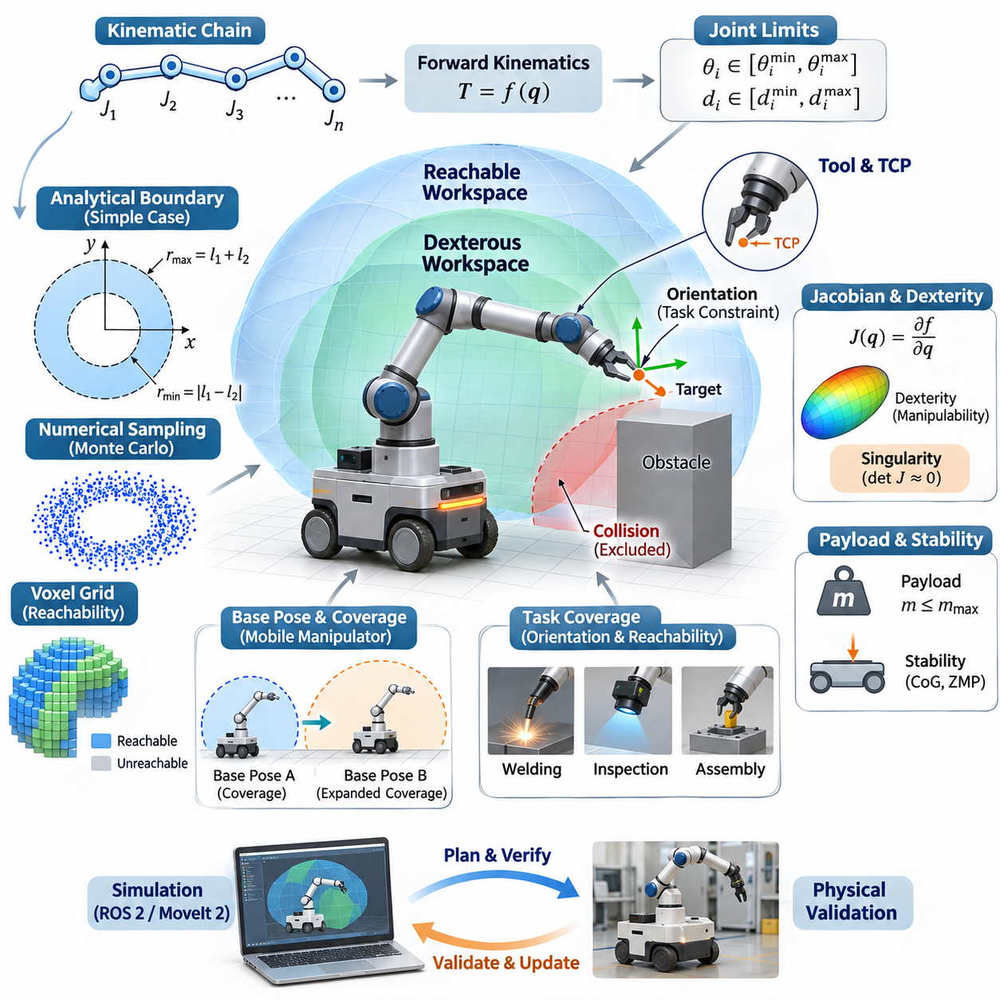
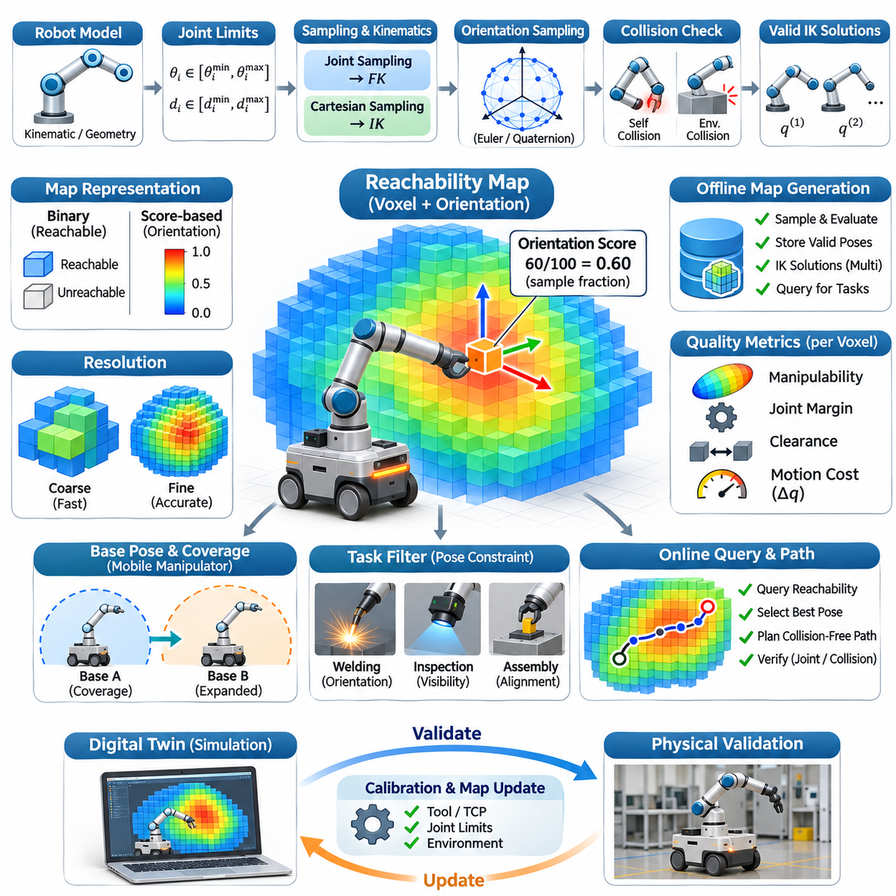
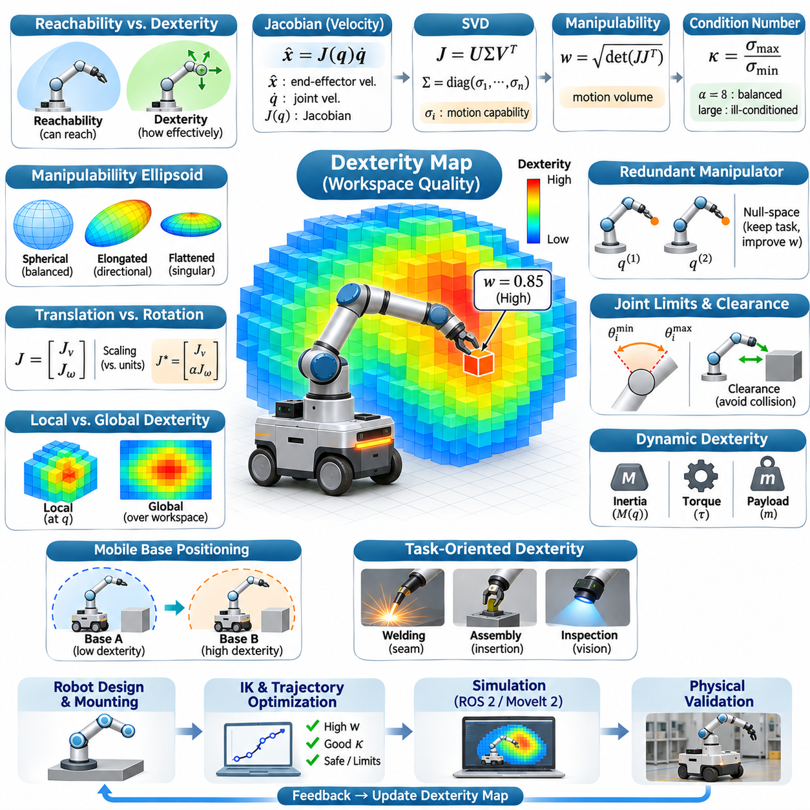
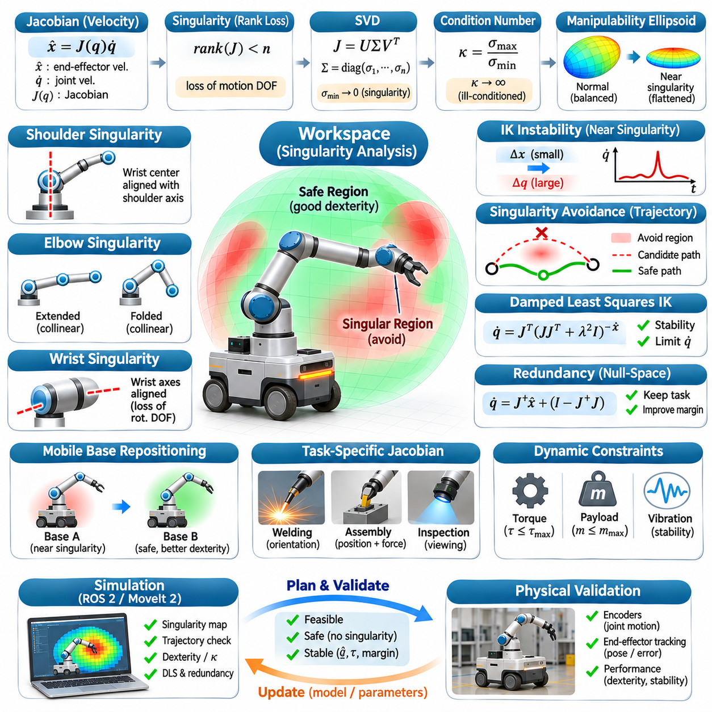
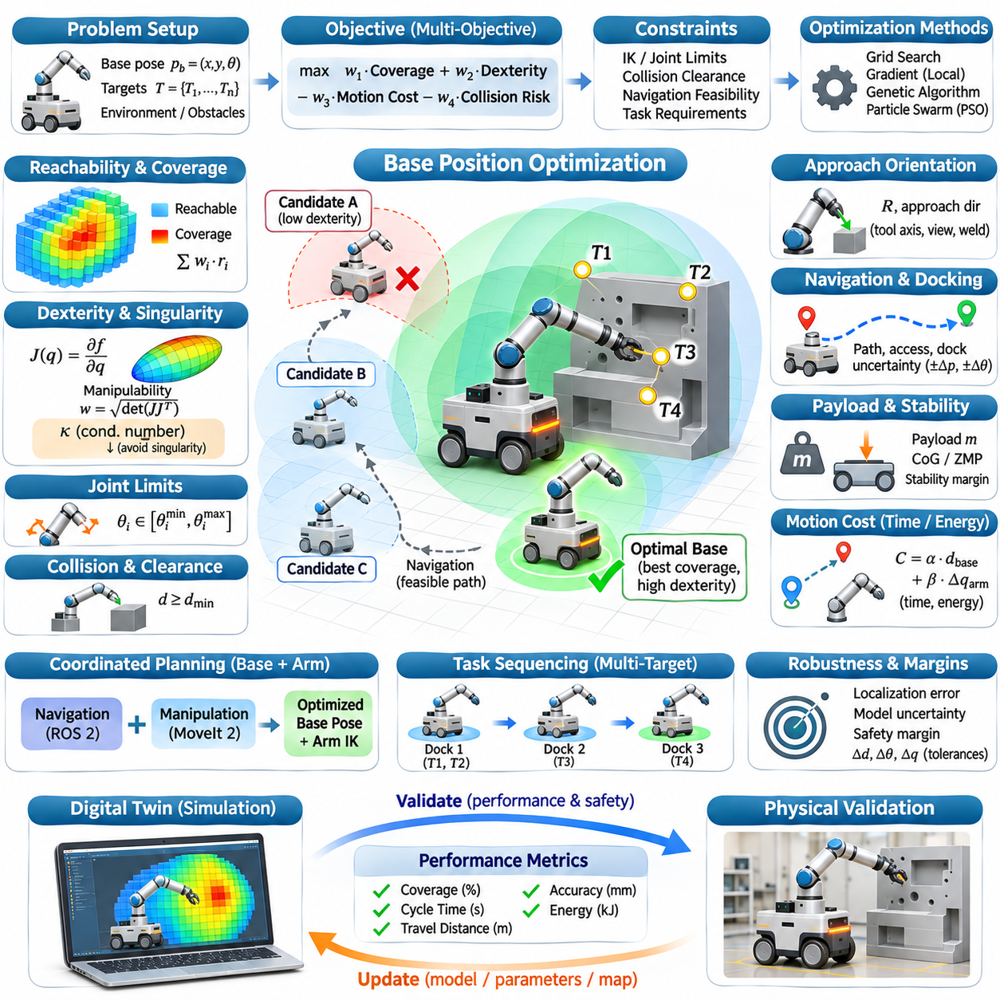
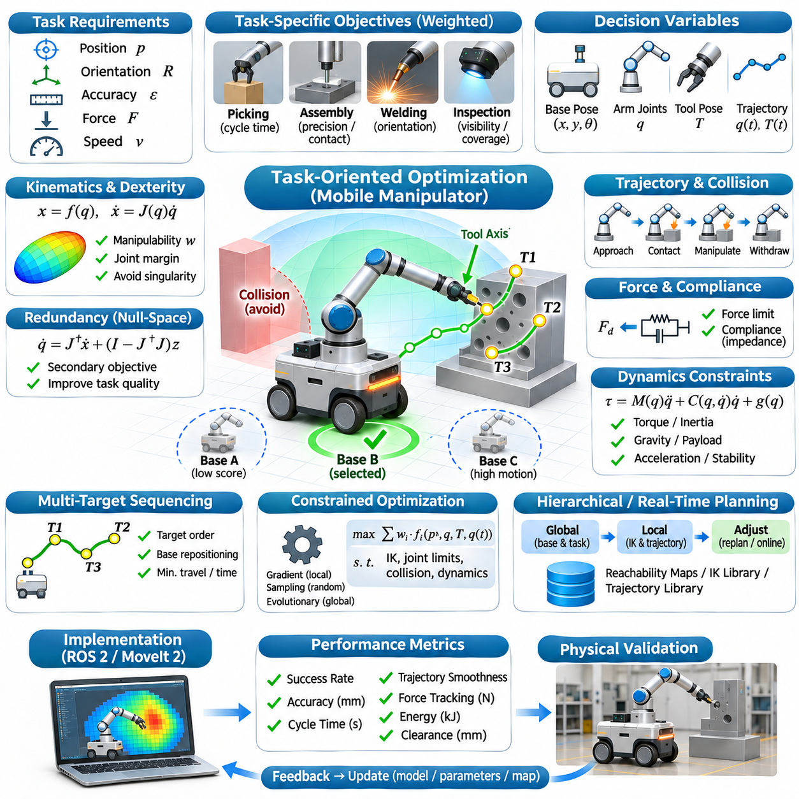
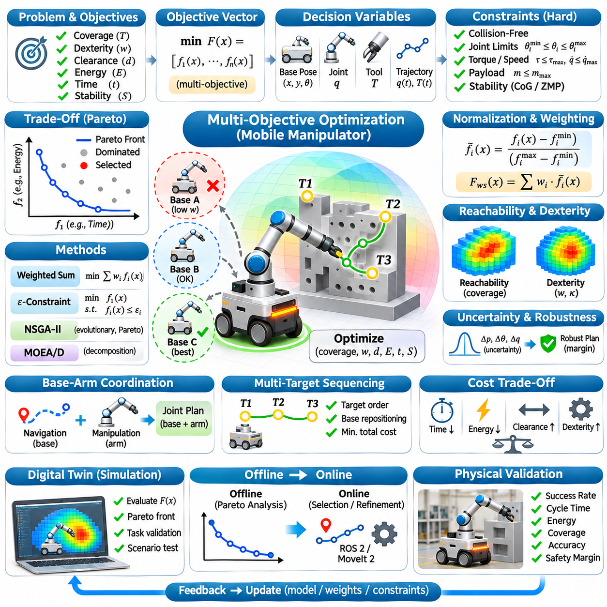
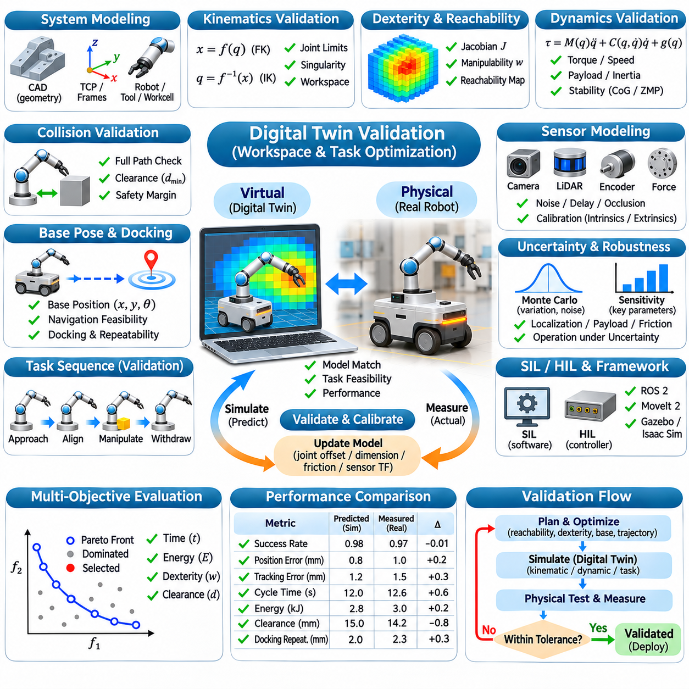
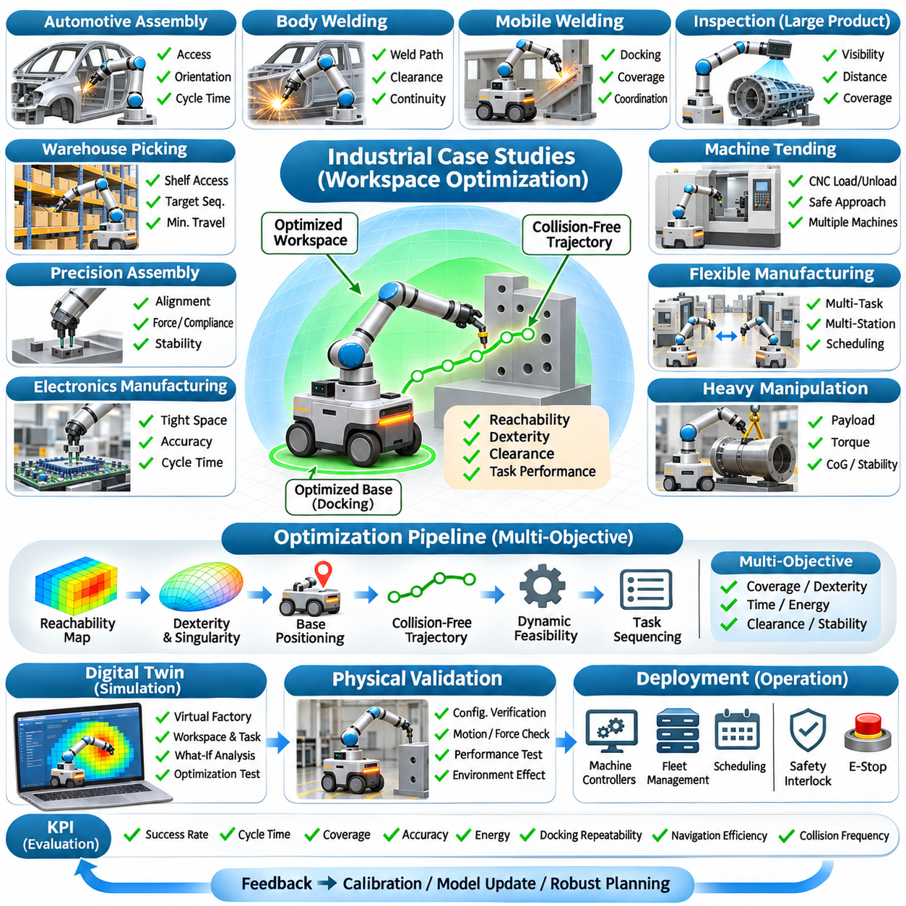

**Volume 02. Manipulator Mechanics and Control**

# Chapter 13. Workspace Optimization

## 01 Workspace Analysis

{width="7.268055555555556in" height="7.268055555555556in"}

Workspace analysis is a fundamental process in manipulator engineering that determines the spatial regions a robot can reach and operate within effectively. It provides the geometric and kinematic foundation for evaluating robot configurations, selecting installation positions, and planning manipulation tasks. In mobile manipulators, workspace analysis must consider both the articulated robot arm and the movable base.

The workspace of a robotic manipulator is defined as the collection of positions or poses attainable by its end effector under specified joint constraints. Its geometry depends on link lengths, joint types, joint limits, and mechanical arrangements. Although a robot may possess a large theoretical workspace, only a portion may be practically usable because of obstacles, joint restrictions, singularities, and operational safety requirements.

Two important workspace categories are reachable workspace and dexterous workspace. Reachable workspace contains all positions that the end effector can attain with at least one valid orientation. Dexterous workspace contains positions where the end effector can achieve every orientation within a specified orientation set. Distinguishing these regions is essential because reaching a target position does not guarantee that the robot can perform the required manipulation operation.

Workspace analysis begins with a mathematical representation of the manipulator\'s kinematic chain. Forward kinematics maps joint configurations into end-effector poses, allowing engineers to determine the spatial locations associated with different joint values. By systematically evaluating feasible joint configurations, the resulting positions can be collected to approximate the workspace boundary and identify regions where manipulation tasks are geometrically possible.

Joint limits strongly influence workspace geometry and operational capability. Revolute joints are restricted by angular ranges, while prismatic joints operate within allowable linear displacements. Mechanical stops, cable routing, actuator limitations, and self-collision constraints further restrict feasible configurations. Accurate workspace analysis must incorporate these limitations rather than assuming unrestricted joint motion throughout the manipulator structure.

Analytical workspace methods derive geometric boundaries directly from manipulator dimensions and joint relationships. These approaches are particularly effective for simple robotic structures with limited degrees of freedom and regular geometric arrangements. For example, a planar two-link manipulator produces a reachable region determined by the sum and difference of its link lengths, although joint limits may remove substantial portions of that region.

Numerical workspace analysis provides greater flexibility for complex manipulators. Joint configurations can be sampled using uniform grids, random sampling, or low-discrepancy sequences, followed by forward kinematic evaluation. Valid end-effector poses are stored as spatial samples that approximate reachable regions. Sampling density determines the resolution of the resulting representation and influences computational cost and boundary accuracy.

Monte Carlo sampling is frequently employed when analytical workspace boundaries are difficult to calculate. Random joint configurations are generated within allowable limits, and their corresponding end-effector positions are computed. Repeated sampling produces a statistical approximation of workspace coverage. However, insufficient samples may overlook narrow reachable regions, while uneven sampling can distort estimates of spatial accessibility.

Workspace representations may use point clouds, voxel grids, occupancy structures, or geometric meshes. Point clouds preserve sampled positions, while voxel grids divide the environment into discrete spatial cells for efficient indexing. Each cell can store information about reachability, orientation availability, collision status, or configuration quality. These representations support subsequent reachability mapping and task-oriented optimization.

A critical distinction exists between geometric reachability and collision-free reachability. A target may lie within the theoretical workspace but remain inaccessible because the robot arm intersects its own structure, nearby machinery, or environmental obstacles. Collision-aware workspace analysis evaluates the complete robot configuration, including links, joints, tools, and surrounding objects, to determine whether a valid configuration can be executed safely.

End-effector geometry must also be included when evaluating practical workspace boundaries. Grippers, welding torches, inspection cameras, and other tools introduce additional dimensions and orientation requirements. The tool center point may extend beyond the wrist frame, changing the reachable region and collision envelope. Consequently, workspace calculations should use the actual tool configuration rather than relying exclusively on the nominal robot flange.

Workspace analysis becomes more complex when task execution requires specific end-effector orientations. Welding, assembly, surface inspection, and precision insertion often impose strict tool-axis constraints. A position that is reachable with an arbitrary orientation may be unsuitable for the intended operation. Evaluating position and orientation together provides a more realistic assessment of task feasibility than position-only workspace calculations.

For mobile manipulators, the robot base introduces additional degrees of freedom that significantly expand operational coverage. The effective workspace depends on the combination of base pose and arm configuration. Moving the base changes the arm\'s reachable region relative to the environment, allowing tasks beyond the fixed-base workspace. However, navigation constraints, docking accuracy, platform stability, and localization uncertainty must be considered.

The relationship between base placement and manipulator workspace is especially important in industrial environments. A poorly positioned mobile platform may force the arm toward joint limits or singular configurations even when the target remains geometrically reachable. Appropriate base placement can increase accessible task locations, improve manipulation flexibility, and reduce unnecessary joint movement while maintaining adequate clearance from surrounding equipment.

Workspace boundaries alone do not fully describe manipulation performance. Some reachable regions require extreme joint configurations, produce poor force transmission, or offer limited freedom for orientation changes. Other regions permit multiple configurations and smoother motion. Therefore, workspace analysis should distinguish simple geometric accessibility from the quality of manipulation that can be achieved within different spatial regions.

The manipulator Jacobian provides additional information about local motion capability throughout the workspace. It relates joint velocities to end-effector linear and angular velocities. Near singular configurations, certain Cartesian motions become difficult or impossible to generate instantaneously, and numerical control may become poorly conditioned. Incorporating Jacobian-based measures helps identify workspace regions that are reachable but operationally undesirable.

Dynamic constraints can further reduce the usable workspace during actual operation. Joint torque limits, actuator speeds, payload mass, gravitational loading, and acceleration requirements affect whether a robot can perform a task at a particular configuration. A pose may be kinematically feasible but dynamically unsuitable for lifting or manipulating a heavy object. Practical workspace evaluation therefore benefits from integrating dynamic feasibility.

Workspace analysis also supports the evaluation of robot design alternatives. Engineers can compare different link lengths, joint arrangements, mounting heights, and arm orientations to determine how structural choices influence task coverage. Increasing reach does not automatically improve overall performance because longer links may introduce additional inertia, structural deflection, and collision risks. Design decisions must balance reachability with mechanical capability.

Simulation environments provide an effective means of evaluating workspace characteristics before physical deployment. Robot models defined through URDF or comparable descriptions can be analyzed using forward kinematics, inverse kinematics, and collision-checking tools. ROS 2 and MoveIt 2 can support configuration feasibility testing and motion planning, while simulation results help engineers identify inaccessible targets and problematic operating regions.

Workspace analysis should be validated against physical robot behavior because mathematical models may not capture every practical limitation. Calibration errors, structural compliance, manufacturing tolerances, and joint-position uncertainty can shift the effective reachable region. Experimental measurements at representative workspace locations help identify discrepancies between predicted and actual end-effector positions and establish confidence in the model.

Industrial workspace evaluation often focuses on task coverage rather than maximizing total reachable volume. In inspection applications, the robot must access specified measurement points with suitable sensor orientations and viewing distances. In assembly operations, insertion directions and approach clearances determine usable configurations. These requirements demonstrate why workspace analysis must be connected directly to the geometry and constraints of the intended task.

A systematic workspace analysis process combines kinematic modeling, configuration sampling, collision evaluation, orientation feasibility, and performance assessment. The resulting information provides a foundation for reachability maps, dexterity analysis, singularity evaluation, and base-position optimization. By identifying both accessible and restricted regions, engineers can develop manipulators that execute industrial tasks more reliably, efficiently, and safely.

## 02 Reachability Maps

{width="7.268055555555556in" height="7.268055555555556in"}

Reachability maps are spatial representations that describe where a robotic manipulator can position its end effector and how effectively it can achieve different orientations. Unlike conventional workspace boundaries, reachability maps provide detailed information about accessibility within individual spatial regions. They support robot design, motion planning, base placement, and task feasibility evaluation in fixed and mobile manipulation systems.

A reachability map is constructed by dividing the manipulator workspace into discrete spatial regions and evaluating feasible robot configurations within each region. These regions are commonly represented using three-dimensional voxels or sampled Cartesian positions. Each location stores information about whether the end effector can reach that position, often together with orientation coverage and additional measures of manipulation capability.

The mathematical foundation of reachability mapping is based on forward and inverse kinematics. Forward kinematics transforms joint configurations into end-effector poses, while inverse kinematics determines whether a desired pose can be achieved by valid joint values. By evaluating many candidate configurations, the mapping process establishes relationships between spatial positions, tool orientations, and feasible robot postures.

A basic reachability map uses binary classification to distinguish reachable and unreachable locations. A spatial cell is marked reachable when at least one valid joint configuration places the end effector within that region. Although binary maps provide useful geometric information, they do not indicate how many orientations are available or whether the robot can execute the required operation with adequate clearance and stability.

Probabilistic or score-based reachability maps provide richer information than binary representations. A reachability score may represent the fraction of sampled orientations that can be achieved at a particular location. For example, if a robot successfully reaches 60 of 100 uniformly sampled target orientations, the estimated orientation reachability score is 0.60. Such scores depend on the sampling strategy and should not automatically be interpreted as physical success probabilities.

Orientation sampling is essential because robotic manipulation requires both position and orientation control. At each spatial location, candidate end-effector orientations can be generated using Euler angles, quaternions, or rotation matrices. Uniformly distributed rotation samples are particularly useful for reducing directional bias. Each candidate pose is evaluated against joint limits, inverse kinematics feasibility, and applicable collision constraints.

Reachability map resolution influences both computational efficiency and geometric accuracy. Fine voxel grids capture narrow accessible regions and workspace boundaries more precisely but require greater memory and processing time. Coarse grids reduce computational requirements while potentially overlooking small reachable regions or collision-sensitive areas. Resolution selection should reflect task precision, robot dimensions, and available computing resources.

Offline reachability map generation is commonly performed before deployment. A robot model is loaded, its kinematic parameters and joint limits are defined, and candidate positions and orientations are evaluated systematically. Valid solutions are stored in a structured database or spatial index. Once generated, the map can be queried repeatedly without solving the complete workspace problem for every new task.

Sampling-based reachability generation can use random joint configurations, structured joint grids, or Cartesian pose sampling. Joint-space sampling naturally produces feasible forward-kinematic poses, but it may distribute samples unevenly across Cartesian space. Cartesian sampling provides more direct control over spatial coverage but requires inverse kinematics evaluation. Combining both approaches can improve coverage and computational efficiency.

Collision-aware reachability maps incorporate geometric constraints from the robot and its environment. A pose may satisfy inverse kinematics but remain unusable because a robot link intersects another link, a machine enclosure, or nearby equipment. Self-collision checks can be included during offline generation, while environment-dependent collision checks may need to be repeated whenever obstacles or operating conditions change.

Reachability maps may store multiple inverse kinematics solutions for the same target pose. This is important for redundant manipulators, where several joint configurations can produce identical end-effector positions and orientations. Different solutions may offer different collision clearances, joint-limit margins, or motion continuity. Retaining representative configurations enables planners to select postures that satisfy additional operational requirements.

Reachability maps can also incorporate quality metrics beyond simple geometric feasibility. Common measures include manipulability, distance from joint limits, collision clearance, and estimated joint displacement. These values help distinguish highly accessible regions from locations that are technically reachable but difficult to use. A task planner can combine such measures to prioritize configurations with greater operational flexibility.

For mobile manipulators, reachability maps provide a connection between navigation and manipulation planning. A map generated relative to the robot base can be transformed into the environment coordinate frame for different base poses. This allows the system to evaluate which platform locations provide access to required targets. The combined analysis supports coordinated base positioning and robotic arm configuration selection.

Base placement optimization can use reachability maps to identify platform positions that maximize task coverage. Candidate base poses are evaluated against the target locations and orientations required by the operation. A base position is considered favorable when it enables the arm to reach more task poses while preserving suitable manipulation quality. Navigation accessibility, docking constraints, and platform stability must also be considered.

Task-specific reachability maps are particularly useful in industrial applications. Welding requires suitable torch orientations and approach directions, while inspection requires appropriate camera viewpoints and working distances. Assembly operations may require restricted insertion directions and collision-free approach paths. By incorporating these requirements, reachability analysis becomes more representative of actual task feasibility than unrestricted geometric mapping.

Reachability information can accelerate motion planning by rejecting infeasible targets before computationally expensive trajectory generation. When a requested pose falls outside the reachable region, the planner can immediately consider alternative orientations, base positions, or task strategies. However, a reachable target does not guarantee that a continuous collision-free trajectory exists between the current configuration and the desired configuration.

Reachability maps are especially valuable for systems that perform repeated operations across large industrial structures. A mobile inspection robot can evaluate whether measurement points are accessible from a selected docking position before initiating an inspection sequence. If some targets are unreachable, the system can select another base position or divide the operation into multiple inspection stages to improve overall coverage.

Digital twin environments provide an effective platform for generating and validating reachability maps. Robot geometry, joint constraints, tool configurations, and environmental models can be integrated into a virtual system. Simulation tools can evaluate candidate poses and visualize accessibility distributions. Comparing simulated predictions with physical robot measurements helps identify calibration errors, model inaccuracies, and practical workspace limitations.

Reachability maps must be updated when robot configuration changes significantly. Installing a different gripper, modifying the tool center point, changing joint limits, or relocating the arm mounting position can alter reachable poses. Environmental changes may also invalidate collision-related information. Separating robot-intrinsic reachability from environment-specific feasibility allows systems to reuse geometric maps while updating operational constraints.

The accuracy of a reachability map depends on model fidelity, sampling density, inverse kinematics reliability, and collision-checking precision. Sparse sampling may underestimate accessibility, while inaccurate geometry or incomplete constraints may overestimate usable regions. Validation should therefore include representative reachable and unreachable poses, boundary conditions, and configurations near joint limits or singularities.

Efficient reachability map implementation requires careful data management. Sparse voxel structures, spatial indexing, compressed orientation sets, and hierarchical representations can reduce memory consumption and improve query speed. For real-time applications, precomputed scores and representative configurations allow planners to retrieve useful feasibility information quickly while reserving detailed kinematic and collision verification for selected candidates.

Reachability maps provide a practical bridge between theoretical workspace analysis and operational manipulation planning. By associating spatial locations with orientation feasibility, robot configurations, and performance measures, they support more informed decisions about task allocation, base placement, and motion generation. Their greatest value emerges when geometric accessibility is combined with collision safety, manipulation quality, and task-specific requirements.

## 03 Dexterity Analysis

{width="7.268055555555556in" height="7.268055555555556in"}

Dexterity analysis evaluates the ability of a robotic manipulator to generate controlled movements and orientations at different locations within its workspace. While reachability analysis determines whether a target pose can be achieved, dexterity analysis examines how effectively the robot can move and manipulate objects around that pose. It provides essential information for robot design, task planning, and workspace optimization.

Robot dexterity depends on the manipulator\'s kinematic structure, joint configuration, degrees of freedom, and proximity to singularities. A robot may reach a particular position but have limited freedom to change its end-effector orientation or movement direction. High dexterity indicates that the manipulator can perform diverse local motions without excessive joint movement, while low dexterity indicates restricted or poorly conditioned motion.

The mathematical foundation of dexterity analysis is the manipulator Jacobian, which relates joint velocities to end-effector linear and angular velocities. For a manipulator with joint velocity vector q̇ and end-effector velocity vector ẋ, the relationship is expressed as ẋ = J(q)q̇. The Jacobian matrix J(q) changes with the robot configuration, making dexterity dependent on the current joint positions.

The Jacobian provides information about how efficiently joint motion produces Cartesian movement. When the Jacobian is well conditioned, the robot can generate movements in different directions with relatively balanced joint velocities. When it becomes poorly conditioned, certain movement directions require disproportionately large joint velocities. This behavior becomes especially important near singular configurations where independent motion capabilities are reduced.

Manipulability is one of the most widely used quantitative measures of robot dexterity. Yoshikawa\'s manipulability index is commonly defined as w = √det(JJᵀ) for a task Jacobian with full row rank. This index describes the volume scaling of the velocity manipulability ellipsoid. Larger values generally indicate greater instantaneous motion capability, although meaningful comparisons require consistent units and coordinate scaling.

The manipulability ellipsoid provides a geometric interpretation of local motion capability. It represents the Cartesian velocities achievable when joint velocities satisfy a normalized Euclidean bound. The ellipsoid\'s principal axes indicate directions of greater or smaller motion capability. A nearly spherical ellipsoid suggests balanced directional mobility, while an elongated ellipsoid indicates substantial directional differences.

Singular value decomposition provides a systematic method for examining the Jacobian and its associated manipulability ellipsoid. By decomposing the Jacobian into orthogonal matrices and singular values, engineers can identify principal movement directions and their relative capabilities. Small singular values indicate directions where Cartesian velocity generation is weak, while zero singular values identify lost instantaneous motion directions.

The Jacobian condition number is another important dexterity metric. It is commonly calculated as the ratio between the largest and smallest singular values of an appropriately scaled Jacobian. A condition number near one indicates balanced velocity transmission, while a large condition number indicates directional sensitivity. At a singular configuration, the condition number becomes unbounded when the smallest relevant singular value approaches zero.

Dexterity analysis must distinguish translational and rotational capabilities because linear and angular velocities have different physical units. Directly combining them in a single Jacobian metric may produce misleading comparisons. Engineers may analyze translational and rotational Jacobians separately or introduce characteristic lengths and task-specific scaling factors. These choices ensure that dexterity scores reflect meaningful physical requirements.

Local dexterity describes manipulation capability at a particular joint configuration, while global dexterity summarizes performance across a larger workspace region. Global measures may be calculated by averaging local manipulability, evaluating worst-case conditioning, or measuring the proportion of configurations satisfying dexterity thresholds. Such measures help compare robot designs and identify regions suitable for demanding manipulation operations.

Dexterity maps extend reachability maps by associating workspace locations with quantitative manipulation quality. Each spatial cell may store the maximum, average, or minimum dexterity score among valid configurations reaching that location. These maps reveal regions where the robot can move efficiently and regions where motion becomes restricted. They are particularly useful for selecting working positions and optimizing repetitive industrial tasks.

For redundant manipulators, multiple joint configurations may achieve the same end-effector pose while exhibiting different dexterity characteristics. Redundancy resolution can exploit this flexibility by selecting configurations that improve manipulability or avoid singularities. Null-space control allows certain joint adjustments without changing the primary end-effector task, provided sufficient redundancy and appropriate constraints are available.

Dexterity optimization can be integrated into inverse kinematics and trajectory planning. Instead of selecting any valid joint configuration, an optimization algorithm may prefer solutions with higher manipulability, better conditioning, or greater distance from joint limits. Gradient-based methods can adjust joint configurations to improve local dexterity while preserving the required task pose and satisfying collision and mechanical constraints.

Joint limits significantly influence practical dexterity even when the Jacobian indicates favorable local motion properties. A robot near its mechanical joint boundaries may be unable to continue moving in certain directions despite having a mathematically well-conditioned Jacobian. Joint-limit-aware dexterity measures account for remaining joint travel and provide a more realistic description of usable motion capability.

Collision constraints also affect dexterity in real environments. A manipulator may possess favorable kinematic dexterity but lack sufficient clearance to execute movements around its current pose. Nearby equipment, workpieces, and the robot\'s own structure can restrict feasible joint motions. Collision-aware dexterity analysis therefore combines local kinematic capability with environmental constraints and available movement directions.

In mobile manipulators, dexterity depends on both arm configuration and mobile base placement. Changing the base position alters the relative geometry between the manipulator and its task targets, potentially improving orientation flexibility and avoiding poorly conditioned configurations. Coordinated base and arm optimization can increase task coverage while maintaining favorable manipulation characteristics throughout the operation.

Task-oriented dexterity analysis evaluates motion capability according to the directions required by a specific operation. Welding may prioritize smooth tool motion along a seam, while assembly may require precise axial insertion and controlled lateral compliance. Inspection tasks may emphasize camera orientation flexibility and stable viewpoint adjustment. Task-weighted dexterity metrics provide more relevant evaluations than unrestricted isotropic measures.

Dynamic dexterity extends purely kinematic analysis by considering inertia, actuator torque limits, and acceleration capability. A configuration with favorable velocity manipulability may still exhibit poor acceleration or force-generation performance under significant payloads. Dynamic manipulability measures can incorporate the mass matrix and actuator constraints, allowing engineers to assess whether the robot can execute demanding motions effectively.

Dexterity evaluation is particularly valuable during robot design and mounting configuration selection. Link lengths, joint-axis arrangements, arm mounting height, and tool geometry influence dexterity distributions across the workspace. Engineers can compare candidate designs using workspace-averaged scores and task-specific performance thresholds. The objective is not necessarily maximum dexterity everywhere but sufficient capability throughout critical operating regions.

Simulation environments support dexterity analysis by computing Jacobians, singular values, and manipulability metrics across sampled configurations. Robot descriptions and kinematic libraries can be integrated with ROS 2, MoveIt 2, or dedicated numerical tools. Visualization of dexterity distributions helps identify weak operating regions, while physical experiments verify whether predicted motion characteristics correspond to actual robot behavior.

A comprehensive dexterity assessment combines Jacobian conditioning, manipulability, joint-limit margins, collision clearance, and task-specific motion requirements. No single metric fully describes manipulation performance, particularly when position, orientation, force, and dynamic constraints interact. Integrating these measures with reachability maps and workspace optimization enables robots to perform industrial manipulation tasks with greater flexibility, stability, and reliability.

## 04 Singularity Analysis

{width="7.268055555555556in" height="7.268055555555556in"}

Singularity analysis is an essential aspect of robotic manipulator engineering that identifies configurations where the robot loses one or more independent motion capabilities. A singularity occurs when the manipulator\'s Jacobian matrix becomes rank deficient, preventing certain end-effector motions from being generated through joint movements. Understanding singularities is critical for reliable inverse kinematics, trajectory planning, dexterity evaluation, and safe robot operation.

The mathematical foundation of singularity analysis is the relationship between joint velocities and Cartesian end-effector velocities. This relationship is expressed as ẋ = J(q)q̇, where J(q) represents the manipulator Jacobian. Under normal configurations, the Jacobian provides sufficient independent motion directions. At singular configurations, its rank decreases, indicating that one or more Cartesian motion directions become unavailable or require theoretically unbounded joint velocities.

Singularities are closely related to the geometric structure and kinematic arrangement of a robot arm. They typically occur at specific combinations of joint angles where multiple joint axes become aligned, links reach particular geometric relationships, or the manipulator loses independent control over certain directions. Their locations depend on link dimensions, joint arrangements, degrees of freedom, and mechanical constraints.

For a typical six-degree-of-freedom industrial manipulator, singularities are commonly classified into shoulder, elbow, and wrist singularities. Shoulder singularities occur when the wrist center aligns with or approaches the robot\'s shoulder axis. Elbow singularities arise when the arm approaches a fully extended or folded configuration. Wrist singularities occur when two wrist joint axes become aligned, reducing independent rotational motion.

Shoulder singularities can significantly affect the robot\'s ability to position its wrist center in certain directions. When the wrist center approaches the shoulder axis, different shoulder configurations may become indistinguishable or require substantial joint movement to produce small Cartesian changes. These conditions can introduce instability into inverse kinematics solutions and complicate trajectory execution near the affected region.

Elbow singularities generally occur when the upper arm and forearm become nearly collinear or reach a folded alignment. In these configurations, the manipulator loses an independent direction of movement because the contributions of certain joints become geometrically dependent. Small changes in the desired end-effector position may consequently require large joint rotations, increasing sensitivity and reducing motion stability.

Wrist singularities occur when rotational axes within the wrist mechanism become aligned. This condition reduces the ability to independently control the end-effector orientation around certain rotational directions. Industrial manipulators may experience abrupt changes in wrist joint angles when passing near these configurations, even when the Cartesian trajectory appears smooth. Appropriate orientation planning is therefore important for maintaining continuous robot motion.

The singular value decomposition of the Jacobian provides a systematic method for detecting and characterizing singular configurations. By decomposing the Jacobian into orthogonal matrices and singular values, engineers can examine the independent motion directions available to the manipulator. When the smallest singular value approaches zero, the robot approaches a singularity. A zero singular value indicates that at least one instantaneous Cartesian motion direction has been lost.

The Jacobian condition number is widely used to evaluate proximity to singularities. It is calculated as the ratio between the largest and smallest singular values of an appropriately scaled Jacobian. A rapidly increasing condition number indicates deteriorating numerical conditioning and reduced motion capability in certain directions. Monitoring this value allows motion planners and controllers to identify configurations that should be avoided during normal operation.

Near a singularity, inverse kinematics calculations can become numerically unstable. Small changes in the desired end-effector position or orientation may produce disproportionately large changes in the calculated joint angles. Numerical solvers may also converge slowly, oscillate, or fail to find a suitable solution. These problems can result in unexpected joint movements, trajectory discontinuities, and degraded positioning accuracy.

Singularity analysis is closely connected to robot manipulability. The manipulability ellipsoid becomes increasingly elongated as the manipulator approaches a singular configuration, indicating that motion capability is becoming strongly direction-dependent. The corresponding manipulability measure decreases as the Jacobian loses rank. Combining manipulability analysis with singularity detection provides a more complete assessment of local robot motion quality.

Singularity avoidance is an important requirement in practical motion planning. One approach is to define a safety threshold for the smallest Jacobian singular value or the Jacobian condition number. Candidate trajectories can then be evaluated to ensure that the manipulator maintains an acceptable distance from singular configurations. This approach reduces the likelihood of unstable joint velocities and helps maintain predictable motion throughout task execution.

Damped least-squares inverse kinematics is commonly used to improve numerical stability near singularities. Instead of directly applying the Jacobian pseudoinverse, the method introduces a damping factor that limits excessive joint velocity responses. The damping factor can be adjusted according to the smallest singular value or other conditioning measures. Although this method improves numerical robustness, it may introduce small Cartesian tracking errors.

Null-space control provides another method for managing singularity-related constraints in redundant manipulators. The primary task controls the desired end-effector motion, while secondary objectives modify redundant joint movements without changing the primary task, within the available null space. These objectives may include increasing distance from singular configurations, avoiding joint limits, and improving collision clearance.

Trajectory planning should consider singularity avoidance over the complete motion path rather than evaluating only the initial and final configurations. A trajectory may begin and end in well-conditioned configurations but pass through a singular region during execution. Continuous monitoring of Jacobian properties allows planners to modify intermediate configurations, select alternative inverse kinematics solutions, or generate different motion paths.

Singularity analysis becomes more complex in mobile manipulators because both the robot arm and mobile base influence the overall motion capability. Base movement can change the relative geometry between the arm and target, allowing the system to avoid problematic arm configurations. Coordinated base and arm planning can therefore provide additional flexibility when approaching targets that would otherwise require operation near singularities.

Task-specific singularity evaluation is particularly important in industrial applications. Welding, precision assembly, inspection, and surface processing require different combinations of translational and rotational motion. A configuration that is poorly conditioned for unrestricted six-dimensional movement may remain acceptable for a task requiring only a limited set of motion directions. Therefore, singularity analysis should consider the task Jacobian and actual operational requirements whenever appropriate.

Dynamic effects can further amplify the consequences of singular configurations. Near singularities, the large joint velocities required to produce certain Cartesian movements may exceed actuator limits or introduce excessive acceleration and mechanical stress. Under substantial payloads, these conditions can reduce positioning accuracy and increase the risk of vibration or structural deformation. Dynamic constraints should therefore be considered alongside purely kinematic singularity measures.

Simulation tools provide an effective environment for identifying singular regions before physical deployment. Robot models can be evaluated across sampled joint configurations, with Jacobian rank, singular values, and condition numbers calculated automatically. ROS 2, MoveIt 2, and numerical robotics libraries can support these evaluations. Visualizing singularity distributions across the workspace helps engineers select suitable operating regions and motion strategies.

Experimental validation is necessary to confirm that singularity analysis accurately reflects real robot behavior. Joint encoder measurements, end-effector tracking, and commanded velocity responses can reveal unexpected behavior near predicted singular configurations. Model inaccuracies, mechanical tolerances, controller limitations, and structural compliance may influence actual performance. Testing representative configurations provides practical evidence for validating the analytical model.

A comprehensive singularity management strategy combines Jacobian analysis, condition number monitoring, manipulability evaluation, inverse kinematics robustness, and trajectory optimization. No single detection method is sufficient for every manipulator structure or application. Integrating these techniques into the control and planning architecture helps maintain continuous motion, prevent excessive joint velocities, and improve the reliability and safety of industrial robotic manipulation.

## 05 Base Position Optimization

{width="7.268055555555556in" height="7.268055555555556in"}

Base position optimization is a fundamental component of mobile manipulator planning that determines the most suitable location and orientation of the mobile platform for executing manipulation tasks. Unlike fixed-base robots, mobile manipulators can reposition their platforms to improve arm reachability, dexterity, and collision clearance. Selecting an appropriate base position directly influences task coverage, motion efficiency, operational stability, and overall manipulation performance.

The optimization process considers the geometric relationship between the mobile base, robot arm, target objects, and surrounding environment. A candidate base pose is typically represented by its position and orientation in the environment coordinate frame. For each candidate pose, the system evaluates whether the manipulator can reach the required targets while satisfying joint limits, orientation constraints, and collision avoidance requirements.

Kinematic reachability is one of the primary criteria for evaluating candidate base positions. The robot arm must be capable of reaching target locations from the selected platform pose without exceeding its joint limits or entering invalid configurations. Reachability maps can be used to estimate the accessible task region for different base positions, allowing the planner to identify locations that provide sufficient coverage of the required manipulation targets.

Dexterity is another important consideration in base position optimization. A platform position may provide geometric access to a target while forcing the robot arm into configurations with poor manipulability or proximity to singularities. Evaluating Jacobian-based dexterity measures helps identify base positions that allow the arm to maintain balanced movement capability and sufficient orientation flexibility throughout task execution.

The relative orientation of the mobile base significantly affects the manipulator\'s effective workspace. Rotating the platform can change the relationship between the arm\'s kinematic structure and the target object, improving approach directions and reducing joint movement requirements. For operations such as inspection, welding, and assembly, selecting an appropriate base orientation is often as important as selecting the platform\'s translational position.

Base position optimization can be formulated as a constrained optimization problem. The objective function may combine target reachability, manipulability, distance from singular configurations, collision clearance, and expected motion cost. Constraints represent navigation feasibility, platform dimensions, joint limits, environmental obstacles, and task-specific requirements. The optimization algorithm searches for a base pose that provides the best overall operational performance.

Target coverage is particularly important when a mobile manipulator must perform multiple operations from a single docking position. A suitable base location should allow the robot arm to access as many required targets as possible without unnecessary platform movement. Coverage-based optimization evaluates the number or weighted importance of reachable targets and identifies positions that reduce the need for repeated repositioning.

Collision avoidance must be considered when evaluating candidate base positions. The mobile platform may collide with nearby equipment, walls, workpieces, or other robots, while the manipulator may encounter obstacles during arm extension and retraction. Collision checking should therefore consider both the platform geometry and the complete manipulator configuration. Sufficient clearance is necessary to maintain safe and reliable operation.

Navigation feasibility introduces additional constraints that distinguish mobile manipulator optimization from conventional fixed-base manipulation planning. A theoretically favorable base pose may be inaccessible because of narrow passages, restricted turning areas, floor conditions, or obstacles. The navigation planner must identify collision-free paths to candidate positions and verify that the platform can approach and leave the selected location safely.

Docking accuracy also influences the quality of base position optimization. The actual platform position may differ from its commanded pose because of localization uncertainty, wheel slip, floor irregularities, or positioning errors. Manipulation planning should account for these uncertainties by maintaining adequate reachability and collision margins. Fine positioning or visual alignment may be required when the task demands high end-effector accuracy.

For industrial applications, base position optimization should consider the relationship between the platform and the workpiece rather than relying only on geometric distance. The closest platform position is not necessarily the best because it may restrict arm movement, reduce visibility, or create unfavorable approach angles. A slightly more distant position may provide better dexterity, improved collision clearance, and more efficient task execution.

Multiple target optimization becomes necessary when the robot must manipulate objects distributed across a large working area. The system may evaluate candidate base positions according to their ability to cover several targets within a single operating region. Weighted coverage functions can assign different importance to targets based on task priority, processing time, inspection requirements, or operational sequence.

Motion cost is another important optimization criterion. Moving the mobile base consumes time and energy, while excessive arm movement increases joint activity and may reduce mechanical efficiency. A combined cost function can consider base travel distance, arm joint displacement, trajectory duration, and expected energy consumption. This approach helps balance navigation effort against manipulation efficiency.

For redundant mobile manipulators, base position and arm configuration should be optimized together. A base pose that appears unfavorable under one arm configuration may become suitable when the arm uses a different inverse kinematics solution. Coordinated optimization can exploit the combined degrees of freedom of the mobile platform and manipulator, improving reachability and dexterity while avoiding singularities and joint limits.

Sequential manipulation tasks require additional consideration of base repositioning between operations. The optimal base position for one target may not be suitable for the next target, particularly when objects are distributed across different workstations. Task planning can determine whether several operations should be completed from one position or whether the platform should move between multiple optimized docking locations.

Dynamic and mechanical constraints also influence the selection of suitable base positions. Manipulator extension can shift the system\'s center of gravity and affect platform stability, particularly when handling heavy payloads or operating at elevated positions. The optimization process should consider payload capacity, support geometry, acceleration limits, and stability margins to prevent unsafe configurations during manipulation.

Uncertainty-aware optimization improves robustness under real operating conditions. Localization errors, target pose estimation uncertainty, structural deformation, and mechanical tolerances can reduce the accuracy of predicted manipulation performance. Instead of selecting a base position that only satisfies ideal geometric conditions, the system should prefer solutions that preserve sufficient operational margins under expected disturbances.

Optimization algorithms can range from exhaustive candidate evaluation to numerical and heuristic search methods. Grid-based search provides a straightforward approach for evaluating discrete base positions, while gradient-based methods can refine continuous position and orientation variables when the objective function is sufficiently smooth. Genetic algorithms, particle swarm optimization, and other population-based methods can also explore complex optimization spaces with multiple competing objectives.

In practical mobile manipulation systems, base position optimization can be integrated with ROS 2 navigation and MoveIt 2 motion planning. The navigation system provides feasible platform poses and paths, while the manipulation planner evaluates arm reachability, inverse kinematics, collision conditions, and trajectory feasibility. A coordination layer combines these results to select suitable base positions and execute the overall task sequence.

Digital twin environments support the development and validation of base position optimization algorithms. Virtual models of the mobile platform, manipulator, workpieces, and surrounding equipment allow candidate positions to be evaluated before physical deployment. Simulation can measure task coverage, motion duration, collision clearance, and manipulation quality, while physical experiments verify the accuracy of predicted performance.

Experimental evaluation should compare optimized base positions with manually selected or conventional positioning strategies. Relevant performance indicators include target coverage, task completion time, base travel distance, arm joint displacement, positioning accuracy, collision frequency, and energy consumption. Repeated experiments under different environmental conditions help determine whether the optimization method provides consistent improvements.

An effective base position optimization strategy integrates reachability, dexterity, singularity avoidance, collision clearance, navigation feasibility, and task-specific performance requirements. Rather than selecting a platform position based on a single geometric criterion, the system evaluates the combined behavior of the mobile base and manipulator. This integrated approach enables mobile manipulators to achieve more reliable task execution, efficient movement, and flexible operation in complex industrial environments.

## 06 Task Oriented Optimization

{width="7.268055555555556in" height="7.268055555555556in"}

Task-oriented optimization focuses on improving robotic manipulator performance according to the specific requirements of an intended operation rather than maximizing general workspace or kinematic performance. Different industrial tasks impose different constraints on position, orientation, force, speed, accuracy, and motion continuity. Therefore, optimization objectives must reflect the actual operational requirements of applications such as assembly, welding, inspection, material handling, and precision manipulation.

The fundamental principle of task-oriented optimization is that the best robot configuration depends on the task being performed. A configuration suitable for high-speed material handling may not be appropriate for precision assembly or force-controlled insertion. Similarly, an arm posture that provides excellent geometric reachability may produce poor tool orientation or insufficient collision clearance. Optimization must therefore evaluate robot performance in the context of specific task objectives.

Task requirements are first translated into mathematical constraints and performance objectives. These requirements may include target positions, end-effector orientations, allowable position errors, force limits, velocity profiles, and collision avoidance conditions. The resulting task specification defines the feasible operating region and provides measurable criteria for comparing alternative robot configurations and motion trajectories.

End-effector pose optimization is an important component of task-oriented planning. The robot must reach each target with an appropriate position and orientation while maintaining sufficient flexibility for subsequent movements. For example, an assembly operation may require a precisely aligned insertion direction, whereas an inspection operation may prioritize camera visibility and a suitable viewing angle. These differences directly influence optimal manipulator configurations.

Kinematic optimization evaluates how effectively the manipulator can perform the required task within its joint constraints. Inverse kinematics generates candidate joint configurations, while Jacobian-based measures evaluate local motion capability. Configurations with favorable manipulability, adequate joint-limit margins, and sufficient distance from singularities are generally preferred when they support the required task performance.

Trajectory optimization extends configuration optimization across the complete execution process. Instead of evaluating only individual target poses, the planner considers the continuous movement between successive targets. Relevant objectives include minimizing travel distance, joint displacement, execution time, acceleration, and unnecessary changes in orientation. Maintaining smooth trajectories reduces mechanical stress and improves repeatability in repetitive industrial operations.

Task-oriented optimization must also consider collision constraints throughout the entire motion. A target configuration may be reachable and kinematically favorable but inaccessible through a collision-free trajectory. The optimization process therefore evaluates the geometry of the robot links, end effector, workpiece, and surrounding equipment. Sufficient clearance must be maintained during approach, contact, manipulation, and withdrawal phases.

Force and contact requirements are particularly important in assembly, insertion, polishing, and surface-following operations. These tasks may require controlled interaction forces rather than purely position-based motion. Task-oriented optimization can incorporate force limits, contact direction, compliance characteristics, and interaction stability into its objectives. The selected trajectory should provide accurate positioning while avoiding excessive contact forces or unstable mechanical interactions.

Different tasks require different weighting of optimization objectives. High-speed picking may prioritize cycle time and motion efficiency, while precision assembly may emphasize positional accuracy, orientation consistency, and controlled contact forces. Inspection operations may prioritize visibility, sensor positioning, and coverage. A weighted objective function allows engineers to represent these priorities and balance competing performance requirements.

For mobile manipulators, task-oriented optimization must coordinate the mobile base and robotic arm. The base position determines the arm\'s relative geometry to the target, while the arm configuration determines the available manipulation poses. A suitable solution considers both navigation and manipulation requirements, selecting base positions that provide effective task coverage, favorable arm dexterity, and collision-free access to the required working locations.

Multi-target tasks introduce additional optimization requirements because the robot must execute several operations in a predefined or dynamically determined sequence. The planner may optimize target ordering, intermediate configurations, base repositioning, and overall execution time. Grouping nearby targets into a single operating region can reduce unnecessary navigation, while selecting appropriate arm configurations can minimize repeated joint movements.

Redundant manipulators provide additional flexibility for task-oriented optimization. Multiple joint configurations may achieve the same end-effector pose, but they can differ in collision clearance, manipulability, joint-limit proximity, and force transmission. Optimization algorithms can exploit this redundancy to select configurations that improve task execution while preserving the required end-effector trajectory. Null-space optimization is particularly useful when secondary objectives must be satisfied without disturbing the primary task.

Dynamic constraints should be included when tasks involve significant payloads, rapid movements, or sustained contact forces. Joint torque limits, actuator capabilities, link inertia, gravity, and acceleration requirements influence whether a candidate trajectory can be executed reliably. A kinematically valid solution may still be dynamically infeasible. Integrating dynamic models into task-oriented optimization improves motion feasibility and reduces excessive mechanical loading.

Task-oriented optimization can be formulated as a constrained numerical optimization problem. Decision variables may include joint configurations, trajectory parameters, end-effector poses, and mobile base positions. The objective function represents task-specific performance, while constraints enforce kinematic feasibility, collision avoidance, actuator limits, and operational safety. Depending on the problem structure, gradient-based optimization, sampling-based methods, or evolutionary algorithms may be applied.

Real-time task-oriented optimization requires balancing solution quality against computational cost. Complex optimization algorithms may produce excellent trajectories but require excessive processing time for time-critical applications. Practical systems often combine precomputed reachability maps, inverse kinematics solutions, trajectory libraries, and local optimization. This hierarchical approach provides efficient initial solutions while allowing adjustments when environmental conditions or task requirements change.

Simulation and digital twin environments support task-oriented optimization by allowing candidate configurations and trajectories to be evaluated before physical execution. Robot geometry, tool characteristics, workpiece models, and environmental constraints can be represented in a virtual environment. Simulation enables engineers to compare task completion time, positioning accuracy, collision clearance, and manipulation quality under repeatable conditions.

In ROS 2 and MoveIt 2-based systems, task-oriented optimization can be integrated with motion planning, inverse kinematics, collision checking, and trajectory execution components. Task-level planners define the required operations, while lower-level planning modules generate feasible robot motions. For mobile manipulators, navigation and manipulation planning must exchange information to ensure that the selected base position supports the complete task sequence.

Performance evaluation should verify whether optimization produces measurable improvements in actual task execution. Relevant indicators include task success rate, positioning accuracy, cycle time, trajectory smoothness, force regulation accuracy, energy consumption, and collision avoidance performance. Repeated experiments under different operating conditions help determine whether the selected optimization strategy remains effective despite variations in payload, target location, and environmental conditions.

An effective task-oriented optimization framework integrates task specifications, kinematic feasibility, dexterity, singularity avoidance, collision constraints, dynamic performance, and execution efficiency. Its objective is not to identify a universally optimal robot configuration but to select the most appropriate configuration and motion strategy for each operation. This approach enables robotic manipulators and mobile manipulation systems to achieve higher productivity, precision, flexibility, and operational reliability in complex industrial environments.

## 07 Multi Objective Optimization

{width="7.268055555555556in" height="7.268055555555556in"}

Multi-objective optimization is a systematic approach to robotic manipulator planning that considers several competing performance criteria simultaneously. Unlike single-objective optimization, which focuses on one performance measure, this approach balances reachability, dexterity, collision clearance, energy consumption, execution time, and operational stability. It is particularly important for mobile manipulators because navigation and manipulation introduce additional trade-offs.

The fundamental challenge of multi-objective optimization is that improving one performance criterion may degrade another. A robot configuration with excellent manipulability may require greater joint movement, while a shorter trajectory may approach obstacles or singularities. Similarly, reducing mobile base travel may increase arm motion and energy consumption. Optimization must therefore identify solutions that provide acceptable compromises among competing objectives.

A multi-objective optimization problem is commonly expressed using an objective vector F(x) = [f₁(x), f₂(x), \..., fₙ(x)], where x represents decision variables and each function evaluates a different performance criterion. These variables may include joint angles, base positions, tool orientations, and trajectory parameters. The feasible solution space is restricted by kinematic, dynamic, collision, and operational constraints.

Pareto optimality provides the theoretical foundation for evaluating competing objectives without requiring a single performance measure. A solution is Pareto optimal when no objective can be improved without worsening at least one other objective. The collection of such solutions forms the Pareto front, which represents the best available trade-offs among performance criteria. Engineers can select an appropriate solution according to application priorities.

Pareto dominance is used to compare candidate solutions during optimization. One solution dominates another when it performs no worse in every objective and strictly better in at least one objective, assuming all objectives are minimized. Solutions that are not dominated by other feasible candidates form the nondominated set. This comparison enables optimization algorithms to identify meaningful alternatives without prematurely assigning fixed preferences.

Weighted-sum optimization is a straightforward method for combining multiple objectives into a single scalar function. Each performance criterion is multiplied by a weighting coefficient representing its relative importance. The resulting objective can be minimized using conventional optimization algorithms. However, weights must be selected carefully because different measurement scales and nonlinear trade-offs can significantly influence the resulting solution.

Objective normalization is essential when performance criteria have different physical units or numerical ranges. For example, trajectory duration may be measured in seconds, energy consumption in joules, and collision clearance in meters. Without appropriate normalization, an objective with a large numerical magnitude may dominate the optimization process. Scaling objectives to comparable ranges improves the interpretation and effectiveness of weighting strategies.

The epsilon-constraint method provides an alternative to weighted-sum optimization. One objective is selected for optimization, while other objectives are converted into inequality constraints with specified allowable limits. This approach is useful when certain performance requirements must remain within acceptable boundaries. For example, execution time may be minimized while maintaining minimum collision clearance and manipulability thresholds.

Evolutionary multi-objective optimization algorithms are widely used for complex robotic planning problems. Methods such as NSGA-II and MOEA/D explore multiple candidate solutions and approximate the Pareto front. These algorithms can handle nonlinear objectives, discontinuous constraints, and complicated search spaces. Their principal disadvantage is the computational cost associated with evaluating large populations over many iterations.

Reachability and dexterity are frequently combined as objectives in manipulator workspace optimization. A candidate configuration should allow the robot to access required targets while maintaining sufficient freedom of movement. Maximizing reachable target coverage alone may lead to configurations near joint limits or singularities. Incorporating manipulability and conditioning measures helps identify operating regions that support reliable task execution.

Collision clearance introduces an important safety-related objective. Increasing clearance generally reduces the risk of contact with environmental obstacles, but may require longer trajectories or less favorable arm configurations. Optimization can evaluate minimum separation distances along complete motion paths rather than at isolated target poses. Hard collision constraints should remain mandatory even when additional clearance is treated as an optimization objective.

Energy efficiency and execution time often create competing optimization requirements. Faster movements may demand higher accelerations and actuator torques, increasing peak power and potentially energy consumption. Slower trajectories may reduce mechanical loading but extend operating time and auxiliary power usage. Multi-objective optimization evaluates these interactions to identify motion profiles that balance productivity and energy efficiency.

For mobile manipulators, the combined movement of the base and arm creates additional optimization dimensions. A base position that minimizes navigation distance may force the manipulator into an unfavorable configuration. Conversely, a position offering excellent arm dexterity may require substantial platform travel. Joint optimization of base pose and arm configuration allows the system to balance navigation effort, manipulation quality, and overall task duration.

Multi-target operations require optimization across complete task sequences rather than individual movements. Target ordering, base repositioning, arm trajectories, and docking locations influence total execution cost. A locally optimal movement may increase the cost of subsequent operations. Sequence-level optimization considers these dependencies and identifies coordinated strategies that improve overall productivity without violating task constraints.

Dynamic feasibility must be preserved throughout multi-objective optimization. Joint torque limits, actuator velocity limits, payload characteristics, and stability margins restrict the set of executable solutions. A trajectory that performs well in geometric or timing objectives may be unsuitable under actual dynamic conditions. Incorporating these constraints prevents the optimizer from selecting theoretically attractive but physically infeasible solutions.

Robust multi-objective optimization considers uncertainty in localization, target estimation, payload properties, and environmental conditions. A solution that performs well under ideal assumptions may become unreliable when small disturbances occur. Robust formulations evaluate expected performance, worst-case behavior, or variability across representative scenarios. This approach favors solutions that maintain acceptable performance despite realistic operating uncertainties.

Decision-making after Pareto optimization is an important engineering step. The Pareto front may contain many solutions with different advantages, requiring selection based on task priorities and operational requirements. Techniques such as reference-point selection, compromise programming, and multicriteria decision analysis can support this process. The selected solution should reflect measurable requirements rather than arbitrary preferences.

Simulation and digital twin environments provide practical tools for evaluating multi-objective optimization strategies. Candidate solutions can be tested against robot geometry, workspace constraints, dynamic models, and representative task scenarios. Performance measures such as cycle time, energy consumption, manipulability, and collision clearance can be compared systematically. Simulation also supports sensitivity analysis of objective weights and constraint thresholds.

In ROS 2 and MoveIt 2-based architectures, multi-objective optimization can be implemented through coordinated planning modules. Navigation components evaluate feasible base movement, while manipulation planners assess arm configurations and trajectories. An optimization layer combines these results and selects solutions according to task priorities. Practical implementations may use offline Pareto analysis followed by faster online selection and local refinement.

Performance validation should examine both individual objective improvements and overall system behavior. Relevant indicators include task success rate, total execution time, energy consumption, target coverage, manipulability, positioning accuracy, and safety margins. Comparing Pareto-based solutions with single-objective baselines helps quantify trade-offs. Repeated physical experiments are necessary to confirm that simulated improvements remain valid under real operating conditions.

An effective multi-objective optimization framework integrates mathematical modeling, Pareto analysis, constraint handling, numerical search, and task-specific decision-making. Its purpose is not to maximize every performance criterion simultaneously, which is generally impossible, but to identify balanced solutions that satisfy operational priorities. This approach improves the adaptability, efficiency, safety, and reliability of robotic manipulators operating in complex industrial environments.

## 08 Digital Twin Validation

{width="7.268055555555556in" height="7.268055555555556in"}

Digital twin validation is an essential process for verifying workspace optimization strategies before deploying robotic manipulators in physical environments. A digital twin represents the robot, mobile platform, tools, workpieces, and surrounding equipment within a virtual environment. By reproducing relevant geometric, kinematic, and dynamic characteristics, engineers can evaluate whether optimized configurations and trajectories satisfy operational requirements.

The primary objective of digital twin validation is to reduce the gap between predicted optimization performance and actual robot behavior. Mathematical optimization may identify configurations with favorable reachability, dexterity, or collision clearance, but these results depend on model accuracy. Digital twin environments allow engineers to examine whether theoretical improvements remain achievable when realistic mechanical and environmental constraints are introduced.

Accurate geometric modeling forms the foundation of reliable digital twin validation. Robot links, joints, end effectors, mobile bases, workpieces, and obstacles must be represented with appropriate dimensions and coordinate transformations. CAD models can provide detailed geometric information, while simplified collision models improve computational efficiency. Consistent coordinate frames are necessary to prevent errors in reachability and collision evaluation.

Kinematic validation determines whether optimized robot configurations can achieve the required end-effector positions and orientations. Forward kinematics calculates the resulting tool pose from joint configurations, while inverse kinematics identifies feasible joint solutions for target poses. The digital twin evaluates joint limits, singularity proximity, and workspace boundaries to confirm that candidate configurations remain valid throughout the intended task.

Dynamic validation extends the analysis beyond geometric feasibility by considering forces, torques, inertia, gravity, and acceleration. A trajectory may be kinematically valid but require actuator torques or joint velocities beyond physical limits. Dynamic simulation evaluates whether the manipulator can execute planned movements under expected payload conditions. This process helps identify excessive mechanical loading and potential stability problems.

For mobile manipulators, digital twin validation must represent the interaction between the mobile base and robotic arm. Platform positioning changes the manipulator\'s reachable workspace, while arm movements can influence overall system stability. Simulation evaluates coordinated base and arm motion, docking positions, navigation paths, and manipulation trajectories. This integrated analysis is particularly important when tasks require repeated repositioning.

Workspace validation examines whether optimized configurations provide sufficient access to required target regions. Reachability maps can be generated from sampled robot configurations and compared with the target distribution. Dexterity measures and Jacobian conditioning can also be evaluated across the workspace. These results help identify regions where the manipulator can operate effectively without approaching joint limits or singularities.

Collision validation is one of the most important applications of digital twin technology. The virtual environment allows the complete robot geometry to be checked against workpieces, fixtures, walls, and nearby equipment. Collision checking should cover entire trajectories rather than only initial and final configurations. Safety margins can be incorporated to account for localization errors, mechanical tolerances, and uncertainty in obstacle positions.

Base position optimization can be validated by simulating candidate docking locations and evaluating their influence on manipulation performance. Each candidate position may be assessed according to target coverage, arm dexterity, navigation accessibility, and collision clearance. The digital twin can compare multiple base poses under identical task conditions, helping engineers select locations that provide reliable operation with minimal unnecessary movement.

Task-oriented optimization requires validation against the actual sequence of operations rather than isolated robot poses. A virtual task may include approaching a workpiece, aligning the end effector, performing manipulation, and withdrawing safely. Simulation verifies whether the optimized motion satisfies position, orientation, timing, and force requirements throughout the sequence. This approach reveals constraints that may not be visible during static configuration analysis.

Multi-objective optimization results can be evaluated through digital twin experiments that compare competing performance criteria. Candidate solutions may offer different combinations of cycle time, energy consumption, manipulability, and collision clearance. Simulating these alternatives under consistent conditions provides quantitative evidence for selecting an appropriate trade-off. Pareto-optimal solutions can be examined to determine whether their predicted advantages remain meaningful.

Sensor modeling improves the realism of digital twin validation by representing cameras, LiDAR, encoders, force sensors, and other measurement devices. Simulated sensor observations can be used to test localization, object detection, target pose estimation, and feedback control. Sensor noise, occlusion, calibration errors, and measurement delays should be considered when evaluating systems that depend on perception-driven manipulation.

Uncertainty modeling is essential because physical environments rarely match ideal simulation assumptions. Variations in payload mass, friction, joint compliance, localization accuracy, and target placement can influence task performance. Digital twin experiments can introduce controlled disturbances to evaluate robustness. Monte Carlo simulation and parameter sensitivity analysis help determine whether optimized solutions maintain acceptable performance across realistic operating conditions.

Digital twin validation can also support controller testing before physical deployment. Motion planning, trajectory tracking, impedance control, and safety monitoring algorithms can be connected to simulated robot models. Software-in-the-loop testing evaluates control software without requiring physical hardware, while hardware-in-the-loop testing incorporates selected real controllers or devices. These methods help identify integration problems before commissioning.

ROS 2 and MoveIt 2 provide practical components for integrating digital twin validation with robotic planning workflows. Robot descriptions, joint states, collision models, and planning interfaces can be shared between simulation and physical systems. Navigation components can evaluate mobile base movement, while manipulation planners generate arm trajectories. Maintaining consistent robot models and coordinate frames improves the reliability of simulation-based verification.

Simulation platforms such as Gazebo, NVIDIA Isaac Sim, and industrial robotics environments can support different levels of digital twin fidelity. Physics engines model mechanical interactions, while rendering systems reproduce visual observations for perception algorithms. The required simulation fidelity depends on the validation objective. Geometric reachability analysis may require less detail than contact-rich assembly or force-controlled manipulation.

Validation metrics should be defined before conducting digital twin experiments. Common indicators include task success rate, positioning error, trajectory tracking error, cycle time, energy consumption, collision clearance, and manipulability. For mobile manipulators, navigation accuracy, docking repeatability, and base repositioning frequency are also relevant. Consistent metrics allow optimized strategies to be compared with baseline approaches.

Physical experiments are necessary to establish confidence in digital twin predictions. Representative robot configurations and trajectories should be executed under controlled conditions, and measured results should be compared with simulation outputs. Differences may arise from inaccurate mass properties, joint friction, structural flexibility, sensor calibration, or controller behavior. These discrepancies provide information for improving the virtual model.

Digital twin calibration is an iterative process that updates model parameters using measurements from physical equipment. Joint offsets, link dimensions, actuator characteristics, friction coefficients, and sensor transformations may require adjustment. Calibration reduces discrepancies between simulated and observed behavior, improving the reliability of subsequent optimization studies. Model updates should be verified using independent test conditions to avoid overfitting.

A comprehensive validation strategy combines geometric verification, kinematic analysis, dynamic simulation, collision testing, uncertainty evaluation, and physical experimentation. No single simulation model can reproduce every characteristic of a real robotic system with perfect accuracy. Validation should therefore focus on the assumptions and performance measures most relevant to the intended task, while explicitly recognizing remaining modeling limitations.

Digital twin validation ultimately provides a structured connection between workspace optimization and reliable industrial deployment. By evaluating candidate configurations, base positions, trajectories, and control strategies before physical execution, engineers can identify potential failures and improve system performance. Continuous comparison between virtual predictions and operational measurements supports safer commissioning, more efficient optimization, and dependable mobile manipulation.

## 09 Industrial Case Studies

{width="7.268055555555556in" height="7.268055555555556in"}

Industrial case studies demonstrate how workspace optimization improves the practical performance of robotic manipulators and mobile manipulation systems. Manufacturing environments impose constraints involving limited space, complex equipment layouts, variable workpieces, and strict production requirements. By combining reachability analysis, dexterity evaluation, base positioning, and trajectory optimization, engineers can develop robotic solutions that improve productivity, accuracy, and operational reliability.

Automotive assembly provides a representative application of task-oriented workspace optimization. Robotic manipulators must access multiple fastening, positioning, and installation points within confined vehicle structures. An optimized configuration allows the robot to reach required locations while maintaining suitable tool orientations and avoiding collisions. Evaluating joint limits, singularities, and approach directions helps reduce cycle time and improve assembly consistency.

In automotive body welding, robot workspace optimization is particularly important because welding tools must follow predefined paths with controlled orientation and sufficient clearance. Large workpieces and surrounding fixtures may restrict available approach directions. Optimization algorithms evaluate alternative robot configurations and trajectories to maintain weld accessibility, minimize unnecessary joint motion, and reduce the risk of collisions during continuous welding operations.

Mobile welding manipulators introduce additional challenges because both the mobile platform and robotic arm must be positioned appropriately. The platform must navigate safely around production equipment and stop at locations that provide favorable arm reachability. Base position optimization can reduce repeated docking operations while improving welding coverage. Coordinated planning also helps maintain suitable joint configurations throughout complex welding trajectories.

Industrial inspection systems benefit from workspace optimization when cameras, laser scanners, or other sensors must observe large and geometrically complex products. Sensor orientation, working distance, visibility, and collision clearance influence inspection quality. Optimizing manipulator configurations and mobile base positions allows inspection systems to cover more surfaces with fewer repositioning operations while maintaining suitable measurement conditions.

For large industrial products, mobile inspection platforms can overcome the workspace limitations of fixed robotic inspection cells. A mobile manipulator may move between several inspection stations and execute local scanning trajectories at each location. Reachability maps and visibility analysis help determine suitable docking positions. Digital twin validation can verify whether planned inspection paths maintain sensor coverage and avoid interference with surrounding structures.

Warehouse picking provides another practical example of workspace optimization. Mobile manipulators must retrieve objects from shelves with different heights, depths, and orientations. A base position that minimizes travel distance may not provide sufficient arm reachability for every shelf location. Joint optimization of navigation and manipulation allows the system to select positions that improve picking accessibility while reducing unnecessary movements.

In warehouse environments, target selection and task sequencing strongly influence overall efficiency. A robot may need to retrieve several objects from nearby storage locations before moving to another aisle. Task-oriented optimization can group reachable targets and determine an efficient picking sequence. Collision checking ensures that the manipulator avoids shelves, stored products, and nearby equipment throughout approach and withdrawal movements.

Precision assembly applications emphasize positioning accuracy, tool alignment, and controlled interaction forces. Tasks such as connector insertion, component placement, and mechanical fastening require the manipulator to approach targets with specific orientations. Workspace optimization identifies configurations that maintain adequate dexterity and avoid singularities. Force and compliance constraints can also be incorporated to improve contact stability during assembly.

Electronics manufacturing illustrates the importance of balancing accuracy and productivity. Robotic manipulators may handle small components within densely arranged workstations, where limited clearance restricts available motion paths. Optimization can reduce joint displacement and cycle time while maintaining precise tool positioning. Digital twin simulation helps verify collision-free trajectories and evaluate sensitivity to component placement errors.

Machine tending applications require robots to load and unload workpieces from CNC machines, presses, and automated processing equipment. Access openings, machine doors, fixtures, and tool holders impose significant workspace constraints. Optimized robot configurations must support safe approach and withdrawal trajectories. Mobile manipulators can extend this capability by serving multiple machines from carefully selected operating positions.

In flexible manufacturing systems, mobile manipulators may perform different tasks across several production stations. Each station can require distinct tool orientations, target distributions, and motion constraints. Multi-objective optimization helps balance navigation distance, task coverage, manipulability, and execution time. Coordinated scheduling and base position selection reduce unnecessary travel while maintaining sufficient flexibility for changing production requirements.

Heavy industrial manipulation introduces additional constraints related to payload, stability, and structural deformation. Large tools or components can shift the combined center of gravity and increase joint torque requirements. Workspace optimization must consider dynamic feasibility alongside geometric reachability. Selecting favorable arm configurations and platform positions helps reduce excessive mechanical loading and maintain safe operation.

Collaborative robotic applications require workspace optimization that accounts for human presence and shared operating regions. A configuration with high manipulability may still be unsuitable if it places the robot close to workers or restricts safe movement. Optimization can incorporate separation distances, collision avoidance, and motion constraints. Dynamic replanning allows the system to respond when people or equipment enter the workspace.

Industrial surface processing tasks, including polishing, grinding, and coating, require continuous tool motion along complex surfaces. Tool orientation, contact force, path smoothness, and joint velocity limits strongly influence process quality. Task-oriented optimization selects configurations that maintain favorable motion capability throughout the surface path. Avoiding singularities and abrupt joint movements helps produce more consistent processing results.

Digital twin validation is frequently used to compare alternative workspace optimization strategies before factory deployment. Engineers can reproduce workstations, robot geometry, tooling, and production sequences in simulation. Candidate configurations are evaluated according to reachability, collision clearance, cycle time, and energy consumption. Physical experiments then determine whether the predicted improvements remain valid under actual operating conditions.

Performance evaluation across industrial case studies should consider both task-specific outcomes and general robotic capabilities. Relevant indicators include task success rate, cycle time, target coverage, positioning accuracy, collision frequency, and energy consumption. For mobile manipulators, docking repeatability and navigation efficiency are also important. Comparing optimized systems with baseline configurations provides quantitative evidence of practical benefits.

Implementation challenges often arise from differences between ideal models and real production environments. Localization uncertainty, mechanical tolerances, changing obstacles, sensor calibration errors, and variations in workpiece placement can reduce optimization effectiveness. Robust planning methods and periodic calibration help address these issues. Continuous monitoring allows the system to detect performance degradation and update operating parameters.

Industrial deployment also requires integration with production management and safety systems. Robot motion planning must coordinate with machine controllers, fleet management systems, and task scheduling software. Safety interlocks, emergency stopping functions, and operational constraints must remain effective regardless of optimization objectives. A reliable architecture separates performance optimization from mandatory safety enforcement while supporting coordinated execution.

The combined lessons from industrial applications show that workspace optimization must be adapted to the specific physical and operational characteristics of each task. Automotive manufacturing emphasizes accessibility and cycle time, inspection prioritizes coverage and measurement quality, and precision assembly requires accurate positioning and controlled contact. Mobile manipulation adds navigation, docking, and platform stability to these considerations.

Successful industrial workspace optimization integrates geometric analysis, kinematic evaluation, dynamic constraints, collision avoidance, task sequencing, and experimental validation. Rather than maximizing a single performance measure, engineers must select configurations and motion strategies that satisfy complete production requirements. This integrated approach enables robotic manipulators and mobile manipulation systems to operate more efficiently, accurately, and reliably across diverse industrial environments.
