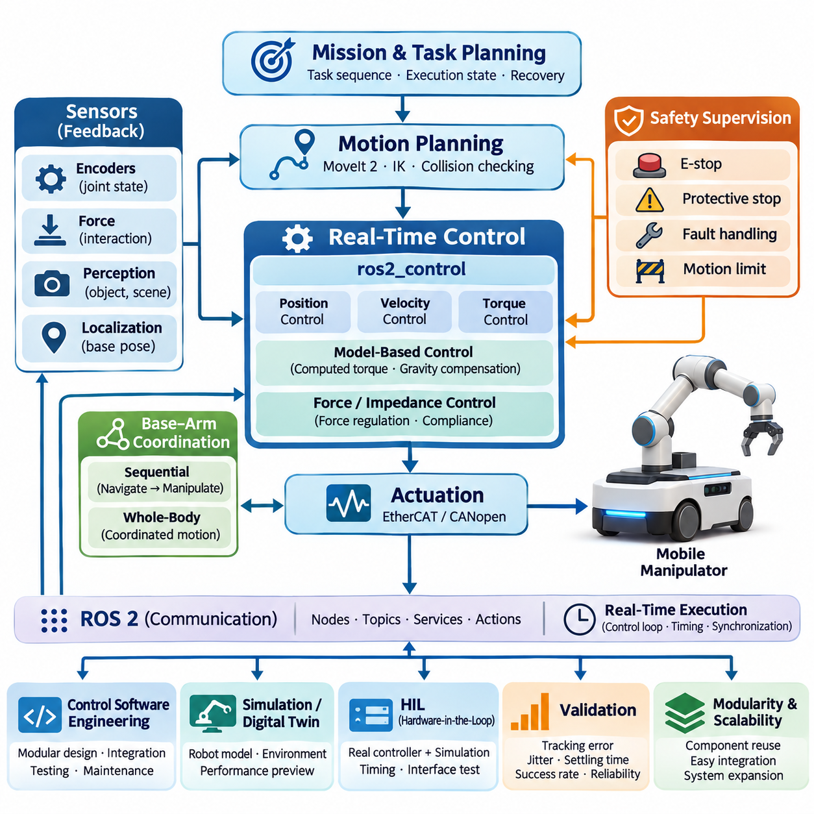
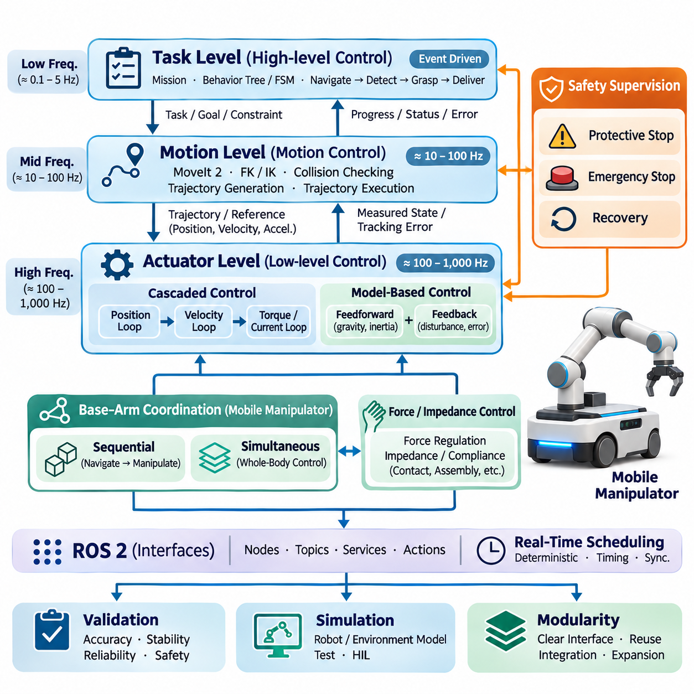
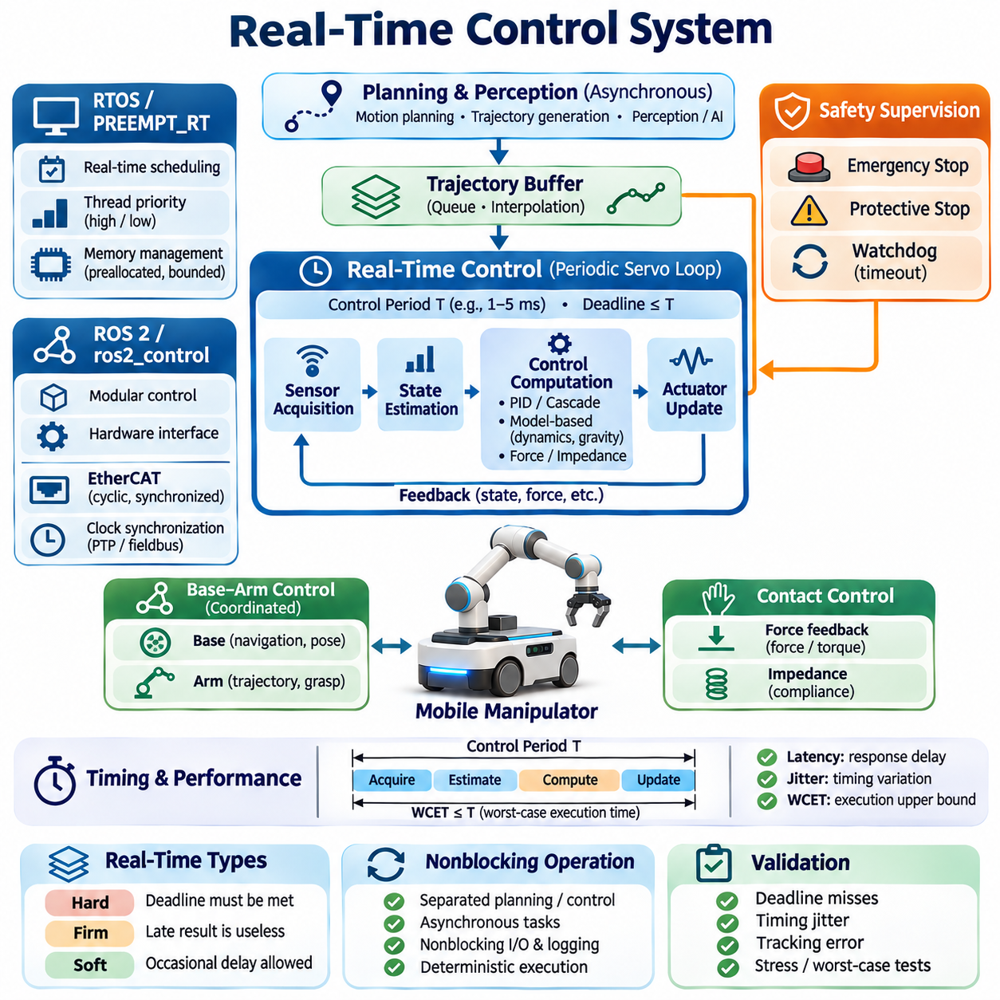
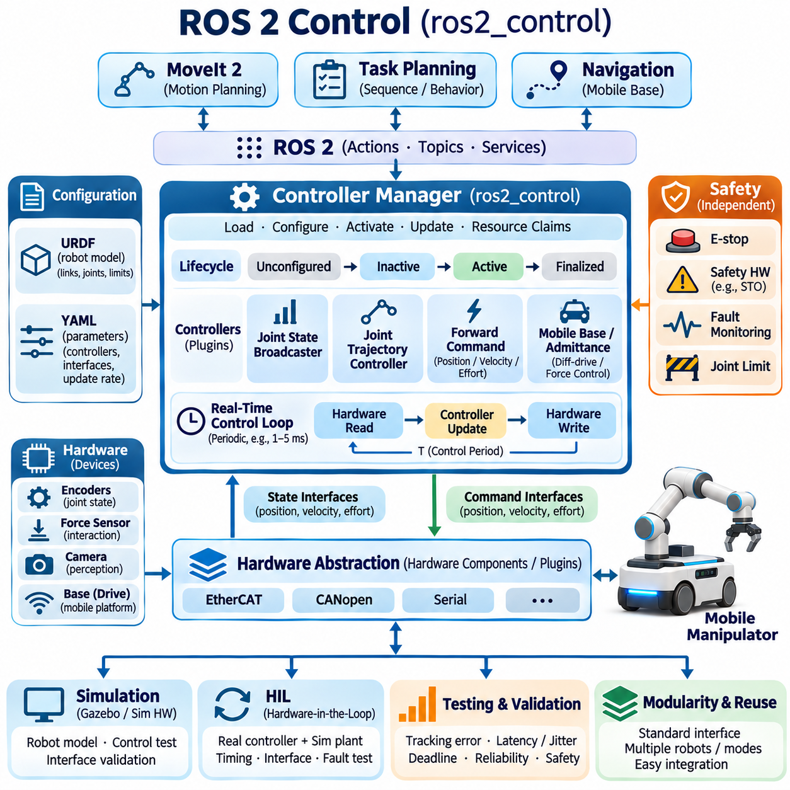
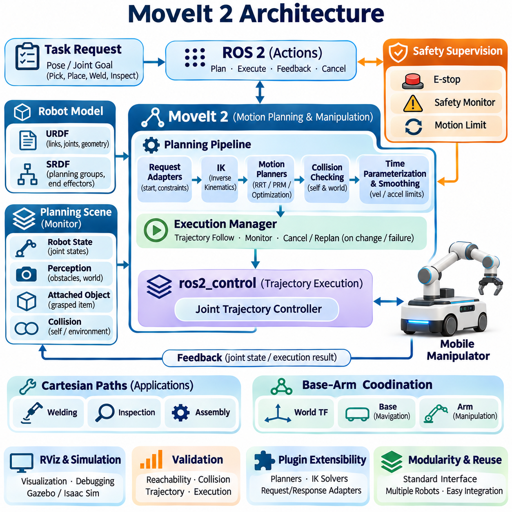
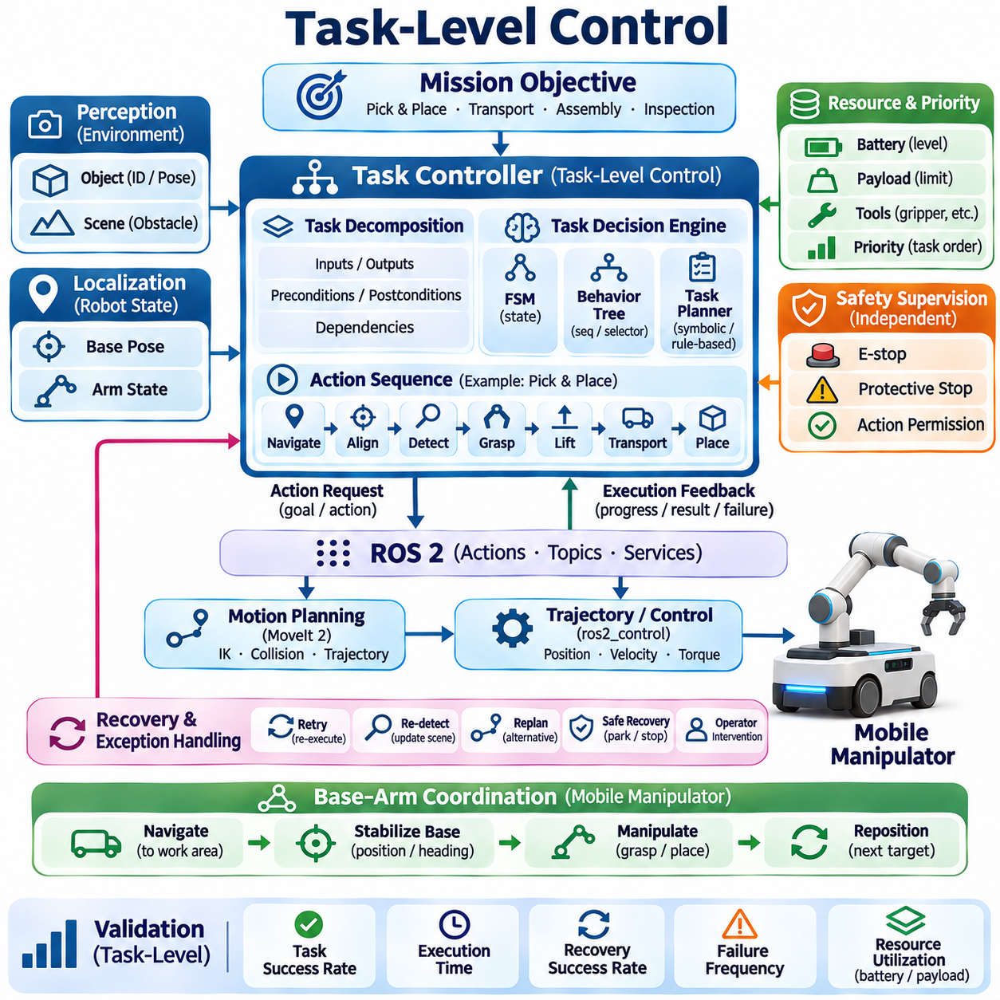
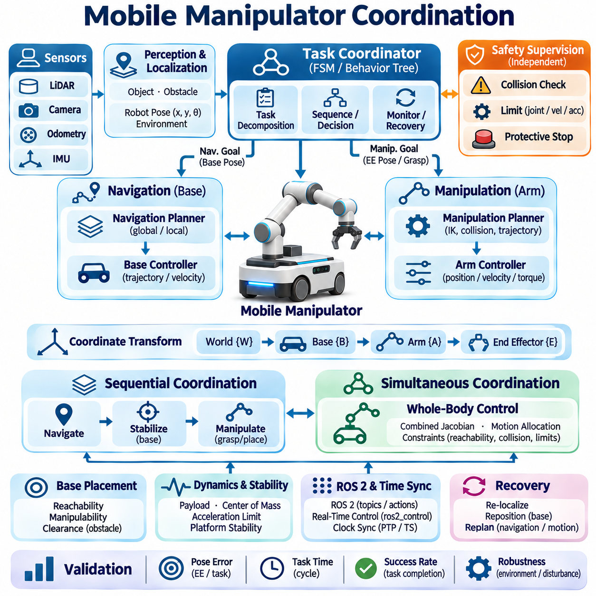
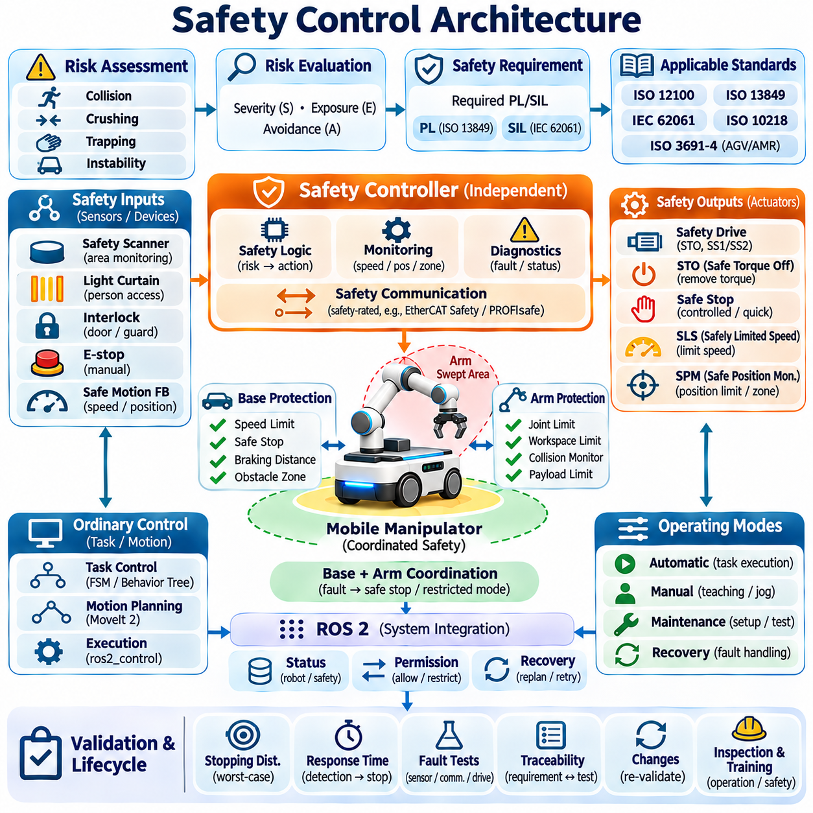
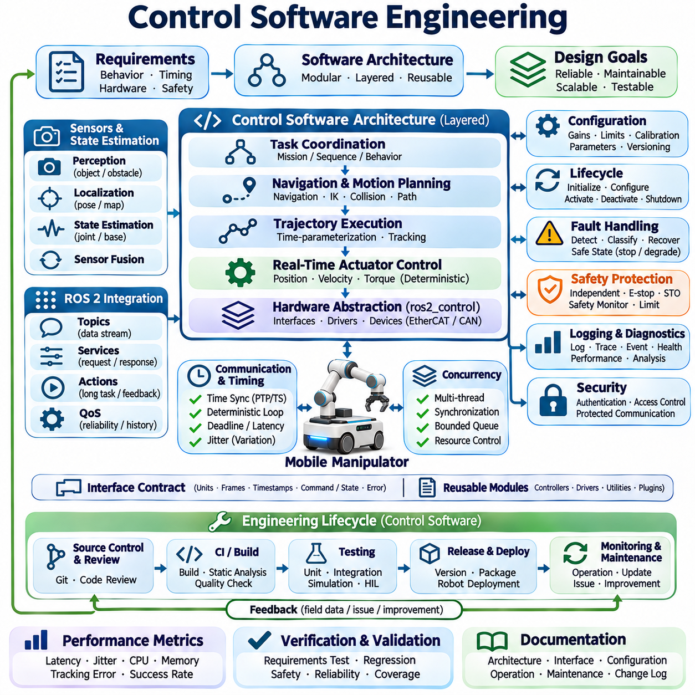
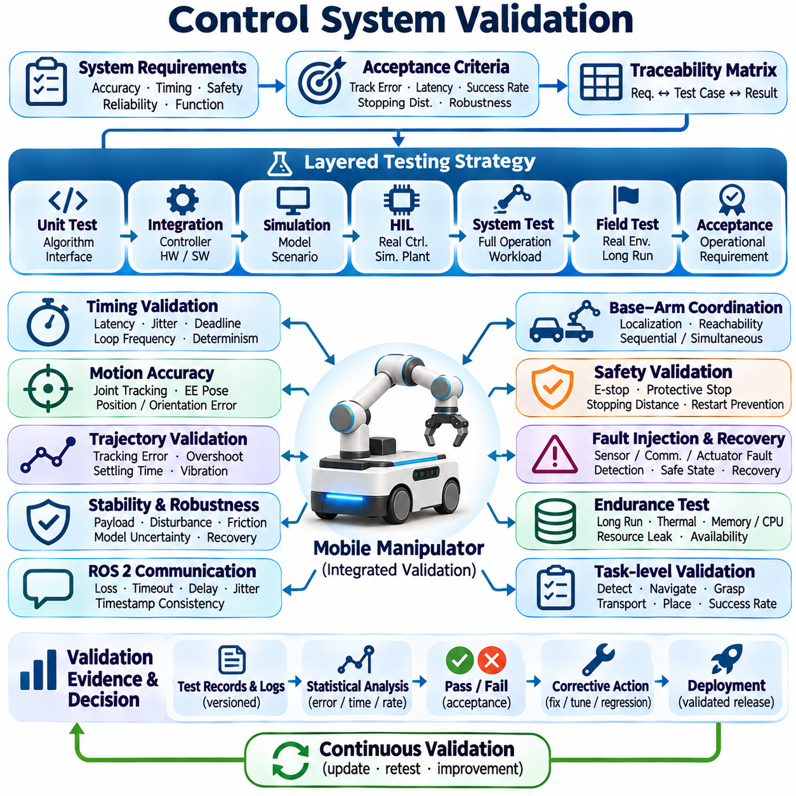

**Volume 02. Manipulator Mechanics and Control**

# Chapter 14. Control Architecture

## 01 Control Architecture Overview

{width="7.268055555555556in" height="7.268055555555556in"}

Control architecture defines the organizational structure through which a robotic manipulator converts high-level objectives into coordinated physical actions. It establishes relationships among task planning, motion generation, feedback regulation, actuator commands, and safety supervision. A well-designed architecture separates responsibilities while maintaining reliable communication across components operating at different computational speeds.

In a mobile manipulator, control architecture must coordinate the robotic arm, mobile platform, end effector, and perception system. Unlike a stationary industrial robot, the manipulator operates on a movable base whose position and orientation influence the arm workspace. The architecture must therefore integrate navigation, localization, manipulation, and environmental interaction within a consistent control framework.

The fundamental purpose of control architecture is to transform desired robot behavior into measurable and controllable physical motion. A task command may specify an object destination, while intermediate controllers generate Cartesian trajectories, joint references, and actuator signals. Feedback from encoders, force sensors, and perception modules continuously updates the execution process to compensate for disturbances and modeling uncertainty.

Modern robotic control systems commonly employ hierarchical organization to manage different levels of abstraction. High-level controllers determine task objectives and execution sequences, middle-level controllers generate trajectories and coordinate subsystems, and low-level controllers regulate joint position, velocity, current, or torque. This separation improves modularity, simplifies debugging, and supports independent optimization of control functions.

The high-level control layer interprets mission requirements and determines the sequence of operations necessary to complete them. For example, a warehouse mobile manipulator may navigate toward a storage location, identify a target object, position its arm, establish a grasp, and transport the object. Task-level logic manages dependencies, execution states, recovery procedures, and transitions between navigation and manipulation.

The motion control layer converts task objectives into physically feasible trajectories. It uses kinematic models, inverse kinematics, workspace constraints, and collision information to determine suitable robot configurations. Trajectory generation must consider joint limits, velocity restrictions, acceleration bounds, and environmental obstacles while maintaining smooth transitions between successive movements.

Low-level control operates directly on the physical mechanisms responsible for robot motion. Joint controllers compare commanded references with measured states and calculate corrective signals for actuators. Position, velocity, and torque control loops may be organized into cascaded structures, allowing fast inner loops to stabilize motor behavior while slower outer loops regulate mechanical motion and trajectory tracking.

Feedback is essential because real robotic systems experience disturbances, friction, payload variation, sensor noise, and modeling errors. Closed-loop controllers continuously compare desired and actual states to reduce tracking deviations. The architecture must provide accurate measurements, predictable communication delays, and suitable controller update frequencies to preserve stability under changing operating conditions.

Model-based control extends conventional feedback by incorporating mathematical representations of manipulator dynamics. Inertia matrices, Coriolis effects, centrifugal forces, gravity, and friction estimates can improve control performance. Computed torque control and gravity compensation illustrate how dynamic models reduce predictable disturbances, allowing feedback controllers to focus on residual errors and unexpected interactions.

Force and impedance control introduce additional requirements when manipulators interact with physical environments. Position regulation alone may generate excessive contact forces during assembly or surface following. Force controllers regulate interaction loads, while impedance controllers establish desired relationships among displacement, velocity, and force. These approaches enable controlled compliance during uncertain contact conditions.

Real-time execution is a defining requirement of robotic control architecture. Control algorithms must complete computations within specified deadlines to maintain predictable actuator behavior. High-frequency servo loops typically require more deterministic execution than task planning or perception processes. Separating time-critical functions from computationally intensive operations prevents unpredictable workloads from disrupting motion stability.

Communication architecture determines how commands, measurements, and status information move between control components. Industrial systems may use EtherCAT, CANopen, or other fieldbus technologies for actuator communication, while middleware supports higher-level software integration. Message timing, synchronization, buffering, and failure detection must be considered because communication delays directly influence control accuracy and reliability.

ROS 2 provides a modular software framework for integrating robotic control components through nodes, topics, services, and actions. Its communication mechanisms support distributed processing across sensing, planning, and execution modules. However, deterministic control requires appropriate operating-system scheduling, middleware configuration, and hardware interfaces rather than relying on general-purpose message communication alone.

The ros2_control framework provides standardized interfaces between robot hardware and control algorithms. Hardware components expose state and command interfaces, while controllers implement specific regulation functions. Controller managers coordinate lifecycle transitions and execution updates. This separation allows developers to reuse controller implementations across compatible robot platforms and evaluate software using simulated hardware interfaces.

MoveIt 2 complements low-level control by providing motion planning, kinematic computation, collision checking, and trajectory execution capabilities. It evaluates robot configurations against planning constraints and produces trajectories for compatible controllers. Integration between MoveIt 2 and ros2_control establishes a practical connection between geometric motion planning and actuator-level execution.

Mobile manipulator coordination requires explicit management of relationships between the mobile base and robotic arm. Base movement changes the manipulator reference frame and can alter target reachability, stability, and collision conditions. Coordinated controllers may operate the base and arm sequentially or simultaneously, depending on task requirements, mechanical constraints, localization accuracy, and system capabilities.

Sequential coordination simplifies many industrial operations by positioning and stabilizing the mobile platform before initiating manipulation. Simultaneous coordination can increase workspace coverage and operational flexibility but introduces additional coupling between subsystems. Whole-body control methods consider base and arm degrees of freedom together, enabling optimization of end-effector motion while respecting system constraints.

Safety control architecture must operate alongside functional motion control without depending entirely on its successful execution. Emergency stopping, protective stopping, joint limits, collision monitoring, and actuator fault detection require clearly defined responsibilities. Safety-related functions must be implemented with appropriate independence, diagnostic coverage, and validated response behavior according to applicable risk assessments.

Fault management provides a systematic mechanism for handling abnormal operating conditions. Communication interruptions, actuator overheating, sensor failures, localization uncertainty, and trajectory infeasibility may require different recovery responses. The architecture should classify faults, identify affected subsystems, transition into defined safe states, and permit controlled recovery only when necessary conditions have been satisfied.

Control software engineering emphasizes modular interfaces, explicit state management, configuration control, and reproducible testing. Components should expose well-defined command structures, measurement formats, operating modes, and error conditions. Version-controlled parameters and documented dependencies help prevent integration failures when control algorithms, hardware drivers, or middleware configurations change during development.

Simulation and digital twins support architecture evaluation before deployment on physical robots. Developers can examine trajectory tracking, controller interactions, communication delays, and fault responses under controlled conditions. Hardware-in-the-loop testing extends this approach by incorporating real controllers or actuators, helping reveal timing and integration problems that simplified simulation models may overlook.

Control system validation must assess both individual components and their interactions. Relevant measurements include tracking error, settling time, overshoot, control-loop jitter, trajectory completion rate, and fault response latency. Tests should cover nominal operation, payload changes, contact transitions, communication disturbances, and emergency conditions to establish performance boundaries and operational reliability.

Scalability becomes important when control architecture must support different manipulators, grippers, mobile platforms, or industrial applications. Standardized interfaces and configurable controllers reduce platform-specific software modifications. A modular architecture also enables gradual integration of advanced capabilities, including adaptive control, learning-based planning, predictive optimization, and coordinated multi-robot operations.

Ultimately, control architecture provides the engineering foundation connecting robot intelligence with dependable physical execution. Its effectiveness depends not only on individual control algorithms but also on timing guarantees, subsystem coordination, feedback integrity, fault handling, and validation. A coherent architecture enables mobile manipulators to perform increasingly complex tasks while maintaining precision, stability, safety, and operational flexibility.

## 02 Hierarchical Control

{width="7.268055555555556in" height="7.268055555555556in"}

Hierarchical control is a fundamental architectural approach that organizes robotic control functions into multiple levels according to their responsibilities, time scales, and computational requirements. Instead of assigning every decision to a single controller, the system distributes tasks among specialized layers. This organization enables complex robotic manipulators to combine strategic planning, coordinated motion, and precise actuator regulation within a unified framework.

The primary objective of hierarchical control is to separate high-level decision-making from low-level physical execution while preserving consistent information exchange. Higher layers determine what the robot should accomplish, whereas lower layers determine how commands are physically executed. Intermediate layers translate abstract objectives into feasible motion references, ensuring that planning decisions remain compatible with mechanical and operational constraints.

A typical hierarchical architecture contains task-level, motion-level, and actuator-level control. The task layer manages objectives and execution sequences, the motion layer generates trajectories and coordinates robot components, and the actuator layer regulates joint behavior. These layers operate at different frequencies and exchange commands, feedback, and status information through defined interfaces that support predictable execution.

Task-level control represents the highest abstraction within the hierarchy. It interprets mission requirements, selects actions, and determines execution order based on environmental conditions and system capabilities. For a mobile manipulator, a task controller may coordinate navigation, object detection, grasp planning, manipulation, and delivery. It also monitors task completion and initiates recovery procedures when operations fail.

Task execution can be represented using finite-state machines, behavior trees, or structured task planners. These mechanisms organize operational logic into identifiable states, transitions, and conditions. A behavior tree may select between normal execution and recovery actions based on sensor feedback. Such representations improve modularity and make complex task sequences easier to inspect, modify, and validate.

The motion-level controller converts task instructions into trajectories that satisfy geometric and dynamic constraints. It uses forward kinematics, inverse kinematics, collision checking, and trajectory optimization to generate suitable references. Motion planning must account for joint limits, workspace boundaries, velocity constraints, and obstacles while maintaining smooth and achievable transitions between successive robot configurations.

Trajectory execution provides the connection between planned motion and continuous control. A trajectory controller interpolates reference positions, velocities, and sometimes accelerations over time. It monitors tracking performance and coordinates multiple joints to maintain synchronized movement. When execution errors exceed acceptable limits, the controller may report a failure or request a controlled stop.

At the lowest level, actuator controllers regulate physical variables such as motor current, torque, velocity, and position. These controllers operate at relatively high frequencies because mechanical stability and tracking accuracy depend on rapid feedback. Encoder measurements, current sensors, and motor models provide the information required to calculate corrective commands and compensate for disturbances.

Cascaded control structures are frequently used within the actuator layer. An outer position loop generates velocity references, a velocity loop produces torque or current demands, and an inner current loop regulates motor electrical behavior. Each loop is designed with an appropriate bandwidth, generally allowing inner loops to respond faster than outer loops. Proper tuning reduces interference and improves overall stability.

The hierarchical structure also supports model-based control strategies. Dynamic models can provide feedforward torque commands that compensate for gravity, inertia, and predictable motion-dependent forces. Feedback controllers then correct remaining deviations caused by disturbances or modeling errors. This combination improves trajectory tracking without requiring higher-level planners to manage individual actuator dynamics.

Different control layers operate on distinct time scales because their computational responsibilities vary. Task planning may update when operational conditions change, motion controllers may update at tens or hundreds of hertz, and actuator loops may execute at hundreds or thousands of hertz. These values depend on hardware and application requirements. Deterministic scheduling is particularly important for time-critical control loops.

Information flows downward through the hierarchy as objectives, constraints, trajectories, and actuator references. Feedback travels upward as measured states, execution progress, tracking errors, and fault reports. This bidirectional communication enables higher layers to adapt decisions according to physical conditions while lower layers maintain local control stability without waiting for every high-level decision.

Clear interface definitions are essential for reliable hierarchical operation. Each layer should specify command formats, reference frames, units, timing requirements, operating modes, and error conditions. Inconsistent coordinate transformations or outdated state information can produce incorrect movements even when individual controllers function properly. Interface validation therefore becomes a critical part of system integration.

Hierarchical control is particularly valuable for mobile manipulators because the mobile base and robotic arm have different motion characteristics. The base controller manages navigation and platform movement, while the arm controller regulates manipulation. A coordination layer determines when each subsystem should operate and whether their movements should be sequential or simultaneous according to task requirements.

During sequential operation, the mobile platform first reaches a target location and establishes an acceptable positioning condition. The arm controller then executes manipulation using the estimated base pose as a reference. This approach reduces coordination complexity and simplifies safety verification. However, localization uncertainty and positioning errors must still be considered when generating manipulation trajectories.

Simultaneous base-arm control introduces stronger coupling between motion subsystems. The coordination layer may generate references for both platform movement and arm articulation to maintain an end-effector trajectory. Whole-body control can optimize combined degrees of freedom while considering reachability, joint limits, collision constraints, and platform stability. This capability expands the effective manipulation workspace.

Hierarchical control can also accommodate force, impedance, and compliance behaviors during contact tasks. The task layer determines the required interaction mode, while the motion layer establishes desired Cartesian behavior. Lower-level controllers implement force regulation or compliant responses through actuator commands. Contact transitions require careful coordination to avoid discontinuities between free-space motion and constrained interaction.

Safety supervision must remain effective across every hierarchical level. Task controllers can prevent unsafe operation sequences, motion controllers can enforce geometric constraints, and actuator controllers can monitor physical limits. Independent safety-related mechanisms may override normal commands when hazardous conditions occur. The hierarchy must define how protective stops, emergency stops, and recovery permissions propagate through the system.

Fault handling benefits from assigning recovery responsibilities according to the severity and origin of a failure. A temporary trajectory tracking deviation may be handled locally, while persistent motion infeasibility may require replanning. Hardware faults or safety violations may demand immediate protective action. Higher layers should receive structured fault information so that recovery decisions reflect the actual system condition.

ROS 2 provides communication mechanisms suitable for implementing distributed hierarchical control. Task-level nodes can issue action requests, planning components can generate trajectories, and ros2_control controllers can execute hardware commands. MoveIt 2 supports motion planning and trajectory execution integration. However, deterministic actuator regulation still requires appropriate real-time scheduling and hardware communication mechanisms.

Software modularity is a major advantage of hierarchical architectures. Developers can replace a motion planner, modify a task strategy, or introduce a different actuator controller without redesigning the entire system, provided interface contracts remain compatible. This separation supports simulation, hardware abstraction, component testing, and incremental integration across different manipulator configurations.

Validation should examine both individual control layers and their combined behavior. Unit tests verify controller calculations and interface handling, while integration tests evaluate command propagation and feedback consistency. System-level experiments measure trajectory accuracy, response latency, fault recovery, and coordination performance under realistic operating conditions, including communication disturbances and changing payloads.

A hierarchical architecture must balance modularity against communication overhead and accumulated delays. Excessive separation can introduce latency, synchronization problems, and inconsistent state estimates. Designers should therefore assign functions according to their timing sensitivity, computational complexity, and safety requirements. Well-defined execution boundaries help preserve responsiveness while maintaining architectural flexibility.

Ultimately, hierarchical control provides a scalable foundation for transforming complex robotic objectives into reliable physical behavior. By separating task reasoning, motion coordination, and actuator regulation, it enables independent development while preserving system-level consistency. Its effectiveness depends on precise interfaces, predictable timing, robust feedback, coordinated safety handling, and comprehensive validation across the complete control hierarchy.

## 03 Real Time Control System

{width="7.268055555555556in" height="7.268055555555556in"}

A real-time control system is a computational and physical framework designed to execute robotic control operations within predictable timing constraints. Its primary objective is not simply to achieve high processing speed but to guarantee that critical calculations and actuator commands occur before specified deadlines. In robotic manipulators, timing predictability directly influences motion stability, tracking accuracy, and operational safety.

Real-time control becomes essential when robotic manipulators perform high-speed motion, precision assembly, force regulation, or coordinated manipulation. Delayed control commands can introduce tracking errors, oscillations, and unstable interactions with the environment. A reliable system must therefore coordinate sensing, computation, communication, and actuation through execution schedules that maintain consistent response characteristics.

Real-time systems are commonly classified into hard, firm, and soft real-time categories according to the consequences of missed deadlines. Hard real-time tasks require strict deadline compliance because violations may cause unacceptable failures. Firm real-time tasks lose usefulness when results arrive late, while soft real-time tasks tolerate occasional delays with degraded performance. Robotic control architectures often combine these categories.

The control cycle represents the fundamental execution unit of a real-time robotic controller. During each cycle, the system acquires sensor measurements, estimates relevant states, calculates control commands, and updates actuator outputs. This sequence must finish within the allocated control period. Consistent execution timing ensures that feedback algorithms operate according to their intended mathematical assumptions.

Control frequency determines how often the system updates actuator commands and evaluates feedback measurements. Joint position controllers may operate at hundreds of hertz, while torque and current regulation can require substantially higher update rates. The appropriate frequency depends on actuator dynamics, mechanical bandwidth, sensor characteristics, and control objectives rather than a universal numerical requirement.

Latency and jitter are critical performance characteristics of real-time control systems. Latency describes the delay between an event and its corresponding response, while jitter represents variation in execution or communication timing. Excessive latency reduces control responsiveness, and unpredictable jitter complicates stability analysis. Engineers must evaluate both average behavior and worst-case timing conditions.

Worst-case execution time provides an upper bound on the time required for a control task under specified assumptions. Real-time scheduling must ensure that computational workloads can complete before their deadlines, including under demanding operating conditions. Execution-time analysis considers algorithm complexity, memory access, processor contention, and operating-system interference to identify potential deadline violations.

Real-time operating systems and real-time Linux configurations provide scheduling mechanisms intended to reduce execution uncertainty. Priority-based scheduling allows critical control threads to execute ahead of less important workloads. Linux systems may employ PREEMPT_RT configurations to improve scheduling determinism. However, operating-system selection alone cannot guarantee real-time performance without careful application and hardware design.

Thread priority assignment is an important architectural decision because competing tasks share processor resources. High-priority servo loops should receive predictable execution opportunities, while logging, visualization, and noncritical diagnostics operate at lower priorities. Incorrect priority management can cause starvation, scheduling delays, or priority inversion, particularly when multiple threads access shared resources.

Memory management also affects deterministic execution. Dynamic memory allocation, unpredictable garbage collection, and page faults can introduce execution delays during critical control cycles. Real-time software commonly uses preallocated memory, bounded data structures, and carefully managed buffers. These practices reduce unexpected pauses and help maintain consistent execution times during continuous robot operation.

Communication timing is especially important when controllers exchange data with distributed actuators and sensors. Industrial networks such as EtherCAT support cyclic communication and synchronization mechanisms suitable for demanding motion-control applications. Communication design must consider transmission delays, network loading, synchronization accuracy, and fault behavior to maintain coordinated execution across multiple devices.

Clock synchronization ensures that measurements and commands from different components can be interpreted within a consistent temporal reference. Distributed robotic systems may use hardware timestamps, synchronized fieldbus clocks, or precision time synchronization mechanisms. Accurate timing is particularly important when combining encoder data, force measurements, inertial sensing, and perception information for coordinated control.

Real-time control architectures frequently separate deterministic execution from computationally intensive planning and perception. High-level algorithms may generate trajectories asynchronously, while dedicated real-time controllers execute validated references at fixed intervals. This separation prevents variable processing times in motion planning, object recognition, or artificial intelligence modules from directly interrupting actuator regulation.

Trajectory buffering provides a practical mechanism for connecting asynchronous planning with periodic control execution. Planned trajectories are transferred into bounded buffers from which the real-time controller retrieves references. Interpolation generates intermediate setpoints according to the control period. Buffer management must detect underruns, outdated commands, and invalid references to prevent discontinuous or unsafe motion.

Feedback control algorithms must account for sampling intervals and computational delays. Discrete-time implementations of PID control, state feedback, and model-based compensation depend on consistent timing assumptions. Variations in sampling periods can alter effective controller behavior and degrade stability. Appropriate discretization, delay analysis, and controller tuning are therefore essential for reliable execution.

Real-time dynamics computation becomes important when manipulators use torque control, gravity compensation, or advanced model-based strategies. Algorithms must calculate required forces and torques within the available control period. Efficient rigid-body dynamics methods, optimized numerical operations, and predictable memory access help satisfy timing constraints while preserving sufficient model accuracy.

Mobile manipulators introduce additional timing requirements because navigation, localization, base control, and arm control operate at different rates. Coordinated execution requires consistent state estimates and appropriate synchronization between subsystems. During simultaneous base-arm motion, timing mismatches can produce end-effector tracking errors even when individual controllers maintain acceptable local performance.

Force-controlled manipulation imposes demanding timing requirements during physical contact. Sensor measurements must be processed quickly enough to detect interaction changes and adjust actuator behavior. Excessive delay can increase contact forces or destabilize compliant motion. Controller bandwidth, mechanical compliance, filtering, and communication latency must therefore be considered together when designing contact-control loops.

Safety-related control requires predictable detection and response to hazardous conditions. Emergency stopping, protective stopping, actuator limit monitoring, and communication fault handling must satisfy defined response-time requirements. Safety functions should not depend exclusively on general-purpose software scheduling. Independent safety hardware and validated protective mechanisms may be necessary according to the system risk assessment.

Watchdog mechanisms monitor whether critical control tasks execute within expected timing limits. A watchdog may detect missed updates, communication interruptions, or stalled control threads and initiate a defined fault response. Effective watchdog design requires appropriate timeout thresholds and clear recovery policies. Excessively short thresholds can cause unnecessary interruptions, while excessive delays may reduce protection.

ROS 2 can support real-time-oriented robotic architectures when communication, scheduling, and memory behavior are carefully configured. The ros2_control framework provides structured interfaces for periodic hardware updates and controller execution. Nevertheless, middleware overhead, executor behavior, and operating-system scheduling must be evaluated experimentally because real-time performance is not guaranteed by software framework selection alone.

Performance validation requires measuring execution latency, cycle-time jitter, deadline misses, communication delays, and control accuracy under realistic workloads. Tests should include processor saturation, network disturbances, sensor faults, and simultaneous subsystem operation. Long-duration measurements help reveal rare timing anomalies that short demonstrations may overlook, providing evidence of operational robustness.

Real-time software engineering also emphasizes observability without disturbing critical execution. Diagnostic information should be collected through bounded, nonblocking mechanisms whenever possible. Logging and telemetry must avoid unpredictable disk operations or network transactions inside time-critical loops. Separating monitoring functions from servo execution preserves useful debugging information while reducing interference.

Ultimately, a real-time control system provides the timing foundation required for dependable robotic motion and interaction. Its effectiveness depends on coordinated hardware, operating-system scheduling, communication, control algorithms, and safety mechanisms. By managing deadlines, latency, jitter, and computational workloads systematically, robotic manipulators can achieve stable, accurate, and predictable behavior under demanding operating conditions.

## 04 ROS2 Control

{width="7.268055555555556in" height="7.268055555555556in"}

ROS 2 Control is a fundamental framework for implementing standardized hardware interfaces and motion controllers in ROS 2-based robotic systems. It provides a structured mechanism for connecting robot hardware, actuator drivers, sensor interfaces, and control algorithms. By separating hardware communication from controller logic, ros2_control improves software modularity, hardware portability, and maintainability across different robotic platforms.

The central objective of ros2_control is to establish a consistent control interface between the ROS 2 software environment and physical robot components. Instead of implementing hardware communication separately for every controller, developers define standardized state and command interfaces. Controllers can then operate through these interfaces without depending directly on specific motor drivers or hardware communication protocols.

The architecture primarily consists of hardware components, controller components, and a controller manager. Hardware components represent physical devices such as robot joints, grippers, force sensors, and mobile bases. Controllers implement control algorithms using the interfaces exposed by these devices. The controller manager coordinates hardware initialization, controller configuration, activation, execution, and shutdown.

Hardware interfaces define how software exchanges information with physical devices. State interfaces provide measured information such as joint position, velocity, and effort, while command interfaces transmit desired position, velocity, or effort values. This abstraction allows different hardware implementations to expose compatible capabilities and enables controllers to operate across multiple robot configurations.

The hardware abstraction layer separates device-specific communication from higher-level control algorithms. A hardware component implements the required read and write operations to acquire sensor measurements and transmit actuator commands. Depending on the platform, these operations may communicate through EtherCAT, CANopen, serial interfaces, or proprietary motor controllers. The hardware implementation must preserve consistent data interpretation and timing behavior.

The controller manager is responsible for coordinating the execution lifecycle of hardware components and controllers. It loads controller implementations, configures their interfaces, activates selected controllers, and manages periodic update operations. Resource management prevents incompatible controllers from simultaneously claiming the same command interfaces. This mechanism is particularly important when switching between position, velocity, and torque control modes.

Controller lifecycle management provides a standardized mechanism for handling operational transitions. Controllers generally progress through states such as unconfigured, inactive, active, and finalized. Configuration establishes required resources, activation enables command execution, and deactivation stops normal control operations. These transitions support controlled startup, shutdown, controller switching, and recovery during robot operation.

ROS 2 Control supports different controller types according to the required motion-control behavior. Joint state broadcasters publish measured joint information, while joint trajectory controllers execute time-dependent joint references. Forward command controllers transmit direct position, velocity, or effort commands. Specialized controllers can implement additional behaviors such as differential-drive motion, admittance control, and coordinated actuator operation.

The joint trajectory controller provides an important connection between motion planning and physical execution. It receives trajectories containing joint positions and optional velocity and acceleration references, then generates commands for the corresponding hardware interfaces. Trajectory interpolation and feedback monitoring support coordinated multi-joint movement. Execution results and tracking errors can be reported to higher-level applications through ROS 2 actions.

Robot description plays an important role in configuring ros2_control. The URDF model describes the robot\'s mechanical structure, joint relationships, limits, and relevant physical properties. The ros2_control configuration embedded in the robot description specifies hardware components, joint interfaces, and available command and state resources. This allows the control framework to understand the relationship between the robot model and its hardware implementation.

Controller configuration is commonly maintained through ROS 2 parameter files. These files define controller types, joint names, command interfaces, state interfaces, and controller-specific parameters. Separating configuration from executable code makes it easier to support multiple robot variants and operating modes. Consistent parameter management also reduces integration errors when transferring software between simulation and physical hardware.

Real-time execution is an important consideration because actuator control requires predictable periodic updates. The controller manager coordinates hardware reading, controller updates, and hardware writing within its control loop. The execution period must satisfy the response requirements of the actuators and the mechanical system. Real-time Linux configurations, appropriate thread priorities, and efficient hardware communication help improve timing determinism.

ROS 2 communication mechanisms connect ros2_control with other robotic software components. Topics provide joint states and diagnostic information, services support configuration and management operations, and actions enable asynchronous trajectory execution. This separation allows perception, task planning, visualization, and control applications to communicate without requiring direct access to hardware drivers.

Integration with MoveIt 2 enables a practical motion-planning and execution architecture. MoveIt 2 generates collision-aware trajectories using the robot\'s kinematic model and planning constraints. The trajectory execution interface communicates with compatible ROS 2 controllers, which translate planned motion into actuator commands. This integration connects geometric planning, trajectory generation, and physical robot movement within a common software environment.

Mobile manipulators require additional coordination because the mobile base and robotic arm may use different hardware interfaces and controller configurations. A differential-drive or steering controller can manage platform movement, while joint trajectory controllers regulate the manipulator. Higher-level coordination software manages navigation, base stabilization, arm positioning, and manipulation sequences. Consistent reference frames and synchronized state information are essential for accurate operation.

Simulation provides an effective environment for developing and testing ros2_control configurations before connecting physical hardware. Simulated hardware components expose the same interfaces used by real devices, allowing compatible controllers to execute without changing their fundamental architecture. Integration with Gazebo and other simulation environments supports evaluation of joint behavior, trajectory execution, and controller configuration under controlled conditions.

Hardware-in-the-loop testing extends simulation by introducing actual controllers, actuators, or communication devices into the development environment. It helps identify problems involving communication delays, actuator response, sensor accuracy, and hardware-specific behavior. Comparing simulated and physical execution provides valuable information for refining controller parameters and validating the transition from virtual development to real deployment.

Safety and fault management must be incorporated into the ros2_control implementation. Joint limits, command validation, communication monitoring, and controller state supervision help prevent abnormal operation. However, software-level controller protections should not replace independent safety mechanisms such as emergency-stop circuits and safety-rated hardware. The complete system must be evaluated according to its operational risks and applicable safety requirements.

Software development practices are essential for maintaining reliable ros2_control systems. Hardware plugins, controller implementations, configuration files, and robot descriptions should be maintained as modular and version-controlled components. Unit testing, integration testing, simulation, and physical validation help identify interface inconsistencies and execution problems. Clear lifecycle management and diagnostic reporting also simplify maintenance and troubleshooting.

Ultimately, ros2_control provides a standardized foundation for connecting ROS 2 software with physical robotic mechanisms. Its hardware abstraction, controller management, lifecycle operations, and periodic execution model support reusable and scalable control architectures. When integrated with MoveIt 2, real-time execution mechanisms, and appropriate safety systems, it enables robotic manipulators and mobile manipulators to achieve reliable, coordinated, and maintainable physical operation.

## 05 MoveIt2 Architecture

{width="7.268055555555556in" height="7.268055555555556in"}

MoveIt 2 is a comprehensive motion planning and manipulation framework designed for developing advanced robotic applications within the ROS 2 ecosystem. It provides essential capabilities for robot kinematics, motion planning, collision detection, trajectory generation, and execution management. Its architecture separates planning algorithms from hardware-level control, allowing developers to construct modular robotic systems that support different manipulators, sensors, and actuator configurations.

The primary objective of MoveIt 2 is to transform high-level manipulation requests into collision-free and executable robot trajectories. A task may specify a desired end-effector position and orientation, while MoveIt 2 determines suitable joint configurations and motion paths. It evaluates kinematic constraints, environmental obstacles, and robot limitations before generating trajectories that can be transferred to compatible controllers.

The MoveIt 2 architecture consists of several cooperating components, including the planning scene, robot model, planning pipeline, motion planning algorithms, trajectory processing modules, and execution interfaces. These components exchange robot states, environmental information, planning requests, and execution results. Their modular organization allows individual algorithms and software components to be configured or replaced without redesigning the entire manipulation system.

The robot model provides the kinematic and geometric representation required for motion planning. It is commonly described using URDF and supplemented by semantic information through the SRDF. The URDF defines links, joints, physical relationships, and collision geometry, while the SRDF describes planning groups, end effectors, named configurations, and other semantic relationships. Together, these descriptions establish the structural foundation for MoveIt 2.

The planning scene maintains the information required to evaluate robot configurations and environmental conditions. It contains the current robot state, collision geometry, attached objects, and relevant world information. The planning scene monitor updates this information using joint states, sensor observations, and environmental changes. Accurate scene information is essential because motion planners depend on reliable representations of both the robot and its surroundings.

The motion planning pipeline converts planning requests into candidate trajectories through a sequence of processing stages. It may include request adapters, planning algorithms, path processing, and response generation. Request adapters can modify initial conditions or resolve certain planning constraints, while response adapters can improve the resulting trajectory. This modular pipeline allows different planning strategies to be combined within a consistent execution framework.

Motion planning algorithms determine how a robot can move from an initial configuration to a desired goal configuration. Sampling-based planners such as RRT and PRM explore the configuration space to identify feasible paths. Optimization-based approaches can improve trajectory quality according to selected objectives. The appropriate algorithm depends on environmental complexity, dimensionality, planning time requirements, and the characteristics of the manipulation task.

Inverse kinematics is an important capability within MoveIt 2 because manipulation tasks are frequently expressed in Cartesian coordinates. Given a desired end-effector pose, an inverse kinematics solver calculates joint configurations that achieve the requested position and orientation. Multiple solutions may exist, particularly for redundant manipulators. Solver selection and configuration influence reachability, computational performance, and the continuity of generated robot movements.

Collision checking evaluates whether candidate robot configurations intersect with obstacles or other robot components. MoveIt 2 uses collision geometry and collision detection libraries to identify invalid configurations during planning. The system considers self-collision and environmental collision, allowing motion planners to reject unsafe paths. Collision geometry should balance computational efficiency with sufficient representation accuracy for the intended application.

Trajectory processing converts geometric paths into time-parameterized motion commands. A geometric path describes the sequence of configurations, while a trajectory additionally specifies timing and motion characteristics. Time parameterization considers velocity and acceleration limits to generate executable references. Additional processing may improve smoothness and reduce abrupt changes in joint motion, supporting stable execution through downstream controllers.

The planning scene also supports object manipulation by representing objects attached to the robot. When a gripper grasps an object, the object can be attached to the appropriate robot link within the planning scene. Its geometry then participates in subsequent collision checking and motion planning. This capability is particularly important when transporting objects through constrained environments because the combined robot-object geometry must remain collision-free.

MoveIt 2 provides interfaces for submitting planning requests and managing asynchronous manipulation operations. Applications can request joint-space or Cartesian-space motion and receive planning results through standardized interfaces. ROS 2 actions are particularly useful for long-running operations because they support execution feedback, cancellation, and result reporting. These mechanisms allow task-level applications to coordinate manipulation without directly implementing planning algorithms.

Trajectory execution connects MoveIt 2 with the physical robot through compatible ROS 2 controllers. The execution manager coordinates trajectory transmission, controller selection, execution monitoring, and result handling. Through integration with ros2_control, planned joint trajectories can be transferred to joint trajectory controllers that generate hardware commands. This separation enables motion planning and actuator regulation to evolve independently while maintaining standardized interfaces.

Cartesian motion planning is useful when the end effector must follow a specified spatial path. Instead of selecting arbitrary joint-space configurations, the planner evaluates intermediate Cartesian poses and calculates corresponding joint configurations. This approach is valuable for applications such as welding, inspection, surface following, and precision assembly. However, Cartesian paths must still satisfy inverse kinematics, joint limits, collision constraints, and trajectory continuity requirements.

MoveIt 2 supports planning groups that organize robot joints according to functional structures. A planning group may represent an entire manipulator, a particular arm, or a gripper. This organization enables applications to plan movements for selected robot components without treating the entire mechanism as a single undifferentiated system. Planning groups are especially useful for robots containing multiple arms or independently controlled end effectors.

Mobile manipulator integration introduces additional challenges because the robot base and manipulator jointly determine end-effector reachability. MoveIt 2 primarily provides manipulation-oriented planning capabilities, while navigation frameworks can manage mobile platform movement. A coordination layer connects these systems by selecting base positions, updating robot states, and generating feasible arm trajectories. Consistent coordinate transformations between the world, base, and arm frames are essential for accurate operation.

Simulation and visualization are important parts of the MoveIt 2 development workflow. RViz provides tools for displaying robot configurations, planning scenes, collision objects, and generated trajectories. Developers can inspect planning requests, evaluate alternative solutions, and identify configuration problems before executing movements on physical hardware. Simulation environments provide additional opportunities to validate collision behavior and trajectory execution under controlled conditions.

MoveIt 2 architecture must also account for execution failures and changing environmental conditions. A planned trajectory may become invalid when an obstacle moves, the robot state changes, or an actuator fails to follow its reference. Applications should monitor execution feedback and determine whether to stop, cancel, or replan the operation. Replanning strategies improve adaptability, but they must consider timing constraints and the physical safety of the robot.

Software extensibility is one of the major strengths of MoveIt 2. Its plugin-based architecture supports different kinematics solvers, motion planners, planning adapters, and perception-related components. Developers can select algorithms according to robot characteristics and application requirements. This flexibility supports research experimentation, industrial customization, and gradual integration of advanced manipulation capabilities without requiring a complete replacement of the underlying framework.

Ultimately, MoveIt 2 provides the software architecture required to connect robot models, environmental perception, motion planning, collision checking, and trajectory execution. Its integration with ROS 2 and ros2_control establishes a practical development foundation for modern robotic manipulators. When combined with appropriate task planning, real-time control, and safety supervision, MoveIt 2 enables complex manipulation operations to be planned, coordinated, and executed reliably in industrial and mobile robotic environments.

## 06 Task Level Control

{width="7.268055555555556in" height="7.268055555555556in"}

Task-level control is the highest functional layer in a robotic control architecture, responsible for translating operational objectives into executable sequences of robotic actions. Unlike joint-level or trajectory-level controllers, which focus on physical motion, task-level control determines what the robot should accomplish and under which conditions. It connects mission planning, environmental perception, decision-making, and lower-level motion execution within a unified operational framework.

The primary responsibility of task-level control is to interpret task requirements and organize the actions necessary to achieve a desired outcome. A task may involve identifying an object, approaching its location, grasping it, transporting it, and placing it at a destination. The task controller decomposes this objective into smaller operations, establishes their execution order, and monitors whether each operation satisfies its completion conditions.

Task decomposition is an important concept because complex robotic operations cannot always be executed as a single motion command. A high-level objective is divided into subtasks with clearly defined inputs, outputs, preconditions, and completion criteria. This decomposition allows individual operations to be planned and executed independently while preserving the dependencies required for successful completion of the overall task.

Task-level control relies on environmental information to make appropriate decisions during execution. Perception systems provide object identities, positions, orientations, and environmental conditions, while localization systems estimate the robot\'s position within its workspace. The task controller combines these observations with the current execution state to select appropriate actions and adapt the operational sequence when the environment changes.

Finite-state machines provide a structured method for representing task execution. Each state describes a specific operational condition, while transitions define the events or conditions that allow the system to move into another state. For example, a pick-and-place task may contain approach, alignment, grasping, lifting, transportation, and placement states. Explicit state definitions simplify execution monitoring, fault identification, and recovery management.

Behavior trees provide another approach to organizing task-level decision-making. They represent operational logic through hierarchical combinations of sequences, selectors, conditions, and actions. A behavior tree can evaluate multiple possible actions and select appropriate responses according to current conditions. Its modular structure makes it suitable for complex tasks requiring conditional execution, repeated behaviors, and recovery strategies.

Task planners determine the sequence of operations required to achieve a specified goal. Depending on application complexity, planning may use predefined workflows, rule-based logic, symbolic planning, or optimization-based methods. The planner considers task dependencies, available resources, environmental constraints, and operational requirements. Its output provides an organized action sequence that can be translated into motion and control commands.

Task execution requires coordination between task-level decisions and lower-level control functions. When the task controller requests a movement, the motion planning layer generates a feasible trajectory, and the actuator controllers execute the corresponding commands. The task controller monitors execution feedback and determines whether the requested operation has completed successfully. This separation prevents high-level task logic from directly managing individual motor commands.

Preconditions and postconditions provide a systematic way to verify task execution. Preconditions describe the conditions that must be satisfied before an action begins, such as a valid object pose or an available grasp configuration. Postconditions define the expected result after execution, such as successful object attachment or arrival at a target location. These conditions help prevent invalid action sequences and improve operational reliability.

Task-level control must also manage uncertainty and unexpected events. An object may move, a grasp may fail, or an obstacle may block the planned route. Instead of continuing with an invalid execution sequence, the task controller evaluates the new situation and selects an appropriate response. Depending on the failure, it may retry an action, request new perception data, generate an alternative plan, or transition into a safe recovery state.

Recovery management is an essential component of robust task execution. Each critical operation should have defined failure conditions and corresponding recovery strategies. For example, an unsuccessful grasp may trigger object re-detection and grasp replanning, while a navigation failure may require route recalculation or operator intervention. Recovery decisions should consider the current robot state to avoid repeating actions that could create additional hazards.

In mobile manipulators, task-level control coordinates navigation and manipulation as interconnected operational activities. A typical task may require the mobile platform to approach a workstation, establish a suitable position, and execute a manipulation sequence. The task controller determines when navigation should stop, when the arm can begin operating, and when the platform must reposition to reach another target. This coordination is particularly important when the robot workspace depends on base positioning.

Task-level control also manages resources and operational priorities. A mobile manipulator may have limited battery capacity, payload restrictions, available tools, and competing mission requirements. The task controller evaluates these conditions when selecting actions and scheduling operations. Resource-aware decisions help avoid infeasible tasks, unnecessary movements, and inefficient execution sequences while maintaining the required operational objectives.

Communication between task-level controllers and other software components is commonly implemented through ROS 2 interfaces. Actions are useful for long-running operations because they provide execution feedback, cancellation, and completion results. Services support discrete configuration and decision requests, while topics distribute continuously updated information such as robot states and perception results. These communication mechanisms support modular task execution across distributed software components.

Task-level control must incorporate safety conditions throughout the operational sequence. Before initiating an action, the controller should verify that relevant safety conditions and execution prerequisites are satisfied. During operation, it should monitor subsystem status, workspace restrictions, and failure notifications. Emergency stopping and safety-rated protective functions must remain independent of ordinary task logic where required by the system safety architecture.

The performance of task-level control can be evaluated through task completion rate, execution time, recovery success rate, action failure frequency, and resource utilization. These measurements reveal whether the task controller can achieve operational objectives consistently under different environmental conditions. Validation should include normal execution, unexpected object changes, unsuccessful manipulation attempts, communication failures, and recovery scenarios.

Ultimately, task-level control connects robotic intelligence with coordinated physical operations. By decomposing objectives, managing execution states, coordinating lower-level controllers, and responding to unexpected conditions, it enables robotic systems to perform complex activities beyond individual motion commands. Its effectiveness depends on clear task definitions, reliable feedback, structured decision-making, robust recovery mechanisms, and consistent coordination across the complete robotic architecture.

## 07 Mobile Manipulator Coordination

{width="7.268055555555556in" height="7.268055555555556in"}

Mobile manipulator coordination is a fundamental control function that integrates mobile platform navigation with robotic arm manipulation. Unlike stationary manipulators, mobile manipulators operate through the combined motion of a mobile base and an articulated arm. Their coordination requires consistent management of positioning, motion planning, control timing, and operational safety. A unified architecture enables both subsystems to perform complex tasks without conflicting commands or unstable movements.

The primary objective of mobile manipulator coordination is to achieve accurate end-effector positioning while maintaining safe and efficient platform operation. The mobile base provides large-scale workspace mobility, while the manipulator performs precise local movements. Coordination determines how these capabilities are combined to reach targets, avoid obstacles, and execute manipulation tasks. Effective coordination also considers base positioning errors, arm reachability, and environmental constraints.

The overall system typically includes navigation control, manipulator control, task coordination, perception, and safety supervision. Navigation controllers manage platform movement and obstacle avoidance, while manipulator controllers regulate joint trajectories and end-effector motion. A coordination layer exchanges commands and feedback between these subsystems. This separation preserves modularity while supporting integrated decision-making across the complete robotic system.

Coordinate frame management is essential because the end-effector pose depends on both the mobile base position and the manipulator configuration. The transformation chain connects the world frame, robot base frame, arm mounting frame, and end-effector frame. Changes in base position alter the global location of the manipulator workspace. Accurate transformations and synchronized state estimates are therefore necessary for reliable target positioning and motion execution.

Mobile base localization provides the spatial reference required for coordinated manipulation. Localization systems may combine LiDAR, cameras, wheel odometry, and inertial measurements to estimate platform position and orientation. These estimates contain uncertainty that propagates into the predicted end-effector pose. The coordination architecture must account for localization accuracy, sensor synchronization, and possible drift when executing precision manipulation tasks.

Base positioning is a critical factor in determining manipulator reachability. A target may be reachable from several platform positions, but not all positions provide equivalent joint configurations or collision clearance. Base placement strategies evaluate reachability, manipulability, obstacle proximity, and task constraints. Selecting an appropriate base pose reduces unnecessary arm extension and improves the likelihood of successful manipulation.

Sequential coordination is commonly used when navigation and manipulation can be performed in separate operational phases. The mobile base first travels to a target region, stops, and establishes a stable operating condition. The manipulator then executes the required motion while the base remains stationary. This approach simplifies control interactions and is suitable for inspection, pick-and-place, machine tending, and other tasks requiring stable positioning.

Simultaneous coordination allows the mobile base and manipulator to move together during task execution. This approach expands the effective workspace and can improve operational efficiency when continuous movement is required. However, combined motion introduces additional kinematic coupling, dynamic interactions, and collision constraints. Coordinated planning must consider the complete robot configuration rather than treating the platform and arm as independent mechanisms.

Whole-body control provides a mathematical framework for coordinating multiple degrees of freedom across the mobile base and manipulator. The combined robot configuration includes platform position, orientation, and arm joint variables. A whole-body controller distributes motion commands according to task priorities, kinematic constraints, and actuator capabilities. Redundant degrees of freedom can be used to improve manipulability, avoid joint limits, or maintain safe distances from obstacles.

The combined kinematic model describes how base and arm movements contribute to end-effector motion. A whole-body Jacobian relates platform velocities and joint velocities to the resulting end-effector velocity. This relationship enables coordinated velocity control and supports optimization-based motion allocation. Constraints must account for platform mobility, wheel steering characteristics, joint limits, and possible nonholonomic motion restrictions.

Motion planning for mobile manipulators must consider both navigation space and manipulation configuration space. Navigation planning identifies feasible platform routes, while manipulation planning generates collision-free arm trajectories. Integrated planning evaluates the combined configuration space when base and arm motion interact strongly. Hierarchical planning can reduce computational complexity by separating global navigation decisions from local manipulation optimization.

Dynamic coordination becomes important when arm movement influences platform stability. Rapid acceleration, heavy payloads, or extended arm configurations can shift the center of mass and generate reaction forces. The controller must consider these effects when determining allowable motions and operating speeds. Stability constraints, payload models, and acceleration limits help prevent excessive vibration, wheel unloading, or unsafe platform behavior.

Perception coordination ensures that navigation and manipulation operate using consistent environmental information. Navigation may rely on large-scale maps and obstacle representations, while manipulation requires detailed local geometry and accurate object poses. The coordination layer aligns these representations through shared coordinate frames and updated sensor observations. Environmental changes must be reflected in planning before outdated information causes execution errors.

Task-level coordination determines when navigation, stabilization, manipulation, and recovery operations should occur. A typical sequence may include approaching a workstation, refining the base pose, verifying arm reachability, executing manipulation, and confirming completion. State machines or behavior trees can organize these activities and manage transitions. Execution feedback allows the coordinator to detect failures and select appropriate recovery actions.

Communication and timing are essential for maintaining consistent operation between the mobile platform and manipulator. ROS 2 topics, services, and actions can exchange state information, control requests, and execution results. Time synchronization ensures that localization estimates, joint states, and perception measurements correspond to compatible observation times. Delayed or inconsistent data can produce positioning errors even when individual controllers operate correctly.

Safety coordination must address hazards created by the combined movement of the base and robotic arm. Collision monitoring should consider the complete robot geometry, including the arm, end effector, carried objects, and mobile platform. The system must enforce operating limits and coordinate protective responses when unsafe conditions are detected. Safety-rated stopping and protective functions should remain independent of ordinary coordination software where required.

Recovery strategies are necessary because coordination failures can originate from either subsystem or their interaction. Navigation errors may place the base outside the manipulator\'s reachable workspace, while arm planning failures may require repositioning the platform. The coordinator should distinguish between localization problems, unreachable targets, collisions, and controller faults. Appropriate responses may include re-localization, base repositioning, trajectory replanning, or operator intervention.

Performance evaluation should measure both subsystem behavior and overall task effectiveness. Relevant metrics include end-effector positioning accuracy, base placement error, task completion time, manipulation success rate, collision avoidance performance, and recovery success rate. Experiments should compare sequential and simultaneous coordination under representative operating conditions. Evaluation must also consider payload variation, localization uncertainty, and changing environments.

Ultimately, mobile manipulator coordination enables a robotic system to combine mobility and dexterous manipulation within a unified operational architecture. Reliable performance depends on accurate coordinate transformations, effective base placement, integrated motion planning, synchronized feedback, and robust safety supervision. By coordinating navigation and manipulation at kinematic, control, and task levels, mobile manipulators can execute complex operations across dynamic industrial and service environments.

## 08 Safety Control Architecture

{width="7.268055555555556in" height="7.268055555555556in"}

Safety control architecture is a fundamental component of robotic systems that protects personnel, equipment, and surrounding environments during operation. Unlike ordinary motion controllers, safety control functions prioritize hazard prevention and risk reduction over task completion. A comprehensive architecture integrates safety sensors, protective logic, actuator supervision, and emergency responses. Its design must address both predictable operating conditions and unexpected failures.

The primary objective of safety control architecture is to maintain robotic operation within acceptable risk limits. This requires identifying potential hazards, estimating their consequences, and implementing appropriate protective measures. Safety functions must remain effective when normal control software fails or communication becomes unreliable. A risk-based design approach establishes the required protection mechanisms according to the robot configuration, operating environment, and intended tasks.

Safety control is commonly organized into multiple functional layers. The lowest layer includes hardware protection mechanisms such as emergency-stop circuits, safety relays, and safe motor drives. Intermediate layers supervise motion limits, protective sensors, and operating modes. Higher layers manage task permissions and operational restrictions. These layers cooperate to reduce risk, but safety-critical protection must not depend solely on ordinary application software.

Hazard identification provides the foundation for defining safety requirements. Mobile manipulators may introduce risks associated with platform movement, robotic arm motion, payload handling, and interaction with nearby personnel. Potential hazards include crushing, trapping, collision, instability, and unintended actuator movement. Risk assessment evaluates the severity of possible harm, exposure conditions, and the likelihood of avoiding hazardous events.

Functional safety engineering translates identified hazards into measurable safety requirements. Depending on the application, relevant standards may include ISO 12100, ISO 13849, IEC 62061, ISO 10218, and ISO 3691-4. These standards address different aspects of machinery risk reduction and safety-related control systems. Required performance levels or safety integrity levels must be determined through appropriate risk assessment rather than assumed from robot specifications.

Emergency-stop functionality provides a means to stop hazardous motion when an emergency is recognized. Emergency-stop devices must be accessible and integrated with appropriate safety-related control hardware. Their activation initiates a defined stopping response and prevents unintended restart. Emergency stopping is a complementary protective measure and does not replace safeguards required to prevent personnel from entering hazardous operating conditions.

Protective stopping is distinct from emergency stopping because it may be initiated automatically by safety sensors or monitored operating conditions. A protective stop can occur when a person enters a restricted workspace or a safety-related fault is detected. The system must determine which actuators require stopping and whether controlled deceleration is necessary. Restart conditions must be verified before normal operation resumes.

Safe motion monitoring supervises critical movement parameters such as speed, position, direction, and stopping behavior. Safety functions may include safe torque off, safe stop, safely limited speed, and safe position monitoring when supported by suitable equipment. These functions help restrict hazardous movement without relying exclusively on ordinary controller commands. Their implementation requires compatible safety-rated drives, sensors, and control logic.

Safety sensors provide information about hazardous conditions around the robot. Safety laser scanners, protective light curtains, interlocking devices, and other certified sensors can detect personnel or access to restricted areas. Their placement must consider detection coverage, response time, stopping distance, and environmental interference. Ordinary perception cameras and navigation sensors should not be treated as safety-rated protective devices without appropriate certification and validation.

Mobile platform safety requires continuous consideration of vehicle speed, travel direction, obstacle proximity, and stopping capability. Protective fields may change according to operating conditions, provided the safety system supports validated field switching. Braking distance depends on speed, payload, surface conditions, and actuator response. Safety design must account for worst-case stopping performance rather than relying only on nominal navigation behavior.

Manipulator safety introduces additional hazards because articulated arms can create complex swept volumes and rapidly changing contact conditions. Joint limits, workspace restrictions, payload constraints, and collision monitoring contribute to risk reduction. However, software-based collision prediction alone cannot guarantee personnel protection. Safety-related motion supervision must consider the entire arm structure, end effector, tooling, and carried objects.

Mobile manipulator safety requires coordination between base protection and arm protection. A stationary base does not necessarily make arm motion safe, and a stopped arm does not eliminate hazards from platform movement. The safety architecture must define how subsystem faults influence the complete robot. Depending on the hazard, protective responses may require stopping both subsystems or restricting selected functions while maintaining a safe operating state.

Safety communication connects distributed protective devices and safety controllers. Safety-rated communication protocols can transmit protective status and commands while detecting communication faults. Network delays, message loss, and device disconnection must lead to defined safe responses. Ordinary ROS 2 communication can report safety status to applications, but it should not replace certified safety communication where safety integrity requirements demand it.

Fault detection and diagnostic coverage are essential for maintaining protective functions over time. Safety controllers monitor conditions such as sensor faults, actuator inconsistencies, wiring failures, and invalid operating states. Diagnostic mechanisms help identify failures before they compromise protective performance. The architecture must define fault reactions, safe-state transitions, and conditions for restoring operation after maintenance or corrective action.

Operational mode management establishes different permissions for automatic operation, manual control, maintenance, and recovery. Each mode may require specific speed limits, enabling devices, access restrictions, or operator supervision. Mode transitions must prevent unintended motion and unauthorized activation. Maintenance procedures should also address hazardous energy isolation and residual mechanical or electrical energy.

Safety supervision must be integrated with task-level and motion-level control without compromising independence. Task controllers may request permission before executing navigation or manipulation operations. Safety controllers can restrict or interrupt those operations when protective conditions are violated. Application software should interpret safety feedback and manage recovery, while safety-rated hardware remains responsible for enforcing required protective functions.

Validation and verification demonstrate whether the safety architecture satisfies its specified requirements. Testing should examine emergency stopping, protective field activation, communication faults, sensor failures, actuator faults, and restart behavior. Stopping distances and response times must be measured under representative worst-case conditions. Documentation should connect each identified hazard to its protective measures, test procedures, and acceptance criteria.

Safety performance must be maintained throughout the robotic system lifecycle. Hardware replacement, software updates, payload changes, and modifications to operating environments may affect validated protective functions. Configuration management and change assessment help determine when additional testing is required. Periodic inspection, maintenance, and operator training support continued compliance with the established safety requirements.

Ultimately, safety control architecture establishes the protective foundation for reliable robotic operation. Its effectiveness depends on systematic risk assessment, independent safety functions, validated sensing and stopping mechanisms, fault supervision, and controlled recovery procedures. For mobile manipulators, coordinated protection of both the platform and robotic arm is essential. Safety must therefore be treated as a system-level engineering responsibility throughout design, integration, deployment, and maintenance.

## 09 Control Software Engineering

{width="7.268055555555556in" height="7.268055555555556in"}

Control software engineering is a fundamental discipline for developing reliable, maintainable, and scalable robotic control systems. It combines software architecture, control algorithms, hardware interfaces, communication mechanisms, and verification practices. Unlike isolated algorithm development, control software engineering considers the complete operational lifecycle of robotic systems. Its objective is to ensure that software components interact predictably under real-world operating conditions.

The primary objective of control software engineering is to transform control requirements into structured and testable software implementations. Requirements describe expected robot behavior, timing constraints, hardware capabilities, and safety conditions. Engineers translate these requirements into software modules with clearly defined responsibilities and interfaces. This systematic approach reduces integration complexity and supports consistent behavior across different robot configurations.

Modular software architecture separates control functions into independent but cooperating components. Typical modules include hardware abstraction, state estimation, motion planning, trajectory execution, actuator control, and task coordination. Each component provides defined interfaces for exchanging commands and feedback. Modular design improves code reuse, simplifies testing, and allows individual subsystems to evolve without requiring extensive modifications to the complete control system.

Layered control architecture organizes software according to functional responsibilities and execution timing. High-level layers manage mission objectives and task sequencing, intermediate layers perform motion planning and trajectory generation, and lower layers execute real-time actuator control. Information flows between these layers through standardized interfaces. Clear separation prevents high-level application logic from interfering with time-critical control operations.

Hardware abstraction is essential for supporting multiple robot platforms with common control software. Device-specific communication is encapsulated within hardware drivers and interface modules. Higher-level controllers interact with standardized representations of position, velocity, torque, and sensor measurements. Frameworks such as ros2_control provide mechanisms for implementing reusable hardware interfaces and controller components across different robotic configurations.

Interface design determines how software components exchange information and coordinate execution. Interfaces should specify data types, units, coordinate frames, timestamps, command semantics, and error conditions. Inconsistent interface definitions can cause failures even when individual algorithms operate correctly. Well-defined contracts reduce ambiguity and allow components developed by different teams to integrate through predictable communication behavior.

Real-time software design addresses the timing requirements of actuator control and feedback processing. Control loops must execute within specified periods while limiting latency and timing variation. Developers should avoid unbounded memory allocation, blocking operations, and unpredictable communication inside critical execution paths. Appropriate scheduling policies, thread priorities, and real-time operating system configurations improve execution determinism.

Concurrency management becomes important when multiple control functions execute simultaneously. Sensor acquisition, state estimation, motion planning, communication, and actuator updates may operate at different frequencies. Shared data structures require synchronization mechanisms that prevent race conditions and inconsistent state access. Careful thread design and bounded communication queues help maintain predictable performance without introducing unnecessary delays.

ROS 2 provides a communication framework for organizing distributed robotic software. Nodes implement functional components, topics distribute continuous information, services support request-response operations, and actions manage long-running tasks. Quality of Service settings influence message reliability, history, and delivery behavior. Appropriate communication design balances responsiveness, resource consumption, and robustness across distributed control components.

Lifecycle management establishes controlled transitions between software operating states. Components may progress through initialization, configuration, activation, deactivation, and shutdown. These transitions ensure that hardware resources and communication interfaces are available before control commands are executed. Lifecycle-aware design also supports orderly recovery after faults, controller replacement, and system reconfiguration during operation.

Configuration management separates robot-specific parameters from executable control logic. Configuration files define joint limits, controller gains, communication settings, sensor calibration, and operating modes. Version-controlled configurations make experiments reproducible and reduce errors when deploying software across multiple robots. Parameter validation is necessary because incorrect settings can produce unstable control behavior or violate hardware constraints.

Fault handling is a central responsibility of robust control software. Components must detect invalid sensor data, communication timeouts, actuator faults, and unexpected execution states. Errors should be classified according to severity and their impact on system operation. Recovery mechanisms may restart noncritical components, request replanning, or transition the robot into a controlled safe state. Safety-critical responses require independent protective mechanisms where appropriate.

Logging and diagnostics provide visibility into control system behavior during development and deployment. Structured logs should record relevant events, warnings, errors, and state transitions with consistent timestamps. Diagnostic interfaces can report controller health, communication quality, execution delays, and hardware status. Effective observability helps engineers identify intermittent faults and reconstruct the conditions that caused unexpected behavior.

Testing strategies should cover individual software modules and their interactions. Unit tests verify algorithms and interface behavior, while integration tests examine communication between controllers, planners, and hardware abstractions. Simulation tests evaluate complete robotic workflows under controlled conditions. Hardware-in-the-loop testing introduces physical devices to expose timing, communication, and actuator-related problems before full deployment.

Continuous integration and automated testing improve software reliability as development progresses. Source code changes can trigger compilation, static analysis, unit testing, and integration testing. Automated pipelines help identify regressions before new software versions reach operational robots. Deployment procedures should preserve traceability between source revisions, configuration versions, test results, and released software packages.

Software security is increasingly important because robotic control systems often communicate across networks and external services. Secure configuration, access control, authentication, and protected communication reduce exposure to unauthorized commands or data manipulation. Software updates and dependency management should address known vulnerabilities. Security engineering must complement functional safety because compromised software can create physical operational risks.

Control software performance should be evaluated using measurable engineering criteria. Relevant metrics include control-loop latency, timing jitter, CPU utilization, memory consumption, communication delay, and command tracking error. Testing under representative workloads reveals whether software performance remains acceptable during simultaneous perception, planning, and control operations. Performance optimization should preserve correctness, maintainability, and safety.

Mobile manipulator software requires additional integration between navigation, manipulation, and task coordination. The architecture must maintain consistent coordinate transformations, synchronized robot states, and compatible command interfaces. Navigation failures, arm planning errors, and localization uncertainty should be reported through standardized diagnostic mechanisms. Clear subsystem boundaries allow mobility and manipulation functions to be developed independently while supporting coordinated execution.

Documentation and maintainability are essential for long-term robotic system operation. Software architecture descriptions, interface specifications, configuration procedures, and troubleshooting guides help engineers understand system behavior. Coding standards, code reviews, and dependency management reduce technical debt. Clear ownership of software modules also simplifies maintenance, integration, and future expansion across different robotic platforms.

Ultimately, control software engineering provides the foundation for transforming robotic control concepts into dependable operational systems. Its effectiveness depends on modular architecture, standardized interfaces, deterministic execution, systematic testing, fault management, and disciplined software maintenance. When these principles are applied consistently, robotic control software becomes easier to validate, deploy, troubleshoot, and extend throughout the system lifecycle.

## 10 Control System Validation

{width="7.268055555555556in" height="7.268055555555556in"}

Control system validation is a systematic engineering process used to determine whether a robotic control system satisfies its intended operational requirements. It examines functional correctness, motion accuracy, timing behavior, reliability, and safety under representative conditions. Unlike isolated component testing, system validation evaluates interactions among controllers, sensors, actuators, communication networks, and task-level software during complete robotic operations.

The primary objective of control system validation is to establish evidence that the integrated system performs its intended functions consistently and safely. Verification determines whether implementation satisfies specified technical requirements, while validation examines whether the resulting system meets operational needs. Both activities require measurable acceptance criteria, documented procedures, and reproducible test conditions. Their combined results support engineering decisions before deployment.

Validation planning begins by translating system requirements into observable test objectives. Requirements may specify positioning accuracy, trajectory tracking error, control-loop frequency, response time, and recovery behavior. Each requirement should be associated with a test method, measurement procedure, and acceptance threshold. A traceability matrix connects requirements to test cases and results, helping engineers identify missing coverage and unresolved implementation risks.

A layered testing strategy evaluates control software from individual components to complete system operation. Unit tests examine mathematical algorithms and software interfaces, while integration tests verify interactions among controllers and hardware modules. System tests evaluate coordinated robotic behavior under realistic workloads. Acceptance testing confirms that the integrated robot satisfies defined operational expectations within its intended application environment.

Simulation-based validation provides a controlled environment for examining robot behavior before physical testing. Dynamic models represent actuators, mechanical structures, sensors, and environmental interactions. Simulation enables repeated evaluation of trajectory tracking, controller stability, and collision avoidance under varied conditions. However, simulation results must be interpreted carefully because model inaccuracies and unrepresented disturbances can affect real-world performance.

Hardware-in-the-loop testing connects real controllers or hardware components with simulated robot dynamics and environments. This approach exposes timing problems, communication delays, interface inconsistencies, and controller implementation errors before full robotic integration. It also supports controlled fault injection without exposing the complete physical system to unnecessary hazards. Hardware-in-the-loop results help establish confidence in the transition from simulation to physical operation.

Control-loop timing validation determines whether software execution satisfies required update periods and deadlines. Engineers measure execution latency, scheduling jitter, missed deadlines, and communication delays during representative workloads. Timing measurements should include periods of high computational demand, such as simultaneous perception and motion planning. Consistent timing behavior is essential because delayed feedback or commands can degrade control stability and tracking performance.

Motion accuracy validation measures the difference between commanded and actual robot movement. Joint-level tests evaluate position, velocity, and torque tracking, while Cartesian-level tests assess end-effector positioning and orientation accuracy. Measurements may use encoders, external tracking systems, or calibrated reference instruments. Repeated experiments help distinguish systematic errors, random variations, and performance changes caused by operating conditions.

Trajectory tracking validation examines how accurately the robot follows planned motion over time. Test trajectories should include different speeds, accelerations, directions, and payload conditions. Engineers evaluate tracking error, overshoot, settling time, and oscillation while monitoring actuator limits. These measurements reveal whether controller tuning and mechanical characteristics support the intended motion performance without excessive vibration or unstable behavior.

Stability and robustness testing evaluates controller behavior under disturbances and model uncertainty. External forces, payload changes, friction variations, and sensor noise can affect system response. Tests should examine whether the controller maintains bounded behavior and recovers appropriately after disturbances. Robustness assessment is particularly important for mobile manipulators because platform dynamics and arm motion can interact during coordinated operation.

Communication validation examines the reliability and timing of information exchanged between distributed control components. ROS 2 topics, services, actions, and hardware communication interfaces may experience latency, packet loss, or temporary disconnection. Testing should evaluate message delivery, timestamp consistency, timeout handling, and recovery behavior. Communication failures must not produce uncontrolled actuator commands or inconsistent execution states.

Mobile manipulator validation requires coordinated evaluation of navigation and manipulation performance. Base positioning error can propagate into end-effector accuracy, while arm motion may influence platform stability. Tests should measure localization accuracy, base placement repeatability, arm reachability, and combined positioning performance. Sequential and simultaneous operating modes should be evaluated separately when both are supported by the system architecture.

Safety validation determines whether protective functions operate according to their specified requirements. Testing may include emergency stopping, protective stopping, motion limits, sensor faults, communication failures, and restart prevention. Safety-related response times and stopping distances must be measured under appropriate worst-case conditions. Required safety functions should be validated independently of ordinary application control and according to applicable standards.

Fault injection testing deliberately introduces controlled abnormal conditions to examine system responses. Examples include sensor disconnection, invalid measurements, actuator communication loss, controller crashes, and unavailable planning services. The objective is to verify fault detection, error classification, safe-state transitions, and recovery procedures. Tests must be designed so injected failures cannot create uncontrolled physical hazards during execution.

Endurance and reliability testing evaluate whether control performance remains acceptable during extended operation. Long-duration experiments can reveal memory leaks, resource exhaustion, communication degradation, thermal effects, and intermittent software faults. Engineers monitor execution stability, task completion rate, controller availability, and recovery frequency. Reliability results help identify weaknesses that may not appear during short functional tests.

Task-level validation evaluates whether the robot can complete representative operational workflows rather than isolated movements. Test scenarios may include object detection, navigation, grasping, transportation, placement, and recovery from unsuccessful actions. Performance metrics include task success rate, completion time, intervention frequency, and resource consumption. Realistic scenarios should include environmental variation and unexpected events.

Validation data management is essential for ensuring reproducible engineering results. Test records should include software versions, controller parameters, hardware configurations, environmental conditions, timestamps, and measurement results. Automated logging and analysis tools support consistent comparisons across experiments. Clear documentation allows engineers to investigate failures, reproduce observed behavior, and evaluate the effects of subsequent design modifications.

Acceptance criteria must be defined before evaluating test results to prevent subjective interpretation. Each criterion should specify measurable limits, operating conditions, and the required number of successful trials where appropriate. Statistical analysis can characterize repeatability, uncertainty, and performance variation. Failed tests should lead to documented corrective actions, followed by regression testing to confirm that modifications do not introduce new problems.

Field validation extends laboratory testing into the intended operational environment. Real facilities introduce variable lighting, floor conditions, wireless communication quality, obstacles, and human activity. Field trials should evaluate complete mission execution while monitoring safety, reliability, and operational efficiency. Differences between laboratory and field performance provide evidence for refining control parameters, perception models, and coordination strategies.

Ultimately, control system validation establishes the evidence required to deploy robotic systems with confidence in their operational performance. Effective validation combines requirement traceability, layered testing, simulation, physical experiments, safety assessment, and field trials. For mobile manipulators, it must address both individual subsystem behavior and coordinated system performance. Continuous validation throughout development and maintenance supports reliable, safe, and repeatable robotic operation.
