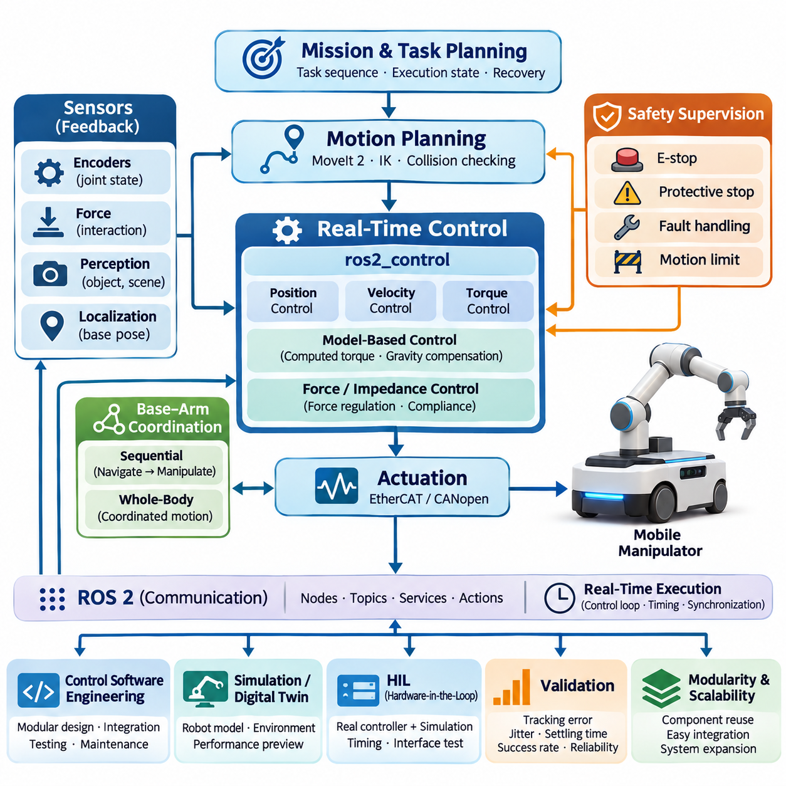
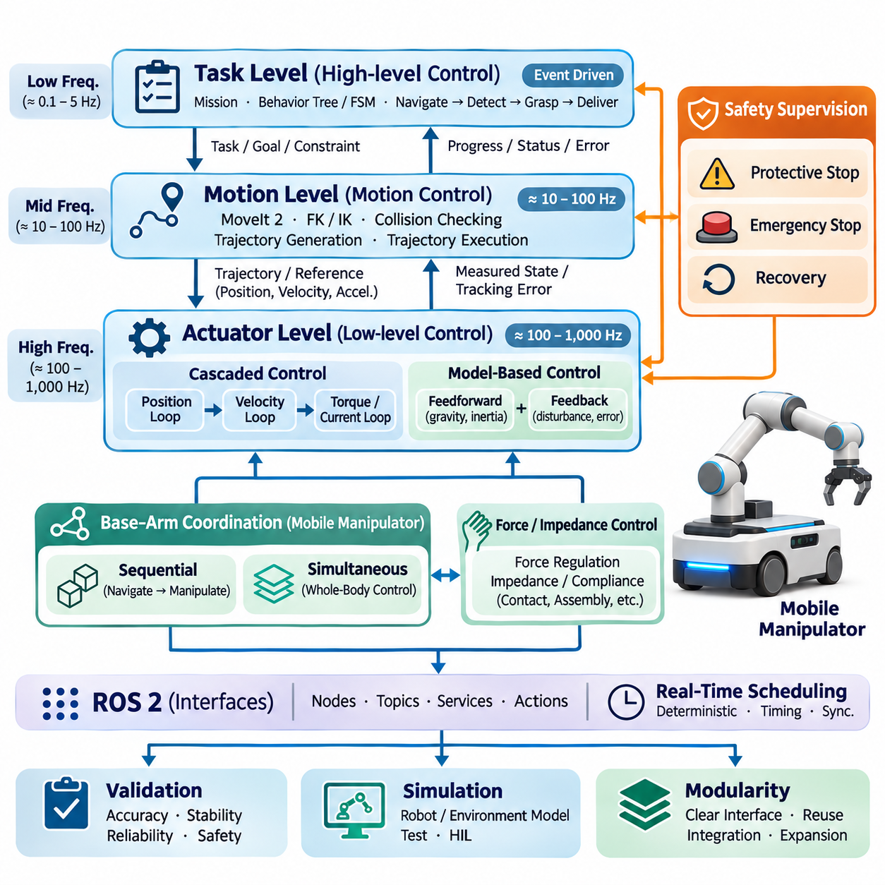
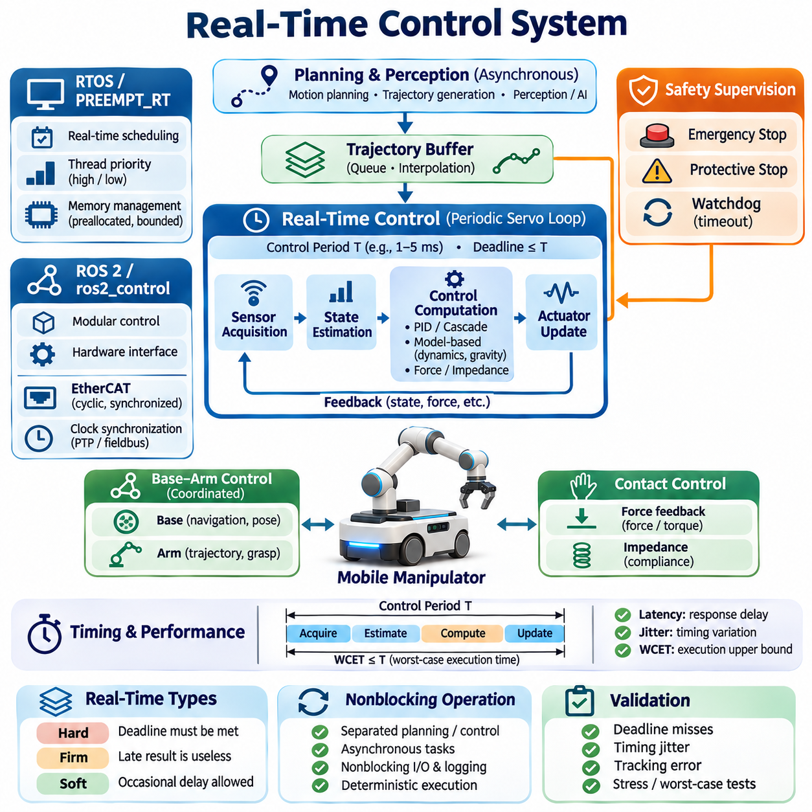
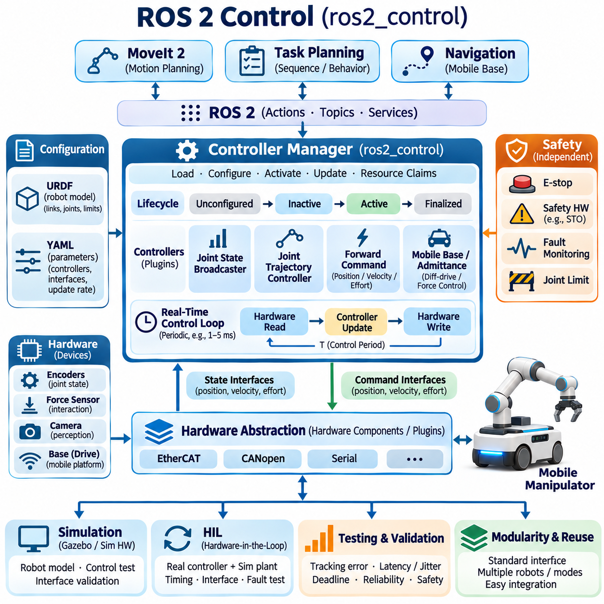
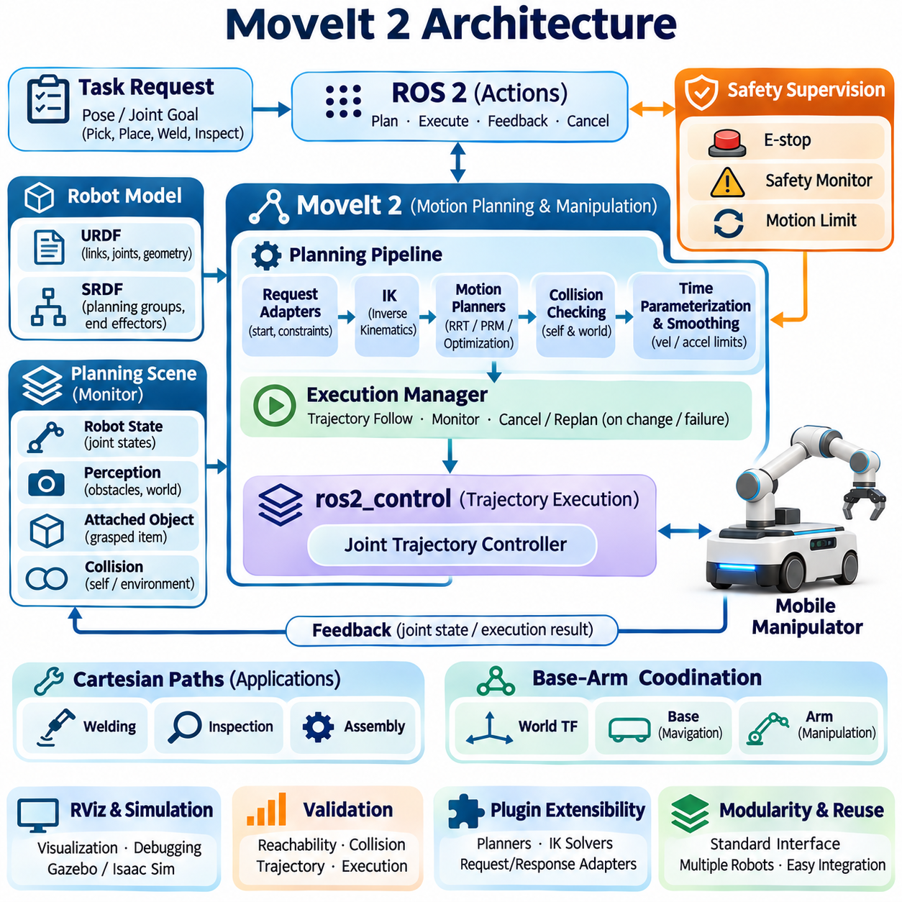
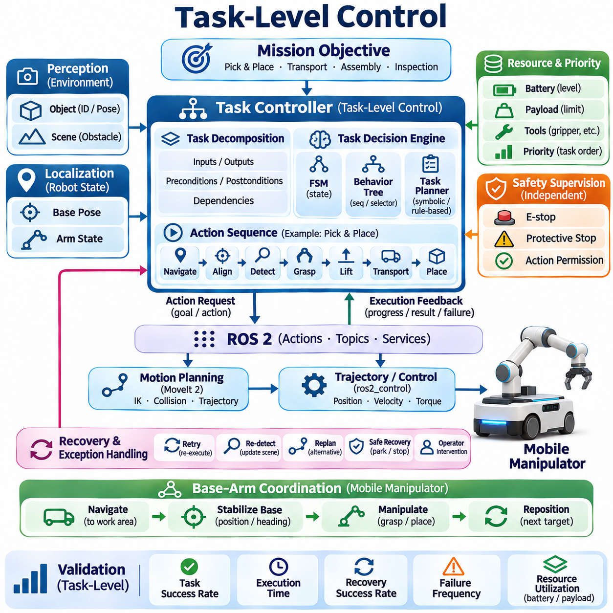
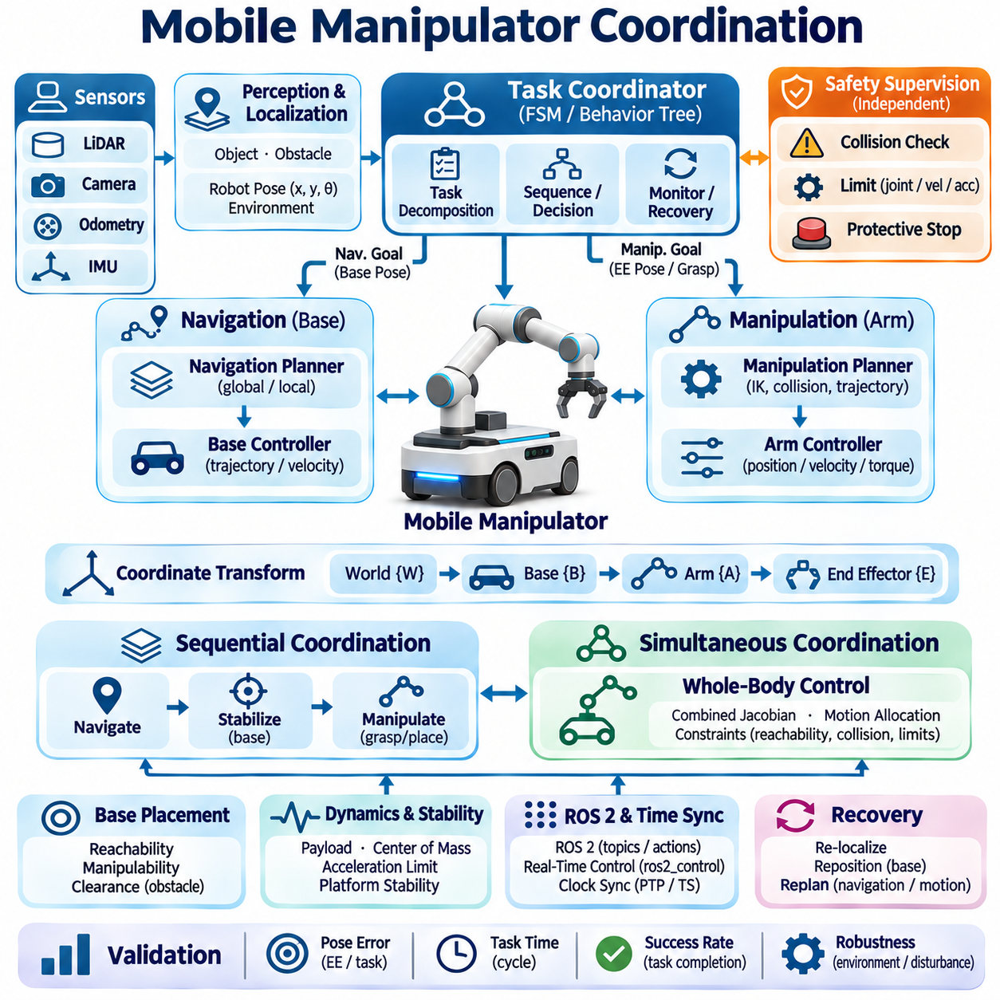
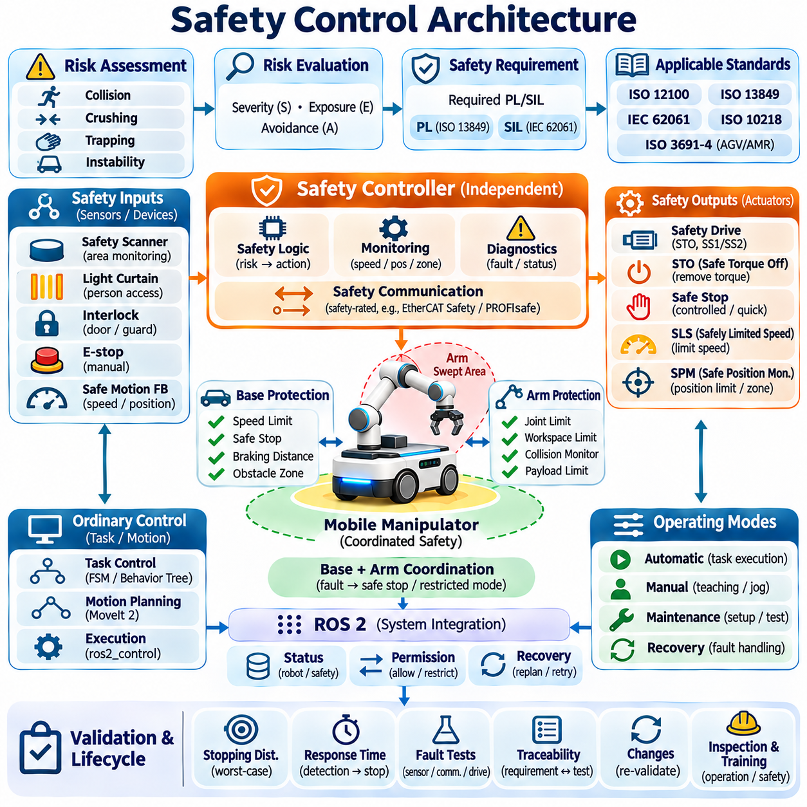
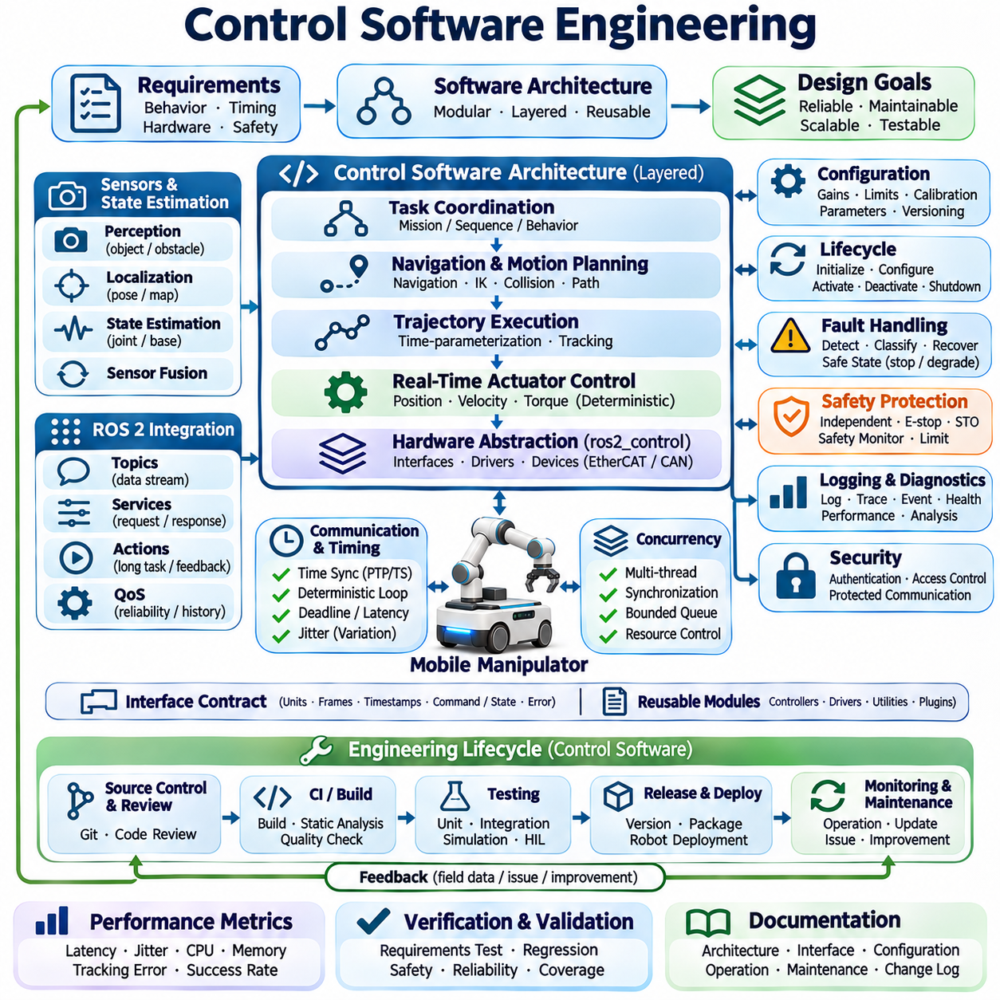
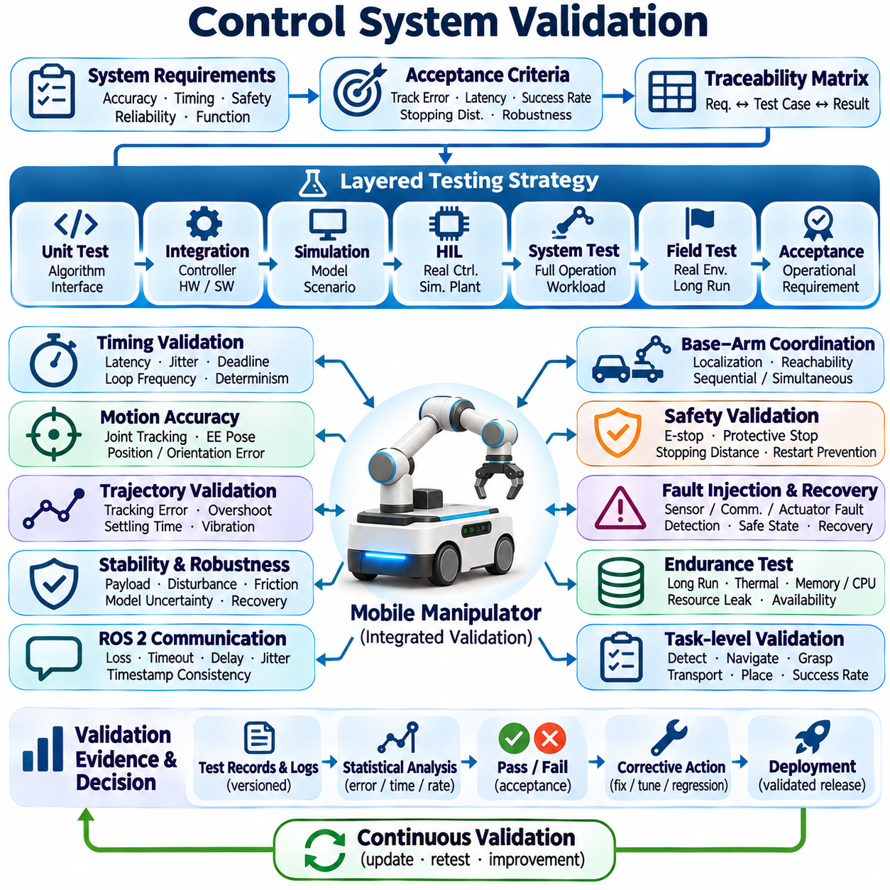

# Chapter 14. Control Architecture

## 01 Control Architecture Overview

{width="7.268055555555556in" height="7.268055555555556in"}

제어 아키텍처(Control Architecture)는 로봇 매니퓰레이터(Robotic Manipulator)가 상위 수준의 목표(High-Level Objectives)를 조정된 물리적 동작(Coordinated Physical Actions)으로 변환하는 조직적 구조를 정의한다. 작업 계획(Task Planning), 동작 생성(Motion Generation), 피드백 제어(Feedback Control), 액추에이터 명령(Actuator Commands), 안전 감독(Safety Supervision) 사이의 관계를 설정한다. 잘 설계된 아키텍처는 각 구성 요소의 책임을 분리하면서 서로 다른 연산 속도로 작동하는 구성 요소 사이의 안정적인 통신을 유지한다.

모바일 매니퓰레이터(Mobile Manipulator)에서 제어 아키텍처는 로봇 팔(Robot Arm), 모바일 플랫폼(Mobile Platform), 엔드 이펙터(End Effector), 인식 시스템(Perception System)을 통합적으로 조정해야 한다. 고정형 산업용 로봇(Stationary Industrial Robot)과 달리 매니퓰레이터는 이동 가능한 베이스(Movable Base) 위에서 작동하며, 베이스의 위치와 방향은 로봇 팔의 작업 공간(Workspace)에 영향을 준다. 따라서 제어 아키텍처는 내비게이션(Navigation), 위치 추정(Localization), 조작(Manipulation), 환경 상호작용(Environmental Interaction)을 일관된 제어 프레임워크(Control Framework)로 통합해야 한다.

제어 아키텍처의 기본 목적은 원하는 로봇 동작(Desired Robot Behavior)을 측정하고 제어할 수 있는 물리적 운동(Physical Motion)으로 변환하는 것이다. 작업 명령(Task Command)은 물체의 목표 위치를 지정할 수 있으며, 중간 단계의 제어기(Intermediate Controllers)는 데카르트 좌표계 궤적(Cartesian Trajectories), 관절 기준값(Joint References), 액추에이터 신호(Actuator Signals)를 생성한다. 엔코더(Encoder), 힘 센서(Force Sensor), 인식 모듈(Perception Module)의 피드백은 외란(Disturbance)과 모델링 불확실성(Modeling Uncertainty)을 보상하도록 실행 과정을 지속적으로 갱신한다.

현대 로봇 제어 시스템(Robotic Control System)은 서로 다른 추상화 수준(Abstraction Levels)을 관리하기 위해 일반적으로 계층적 구조(Hierarchical Organization)를 사용한다. 상위 제어기(High-Level Controller)는 작업 목표와 실행 순서를 결정하고, 중간 제어기(Middle-Level Controller)는 궤적을 생성하고 하위 시스템을 조정하며, 하위 제어기(Low-Level Controller)는 관절 위치(Joint Position), 속도(Velocity), 전류(Current), 토크(Torque)를 제어한다. 이러한 분리는 모듈성(Modularity)을 향상하고 디버깅(Debugging)을 단순화하며 제어 기능의 독립적인 최적화를 지원한다.

상위 제어 계층(High-Level Control Layer)은 임무 요구사항(Mission Requirements)을 해석하고 작업 완료에 필요한 동작 순서를 결정한다. 예를 들어 창고 모바일 매니퓰레이터(Warehouse Mobile Manipulator)는 보관 위치로 이동하고 목표 물체를 식별한 다음 로봇 팔을 배치하고 파지(Grasp)를 수행하여 물체를 운반할 수 있다. 작업 수준 논리(Task-Level Logic)는 작업 간 의존성(Dependencies), 실행 상태(Execution States), 복구 절차(Recovery Procedures), 내비게이션과 조작 사이의 상태 전환(State Transitions)을 관리한다.

동작 제어 계층(Motion Control Layer)은 작업 목표를 물리적으로 실행 가능한 궤적(Physically Feasible Trajectories)으로 변환한다. 운동학 모델(Kinematic Models), 역운동학(Inverse Kinematics), 작업 공간 제약조건(Workspace Constraints), 충돌 정보(Collision Information)를 사용하여 적절한 로봇 구성(Robot Configuration)을 결정한다. 궤적 생성(Trajectory Generation)은 관절 제한(Joint Limits), 속도 제한(Velocity Restrictions), 가속도 경계(Acceleration Bounds), 환경 장애물(Environmental Obstacles)을 고려하면서 연속적인 동작 사이의 부드러운 전환을 유지해야 한다.

하위 제어(Low-Level Control)는 로봇 운동을 담당하는 물리적 기구(Physical Mechanisms)에 직접 작용한다. 관절 제어기(Joint Controller)는 명령된 기준값(Commanded References)과 측정된 상태(Measured States)를 비교하고 액추에이터에 필요한 보정 신호(Corrective Signals)를 계산한다. 위치, 속도, 토크 제어 루프(Control Loops)는 캐스케이드 구조(Cascaded Structure)로 구성할 수 있으며, 빠른 내부 루프(Inner Loop)는 모터 동작을 안정화하고 상대적으로 느린 외부 루프(Outer Loop)는 기계적 운동과 궤적 추종(Trajectory Tracking)을 제어한다.

실제 로봇 시스템은 외란(Disturbance), 마찰(Friction), 페이로드 변화(Payload Variation), 센서 잡음(Sensor Noise), 모델링 오차(Modeling Errors)의 영향을 받으므로 피드백(Feedback)이 필수적이다. 폐루프 제어기(Closed-Loop Controller)는 목표 상태와 실제 상태를 지속적으로 비교하여 추종 오차(Tracking Error)를 감소시킨다. 제어 아키텍처는 변화하는 운용 조건에서도 안정성(Stability)을 유지하기 위해 정확한 측정값, 예측 가능한 통신 지연(Communication Delay), 적절한 제어기 갱신 주기(Controller Update Frequency)를 제공해야 한다.

모델 기반 제어(Model-Based Control)는 매니퓰레이터 동역학(Manipulator Dynamics)의 수학적 표현(Mathematical Representation)을 활용하여 기존 피드백 제어를 확장한다. 관성 행렬(Inertia Matrix), 코리올리 효과(Coriolis Effects), 원심력(Centrifugal Forces), 중력(Gravity), 마찰 추정값(Friction Estimates)은 제어 성능을 향상할 수 있다. 계산 토크 제어(Computed Torque Control)와 중력 보상(Gravity Compensation)은 예측 가능한 외란을 줄여 피드백 제어기가 잔여 오차(Residual Errors)와 예상하지 못한 상호작용에 집중하도록 한다.

힘 제어(Force Control)와 임피던스 제어(Impedance Control)는 매니퓰레이터가 물리적 환경과 상호작용할 때 추가적인 요구사항을 발생시킨다. 위치 제어(Position Control)만 사용하면 조립(Assembly)이나 표면 추종(Surface Following) 과정에서 과도한 접촉력(Contact Force)이 발생할 수 있다. 힘 제어기는 상호작용 하중(Interaction Loads)을 조절하고, 임피던스 제어기는 변위(Displacement), 속도(Velocity), 힘(Force) 사이의 원하는 관계를 설정한다. 이러한 방식은 불확실한 접촉 조건에서 제어된 순응성(Controlled Compliance)을 제공한다.

실시간 실행(Real-Time Execution)은 로봇 제어 아키텍처의 핵심 요구사항이다. 제어 알고리즘(Control Algorithms)은 예측 가능한 액추에이터 동작을 유지하기 위해 지정된 마감시간(Deadlines) 안에 계산을 완료해야 한다. 고주파 서보 루프(High-Frequency Servo Loops)는 일반적으로 작업 계획이나 인식 처리보다 높은 결정성(Determinism)을 요구한다. 시간에 민감한 기능(Time-Critical Functions)을 연산 집약적인 작업(Computationally Intensive Operations)과 분리하면 예측하기 어려운 작업 부하가 운동 안정성을 방해하는 것을 방지할 수 있다.

통신 아키텍처(Communication Architecture)는 제어 구성 요소 사이에서 명령, 측정값, 상태 정보가 전달되는 방식을 결정한다. 산업용 시스템은 액추에이터 통신을 위해 이더캣(EtherCAT), 캔오픈(CANopen) 또는 다른 필드버스(Fieldbus) 기술을 사용할 수 있으며, 미들웨어(Middleware)는 상위 소프트웨어 통합을 지원한다. 메시지 타이밍(Message Timing), 동기화(Synchronization), 버퍼링(Buffering), 장애 감지(Failure Detection)를 고려해야 하며, 통신 지연은 제어 정확도(Control Accuracy)와 신뢰성(Reliability)에 직접적인 영향을 준다.

ROS 2는 노드(Node), 토픽(Topic), 서비스(Service), 액션(Action)을 통해 로봇 제어 구성 요소를 통합하는 모듈형 소프트웨어 프레임워크(Modular Software Framework)를 제공한다. 통신 메커니즘(Communication Mechanisms)은 센싱(Sensing), 계획(Planning), 실행(Execution) 모듈 사이의 분산 처리(Distributed Processing)를 지원한다. 그러나 결정적 제어(Deterministic Control)를 구현하려면 범용 메시지 통신에만 의존하지 않고 적절한 운영체제 스케줄링(Operating-System Scheduling), 미들웨어 설정(Middleware Configuration), 하드웨어 인터페이스(Hardware Interfaces)가 필요하다.

ros2_control 프레임워크(ros2_control Framework)는 로봇 하드웨어(Robot Hardware)와 제어 알고리즘(Control Algorithms) 사이에 표준화된 인터페이스(Standardized Interfaces)를 제공한다. 하드웨어 구성 요소(Hardware Components)는 상태 인터페이스(State Interfaces)와 명령 인터페이스(Command Interfaces)를 제공하고, 제어기(Controllers)는 특정 제어 기능을 구현한다. 제어기 관리자(Controller Manager)는 생명주기 전환(Lifecycle Transitions)과 실행 갱신(Execution Updates)을 조정한다. 이러한 분리는 호환 가능한 로봇 플랫폼에서 제어기를 재사용하고 시뮬레이션 하드웨어 인터페이스(Simulated Hardware Interfaces)를 통해 소프트웨어를 평가할 수 있도록 한다.

MoveIt 2는 동작 계획(Motion Planning), 운동학 계산(Kinematic Computation), 충돌 검사(Collision Checking), 궤적 실행(Trajectory Execution) 기능을 제공하여 하위 제어를 보완한다. 계획 제약조건(Planning Constraints)에 따라 로봇 구성을 평가하고 호환 가능한 제어기에 전달할 궤적을 생성한다. MoveIt 2와 ros2_control의 통합은 기하학적 동작 계획(Geometric Motion Planning)과 액추에이터 수준 실행(Actuator-Level Execution)을 연결하는 실용적인 구조를 형성한다.

모바일 매니퓰레이터의 협조 제어(Mobile Manipulator Coordination)는 모바일 베이스(Mobile Base)와 로봇 팔(Robot Arm) 사이의 관계를 명시적으로 관리해야 한다. 베이스 이동은 매니퓰레이터 기준 좌표계(Manipulator Reference Frame)를 변화시키며 목표 도달 가능성(Target Reachability), 안정성(Stability), 충돌 조건(Collision Conditions)에 영향을 줄 수 있다. 협조 제어기(Coordinated Controllers)는 작업 요구사항, 기계적 제약조건(Mechanical Constraints), 위치 추정 정확도(Localization Accuracy), 시스템 성능에 따라 베이스와 로봇 팔을 순차적으로 또는 동시에 작동시킬 수 있다.

순차적 협조 제어(Sequential Coordination)는 조작을 시작하기 전에 모바일 플랫폼의 위치를 설정하고 안정화함으로써 많은 산업 작업을 단순화한다. 동시 협조 제어(Simultaneous Coordination)는 작업 공간 범위(Workspace Coverage)와 운용 유연성(Operational Flexibility)을 향상할 수 있지만 하위 시스템 사이의 추가적인 결합(Coupling)을 발생시킨다. 전신 제어(Whole-Body Control)는 베이스와 로봇 팔의 자유도(Degrees of Freedom)를 함께 고려하여 시스템 제약조건을 만족하면서 엔드 이펙터 동작(End-Effector Motion)을 최적화한다.

안전 제어 아키텍처(Safety Control Architecture)는 기능적 동작 제어(Functional Motion Control)와 병행하여 작동해야 하며, 동작 제어의 정상적인 실행에 전적으로 의존해서는 안 된다. 비상 정지(Emergency Stop), 보호 정지(Protective Stop), 관절 제한(Joint Limits), 충돌 감시(Collision Monitoring), 액추에이터 장애 감지(Actuator Fault Detection)는 명확한 책임 구분이 필요하다. 안전 관련 기능(Safety-Related Functions)은 해당 위험 평가(Risk Assessment)에 따라 적절한 독립성(Independence), 진단 범위(Diagnostic Coverage), 검증된 대응 동작(Validated Response Behavior)을 갖추어 구현해야 한다.

장애 관리(Fault Management)는 비정상적인 운용 조건(Abnormal Operating Conditions)을 처리하기 위한 체계적인 메커니즘을 제공한다. 통신 중단(Communication Interruptions), 액추에이터 과열(Actuator Overheating), 센서 장애(Sensor Failures), 위치 추정 불확실성(Localization Uncertainty), 궤적 실행 불가능성(Trajectory Infeasibility)은 서로 다른 복구 대응(Recovery Responses)을 요구할 수 있다. 제어 아키텍처는 장애를 분류하고 영향을 받는 하위 시스템을 식별하며 정의된 안전 상태(Safe States)로 전환하고 필요한 조건이 충족된 경우에만 통제된 복구(Controlled Recovery)를 허용해야 한다.

제어 소프트웨어 엔지니어링(Control Software Engineering)은 모듈형 인터페이스(Modular Interfaces), 명시적인 상태 관리(Explicit State Management), 형상 관리(Configuration Control), 재현 가능한 테스트(Reproducible Testing)를 강조한다. 각 구성 요소는 명확하게 정의된 명령 구조(Command Structures), 측정 데이터 형식(Measurement Formats), 운용 모드(Operating Modes), 오류 조건(Error Conditions)을 제공해야 한다. 버전 관리되는 매개변수(Version-Controlled Parameters)와 문서화된 의존성(Documented Dependencies)은 개발 과정에서 제어 알고리즘, 하드웨어 드라이버, 미들웨어 설정이 변경될 때 발생하는 통합 장애를 줄이는 데 도움이 된다.

시뮬레이션(Simulation)과 디지털 트윈(Digital Twin)은 실제 로봇에 배포하기 전에 제어 아키텍처를 평가하도록 지원한다. 개발자는 통제된 조건에서 궤적 추종(Trajectory Tracking), 제어기 상호작용(Controller Interactions), 통신 지연(Communication Delays), 장애 대응(Fault Responses)을 분석할 수 있다. 하드웨어 인 더 루프 테스트(Hardware-in-the-Loop Testing)는 실제 제어기나 액추에이터를 포함하여 이러한 접근법을 확장하며, 단순화된 시뮬레이션 모델에서 발견하기 어려운 타이밍 문제와 통합 문제를 식별하는 데 도움이 된다.

제어 시스템 검증(Control System Validation)은 개별 구성 요소뿐 아니라 구성 요소 사이의 상호작용도 평가해야 한다. 주요 측정 지표에는 추종 오차(Tracking Error), 정착 시간(Settling Time), 오버슈트(Overshoot), 제어 루프 지터(Control-Loop Jitter), 궤적 완료율(Trajectory Completion Rate), 장애 대응 지연시간(Fault Response Latency)이 포함된다. 테스트는 정상 운용(Nominal Operation), 페이로드 변화(Payload Changes), 접촉 전환(Contact Transitions), 통신 장애(Communication Disturbances), 비상 상황(Emergency Conditions)을 포함하여 성능 한계(Performance Boundaries)와 운용 신뢰성(Operational Reliability)을 확인해야 한다.

확장성(Scalability)은 제어 아키텍처가 서로 다른 매니퓰레이터, 그리퍼(Gripper), 모바일 플랫폼 또는 산업 응용 분야를 지원해야 할 때 중요해진다. 표준화된 인터페이스(Standardized Interfaces)와 설정 가능한 제어기(Configurable Controllers)는 플랫폼별 소프트웨어 수정 작업을 줄인다. 모듈형 아키텍처(Modular Architecture)는 적응 제어(Adaptive Control), 학습 기반 계획(Learning-Based Planning), 예측 최적화(Predictive Optimization), 다중 로봇 협조 운용(Coordinated Multi-Robot Operations)과 같은 고급 기능의 점진적인 통합도 가능하게 한다.

궁극적으로 제어 아키텍처(Control Architecture)는 로봇 지능(Robot Intelligence)과 신뢰할 수 있는 물리적 실행(Dependable Physical Execution)을 연결하는 공학적 기반(Engineering Foundation)을 제공한다. 효과적인 아키텍처는 개별 제어 알고리즘뿐 아니라 타이밍 보장(Timing Guarantees), 하위 시스템 협조(Subsystem Coordination), 피드백 무결성(Feedback Integrity), 장애 처리(Fault Handling), 검증(Validation)에 의해 결정된다. 일관된 제어 아키텍처는 모바일 매니퓰레이터가 정밀도(Precision), 안정성(Stability), 안전성(Safety), 운용 유연성(Operational Flexibility)을 유지하면서 점점 더 복잡한 작업을 수행할 수 있도록 한다.

## 02 Hierarchical Control

{width="7.268055555555556in" height="7.268055555555556in"}

계층적 제어(Hierarchical Control)는 로봇 제어 기능을 책임, 시간 척도(Time Scales), 연산 요구사항(Computational Requirements)에 따라 여러 수준으로 구성하는 기본적인 아키텍처 접근법(Architectural Approach)이다. 모든 의사결정을 하나의 제어기에 할당하는 대신, 시스템은 전문화된 계층(Specialized Layers)에 작업을 분산한다. 이러한 구성은 복잡한 로봇 매니퓰레이터(Robotic Manipulator)가 전략적 계획(Strategic Planning), 협조 동작(Coordinated Motion), 정밀한 액추에이터 제어(Actuator Regulation)를 통합된 프레임워크(Unified Framework) 안에서 결합할 수 있도록 한다.

계층적 제어의 주요 목적은 상위 수준의 의사결정(High-Level Decision-Making)과 하위 수준의 물리적 실행(Low-Level Physical Execution)을 분리하면서 일관된 정보 교환(Information Exchange)을 유지하는 것이다. 상위 계층(Higher Layers)은 로봇이 무엇을 수행해야 하는지 결정하고, 하위 계층(Lower Layers)은 명령을 물리적으로 실행하는 방법을 결정한다. 중간 계층(Intermediate Layers)은 추상적인 목표(Abstract Objectives)를 실행 가능한 동작 기준값(Feasible Motion References)으로 변환하여 계획된 동작이 기계적 제약조건(Mechanical Constraints) 및 운용 제약조건(Operational Constraints)과 일치하도록 한다.

일반적인 계층적 아키텍처(Hierarchical Architecture)는 작업 수준 제어(Task-Level Control), 동작 수준 제어(Motion-Level Control), 액추에이터 수준 제어(Actuator-Level Control)로 구성된다. 작업 계층(Task Layer)은 목표와 실행 순서를 관리하고, 동작 계층(Motion Layer)은 궤적을 생성하고 로봇 구성 요소를 조정하며, 액추에이터 계층(Actuator Layer)은 관절 동작(Joint Behavior)을 제어한다. 이러한 계층은 서로 다른 주파수(Frequencies)로 작동하며 예측 가능한 실행을 지원하는 정의된 인터페이스(Defined Interfaces)를 통해 명령, 피드백, 상태 정보를 교환한다.

작업 수준 제어(Task-Level Control)는 계층 구조에서 가장 높은 추상화 수준(Abstraction Level)을 나타낸다. 임무 요구사항(Mission Requirements)을 해석하고, 동작을 선택하며, 환경 조건(Environmental Conditions)과 시스템 성능(System Capabilities)에 따라 실행 순서를 결정한다. 모바일 매니퓰레이터(Mobile Manipulator)의 경우 작업 제어기(Task Controller)는 내비게이션(Navigation), 객체 탐지(Object Detection), 파지 계획(Grasp Planning), 조작(Manipulation), 배송(Delivery)을 조정할 수 있다. 또한 작업 완료 상태를 감시하고 작업 실패 시 복구 절차(Recovery Procedures)를 시작한다.

작업 실행(Task Execution)은 유한 상태 기계(Finite-State Machine), 행동 트리(Behavior Tree), 구조화된 작업 계획기(Structured Task Planner)를 사용하여 표현할 수 있다. 이러한 메커니즘은 운용 논리(Operational Logic)를 식별 가능한 상태(States), 전이(Transitions), 조건(Conditions)으로 구성한다. 행동 트리는 센서 피드백(Sensor Feedback)에 따라 정상 실행(Normal Execution)과 복구 동작(Recovery Actions) 중 하나를 선택할 수 있다. 이러한 표현 방식은 모듈성(Modularity)을 향상하고 복잡한 작업 순서를 쉽게 검사, 수정, 검증할 수 있도록 한다.

동작 수준 제어기(Motion-Level Controller)는 작업 명령(Task Instructions)을 기하학적 제약조건(Geometric Constraints)과 동역학적 제약조건(Dynamic Constraints)을 만족하는 궤적(Trajectories)으로 변환한다. 순운동학(Forward Kinematics), 역운동학(Inverse Kinematics), 충돌 검사(Collision Checking), 궤적 최적화(Trajectory Optimization)를 사용하여 적절한 기준값을 생성한다. 동작 계획(Motion Planning)은 관절 제한(Joint Limits), 작업 공간 경계(Workspace Boundaries), 속도 제약조건(Velocity Constraints), 장애물(Obstacles)을 고려하면서 연속적인 로봇 구성 사이에서 부드럽고 실행 가능한 전환을 유지해야 한다.

궤적 실행(Trajectory Execution)은 계획된 동작(Planned Motion)과 연속 제어(Continuous Control)를 연결한다. 궤적 제어기(Trajectory Controller)는 시간에 따라 기준 위치(Reference Positions), 속도(Velocities), 필요한 경우 가속도(Accelerations)를 보간(Interpolation)한다. 추종 성능(Tracking Performance)을 감시하고 여러 관절을 조정하여 동기화된 운동(Synchronized Movement)을 유지한다. 실행 오차(Execution Errors)가 허용 한계를 초과하면 제어기는 실패를 보고하거나 제어된 정지(Controlled Stop)를 요청할 수 있다.

가장 낮은 수준에서 액추에이터 제어기(Actuator Controllers)는 모터 전류(Motor Current), 토크(Torque), 속도(Velocity), 위치(Position)와 같은 물리적 변수를 제어한다. 이러한 제어기는 기계적 안정성(Mechanical Stability)과 추종 정확도(Tracking Accuracy)가 빠른 피드백에 의존하므로 상대적으로 높은 주파수로 작동한다. 엔코더 측정값(Encoder Measurements), 전류 센서(Current Sensors), 모터 모델(Motor Models)은 보정 명령(Corrective Commands)을 계산하고 외란(Disturbances)을 보상하는 데 필요한 정보를 제공한다.

캐스케이드 제어 구조(Cascaded Control Structure)는 액추에이터 계층에서 자주 사용된다. 외부 위치 루프(Outer Position Loop)는 속도 기준값(Velocity References)을 생성하고, 속도 루프(Velocity Loop)는 토크 또는 전류 요구값(Torque or Current Demands)을 생성하며, 내부 전류 루프(Inner Current Loop)는 모터의 전기적 동작(Electrical Behavior)을 제어한다. 각 루프는 적절한 대역폭(Bandwidth)을 갖도록 설계되며, 일반적으로 내부 루프가 외부 루프보다 빠르게 응답하도록 한다. 적절한 튜닝(Tuning)은 루프 간 간섭을 줄이고 전체 안정성을 향상한다.

계층적 구조는 모델 기반 제어 전략(Model-Based Control Strategies)도 지원한다. 동역학 모델(Dynamic Models)은 중력(Gravity), 관성(Inertia), 예측 가능한 운동 의존적 힘(Motion-Dependent Forces)을 보상하는 피드포워드 토크 명령(Feedforward Torque Commands)을 제공할 수 있다. 이후 피드백 제어기(Feedback Controllers)는 외란이나 모델링 오차(Modeling Errors)로 인해 남아 있는 편차(Remaining Deviations)를 보정한다. 이러한 조합은 상위 계획기(Higher-Level Planners)가 개별 액추에이터 동역학(Actuator Dynamics)을 직접 관리하지 않아도 궤적 추종 성능(Trajectory Tracking Performance)을 향상한다.

서로 다른 제어 계층은 연산 책임(Computational Responsibilities)이 다르기 때문에 서로 다른 시간 척도(Time Scales)로 작동한다. 작업 계획(Task Planning)은 운용 조건이 변경될 때 갱신될 수 있으며, 동작 제어기(Motion Controllers)는 수십 또는 수백 헤르츠(Hertz), 액추에이터 루프(Actuator Loops)는 수백 또는 수천 헤르츠로 실행될 수 있다. 이러한 값은 하드웨어와 응용 요구사항에 따라 달라진다. 결정적 스케줄링(Deterministic Scheduling)은 특히 시간에 민감한 제어 루프(Time-Critical Control Loops)에서 중요하다.

정보는 목표(Objectives), 제약조건(Constraints), 궤적(Trajectories), 액추에이터 기준값(Actuator References)의 형태로 계층 구조의 상위에서 하위로 전달된다. 피드백(Feedback)은 측정 상태(Measured States), 실행 진행 상황(Execution Progress), 추종 오차(Tracking Errors), 장애 보고(Fault Reports)의 형태로 하위에서 상위로 전달된다. 이러한 양방향 통신(Bidirectional Communication)은 상위 계층이 물리적 조건에 따라 의사결정을 조정하도록 하며, 하위 계층은 모든 상위 의사결정을 기다리지 않고 국부적인 제어 안정성(Local Control Stability)을 유지하도록 한다.

명확한 인터페이스 정의(Interface Definitions)는 신뢰할 수 있는 계층적 운용(Hierarchical Operation)에 필수적이다. 각 계층은 명령 형식(Command Formats), 기준 좌표계(Reference Frames), 단위(Units), 타이밍 요구사항(Timing Requirements), 운용 모드(Operating Modes), 오류 조건(Error Conditions)을 명시해야 한다. 일관되지 않은 좌표 변환(Coordinate Transformations)이나 오래된 상태 정보(Outdated State Information)는 개별 제어기가 정상적으로 작동하더라도 잘못된 움직임을 발생시킬 수 있다. 따라서 인터페이스 검증(Interface Validation)은 시스템 통합(System Integration)의 핵심 요소가 된다.

계층적 제어는 모바일 베이스(Mobile Base)와 로봇 팔(Robot Arm)이 서로 다른 운동 특성(Motion Characteristics)을 갖기 때문에 모바일 매니퓰레이터에서 특히 유용하다. 베이스 제어기(Base Controller)는 내비게이션과 플랫폼 이동(Platform Movement)을 관리하고, 로봇 팔 제어기(Arm Controller)는 조작 동작(Manipulation)을 제어한다. 협조 계층(Coordination Layer)은 작업 요구사항에 따라 각 하위 시스템이 언제 작동해야 하는지, 그리고 동작을 순차적으로 수행할지 동시에 수행할지를 결정한다.

순차적 운용(Sequential Operation)에서는 모바일 플랫폼이 먼저 목표 위치(Target Location)에 도달하고 허용 가능한 위치 조건(Positioning Condition)을 확보한다. 이후 로봇 팔 제어기는 추정된 베이스 자세(Estimated Base Pose)를 기준으로 조작을 실행한다. 이러한 접근법은 협조 제어의 복잡성(Coordination Complexity)을 줄이고 안전 검증(Safety Verification)을 단순화한다. 그러나 조작 궤적(Manipulation Trajectories)을 생성할 때 위치 추정 불확실성(Localization Uncertainty)과 위치 결정 오차(Positioning Errors)를 여전히 고려해야 한다.

베이스와 로봇 팔의 동시 제어(Simultaneous Base-Arm Control)는 운동 하위 시스템 사이에 더 강한 결합(Coupling)을 발생시킨다. 협조 계층은 엔드 이펙터 궤적(End-Effector Trajectory)을 유지하기 위해 플랫폼 이동과 로봇 팔 관절 운동(Arm Articulation)에 대한 기준값을 함께 생성할 수 있다. 전신 제어(Whole-Body Control)는 도달 가능성(Reachability), 관절 제한(Joint Limits), 충돌 제약조건(Collision Constraints), 플랫폼 안정성(Platform Stability)을 고려하면서 결합된 자유도(Combined Degrees of Freedom)를 최적화할 수 있다. 이러한 기능은 유효 조작 작업 공간(Effective Manipulation Workspace)을 확장한다.

계층적 제어는 접촉 작업(Contact Tasks)에서 힘 제어(Force Control), 임피던스 제어(Impedance Control), 순응 제어(Compliance Control)도 수용할 수 있다. 작업 계층은 필요한 상호작용 모드(Interaction Mode)를 결정하고, 동작 계층은 원하는 데카르트 좌표계 동작(Cartesian Behavior)을 설정한다. 하위 제어기는 액추에이터 명령(Actuator Commands)을 통해 힘 조절(Force Regulation) 또는 순응 응답(Compliant Responses)을 구현한다. 접촉 전환(Contact Transitions)에서는 자유 공간 운동(Free-Space Motion)과 구속된 상호작용(Constrained Interaction) 사이의 불연속성(Discontinuities)을 방지하기 위한 세심한 조정이 필요하다.

안전 감독(Safety Supervision)은 모든 계층적 수준에서 효과적으로 유지되어야 한다. 작업 제어기(Task Controllers)는 안전하지 않은 운용 순서(Unsafe Operation Sequences)를 방지하고, 동작 제어기(Motion Controllers)는 기하학적 제약조건(Geometric Constraints)을 적용하며, 액추에이터 제어기(Actuator Controllers)는 물리적 한계(Physical Limits)를 감시할 수 있다. 독립적인 안전 관련 메커니즘(Independent Safety-Related Mechanisms)은 위험 상황(Hazardous Conditions)이 발생하면 정상 명령을 무효화할 수 있다. 계층 구조는 보호 정지(Protective Stops), 비상 정지(Emergency Stops), 복구 허가(Recovery Permissions)가 시스템 전체에 전달되는 방식을 정의해야 한다.

장애 처리(Fault Handling)는 장애의 심각도(Severity)와 발생 원인(Origin)에 따라 복구 책임(Recovery Responsibilities)을 할당함으로써 효과를 높일 수 있다. 일시적인 궤적 추종 편차(Trajectory Tracking Deviation)는 국부적으로 처리할 수 있지만, 지속적인 동작 실행 불가능성(Motion Infeasibility)은 재계획(Replanning)을 요구할 수 있다. 하드웨어 장애(Hardware Faults)나 안전 위반(Safety Violations)은 즉각적인 보호 조치(Protective Action)를 요구할 수 있다. 상위 계층은 실제 시스템 상태를 반영한 복구 결정을 수행할 수 있도록 구조화된 장애 정보(Structured Fault Information)를 전달받아야 한다.

ROS 2는 분산 계층적 제어(Distributed Hierarchical Control)를 구현하는 데 적합한 통신 메커니즘(Communication Mechanisms)을 제공한다. 작업 수준 노드(Task-Level Nodes)는 액션 요청(Action Requests)을 발행하고, 계획 구성 요소(Planning Components)는 궤적을 생성하며, ros2_control 제어기는 하드웨어 명령(Hardware Commands)을 실행할 수 있다. MoveIt 2는 동작 계획(Motion Planning)과 궤적 실행 통합(Trajectory Execution Integration)을 지원한다. 그러나 결정적 액추에이터 제어(Deterministic Actuator Regulation)를 위해서는 적절한 실시간 스케줄링(Real-Time Scheduling)과 하드웨어 통신 메커니즘(Hardware Communication Mechanisms)이 여전히 필요하다.

소프트웨어 모듈성(Software Modularity)은 계층적 아키텍처의 주요 장점이다. 인터페이스 계약(Interface Contracts)이 호환성을 유지한다면 개발자는 전체 시스템을 재설계하지 않고 동작 계획기(Motion Planner)를 교체하거나 작업 전략(Task Strategy)을 수정하거나 다른 액추에이터 제어기(Actuator Controller)를 도입할 수 있다. 이러한 분리는 시뮬레이션(Simulation), 하드웨어 추상화(Hardware Abstraction), 구성 요소 테스트(Component Testing), 다양한 매니퓰레이터 구성(Manipulator Configurations)에 대한 점진적 통합(Incremental Integration)을 지원한다.

검증(Validation)은 개별 제어 계층과 이들이 결합된 동작을 모두 평가해야 한다. 단위 테스트(Unit Tests)는 제어기 계산(Controller Calculations)과 인터페이스 처리(Interface Handling)를 확인하고, 통합 테스트(Integration Tests)는 명령 전달(Command Propagation)과 피드백 일관성(Feedback Consistency)을 평가한다. 시스템 수준 실험(System-Level Experiments)은 통신 장애(Communication Disturbances)와 페이로드 변화(Changing Payloads)를 포함한 실제 운용 조건에서 궤적 정확도(Trajectory Accuracy), 응답 지연시간(Response Latency), 장애 복구(Fault Recovery), 협조 성능(Coordination Performance)을 측정한다.

계층적 아키텍처는 모듈성(Modularity)과 통신 오버헤드(Communication Overhead), 누적 지연(Accumulated Delays) 사이의 균형을 유지해야 한다. 과도한 계층 분리는 지연시간(Latency), 동기화 문제(Synchronization Problems), 일관되지 않은 상태 추정(Inconsistent State Estimates)을 발생시킬 수 있다. 따라서 설계자는 타이밍 민감도(Timing Sensitivity), 연산 복잡도(Computational Complexity), 안전 요구사항(Safety Requirements)에 따라 기능을 할당해야 한다. 명확하게 정의된 실행 경계(Execution Boundaries)는 아키텍처의 유연성(Architectural Flexibility)을 유지하면서 응답성(Responsiveness)을 보존하는 데 도움이 된다.

궁극적으로 계층적 제어(Hierarchical Control)는 복잡한 로봇 목표(Complex Robotic Objectives)를 신뢰할 수 있는 물리적 동작(Reliable Physical Behavior)으로 변환하기 위한 확장 가능한 기반(Scalable Foundation)을 제공한다. 작업 추론(Task Reasoning), 동작 협조(Motion Coordination), 액추에이터 제어(Actuator Regulation)를 분리함으로써 시스템 수준의 일관성(System-Level Consistency)을 유지하면서 독립적인 개발을 가능하게 한다. 그 효과는 정확한 인터페이스(Precise Interfaces), 예측 가능한 타이밍(Predictable Timing), 강건한 피드백(Robust Feedback), 조정된 안전 처리(Coordinated Safety Handling), 전체 제어 계층에 대한 포괄적인 검증(Comprehensive Validation)에 달려 있다.

## 03 Real Time Control System

{width="7.268055555555556in" height="7.268055555555556in"}

실시간 제어 시스템(Real-Time Control System)은 예측 가능한 시간 제약조건(Timing Constraints) 내에서 로봇 제어 작업을 실행하도록 설계된 컴퓨팅 및 물리적 프레임워크(Computational and Physical Framework)이다. 주요 목적은 단순히 높은 처리 속도(Processing Speed)를 달성하는 것이 아니라 중요한 계산과 액추에이터 명령(Actuator Commands)이 지정된 마감시간(Deadlines) 이전에 실행되도록 보장하는 것이다. 로봇 매니퓰레이터(Robotic Manipulator)에서 시간 예측 가능성(Timing Predictability)은 운동 안정성(Motion Stability), 추종 정확도(Tracking Accuracy), 운용 안전성(Operational Safety)에 직접적인 영향을 준다.

실시간 제어(Real-Time Control)는 로봇 매니퓰레이터가 고속 운동(High-Speed Motion), 정밀 조립(Precision Assembly), 힘 조절(Force Regulation), 협조 조작(Coordinated Manipulation)을 수행할 때 필수적이다. 제어 명령(Control Commands)의 지연은 추종 오차(Tracking Errors), 진동(Oscillations), 환경과의 불안정한 상호작용(Unstable Interactions)을 발생시킬 수 있다. 따라서 신뢰할 수 있는 시스템은 일관된 응답 특성(Response Characteristics)을 유지하는 실행 일정(Execution Schedules)을 통해 센싱(Sensing), 연산(Computation), 통신(Communication), 구동(Actuation)을 조정해야 한다.

실시간 시스템(Real-Time Systems)은 일반적으로 마감시간 위반(Missed Deadlines)의 결과에 따라 경성 실시간(Hard Real-Time), 확정 실시간(Firm Real-Time), 연성 실시간(Soft Real-Time)으로 분류된다. 경성 실시간 작업은 마감시간 위반이 허용할 수 없는 장애를 발생시킬 수 있으므로 엄격한 준수가 필요하다. 확정 실시간 작업은 결과가 늦게 도착하면 유용성을 잃으며, 연성 실시간 작업은 성능 저하를 감수하면서 간헐적인 지연을 허용한다. 로봇 제어 아키텍처(Robotic Control Architecture)는 이러한 범주를 함께 사용하는 경우가 많다.

제어 주기(Control Cycle)는 실시간 로봇 제어기(Real-Time Robotic Controller)의 기본 실행 단위를 나타낸다. 각 주기 동안 시스템은 센서 측정값(Sensor Measurements)을 획득하고, 관련 상태(State)를 추정하며, 제어 명령(Control Commands)을 계산하고, 액추에이터 출력(Actuator Outputs)을 갱신한다. 이러한 순서는 할당된 제어 주기(Control Period) 내에 완료되어야 한다. 일관된 실행 타이밍(Execution Timing)은 피드백 알고리즘(Feedback Algorithms)이 설계된 수학적 가정(Mathematical Assumptions)에 따라 작동하도록 보장한다.

제어 주파수(Control Frequency)는 시스템이 액추에이터 명령을 갱신하고 피드백 측정값을 평가하는 빈도를 결정한다. 관절 위치 제어기(Joint Position Controller)는 수백 헤르츠(Hertz)에서 작동할 수 있으며, 토크 및 전류 제어(Torque and Current Regulation)는 훨씬 높은 갱신 속도(Update Rates)를 요구할 수 있다. 적절한 주파수는 보편적인 수치 요구사항이 아니라 액추에이터 동역학(Actuator Dynamics), 기계적 대역폭(Mechanical Bandwidth), 센서 특성(Sensor Characteristics), 제어 목표(Control Objectives)에 따라 결정된다.

지연시간(Latency)과 지터(Jitter)는 실시간 제어 시스템의 핵심 성능 특성(Performance Characteristics)이다. 지연시간은 이벤트(Event)와 해당 응답(Response) 사이의 시간 지연을 의미하며, 지터는 실행 또는 통신 타이밍의 변동(Variation)을 나타낸다. 과도한 지연시간은 제어 응답성(Control Responsiveness)을 감소시키고, 예측할 수 없는 지터는 안정성 분석(Stability Analysis)을 어렵게 만든다. 엔지니어는 평균적인 동작(Average Behavior)뿐 아니라 최악 조건의 타이밍(Worst-Case Timing Conditions)도 평가해야 한다.

최악 실행 시간(Worst-Case Execution Time, WCET)은 지정된 가정(Assumptions) 아래에서 제어 작업(Control Task)을 완료하는 데 필요한 시간의 상한(Upper Bound)을 제공한다. 실시간 스케줄링(Real-Time Scheduling)은 높은 부하의 운용 조건에서도 연산 작업(Computational Workloads)이 마감시간 이전에 완료되도록 해야 한다. 실행 시간 분석(Execution-Time Analysis)은 알고리즘 복잡도(Algorithm Complexity), 메모리 접근(Memory Access), 프로세서 자원 경합(Processor Contention), 운영체제 간섭(Operating-System Interference)을 고려하여 잠재적인 마감시간 위반(Deadline Violations)을 식별한다.

실시간 운영체제(Real-Time Operating System)와 실시간 리눅스 구성(Real-Time Linux Configuration)은 실행 불확실성(Execution Uncertainty)을 줄이기 위한 스케줄링 메커니즘(Scheduling Mechanisms)을 제공한다. 우선순위 기반 스케줄링(Priority-Based Scheduling)은 중요한 제어 스레드(Control Threads)가 중요도가 낮은 작업보다 먼저 실행되도록 한다. 리눅스 시스템은 스케줄링 결정성(Scheduling Determinism)을 향상하기 위해 PREEMPT_RT 구성을 사용할 수 있다. 그러나 운영체제 선택만으로는 실시간 성능을 보장할 수 없으며 세심한 애플리케이션 및 하드웨어 설계가 필요하다.

스레드 우선순위 할당(Thread Priority Assignment)은 여러 작업이 프로세서 자원(Processor Resources)을 공유하기 때문에 중요한 아키텍처 설계 결정이다. 우선순위가 높은 서보 루프(High-Priority Servo Loops)는 예측 가능한 실행 기회를 확보해야 하며, 로깅(Logging), 시각화(Visualization), 중요도가 낮은 진단 기능(Noncritical Diagnostics)은 낮은 우선순위에서 작동해야 한다. 잘못된 우선순위 관리(Priority Management)는 특히 여러 스레드가 공유 자원(Shared Resources)에 접근할 때 기아 상태(Starvation), 스케줄링 지연(Scheduling Delays), 우선순위 역전(Priority Inversion)을 발생시킬 수 있다.

메모리 관리(Memory Management)도 결정적 실행(Deterministic Execution)에 영향을 준다. 동적 메모리 할당(Dynamic Memory Allocation), 예측하기 어려운 가비지 컬렉션(Garbage Collection), 페이지 폴트(Page Faults)는 중요한 제어 주기 동안 실행 지연을 발생시킬 수 있다. 실시간 소프트웨어(Real-Time Software)는 일반적으로 사전 할당된 메모리(Preallocated Memory), 크기가 제한된 데이터 구조(Bounded Data Structures), 신중하게 관리되는 버퍼(Managed Buffers)를 사용한다. 이러한 방식은 예상하지 못한 일시 정지를 줄이고 지속적인 로봇 운용 중 일관된 실행 시간을 유지하는 데 도움이 된다.

통신 타이밍(Communication Timing)은 제어기가 분산된 액추에이터(Distributed Actuators) 및 센서(Sensors)와 데이터를 교환할 때 특히 중요하다. 이더캣(EtherCAT)과 같은 산업용 네트워크(Industrial Networks)는 높은 성능이 요구되는 동작 제어(Motion Control)에 적합한 주기적 통신(Cyclic Communication)과 동기화 메커니즘(Synchronization Mechanisms)을 지원한다. 통신 설계는 여러 장치 사이에서 조정된 실행(Coordinated Execution)을 유지하기 위해 전송 지연(Transmission Delays), 네트워크 부하(Network Loading), 동기화 정확도(Synchronization Accuracy), 장애 동작(Fault Behavior)을 고려해야 한다.

클록 동기화(Clock Synchronization)는 서로 다른 구성 요소에서 생성된 측정값과 명령을 일관된 시간 기준(Temporal Reference)으로 해석할 수 있도록 한다. 분산 로봇 시스템(Distributed Robotic Systems)은 하드웨어 타임스탬프(Hardware Timestamps), 동기화된 필드버스 클록(Synchronized Fieldbus Clocks), 정밀 시간 동기화 메커니즘(Precision Time Synchronization Mechanisms)을 사용할 수 있다. 정확한 타이밍은 협조 제어를 위해 엔코더 데이터(Encoder Data), 힘 측정값(Force Measurements), 관성 센싱(Inertial Sensing), 인식 정보(Perception Information)를 결합할 때 특히 중요하다.

실시간 제어 아키텍처(Real-Time Control Architecture)는 결정적 실행(Deterministic Execution)과 연산 집약적인 계획 및 인식(Computationally Intensive Planning and Perception)을 분리하는 경우가 많다. 상위 알고리즘(High-Level Algorithms)은 비동기적으로(Asynchronously) 궤적을 생성할 수 있으며, 전용 실시간 제어기(Dedicated Real-Time Controllers)는 검증된 기준값(Validated References)을 고정된 간격(Fixed Intervals)으로 실행한다. 이러한 분리는 동작 계획(Motion Planning), 객체 인식(Object Recognition), 인공지능 모듈(Artificial Intelligence Modules)의 가변적인 처리 시간이 액추에이터 제어(Actuator Regulation)를 직접 중단시키는 것을 방지한다.

궤적 버퍼링(Trajectory Buffering)은 비동기 계획(Asynchronous Planning)과 주기적 제어 실행(Periodic Control Execution)을 연결하는 실용적인 메커니즘을 제공한다. 계획된 궤적(Planned Trajectories)은 제한된 크기의 버퍼(Bounded Buffers)로 전달되며, 실시간 제어기는 여기에서 기준값을 가져온다. 보간(Interpolation)은 제어 주기에 따라 중간 설정값(Intermediate Setpoints)을 생성한다. 버퍼 관리(Buffer Management)는 불연속적이거나 안전하지 않은 동작을 방지하기 위해 버퍼 언더런(Buffer Underruns), 오래된 명령(Outdated Commands), 유효하지 않은 기준값(Invalid References)을 감지해야 한다.

피드백 제어 알고리즘(Feedback Control Algorithms)은 샘플링 간격(Sampling Intervals)과 연산 지연(Computational Delays)을 고려해야 한다. PID 제어(PID Control), 상태 피드백(State Feedback), 모델 기반 보상(Model-Based Compensation)의 이산시간 구현(Discrete-Time Implementations)은 일관된 타이밍 가정(Timing Assumptions)에 의존한다. 샘플링 주기(Sampling Periods)의 변동은 제어기의 실제 동작 특성을 변화시키고 안정성을 저하시킬 수 있다. 따라서 적절한 이산화(Discretization), 지연 분석(Delay Analysis), 제어기 튜닝(Controller Tuning)은 신뢰할 수 있는 실행에 필수적이다.

실시간 동역학 계산(Real-Time Dynamics Computation)은 매니퓰레이터가 토크 제어(Torque Control), 중력 보상(Gravity Compensation), 고급 모델 기반 제어 전략(Advanced Model-Based Control Strategies)을 사용할 때 중요해진다. 알고리즘은 사용 가능한 제어 주기 내에서 필요한 힘과 토크(Forces and Torques)를 계산해야 한다. 효율적인 강체 동역학 계산 방법(Rigid-Body Dynamics Methods), 최적화된 수치 연산(Optimized Numerical Operations), 예측 가능한 메모리 접근(Predictable Memory Access)은 충분한 모델 정확도(Model Accuracy)를 유지하면서 타이밍 제약조건을 충족하는 데 도움이 된다.

모바일 매니퓰레이터(Mobile Manipulator)는 내비게이션(Navigation), 위치 추정(Localization), 베이스 제어(Base Control), 로봇 팔 제어(Arm Control)가 서로 다른 주기로 작동하기 때문에 추가적인 타이밍 요구사항(Timing Requirements)을 발생시킨다. 협조 실행(Coordinated Execution)에는 일관된 상태 추정값(State Estimates)과 하위 시스템 사이의 적절한 동기화(Synchronization)가 필요하다. 베이스와 로봇 팔이 동시에 움직이는 동안 개별 제어기가 허용 가능한 국부 성능(Local Performance)을 유지하더라도 타이밍 불일치(Timing Mismatches)는 엔드 이펙터 추종 오차(End-Effector Tracking Errors)를 발생시킬 수 있다.

힘 제어 기반 조작(Force-Controlled Manipulation)은 물리적 접촉(Physical Contact) 중 높은 수준의 타이밍 요구사항을 부과한다. 센서 측정값(Sensor Measurements)은 상호작용 변화(Interaction Changes)를 감지하고 액추에이터 동작을 조정할 수 있을 만큼 빠르게 처리되어야 한다. 과도한 지연은 접촉력(Contact Forces)을 증가시키거나 순응 동작(Compliant Motion)을 불안정하게 만들 수 있다. 따라서 접촉 제어 루프(Contact-Control Loops)를 설계할 때 제어기 대역폭(Controller Bandwidth), 기계적 순응성(Mechanical Compliance), 필터링(Filtering), 통신 지연(Communication Latency)을 함께 고려해야 한다.

안전 관련 제어(Safety-Related Control)는 위험 조건(Hazardous Conditions)에 대한 예측 가능한 감지와 대응을 요구한다. 비상 정지(Emergency Stopping), 보호 정지(Protective Stopping), 액추에이터 한계 감시(Actuator Limit Monitoring), 통신 장애 처리(Communication Fault Handling)는 정의된 응답 시간 요구사항(Response-Time Requirements)을 충족해야 한다. 안전 기능(Safety Functions)은 범용 소프트웨어 스케줄링(General-Purpose Software Scheduling)에만 의존해서는 안 된다. 시스템 위험 평가(System Risk Assessment)에 따라 독립적인 안전 하드웨어(Independent Safety Hardware)와 검증된 보호 메커니즘(Validated Protective Mechanisms)이 필요할 수 있다.

워치독 메커니즘(Watchdog Mechanisms)은 중요한 제어 작업이 예상된 시간 제한 내에서 실행되는지 감시한다. 워치독(Watchdog)은 갱신 누락(Missed Updates), 통신 중단(Communication Interruptions), 정지된 제어 스레드(Stalled Control Threads)를 감지하고 정의된 장애 대응(Fault Response)을 시작할 수 있다. 효과적인 워치독 설계에는 적절한 타임아웃 임계값(Timeout Thresholds)과 명확한 복구 정책(Recovery Policies)이 필요하다. 지나치게 짧은 임계값은 불필요한 중단을 발생시킬 수 있으며, 과도한 지연은 보호 성능을 감소시킬 수 있다.

ROS 2는 통신(Communication), 스케줄링(Scheduling), 메모리 동작(Memory Behavior)을 신중하게 구성하면 실시간 지향 로봇 아키텍처(Real-Time-Oriented Robotic Architecture)를 지원할 수 있다. ros2_control 프레임워크(ros2_control Framework)는 주기적인 하드웨어 갱신(Periodic Hardware Updates)과 제어기 실행(Controller Execution)을 위한 구조화된 인터페이스(Structured Interfaces)를 제공한다. 그러나 미들웨어 오버헤드(Middleware Overhead), 실행기 동작(Executor Behavior), 운영체제 스케줄링(Operating-System Scheduling)은 실험적으로 평가해야 한다. 소프트웨어 프레임워크의 선택만으로 실시간 성능이 보장되지는 않기 때문이다.

성능 검증(Performance Validation)은 실제 작업 부하(Realistic Workloads)에서 실행 지연시간(Execution Latency), 주기 시간 지터(Cycle-Time Jitter), 마감시간 위반(Deadline Misses), 통신 지연(Communication Delays), 제어 정확도(Control Accuracy)를 측정해야 한다. 테스트에는 프로세서 포화(Processor Saturation), 네트워크 장애(Network Disturbances), 센서 장애(Sensor Faults), 하위 시스템의 동시 운용(Simultaneous Subsystem Operation)이 포함되어야 한다. 장시간 측정(Long-Duration Measurements)은 짧은 시연에서 발견하기 어려운 드문 타이밍 이상(Rare Timing Anomalies)을 드러내며 운용 강건성(Operational Robustness)에 대한 근거를 제공한다.

실시간 소프트웨어 엔지니어링(Real-Time Software Engineering)은 중요한 실행을 방해하지 않는 관측 가능성(Observability)도 강조한다. 진단 정보(Diagnostic Information)는 가능한 경우 실행 시간이 제한되고 차단을 발생시키지 않는 메커니즘(Bounded, Nonblocking Mechanisms)을 통해 수집해야 한다. 로깅(Logging)과 원격 측정(Telemetry)은 시간에 민감한 루프(Time-Critical Loops) 내부에서 예측할 수 없는 디스크 작업(Disk Operations)이나 네트워크 트랜잭션(Network Transactions)을 피해야 한다. 감시 기능(Monitoring Functions)을 서보 실행(Servo Execution)과 분리하면 간섭을 줄이면서 유용한 디버깅 정보(Debugging Information)를 유지할 수 있다.

궁극적으로 실시간 제어 시스템(Real-Time Control System)은 신뢰할 수 있는 로봇 운동(Robotic Motion)과 상호작용(Interaction)에 필요한 타이밍 기반(Timing Foundation)을 제공한다. 그 효과는 하드웨어(Hardware), 운영체제 스케줄링(Operating-System Scheduling), 통신(Communication), 제어 알고리즘(Control Algorithms), 안전 메커니즘(Safety Mechanisms)의 조정에 달려 있다. 마감시간(Deadlines), 지연시간(Latency), 지터(Jitter), 연산 작업 부하(Computational Workloads)를 체계적으로 관리함으로써 로봇 매니퓰레이터는 까다로운 운용 조건에서도 안정적이고 정확하며 예측 가능한 동작을 달성할 수 있다.

## 04 ROS2 Control

{width="7.268055555555556in" height="7.268055555555556in"}

ROS 2 Control은 ROS 2 기반 로봇 시스템에서 표준화된 하드웨어 인터페이스(Hardware Interfaces)와 동작 제어기(Motion Controllers)를 구현하기 위한 핵심 프레임워크이다. 로봇 하드웨어(Robot Hardware), 액추에이터 드라이버(Actuator Drivers), 센서 인터페이스(Sensor Interfaces), 제어 알고리즘(Control Algorithms)을 연결하는 구조화된 메커니즘을 제공한다. 하드웨어 통신(Hardware Communication)과 제어기 논리(Controller Logic)를 분리함으로써 ros2_control은 서로 다른 로봇 플랫폼에서 소프트웨어 모듈성(Modularity), 하드웨어 이식성(Portability), 유지보수성(Maintainability)을 향상한다.

ros2_control의 핵심 목적은 ROS 2 소프트웨어 환경과 물리적 로봇 구성 요소(Physical Robot Components) 사이에 일관된 제어 인터페이스(Control Interface)를 구축하는 것이다. 모든 제어기마다 하드웨어 통신을 별도로 구현하는 대신, 개발자는 표준화된 상태 인터페이스(State Interfaces)와 명령 인터페이스(Command Interfaces)를 정의한다. 제어기는 특정 모터 드라이버나 하드웨어 통신 프로토콜에 직접 의존하지 않고 이러한 인터페이스를 통해 작동할 수 있다.

아키텍처는 주로 하드웨어 구성 요소(Hardware Components), 제어기 구성 요소(Controller Components), 제어기 관리자(Controller Manager)로 구성된다. 하드웨어 구성 요소는 로봇 관절(Robot Joints), 그리퍼(Grippers), 힘 센서(Force Sensors), 모바일 베이스(Mobile Bases)와 같은 물리적 장치를 나타낸다. 제어기 구성 요소는 해당 장치가 제공하는 인터페이스를 사용하여 제어 알고리즘을 구현한다. 제어기 관리자는 하드웨어 초기화(Hardware Initialization), 제어기 설정(Controller Configuration), 활성화(Activation), 실행(Execution), 종료(Shutdown)를 조정한다.

하드웨어 인터페이스(Hardware Interfaces)는 소프트웨어와 물리적 장치 사이에서 정보를 교환하는 방식을 정의한다. 상태 인터페이스(State Interfaces)는 관절 위치(Joint Position), 속도(Velocity), 힘 또는 토크(Effort)와 같은 측정 정보를 제공하며, 명령 인터페이스(Command Interfaces)는 목표 위치(Position), 속도(Velocity), 힘 또는 토크(Effort) 값을 전달한다. 이러한 추상화(Abstraction)를 통해 서로 다른 하드웨어 구현이 호환 가능한 기능을 제공할 수 있으며, 여러 로봇 구성에서 동일한 제어기를 사용할 수 있다.

하드웨어 추상화 계층(Hardware Abstraction Layer)은 장치별 통신(Device-Specific Communication)과 상위 수준의 제어 알고리즘(High-Level Control Algorithms)을 분리한다. 하드웨어 구성 요소는 센서 측정값을 획득하고 액추에이터 명령을 전달하는 데 필요한 읽기 및 쓰기 작업(Read and Write Operations)을 구현한다. 플랫폼에 따라 이러한 작업은 이더캣(EtherCAT), 캔오픈(CANopen), 직렬 인터페이스(Serial Interfaces), 독점 모터 제어기(Proprietary Motor Controllers)를 통해 통신할 수 있다. 하드웨어 구현은 일관된 데이터 해석(Data Interpretation)과 타이밍 동작(Timing Behavior)을 유지해야 한다.

제어기 관리자(Controller Manager)는 하드웨어 구성 요소와 제어기의 실행 생명주기(Execution Lifecycle)를 조정하는 역할을 담당한다. 제어기 구현을 로드하고, 인터페이스를 설정하며, 선택된 제어기를 활성화하고, 주기적인 갱신 작업(Periodic Update Operations)을 관리한다. 자원 관리(Resource Management)는 호환되지 않는 제어기들이 동일한 명령 인터페이스(Command Interfaces)를 동시에 점유하는 것을 방지한다. 이러한 메커니즘은 위치(Position), 속도(Velocity), 토크 제어(Torque Control) 모드를 전환할 때 특히 중요하다.

제어기 생명주기 관리(Controller Lifecycle Management)는 운용 상태 전환(Operational Transitions)을 처리하기 위한 표준화된 메커니즘을 제공한다. 제어기는 일반적으로 미설정(Unconfigured), 비활성(Inactive), 활성(Active), 종료(Finalized)와 같은 상태를 거친다. 설정(Configuration)은 필요한 자원을 준비하고, 활성화(Activation)는 명령 실행을 허용하며, 비활성화(Deactivation)는 정상적인 제어 동작을 중단한다. 이러한 상태 전환은 로봇 운용 중 통제된 시작(Controlled Startup), 종료(Shutdown), 제어기 전환(Controller Switching), 복구(Recovery)를 지원한다.

ROS 2 Control은 필요한 동작 제어 특성(Motion-Control Behavior)에 따라 다양한 유형의 제어기를 지원한다. 관절 상태 브로드캐스터(Joint State Broadcaster)는 측정된 관절 정보를 발행하고, 관절 궤적 제어기(Joint Trajectory Controller)는 시간에 따라 변하는 관절 기준값(Joint References)을 실행한다. 순방향 명령 제어기(Forward Command Controller)는 위치, 속도 또는 힘·토크 명령을 직접 전달한다. 특수 제어기(Specialized Controllers)는 차동 구동 모션(Differential-Drive Motion), 어드미턴스 제어(Admittance Control), 액추에이터 협조 운용(Coordinated Actuator Operation)과 같은 추가 기능을 구현할 수 있다.

관절 궤적 제어기(Joint Trajectory Controller)는 동작 계획(Motion Planning)과 물리적 실행(Physical Execution)을 연결하는 중요한 역할을 한다. 이 제어기는 관절 위치(Joint Positions)와 선택적인 속도 및 가속도 기준값(Velocity and Acceleration References)이 포함된 궤적을 수신한 다음, 해당 하드웨어 인터페이스에 명령을 생성한다. 궤적 보간(Trajectory Interpolation)과 피드백 감시(Feedback Monitoring)는 여러 관절의 협조된 움직임을 지원한다. 실행 결과(Execution Results)와 추종 오차(Tracking Errors)는 ROS 2 액션(Actions)을 통해 상위 수준 애플리케이션에 전달할 수 있다.

로봇 기술( Robot Description)은 ros2_control을 구성하는 데 중요한 역할을 한다. URDF 모델은 로봇의 기계적 구조(Mechanical Structure), 관절 관계(Joint Relationships), 제한조건(Limits), 관련 물리적 특성(Physical Properties)을 설명한다. 로봇 기술에 포함된 ros2_control 설정은 하드웨어 구성 요소, 관절 인터페이스, 사용 가능한 명령 및 상태 자원(Command and State Resources)을 지정한다. 이를 통해 제어 프레임워크(Control Framework)는 로봇 모델과 하드웨어 구현 사이의 관계를 이해할 수 있다.

제어기 설정(Controller Configuration)은 일반적으로 ROS 2 매개변수 파일(ROS 2 Parameter Files)로 관리된다. 이러한 파일은 제어기 유형(Controller Types), 관절 이름(Joint Names), 명령 인터페이스, 상태 인터페이스, 제어기별 매개변수(Controller-Specific Parameters)를 정의한다. 실행 코드와 설정을 분리하면 여러 로봇 변형 모델(Robot Variants)과 운용 모드(Operating Modes)를 지원하기가 쉬워진다. 일관된 매개변수 관리는 시뮬레이션과 실제 하드웨어 사이에서 소프트웨어를 이전할 때 발생하는 통합 오류(Integration Errors)도 줄여준다.

실시간 실행(Real-Time Execution)은 액추에이터 제어가 예측 가능한 주기적 갱신(Periodic Updates)을 요구하기 때문에 중요한 고려사항이다. 제어기 관리자는 제어 루프(Control Loop) 내에서 하드웨어 읽기(Hardware Reading), 제어기 갱신(Controller Updates), 하드웨어 쓰기(Hardware Writing)를 조정한다. 실행 주기(Execution Period)는 액추에이터와 기계 시스템(Mechanical System)의 응답 요구사항을 충족해야 한다. 실시간 리눅스 구성(Real-Time Linux Configuration), 적절한 스레드 우선순위(Thread Priorities), 효율적인 하드웨어 통신(Hardware Communication)은 타이밍 결정성(Timing Determinism)을 향상하는 데 도움이 된다.

ROS 2 통신 메커니즘(ROS 2 Communication Mechanisms)은 ros2_control과 다른 로봇 소프트웨어 구성 요소를 연결한다. 토픽(Topics)은 관절 상태와 진단 정보를 제공하고, 서비스(Services)는 설정 및 관리 작업을 지원하며, 액션(Actions)은 비동기 궤적 실행(Asynchronous Trajectory Execution)을 가능하게 한다. 이러한 분리 구조를 통해 인식(Perception), 작업 계획(Task Planning), 시각화(Visualization), 제어 애플리케이션(Control Applications)은 하드웨어 드라이버에 직접 접근하지 않고도 서로 통신할 수 있다.

MoveIt 2와의 통합은 실용적인 동작 계획 및 실행 아키텍처(Motion-Planning and Execution Architecture)를 가능하게 한다. MoveIt 2는 로봇의 운동학 모델(Kinematic Model)과 계획 제약조건(Planning Constraints)을 사용하여 충돌을 고려한 궤적(Collision-Aware Trajectories)을 생성한다. 궤적 실행 인터페이스(Trajectory Execution Interface)는 호환 가능한 ROS 2 제어기와 통신하며, 제어기는 계획된 동작을 액추에이터 명령으로 변환한다. 이러한 통합은 기하학적 계획(Geometric Planning), 궤적 생성(Trajectory Generation), 실제 로봇 운동(Physical Robot Movement)을 하나의 소프트웨어 환경에서 연결한다.

모바일 매니퓰레이터(Mobile Manipulator)는 모바일 베이스와 로봇 팔이 서로 다른 하드웨어 인터페이스와 제어기 설정을 사용할 수 있기 때문에 추가적인 협조 제어가 필요하다. 차동 구동 또는 조향 제어기(Differential-Drive or Steering Controller)는 플랫폼 이동을 관리하고, 관절 궤적 제어기(Joint Trajectory Controller)는 매니퓰레이터를 제어할 수 있다. 상위 협조 소프트웨어(Higher-Level Coordination Software)는 내비게이션(Navigation), 베이스 안정화(Base Stabilization), 로봇 팔 위치 설정(Arm Positioning), 조작 순서(Manipulation Sequences)를 관리한다. 정확한 운용을 위해서는 일관된 기준 좌표계(Reference Frames)와 동기화된 상태 정보(Synchronized State Information)가 필수적이다.

시뮬레이션(Simulation)은 실제 하드웨어를 연결하기 전에 ros2_control 설정을 개발하고 테스트할 수 있는 효과적인 환경을 제공한다. 시뮬레이션 하드웨어 구성 요소(Simulated Hardware Components)는 실제 장치와 동일한 인터페이스를 제공하므로 기본 아키텍처를 변경하지 않고도 호환 가능한 제어기를 실행할 수 있다. Gazebo 및 기타 시뮬레이션 환경과의 통합은 통제된 조건에서 관절 동작(Joint Behavior), 궤적 실행(Trajectory Execution), 제어기 설정(Controller Configuration)을 평가할 수 있도록 지원한다.

하드웨어 인 더 루프 테스트(Hardware-in-the-Loop Testing)는 실제 제어기, 액추에이터 또는 통신 장치를 개발 환경에 포함하여 시뮬레이션을 확장한다. 이를 통해 통신 지연(Communication Delays), 액추에이터 응답(Actuator Response), 센서 정확도(Sensor Accuracy), 하드웨어별 동작(Hardware-Specific Behavior)과 관련된 문제를 식별할 수 있다. 시뮬레이션과 실제 실행 결과를 비교하면 제어기 매개변수를 개선하고 가상 개발(Virtual Development)에서 실제 배포(Real Deployment)로 전환하는 과정을 검증하는 데 유용한 정보를 얻을 수 있다.

안전 및 장애 관리(Safety and Fault Management)는 ros2_control 구현에 반드시 포함되어야 한다. 관절 제한(Joint Limits), 명령 검증(Command Validation), 통신 감시(Communication Monitoring), 제어기 상태 감독(Controller State Supervision)은 비정상적인 동작을 방지하는 데 도움이 된다. 그러나 소프트웨어 수준의 제어기 보호 기능(Software-Level Controller Protections)이 비상 정지 회로(Emergency-Stop Circuits)나 안전 등급 하드웨어(Safety-Rated Hardware)와 같은 독립적인 안전 메커니즘을 대체해서는 안 된다. 전체 시스템은 운용 위험(Operational Risks)과 적용 가능한 안전 요구사항(Safety Requirements)에 따라 평가되어야 한다.

소프트웨어 개발 관행(Software Development Practices)은 신뢰할 수 있는 ros2_control 시스템을 유지하는 데 필수적이다. 하드웨어 플러그인(Hardware Plugins), 제어기 구현(Controller Implementations), 설정 파일(Configuration Files), 로봇 기술(Robot Descriptions)은 모듈형 및 버전 관리형 구성 요소(Modular and Version-Controlled Components)로 유지해야 한다. 단위 테스트(Unit Testing), 통합 테스트(Integration Testing), 시뮬레이션(Simulation), 실제 하드웨어 검증(Physical Validation)은 인터페이스 불일치(Interface Inconsistencies)와 실행 문제(Execution Problems)를 식별하는 데 도움이 된다. 명확한 생명주기 관리(Lifecycle Management)와 진단 정보 보고(Diagnostic Reporting)는 유지보수와 문제 해결(Troubleshooting)도 단순화한다.

궁극적으로 ros2_control은 ROS 2 소프트웨어와 물리적 로봇 기구(Physical Robotic Mechanisms)를 연결하는 표준화된 기반(Standardized Foundation)을 제공한다. 하드웨어 추상화(Hardware Abstraction), 제어기 관리(Controller Management), 생명주기 작업(Lifecycle Operations), 주기적 실행 모델(Periodic Execution Model)은 재사용 가능하고 확장 가능한 제어 아키텍처(Reusable and Scalable Control Architectures)를 지원한다. MoveIt 2, 실시간 실행 메커니즘(Real-Time Execution Mechanisms), 적절한 안전 시스템(Appropriate Safety Systems)과 통합하면 로봇 매니퓰레이터와 모바일 매니퓰레이터가 신뢰성 있고 협조적이며 유지보수하기 쉬운 물리적 작업을 수행할 수 있다.

## 05 MoveIt2 Architecture

{width="7.268055555555556in" height="7.268055555555556in"}

MoveIt 2는 ROS 2 생태계 내에서 고급 로봇 응용 프로그램을 개발하기 위해 설계된 종합적인 동작 계획 및 조작 프레임워크(Motion Planning and Manipulation Framework)이다. 로봇 운동학(Robot Kinematics), 동작 계획(Motion Planning), 충돌 감지(Collision Detection), 궤적 생성(Trajectory Generation), 실행 관리(Execution Management)에 필요한 핵심 기능을 제공한다. 아키텍처는 계획 알고리즘(Planning Algorithms)과 하드웨어 수준 제어(Hardware-Level Control)를 분리하여 개발자가 서로 다른 매니퓰레이터, 센서, 액추에이터 구성에 대응하는 모듈형 로봇 시스템을 구축할 수 있도록 한다.

MoveIt 2의 주요 목적은 상위 수준의 조작 요청(High-Level Manipulation Requests)을 충돌이 없고 실제로 실행 가능한 로봇 궤적(Robot Trajectories)으로 변환하는 것이다. 작업은 원하는 엔드 이펙터의 위치와 방향을 지정할 수 있으며, MoveIt 2는 이에 적합한 관절 구성(Joint Configurations)과 동작 경로(Motion Paths)를 결정한다. 궤적을 생성하기 전에 운동학적 제약조건(Kinematic Constraints), 환경 장애물(Environmental Obstacles), 로봇의 한계(Robot Limitations)를 평가한다.

MoveIt 2 아키텍처는 계획 장면(Planning Scene), 로봇 모델(Robot Model), 계획 파이프라인(Planning Pipeline), 동작 계획 알고리즘(Motion Planning Algorithms), 궤적 처리 모듈(Trajectory Processing Modules), 실행 인터페이스(Execution Interfaces) 등 여러 협력 구성 요소로 이루어진다. 이러한 구성 요소는 로봇 상태(Robot States), 환경 정보(Environmental Information), 계획 요청(Planning Requests), 실행 결과(Execution Results)를 교환한다. 모듈형 구성(Modular Organization)을 통해 전체 조작 시스템을 재설계하지 않고도 개별 알고리즘과 소프트웨어 구성 요소를 설정하거나 교체할 수 있다.

로봇 모델(Robot Model)은 동작 계획에 필요한 운동학적 및 기하학적 표현(Kinematic and Geometric Representation)을 제공한다. 일반적으로 URDF를 사용하여 로봇 구조를 기술하고, SRDF를 통해 의미론적 정보(Semantic Information)를 추가한다. URDF는 링크(Links), 관절(Joints), 물리적 연결 관계(Physical Relationships), 충돌 형상(Collision Geometry)을 정의하며, SRDF는 계획 그룹(Planning Groups), 엔드 이펙터(End Effectors), 명명된 구성(Named Configurations), 기타 의미론적 관계를 설명한다. 이 두 가지 기술 정보는 MoveIt 2의 구조적 기반을 형성한다.

계획 장면(Planning Scene)은 로봇 구성과 환경 조건을 평가하는 데 필요한 정보를 유지한다. 여기에는 현재 로봇 상태(Current Robot State), 충돌 형상(Collision Geometry), 부착된 객체(Attached Objects), 관련 환경 정보(World Information)가 포함된다. 계획 장면 모니터(Planning Scene Monitor)는 관절 상태(Joint States), 센서 관측값(Sensor Observations), 환경 변화를 이용하여 이러한 정보를 갱신한다. 동작 계획기는 로봇과 주변 환경을 정확하게 표현한 정보에 의존하므로 신뢰할 수 있는 장면 정보(Planning Scene Information)가 필수적이다.

동작 계획 파이프라인(Motion Planning Pipeline)은 일련의 처리 단계를 통해 계획 요청(Planning Requests)을 후보 궤적(Candidate Trajectories)으로 변환한다. 요청 어댑터(Request Adapters), 계획 알고리즘(Planning Algorithms), 경로 처리(Path Processing), 응답 생성(Response Generation) 등이 포함될 수 있다. 요청 어댑터는 초기 조건을 수정하거나 특정 계획 제약조건을 해결할 수 있으며, 응답 어댑터(Response Adapters)는 생성된 궤적의 품질을 개선할 수 있다. 이러한 모듈형 파이프라인은 일관된 실행 프레임워크 안에서 다양한 계획 전략을 결합할 수 있도록 한다.

동작 계획 알고리즘(Motion Planning Algorithms)은 로봇이 초기 구성(Initial Configuration)에서 원하는 목표 구성(Goal Configuration)까지 이동할 수 있는 방법을 결정한다. RRT와 PRM과 같은 샘플링 기반 계획기(Sampling-Based Planners)는 구성 공간(Configuration Space)을 탐색하여 실행 가능한 경로를 식별한다. 최적화 기반 접근법(Optimization-Based Approaches)은 선택된 목적함수(Objectives)에 따라 궤적 품질을 개선할 수 있다. 적절한 알고리즘은 환경의 복잡도, 차원 수, 계획 시간 요구사항, 조작 작업의 특성에 따라 결정된다.

역운동학(Inverse Kinematics)은 조작 작업이 데카르트 좌표계(Cartesian Coordinates)로 표현되는 경우가 많기 때문에 MoveIt 2의 중요한 기능이다. 원하는 엔드 이펙터 자세(End-Effector Pose)가 주어지면 역운동학 솔버(Inverse Kinematics Solver)는 요청된 위치와 방향을 달성할 수 있는 관절 구성을 계산한다. 특히 여유 자유도(Redundant Degrees of Freedom)를 가진 매니퓰레이터에서는 여러 해가 존재할 수 있다. 솔버의 선택과 설정은 도달 가능성(Reachability), 연산 성능(Computational Performance), 생성되는 로봇 동작의 연속성(Continuity)에 영향을 준다.

충돌 검사(Collision Checking)는 후보 로봇 구성이 장애물이나 다른 로봇 구성 요소와 교차하는지 평가한다. MoveIt 2는 충돌 형상(Collision Geometry)과 충돌 감지 라이브러리(Collision Detection Libraries)를 사용하여 계획 과정에서 유효하지 않은 구성을 식별한다. 시스템은 자기 충돌(Self-Collision)과 환경 충돌(Environmental Collision)을 모두 고려하여 동작 계획기가 안전하지 않은 경로를 거부할 수 있도록 한다. 충돌 형상은 계산 효율성(Computational Efficiency)과 실제 응용 분야에 필요한 표현 정확도(Representation Accuracy) 사이의 균형을 유지해야 한다.

궤적 처리(Trajectory Processing)는 기하학적 경로(Geometric Paths)를 시간 매개변수화된 동작 명령(Time-Parameterized Motion Commands)으로 변환한다. 기하학적 경로는 구성의 순서를 설명하는 반면, 궤적(Trajectory)은 여기에 시간과 운동 특성(Motion Characteristics)을 추가한다. 시간 매개변수화(Time Parameterization)는 속도 및 가속도 제한(Velocity and Acceleration Limits)을 고려하여 실행 가능한 기준값(Executable References)을 생성한다. 추가적인 처리를 통해 궤적의 부드러움을 향상하고 관절 운동 중 급격한 변화를 줄여 하위 제어기(Downstream Controllers)를 통한 안정적인 실행을 지원할 수 있다.

계획 장면(Planning Scene)은 로봇에 부착된 객체를 표현함으로써 물체 조작(Object Manipulation)도 지원한다. 그리퍼(Gripper)가 물체를 파지하면 해당 객체를 계획 장면 내에서 적절한 로봇 링크(Robot Link)에 부착할 수 있다. 이후 객체의 형상은 충돌 검사와 동작 계획에 포함된다. 이러한 기능은 제한된 환경에서 물체를 운반할 때 특히 중요하며, 로봇과 물체가 결합된 전체 형상(Combined Robot-Object Geometry)이 충돌 없이 이동해야 한다.

MoveIt 2는 계획 요청(Planning Requests)을 전달하고 비동기 조작 작업(Asynchronous Manipulation Operations)을 관리하기 위한 인터페이스를 제공한다. 애플리케이션은 관절 공간(Joint Space) 또는 데카르트 공간(Cartesian Space) 동작을 요청하고 표준화된 인터페이스를 통해 계획 결과를 받을 수 있다. ROS 2 액션(ROS 2 Actions)은 실행 피드백(Execution Feedback), 취소(Cancellation), 결과 보고(Result Reporting)를 지원하므로 장시간 수행되는 작업에 특히 유용하다. 이러한 메커니즘을 통해 작업 수준 애플리케이션(Task-Level Applications)은 동작 계획 알고리즘을 직접 구현하지 않고도 조작 작업을 조정할 수 있다.

궤적 실행(Trajectory Execution)은 호환 가능한 ROS 2 제어기를 통해 MoveIt 2와 실제 로봇을 연결한다. 실행 관리자(Execution Manager)는 궤적 전달(Trajectory Transmission), 제어기 선택(Controller Selection), 실행 감시(Execution Monitoring), 결과 처리를 조정한다. ros2_control과 통합하면 계획된 관절 궤적을 하드웨어 명령을 생성하는 관절 궤적 제어기(Joint Trajectory Controllers)로 전달할 수 있다. 이러한 분리는 표준화된 인터페이스를 유지하면서 동작 계획과 액추에이터 제어가 독립적으로 발전할 수 있도록 한다.

엔드 이펙터가 지정된 공간 경로(Spatial Path)를 따라 이동해야 하는 경우 데카르트 동작 계획(Cartesian Motion Planning)이 유용하다. 임의의 관절 공간 구성을 선택하는 대신, 계획기는 중간 데카르트 자세(Cartesian Poses)를 평가하고 이에 대응하는 관절 구성을 계산한다. 이 접근법은 용접(Welding), 검사(Inspection), 표면 추종(Surface Following), 정밀 조립(Precision Assembly)과 같은 응용 분야에 적합하다. 그러나 데카르트 경로도 역운동학, 관절 제한, 충돌 제약조건, 궤적 연속성 요구사항을 충족해야 한다.

MoveIt 2는 기능적 구조에 따라 로봇 관절을 구성하는 계획 그룹(Planning Groups)을 지원한다. 계획 그룹은 전체 매니퓰레이터, 특정 로봇 팔 또는 그리퍼를 나타낼 수 있다. 이러한 구성은 전체 기구를 하나의 구분되지 않은 시스템으로 취급하지 않고 선택된 로봇 구성 요소에 대해서만 동작을 계획할 수 있도록 한다. 계획 그룹은 여러 개의 로봇 팔이나 독립적으로 제어되는 엔드 이펙터를 포함하는 로봇에서 특히 유용하다.

모바일 매니퓰레이터 통합(Mobile Manipulator Integration)은 로봇 베이스와 매니퓰레이터가 엔드 이펙터의 도달 가능성(End-Effector Reachability)을 공동으로 결정하기 때문에 추가적인 과제를 발생시킨다. MoveIt 2는 주로 조작 중심의 계획 기능을 제공하며, 내비게이션 프레임워크(Navigation Framework)는 모바일 플랫폼의 이동을 관리할 수 있다. 협조 계층(Coordination Layer)은 베이스 위치를 선택하고 로봇 상태를 갱신하며 실행 가능한 로봇 팔 궤적을 생성함으로써 이러한 시스템을 연결한다. 정확한 작업을 위해서는 월드, 베이스, 로봇 팔 좌표계 사이의 일관된 좌표 변환(Coordinate Transformations)이 필수적이다.

시뮬레이션(Simulation)과 시각화(Visualization)는 MoveIt 2 개발 과정에서 중요한 역할을 한다. RViz는 로봇 구성, 계획 장면, 충돌 객체, 생성된 궤적을 표시하는 도구를 제공한다. 개발자는 실제 하드웨어에서 동작을 실행하기 전에 계획 요청을 검사하고, 대체 해법을 평가하며, 구성 문제를 식별할 수 있다. 시뮬레이션 환경은 통제된 조건에서 충돌 동작과 궤적 실행을 검증할 수 있는 추가적인 기회를 제공한다.

MoveIt 2 아키텍처는 실행 실패(Execution Failures)와 변화하는 환경 조건(Changing Environmental Conditions)도 고려해야 한다. 장애물이 이동하거나 로봇 상태가 변경되거나 액추에이터가 기준값을 제대로 추종하지 못하면 기존 계획 궤적이 유효하지 않게 될 수 있다. 애플리케이션은 실행 피드백을 감시하고 작업을 정지하거나 취소하거나 재계획(Replanning)할지 결정해야 한다. 재계획 전략은 적응성을 향상하지만 타이밍 제약조건과 로봇의 물리적 안전성을 함께 고려해야 한다.

소프트웨어 확장성(Software Extensibility)은 MoveIt 2의 주요 강점 중 하나이다. 플러그인 기반 아키텍처(Plugin-Based Architecture)는 다양한 운동학 솔버, 동작 계획기, 계획 어댑터, 인식 관련 구성 요소를 지원한다. 개발자는 로봇의 특성과 응용 요구사항에 따라 알고리즘을 선택할 수 있다. 이러한 유연성은 기본 프레임워크 전체를 교체하지 않고도 연구 실험(Research Experimentation), 산업용 맞춤화(Industrial Customization), 고급 조작 기능(Advanced Manipulation Capabilities)의 점진적인 통합을 지원한다.

궁극적으로 MoveIt 2는 로봇 모델(Robot Models), 환경 인식(Environmental Perception), 동작 계획(Motion Planning), 충돌 검사(Collision Checking), 궤적 실행(Trajectory Execution)을 연결하는 데 필요한 소프트웨어 아키텍처(Software Architecture)를 제공한다. ROS 2 및 ros2_control과의 통합은 현대적인 로봇 매니퓰레이터를 위한 실용적인 개발 기반을 구축한다. 적절한 작업 계획(Task Planning), 실시간 제어(Real-Time Control), 안전 감독(Safety Supervision)과 결합하면 MoveIt 2는 산업용 및 모바일 로봇 환경에서 복잡한 조작 작업을 안정적으로 계획하고 조정하며 실행할 수 있도록 한다.

## 06 Task Level Control

{width="7.268055555555556in" height="7.268055555555556in"}

작업 수준 제어(Task-Level Control)는 로봇 제어 아키텍처(Robotic Control Architecture)의 최상위 기능 계층으로, 운용 목표(Operational Objectives)를 실행 가능한 로봇 동작 순서(Executable Sequences of Robotic Actions)로 변환하는 역할을 담당한다. 물리적 운동(Physical Motion)에 집중하는 관절 수준 제어기(Joint-Level Controller)나 궤적 수준 제어기(Trajectory-Level Controller)와 달리, 작업 수준 제어는 로봇이 무엇을 수행해야 하는지와 어떤 조건에서 수행해야 하는지를 결정한다. 임무 계획(Mission Planning), 환경 인식(Environmental Perception), 의사결정(Decision-Making), 하위 수준 동작 실행(Lower-Level Motion Execution)을 통합된 운용 프레임워크(Unified Operational Framework)로 연결한다.

작업 수준 제어의 주요 책임은 작업 요구사항(Task Requirements)을 해석하고 원하는 결과를 달성하는 데 필요한 동작을 구성하는 것이다. 작업에는 물체 식별(Object Identification), 목표 위치 접근(Target Approach), 파지(Grasping), 운반(Transportation), 목적지 배치(Placement)가 포함될 수 있다. 작업 제어기(Task Controller)는 이러한 목표를 더 작은 작업으로 분해하고 실행 순서(Execution Order)를 설정하며, 각 작업이 완료 조건(Completion Conditions)을 충족하는지 감시한다.

작업 분해(Task Decomposition)는 복잡한 로봇 작업을 항상 하나의 동작 명령(Motion Command)으로 실행할 수 없기 때문에 중요한 개념이다. 상위 수준 목표(High-Level Objective)는 명확하게 정의된 입력(Inputs), 출력(Outputs), 사전조건(Preconditions), 완료 기준(Completion Criteria)을 갖는 하위 작업(Subtasks)으로 나뉜다. 이러한 분해를 통해 개별 작업을 독립적으로 계획하고 실행하면서 전체 작업의 성공적인 완료에 필요한 의존 관계(Dependencies)를 유지할 수 있다.

작업 수준 제어는 실행 중 적절한 의사결정을 수행하기 위해 환경 정보(Environmental Information)에 의존한다. 인식 시스템(Perception Systems)은 물체의 식별 정보(Object Identities), 위치(Positions), 방향(Orientations), 환경 조건(Environmental Conditions)을 제공하며, 위치 추정 시스템(Localization Systems)은 작업 공간 내 로봇의 위치를 추정한다. 작업 제어기는 이러한 관측 정보(Observations)와 현재 실행 상태(Current Execution State)를 결합하여 적절한 동작을 선택하고 환경이 변화하면 운용 순서(Operational Sequence)를 조정한다.

유한 상태 기계(Finite-State Machine)는 작업 실행(Task Execution)을 표현하기 위한 구조화된 방법을 제공한다. 각 상태(State)는 특정 운용 조건(Operational Condition)을 설명하고, 상태 전이(Transitions)는 시스템이 다른 상태로 이동할 수 있는 이벤트(Events)나 조건(Conditions)을 정의한다. 예를 들어 픽 앤 플레이스(Pick-and-Place) 작업에는 접근(Approach), 정렬(Alignment), 파지(Grasping), 들어 올리기(Lifting), 운반(Transportation), 배치(Placement) 상태가 포함될 수 있다. 명시적인 상태 정의(Explicit State Definitions)는 실행 감시(Execution Monitoring), 장애 식별(Fault Identification), 복구 관리(Recovery Management)를 단순화한다.

행동 트리(Behavior Tree)는 작업 수준 의사결정(Task-Level Decision-Making)을 구성하는 또 다른 접근법이다. 행동 트리는 시퀀스(Sequences), 선택자(Selectors), 조건(Conditions), 동작(Actions)의 계층적 조합(Hierarchical Combinations)을 통해 운용 논리(Operational Logic)를 표현한다. 현재 조건에 따라 여러 가능한 동작을 평가하고 적절한 대응을 선택할 수 있다. 모듈형 구조(Modular Structure)는 조건부 실행(Conditional Execution), 반복 동작(Repeated Behaviors), 복구 전략(Recovery Strategies)이 필요한 복잡한 작업에 적합하다.

작업 계획기(Task Planner)는 지정된 목표를 달성하는 데 필요한 작업 순서를 결정한다. 응용 분야의 복잡도에 따라 사전 정의된 워크플로(Predefined Workflows), 규칙 기반 논리(Rule-Based Logic), 기호적 계획(Symbolic Planning), 최적화 기반 방법(Optimization-Based Methods)을 사용할 수 있다. 계획기는 작업 간 의존성(Task Dependencies), 사용 가능한 자원(Available Resources), 환경 제약조건(Environmental Constraints), 운용 요구사항(Operational Requirements)을 고려한다. 계획 결과는 동작 및 제어 명령으로 변환할 수 있는 체계적인 작업 순서(Organized Action Sequence)를 제공한다.

작업 실행에는 작업 수준 의사결정(Task-Level Decisions)과 하위 수준 제어 기능(Lower-Level Control Functions) 사이의 협조가 필요하다. 작업 제어기가 이동을 요청하면 동작 계획 계층(Motion Planning Layer)은 실행 가능한 궤적(Feasible Trajectory)을 생성하고, 액추에이터 제어기(Actuator Controllers)는 해당 명령을 실행한다. 작업 제어기는 실행 피드백(Execution Feedback)을 감시하고 요청된 작업이 성공적으로 완료되었는지 판단한다. 이러한 분리 구조는 상위 작업 논리(High-Level Task Logic)가 개별 모터 명령(Motor Commands)을 직접 관리하지 않도록 한다.

사전조건(Preconditions)과 사후조건(Postconditions)은 작업 실행을 체계적으로 검증하는 방법을 제공한다. 사전조건은 유효한 물체 자세(Valid Object Pose)나 사용 가능한 파지 구성(Available Grasp Configuration)처럼 동작을 시작하기 전에 충족해야 하는 조건을 설명한다. 사후조건은 성공적인 물체 부착(Object Attachment)이나 목표 위치 도착(Arrival at a Target Location)처럼 실행 후 기대되는 결과를 정의한다. 이러한 조건은 유효하지 않은 동작 순서(Invalid Action Sequences)를 방지하고 운용 신뢰성(Operational Reliability)을 향상하는 데 도움이 된다.

작업 수준 제어는 불확실성(Uncertainty)과 예상하지 못한 이벤트(Unexpected Events)도 관리해야 한다. 물체가 이동하거나 파지에 실패하거나 장애물이 계획된 경로를 차단할 수 있다. 작업 제어기는 유효하지 않은 실행 순서를 계속 수행하는 대신 새로운 상황을 평가하고 적절한 대응을 선택한다. 장애 유형에 따라 동작을 재시도하거나 새로운 인식 데이터(Perception Data)를 요청하거나 대체 계획(Alternative Plan)을 생성하거나 안전한 복구 상태(Safe Recovery State)로 전환할 수 있다.

복구 관리(Recovery Management)는 강건한 작업 실행(Robust Task Execution)의 필수 구성 요소이다. 각 주요 작업에는 정의된 실패 조건(Failure Conditions)과 이에 대응하는 복구 전략(Recovery Strategies)이 있어야 한다. 예를 들어 파지 실패(Unsuccessful Grasp)는 물체 재탐지(Object Re-Detection)와 파지 재계획(Grasp Replanning)을 유발할 수 있으며, 내비게이션 실패(Navigation Failure)는 경로 재계산(Route Recalculation)이나 운영자 개입(Operator Intervention)을 요구할 수 있다. 복구 결정은 추가적인 위험을 발생시킬 수 있는 동작의 반복을 방지하기 위해 현재 로봇 상태(Current Robot State)를 고려해야 한다.

모바일 매니퓰레이터(Mobile Manipulator)에서 작업 수준 제어는 내비게이션(Navigation)과 조작(Manipulation)을 상호 연결된 운용 활동(Interconnected Operational Activities)으로 조정한다. 일반적인 작업에서는 모바일 플랫폼(Mobile Platform)이 작업대(Workstation)에 접근하고 적절한 위치를 확보한 다음 조작 순서를 실행해야 할 수 있다. 작업 제어기는 내비게이션을 언제 중단할지, 로봇 팔(Robot Arm)이 언제 작동을 시작할 수 있는지, 다른 목표에 도달하기 위해 플랫폼을 언제 재배치해야 하는지를 결정한다. 이러한 협조는 로봇 작업 공간(Robot Workspace)이 베이스 위치(Base Positioning)에 따라 달라지는 경우 특히 중요하다.

작업 수준 제어는 자원(Resource)과 운용 우선순위(Operational Priorities)도 관리한다. 모바일 매니퓰레이터는 제한된 배터리 용량(Battery Capacity), 페이로드 제한(Payload Restrictions), 사용 가능한 도구(Available Tools), 경쟁하는 임무 요구사항(Competing Mission Requirements)을 가질 수 있다. 작업 제어기는 동작을 선택하고 작업 일정을 수립할 때 이러한 조건을 평가한다. 자원을 고려한 의사결정(Resource-Aware Decisions)은 필요한 운용 목표를 유지하면서 실행 불가능한 작업(Infeasible Tasks), 불필요한 이동(Unnecessary Movements), 비효율적인 실행 순서(Inefficient Execution Sequences)를 방지하는 데 도움이 된다.

작업 수준 제어기와 다른 소프트웨어 구성 요소 사이의 통신은 일반적으로 ROS 2 인터페이스(ROS 2 Interfaces)를 통해 구현된다. 액션(Actions)은 실행 피드백(Execution Feedback), 취소(Cancellation), 완료 결과(Completion Results)를 제공하므로 장시간 수행되는 작업(Long-Running Operations)에 유용하다. 서비스(Services)는 개별 설정 및 의사결정 요청(Discrete Configuration and Decision Requests)을 지원하며, 토픽(Topics)은 로봇 상태(Robot States)와 인식 결과(Perception Results)처럼 지속적으로 갱신되는 정보를 배포한다. 이러한 통신 메커니즘은 분산된 소프트웨어 구성 요소 사이에서 모듈형 작업 실행(Modular Task Execution)을 지원한다.

작업 수준 제어는 전체 운용 순서(Operational Sequence)에 안전 조건(Safety Conditions)을 포함해야 한다. 동작을 시작하기 전에 제어기는 관련 안전 조건과 실행 사전요건(Execution Prerequisites)이 충족되었는지 확인해야 한다. 운용 중에는 하위 시스템 상태(Subsystem Status), 작업 공간 제한(Workspace Restrictions), 장애 알림(Failure Notifications)을 감시해야 한다. 비상 정지(Emergency Stopping)와 안전 등급 보호 기능(Safety-Rated Protective Functions)은 시스템 안전 아키텍처(System Safety Architecture)에서 요구하는 경우 일반적인 작업 논리(Ordinary Task Logic)와 독립적으로 유지되어야 한다.

작업 수준 제어의 성능은 작업 완료율(Task Completion Rate), 실행 시간(Execution Time), 복구 성공률(Recovery Success Rate), 동작 실패 빈도(Action Failure Frequency), 자원 활용률(Resource Utilization)을 통해 평가할 수 있다. 이러한 측정값은 작업 제어기가 서로 다른 환경 조건에서 운용 목표를 일관되게 달성할 수 있는지 보여준다. 검증(Validation)에는 정상 실행(Normal Execution), 예상하지 못한 물체 변화(Unexpected Object Changes), 조작 실패(Unsuccessful Manipulation Attempts), 통신 장애(Communication Failures), 복구 시나리오(Recovery Scenarios)가 포함되어야 한다.

궁극적으로 작업 수준 제어(Task-Level Control)는 로봇 지능(Robotic Intelligence)과 조정된 물리적 작업(Coordinated Physical Operations)을 연결한다. 목표를 분해하고 실행 상태(Execution States)를 관리하며 하위 제어기(Lower-Level Controllers)를 조정하고 예상하지 못한 조건에 대응함으로써 로봇 시스템이 개별 동작 명령을 넘어서는 복잡한 활동을 수행할 수 있도록 한다. 그 효과는 명확한 작업 정의(Clear Task Definitions), 신뢰할 수 있는 피드백(Reliable Feedback), 구조화된 의사결정(Structured Decision-Making), 강건한 복구 메커니즘(Robust Recovery Mechanisms), 전체 로봇 아키텍처에 걸친 일관된 협조(Consistent Coordination)에 달려 있다.

## 07 Mobile Manipulator Coordination

{width="7.268055555555556in" height="7.268055555555556in"}

모바일 매니퓰레이터 협조 제어(Mobile Manipulator Coordination)는 모바일 플랫폼 내비게이션(Mobile Platform Navigation)과 로봇 팔 조작(Robotic Arm Manipulation)을 통합하는 핵심 제어 기능이다. 고정형 매니퓰레이터(Stationary Manipulator)와 달리 모바일 매니퓰레이터는 모바일 베이스(Mobile Base)와 다관절 로봇 팔(Articulated Arm)의 결합된 운동을 통해 작동한다. 이러한 협조 제어에는 위치 결정(Positioning), 동작 계획(Motion Planning), 제어 타이밍(Control Timing), 운용 안전성(Operational Safety)에 대한 일관된 관리가 필요하다. 통합 아키텍처(Unified Architecture)는 두 하위 시스템이 상충하는 명령이나 불안정한 움직임 없이 복잡한 작업을 수행할 수 있도록 한다.

모바일 매니퓰레이터 협조 제어의 주요 목적은 모바일 플랫폼의 안전하고 효율적인 운용을 유지하면서 정확한 엔드 이펙터 위치 결정(End-Effector Positioning)을 달성하는 것이다. 모바일 베이스는 넓은 작업 공간에서의 이동성(Workspace Mobility)을 제공하고, 매니퓰레이터는 정밀한 국부 운동(Precise Local Movements)을 수행한다. 협조 제어는 이러한 기능을 결합하여 목표에 도달하고 장애물을 회피하며 조작 작업(Manipulation Tasks)을 실행하는 방법을 결정한다. 효과적인 협조 제어는 베이스 위치 오차(Base Positioning Errors), 로봇 팔의 도달 가능성(Arm Reachability), 환경 제약조건(Environmental Constraints)도 고려한다.

전체 시스템은 일반적으로 내비게이션 제어(Navigation Control), 매니퓰레이터 제어(Manipulator Control), 작업 협조 제어(Task Coordination), 인식(Perception), 안전 감독(Safety Supervision)으로 구성된다. 내비게이션 제어기는 플랫폼 이동과 장애물 회피(Obstacle Avoidance)를 관리하고, 매니퓰레이터 제어기는 관절 궤적(Joint Trajectories)과 엔드 이펙터 운동(End-Effector Motion)을 제어한다. 협조 계층(Coordination Layer)은 이러한 하위 시스템 사이에서 명령과 피드백을 교환한다. 이러한 분리 구조는 모듈성(Modularity)을 유지하면서 전체 로봇 시스템에 걸친 통합 의사결정(Integrated Decision-Making)을 지원한다.

좌표계 관리(Coordinate Frame Management)는 엔드 이펙터 자세(End-Effector Pose)가 모바일 베이스 위치와 매니퓰레이터 구성(Manipulator Configuration)에 모두 의존하기 때문에 필수적이다. 좌표 변환 체인(Transformation Chain)은 월드 좌표계(World Frame), 로봇 베이스 좌표계(Robot Base Frame), 로봇 팔 장착 좌표계(Arm Mounting Frame), 엔드 이펙터 좌표계(End-Effector Frame)를 연결한다. 베이스 위치가 변경되면 매니퓰레이터 작업 공간의 전역 위치(Global Location)도 달라진다. 따라서 신뢰할 수 있는 목표 위치 결정과 동작 실행을 위해서는 정확한 좌표 변환(Accurate Transformations)과 동기화된 상태 추정(Synchronized State Estimates)이 필요하다.

모바일 베이스 위치 추정(Mobile Base Localization)은 협조된 조작(Coordinated Manipulation)에 필요한 공간적 기준(Spatial Reference)을 제공한다. 위치 추정 시스템(Localization Systems)은 라이다(LiDAR), 카메라(Cameras), 휠 오도메트리(Wheel Odometry), 관성 측정값(Inertial Measurements)을 결합하여 플랫폼의 위치와 방향을 추정할 수 있다. 이러한 추정값에는 불확실성(Uncertainty)이 포함되며, 이는 예측된 엔드 이펙터 자세(Predicted End-Effector Pose)로 전파된다. 협조 제어 아키텍처는 정밀 조작 작업을 실행할 때 위치 추정 정확도(Localization Accuracy), 센서 동기화(Sensor Synchronization), 잠재적인 드리프트(Drift)를 고려해야 한다.

베이스 위치 결정(Base Positioning)은 매니퓰레이터의 도달 가능성(Manipulator Reachability)을 결정하는 핵심 요소이다. 하나의 목표는 여러 플랫폼 위치에서 도달할 수 있지만, 모든 위치가 동일한 관절 구성(Joint Configurations)이나 충돌 여유 공간(Collision Clearance)을 제공하는 것은 아니다. 베이스 배치 전략(Base Placement Strategies)은 도달 가능성(Reachability), 조작성(Manipulability), 장애물 근접도(Obstacle Proximity), 작업 제약조건(Task Constraints)을 평가한다. 적절한 베이스 자세(Base Pose)를 선택하면 불필요한 로봇 팔 확장을 줄이고 조작 성공 가능성을 높일 수 있다.

순차적 협조 제어(Sequential Coordination)는 내비게이션과 조작을 별도의 운용 단계(Operational Phases)로 수행할 수 있을 때 일반적으로 사용된다. 모바일 베이스는 먼저 목표 영역(Target Region)으로 이동한 다음 정지하고 안정적인 작업 조건(Stable Operating Condition)을 확보한다. 이후 매니퓰레이터는 베이스가 정지한 상태에서 필요한 동작을 실행한다. 이러한 접근법은 제어 상호작용(Control Interactions)을 단순화하며 검사(Inspection), 픽 앤 플레이스(Pick-and-Place), 공작기계 작업 지원(Machine Tending), 기타 안정적인 위치 결정이 필요한 작업에 적합하다.

동시 협조 제어(Simultaneous Coordination)는 작업 실행 중 모바일 베이스와 매니퓰레이터가 함께 움직일 수 있도록 한다. 이러한 접근법은 유효 작업 공간(Effective Workspace)을 확장하고 연속적인 이동이 필요한 경우 운용 효율성(Operational Efficiency)을 향상할 수 있다. 그러나 결합 운동(Combined Motion)은 추가적인 운동학적 결합(Kinematic Coupling), 동역학적 상호작용(Dynamic Interactions), 충돌 제약조건(Collision Constraints)을 발생시킨다. 협조된 계획(Coordinated Planning)은 플랫폼과 로봇 팔을 독립적인 기구로 취급하는 대신 전체 로봇 구성(Complete Robot Configuration)을 고려해야 한다.

전신 제어(Whole-Body Control)는 모바일 베이스와 매니퓰레이터에 걸친 여러 자유도(Degrees of Freedom)를 협조 제어하기 위한 수학적 프레임워크(Mathematical Framework)를 제공한다. 결합된 로봇 구성(Combined Robot Configuration)에는 플랫폼 위치(Position), 방향(Orientation), 로봇 팔 관절 변수(Arm Joint Variables)가 포함된다. 전신 제어기(Whole-Body Controller)는 작업 우선순위(Task Priorities), 운동학적 제약조건(Kinematic Constraints), 액추에이터 성능(Actuator Capabilities)에 따라 동작 명령을 분배한다. 여유 자유도(Redundant Degrees of Freedom)는 조작성 향상(Manipulability Improvement), 관절 제한 회피(Joint Limit Avoidance), 장애물과의 안전거리 유지에 활용할 수 있다.

결합 운동학 모델(Combined Kinematic Model)은 베이스와 로봇 팔의 움직임이 엔드 이펙터 운동에 어떻게 기여하는지 설명한다. 전신 자코비안(Whole-Body Jacobian)은 플랫폼 속도(Platform Velocities)와 관절 속도(Joint Velocities)를 결과적인 엔드 이펙터 속도(End-Effector Velocity)와 연결한다. 이러한 관계는 협조된 속도 제어(Coordinated Velocity Control)를 가능하게 하고 최적화 기반 동작 분배(Optimization-Based Motion Allocation)를 지원한다. 제약조건에는 플랫폼 이동성(Platform Mobility), 휠 조향 특성(Wheel Steering Characteristics), 관절 제한(Joint Limits), 비홀로노믹 운동 제약(Nonholonomic Motion Restrictions)이 포함되어야 한다.

모바일 매니퓰레이터의 동작 계획(Motion Planning)은 내비게이션 공간(Navigation Space)과 조작 구성 공간(Manipulation Configuration Space)을 모두 고려해야 한다. 내비게이션 계획(Navigation Planning)은 실행 가능한 플랫폼 경로(Feasible Platform Routes)를 식별하고, 조작 계획(Manipulation Planning)은 충돌 없는 로봇 팔 궤적(Collision-Free Arm Trajectories)을 생성한다. 통합 계획(Integrated Planning)은 베이스와 로봇 팔의 운동이 강하게 상호작용하는 경우 결합 구성 공간(Combined Configuration Space)을 평가한다. 계층적 계획(Hierarchical Planning)은 전역 내비게이션 의사결정(Global Navigation Decisions)과 국부 조작 최적화(Local Manipulation Optimization)를 분리하여 계산 복잡도(Computational Complexity)를 줄일 수 있다.

동역학적 협조 제어(Dynamic Coordination)는 로봇 팔의 움직임이 플랫폼 안정성(Platform Stability)에 영향을 미칠 때 중요해진다. 급격한 가속(Rapid Acceleration), 무거운 페이로드(Heavy Payloads), 확장된 로봇 팔 구성(Extended Arm Configurations)은 무게중심(Center of Mass)을 이동시키고 반작용력(Reaction Forces)을 발생시킬 수 있다. 제어기는 허용 가능한 동작과 운용 속도(Operating Speeds)를 결정할 때 이러한 영향을 고려해야 한다. 안정성 제약조건(Stability Constraints), 페이로드 모델(Payload Models), 가속도 제한(Acceleration Limits)은 과도한 진동(Excessive Vibration), 바퀴 하중 감소(Wheel Unloading), 안전하지 않은 플랫폼 동작을 방지하는 데 도움이 된다.

인식 협조 제어(Perception Coordination)는 내비게이션과 조작이 일관된 환경 정보(Environmental Information)를 사용하여 작동하도록 한다. 내비게이션은 대규모 지도(Large-Scale Maps)와 장애물 표현(Obstacle Representations)에 의존할 수 있지만, 조작에는 상세한 국부 기하학 정보(Detailed Local Geometry)와 정확한 물체 자세(Object Poses)가 필요하다. 협조 계층(Coordination Layer)은 공유 좌표계(Shared Coordinate Frames)와 갱신된 센서 관측값(Updated Sensor Observations)을 통해 이러한 표현을 정렬한다. 오래된 정보(Outdated Information)가 실행 오류(Execution Errors)를 유발하기 전에 환경 변화를 계획에 반영해야 한다.

작업 수준 협조 제어(Task-Level Coordination)는 내비게이션, 안정화(Stabilization), 조작(Manipulation), 복구 작업(Recovery Operations)이 언제 수행되어야 하는지 결정한다. 일반적인 작업 순서에는 작업대 접근(Workstation Approach), 베이스 자세 정밀 보정(Base Pose Refinement), 로봇 팔 도달 가능성 검증(Arm Reachability Verification), 조작 실행(Manipulation Execution), 완료 확인(Completion Confirmation)이 포함될 수 있다. 상태 기계(State Machines)나 행동 트리(Behavior Trees)는 이러한 활동을 구성하고 상태 전이(Transitions)를 관리할 수 있다. 실행 피드백(Execution Feedback)은 협조 제어기가 실패를 감지하고 적절한 복구 동작(Recovery Actions)을 선택할 수 있도록 한다.

통신(Communication)과 타이밍(Timing)은 모바일 플랫폼과 매니퓰레이터 사이의 일관된 운용을 유지하는 데 필수적이다. ROS 2 토픽(Topics), 서비스(Services), 액션(Actions)은 상태 정보(State Information), 제어 요청(Control Requests), 실행 결과(Execution Results)를 교환하는 데 사용할 수 있다. 시간 동기화(Time Synchronization)는 위치 추정값(Localization Estimates), 관절 상태(Joint States), 인식 측정값(Perception Measurements)이 서로 일치하는 관측 시점(Observation Times)에 대응하도록 한다. 개별 제어기가 올바르게 작동하더라도 지연되거나 일관성이 없는 데이터는 위치 결정 오차(Positioning Errors)를 발생시킬 수 있다.

안전 협조 제어(Safety Coordination)는 베이스와 로봇 팔의 결합 운동(Combined Movement)으로 인해 발생하는 위험(Hazards)을 다루어야 한다. 충돌 감시(Collision Monitoring)는 로봇 팔, 엔드 이펙터, 운반 물체(Carried Objects), 모바일 플랫폼을 포함한 전체 로봇 형상(Complete Robot Geometry)을 고려해야 한다. 시스템은 운용 제한(Operating Limits)을 적용하고 안전하지 않은 조건이 감지되면 보호 대응(Protective Responses)을 조정해야 한다. 안전 등급 정지(Safety-Rated Stopping)와 보호 기능(Protective Functions)은 필요한 경우 일반 협조 제어 소프트웨어(Ordinary Coordination Software)와 독립적으로 유지되어야 한다.

복구 전략(Recovery Strategies)은 협조 제어 실패가 어느 한 하위 시스템 또는 두 시스템의 상호작용에서 발생할 수 있기 때문에 필요하다. 내비게이션 오차(Navigation Errors)는 베이스를 매니퓰레이터의 도달 가능한 작업 공간(Reachable Workspace) 밖에 위치시킬 수 있으며, 로봇 팔 계획 실패(Arm Planning Failures)는 플랫폼 재배치(Platform Repositioning)를 요구할 수 있다. 협조 제어기는 위치 추정 문제(Localization Problems), 도달 불가능한 목표(Unreachable Targets), 충돌(Collisions), 제어기 장애(Controller Faults)를 구분해야 한다. 적절한 대응에는 재위치 추정(Re-Localization), 베이스 재배치(Base Repositioning), 궤적 재계획(Trajectory Replanning), 운영자 개입(Operator Intervention)이 포함될 수 있다.

성능 평가(Performance Evaluation)는 개별 하위 시스템의 동작과 전체 작업의 효과성(Overall Task Effectiveness)을 모두 측정해야 한다. 관련 지표에는 엔드 이펙터 위치 정확도(End-Effector Positioning Accuracy), 베이스 배치 오차(Base Placement Error), 작업 완료 시간(Task Completion Time), 조작 성공률(Manipulation Success Rate), 충돌 회피 성능(Collision Avoidance Performance), 복구 성공률(Recovery Success Rate)이 포함된다. 실험에서는 대표적인 운용 조건(Representative Operating Conditions)에서 순차적 협조 제어와 동시 협조 제어를 비교해야 한다. 평가에는 페이로드 변화(Payload Variation), 위치 추정 불확실성(Localization Uncertainty), 변화하는 환경(Changing Environments)도 고려해야 한다.

궁극적으로 모바일 매니퓰레이터 협조 제어(Mobile Manipulator Coordination)는 로봇 시스템이 이동성(Mobility)과 정교한 조작 능력(Dexterous Manipulation)을 통합된 운용 아키텍처(Unified Operational Architecture) 안에서 결합할 수 있도록 한다. 신뢰할 수 있는 성능은 정확한 좌표 변환(Coordinate Transformations), 효과적인 베이스 배치(Base Placement), 통합 동작 계획(Integrated Motion Planning), 동기화된 피드백(Synchronized Feedback), 강건한 안전 감독(Robust Safety Supervision)에 달려 있다. 운동학(Kinematics), 제어(Control), 작업(Task) 수준에서 내비게이션과 조작을 협조시킴으로써 모바일 매니퓰레이터는 동적인 산업 및 서비스 환경(Dynamic Industrial and Service Environments)에서 복잡한 작업을 수행할 수 있다.

## 08 Safety Control Architecture

{width="7.268055555555556in" height="7.268055555555556in"}

안전 제어 아키텍처(Safety Control Architecture)는 로봇 시스템(Robotic Systems)의 핵심 구성 요소로서 운용 중 작업자, 장비, 주변 환경을 보호하는 역할을 한다. 일반적인 동작 제어기(Motion Controllers)와 달리 안전 제어 기능(Safety Control Functions)은 작업 완료보다 위험요인 예방(Hazard Prevention)과 위험 감소(Risk Reduction)를 우선한다. 종합적인 안전 아키텍처는 안전 센서(Safety Sensors), 보호 논리(Protective Logic), 액추에이터 감독(Actuator Supervision), 비상 대응(Emergency Responses)을 통합한다. 설계 과정에서는 예측 가능한 운용 조건뿐만 아니라 예상하지 못한 장애도 고려해야 한다.

안전 제어 아키텍처의 주요 목적은 로봇 운용을 허용 가능한 위험 수준(Acceptable Risk Limits) 이내로 유지하는 것이다. 이를 위해 잠재적인 위험요인(Potential Hazards)을 식별하고, 그 결과를 평가하며, 적절한 보호 조치(Protective Measures)를 구현해야 한다. 정상 제어 소프트웨어(Normal Control Software)가 고장 나거나 통신의 신뢰성이 저하되더라도 안전 기능은 유효하게 작동해야 한다. 위험 기반 설계 접근법(Risk-Based Design Approach)은 로봇 구성(Robot Configuration), 운용 환경(Operating Environment), 의도된 작업(Intended Tasks)에 따라 필요한 보호 메커니즘을 결정한다.

안전 제어(Safety Control)는 일반적으로 여러 기능 계층(Functional Layers)으로 구성된다. 최하위 계층에는 비상 정지 회로(Emergency-Stop Circuits), 안전 릴레이(Safety Relays), 안전 모터 드라이브(Safe Motor Drives)와 같은 하드웨어 보호 메커니즘(Hardware Protection Mechanisms)이 포함된다. 중간 계층은 동작 제한(Motion Limits), 보호 센서(Protective Sensors), 운용 모드(Operating Modes)를 감독한다. 상위 계층은 작업 허가(Task Permissions)와 운용 제한(Operational Restrictions)을 관리한다. 이러한 계층은 위험 감소를 위해 협력하지만, 안전 필수 보호 기능(Safety-Critical Protection)이 일반 응용 소프트웨어에만 의존해서는 안 된다.

위험요인 식별(Hazard Identification)은 안전 요구사항(Safety Requirements)을 정의하는 기초가 된다. 모바일 매니퓰레이터(Mobile Manipulators)는 플랫폼 이동(Platform Movement), 로봇 팔 운동(Robotic Arm Motion), 페이로드 취급(Payload Handling), 주변 작업자와의 상호작용(Interaction with Nearby Personnel)과 관련된 위험을 발생시킬 수 있다. 잠재적인 위험요인에는 압착(Crushing), 끼임(Trapping), 충돌(Collision), 불안정성(Instability), 의도하지 않은 액추에이터 움직임(Unintended Actuator Movement)이 포함된다. 위험성 평가(Risk Assessment)는 발생 가능한 피해의 심각도(Severity), 노출 조건(Exposure Conditions), 위험 상황을 회피할 가능성(Likelihood of Avoidance)을 평가한다.

기능 안전 엔지니어링(Functional Safety Engineering)은 식별된 위험요인을 측정 가능한 안전 요구사항(Measurable Safety Requirements)으로 변환한다. 응용 분야에 따라 ISO 12100, ISO 13849, IEC 62061, ISO 10218, ISO 3691-4 등의 관련 표준을 적용할 수 있다. 이러한 표준은 기계류 위험 감소(Machinery Risk Reduction)와 안전 관련 제어 시스템(Safety-Related Control Systems)의 서로 다른 측면을 다룬다. 요구 성능 수준(Performance Level)이나 안전 무결성 수준(Safety Integrity Level)은 로봇 사양만으로 가정해서는 안 되며 적절한 위험성 평가를 통해 결정해야 한다.

비상 정지 기능(Emergency-Stop Functionality)은 비상 상황이 인지되었을 때 위험한 움직임(Hazardous Motion)을 정지시키는 수단을 제공한다. 비상 정지 장치(Emergency-Stop Devices)는 접근하기 쉬운 위치에 설치하고 적절한 안전 관련 제어 하드웨어(Safety-Related Control Hardware)와 통합해야 한다. 비상 정지 장치가 작동하면 정의된 정지 동작(Defined Stopping Response)이 시작되고 의도하지 않은 재시작(Unintended Restart)이 방지되어야 한다. 비상 정지는 보완적 보호 조치(Complementary Protective Measure)이며, 작업자가 위험한 운용 조건에 진입하지 못하도록 하는 필수 안전장치(Safeguards)를 대체하지 않는다.

보호 정지(Protective Stopping)는 안전 센서나 감시되는 운용 조건에 의해 자동으로 시작될 수 있다는 점에서 비상 정지(Emergency Stopping)와 구별된다. 작업자가 제한된 작업 공간(Restricted Workspace)에 진입하거나 안전 관련 장애(Safety-Related Fault)가 감지되면 보호 정지가 발생할 수 있다. 시스템은 어떤 액추에이터를 정지해야 하는지와 제어된 감속(Controlled Deceleration)이 필요한지를 결정해야 한다. 정상 운용을 재개하기 전에 재시작 조건(Restart Conditions)을 검증해야 한다.

안전 동작 감시(Safe Motion Monitoring)는 속도(Speed), 위치(Position), 방향(Direction), 정지 동작(Stopping Behavior)과 같은 핵심 운동 매개변수를 감독한다. 적절한 장비가 지원하는 경우 안전 기능에는 안전 토크 차단(Safe Torque Off), 안전 정지(Safe Stop), 안전 제한 속도(Safely Limited Speed), 안전 위치 감시(Safe Position Monitoring)가 포함될 수 있다. 이러한 기능은 일반 제어기 명령에만 의존하지 않고 위험한 움직임을 제한하는 데 도움이 된다. 이를 구현하려면 호환 가능한 안전 등급 드라이브(Safety-Rated Drives), 센서(Sensors), 제어 논리(Control Logic)가 필요하다.

안전 센서(Safety Sensors)는 로봇 주변의 위험한 조건(Hazardous Conditions)에 관한 정보를 제공한다. 안전 레이저 스캐너(Safety Laser Scanners), 보호용 라이트 커튼(Protective Light Curtains), 인터록 장치(Interlocking Devices), 기타 인증된 센서(Certified Sensors)는 작업자 또는 제한 구역(Restricted Areas)에 대한 접근을 감지할 수 있다. 센서 배치는 감지 범위(Detection Coverage), 응답 시간(Response Time), 정지 거리(Stopping Distance), 환경 간섭(Environmental Interference)을 고려해야 한다. 일반 인식 카메라(Perception Cameras)와 내비게이션 센서(Navigation Sensors)는 적절한 인증과 검증 없이 안전 등급 보호 장치(Safety-Rated Protective Devices)로 취급해서는 안 된다.

모바일 플랫폼 안전(Mobile Platform Safety)은 차량 속도(Vehicle Speed), 주행 방향(Travel Direction), 장애물 근접도(Obstacle Proximity), 정지 능력(Stopping Capability)을 지속적으로 고려해야 한다. 안전 시스템이 검증된 보호 영역 전환(Validated Field Switching)을 지원하는 경우 운용 조건에 따라 보호 영역(Protective Fields)을 변경할 수 있다. 제동 거리(Braking Distance)는 속도, 페이로드(Payload), 노면 조건(Surface Conditions), 액추에이터 응답(Actuator Response)에 따라 달라진다. 안전 설계는 정상적인 내비게이션 동작에만 의존하지 않고 최악 조건의 정지 성능(Worst-Case Stopping Performance)을 고려해야 한다.

매니퓰레이터 안전(Manipulator Safety)은 다관절 로봇 팔(Articulated Arms)이 복잡한 운동 포락 영역(Swept Volumes)과 빠르게 변화하는 접촉 조건(Contact Conditions)을 형성할 수 있기 때문에 추가적인 위험요인을 포함한다. 관절 제한(Joint Limits), 작업 공간 제한(Workspace Restrictions), 페이로드 제약조건(Payload Constraints), 충돌 감시(Collision Monitoring)는 위험 감소에 기여한다. 그러나 소프트웨어 기반 충돌 예측(Software-Based Collision Prediction)만으로 작업자 보호를 보장할 수는 없다. 안전 관련 동작 감독(Safety-Related Motion Supervision)은 로봇 팔 전체 구조, 엔드 이펙터(End Effector), 장착 공구(Tooling), 운반 물체(Carried Objects)를 고려해야 한다.

모바일 매니퓰레이터 안전(Mobile Manipulator Safety)은 베이스 보호(Base Protection)와 로봇 팔 보호(Arm Protection) 사이의 협조가 필요하다. 베이스가 정지했다고 해서 로봇 팔의 움직임이 반드시 안전한 것은 아니며, 로봇 팔이 정지하더라도 플랫폼 이동으로 인한 위험이 제거되는 것은 아니다. 안전 아키텍처는 하위 시스템 장애(Subsystem Faults)가 전체 로봇에 어떤 영향을 미치는지 정의해야 한다. 위험요인에 따라 보호 대응(Protective Responses)은 두 하위 시스템을 모두 정지하거나 안전한 운용 상태(Safe Operating State)를 유지하면서 선택된 기능을 제한하도록 요구할 수 있다.

안전 통신(Safety Communication)은 분산된 보호 장치(Distributed Protective Devices)와 안전 제어기(Safety Controllers)를 연결한다. 안전 등급 통신 프로토콜(Safety-Rated Communication Protocols)은 통신 장애를 감지하면서 보호 상태(Protective Status)와 명령을 전달할 수 있다. 네트워크 지연(Network Delays), 메시지 손실(Message Loss), 장치 연결 해제(Device Disconnection)가 발생하면 정의된 안전 대응(Safe Responses)으로 전환되어야 한다. 일반적인 ROS 2 통신은 응용 프로그램에 안전 상태를 보고할 수 있지만, 안전 무결성 요구사항(Safety Integrity Requirements)이 요구하는 경우 인증된 안전 통신(Certified Safety Communication)을 대체해서는 안 된다.

장애 감지(Fault Detection)와 진단 범위(Diagnostic Coverage)는 시간이 지나도 보호 기능을 유지하기 위해 필수적이다. 안전 제어기는 센서 장애(Sensor Faults), 액추에이터 불일치(Actuator Inconsistencies), 배선 장애(Wiring Failures), 유효하지 않은 운용 상태(Invalid Operating States)와 같은 조건을 감시한다. 진단 메커니즘(Diagnostic Mechanisms)은 장애가 보호 성능(Protective Performance)을 손상시키기 전에 문제를 식별하는 데 도움이 된다. 아키텍처는 장애 대응(Fault Reactions), 안전 상태 전이(Safe-State Transitions), 유지보수 또는 시정 조치(Corrective Action) 이후 운용을 복구하기 위한 조건을 정의해야 한다.

운용 모드 관리(Operational Mode Management)는 자동 운용(Automatic Operation), 수동 제어(Manual Control), 유지보수(Maintenance), 복구(Recovery)에 대해 서로 다른 권한을 설정한다. 각 모드에는 특정 속도 제한(Speed Limits), 활성화 장치(Enabling Devices), 접근 제한(Access Restrictions), 운영자 감독(Operator Supervision)이 필요할 수 있다. 모드 전환(Mode Transitions)은 의도하지 않은 움직임과 승인되지 않은 활성화(Unauthorized Activation)를 방지해야 한다. 유지보수 절차(Maintenance Procedures)에서는 위험 에너지 차단(Hazardous Energy Isolation)과 잔류 기계적 또는 전기적 에너지(Residual Mechanical or Electrical Energy)도 다루어야 한다.

안전 감독(Safety Supervision)은 독립성을 훼손하지 않으면서 작업 수준 제어(Task-Level Control) 및 동작 수준 제어(Motion-Level Control)와 통합되어야 한다. 작업 제어기(Task Controllers)는 내비게이션이나 조작 작업을 실행하기 전에 허가를 요청할 수 있다. 안전 제어기(Safety Controllers)는 보호 조건(Protective Conditions)이 위반되면 해당 작업을 제한하거나 중단할 수 있다. 응용 소프트웨어(Application Software)는 안전 피드백(Safety Feedback)을 해석하고 복구를 관리해야 하며, 안전 등급 하드웨어(Safety-Rated Hardware)는 요구되는 보호 기능을 강제하는 책임을 유지해야 한다.

검증 및 확인(Validation and Verification)은 안전 아키텍처가 지정된 요구사항을 충족하는지 입증한다. 시험에서는 비상 정지(Emergency Stopping), 보호 영역 활성화(Protective Field Activation), 통신 장애(Communication Faults), 센서 장애(Sensor Failures), 액추에이터 장애(Actuator Faults), 재시작 동작(Restart Behavior)을 평가해야 한다. 정지 거리(Stopping Distances)와 응답 시간(Response Times)은 대표적인 최악 조건(Representative Worst-Case Conditions)에서 측정해야 한다. 문서화(Documentation)는 식별된 각 위험요인을 해당 보호 조치(Protective Measures), 시험 절차(Test Procedures), 합격 기준(Acceptance Criteria)과 연결해야 한다.

안전 성능(Safety Performance)은 로봇 시스템의 전체 생명주기(System Lifecycle)에 걸쳐 유지되어야 한다. 하드웨어 교체(Hardware Replacement), 소프트웨어 업데이트(Software Updates), 페이로드 변경(Payload Changes), 운용 환경 변경(Operating Environment Modifications)은 검증된 보호 기능(Validated Protective Functions)에 영향을 미칠 수 있다. 구성 관리(Configuration Management)와 변경 평가(Change Assessment)는 추가 시험이 필요한 시점을 결정하는 데 도움이 된다. 정기 점검(Periodic Inspection), 유지보수(Maintenance), 운영자 교육(Operator Training)은 수립된 안전 요구사항을 지속적으로 준수하도록 지원한다.

궁극적으로 안전 제어 아키텍처(Safety Control Architecture)는 신뢰할 수 있는 로봇 운용(Reliable Robotic Operation)을 위한 보호 기반(Protective Foundation)을 구축한다. 그 효과는 체계적인 위험성 평가(Systematic Risk Assessment), 독립적인 안전 기능(Independent Safety Functions), 검증된 감지 및 정지 메커니즘(Validated Sensing and Stopping Mechanisms), 장애 감독(Fault Supervision), 통제된 복구 절차(Controlled Recovery Procedures)에 달려 있다. 모바일 매니퓰레이터에서는 플랫폼과 로봇 팔을 모두 보호하는 협조된 안전 기능(Coordinated Protection)이 필수적이다. 따라서 안전은 설계(Design), 통합(Integration), 배포(Deployment), 유지보수(Maintenance)의 전 과정에서 시스템 수준의 엔지니어링 책임(System-Level Engineering Responsibility)으로 다루어져야 한다.

## 09 Control Software Engineering

{width="7.268055555555556in" height="7.268055555555556in"}

제어 소프트웨어 엔지니어링(Control Software Engineering)은 신뢰성(Reliability), 유지보수성(Maintainability), 확장성(Scalability)을 갖춘 로봇 제어 시스템(Robotic Control Systems)을 개발하기 위한 핵심 공학 분야이다. 소프트웨어 아키텍처(Software Architecture), 제어 알고리즘(Control Algorithms), 하드웨어 인터페이스(Hardware Interfaces), 통신 메커니즘(Communication Mechanisms), 검증 절차(Verification Practices)를 결합한다. 개별 알고리즘 개발과 달리 제어 소프트웨어 엔지니어링은 로봇 시스템의 전체 운용 생명주기(Operational Lifecycle)를 고려한다. 그 목적은 실제 운용 조건에서 소프트웨어 구성 요소들이 예측 가능한 방식으로 상호작용하도록 보장하는 것이다.

제어 소프트웨어 엔지니어링의 주요 목적은 제어 요구사항(Control Requirements)을 구조화되고 시험 가능한 소프트웨어 구현(Structured and Testable Software Implementations)으로 변환하는 것이다. 요구사항은 예상되는 로봇 동작(Expected Robot Behavior), 타이밍 제약조건(Timing Constraints), 하드웨어 기능(Hardware Capabilities), 안전 조건(Safety Conditions)을 설명한다. 엔지니어는 이러한 요구사항을 명확하게 정의된 책임과 인터페이스를 가진 소프트웨어 모듈(Software Modules)로 변환한다. 이러한 체계적인 접근법(Systematic Approach)은 통합 복잡도(Integration Complexity)를 줄이고 서로 다른 로봇 구성에서 일관된 동작을 지원한다.

모듈형 소프트웨어 아키텍처(Modular Software Architecture)는 제어 기능을 독립적이면서 상호 협력하는 구성 요소로 분리한다. 일반적인 모듈에는 하드웨어 추상화(Hardware Abstraction), 상태 추정(State Estimation), 동작 계획(Motion Planning), 궤적 실행(Trajectory Execution), 액추에이터 제어(Actuator Control), 작업 협조 제어(Task Coordination)가 포함된다. 각 구성 요소는 명령과 피드백을 교환하기 위한 정의된 인터페이스를 제공한다. 모듈형 설계(Modular Design)는 코드 재사용(Code Reuse)을 향상하고 시험을 단순화하며 전체 제어 시스템을 광범위하게 수정하지 않고도 개별 하위 시스템을 발전시킬 수 있도록 한다.

계층형 제어 아키텍처(Layered Control Architecture)는 기능적 책임(Functional Responsibilities)과 실행 타이밍(Execution Timing)에 따라 소프트웨어를 구성한다. 상위 계층(High-Level Layers)은 임무 목표(Mission Objectives)와 작업 순서(Task Sequencing)를 관리하고, 중간 계층(Intermediate Layers)은 동작 계획과 궤적 생성을 수행하며, 하위 계층(Lower Layers)은 실시간 액추에이터 제어(Real-Time Actuator Control)를 실행한다. 정보는 표준화된 인터페이스(Standardized Interfaces)를 통해 계층 사이에서 전달된다. 명확한 계층 분리는 상위 응용 논리(High-Level Application Logic)가 시간에 민감한 제어 작업(Time-Critical Control Operations)을 방해하지 않도록 한다.

하드웨어 추상화(Hardware Abstraction)는 공통 제어 소프트웨어(Common Control Software)로 여러 로봇 플랫폼을 지원하기 위해 필수적이다. 장치별 통신(Device-Specific Communication)은 하드웨어 드라이버(Hardware Drivers)와 인터페이스 모듈(Interface Modules) 내부에 캡슐화된다. 상위 수준 제어기(Higher-Level Controllers)는 위치(Position), 속도(Velocity), 토크(Torque), 센서 측정값(Sensor Measurements)의 표준화된 표현을 통해 하드웨어와 상호작용한다. ros2_control과 같은 프레임워크는 서로 다른 로봇 구성에서 재사용 가능한 하드웨어 인터페이스와 제어기 구성 요소를 구현하는 메커니즘을 제공한다.

인터페이스 설계(Interface Design)는 소프트웨어 구성 요소들이 정보를 교환하고 실행을 조정하는 방식을 결정한다. 인터페이스는 데이터 유형(Data Types), 단위(Units), 좌표계(Coordinate Frames), 타임스탬프(Timestamps), 명령 의미(Command Semantics), 오류 조건(Error Conditions)을 명시해야 한다. 개별 알고리즘이 올바르게 작동하더라도 일관되지 않은 인터페이스 정의(Inconsistent Interface Definitions)는 시스템 장애를 발생시킬 수 있다. 명확하게 정의된 인터페이스 계약(Interface Contracts)은 모호성을 줄이고 서로 다른 팀에서 개발한 구성 요소들이 예측 가능한 통신 동작을 통해 통합될 수 있도록 한다.

실시간 소프트웨어 설계(Real-Time Software Design)는 액추에이터 제어와 피드백 처리(Feedback Processing)의 타이밍 요구사항을 다룬다. 제어 루프(Control Loops)는 지연 시간(Latency)과 타이밍 변동(Timing Variation)을 제한하면서 지정된 주기 내에 실행되어야 한다. 개발자는 시간에 민감한 실행 경로(Critical Execution Paths)에서 실행 시간이 제한되지 않은 메모리 할당(Unbounded Memory Allocation), 블로킹 작업(Blocking Operations), 예측 불가능한 통신(Unpredictable Communication)을 피해야 한다. 적절한 스케줄링 정책(Scheduling Policies), 스레드 우선순위(Thread Priorities), 실시간 운영체제 구성(Real-Time Operating System Configurations)은 실행 결정성(Execution Determinism)을 향상한다.

동시성 관리(Concurrency Management)는 여러 제어 기능이 동시에 실행될 때 중요해진다. 센서 데이터 수집(Sensor Acquisition), 상태 추정(State Estimation), 동작 계획(Motion Planning), 통신(Communication), 액추에이터 갱신(Actuator Updates)은 서로 다른 주파수에서 작동할 수 있다. 공유 데이터 구조(Shared Data Structures)에는 경쟁 상태(Race Conditions)와 일관되지 않은 상태 접근(Inconsistent State Access)을 방지하는 동기화 메커니즘(Synchronization Mechanisms)이 필요하다. 신중한 스레드 설계(Thread Design)와 크기가 제한된 통신 큐(Bounded Communication Queues)는 불필요한 지연을 발생시키지 않으면서 예측 가능한 성능을 유지하는 데 도움이 된다.

ROS 2는 분산 로봇 소프트웨어(Distributed Robotic Software)를 구성하기 위한 통신 프레임워크(Communication Framework)를 제공한다. 노드(Nodes)는 기능적 구성 요소를 구현하고, 토픽(Topics)은 연속적인 정보를 배포하며, 서비스(Services)는 요청-응답 작업(Request-Response Operations)을 지원하고, 액션(Actions)은 장시간 수행되는 작업(Long-Running Tasks)을 관리한다. 서비스 품질(Quality of Service, QoS) 설정은 메시지 신뢰성(Message Reliability), 이력(History), 전달 동작(Delivery Behavior)에 영향을 미친다. 적절한 통신 설계는 분산 제어 구성 요소 사이에서 응답성(Responsiveness), 자원 소비(Resource Consumption), 강건성(Robustness)의 균형을 유지한다.

생명주기 관리(Lifecycle Management)는 소프트웨어 운용 상태(Software Operating States) 사이의 통제된 전환을 설정한다. 구성 요소는 초기화(Initialization), 설정(Configuration), 활성화(Activation), 비활성화(Deactivation), 종료(Shutdown) 단계를 거칠 수 있다. 이러한 상태 전환은 제어 명령이 실행되기 전에 하드웨어 자원(Hardware Resources)과 통신 인터페이스(Communication Interfaces)가 사용 가능한 상태인지 확인한다. 생명주기를 고려한 설계(Lifecycle-Aware Design)는 장애 이후의 체계적인 복구(Orderly Recovery), 제어기 교체(Controller Replacement), 운용 중 시스템 재구성(System Reconfiguration)도 지원한다.

구성 관리(Configuration Management)는 로봇별 매개변수(Robot-Specific Parameters)를 실행 가능한 제어 논리(Executable Control Logic)와 분리한다. 구성 파일(Configuration Files)은 관절 제한(Joint Limits), 제어기 이득(Controller Gains), 통신 설정(Communication Settings), 센서 보정(Sensor Calibration), 운용 모드(Operating Modes)를 정의한다. 버전 관리된 구성(Version-Controlled Configurations)은 실험의 재현성(Reproducibility)을 확보하고 여러 로봇에 소프트웨어를 배포할 때 발생하는 오류를 줄인다. 잘못된 설정은 불안정한 제어 동작(Unstable Control Behavior)을 발생시키거나 하드웨어 제약조건(Hardware Constraints)을 위반할 수 있으므로 매개변수 검증(Parameter Validation)이 필요하다.

장애 처리(Fault Handling)는 강건한 제어 소프트웨어(Robust Control Software)의 핵심 책임이다. 구성 요소는 유효하지 않은 센서 데이터(Invalid Sensor Data), 통신 시간 초과(Communication Timeouts), 액추에이터 장애(Actuator Faults), 예상하지 못한 실행 상태(Unexpected Execution States)를 감지해야 한다. 오류는 심각도(Severity)와 시스템 운용에 미치는 영향에 따라 분류해야 한다. 복구 메커니즘(Recovery Mechanisms)은 비핵심 구성 요소(Noncritical Components)를 재시작하거나 재계획(Replanning)을 요청하거나 로봇을 통제된 안전 상태(Controlled Safe State)로 전환할 수 있다. 안전 필수 대응(Safety-Critical Responses)에는 필요한 경우 독립적인 보호 메커니즘(Independent Protective Mechanisms)이 요구된다.

로깅 및 진단(Logging and Diagnostics)은 개발과 배포 과정에서 제어 시스템 동작(Control System Behavior)을 관찰할 수 있도록 한다. 구조화된 로그(Structured Logs)는 관련 이벤트(Events), 경고(Warnings), 오류(Errors), 상태 전이(State Transitions)를 일관된 타임스탬프와 함께 기록해야 한다. 진단 인터페이스(Diagnostic Interfaces)는 제어기 상태(Controller Health), 통신 품질(Communication Quality), 실행 지연(Execution Delays), 하드웨어 상태(Hardware Status)를 보고할 수 있다. 효과적인 관측 가능성(Observability)은 엔지니어가 간헐적인 장애(Intermittent Faults)를 식별하고 예상하지 못한 동작을 유발한 조건을 재구성하는 데 도움이 된다.

시험 전략(Testing Strategies)은 개별 소프트웨어 모듈과 모듈 사이의 상호작용을 모두 포함해야 한다. 단위 시험(Unit Tests)은 알고리즘과 인터페이스 동작을 검증하고, 통합 시험(Integration Tests)은 제어기, 계획기, 하드웨어 추상화 계층 사이의 통신을 평가한다. 시뮬레이션 시험(Simulation Tests)은 통제된 조건에서 전체 로봇 작업 흐름(Robotic Workflows)을 평가한다. 하드웨어 인 더 루프 시험(Hardware-in-the-Loop Testing)은 물리적 장치를 도입하여 전체 배포 전에 타이밍, 통신, 액추에이터 관련 문제를 드러낸다.

지속적 통합(Continuous Integration)과 자동화 시험(Automated Testing)은 개발이 진행됨에 따라 소프트웨어 신뢰성(Software Reliability)을 향상한다. 소스 코드 변경(Source Code Changes)은 컴파일(Compilation), 정적 분석(Static Analysis), 단위 시험(Unit Testing), 통합 시험(Integration Testing)을 자동으로 실행하도록 할 수 있다. 자동화 파이프라인(Automated Pipelines)은 새로운 소프트웨어 버전이 실제 운용 로봇에 적용되기 전에 회귀 오류(Regressions)를 식별하는 데 도움이 된다. 배포 절차(Deployment Procedures)는 소스 코드 개정판(Source Revisions), 구성 버전(Configuration Versions), 시험 결과(Test Results), 배포된 소프트웨어 패키지(Released Software Packages) 사이의 추적성(Traceability)을 유지해야 한다.

로봇 제어 시스템이 네트워크와 외부 서비스(External Services)를 통해 통신하는 경우가 많아지면서 소프트웨어 보안(Software Security)의 중요성이 증가하고 있다. 보안 구성(Secure Configuration), 접근 제어(Access Control), 인증(Authentication), 보호된 통신(Protected Communication)은 승인되지 않은 명령(Unauthorized Commands)이나 데이터 조작(Data Manipulation)에 대한 노출을 줄인다. 소프트웨어 업데이트(Software Updates)와 의존성 관리(Dependency Management)는 알려진 취약점(Known Vulnerabilities)을 해결해야 한다. 손상된 소프트웨어(Compromised Software)는 물리적 운용 위험(Physical Operational Risks)을 발생시킬 수 있으므로 보안 엔지니어링(Security Engineering)은 기능 안전(Functional Safety)을 보완해야 한다.

제어 소프트웨어 성능(Control Software Performance)은 측정 가능한 공학적 기준(Measurable Engineering Criteria)을 사용하여 평가해야 한다. 관련 지표에는 제어 루프 지연 시간(Control-Loop Latency), 타이밍 지터(Timing Jitter), CPU 사용률(CPU Utilization), 메모리 소비량(Memory Consumption), 통신 지연(Communication Delay), 명령 추종 오차(Command Tracking Error)가 포함된다. 대표적인 작업 부하(Representative Workloads)에서 시험하면 인식(Perception), 계획(Planning), 제어(Control)가 동시에 수행되는 동안에도 소프트웨어 성능이 허용 가능한 수준으로 유지되는지 확인할 수 있다. 성능 최적화(Performance Optimization)는 정확성(Correctness), 유지보수성(Maintainability), 안전성(Safety)을 보존해야 한다.

모바일 매니퓰레이터 소프트웨어(Mobile Manipulator Software)는 내비게이션(Navigation), 조작(Manipulation), 작업 협조 제어(Task Coordination) 사이의 추가적인 통합이 필요하다. 아키텍처는 일관된 좌표 변환(Coordinate Transformations), 동기화된 로봇 상태(Synchronized Robot States), 호환 가능한 명령 인터페이스(Compatible Command Interfaces)를 유지해야 한다. 내비게이션 장애(Navigation Failures), 로봇 팔 계획 오류(Arm Planning Errors), 위치 추정 불확실성(Localization Uncertainty)은 표준화된 진단 메커니즘(Standardized Diagnostic Mechanisms)을 통해 보고되어야 한다. 명확한 하위 시스템 경계(Subsystem Boundaries)는 이동 기능과 조작 기능을 독립적으로 개발하면서도 협조된 실행(Coordinated Execution)을 지원할 수 있도록 한다.

문서화(Documentation)와 유지보수성(Maintainability)은 로봇 시스템의 장기적인 운용(Long-Term Operation)에 필수적이다. 소프트웨어 아키텍처 설명서(Software Architecture Descriptions), 인터페이스 명세서(Interface Specifications), 구성 절차(Configuration Procedures), 문제 해결 지침(Troubleshooting Guides)은 엔지니어가 시스템 동작을 이해하는 데 도움이 된다. 코딩 표준(Coding Standards), 코드 검토(Code Reviews), 의존성 관리(Dependency Management)는 기술 부채(Technical Debt)를 줄인다. 소프트웨어 모듈별 명확한 책임 소재(Clear Ownership)는 서로 다른 로봇 플랫폼에 걸친 유지보수, 통합, 향후 확장을 단순화한다.

궁극적으로 제어 소프트웨어 엔지니어링(Control Software Engineering)은 로봇 제어 개념(Robotic Control Concepts)을 신뢰할 수 있는 실제 운용 시스템(Dependable Operational Systems)으로 변환하기 위한 기반을 제공한다. 그 효과는 모듈형 아키텍처(Modular Architecture), 표준화된 인터페이스(Standardized Interfaces), 결정론적 실행(Deterministic Execution), 체계적인 시험(Systematic Testing), 장애 관리(Fault Management), 엄격한 소프트웨어 유지보수(Disciplined Software Maintenance)에 달려 있다. 이러한 원칙을 일관되게 적용하면 로봇 제어 소프트웨어는 전체 시스템 생명주기(System Lifecycle)에 걸쳐 검증(Validation), 배포(Deployment), 문제 해결(Troubleshooting), 확장(Extension)이 더욱 쉬워진다.

## 10 Control System Validation

{width="7.268055555555556in" height="7.268055555555556in"}

제어 시스템 검증(Control System Validation)은 로봇 제어 시스템(Robotic Control System)이 의도된 운용 요구사항(Operational Requirements)을 충족하는지 판단하기 위한 체계적인 엔지니어링 프로세스(Systematic Engineering Process)이다. 대표적인 운용 조건에서 기능적 정확성(Functional Correctness), 동작 정확도(Motion Accuracy), 타이밍 특성(Timing Behavior), 신뢰성(Reliability), 안전성(Safety)을 평가한다. 개별 구성 요소 시험(Component Testing)과 달리 시스템 검증은 전체 로봇 작업 중 제어기(Controllers), 센서(Sensors), 액추에이터(Actuators), 통신 네트워크(Communication Networks), 작업 수준 소프트웨어(Task-Level Software) 사이의 상호작용을 평가한다.

제어 시스템 검증의 주요 목적은 통합 시스템(Integrated System)이 의도된 기능을 일관되고 안전하게 수행한다는 증거를 확보하는 것이다. 확인(Verification)은 구현 결과가 지정된 기술 요구사항(Technical Requirements)을 충족하는지 판단하며, 검증(Validation)은 완성된 시스템이 실제 운용 요구(Operational Needs)를 충족하는지 평가한다. 두 활동 모두 측정 가능한 합격 기준(Measurable Acceptance Criteria), 문서화된 절차(Documented Procedures), 재현 가능한 시험 조건(Reproducible Test Conditions)이 필요하다. 이러한 활동의 결합된 결과는 실제 배포(Deployment) 이전의 공학적 의사결정(Engineering Decisions)을 지원한다.

검증 계획(Validation Planning)은 시스템 요구사항(System Requirements)을 관측 가능한 시험 목표(Observable Test Objectives)로 변환하는 과정에서 시작된다. 요구사항에는 위치 결정 정확도(Positioning Accuracy), 궤적 추종 오차(Trajectory Tracking Error), 제어 루프 주파수(Control-Loop Frequency), 응답 시간(Response Time), 복구 동작(Recovery Behavior)이 포함될 수 있다. 각 요구사항은 시험 방법(Test Method), 측정 절차(Measurement Procedure), 합격 임계값(Acceptance Threshold)과 연결되어야 한다. 추적성 매트릭스(Traceability Matrix)는 요구사항을 시험 사례(Test Cases) 및 결과와 연결하여 엔지니어가 누락된 시험 범위와 해결되지 않은 구현 위험(Implementation Risks)을 식별하도록 돕는다.

계층적 시험 전략(Layered Testing Strategy)은 개별 구성 요소부터 전체 시스템 운용까지 제어 소프트웨어를 평가한다. 단위 시험(Unit Tests)은 수학적 알고리즘(Mathematical Algorithms)과 소프트웨어 인터페이스(Software Interfaces)를 검사하고, 통합 시험(Integration Tests)은 제어기와 하드웨어 모듈 사이의 상호작용을 확인한다. 시스템 시험(System Tests)은 실제와 유사한 작업 부하(Realistic Workloads)에서 협조된 로봇 동작(Coordinated Robotic Behavior)을 평가한다. 인수 시험(Acceptance Testing)은 통합 로봇이 의도된 응용 환경에서 정의된 운용 기대사항(Operational Expectations)을 충족하는지 확인한다.

시뮬레이션 기반 검증(Simulation-Based Validation)은 물리적 시험 이전에 로봇 동작을 평가하기 위한 통제된 환경(Controlled Environment)을 제공한다. 동역학 모델(Dynamic Models)은 액추에이터, 기계 구조(Mechanical Structures), 센서, 환경과의 상호작용(Environmental Interactions)을 표현한다. 시뮬레이션을 통해 다양한 조건에서 궤적 추종(Trajectory Tracking), 제어기 안정성(Controller Stability), 충돌 회피(Collision Avoidance)를 반복적으로 평가할 수 있다. 그러나 모델의 부정확성(Model Inaccuracies)과 표현되지 않은 외란(Unrepresented Disturbances)이 실제 성능에 영향을 줄 수 있으므로 시뮬레이션 결과를 신중하게 해석해야 한다.

하드웨어 인 더 루프 시험(Hardware-in-the-Loop Testing)은 실제 제어기 또는 하드웨어 구성 요소를 시뮬레이션된 로봇 동역학(Robot Dynamics) 및 환경과 연결한다. 이러한 접근법은 전체 로봇을 통합하기 전에 타이밍 문제(Timing Problems), 통신 지연(Communication Delays), 인터페이스 불일치(Interface Inconsistencies), 제어기 구현 오류(Controller Implementation Errors)를 드러낸다. 또한 전체 물리적 시스템을 불필요한 위험에 노출하지 않고 통제된 장애 주입(Controlled Fault Injection)을 수행할 수 있도록 지원한다. 하드웨어 인 더 루프 시험 결과는 시뮬레이션에서 실제 운용으로 전환하는 과정의 신뢰도를 높이는 데 도움이 된다.

제어 루프 타이밍 검증(Control-Loop Timing Validation)은 소프트웨어 실행이 요구되는 갱신 주기(Update Periods)와 마감시간(Deadlines)을 충족하는지 판단한다. 엔지니어는 대표적인 작업 부하에서 실행 지연 시간(Execution Latency), 스케줄링 지터(Scheduling Jitter), 마감시간 초과(Missed Deadlines), 통신 지연(Communication Delays)을 측정한다. 타이밍 측정에는 인식(Perception)과 동작 계획(Motion Planning)이 동시에 수행되는 경우처럼 계산 요구량이 높은 구간도 포함되어야 한다. 피드백이나 명령이 지연되면 제어 안정성(Control Stability)과 추종 성능(Tracking Performance)이 저하될 수 있으므로 일관된 타이밍 특성이 필수적이다.

동작 정확도 검증(Motion Accuracy Validation)은 명령된 로봇 움직임(Commanded Robot Movement)과 실제 움직임(Actual Robot Movement) 사이의 차이를 측정한다. 관절 수준 시험(Joint-Level Tests)은 위치(Position), 속도(Velocity), 토크(Torque)의 추종 성능을 평가하며, 데카르트 수준 시험(Cartesian-Level Tests)은 엔드 이펙터 위치 정확도(End-Effector Positioning Accuracy)와 방향 정확도(Orientation Accuracy)를 평가한다. 측정에는 엔코더(Encoders), 외부 추적 시스템(External Tracking Systems), 보정된 기준 계측기(Calibrated Reference Instruments)를 사용할 수 있다. 반복 실험(Repeated Experiments)은 계통 오차(Systematic Errors), 무작위 변동(Random Variations), 운용 조건에 따른 성능 변화를 구분하는 데 도움이 된다.

궤적 추종 검증(Trajectory Tracking Validation)은 로봇이 시간에 따라 계획된 동작(Planned Motion)을 얼마나 정확하게 추종하는지 평가한다. 시험 궤적(Test Trajectories)에는 다양한 속도(Speeds), 가속도(Accelerations), 방향(Directions), 페이로드 조건(Payload Conditions)이 포함되어야 한다. 엔지니어는 액추에이터 제한(Actuator Limits)을 감시하면서 추종 오차(Tracking Error), 오버슈트(Overshoot), 정착 시간(Settling Time), 진동(Oscillation)을 평가한다. 이러한 측정값은 제어기 튜닝(Controller Tuning)과 기계적 특성(Mechanical Characteristics)이 과도한 진동이나 불안정한 동작 없이 목표 운동 성능을 지원하는지 보여준다.

안정성 및 강건성 시험(Stability and Robustness Testing)은 외란(Disturbances)과 모델 불확실성(Model Uncertainty)이 존재하는 상황에서 제어기 동작을 평가한다. 외력(External Forces), 페이로드 변화(Payload Changes), 마찰 변동(Friction Variations), 센서 잡음(Sensor Noise)은 시스템 응답(System Response)에 영향을 줄 수 있다. 시험에서는 제어기가 유계 동작(Bounded Behavior)을 유지하고 외란 이후 적절하게 복구되는지 평가해야 한다. 강건성 평가(Robustness Assessment)는 플랫폼 동역학(Platform Dynamics)과 로봇 팔 운동(Arm Motion)이 협조 운용 중 상호작용할 수 있는 모바일 매니퓰레이터에서 특히 중요하다.

통신 검증(Communication Validation)은 분산 제어 구성 요소(Distributed Control Components) 사이에서 교환되는 정보의 신뢰성과 타이밍을 평가한다. ROS 2 토픽(Topics), 서비스(Services), 액션(Actions), 하드웨어 통신 인터페이스(Hardware Communication Interfaces)에서는 지연(Latency), 패킷 손실(Packet Loss), 일시적인 연결 해제(Temporary Disconnection)가 발생할 수 있다. 시험에서는 메시지 전달(Message Delivery), 타임스탬프 일관성(Timestamp Consistency), 시간 초과 처리(Timeout Handling), 복구 동작(Recovery Behavior)을 평가해야 한다. 통신 장애가 제어되지 않은 액추에이터 명령(Uncontrolled Actuator Commands)이나 일관되지 않은 실행 상태(Inconsistent Execution States)를 발생시켜서는 안 된다.

모바일 매니퓰레이터 검증(Mobile Manipulator Validation)은 내비게이션(Navigation)과 조작(Manipulation) 성능을 협조적으로 평가해야 한다. 베이스 위치 결정 오차(Base Positioning Error)는 엔드 이펙터 정확도(End-Effector Accuracy)에 전파될 수 있으며, 로봇 팔 운동은 플랫폼 안정성(Platform Stability)에 영향을 줄 수 있다. 시험에서는 위치 추정 정확도(Localization Accuracy), 베이스 배치 반복정밀도(Base Placement Repeatability), 로봇 팔 도달 가능성(Arm Reachability), 결합 위치 결정 성능(Combined Positioning Performance)을 측정해야 한다. 시스템 아키텍처가 순차적 운용 모드(Sequential Operating Mode)와 동시 운용 모드(Simultaneous Operating Mode)를 모두 지원하는 경우 각각 별도로 평가해야 한다.

안전 검증(Safety Validation)은 보호 기능(Protective Functions)이 지정된 요구사항에 따라 작동하는지 판단한다. 시험에는 비상 정지(Emergency Stopping), 보호 정지(Protective Stopping), 동작 제한(Motion Limits), 센서 장애(Sensor Faults), 통신 장애(Communication Failures), 재시작 방지(Restart Prevention)가 포함될 수 있다. 안전 관련 응답 시간(Safety-Related Response Times)과 정지 거리(Stopping Distances)는 적절한 최악 조건(Worst-Case Conditions)에서 측정해야 한다. 요구되는 안전 기능은 일반 응용 제어(Ordinary Application Control)와 독립적으로, 적용 가능한 표준(Applicable Standards)에 따라 검증되어야 한다.

장애 주입 시험(Fault Injection Testing)은 시스템의 대응을 평가하기 위해 통제된 비정상 조건(Controlled Abnormal Conditions)을 의도적으로 발생시킨다. 예를 들어 센서 연결 해제(Sensor Disconnection), 유효하지 않은 측정값(Invalid Measurements), 액추에이터 통신 손실(Actuator Communication Loss), 제어기 충돌(Controller Crashes), 계획 서비스 사용 불가(Unavailable Planning Services) 등이 포함된다. 목적은 장애 감지(Fault Detection), 오류 분류(Error Classification), 안전 상태 전이(Safe-State Transitions), 복구 절차(Recovery Procedures)를 확인하는 것이다. 주입된 장애가 시험 중 통제되지 않은 물리적 위험(Uncontrolled Physical Hazards)을 발생시키지 않도록 시험을 설계해야 한다.

내구성 및 신뢰성 시험(Endurance and Reliability Testing)은 장시간 운용 중에도 제어 성능이 허용 가능한 수준으로 유지되는지 평가한다. 장시간 실험(Long-Duration Experiments)은 메모리 누수(Memory Leaks), 자원 고갈(Resource Exhaustion), 통신 성능 저하(Communication Degradation), 열적 영향(Thermal Effects), 간헐적인 소프트웨어 장애(Intermittent Software Faults)를 드러낼 수 있다. 엔지니어는 실행 안정성(Execution Stability), 작업 완료율(Task Completion Rate), 제어기 가용성(Controller Availability), 복구 빈도(Recovery Frequency)를 감시한다. 신뢰성 시험 결과는 짧은 기능 시험(Functional Tests)에서는 나타나지 않을 수 있는 취약점을 식별하는 데 도움이 된다.

작업 수준 검증(Task-Level Validation)은 개별 움직임이 아니라 로봇이 대표적인 운용 작업 흐름(Representative Operational Workflows)을 완료할 수 있는지 평가한다. 시험 시나리오(Test Scenarios)에는 물체 탐지(Object Detection), 내비게이션(Navigation), 파지(Grasping), 운반(Transportation), 배치(Placement), 실패한 동작으로부터의 복구(Recovery from Unsuccessful Actions)가 포함될 수 있다. 성능 지표(Performance Metrics)에는 작업 성공률(Task Success Rate), 완료 시간(Completion Time), 개입 빈도(Intervention Frequency), 자원 소비량(Resource Consumption)이 포함된다. 현실적인 시나리오에는 환경 변화(Environmental Variation)와 예상하지 못한 이벤트(Unexpected Events)가 포함되어야 한다.

검증 데이터 관리(Validation Data Management)는 재현 가능한 엔지니어링 결과(Reproducible Engineering Results)를 확보하기 위해 필수적이다. 시험 기록(Test Records)에는 소프트웨어 버전(Software Versions), 제어기 매개변수(Controller Parameters), 하드웨어 구성(Hardware Configurations), 환경 조건(Environmental Conditions), 타임스탬프(Timestamps), 측정 결과(Measurement Results)가 포함되어야 한다. 자동화된 로깅 및 분석 도구(Automated Logging and Analysis Tools)는 실험 간 일관된 비교를 지원한다. 명확한 문서화(Documentation)는 엔지니어가 장애를 조사하고 관측된 동작을 재현하며 이후 설계 변경(Design Modifications)의 영향을 평가할 수 있도록 한다.

합격 기준(Acceptance Criteria)은 시험 결과를 평가하기 전에 정의하여 주관적인 해석(Subjective Interpretation)을 방지해야 한다. 각 기준은 측정 가능한 한계(Measurable Limits), 운용 조건(Operating Conditions), 필요한 경우 요구되는 성공 시험 횟수(Required Number of Successful Trials)를 명시해야 한다. 통계 분석(Statistical Analysis)은 반복정밀도(Repeatability), 불확실성(Uncertainty), 성능 변동(Performance Variation)을 특성화할 수 있다. 시험 실패(Failed Tests)는 문서화된 시정 조치(Corrective Actions)로 이어져야 하며, 이후 변경 사항이 새로운 문제를 발생시키지 않았는지 확인하기 위한 회귀 시험(Regression Testing)을 수행해야 한다.

현장 검증(Field Validation)은 실험실 시험(Laboratory Testing)을 실제 운용 환경(Intended Operational Environment)으로 확장한다. 실제 시설에는 조명 변화(Variable Lighting), 바닥 조건(Floor Conditions), 무선 통신 품질(Wireless Communication Quality), 장애물(Obstacles), 사람의 활동(Human Activity)과 같은 변수가 존재한다. 현장 시험(Field Trials)은 안전성(Safety), 신뢰성(Reliability), 운용 효율성(Operational Efficiency)을 감시하면서 전체 임무 실행(Complete Mission Execution)을 평가해야 한다. 실험실 성능과 현장 성능 사이의 차이는 제어기 매개변수(Control Parameters), 인식 모델(Perception Models), 협조 제어 전략(Coordination Strategies)을 개선하기 위한 근거를 제공한다.

궁극적으로 제어 시스템 검증(Control System Validation)은 로봇 시스템의 운용 성능(Operational Performance)에 대한 신뢰를 바탕으로 실제 배포를 결정하는 데 필요한 증거를 확보한다. 효과적인 검증은 요구사항 추적성(Requirement Traceability), 계층적 시험(Layered Testing), 시뮬레이션(Simulation), 물리적 실험(Physical Experiments), 안전성 평가(Safety Assessment), 현장 시험(Field Trials)을 결합한다. 모바일 매니퓰레이터에서는 개별 하위 시스템 동작(Individual Subsystem Behavior)과 협조된 시스템 성능(Coordinated System Performance)을 모두 다루어야 한다. 개발 및 유지보수 전반에 걸친 지속적인 검증(Continuous Validation)은 신뢰성 있고 안전하며 반복 가능한 로봇 운용(Reliable, Safe, and Repeatable Robotic Operation)을 지원한다.
