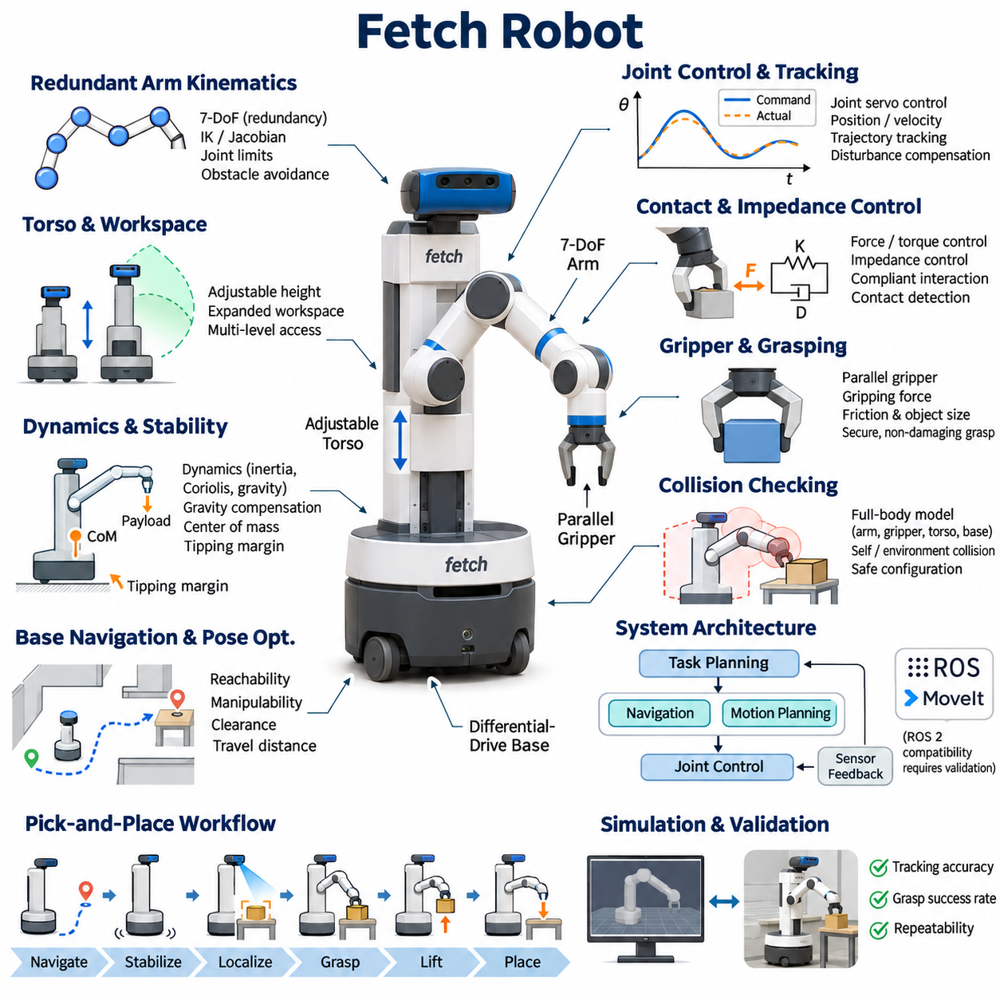
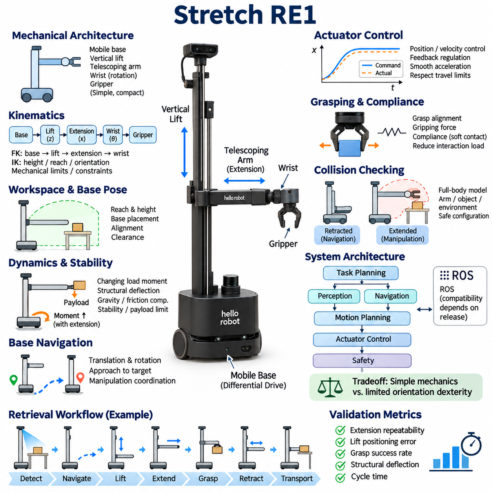
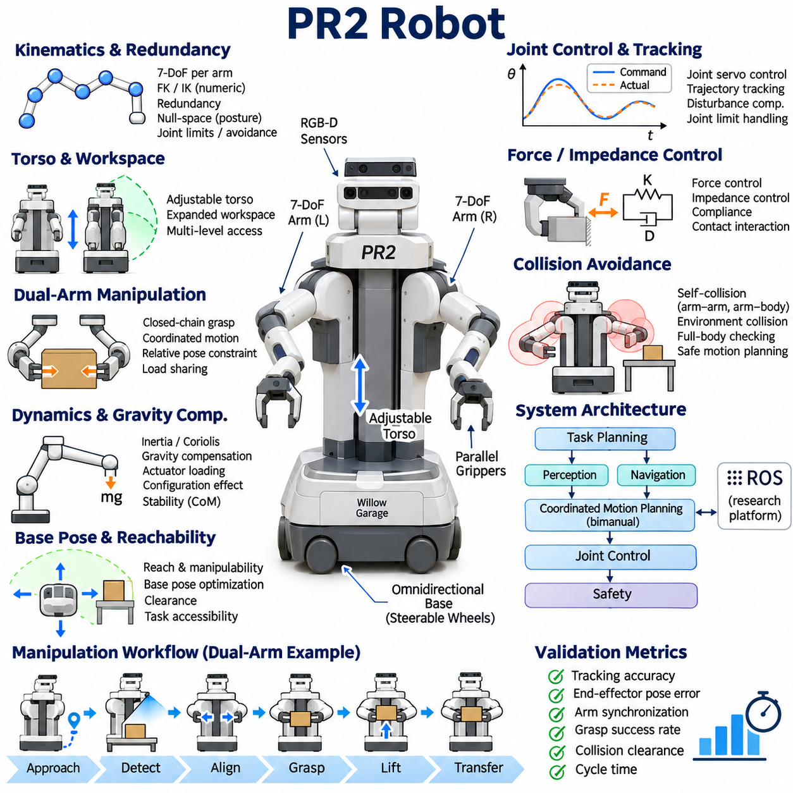
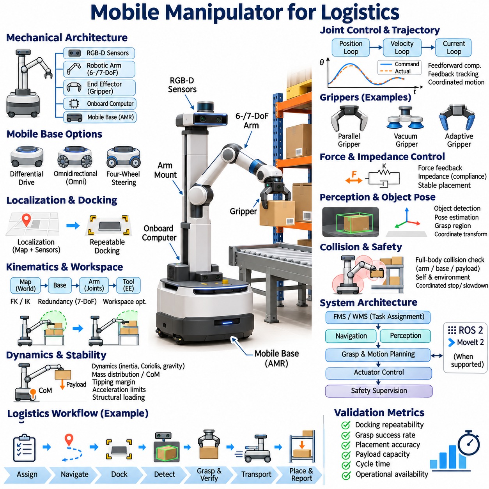
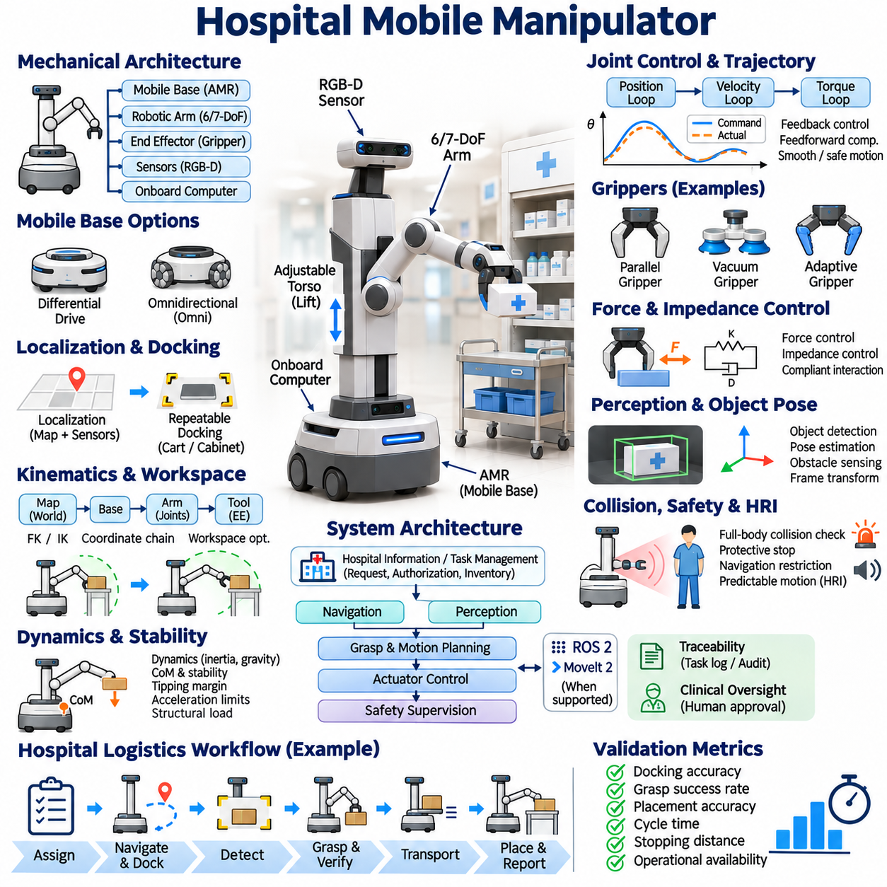
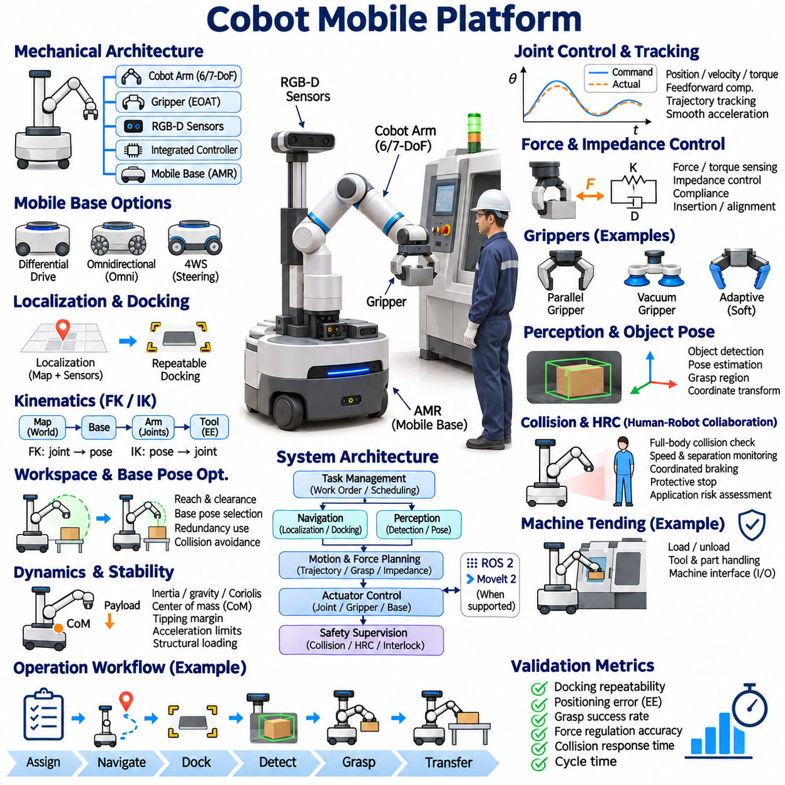
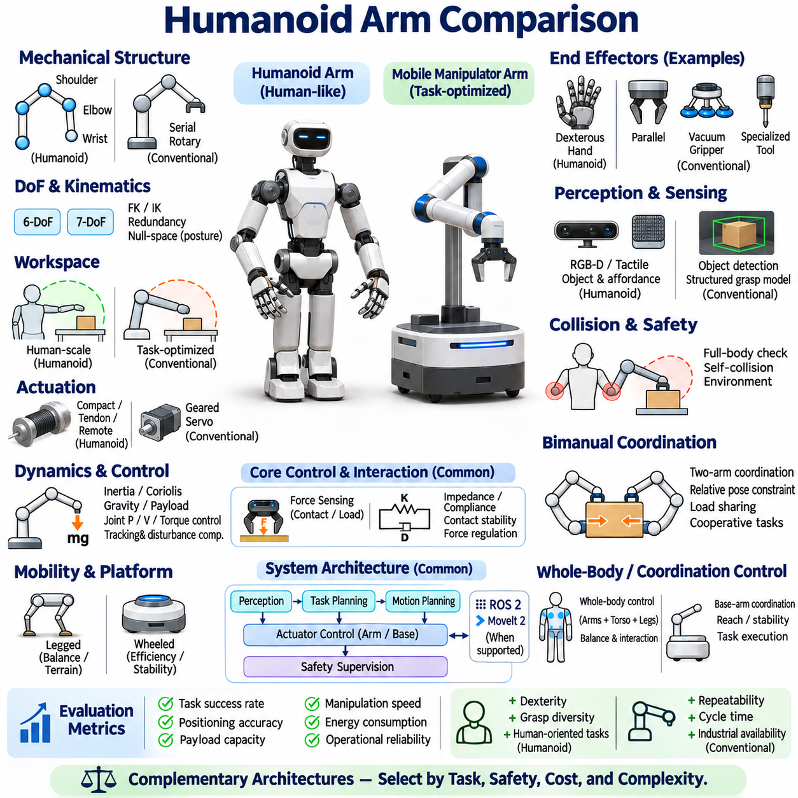

**Volume 02. Manipulator Mechanics and Control**

# Chapter 15. Case Studies

## 01 Fetch Robot

{width="7.268055555555556in" height="7.268055555555556in"}

The Fetch Robot is a representative research platform for mobile manipulation, combining an autonomous wheeled base, a vertically adjustable torso, a seven-degree-of-freedom robotic arm, and an adaptive parallel gripper. Developed by Fetch Robotics, the system demonstrates how mobility and manipulation can be integrated into a unified robotic architecture for object handling, laboratory automation, and human-centered environments.

The robot employs a differential-drive mobile base that provides planar translation and rotation through coordinated wheel velocities. Although the base operates with nonholonomic motion constraints, its mobility substantially expands the effective workspace of the manipulator. By repositioning the platform near a target object, the robot can perform manipulation tasks that would otherwise exceed the reach of a stationary robotic arm.

The seven-degree-of-freedom arm provides kinematic redundancy, allowing multiple joint configurations to achieve the same end-effector pose. This redundancy is valuable for obstacle avoidance, joint-limit management, and manipulation in constrained environments. Numerical inverse kinematics and Jacobian-based optimization can exploit the additional degree of freedom to improve dexterity while maintaining the desired tool position and orientation.

The adjustable torso introduces an additional positioning capability that extends the vertical workspace of the robotic arm. Its height can be coordinated with arm configuration and mobile base placement to access objects at different elevations. Effective workspace analysis therefore requires consideration of the combined kinematic chain, including the mobile platform, torso lift, arm joints, and end-effector geometry.

The mechanical architecture of the Fetch Robot illustrates the importance of balancing manipulation capability against mobile platform stability. Arm extension changes the overall center of mass and generates additional moments around the supporting base. Payload weight, joint configuration, acceleration, and contact forces must therefore be considered when evaluating tipping margins, structural loading, and safe operating conditions.

Joint-level control is responsible for accurately tracking commanded positions and velocities while respecting actuator limitations. The arm uses feedback from joint sensors to regulate motion and compensate for disturbances. In a typical manipulation controller, trajectory generation operates above lower-level servo loops, separating task planning from actuator regulation and allowing coordinated execution across multiple joints.

Dynamic modeling provides a mathematical foundation for understanding the relationship between joint motion and actuator torque. The manipulator dynamics include inertia, Coriolis and centrifugal effects, gravity, and friction. Model-based compensation can improve tracking accuracy, particularly during configurations involving significant gravitational loading or rapid changes in arm posture.

The Fetch Robot also illustrates the importance of gravity compensation in articulated manipulation. As the arm moves through different configurations, gravitational torque requirements change across its joints. A suitable controller estimates these configuration-dependent loads and compensates for them, reducing tracking errors and improving motion smoothness without requiring excessively aggressive feedback gains.

Force and torque considerations become particularly important when the robot interacts with objects or surrounding structures. Grasping, placement, and surface contact introduce external forces that influence manipulator behavior. Depending on the available sensing and control interfaces, contact-aware strategies can regulate interaction forces, detect unexpected resistance, or modify motion to prevent excessive loading.

Impedance control provides a useful conceptual framework for analyzing compliant interaction with the environment. Rather than enforcing perfectly rigid position tracking, an impedance controller establishes a desired relationship between displacement, velocity, and interaction force. Such behavior can improve contact stability during manipulation, although practical implementation depends on actuator characteristics, sensing availability, and controller accessibility.

The robot\'s parallel gripper supports object acquisition through controlled finger motion and gripping effort. Successful grasping depends on finger geometry, contact friction, object dimensions, and the relationship between gripping force and external loading. The gripper must provide sufficient holding capability while avoiding excessive pressure that could damage fragile objects or destabilize the manipulation process.

Grasp planning must account for the combined geometry of the object, gripper, and robotic arm. A feasible grasp pose is not necessarily reachable from every arm configuration or mobile base position. The planning process must evaluate inverse kinematics, collision constraints, joint limits, and approach directions before executing the final grasping motion.

Collision detection is essential because the Fetch Robot operates in environments containing furniture, equipment, objects, and potentially nearby people. Geometric models of the robot and surrounding workspace can be used to identify unsafe configurations. Collision checking must consider the complete articulated structure, including the arm, gripper, torso, and mobile base, rather than treating the manipulator independently.

The interaction between base navigation and arm manipulation introduces a coordination problem that is absent in conventional fixed-base industrial robots. Navigation determines where the robot can safely position itself, while manipulation planning determines whether the target remains reachable. A successful system must coordinate these decisions so that base placement supports collision-free, dexterous manipulation.

Base positioning can be formulated as an optimization problem involving reachability, manipulability, collision clearance, and travel distance. A location that minimizes navigation effort may produce an unfavorable arm configuration. Conversely, a position offering excellent manipulator dexterity may be difficult to access. Multi-objective optimization provides a systematic approach to balancing these competing requirements.

The Fetch Robot is closely associated with research using the Robot Operating System, where modular software components support perception, navigation, manipulation planning, and hardware control. Its research software ecosystem has historically used ROS interfaces and MoveIt-based planning. Integration with ROS 2 and MoveIt 2 requires appropriate drivers, configuration packages, and compatibility validation rather than assuming native support.

Hierarchical control is particularly suitable for the Fetch architecture because different subsystems operate at different timescales. High-level task planning selects manipulation objectives, motion planning generates feasible trajectories, and joint controllers execute those trajectories. Meanwhile, navigation and safety subsystems manage platform motion and environmental constraints, requiring explicit coordination between their operating states.

A representative pick-and-place sequence begins with navigation toward a target workspace, followed by base stabilization and object localization. The controller then computes a suitable grasp pose, evaluates inverse kinematics, and generates a collision-free arm trajectory. After grasp closure, the robot lifts the object, moves toward the placement configuration, and releases it under controlled conditions.

Experimental evaluation should distinguish individual subsystem performance from overall task success. Joint tracking accuracy, end-effector positioning error, grasp reliability, collision clearance, and navigation repeatability provide complementary measurements. Repeated trials under varying object positions and environmental conditions help identify whether failures originate from perception, planning, control, or mechanical limitations.

The Fetch platform also demonstrates why simulation and physical experimentation must be closely connected. Kinematic and dynamic models can predict reachability, joint loading, and collision behavior before hardware execution. However, simulation assumptions concerning friction, actuator response, object contact, and localization accuracy require validation against physical measurements to establish reliable real-world performance.

An important engineering lesson from the Fetch Robot is that additional degrees of freedom increase flexibility but also introduce computational and control complexity. Redundant inverse kinematics, whole-body coordination, and collision avoidance require careful algorithm design. The resulting flexibility is valuable when the robot must operate across diverse environments rather than repeat a single predefined industrial motion.

The Fetch Robot ultimately provides a practical reference for understanding integrated mobile manipulator mechanics and control. Its architecture connects redundant arm kinematics, actuator dynamics, grasp mechanics, workspace optimization, and hierarchical software control. These principles extend beyond the specific platform and provide a foundation for developing reliable mobile manipulation systems for logistics, research, and industrial automation.

## 02 Stretch RE1

{width="7.268055555555556in" height="7.268055555555556in"}

The Stretch RE1 robot, developed by Hello Robot, represents a distinctive approach to mobile manipulation through a compact, lightweight, and mechanically simplified architecture. Unlike conventional mobile manipulators equipped with multi-joint industrial arms, Stretch RE1 combines a mobile base, vertical lift, telescoping arm, and gripper. This configuration emphasizes practical reachability, accessibility, and efficient operation in human environments.

The mechanical design of Stretch RE1 prioritizes a small physical footprint while maintaining a useful manipulation workspace. Its compact mobile base allows navigation through residential spaces, narrow passages, and environments containing furniture. Rather than relying on a large articulated arm, the robot uses coordinated linear and rotational motions to position its end effector, reducing mechanical complexity and simplifying several aspects of motion planning.

A defining feature of Stretch RE1 is its telescoping arm, which extends horizontally to reach objects beyond the immediate boundaries of the mobile platform. The arm provides a controllable extension axis that can be combined with vertical lift motion and mobile base positioning. This arrangement enables the robot to access tables, shelves, and household objects while maintaining a relatively compact mechanical structure when the arm is retracted.

The vertical lift mechanism provides an additional degree of freedom for positioning the arm at different heights. By coordinating lift displacement with horizontal extension, the robot can reach objects located across a substantial vertical workspace. This architecture separates vertical positioning from horizontal reaching, allowing many manipulation tasks to be represented through relatively simple geometric relationships and coordinated actuator commands.

Stretch RE1 employs a nontraditional manipulation architecture in which the mobile base contributes directly to end-effector positioning. Base translation and rotation can compensate for the limited orientation flexibility of the telescoping arm. Consequently, the robot must coordinate navigation and manipulation rather than treating them as independent functions, particularly when approaching objects or aligning the gripper with target surfaces.

The kinematic model of Stretch RE1 differs significantly from that of a conventional six- or seven-degree-of-freedom robotic arm. Its manipulation workspace is primarily shaped by the vertical lift, telescoping extension, wrist orientation, and mobile base configuration. Forward kinematics can be constructed by combining transformations from the base frame through the lift, arm, wrist, and gripper to determine the final end-effector pose.

Inverse kinematics for Stretch RE1 can often be simplified because several major positioning variables correspond directly to linear actuator displacements. Desired end-effector height and horizontal reach can be mapped to lift and extension commands within mechanical limits. However, complete pose control still requires consideration of wrist orientation, base placement, collision constraints, and the restricted degrees of freedom available to the mechanism.

The robot illustrates an important tradeoff between mechanical simplicity and manipulation dexterity. A telescoping arm can perform many practical reaching tasks with fewer actuated joints than a conventional articulated manipulator. However, its ability to approach objects from arbitrary orientations is limited. Tasks requiring complex tool orientation or movement around obstacles may therefore depend more heavily on repositioning the mobile platform.

Dynamic behavior is influenced by the changing extension of the telescoping arm and the distribution of payload mass. As the arm extends, the load moment acting on the supporting structure increases, potentially affecting positioning accuracy and platform stability. Dynamic analysis must consider actuator forces, gravitational loading, structural deflection, and the relationship between extension distance and allowable payload.

The lightweight construction of Stretch RE1 makes gravity compensation and friction management important aspects of actuator control. Vertical lifting requires sufficient force to support the arm assembly and payload, while horizontal extension must overcome mechanical resistance and external disturbances. Appropriate feedforward compensation and feedback regulation can improve tracking performance without requiring unnecessarily high control gains.

Joint-level control in Stretch RE1 focuses on coordinated regulation of linear actuators, rotational joints, and the mobile drive system. Position and velocity feedback allow controllers to execute commanded movements while respecting mechanical travel limits. Smooth acceleration and deceleration are particularly important during arm extension because abrupt movements can introduce vibration, increase structural loading, and reduce end-effector positioning accuracy.

The gripper serves as the primary interface between the robot and manipulated objects. Successful grasping requires suitable finger placement, contact geometry, and gripping force. Because the arm architecture offers limited orientation flexibility compared with industrial manipulators, object approach strategies must account for gripper alignment and accessible grasp surfaces. Base positioning and wrist adjustment can improve the feasibility of these grasps.

Compliance is especially valuable when Stretch RE1 interacts with household furniture, containers, doors, or other objects. Small positioning errors can generate unexpected contact forces during grasping and placement. Mechanical compliance, force-sensitive behavior, and carefully regulated actuator motion can reduce interaction loads, although the available control strategies depend on the installed hardware and software configuration.

Collision avoidance presents unique challenges because the telescoping arm can extend into spaces that are not occupied by the mobile base. A navigation path that is safe for the retracted robot may become unsafe when the arm extends near furniture or walls. Motion planning must therefore account for the complete robot geometry and distinguish between navigation configurations and manipulation configurations.

Workspace optimization is particularly important for Stretch RE1 because the available arm motions are constrained by its simplified mechanical structure. Selecting an appropriate base location can significantly improve reachability and grasp alignment. An effective optimization strategy considers arm extension, lift height, wrist orientation, obstacle clearance, and base accessibility to identify configurations suitable for the intended manipulation task.

The Stretch research platform has been associated with ROS-based software development, enabling integration of perception, navigation, manipulation, and hardware control. Modular interfaces allow developers to implement task-level behaviors while accessing lower-level actuator commands. Compatibility with particular ROS distributions, ROS 2 components, or MoveIt 2 configurations depends on the software release and integration packages used.

Hierarchical control provides a practical framework for coordinating the different subsystems of Stretch RE1. High-level planning determines the target object and manipulation objective, while motion planning selects feasible base and arm configurations. Lower-level controllers regulate actuator movement, and safety supervision monitors operating limits. This separation supports structured task execution and simplifies debugging.

A representative object retrieval task begins with detecting and localizing the target object. The robot navigates to an accessible position, adjusts its lift height, extends the telescoping arm, and aligns the gripper with a suitable grasp location. After closing the gripper, the arm retracts to reduce its occupied workspace, allowing the robot to transport the object toward the desired destination.

Experimental validation should evaluate both manipulation performance and the effects of mechanical simplification. Relevant measurements include extension repeatability, lift positioning error, grasp success rate, payload-dependent deflection, and task completion time. Testing across different object heights, distances, and orientations helps determine the practical boundaries of the robot\'s reachable and usable workspace.

The Stretch RE1 case study demonstrates that effective mobile manipulation does not always require a highly articulated robotic arm. By combining a compact mobile platform with linear reaching mechanisms and coordinated control, the robot provides a practical alternative for selected service and assistive applications. Its engineering principles highlight the importance of matching mechanical architecture, control complexity, and workspace requirements to the intended task.

## 03 PR2 Robot

{width="7.268055555555556in" height="7.268055555555556in"}

The PR2 robot, developed by Willow Garage, represents a landmark research platform in mobile manipulation and service robotics. Its architecture combines an omnidirectional mobile base, an adjustable torso, two seven-degree-of-freedom robotic arms, and parallel grippers. Designed for research in human environments, PR2 demonstrates how mobility, redundant manipulation, perception, and coordinated control can be integrated into a versatile robotic system.

A defining characteristic of PR2 is its dual-arm configuration, which enables coordinated manipulation of objects and tools. Each arm provides seven degrees of freedom, allowing multiple joint configurations to achieve a desired end-effector pose. This kinematic redundancy supports obstacle avoidance, posture optimization, and manipulation in constrained spaces, while the two-arm arrangement enables tasks that require simultaneous grasping or object stabilization.

The omnidirectional mobile base allows PR2 to translate and rotate with greater maneuverability than conventional differential-drive platforms. Its steerable wheel modules support motion in different planar directions, enabling precise positioning near tables, shelves, and workstations. This mobility expands the effective manipulation workspace and reduces the need for complex arm configurations when approaching objects from different directions.

PR2 incorporates a vertically adjustable torso that changes the height of both robotic arms relative to the surrounding environment. Coordinating torso motion with base positioning and arm configuration increases the range of accessible objects. Workspace analysis must therefore consider the complete kinematic structure, including the mobile base, torso lift, both manipulators, and their end effectors.

The kinematic model of each PR2 arm consists of a serial chain of revolute joints connected through rigid links. Forward kinematics determines the end-effector pose from measured joint angles using successive coordinate transformations. Accurate modeling requires consistent coordinate frames, calibrated joint offsets, and correct link dimensions, particularly when the robot performs coordinated manipulation involving both arms.

Inverse kinematics presents additional challenges because each arm contains more degrees of freedom than are required to specify a general six-dimensional end-effector pose. Numerical solvers can exploit this redundancy to satisfy joint limits, avoid singularities, and maintain collision clearance. Null-space optimization provides a mechanism for adjusting arm posture without significantly disturbing the primary end-effector task.

Dual-arm manipulation introduces closed-chain constraints when both grippers hold the same rigid object. The relative transformations between the two end effectors must remain consistent with the object\'s geometry. Coordinated motion planning must preserve these constraints while respecting joint limits and collision boundaries, preventing excessive internal forces that could damage the object or overload the manipulators.

Dynamic modeling is particularly important for PR2 because its two arms can move simultaneously while carrying different loads. Joint torques depend on inertia, gravitational forces, Coriolis effects, and interactions between linked structures. The changing configuration of the arms and torso also influences the overall mass distribution, requiring careful evaluation of actuator loading and mobile platform stability.

PR2 employs joint-level sensing and control to regulate articulated motion. Position feedback, velocity estimation, and actuator effort information support trajectory tracking and disturbance compensation. Its research-oriented control architecture enables investigation of advanced control methods while maintaining lower-level mechanisms for actuator regulation, joint-limit enforcement, and coordinated trajectory execution.

Gravity compensation plays a significant role in controlling PR2\'s articulated arms. As joint configurations change, the gravitational torque required to support each link and attached payload varies. Model-based compensation can reduce steady-state tracking errors and improve motion smoothness, particularly during slow manipulation or when holding objects at extended arm configurations.

Force-sensitive manipulation is essential when PR2 interacts with uncertain environments. Contact forces arise during grasping, pushing, pulling, and object placement. Joint effort measurements and suitable estimation methods can provide information about external loading, while force-aware control strategies can modify commanded motion to reduce excessive interaction forces and improve task reliability.

Impedance and compliance control provide useful approaches for regulating PR2\'s physical interaction with objects and people. By defining desired relationships between motion and external force, a controller can allow limited displacement during contact rather than enforcing perfectly rigid positioning. Such strategies are valuable for manipulation tasks involving uncertain object geometry, contact transitions, or small alignment errors.

The parallel grippers on PR2 provide controlled object grasping through coordinated finger motion. Grasp success depends on contact geometry, friction, object mass, and the relationship between applied gripping effort and external disturbances. In dual-arm tasks, gripper control must also account for load sharing and object stability, especially when manipulating large or irregularly shaped objects.

Collision detection is a major consideration because PR2 contains two articulated arms operating within overlapping workspaces. The planning system must evaluate collisions between each arm and the environment, between the two arms, and between the manipulators and the robot\'s own structure. Self-collision checking and continuous environment monitoring are therefore essential for reliable coordinated motion.

Base positioning and workspace optimization strongly influence PR2\'s manipulation performance. A suitable mobile base location should provide adequate reachability for both arms while maintaining favorable joint configurations and collision clearance. Optimization criteria may include manipulability, joint-limit margins, navigation accessibility, and the feasibility of coordinated bimanual operations.

PR2 played an influential role in the development of the Robot Operating System and the broader open-source robotics ecosystem. Its software architecture supported modular integration of perception, navigation, manipulation planning, and hardware control. Historically, PR2 research commonly used ROS-based tools and motion-planning frameworks, providing an important foundation for later developments in robotic software integration.

Hierarchical control is well suited to PR2 because its subsystems operate at different levels of abstraction and timing. High-level task planning determines manipulation objectives, motion planning generates coordinated trajectories, and lower-level controllers regulate joint motion. Navigation, perception, and safety functions operate alongside these layers, requiring synchronization and clear management of operating states.

A representative PR2 manipulation task may involve approaching a table, identifying an object, positioning both arms, and executing a coordinated grasp. The robot must maintain consistent object geometry while lifting or transferring the object. Successful execution requires integration of perception, inverse kinematics, collision checking, trajectory synchronization, and controlled gripping forces.

Experimental evaluation of PR2 should examine both individual manipulator performance and coordinated system behavior. Relevant metrics include joint tracking accuracy, end-effector positioning error, dual-arm synchronization, grasp success rate, collision clearance, and task completion time. Repeated experiments under varying payloads and object configurations help identify limitations in mechanical design, planning, and control.

The PR2 case study demonstrates the engineering advantages and challenges of highly articulated mobile manipulation. Dual redundant arms provide substantial flexibility, but they also increase computational complexity, coordination requirements, and mechanical cost. The platform illustrates how kinematics, dynamics, force control, collision avoidance, and hierarchical software architecture must operate together to achieve reliable manipulation in complex environments.

## 04 Mobile Manipulator for Logistics

{width="7.268055555555556in" height="7.268055555555556in"}

A mobile manipulator for logistics integrates an autonomous mobile robot (AMR) with a robotic arm to perform material handling tasks across warehouses, distribution centers, and manufacturing facilities. Unlike conventional AMRs that primarily transport goods, this system can autonomously approach objects, grasp them, transfer them, and place them at designated locations. The integration of mobility and manipulation enables more flexible automation of logistics operations that traditionally require separate transport and handling equipment.

The mechanical architecture typically consists of a mobile base, a robotic arm, an end effector, perception sensors, and an onboard computing system. The mobile base provides autonomous navigation and positioning, while the robotic arm performs object manipulation. The overall mechanical design must consider payload capacity, structural rigidity, center of gravity, and vibration characteristics. These factors directly influence manipulation accuracy and operational stability, particularly when handling heavy or irregularly shaped objects.

The mobile base is responsible for transporting the manipulator between storage locations, conveyor systems, workstations, and delivery points. Differential-drive, omnidirectional, and four-wheel steering configurations can be selected according to floor conditions, maneuverability requirements, and payload capacity. Accurate localization and repeatable docking are particularly important because the robotic arm requires a sufficiently stable reference position before executing precision manipulation tasks.

The robotic arm provides the positioning capability required to retrieve and place logistics items. Depending on the application, six- or seven-degree-of-freedom manipulators may be employed to reach objects at different heights and orientations. Kinematic redundancy can improve obstacle avoidance and provide alternative joint configurations when shelves, containers, or surrounding equipment restrict the available workspace. The arm structure must also maintain sufficient stiffness under varying payload conditions.

Forward and inverse kinematics are essential for coordinating the mobile platform and robotic arm. Forward kinematics determines the end-effector pose from joint positions and the current mobile base configuration. Inverse kinematics calculates the required joint positions for a desired grasp or placement pose. The complete transformation chain must account for the relationship between the map, mobile base, arm mounting frame, robot links, and end effector to maintain consistent positioning accuracy.

Workspace optimization is particularly important in logistics environments because storage racks, pallets, conveyors, and containers create spatial constraints. The mobile base should approach the target from a position that provides sufficient arm reach while minimizing joint extension, singularity risks, and collision possibilities. Selecting an appropriate base pose can improve manipulator dexterity, reduce unnecessary movements, and increase the probability of successful object retrieval.

Dynamic performance depends on the combined motion of the mobile base and manipulator. Arm acceleration, payload mass, joint configuration, and mobile platform movement influence the overall center of gravity and structural loading. When the arm extends while carrying a heavy object, the resulting moment can affect platform stability. Motion planning should therefore consider payload-dependent acceleration limits, tipping margins, and mechanical stress throughout the manipulation sequence.

Joint-level control regulates the position, velocity, and torque of the robotic arm. Cascaded control architectures commonly combine position, velocity, and current regulation to achieve stable actuator behavior. Feedforward compensation can improve trajectory tracking by accounting for predictable dynamic effects, while feedback control corrects deviations caused by disturbances, mechanical variations, and payload changes. Coordinated joint motion is necessary to achieve smooth grasping and placement operations.

Grasping is one of the most challenging aspects of logistics manipulation because transported objects vary in size, shape, weight, surface material, and packaging condition. Parallel grippers, vacuum grippers, and adaptive end effectors can be selected according to the object characteristics. The gripping mechanism must provide sufficient holding force while avoiding package deformation or object damage. Reliable grasp execution also requires suitable contact geometry and accurate alignment between the gripper and target object.

Force control and compliance are important when objects are placed inside containers, positioned on shelves, or transferred between conveyor systems. Small localization errors can cause unintended contact between the object, gripper, and surrounding structures. Force feedback and impedance control can help regulate contact behavior, reduce excessive interaction forces, and improve placement reliability. These techniques are particularly useful when object dimensions or environmental geometry are not perfectly known.

Perception systems provide the information required to identify and localize logistics objects. RGB cameras, depth sensors, and three-dimensional vision systems can estimate object dimensions, surface geometry, and graspable regions. The perception pipeline must transform detected object poses into the robot coordinate frame and compensate for changes in camera position or mobile base localization. Accurate object localization is essential for generating feasible grasp trajectories.

Collision detection must consider the complete mobile manipulation system rather than the robotic arm alone. Potential collisions can occur between the arm, mobile base, storage racks, pallets, transported objects, and nearby workers. Geometric collision checking can evaluate planned trajectories before execution, while real-time monitoring can detect unexpected obstacles. Safety mechanisms should coordinate navigation stops, arm motion restrictions, and emergency responses according to the operational risk.

A typical logistics operation begins when the fleet management system assigns a transport and handling task. The mobile manipulator navigates toward the designated storage area and establishes a suitable docking position. Its perception system identifies the target object, estimates its pose, and determines a feasible grasp configuration. The manipulator then approaches the object, closes the gripper, verifies successful acquisition, and transports the object to the destination.

At the delivery location, the robot aligns its mobile base with the workstation, conveyor, or storage position. The manipulator calculates a collision-free placement trajectory and adjusts its end-effector orientation according to the target geometry. After controlled placement and gripper release, the system verifies task completion and reports the result to the fleet management or warehouse management system. This closed-loop operation reduces dependence on fixed material handling equipment.

The software architecture generally follows a hierarchical control structure. Fleet management assigns tasks and coordinates multiple robots, while the navigation subsystem manages localization, path planning, and docking. The manipulation subsystem handles object perception, grasp planning, inverse kinematics, and trajectory execution. Lower-level controllers regulate the actuators, while the safety subsystem monitors operating conditions and prevents hazardous actions. ROS 2 and MoveIt 2 can provide software frameworks for implementing these functions when supported by the selected hardware and drivers.

Performance evaluation should consider both transportation and manipulation capabilities. Navigation accuracy, docking repeatability, grasp success rate, placement accuracy, payload capacity, cycle time, and operational availability provide important evaluation metrics. Integrated testing should also measure task completion reliability under different object configurations, environmental conditions, and payload distributions. Evaluating the complete workflow is more meaningful than measuring mobile navigation and robotic arm performance independently.

The mobile manipulator for logistics demonstrates how autonomous transportation and robotic handling can be combined into a flexible material handling solution. Its effectiveness depends on the coordination of mechanical design, kinematics, dynamics, perception, grasping, collision avoidance, and hierarchical control. The central engineering challenge is not simply to attach a robotic arm to an AMR, but to optimize the complete system so that navigation and manipulation operate as one coordinated process.

## 05 Hospital Mobile Manipulator

{width="7.268055555555556in" height="7.268055555555556in"}

A hospital mobile manipulator integrates an autonomous mobile robot (AMR) with a robotic arm to support material handling, clinical logistics, and selected assistance tasks in healthcare environments. Unlike conventional hospital delivery robots that primarily transport supplies, a mobile manipulator can interact physically with objects, drawers, storage compartments, and medical equipment. Its purpose is to reduce repetitive manual work while improving operational efficiency and supporting healthcare professionals.

The mechanical architecture typically consists of a mobile base, a robotic arm, an end effector, perception sensors, and an onboard computing platform. The mobile base provides autonomous movement through corridors, patient rooms, and clinical workspaces, while the robotic arm performs object handling and interaction tasks. The design must balance payload capacity, structural stability, compact dimensions, and maneuverability because hospital environments contain narrow passages and frequently changing obstacles.

The mobile platform must operate reliably in environments shared by patients, medical staff, visitors, and other autonomous systems. Differential-drive and omnidirectional configurations can provide different advantages depending on corridor width, turning requirements, and docking accuracy. Accurate localization is essential when approaching medication carts, supply cabinets, bedside tables, and service stations. The robot must also maintain predictable motion to avoid disturbing nearby people.

The robotic arm provides the manipulation capability required for tasks such as retrieving supplies, opening accessible storage compartments, handling containers, and transferring lightweight objects. Six- or seven-degree-of-freedom manipulators can provide sufficient flexibility for reaching objects at different heights and orientations. However, arm selection must consider payload, reach, mechanical stiffness, speed, and the physical safety requirements of close interaction with people.

Kinematic modeling is fundamental to coordinating the mobile base and robotic arm. Forward kinematics calculates the end-effector pose from the joint positions and the current base configuration, while inverse kinematics determines the joint movements required to reach a target. The complete coordinate transformation chain must include the hospital map, mobile base, arm mounting frame, robot links, sensors, and end effector to maintain accurate positioning during manipulation.

Workspace optimization is particularly important in hospitals because furniture, beds, medical equipment, storage cabinets, and people create complex spatial constraints. The mobile base should approach a target from a position that provides sufficient arm reach without requiring excessive joint extension or unfavorable configurations. Selecting an appropriate base pose improves manipulability, reduces collision risks, and helps the robot perform tasks without unnecessarily repositioning itself.

Dynamic modeling must account for the combined mechanical behavior of the mobile platform and manipulator. Arm acceleration, payload mass, joint configuration, and base movement influence the overall center of gravity and structural loading. When the arm extends while carrying an object, the resulting moment can affect platform stability. Motion planning should therefore limit acceleration and maintain appropriate stability margins throughout manipulation.

Joint-level control regulates the position, velocity, and torque of the robotic arm. Position feedback and velocity estimation support accurate trajectory tracking, while feedforward compensation can reduce errors caused by predictable dynamic effects. Smooth motion is especially important in hospitals because sudden acceleration, vibration, or unexpected arm movement may disturb nearby patients or create unsafe interactions with medical equipment.

Grasping requires careful consideration of the variety of objects encountered in healthcare environments. Medical supply packages, bottles, containers, instruments, and disposable materials have different dimensions, weights, and surface properties. Parallel grippers, vacuum grippers, and adaptive end effectors can be selected according to the handling requirements. The gripping mechanism must provide sufficient holding force without damaging packaging or compromising the integrity of medical supplies.

Force control and compliance are important when manipulating objects near patients, medical devices, and furniture. Unexpected contact can occur because of localization errors, object movement, or inaccurate estimates of surrounding geometry. Force feedback and impedance control can regulate interaction forces and allow controlled movement during contact. These capabilities help reduce excessive loading and improve the reliability of object placement and physical interaction.

Perception systems enable the robot to recognize objects, estimate their positions, and understand the surrounding workspace. RGB cameras, depth sensors, and three-dimensional vision systems can support object detection, pose estimation, and obstacle recognition. Sensor information must be transformed into consistent robot coordinate frames and updated as the mobile platform moves. Reliable perception is essential when the robot approaches partially occluded objects or operates in changing clinical environments.

Collision detection must consider the entire mobile manipulation system, including the base, robotic arm, gripper, and transported objects. Hospitals contain numerous obstacles, such as beds, wheelchairs, carts, equipment stands, and people. Geometric collision checking can evaluate planned trajectories, while real-time sensing monitors unexpected changes in the environment. Safety supervision should coordinate navigation restrictions, arm motion limitations, protective stops, and emergency responses.

A representative hospital logistics task begins when a hospital information or task management system assigns a delivery or retrieval request. The mobile manipulator navigates to a designated supply area, identifies the target object, and positions its base for manipulation. The perception system estimates the object\'s pose, and the motion planner generates a collision-free grasp trajectory. After confirming successful acquisition, the robot transports the object to the requested destination.

At the destination, the robot establishes a suitable position near a workstation, storage area, or designated delivery location. The manipulator executes a controlled placement trajectory and releases the object after verifying the target position. The system then reports task completion to the hospital management platform. This process can support internal logistics and reduce the time healthcare professionals spend transporting routine supplies between departments.

Human-robot interaction (HRI) is a critical consideration because hospital robots operate in environments where people may be vulnerable, distracted, or unfamiliar with autonomous systems. The robot should communicate its intentions through predictable movement, visual indicators, audible signals, or user interfaces. Its behavior must be understandable and nonintrusive, particularly when navigating around patients or approaching occupied rooms.

The software architecture generally follows a hierarchical control structure. The task management layer receives requests and determines operational priorities, while the navigation subsystem handles localization, path planning, and docking. The manipulation subsystem performs object recognition, grasp planning, inverse kinematics, and trajectory execution. Lower-level controllers regulate actuators, while the safety subsystem continuously monitors operating conditions. ROS 2 and MoveIt 2 can provide suitable software frameworks when supported by the selected hardware and drivers.

Hospital integration introduces requirements beyond conventional robotic manipulation. The system may need to communicate with hospital information systems, inventory platforms, medication management applications, and facility management infrastructure. Access control, task authorization, communication reliability, and operational traceability must be considered. Medical supplies and medication-related operations require appropriate verification procedures, and robotic handling should not replace clinical judgment or authorized healthcare responsibilities.

Performance evaluation should consider navigation reliability, docking accuracy, grasp success rate, placement accuracy, payload capacity, task completion time, and operational availability. Safety-related measurements should include stopping distance, obstacle detection performance, collision avoidance reliability, and the consistency of protective responses. Testing should cover realistic hospital conditions, including crowded corridors, changing furniture arrangements, reflective surfaces, and temporary obstacles.

The hospital mobile manipulator demonstrates how autonomous mobility and physical manipulation can support healthcare logistics and selected assistance activities. Its effectiveness depends on the integration of mechanical design, kinematics, dynamics, perception, grasping, collision avoidance, human-robot interaction, and hierarchical control. The central engineering challenge is to achieve reliable task execution while maintaining strict requirements for human safety, environmental adaptability, operational reliability, and compatibility with clinical workflows.

## 06 Cobot Mobile Platform

{width="7.268055555555556in" height="7.268055555555556in"}

A collaborative mobile manipulator combines an autonomous mobile robot (AMR) with a collaborative robotic arm to perform manipulation tasks in shared human workspaces. Unlike traditional industrial robots installed in fixed safety enclosures, this system is designed to move between workstations and interact with human operators. Its architecture enables flexible material handling, machine tending, assembly assistance, and inspection operations while supporting closer cooperation between people and robotic systems.

The mechanical architecture typically consists of a mobile base, a collaborative robotic arm, an end effector, perception sensors, and an integrated control platform. The mobile base provides autonomous transportation and positioning, while the collaborative arm performs physical interaction with objects and workstations. The mechanical structure must balance payload capacity, reach, structural stiffness, and overall stability. Particular attention is required because arm movement and payload changes can influence the stability of the mobile platform.

The mobile base provides the mobility required to serve multiple workstations without installing a dedicated robot at each location. Differential-drive and omnidirectional configurations can be selected according to workspace dimensions, floor conditions, and maneuverability requirements. Accurate localization and repeatable docking are essential because collaborative manipulation frequently requires the robot to position its end effector near tools, fixtures, machine interfaces, and human work areas.

The collaborative robotic arm is designed to support physical interaction with people and surrounding equipment. Compared with conventional industrial manipulators, collaborative arms commonly incorporate additional safety-related functions, such as force and torque monitoring, speed limitation, and collision response. These capabilities can support collaborative applications, although the complete system must be evaluated as an integrated mobile robot rather than assuming that a collaborative arm automatically makes the entire platform safe.

Kinematic modeling is essential for coordinating the mobile base and collaborative arm. Forward kinematics determines the end-effector pose from the measured joint positions and mobile base configuration. Inverse kinematics calculates the joint configuration required to reach a target position and orientation. The complete transformation chain must include the map frame, mobile base, arm mounting frame, individual links, and end effector to maintain consistent positioning accuracy during mobile manipulation.

Workspace optimization determines suitable mobile base positions for different collaborative tasks. A robot may need to approach a workstation from several directions depending on fixture placement, operator location, and object geometry. The selected base pose should provide sufficient arm reach while maintaining favorable joint configurations and collision clearance. Optimizing base placement can reduce unnecessary arm extension and improve accessibility for both the robot and human operators.

Dynamic modeling must consider the interaction between arm movement, payload mass, and mobile platform stability. When the collaborative arm extends or accelerates, its motion changes the distribution of mass and generates reaction forces on the mobile base. These effects become more significant when the robot handles heavy objects or performs movements near the limits of its workspace. Appropriate acceleration limits and stability monitoring are therefore necessary during coordinated operation.

Joint-level control regulates the position, velocity, and torque of the collaborative arm. Position and velocity feedback support accurate trajectory tracking, while feedforward compensation improves response to predictable dynamic effects. In collaborative applications, smooth acceleration and deceleration are particularly important because sudden movements can create unexpected interactions with nearby operators. Control parameters should balance positioning accuracy, motion responsiveness, and safe physical interaction.

Force control is an important capability for collaborative manipulation because many tasks involve direct contact with objects, fixtures, or human-operated equipment. Force and torque sensing can identify external loading and provide information about contact conditions. Force-feedback control can regulate applied forces during insertion, alignment, pressing, and other contact-intensive operations. The controller must distinguish intended task forces from unexpected external disturbances.

Impedance and compliance control provide additional flexibility during physical interaction. An impedance controller defines a desired relationship between end-effector displacement, velocity, and interaction force. This allows the manipulator to respond more naturally when encountering uncertain contact conditions or small alignment errors. Compliance is particularly useful during assembly assistance, component insertion, and shared manipulation tasks where perfectly rigid position control may produce excessive contact forces.

End-effectors and grippers must be selected according to the intended collaborative task. Parallel grippers can handle rigid components, while vacuum grippers are suitable for compatible flat-surface objects. Adaptive and soft grippers can accommodate variations in object geometry and reduce the risk of damaging sensitive materials. Gripper selection must consider gripping force, payload, contact geometry, tool mass, and the safety of nearby human operators.

Perception systems support environmental understanding and collaborative task execution. RGB cameras, depth sensors, and three-dimensional vision systems can identify objects, estimate their poses, detect obstacles, and monitor human presence. The perception system must continuously update environmental information because operators, tools, and workpieces may move during operation. Accurate sensor calibration and coordinate transformation are necessary to maintain consistency between perception, navigation, and manipulation.

Collision detection must consider interactions between the robotic arm, mobile base, end effector, transported objects, surrounding equipment, and people. Traditional geometric collision checking can evaluate planned trajectories, while real-time monitoring detects unexpected obstacles or contact events. Safety functions should coordinate arm stopping, mobile base braking, speed reduction, and protective responses. The combined system must maintain safe behavior even when the mobile platform and arm operate simultaneously.

Human-robot collaboration requires predictable and understandable robot behavior. Operators should be able to recognize the robot\'s movement intentions through visual indicators, audible signals, or user interfaces. The system should support appropriate speed and separation monitoring, controlled stopping, and safe recovery from unexpected interactions. Risk assessment must consider the complete application, including tools, payloads, workpiece geometry, mobile motion, and the surrounding workplace.

A representative collaborative operation begins when the robot receives a task assignment and navigates toward a designated workstation. After reaching a suitable docking position, the perception system identifies the target component and estimates its pose. The collaborative arm then approaches the object, performs the required grasp or contact operation, and transfers the component to the operator or another workstation. During the task, navigation and manipulation controllers coordinate their operating states.

Machine tending is another important application of collaborative mobile platforms. The robot can transport components between workstations and interact with machine interfaces, loading areas, or unloading positions. Accurate base positioning is necessary to align the arm with machine fixtures, while force-aware manipulation can support controlled insertion and removal. Safety interlocks and machine-state communication must prevent the robot from entering hazardous operating zones.

The software architecture generally follows a hierarchical control structure. The task management layer coordinates work orders and workstation assignments, while the navigation subsystem handles localization, path planning, and docking. The manipulation subsystem manages perception, inverse kinematics, trajectory planning, and force control. Lower-level controllers regulate the actuators, and the safety subsystem monitors operating conditions. ROS 2 and MoveIt 2 can provide implementation frameworks when compatible hardware interfaces and drivers are available.

Performance evaluation should consider mobility, manipulation accuracy, collaborative safety, and operational efficiency. Important metrics include navigation accuracy, docking repeatability, end-effector positioning error, grasp success rate, force regulation accuracy, collision response time, and task completion time. Testing should include different payloads, workstation configurations, operator positions, and environmental conditions to evaluate the reliability of the complete mobile collaborative system.

The collaborative mobile platform demonstrates how mobility and collaborative manipulation can extend automation beyond conventional fixed industrial workcells. Its effectiveness depends on the integration of mechanical design, kinematics, dynamics, force control, perception, collision detection, and human-robot interaction. The central engineering challenge is to coordinate the mobile base and collaborative arm while maintaining predictable behavior, stable manipulation, and application-level safety in continuously changing human workspaces.

## 07 Humanoid Arm Comparison

{width="7.268055555555556in" height="7.268055555555556in"}

A humanoid robotic arm and a conventional mobile manipulator arm share fundamental principles of kinematics, dynamics, and control, but differ in mechanical architecture, intended functionality, and system integration. Humanoid arms are designed to approximate human upper-limb motion, while conventional manipulators prioritize task-specific reach, payload, accuracy, and efficiency. Comparing these architectures helps identify appropriate solutions for industrial automation, service robotics, and human-centered manipulation.

The mechanical structure of a humanoid arm typically includes shoulder, elbow, and wrist joints arranged to reproduce human-like movement. A conventional industrial manipulator generally uses serial rotary joints optimized for positioning and orientation. Both architectures may employ six or seven degrees of freedom, but humanoid arms often emphasize anthropomorphic joint arrangements. These arrangements improve compatibility with environments, tools, and workspaces originally designed for human operators.

Degrees of freedom strongly influence manipulation flexibility and motion planning. A six-degree-of-freedom arm can generally achieve arbitrary reachable end-effector poses when its joint geometry permits, while a seven-degree-of-freedom arm provides additional kinematic redundancy. Humanoid arms frequently use redundant configurations to reproduce natural elbow positioning and avoid obstacles. Conventional manipulators may use redundancy primarily to improve dexterity, joint-limit avoidance, and task accessibility.

Forward kinematics determines the position and orientation of the end effector from joint configurations in both humanoid and conventional manipulators. Inverse kinematics calculates joint configurations required to achieve a desired target pose. Humanoid arms introduce additional considerations because their joint limits and anthropomorphic geometry may restrict feasible postures. Redundant inverse kinematics can optimize elbow orientation, joint comfort, collision clearance, and movement continuity while preserving the target pose.

Workspace characteristics differ according to joint arrangement, link dimensions, and mounting configuration. Humanoid arms are often designed to operate within human-scale environments, including tables, cabinets, doors, and handheld tools. Conventional industrial arms can be optimized for larger reach, specialized orientations, or repetitive trajectories. In mobile manipulation, the position of the mobile base further determines reachable regions and influences the selection of feasible arm configurations.

Dynamic behavior depends on link masses, actuator placement, joint inertia, and payload distribution. Humanoid arms may prioritize compact joints and distributed actuation to support human-like proportions and motion. Conventional manipulators often employ structures optimized for stiffness, payload handling, and repeatability. Both require dynamic models that account for inertia, Coriolis and centrifugal effects, gravity, and external forces to achieve stable and accurate control.

Actuator selection creates important differences between humanoid and conventional arm architectures. Humanoid arms may use compact electric actuators, tendon-driven mechanisms, or remote actuation to reduce distal mass and improve motion flexibility. Industrial manipulators commonly employ geared servo motors with high torque capacity and precise position feedback. The actuator architecture influences joint compliance, backdrivability, mechanical efficiency, thermal performance, and maintenance requirements.

Joint-level control regulates position, velocity, and torque in both architectures. Conventional industrial manipulators frequently prioritize high repeatability and accurate trajectory tracking under controlled operating conditions. Humanoid arms may place greater emphasis on adaptable motion, physical interaction, and coordinated multi-joint behavior. Their control systems must manage joint coupling, variable loading, and potential disturbances while maintaining stable movement across different configurations.

Force control is particularly important when humanoid arms interact with objects and environments designed for human use. Tasks such as opening doors, turning handles, carrying containers, and operating tools require controlled contact forces. Conventional manipulators also use force control for assembly, insertion, polishing, and surface processing. In both systems, force and torque sensing can support contact detection, force regulation, and adaptation to uncertain environmental conditions.

Impedance and compliance control provide a framework for regulating physical interaction. Humanoid arms can benefit from compliant behavior when handling unfamiliar objects or cooperating with people. Conventional manipulators use similar techniques to compensate for alignment errors and reduce excessive contact forces. The desired impedance characteristics depend on task requirements, actuator capabilities, and safety constraints rather than the external appearance of the robotic arm.

End-effector design represents a major distinction between humanoid and conventional manipulation systems. Humanoid robots often employ multi-fingered hands to reproduce human grasping patterns and manipulate tools intended for people. Conventional manipulators frequently use parallel grippers, vacuum tools, or specialized end effectors optimized for particular objects. Dexterous hands provide greater grasp diversity but introduce additional mechanical complexity, sensing requirements, and control challenges.

Perception requirements also differ according to task complexity and environmental variability. Humanoid systems may need to interpret human-oriented objects, hand contact regions, and complex manipulation affordances. Conventional mobile manipulators often operate with structured object models and predefined grasp strategies. Both can use RGB cameras, depth sensors, tactile sensing, and three-dimensional perception to estimate object poses and generate feasible manipulation trajectories.

Collision avoidance must account for the complete arm geometry and surrounding environment. Humanoid arms operating near the torso, head, or opposite arm require self-collision checking and coordinated motion planning. Conventional mobile manipulators must consider collisions between the arm, mobile base, payload, and nearby equipment. Redundant joint configurations can improve collision avoidance, but additional degrees of freedom also increase the complexity of trajectory planning and validation.

Bimanual manipulation is a major capability of many humanoid robotic systems. Two arms can coordinate to carry large objects, stabilize components, or perform tasks requiring simultaneous holding and manipulation. Conventional mobile manipulators may use a single arm for simpler tasks or dual-arm configurations for coordinated operations. Bimanual control requires synchronized trajectories, force distribution, relative pose constraints, and management of closed-chain interactions.

The mobile platform introduces additional differences between humanoid and conventional systems. A humanoid robot may use legged locomotion to negotiate stairs and environments designed for people, while a mobile manipulator commonly uses a wheeled AMR for efficient movement on suitable floors. Legged mobility offers potential terrain adaptability but introduces balance and whole-body control challenges. Wheeled platforms generally provide simpler stability management and efficient transportation in structured facilities.

Whole-body control becomes essential when arm motion interacts with locomotion and balance. Humanoid robots must coordinate arms, torso, legs, and contact forces to maintain stability while performing manipulation tasks. Wheeled mobile manipulators may coordinate base and arm movement to extend reach or improve positioning. Optimization-based control can allocate motion across available joints while respecting stability, actuator limits, collision constraints, and task priorities.

Software architecture commonly separates perception, task planning, motion planning, actuator control, and safety supervision. Conventional mobile manipulators can use ROS 2 and MoveIt 2 for navigation integration, kinematic planning, and manipulation execution. Humanoid systems may require additional whole-body planning, contact management, and balance control components. Both architectures benefit from modular interfaces, consistent coordinate frames, and reliable communication between control layers.

Performance evaluation should consider task success rate, positioning accuracy, payload capacity, manipulation speed, energy consumption, and operational reliability. Humanoid arms should also be evaluated for dexterity, grasp diversity, coordinated motion, and compatibility with human-oriented tasks. Conventional manipulators may emphasize repeatability, cycle time, structural stiffness, and industrial availability. Meaningful comparison requires equivalent tasks, environmental conditions, and measurement procedures.

The comparison demonstrates that humanoid arms and conventional mobile manipulators are complementary rather than universally competing architectures. Humanoid systems offer potential advantages in human-oriented environments and complex dexterous interaction, while conventional manipulators provide efficient solutions for specialized industrial tasks. The appropriate choice depends on task requirements, mechanical complexity, control capability, safety, cost, and operational constraints rather than human-like appearance alone.
