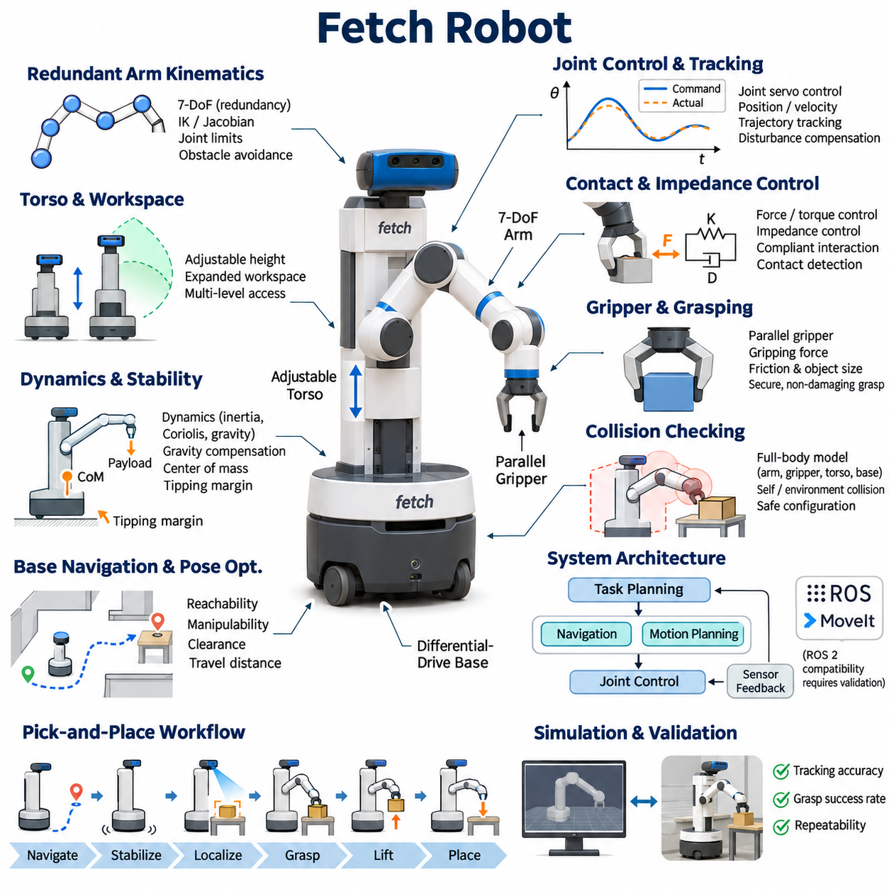
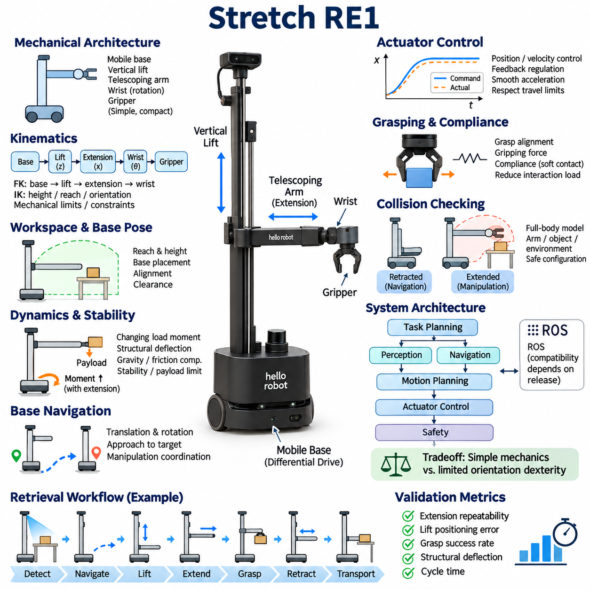
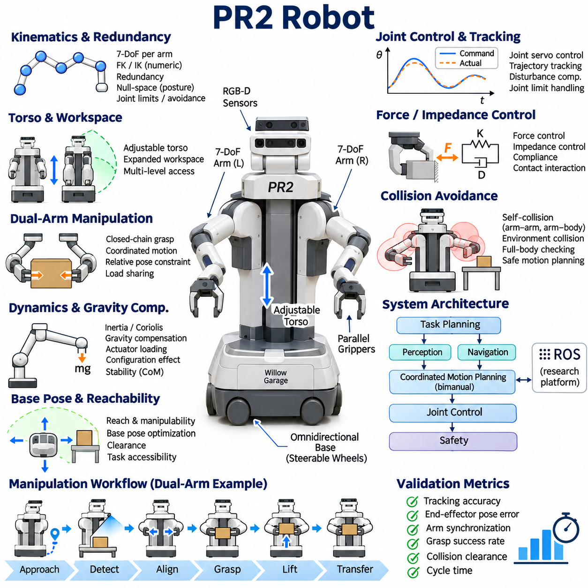
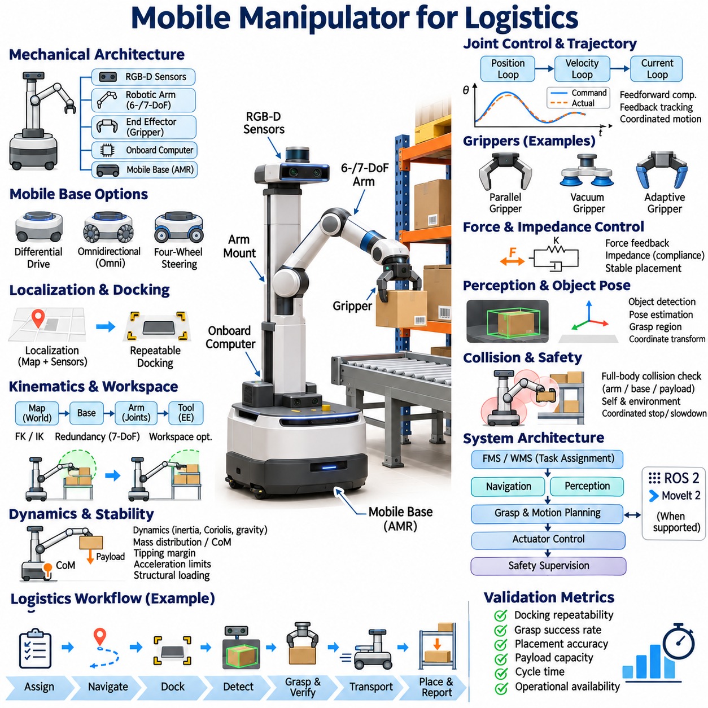
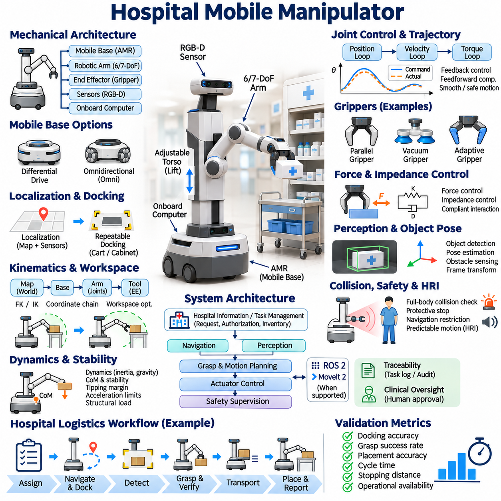
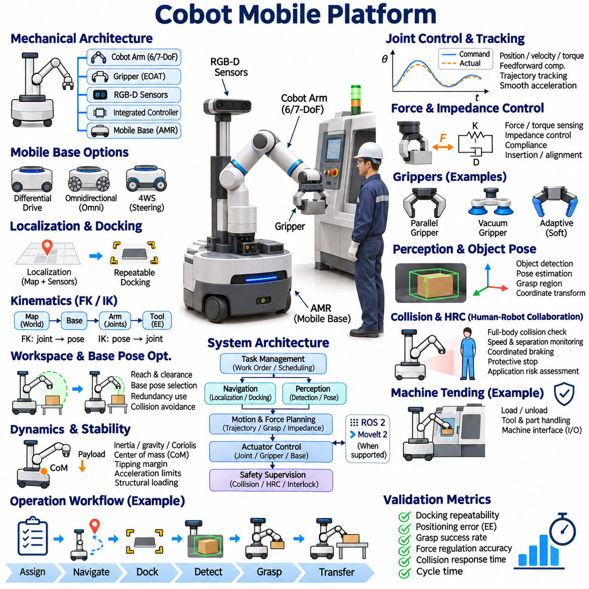
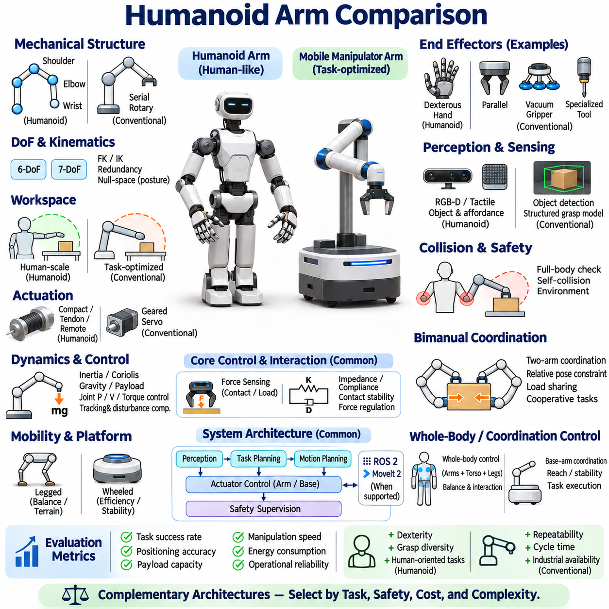

# Chapter 15. Case Studies

## 01 Fetch Robot

{width="7.268055555555556in" height="7.268055555555556in"}

Fetch 로봇(Fetch Robot)은 자율주행 바퀴형 이동 플랫폼(Autonomous Wheeled Mobile Platform), 수직 높이 조절 몸체(Vertically Adjustable Torso), 7자유도 로봇 팔(Seven-Degree-of-Freedom Robotic Arm), 적응형 평행 그리퍼(Adaptive Parallel Gripper)를 결합한 대표적인 이동 조작(Mobile Manipulation) 연구 플랫폼이다. Fetch Robotics가 개발한 이 시스템은 이동성(Mobility)과 조작 기능(Manipulation)을 통합 로봇 아키텍처(Unified Robotic Architecture)로 구성하여 물체 취급(Object Handling), 실험실 자동화(Laboratory Automation), 인간 중심 환경(Human-Centered Environments)에서 활용하는 방법을 보여준다.

이 로봇은 차동 구동 이동 베이스(Differential-Drive Mobile Base)를 사용하며, 바퀴 속도의 협조 제어(Coordinated Wheel Velocity Control)를 통해 평면 이동(Planar Translation)과 회전(Rotation)을 수행한다. 이동 베이스에는 비홀로노믹 운동 제약(Nonholonomic Motion Constraints)이 존재하지만, 이동 기능을 통해 로봇 팔의 유효 작업 공간(Effective Workspace)을 크게 확장할 수 있다. 목표 물체 근처로 플랫폼을 재배치하면 고정형 로봇 팔(Stationary Robotic Arm)의 도달 범위를 벗어나는 조작 작업도 수행할 수 있다.

7자유도 로봇 팔(Seven-Degree-of-Freedom Arm)은 운동학적 여유 자유도(Kinematic Redundancy)를 제공하여 동일한 말단 장치 자세(End-Effector Pose)를 여러 관절 구성(Joint Configuration)으로 구현할 수 있다. 이러한 여유 자유도는 장애물 회피(Obstacle Avoidance), 관절 한계 관리(Joint-Limit Management), 제한된 환경에서의 조작에 유용하다. 수치적 역운동학(Numerical Inverse Kinematics)과 야코비안 기반 최적화(Jacobian-Based Optimization)를 통해 추가 자유도를 활용하면 목표 도구 위치와 방향을 유지하면서 조작성(Dexterity)을 향상시킬 수 있다.

높이 조절 몸체(Adjustable Torso)는 로봇 팔의 수직 작업 공간(Vertical Workspace)을 확장하는 추가 위치 조정 기능을 제공한다. 몸체 높이는 로봇 팔의 관절 구성 및 이동 베이스 위치와 협조하여 서로 다른 높이에 있는 물체에 접근하도록 조정할 수 있다. 따라서 효과적인 작업 공간 분석(Workspace Analysis)을 위해서는 이동 플랫폼, 몸체 승강 장치(Torso Lift), 로봇 팔 관절, 말단 장치 형상을 포함한 통합 운동학 체인(Combined Kinematic Chain)을 고려해야 한다.

Fetch 로봇의 기계적 아키텍처(Mechanical Architecture)는 조작 능력(Manipulation Capability)과 이동 플랫폼 안정성(Mobile Platform Stability) 사이의 균형이 중요하다는 점을 보여준다. 로봇 팔이 확장되면 전체 무게중심(Center of Mass)이 변화하고 지지 베이스에 추가 모멘트(Moment)가 발생한다. 따라서 전복 안정 여유(Tipping Margin), 구조적 하중(Structural Loading), 안전 운용 조건(Safe Operating Conditions)을 평가할 때 탑재물 중량(Payload Weight), 관절 구성, 가속도, 접촉력을 함께 고려해야 한다.

관절 수준 제어(Joint-Level Control)는 구동기 제한(Actuator Limitations)을 준수하면서 명령된 위치와 속도를 정확하게 추종하는 역할을 담당한다. 로봇 팔은 관절 센서(Joint Sensors)의 피드백(Feedback)을 활용하여 움직임을 조절하고 외란(Disturbances)을 보상한다. 일반적인 조작 제어기(Manipulation Controller)에서는 궤적 생성(Trajectory Generation)이 하위 서보 제어 루프(Lower-Level Servo Loops)보다 상위 계층에서 수행되며, 이를 통해 작업 계획과 구동기 제어를 분리하고 여러 관절의 협조 실행을 지원한다.

동역학 모델링(Dynamic Modeling)은 관절 운동(Joint Motion)과 구동기 토크(Actuator Torque) 사이의 관계를 이해하기 위한 수학적 기반을 제공한다. 로봇 팔의 동역학에는 관성(Inertia), 코리올리 및 원심 효과(Coriolis and Centrifugal Effects), 중력(Gravity), 마찰(Friction)이 포함된다. 모델 기반 보상(Model-Based Compensation)은 특히 중력 하중이 크거나 로봇 팔 자세가 빠르게 변화하는 상황에서 추종 정확도(Tracking Accuracy)를 향상시키는 데 효과적이다.

Fetch 로봇은 다관절 조작(Articulated Manipulation)에서 중력 보상(Gravity Compensation)이 중요한 이유도 보여준다. 로봇 팔이 서로 다른 관절 구성으로 이동하면 각 관절에 필요한 중력 토크(Gravity Torque)가 변화한다. 적절한 제어기는 이러한 구성 의존적 하중(Configuration-Dependent Loads)을 추정하고 보상하여 과도하게 높은 피드백 이득(Feedback Gains)을 사용하지 않고도 추종 오차(Tracking Error)를 줄이고 움직임의 부드러움(Motion Smoothness)을 향상시킨다.

로봇이 물체 또는 주변 구조물과 상호작용할 때 힘과 토크(Force and Torque)에 대한 고려가 특히 중요해진다. 파지(Grasping), 배치(Placement), 표면 접촉(Surface Contact)은 로봇 팔의 동작에 영향을 미치는 외력(External Forces)을 발생시킨다. 사용 가능한 센싱 및 제어 인터페이스(Sensing and Control Interfaces)에 따라 접촉 인식 제어 전략(Contact-Aware Control Strategies)은 상호작용 힘을 조절하거나 예상하지 못한 저항을 감지하고 과도한 하중을 방지하도록 움직임을 수정할 수 있다.

임피던스 제어(Impedance Control)는 환경과의 유연한 상호작용(Compliant Interaction)을 분석하기 위한 유용한 개념적 프레임워크(Conceptual Framework)를 제공한다. 임피던스 제어기는 완전히 강체적인 위치 추종(Rigid Position Tracking)을 강제하는 대신 변위(Displacement), 속도(Velocity), 상호작용 힘(Interaction Force) 사이에 원하는 관계를 설정한다. 이러한 동작은 조작 중 접촉 안정성(Contact Stability)을 향상시킬 수 있지만, 실제 구현은 구동기 특성, 센싱 가용성, 제어기 접근 가능성에 따라 달라진다.

로봇의 평행 그리퍼(Parallel Gripper)는 제어된 손가락 움직임(Finger Motion)과 파지력(Gripping Effort)을 통해 물체를 획득한다. 성공적인 파지(Grasping)는 손가락 형상(Finger Geometry), 접촉 마찰(Contact Friction), 물체 크기(Object Dimensions), 파지력과 외부 하중 사이의 관계에 따라 결정된다. 그리퍼는 충분한 물체 유지 능력(Holding Capability)을 제공하면서도 취약한 물체를 손상시키거나 조작 과정의 안정성을 저하시킬 수 있는 과도한 압력을 방지해야 한다.

파지 계획(Grasp Planning)은 물체, 그리퍼, 로봇 팔의 통합 기하학적 형상(Combined Geometry)을 고려해야 한다. 실행 가능한 파지 자세(Feasible Grasp Pose)가 모든 로봇 팔 구성이나 이동 베이스 위치에서 도달 가능한 것은 아니다. 따라서 계획 과정에서는 최종 파지 동작(Final Grasping Motion)을 실행하기 전에 역운동학(Inverse Kinematics), 충돌 제약(Collision Constraints), 관절 한계(Joint Limits), 접근 방향(Approach Directions)을 평가해야 한다.

Fetch 로봇은 가구, 장비, 물체, 주변 사람이 존재할 수 있는 환경에서 작동하므로 충돌 감지(Collision Detection)가 필수적이다. 로봇과 주변 작업 공간의 기하학적 모델(Geometric Models)을 활용하면 안전하지 않은 관절 구성(Unsafe Configurations)을 식별할 수 있다. 충돌 검사(Collision Checking)는 로봇 팔을 독립적으로 취급하는 대신 로봇 팔, 그리퍼, 몸체, 이동 베이스를 포함한 전체 관절 구조(Articulated Structure)를 고려해야 한다.

이동 베이스 내비게이션(Base Navigation)과 로봇 팔 조작(Arm Manipulation)의 상호작용은 기존 고정형 산업용 로봇(Fixed-Base Industrial Robots)에는 없는 협조 문제(Coordination Problem)를 발생시킨다. 내비게이션은 로봇이 안전하게 위치할 수 있는 장소를 결정하고, 조작 계획(Manipulation Planning)은 목표에 도달할 수 있는지를 판단한다. 성공적인 시스템은 베이스 위치가 충돌 없는 조작(Collision-Free Manipulation)과 높은 조작성(Dexterity)을 지원하도록 두 의사결정을 협조시켜야 한다.

베이스 위치 선정(Base Positioning)은 도달 가능성(Reachability), 조작성(Manipulability), 충돌 여유 거리(Collision Clearance), 이동 거리(Travel Distance)를 포함하는 최적화 문제(Optimization Problem)로 정의할 수 있다. 내비게이션 비용을 최소화하는 위치가 로봇 팔에 불리한 관절 구성을 만들 수 있다. 반대로 우수한 조작성을 제공하는 위치는 접근하기 어려울 수 있다. 다목적 최적화(Multi-Objective Optimization)는 이러한 상충 요구사항(Competing Requirements)의 균형을 체계적으로 조정하는 방법을 제공한다.

Fetch 로봇은 로봇 운영체제(Robot Operating System, ROS)를 활용한 연구와 밀접하게 관련되어 있으며, 모듈형 소프트웨어 구성 요소(Modular Software Components)는 인식(Perception), 내비게이션(Navigation), 조작 계획(Manipulation Planning), 하드웨어 제어(Hardware Control)를 지원한다. 기존 연구용 소프트웨어 생태계는 ROS 인터페이스와 MoveIt 기반 계획을 활용해 왔다. ROS 2 및 MoveIt 2와의 통합에는 기본 지원을 가정하기보다 적절한 드라이버, 구성 패키지, 호환성 검증(Compatibility Validation)이 필요하다.

계층적 제어(Hierarchical Control)는 서로 다른 하위 시스템이 다양한 시간 척도(Timescales)에서 작동하는 Fetch 아키텍처에 특히 적합하다. 상위 작업 계획(High-Level Task Planning)은 조작 목표를 선택하고, 동작 계획(Motion Planning)은 실행 가능한 궤적을 생성하며, 관절 제어기(Joint Controllers)는 해당 궤적을 실행한다. 동시에 내비게이션 및 안전 하위 시스템(Navigation and Safety Subsystems)은 플랫폼 움직임과 환경 제약을 관리하므로 각 시스템의 운용 상태 사이에 명시적인 협조가 필요하다.

대표적인 픽 앤 플레이스(Pick-and-Place) 작업은 목표 작업 공간(Target Workspace)으로 이동한 다음 베이스 안정화(Base Stabilization)와 물체 위치 추정(Object Localization)을 수행하는 과정으로 시작된다. 이후 제어기는 적절한 파지 자세를 계산하고 역운동학을 평가하며 충돌 없는 로봇 팔 궤적을 생성한다. 파지 완료 후 로봇은 물체를 들어 올리고 목표 배치 자세(Placement Configuration)로 이동한 다음 제어된 조건에서 물체를 놓는다.

실험적 평가(Experimental Evaluation)에서는 개별 하위 시스템 성능(Subsystem Performance)과 전체 작업 성공률(Overall Task Success)을 구분해야 한다. 관절 추종 정확도(Joint Tracking Accuracy), 말단 장치 위치 오차(End-Effector Positioning Error), 파지 신뢰성(Grasp Reliability), 충돌 여유 거리, 내비게이션 반복 정밀도(Navigation Repeatability)는 상호 보완적인 평가 지표를 제공한다. 다양한 물체 위치와 환경 조건에서 반복 실험을 수행하면 실패 원인이 인식, 계획, 제어, 기계적 한계 중 어디에서 발생하는지 식별하는 데 도움이 된다.

Fetch 플랫폼은 시뮬레이션(Simulation)과 물리적 실험(Physical Experimentation)이 긴밀하게 연결되어야 하는 이유도 보여준다. 운동학 및 동역학 모델(Kinematic and Dynamic Models)은 실제 하드웨어 실행 전에 도달 가능성, 관절 하중, 충돌 동작을 예측할 수 있다. 그러나 마찰, 구동기 응답, 물체 접촉, 위치 추정 정확도에 관한 시뮬레이션 가정(Simulation Assumptions)은 실제 측정값과 비교하여 검증해야 신뢰할 수 있는 현실 세계 성능(Real-World Performance)을 확보할 수 있다.

Fetch 로봇에서 얻을 수 있는 중요한 공학적 교훈(Engineering Lesson)은 추가 자유도(Additional Degrees of Freedom)가 유연성을 증가시키는 동시에 계산 및 제어 복잡성(Computational and Control Complexity)도 높인다는 점이다. 여유 자유도 역운동학(Redundant Inverse Kinematics), 전신 협조 제어(Whole-Body Coordination), 충돌 회피(Collision Avoidance)에는 신중한 알고리즘 설계(Algorithm Design)가 필요하다. 이러한 유연성은 단일 산업 동작을 반복하는 대신 다양한 환경에서 작동해야 하는 로봇에 특히 가치가 있다.

결과적으로 Fetch 로봇은 통합 이동 조작기(Integrated Mobile Manipulator)의 기계 구조와 제어를 이해하기 위한 실용적인 참조 사례(Practical Reference)를 제공한다. 이 아키텍처는 여유 자유도 로봇 팔 운동학(Redundant Arm Kinematics), 구동기 동역학(Actuator Dynamics), 파지 역학(Grasp Mechanics), 작업 공간 최적화(Workspace Optimization), 계층적 소프트웨어 제어(Hierarchical Software Control)를 연결한다. 이러한 원리는 특정 플랫폼을 넘어 물류, 연구, 산업 자동화를 위한 신뢰성 높은 이동 조작 시스템(Mobile Manipulation Systems)을 개발하는 기반을 제공한다.

## 02 Stretch RE1

{width="7.268055555555556in" height="7.268055555555556in"}

Hello Robot이 개발한 Stretch RE1 로봇(Stretch RE1 Robot)은 소형화(Compact Design), 경량화(Lightweight Construction), 기계적 단순화(Mechanical Simplification)를 통해 이동 조작(Mobile Manipulation)에 접근하는 독특한 방식을 보여준다. 다관절 산업용 로봇 팔(Multi-Joint Industrial Arm)을 장착한 기존 이동 조작기와 달리 Stretch RE1은 이동 베이스(Mobile Base), 수직 승강 장치(Vertical Lift), 신축형 로봇 팔(Telescoping Arm), 그리퍼(Gripper)를 결합한다. 이러한 구성은 인간 생활환경에서 실용적인 도달 가능성(Reachability), 접근성(Accessibility), 효율적인 작업 수행(Efficient Operation)을 강조한다.

Stretch RE1의 기계적 설계(Mechanical Design)는 유용한 조작 작업 공간(Manipulation Workspace)을 유지하면서 작은 설치 면적(Small Physical Footprint)을 확보하는 데 중점을 둔다. 소형 이동 베이스(Compact Mobile Base)를 통해 주거 공간, 좁은 통로, 가구가 배치된 환경에서 이동할 수 있다. 대형 다관절 로봇 팔(Articulated Arm)에 의존하는 대신 직선 운동(Linear Motion)과 회전 운동(Rotational Motion)을 협조시켜 말단 장치(End Effector)의 위치를 결정하므로 기계적 복잡성을 줄이고 동작 계획(Motion Planning)의 여러 측면을 단순화할 수 있다.

Stretch RE1의 대표적인 특징은 이동 플랫폼의 바로 인접한 영역을 넘어 물체에 접근할 수 있도록 수평으로 확장되는 신축형 로봇 팔(Telescoping Arm)이다. 로봇 팔은 제어 가능한 신축 축(Extension Axis)을 제공하며, 이를 수직 승강 운동(Vertical Lift Motion) 및 이동 베이스 위치 조정(Mobile Base Positioning)과 결합할 수 있다. 이러한 구조를 통해 로봇은 팔을 접었을 때 비교적 작은 기계적 구조를 유지하면서 테이블, 선반, 가정용 물체에 접근할 수 있다.

수직 승강 메커니즘(Vertical Lift Mechanism)은 서로 다른 높이에서 로봇 팔의 위치를 조정하기 위한 추가 자유도(Degree of Freedom)를 제공한다. 승강 변위(Lift Displacement)와 수평 신축 운동(Horizontal Extension)을 협조시키면 상당한 수직 작업 공간(Vertical Workspace)에 분포한 물체에 접근할 수 있다. 이러한 아키텍처는 수직 위치 조정과 수평 도달 동작을 분리하므로 많은 조작 작업을 비교적 단순한 기하학적 관계(Geometric Relationships)와 협조 구동 명령(Coordinated Actuator Commands)으로 표현할 수 있다.

Stretch RE1은 이동 베이스가 말단 장치 위치 결정(End-Effector Positioning)에 직접 기여하는 비전통적인 조작 아키텍처(Nontraditional Manipulation Architecture)를 사용한다. 베이스의 병진 운동(Base Translation)과 회전 운동(Base Rotation)은 신축형 로봇 팔의 제한된 방향 조정 능력(Orientation Flexibility)을 보완할 수 있다. 따라서 특히 물체에 접근하거나 그리퍼를 목표 표면에 정렬할 때 내비게이션(Navigation)과 조작(Manipulation)을 독립적인 기능으로 취급하지 않고 협조시켜야 한다.

Stretch RE1의 운동학 모델(Kinematic Model)은 기존 6자유도 또는 7자유도 로봇 팔(Six- or Seven-Degree-of-Freedom Robotic Arm)의 모델과 상당히 다르다. 조작 작업 공간(Manipulation Workspace)은 주로 수직 승강 장치(Vertical Lift), 신축형 팔의 확장(Telescoping Extension), 손목 방향(Wrist Orientation), 이동 베이스 구성(Mobile Base Configuration)에 의해 결정된다. 순운동학(Forward Kinematics)은 베이스 좌표계(Base Frame)에서 승강 장치, 로봇 팔, 손목, 그리퍼까지의 변환을 결합하여 최종 말단 장치 자세(End-Effector Pose)를 계산할 수 있다.

Stretch RE1의 역운동학(Inverse Kinematics)은 주요 위치 결정 변수 중 일부가 직선 구동기의 변위(Linear Actuator Displacement)에 직접 대응하므로 비교적 단순하게 구성할 수 있다. 원하는 말단 장치 높이(End-Effector Height)와 수평 도달 거리(Horizontal Reach)를 기계적 한계(Mechanical Limits) 내에서 승강 및 신축 명령으로 변환할 수 있다. 그러나 완전한 자세 제어(Pose Control)를 위해서는 손목 방향, 베이스 위치, 충돌 제약(Collision Constraints), 메커니즘에서 사용 가능한 제한된 자유도를 함께 고려해야 한다.

이 로봇은 기계적 단순성(Mechanical Simplicity)과 조작 유연성(Manipulation Dexterity) 사이의 중요한 절충 관계(Tradeoff)를 보여준다. 신축형 로봇 팔은 기존 다관절 조작기(Articulated Manipulator)보다 적은 구동 관절(Actuated Joints)로 다양한 실용적인 도달 작업(Reaching Tasks)을 수행할 수 있다. 그러나 임의의 방향에서 물체에 접근하는 능력은 제한적이다. 따라서 복잡한 도구 방향(Tool Orientation)이나 장애물 주변을 우회하는 움직임이 필요한 작업은 이동 플랫폼의 재배치(Repositioning)에 더 크게 의존할 수 있다.

동적 거동(Dynamic Behavior)은 신축형 로봇 팔의 확장 길이 변화와 탑재물 질량 분포(Payload Mass Distribution)의 영향을 받는다. 로봇 팔이 확장되면 지지 구조물에 작용하는 하중 모멘트(Load Moment)가 증가하여 위치 결정 정확도(Positioning Accuracy)와 플랫폼 안정성(Platform Stability)에 영향을 줄 수 있다. 동역학 분석(Dynamic Analysis)에서는 구동기 힘(Actuator Forces), 중력 하중(Gravitational Loading), 구조적 처짐(Structural Deflection), 확장 거리와 허용 탑재 하중(Allowable Payload) 사이의 관계를 고려해야 한다.

Stretch RE1의 경량 구조(Lightweight Construction)는 중력 보상(Gravity Compensation)과 마찰 관리(Friction Management)를 구동기 제어(Actuator Control)의 중요한 요소로 만든다. 수직 승강에는 로봇 팔 조립체(Arm Assembly)와 탑재물을 지지할 충분한 힘이 필요하며, 수평 신축 운동은 기계적 저항(Mechanical Resistance)과 외란(External Disturbances)을 극복해야 한다. 적절한 피드포워드 보상(Feedforward Compensation)과 피드백 제어(Feedback Regulation)는 불필요하게 높은 제어 이득(Control Gains)을 사용하지 않고도 추종 성능(Tracking Performance)을 향상시킬 수 있다.

Stretch RE1의 관절 수준 제어(Joint-Level Control)는 직선 구동기(Linear Actuators), 회전 관절(Rotational Joints), 이동 구동 시스템(Mobile Drive System)의 협조 제어에 중점을 둔다. 위치 및 속도 피드백(Position and Velocity Feedback)을 통해 제어기는 기계적 이동 한계(Mechanical Travel Limits)를 준수하면서 명령된 움직임을 실행할 수 있다. 특히 로봇 팔 신축 과정에서는 급격한 움직임이 진동(Vibration), 구조적 하중(Structural Loading), 말단 장치 위치 오차(End-Effector Positioning Error)를 증가시킬 수 있으므로 부드러운 가속과 감속(Smooth Acceleration and Deceleration)이 중요하다.

그리퍼(Gripper)는 로봇과 조작 대상 물체(Manipulated Objects) 사이의 주요 접촉 인터페이스(Contact Interface) 역할을 한다. 성공적인 파지(Grasping)를 위해서는 적절한 손가락 배치(Finger Placement), 접촉 형상(Contact Geometry), 파지력(Gripping Force)이 필요하다. 로봇 팔의 방향 조정 능력이 산업용 조작기보다 제한적이므로 물체 접근 전략(Object Approach Strategies)에서는 그리퍼 정렬(Gripper Alignment)과 접근 가능한 파지 표면(Accessible Grasp Surfaces)을 고려해야 한다. 베이스 위치 조정과 손목 조절은 파지 실행 가능성(Grasp Feasibility)을 향상시킬 수 있다.

순응성(Compliance)은 Stretch RE1이 가정용 가구, 용기, 문 또는 기타 물체와 상호작용할 때 특히 유용하다. 작은 위치 결정 오차(Positioning Errors)도 파지 및 배치 과정에서 예상하지 못한 접촉력(Contact Forces)을 발생시킬 수 있다. 기계적 순응성(Mechanical Compliance), 힘 감응 동작(Force-Sensitive Behavior), 정밀하게 조절된 구동기 운동(Regulated Actuator Motion)은 상호작용 하중(Interaction Loads)을 줄일 수 있지만, 사용 가능한 제어 전략은 설치된 하드웨어 및 소프트웨어 구성에 따라 달라진다.

충돌 회피(Collision Avoidance)는 신축형 로봇 팔이 이동 베이스가 차지하지 않는 공간까지 확장될 수 있기 때문에 독특한 문제를 발생시킨다. 로봇 팔을 접은 상태에서는 안전한 내비게이션 경로(Navigation Path)라도 가구나 벽 근처에서 로봇 팔을 확장하면 안전하지 않을 수 있다. 따라서 동작 계획(Motion Planning)은 로봇 전체 형상(Complete Robot Geometry)을 고려해야 하며, 내비게이션 구성(Navigation Configurations)과 조작 구성(Manipulation Configurations)을 구분해야 한다.

Stretch RE1은 단순화된 기계적 구조(Simplified Mechanical Structure)로 인해 사용 가능한 로봇 팔 운동이 제한되므로 작업 공간 최적화(Workspace Optimization)가 특히 중요하다. 적절한 베이스 위치(Base Location)를 선택하면 도달 가능성(Reachability)과 파지 정렬(Grasp Alignment)을 크게 개선할 수 있다. 효과적인 최적화 전략(Optimization Strategy)은 로봇 팔 확장 길이, 승강 높이, 손목 방향, 장애물 여유 거리(Obstacle Clearance), 베이스 접근성(Base Accessibility)을 고려하여 목표 조작 작업에 적합한 구성을 식별한다.

Stretch 연구 플랫폼(Stretch Research Platform)은 ROS 기반 소프트웨어 개발(ROS-Based Software Development)과 연관되어 있으며, 인식(Perception), 내비게이션(Navigation), 조작(Manipulation), 하드웨어 제어(Hardware Control)의 통합을 지원한다. 모듈형 인터페이스(Modular Interfaces)를 통해 개발자는 하위 구동기 명령(Lower-Level Actuator Commands)에 접근하면서 작업 수준 동작(Task-Level Behaviors)을 구현할 수 있다. 특정 ROS 배포판(ROS Distributions), ROS 2 구성 요소(ROS 2 Components), MoveIt 2 구성과의 호환성은 사용되는 소프트웨어 릴리스(Software Release)와 통합 패키지(Integration Packages)에 따라 달라진다.

계층적 제어(Hierarchical Control)는 Stretch RE1의 다양한 하위 시스템(SubSystems)을 협조시키기 위한 실용적인 프레임워크를 제공한다. 상위 수준 계획(High-Level Planning)은 목표 물체(Target Object)와 조작 목적(Manipulation Objective)을 결정하고, 동작 계획(Motion Planning)은 실행 가능한 베이스 및 로봇 팔 구성을 선택한다. 하위 수준 제어기(Lower-Level Controllers)는 구동기 움직임을 조절하며, 안전 감독(Safety Supervision)은 운용 한계(Operating Limits)를 감시한다. 이러한 기능 분리는 구조화된 작업 실행(Structured Task Execution)을 지원하고 디버깅(Debugging)을 단순화한다.

대표적인 물체 회수 작업(Object Retrieval Task)은 목표 물체를 감지(Detection)하고 위치를 추정(Localization)하는 과정에서 시작된다. 로봇은 접근 가능한 위치로 이동한 후 승강 높이(Lift Height)를 조절하고 신축형 로봇 팔을 확장하여 그리퍼를 적절한 파지 위치(Grasp Location)에 정렬한다. 그리퍼를 닫아 물체를 파지한 다음 로봇 팔을 수축하여 점유 작업 공간(Occupied Workspace)을 줄이며, 이를 통해 로봇은 물체를 원하는 목적지(Destination)로 운반할 수 있다.

실험적 검증(Experimental Validation)에서는 조작 성능(Manipulation Performance)과 기계적 단순화(Mechanical Simplification)의 영향을 모두 평가해야 한다. 관련 측정 항목에는 신축 반복 정밀도(Extension Repeatability), 승강 위치 오차(Lift Positioning Error), 파지 성공률(Grasp Success Rate), 탑재 하중에 따른 처짐(Payload-Dependent Deflection), 작업 완료 시간(Task Completion Time)이 포함된다. 서로 다른 물체 높이, 거리, 방향에서 시험하면 로봇의 도달 가능한 작업 공간(Reachable Workspace)과 실제 사용 가능한 작업 공간(Usable Workspace)의 한계를 파악할 수 있다.

Stretch RE1 사례 연구(Case Study)는 효과적인 이동 조작(Mobile Manipulation)에 반드시 고도의 다관절 로봇 팔(Highly Articulated Robotic Arm)이 필요한 것은 아니라는 점을 보여준다. 소형 이동 플랫폼(Compact Mobile Platform), 직선 도달 메커니즘(Linear Reaching Mechanisms), 협조 제어(Coordinated Control)를 결합하여 특정 서비스 및 보조 작업(Service and Assistive Applications)에 실용적인 대안을 제공한다. 이러한 공학적 원리(Engineering Principles)는 기계적 아키텍처(Mechanical Architecture), 제어 복잡성(Control Complexity), 작업 공간 요구사항(Workspace Requirements)을 목표 작업(Intended Task)에 적합하게 설계하는 것이 중요하다는 점을 강조한다.

## 03 PR2 Robot

{width="7.268055555555556in" height="7.268055555555556in"}

Willow Garage가 개발한 PR2 로봇(PR2 Robot)은 이동 조작(Mobile Manipulation)과 서비스 로보틱스(Service Robotics) 분야에서 중요한 이정표가 된 연구 플랫폼(Research Platform)이다. 이 로봇의 아키텍처는 전방향 이동 베이스(Omnidirectional Mobile Base), 높이 조절 몸체(Adjustable Torso), 2개의 7자유도 로봇 팔(Seven-Degree-of-Freedom Robotic Arms), 평행 그리퍼(Parallel Grippers)를 결합한다. 인간 생활환경(Human Environments)에서의 연구를 위해 설계된 PR2는 이동성(Mobility), 여유 자유도 조작(Redundant Manipulation), 인식(Perception), 협조 제어(Coordinated Control)를 다목적 로봇 시스템(Versatile Robotic System)으로 통합하는 방법을 보여준다.

PR2의 대표적인 특징은 물체와 도구의 협조 조작(Coordinated Manipulation)을 가능하게 하는 양팔 구성(Dual-Arm Configuration)이다. 각 로봇 팔은 7자유도(Seven Degrees of Freedom)를 제공하므로 동일한 말단 장치 자세(End-Effector Pose)를 여러 관절 구성(Joint Configurations)으로 구현할 수 있다. 이러한 운동학적 여유 자유도(Kinematic Redundancy)는 장애물 회피(Obstacle Avoidance), 자세 최적화(Posture Optimization), 제한된 공간에서의 조작을 지원하며, 양팔 구조는 동시 파지(Simultaneous Grasping)나 물체 안정화(Object Stabilization)가 필요한 작업을 가능하게 한다.

전방향 이동 베이스(Omnidirectional Mobile Base)를 통해 PR2는 기존 차동 구동 플랫폼(Differential-Drive Platforms)보다 높은 기동성(Maneuverability)으로 병진 이동(Translation)과 회전(Rotation)을 수행할 수 있다. 조향 가능한 바퀴 모듈(Steerable Wheel Modules)은 다양한 평면 방향(Planar Directions)으로 이동할 수 있도록 지원하여 테이블, 선반, 작업대 근처에서 정밀한 위치 결정을 가능하게 한다. 이러한 이동성은 유효 조작 작업 공간(Effective Manipulation Workspace)을 확장하고 서로 다른 방향에서 물체에 접근할 때 복잡한 로봇 팔 구성을 사용할 필요성을 줄여준다.

PR2에는 주변 환경에 대한 두 로봇 팔의 높이를 변경할 수 있는 수직 높이 조절 몸체(Vertically Adjustable Torso)가 포함되어 있다. 몸체 움직임(Torso Motion)을 베이스 위치 조정(Base Positioning) 및 로봇 팔 구성(Arm Configuration)과 협조시키면 접근 가능한 물체의 범위가 확대된다. 따라서 작업 공간 분석(Workspace Analysis)에서는 이동 베이스, 몸체 승강 장치(Torso Lift), 양쪽 조작기(Both Manipulators), 말단 장치(End Effectors)를 포함하는 전체 운동학적 구조(Complete Kinematic Structure)를 고려해야 한다.

각 PR2 로봇 팔의 운동학 모델(Kinematic Model)은 강체 링크(Rigid Links)로 연결된 회전 관절(Revolute Joints)의 직렬 체인(Serial Chain)으로 구성된다. 순운동학(Forward Kinematics)은 연속적인 좌표 변환(Coordinate Transformations)을 사용하여 측정된 관절 각도(Joint Angles)로부터 말단 장치 자세(End-Effector Pose)를 결정한다. 정확한 모델링을 위해서는 일관된 좌표계(Coordinate Frames), 보정된 관절 오프셋(Calibrated Joint Offsets), 정확한 링크 치수(Link Dimensions)가 필요하며, 특히 양팔이 협조 조작을 수행할 때 이러한 요소가 중요하다.

역운동학(Inverse Kinematics)은 각 로봇 팔이 일반적인 6차원 말단 장치 자세(Six-Dimensional End-Effector Pose)를 지정하는 데 필요한 자유도보다 많은 자유도를 가지므로 추가적인 과제를 발생시킨다. 수치적 해법(Numerical Solvers)은 이러한 여유 자유도를 활용하여 관절 한계(Joint Limits)를 만족하고 특이점(Singularities)을 회피하며 충돌 여유 거리(Collision Clearance)를 유지할 수 있다. 영공간 최적화(Null-Space Optimization)는 주요 말단 장치 작업(Primary End-Effector Task)에 큰 영향을 주지 않으면서 로봇 팔 자세를 조정하는 방법을 제공한다.

양팔 조작(Dual-Arm Manipulation)은 두 그리퍼가 동일한 강체 물체(Rigid Object)를 잡을 때 폐쇄 체인 제약(Closed-Chain Constraints)을 발생시킨다. 두 말단 장치 사이의 상대 변환(Relative Transformations)은 물체의 기하학적 형상(Object Geometry)과 일관되게 유지되어야 한다. 협조 동작 계획(Coordinated Motion Planning)은 관절 한계와 충돌 경계(Collision Boundaries)를 준수하면서 이러한 제약을 유지해야 하며, 물체 손상이나 조작기 과부하를 유발할 수 있는 과도한 내부 힘(Internal Forces)을 방지해야 한다.

PR2는 두 로봇 팔이 서로 다른 하중을 운반하면서 동시에 움직일 수 있으므로 동역학 모델링(Dynamic Modeling)이 특히 중요하다. 관절 토크(Joint Torques)는 관성(Inertia), 중력(Gravitational Forces), 코리올리 효과(Coriolis Effects), 연결된 구조물 사이의 상호작용(Interactions Between Linked Structures)에 따라 달라진다. 로봇 팔과 몸체의 구성 변화는 전체 질량 분포(Overall Mass Distribution)에도 영향을 미치므로 구동기 하중(Actuator Loading)과 이동 플랫폼 안정성(Mobile Platform Stability)을 신중하게 평가해야 한다.

PR2는 관절 수준 센싱 및 제어(Joint-Level Sensing and Control)를 활용하여 다관절 운동(Articulated Motion)을 조절한다. 위치 피드백(Position Feedback), 속도 추정(Velocity Estimation), 구동기 작용력 정보(Actuator Effort Information)는 궤적 추종(Trajectory Tracking)과 외란 보상(Disturbance Compensation)을 지원한다. 연구 중심 제어 아키텍처(Research-Oriented Control Architecture)는 구동기 제어, 관절 한계 적용, 협조 궤적 실행을 위한 하위 수준 메커니즘을 유지하면서 고급 제어 방법(Advanced Control Methods)을 연구할 수 있도록 한다.

중력 보상(Gravity Compensation)은 PR2의 다관절 로봇 팔(Articulated Arms)을 제어하는 데 중요한 역할을 한다. 관절 구성이 변화하면 각 링크(Link)와 부착된 탑재물(Payload)을 지지하는 데 필요한 중력 토크(Gravitational Torque)가 달라진다. 모델 기반 보상(Model-Based Compensation)은 특히 느린 조작 동작이나 로봇 팔을 길게 확장한 상태에서 물체를 유지할 때 정상 상태 추종 오차(Steady-State Tracking Errors)를 줄이고 움직임의 부드러움(Motion Smoothness)을 향상시킬 수 있다.

PR2가 불확실한 환경(Uncertain Environments)과 상호작용할 때는 힘 감응 조작(Force-Sensitive Manipulation)이 필수적이다. 파지(Grasping), 밀기(Pushing), 당기기(Pulling), 물체 배치(Object Placement) 과정에서 접촉력(Contact Forces)이 발생한다. 관절 작용력 측정(Joint Effort Measurements)과 적절한 추정 방법(Estimation Methods)은 외부 하중(External Loading)에 관한 정보를 제공할 수 있으며, 힘 인식 제어 전략(Force-Aware Control Strategies)은 명령된 움직임을 수정하여 과도한 상호작용 힘을 줄이고 작업 신뢰성(Task Reliability)을 향상시킬 수 있다.

임피던스 제어(Impedance Control)와 순응 제어(Compliance Control)는 PR2가 물체 및 사람과 물리적으로 상호작용하는 과정을 조절하기 위한 유용한 방법을 제공한다. 움직임과 외력(External Force) 사이의 원하는 관계를 정의하면 제어기는 완전히 강체적인 위치 결정(Rigid Positioning)을 강제하는 대신 접촉 중 제한된 변위(Limited Displacement)를 허용할 수 있다. 이러한 전략은 불확실한 물체 형상(Uncertain Object Geometry), 접촉 전환(Contact Transitions), 작은 정렬 오차(Alignment Errors)가 포함된 조작 작업에 유용하다.

PR2의 평행 그리퍼(Parallel Grippers)는 협조된 손가락 움직임(Coordinated Finger Motion)을 통해 제어된 물체 파지(Object Grasping)를 제공한다. 파지 성공(Grasp Success)은 접촉 형상(Contact Geometry), 마찰(Friction), 물체 질량(Object Mass), 적용된 파지 작용력(Gripping Effort)과 외부 외란(External Disturbances) 사이의 관계에 따라 달라진다. 양팔 작업(Dual-Arm Tasks)에서는 특히 크거나 불규칙한 형상의 물체를 조작할 때 하중 분담(Load Sharing)과 물체 안정성(Object Stability)도 그리퍼 제어에 반영해야 한다.

PR2는 서로 겹치는 작업 공간(Overlapping Workspaces)에서 작동하는 두 개의 다관절 로봇 팔을 포함하므로 충돌 감지(Collision Detection)가 중요한 고려사항이다. 계획 시스템(Planning System)은 각 로봇 팔과 환경 사이의 충돌, 두 로봇 팔 사이의 충돌, 조작기와 로봇 자체 구조물 사이의 충돌을 평가해야 한다. 따라서 신뢰성 높은 협조 동작(Coordinated Motion)을 위해서는 자체 충돌 검사(Self-Collision Checking)와 지속적인 환경 모니터링(Continuous Environment Monitoring)이 필수적이다.

베이스 위치 선정(Base Positioning)과 작업 공간 최적화(Workspace Optimization)는 PR2의 조작 성능(Manipulation Performance)에 큰 영향을 미친다. 적절한 이동 베이스 위치(Mobile Base Location)는 유리한 관절 구성(Joint Configurations)과 충돌 여유 거리(Collision Clearance)를 유지하면서 양팔 모두에 충분한 도달 가능성(Reachability)을 제공해야 한다. 최적화 기준(Optimization Criteria)에는 조작성(Manipulability), 관절 한계 여유(Joint-Limit Margins), 내비게이션 접근성(Navigation Accessibility), 협조 양팔 작업(Coordinated Bimanual Operations)의 실행 가능성이 포함될 수 있다.

PR2는 로봇 운영체제(Robot Operating System, ROS)와 광범위한 오픈소스 로보틱스 생태계(Open-Source Robotics Ecosystem)의 발전에 중요한 역할을 했다. 소프트웨어 아키텍처(Software Architecture)는 인식(Perception), 내비게이션(Navigation), 조작 계획(Manipulation Planning), 하드웨어 제어(Hardware Control)의 모듈형 통합(Modular Integration)을 지원했다. 역사적으로 PR2 연구에서는 ROS 기반 도구(ROS-Based Tools)와 동작 계획 프레임워크(Motion-Planning Frameworks)가 널리 사용되었으며, 이는 이후 로봇 소프트웨어 통합(Robotic Software Integration) 발전의 중요한 기반이 되었다.

계층적 제어(Hierarchical Control)는 PR2의 하위 시스템이 서로 다른 추상화 수준(Levels of Abstraction)과 시간 척도(Timing)에서 작동하므로 적합한 제어 구조이다. 상위 작업 계획(High-Level Task Planning)은 조작 목표(Manipulation Objectives)를 결정하고, 동작 계획(Motion Planning)은 협조 궤적(Coordinated Trajectories)을 생성하며, 하위 수준 제어기(Lower-Level Controllers)는 관절 움직임을 조절한다. 내비게이션, 인식, 안전 기능은 이러한 계층과 함께 작동하므로 동기화(Synchronization)와 명확한 운용 상태 관리(Operating State Management)가 필요하다.

대표적인 PR2 조작 작업(Manipulation Task)은 테이블에 접근하고 물체를 식별한 다음 양팔의 위치를 조정하여 협조 파지(Coordinated Grasp)를 실행하는 과정으로 구성될 수 있다. 로봇은 물체를 들어 올리거나 이동시키는 동안 일관된 물체 형상 관계(Object Geometry)를 유지해야 한다. 성공적인 실행을 위해서는 인식(Perception), 역운동학(Inverse Kinematics), 충돌 검사(Collision Checking), 궤적 동기화(Trajectory Synchronization), 제어된 파지력(Controlled Gripping Forces)의 통합이 필요하다.

PR2의 실험적 평가(Experimental Evaluation)에서는 개별 조작기 성능(Individual Manipulator Performance)과 협조 시스템 동작(Coordinated System Behavior)을 모두 검토해야 한다. 관련 성능 지표(Performance Metrics)에는 관절 추종 정확도(Joint Tracking Accuracy), 말단 장치 위치 오차(End-Effector Positioning Error), 양팔 동기화(Dual-Arm Synchronization), 파지 성공률(Grasp Success Rate), 충돌 여유 거리(Collision Clearance), 작업 완료 시간(Task Completion Time)이 포함된다. 다양한 탑재 하중(Payloads)과 물체 구성(Object Configurations)에서 반복 실험을 수행하면 기계적 설계, 계획, 제어의 한계를 식별하는 데 도움이 된다.

PR2 사례 연구(Case Study)는 고도의 다관절 이동 조작(Highly Articulated Mobile Manipulation)이 제공하는 공학적 장점과 과제를 보여준다. 여유 자유도를 가진 양팔(Dual Redundant Arms)은 높은 유연성을 제공하지만 계산 복잡성(Computational Complexity), 협조 요구사항(Coordination Requirements), 기계적 비용(Mechanical Cost)도 증가시킨다. 이 플랫폼은 복잡한 환경에서 신뢰성 높은 조작(Reliable Manipulation)을 구현하기 위해 운동학(Kinematics), 동역학(Dynamics), 힘 제어(Force Control), 충돌 회피(Collision Avoidance), 계층적 소프트웨어 아키텍처(Hierarchical Software Architecture)가 통합적으로 작동해야 한다는 점을 보여준다.

## 04 Mobile Manipulator for Logistics

{width="7.268055555555556in" height="7.268055555555556in"}

물류용 이동 조작기(Mobile Manipulator for Logistics)는 자율 이동 로봇(Autonomous Mobile Robot, AMR)과 로봇 팔(Robotic Arm)을 통합하여 창고(Warehouse), 물류 센터(Distribution Center), 제조 시설(Manufacturing Facility) 전반에서 자재 취급 작업(Material Handling Tasks)을 수행한다. 주로 물품 운반을 수행하는 기존 AMR과 달리, 이 시스템은 물체에 자율적으로 접근하고, 파지(Grasping)하고, 이동시키며, 지정된 위치에 배치할 수 있다. 이동성과 조작 기능의 통합은 기존에 별도의 운반 장비와 취급 장비가 필요했던 물류 작업을 더욱 유연하게 자동화할 수 있도록 한다.

일반적인 기계적 아키텍처(Mechanical Architecture)는 이동 베이스(Mobile Base), 로봇 팔(Robotic Arm), 말단 장치(End Effector), 인식 센서(Perception Sensors), 탑재 컴퓨팅 시스템(Onboard Computing System)으로 구성된다. 이동 베이스는 자율주행과 위치 결정을 담당하고, 로봇 팔은 물체 조작을 수행한다. 전체 기계 설계에서는 탑재 하중(Payload Capacity), 구조 강성(Structural Rigidity), 무게중심(Center of Gravity), 진동 특성(Vibration Characteristics)을 고려해야 한다. 이러한 요소는 특히 무겁거나 불규칙한 형상의 물체를 취급할 때 조작 정확도와 운용 안정성에 직접적인 영향을 미친다.

이동 베이스(Mobile Base)는 보관 위치(Storage Locations), 컨베이어 시스템(Conveyor Systems), 작업대(Workstations), 배송 지점(Delivery Points) 사이에서 조작기를 운반하는 역할을 담당한다. 차동 구동(Differential Drive), 전방향 구동(Omnidirectional Drive), 4륜 조향(Four-Wheel Steering) 구성을 바닥 조건, 기동성 요구사항, 탑재 하중에 따라 선택할 수 있다. 정밀 조작 작업을 실행하기 전에 로봇 팔이 충분히 안정적인 기준 위치를 확보해야 하므로 정확한 위치 추정(Localization)과 반복 가능한 도킹(Docking)이 특히 중요하다.

로봇 팔(Robotic Arm)은 물류 물품을 회수하고 배치하는 데 필요한 위치 결정 기능을 제공한다. 적용 분야에 따라 6자유도 또는 7자유도 조작기(Six- or Seven-Degree-of-Freedom Manipulators)를 사용하여 서로 다른 높이와 방향에 있는 물체에 접근할 수 있다. 운동학적 여유 자유도(Kinematic Redundancy)는 선반, 용기, 주변 장비로 인해 작업 공간이 제한될 때 장애물 회피(Obstacle Avoidance)를 개선하고 대체 관절 구성(Alternative Joint Configurations)을 제공할 수 있다. 또한 다양한 탑재 하중 조건에서도 충분한 강성을 유지할 수 있도록 로봇 팔 구조를 설계해야 한다.

순운동학(Forward Kinematics)과 역운동학(Inverse Kinematics)은 이동 플랫폼과 로봇 팔을 협조시키는 데 필수적이다. 순운동학은 관절 위치와 현재 이동 베이스 구성을 이용하여 말단 장치 자세(End-Effector Pose)를 계산한다. 역운동학은 원하는 파지 또는 배치 자세를 구현하기 위해 필요한 관절 위치를 계산한다. 전체 변환 체인(Complete Transformation Chain)은 지도(Map), 이동 베이스(Mobile Base), 로봇 팔 장착 좌표계(Arm Mounting Frame), 로봇 링크(Robot Links), 말단 장치 사이의 관계를 고려해야 일관된 위치 결정 정확도를 유지할 수 있다.

물류 환경에서는 보관 랙(Storage Racks), 팔레트(Pallets), 컨베이어(Conveyors), 용기(Containers)가 공간적 제약을 형성하므로 작업 공간 최적화(Workspace Optimization)가 특히 중요하다. 이동 베이스는 충분한 로봇 팔 도달 범위(Arm Reach)를 확보하면서 관절 확장(Joint Extension), 특이점 위험(Singularity Risks), 충돌 가능성을 최소화할 수 있는 위치에서 목표물에 접근해야 한다. 적절한 베이스 자세(Base Pose)를 선택하면 조작기의 조작성(Manipulability)을 향상시키고 불필요한 움직임을 줄이며 물체 회수 성공 가능성을 높일 수 있다.

동적 성능(Dynamic Performance)은 이동 베이스와 조작기의 결합 운동(Combined Motion)에 따라 달라진다. 로봇 팔의 가속도, 탑재물 질량(Payload Mass), 관절 구성(Joint Configuration), 이동 플랫폼의 움직임은 전체 무게중심과 구조적 하중(Structural Loading)에 영향을 미친다. 로봇 팔이 무거운 물체를 운반하면서 확장되면 발생하는 모멘트(Moment)가 플랫폼 안정성에 영향을 줄 수 있다. 따라서 동작 계획(Motion Planning)에서는 탑재 하중에 따른 가속도 제한(Payload-Dependent Acceleration Limits), 전복 안정 여유(Tipping Margins), 전체 조작 과정에서의 기계적 응력(Mechanical Stress)을 고려해야 한다.

관절 수준 제어(Joint-Level Control)는 로봇 팔의 위치, 속도, 토크를 조절한다. 일반적으로 계단식 제어 아키텍처(Cascaded Control Architecture)는 위치, 속도, 전류 제어를 결합하여 안정적인 구동기 동작을 구현한다. 피드포워드 보상(Feedforward Compensation)은 예측 가능한 동역학적 영향을 고려하여 궤적 추종(Trajectory Tracking)을 개선할 수 있으며, 피드백 제어(Feedback Control)는 외란, 기계적 변화, 탑재 하중 변화로 발생하는 편차를 보정한다. 부드러운 파지와 배치 작업을 위해서는 여러 관절의 협조 운동(Coordinated Joint Motion)이 필요하다.

파지(Grasping)는 운반 대상 물체의 크기, 형상, 무게, 표면 재질, 포장 상태가 다양하기 때문에 물류 조작에서 가장 어려운 요소 중 하나이다. 물체의 특성에 따라 평행 그리퍼(Parallel Grippers), 진공 그리퍼(Vacuum Grippers), 적응형 말단 장치(Adaptive End Effectors)를 선택할 수 있다. 파지 메커니즘(Gripping Mechanism)은 포장재의 변형이나 물체 손상을 방지하면서 충분한 유지력을 제공해야 한다. 신뢰성 높은 파지를 위해서는 적절한 접촉 형상(Contact Geometry)과 그리퍼 및 목표 물체 사이의 정확한 정렬(Alignment)도 필요하다.

물체를 용기 내부에 배치하거나 선반에 올려놓거나 컨베이어 시스템 사이에서 이송할 때 힘 제어(Force Control)와 순응 제어(Compliance Control)가 중요하다. 작은 위치 추정 오차(Localization Errors)도 물체, 그리퍼, 주변 구조물 사이에 의도하지 않은 접촉을 발생시킬 수 있다. 힘 피드백(Force Feedback)과 임피던스 제어(Impedance Control)는 접촉 동작을 조절하고 과도한 상호작용 힘(Interaction Forces)을 줄이며 배치 신뢰성을 향상시킬 수 있다. 이러한 기술은 물체의 치수나 환경의 기하학적 구조를 완벽하게 알 수 없는 상황에서 특히 유용하다.

인식 시스템(Perception System)은 물류 물체를 식별하고 위치를 추정하는 데 필요한 정보를 제공한다. RGB 카메라, 깊이 센서(Depth Sensors), 3차원 비전 시스템(Three-Dimensional Vision Systems)을 이용하여 물체의 치수, 표면 형상, 파지 가능한 영역(Graspable Regions)을 추정할 수 있다. 인식 파이프라인(Perception Pipeline)은 검출된 물체 자세(Object Pose)를 로봇 좌표계(Robot Coordinate Frame)로 변환하고 카메라 위치나 이동 베이스 위치 추정의 변화를 보정해야 한다. 정확한 물체 위치 추정(Object Localization)은 실행 가능한 파지 궤적(Feasible Grasp Trajectories)을 생성하기 위한 필수 조건이다.

충돌 감지(Collision Detection)는 로봇 팔만이 아니라 전체 이동 조작 시스템(Complete Mobile Manipulation System)을 고려해야 한다. 로봇 팔, 이동 베이스, 보관 랙, 팔레트, 운반 중인 물체, 주변 작업자 사이에서 충돌이 발생할 수 있다. 기하학적 충돌 검사(Geometric Collision Checking)는 실행 전에 계획된 궤적을 평가할 수 있으며, 실시간 모니터링(Real-Time Monitoring)은 예상하지 못한 장애물을 감지할 수 있다. 안전 메커니즘(Safety Mechanisms)은 운용 위험에 따라 주행 정지(Navigation Stops), 로봇 팔 움직임 제한(Arm Motion Restrictions), 비상 대응(Emergency Responses)을 협조적으로 관리해야 한다.

일반적인 물류 작업(Logistics Operation)은 차량 관리 시스템(Fleet Management System)이 운반 및 취급 작업을 할당하면서 시작된다. 이동 조작기는 지정된 보관 구역으로 이동하여 적절한 도킹 위치를 확보한다. 인식 시스템은 목표 물체를 식별하고 자세를 추정하며 실행 가능한 파지 구성을 결정한다. 이후 조작기는 물체에 접근하고 그리퍼를 닫으며, 물체 획득 성공 여부를 확인한 다음 목적지까지 운반한다.

배송 위치(Delivery Location)에 도착하면 로봇은 작업대, 컨베이어 또는 보관 위치에 맞춰 이동 베이스를 정렬한다. 조작기는 충돌 없는 배치 궤적(Collision-Free Placement Trajectory)을 계산하고 목표물의 기하학적 형상에 따라 말단 장치 방향을 조정한다. 제어된 배치와 그리퍼 해제(Gripper Release)가 완료되면 시스템은 작업 완료 여부를 확인하고 결과를 차량 관리 시스템(Fleet Management System) 또는 창고 관리 시스템(Warehouse Management System)에 보고한다. 이러한 폐루프 운용(Closed-Loop Operation)은 고정형 자재 취급 장비(Fixed Material Handling Equipment)에 대한 의존성을 줄여준다.

소프트웨어 아키텍처(Software Architecture)는 일반적으로 계층적 제어 구조(Hierarchical Control Structure)를 따른다. 차량 관리(Fleet Management)는 작업을 할당하고 여러 로봇을 협조시키며, 내비게이션 하위 시스템(Navigation Subsystem)은 위치 추정, 경로 계획(Path Planning), 도킹을 관리한다. 조작 하위 시스템(Manipulation Subsystem)은 물체 인식, 파지 계획(Grasp Planning), 역운동학, 궤적 실행을 담당한다. 하위 수준 제어기(Lower-Level Controllers)는 구동기를 조절하고 안전 하위 시스템(Safety Subsystem)은 운용 조건을 감시하여 위험한 동작을 방지한다. 선택한 하드웨어와 드라이버가 지원하는 경우 ROS 2와 MoveIt 2를 이러한 기능을 구현하기 위한 소프트웨어 프레임워크로 활용할 수 있다.

성능 평가(Performance Evaluation)는 운반 능력과 조작 능력을 모두 고려해야 한다. 내비게이션 정확도(Navigation Accuracy), 도킹 반복 정밀도(Docking Repeatability), 파지 성공률(Grasp Success Rate), 배치 정확도(Placement Accuracy), 탑재 하중(Payload Capacity), 사이클 시간(Cycle Time), 운용 가용성(Operational Availability)은 중요한 평가 지표를 제공한다. 통합 시험(Integrated Testing)에서는 서로 다른 물체 구성, 환경 조건, 탑재 하중 분포에서 작업 완료 신뢰성(Task Completion Reliability)도 측정해야 한다. 전체 작업 흐름(Complete Workflow)을 평가하는 것이 이동 내비게이션과 로봇 팔 성능을 독립적으로 측정하는 것보다 더 의미 있다.

물류용 이동 조작기(Mobile Manipulator for Logistics)는 자율 운반(Autonomous Transportation)과 로봇 조작(Robotic Handling)을 결합하여 유연한 자재 취급 솔루션(Flexible Material Handling Solution)을 구현할 수 있음을 보여준다. 시스템의 효율성은 기계 설계(Mechanical Design), 운동학(Kinematics), 동역학(Dynamics), 인식(Perception), 파지(Grasping), 충돌 회피(Collision Avoidance), 계층적 제어(Hierarchical Control)의 협조에 달려 있다. 핵심적인 공학적 과제는 단순히 AMR에 로봇 팔을 장착하는 것이 아니라, 내비게이션과 조작이 하나의 협조된 프로세스로 작동하도록 전체 시스템을 최적화하는 것이다.

## 05 Hospital Mobile Manipulator

{width="7.268055555555556in" height="7.268055555555556in"}

병원용 이동 조작기(Hospital Mobile Manipulator)는 의료 환경에서 자재 취급(Material Handling), 임상 물류(Clinical Logistics), 일부 보조 작업(Assistance Tasks)을 지원하기 위해 자율 이동 로봇(Autonomous Mobile Robot, AMR)과 로봇 팔(Robotic Arm)을 통합한 시스템이다. 주로 물품 운반을 수행하는 기존 병원 배송 로봇과 달리, 이동 조작기는 물체, 서랍, 보관함, 의료 장비와 직접 물리적으로 상호작용할 수 있다. 이 시스템의 목적은 반복적인 수작업을 줄이고 운영 효율성을 향상시키면서 의료 전문가(Healthcare Professionals)의 업무를 지원하는 것이다.

일반적인 기계적 아키텍처(Mechanical Architecture)는 이동 베이스(Mobile Base), 로봇 팔(Robotic Arm), 말단 장치(End Effector), 인식 센서(Perception Sensors), 탑재 컴퓨팅 플랫폼(Onboard Computing Platform)으로 구성된다. 이동 베이스는 복도, 환자실, 임상 작업 공간(Clinical Workspaces)에서 자율 이동을 담당하고, 로봇 팔은 물체 취급과 상호작용 작업을 수행한다. 병원 환경에는 좁은 통로와 빈번하게 변화하는 장애물이 존재하므로 전체 설계에서는 탑재 하중(Payload Capacity), 구조적 안정성(Structural Stability), 소형 치수(Compact Dimensions), 기동성(Maneuverability) 사이의 균형을 확보해야 한다.

이동 플랫폼(Mobile Platform)은 환자, 의료진, 방문객, 기타 자율 시스템이 함께 사용하는 환경에서 안정적으로 작동해야 한다. 차동 구동(Differential Drive)과 전방향 구동(Omnidirectional Drive)은 복도 폭, 회전 요구사항, 도킹 정확도에 따라 서로 다른 장점을 제공할 수 있다. 약품 카트(Medication Carts), 물품 보관 캐비닛(Supply Cabinets), 침상 옆 테이블(Bedside Tables), 서비스 스테이션(Service Stations)에 접근할 때는 정확한 위치 추정(Localization)이 필수적이다. 또한 로봇은 주변 사람을 방해하지 않도록 예측 가능한 움직임을 유지해야 한다.

로봇 팔(Robotic Arm)은 물품 회수, 접근 가능한 보관함 개방, 용기 취급, 경량 물체 이송과 같은 작업에 필요한 조작 기능을 제공한다. 6자유도 또는 7자유도 조작기(Six- or Seven-Degree-of-Freedom Manipulators)는 서로 다른 높이와 방향에 있는 물체에 접근할 수 있는 충분한 유연성을 제공한다. 그러나 로봇 팔을 선정할 때는 탑재 하중, 도달 거리(Reach), 기계적 강성(Mechanical Stiffness), 속도, 사람과 근접하여 상호작용할 때 요구되는 물리적 안전 조건을 고려해야 한다.

운동학 모델링(Kinematic Modeling)은 이동 베이스와 로봇 팔의 협조 제어에 기본이 된다. 순운동학(Forward Kinematics)은 관절 위치와 현재 베이스 구성을 이용하여 말단 장치 자세(End-Effector Pose)를 계산하며, 역운동학(Inverse Kinematics)은 목표에 도달하기 위해 필요한 관절 움직임을 결정한다. 전체 좌표 변환 체인(Complete Coordinate Transformation Chain)에는 병원 지도(Hospital Map), 이동 베이스, 로봇 팔 장착 좌표계(Arm Mounting Frame), 로봇 링크(Robot Links), 센서, 말단 장치가 포함되어야 조작 과정에서 정확한 위치 결정을 유지할 수 있다.

병원에는 가구, 침대, 의료 장비, 보관 캐비닛, 사람이 복잡한 공간적 제약을 형성하므로 작업 공간 최적화(Workspace Optimization)가 특히 중요하다. 이동 베이스는 과도한 관절 확장(Joint Extension)이나 불리한 관절 구성을 요구하지 않으면서 충분한 로봇 팔 도달 범위를 확보할 수 있는 위치에서 목표물에 접근해야 한다. 적절한 베이스 자세(Base Pose)를 선택하면 조작성(Manipulability)을 향상시키고 충돌 위험을 줄이며 불필요한 위치 재조정 없이 작업을 수행할 수 있다.

동역학 모델링(Dynamic Modeling)은 이동 플랫폼과 조작기의 결합된 기계적 거동(Combined Mechanical Behavior)을 고려해야 한다. 로봇 팔의 가속도, 탑재물 질량(Payload Mass), 관절 구성(Joint Configuration), 베이스 움직임은 전체 무게중심(Center of Gravity)과 구조적 하중(Structural Loading)에 영향을 미친다. 로봇 팔이 물체를 운반하면서 확장되면 발생하는 모멘트(Moment)가 플랫폼 안정성에 영향을 줄 수 있다. 따라서 동작 계획(Motion Planning)에서는 조작 과정 전체에 걸쳐 가속도를 제한하고 적절한 안정성 여유(Stability Margins)를 유지해야 한다.

관절 수준 제어(Joint-Level Control)는 로봇 팔의 위치, 속도, 토크를 조절한다. 위치 피드백(Position Feedback)과 속도 추정(Velocity Estimation)은 정확한 궤적 추종(Trajectory Tracking)을 지원하며, 피드포워드 보상(Feedforward Compensation)은 예측 가능한 동역학적 영향으로 발생하는 오차를 줄일 수 있다. 병원에서는 갑작스러운 가속, 진동, 예상하지 못한 로봇 팔 움직임이 주변 환자를 불편하게 하거나 의료 장비와의 안전하지 않은 상호작용을 유발할 수 있으므로 부드러운 움직임이 특히 중요하다.

파지(Grasping)를 위해서는 의료 환경에서 접하게 되는 다양한 물체의 특성을 신중하게 고려해야 한다. 의료용품 포장재(Medical Supply Packages), 병(Bottles), 용기(Containers), 의료 기구(Instruments), 일회용 자재(Disposable Materials)는 서로 다른 치수, 무게, 표면 특성을 가진다. 취급 요구사항에 따라 평행 그리퍼(Parallel Grippers), 진공 그리퍼(Vacuum Grippers), 적응형 말단 장치(Adaptive End Effectors)를 선택할 수 있다. 파지 메커니즘(Gripping Mechanism)은 포장재를 변형시키거나 의료용품의 무결성을 손상시키지 않으면서 충분한 유지력을 제공해야 한다.

환자, 의료 장치, 가구 주변에서 물체를 조작할 때는 힘 제어(Force Control)와 순응 제어(Compliance Control)가 중요하다. 위치 추정 오차(Localization Errors), 물체의 움직임, 주변 형상에 대한 부정확한 추정으로 인해 예상하지 못한 접촉이 발생할 수 있다. 힘 피드백(Force Feedback)과 임피던스 제어(Impedance Control)는 상호작용 힘(Interaction Forces)을 조절하고 접촉 중 제어된 움직임을 허용할 수 있다. 이러한 기능은 과도한 하중을 줄이고 물체 배치와 물리적 상호작용의 신뢰성을 향상시키는 데 도움이 된다.

인식 시스템(Perception Systems)은 로봇이 물체를 인식하고 위치를 추정하며 주변 작업 공간을 이해할 수 있도록 한다. RGB 카메라, 깊이 센서(Depth Sensors), 3차원 비전 시스템(Three-Dimensional Vision Systems)은 물체 검출(Object Detection), 자세 추정(Pose Estimation), 장애물 인식(Obstacle Recognition)을 지원할 수 있다. 센서 정보는 일관된 로봇 좌표계(Robot Coordinate Frames)로 변환되어야 하며 이동 플랫폼이 움직일 때마다 갱신되어야 한다. 로봇이 일부 가려진 물체에 접근하거나 변화하는 임상 환경에서 작동할 때 신뢰성 높은 인식 기능은 필수적이다.

충돌 감지(Collision Detection)는 이동 베이스, 로봇 팔, 그리퍼, 운반 중인 물체를 포함한 전체 이동 조작 시스템(Complete Mobile Manipulation System)을 고려해야 한다. 병원에는 침대, 휠체어, 카트, 장비 거치대, 사람과 같은 다양한 장애물이 존재한다. 기하학적 충돌 검사(Geometric Collision Checking)는 계획된 궤적을 평가할 수 있으며, 실시간 센싱(Real-Time Sensing)은 환경의 예상하지 못한 변화를 감시한다. 안전 감독(Safety Supervision)은 주행 제한(Navigation Restrictions), 로봇 팔 움직임 제한(Arm Motion Limitations), 보호 정지(Protective Stops), 비상 대응(Emergency Responses)을 협조적으로 관리해야 한다.

대표적인 병원 물류 작업(Hospital Logistics Task)은 병원 정보 시스템(Hospital Information System) 또는 작업 관리 시스템(Task Management System)이 배송이나 회수 요청을 할당하면서 시작된다. 이동 조작기는 지정된 물품 보관 구역으로 이동하여 물체 조작에 적합한 베이스 위치를 확보한다. 인식 시스템은 목표 물체를 식별하고 자세를 추정하며, 동작 계획기는 충돌 없는 파지 궤적(Collision-Free Grasp Trajectory)을 생성한다. 물체 획득에 성공했음을 확인한 후 로봇은 해당 물체를 요청된 목적지까지 운반한다.

목적지에 도착하면 로봇은 작업대, 보관 구역 또는 지정된 배송 위치 근처에서 적절한 위치를 확보한다. 조작기는 제어된 배치 궤적(Controlled Placement Trajectory)을 실행하고 목표 위치를 확인한 후 물체를 놓는다. 이후 시스템은 작업 완료 여부를 병원 관리 플랫폼(Hospital Management Platform)에 보고한다. 이러한 프로세스는 병원 내부 물류(Internal Logistics)를 지원하고 의료 전문가가 부서 간 일상적인 물품을 운반하는 데 소요되는 시간을 줄일 수 있다.

인간-로봇 상호작용(Human-Robot Interaction, HRI)은 병원 로봇이 취약하거나 주의가 분산된 사람, 자율 시스템에 익숙하지 않은 사람이 존재하는 환경에서 작동하기 때문에 핵심적인 고려사항이다. 로봇은 예측 가능한 움직임, 시각적 표시기(Visual Indicators), 음향 신호(Audible Signals), 사용자 인터페이스(User Interfaces)를 통해 자신의 동작 의도를 전달해야 한다. 특히 환자 주변을 이동하거나 사람이 있는 병실에 접근할 때 로봇의 동작은 이해하기 쉽고 주변을 방해하지 않아야 한다.

소프트웨어 아키텍처(Software Architecture)는 일반적으로 계층적 제어 구조(Hierarchical Control Structure)를 따른다. 작업 관리 계층(Task Management Layer)은 요청을 수신하고 운용 우선순위를 결정하며, 내비게이션 하위 시스템(Navigation Subsystem)은 위치 추정, 경로 계획(Path Planning), 도킹을 처리한다. 조작 하위 시스템(Manipulation Subsystem)은 물체 인식, 파지 계획(Grasp Planning), 역운동학(Inverse Kinematics), 궤적 실행(Trajectory Execution)을 수행한다. 하위 수준 제어기(Lower-Level Controllers)는 구동기를 조절하고 안전 하위 시스템(Safety Subsystem)은 운용 조건을 지속적으로 감시한다. 선택한 하드웨어와 드라이버가 지원하는 경우 ROS 2와 MoveIt 2를 적절한 소프트웨어 프레임워크로 활용할 수 있다.

병원 시스템 통합(Hospital Integration)은 기존의 일반적인 로봇 조작을 넘어서는 추가 요구사항을 발생시킨다. 시스템은 병원 정보 시스템, 재고 관리 플랫폼(Inventory Platforms), 약품 관리 애플리케이션(Medication Management Applications), 시설 관리 인프라(Facility Management Infrastructure)와 통신해야 할 수 있다. 접근 제어(Access Control), 작업 승인(Task Authorization), 통신 신뢰성(Communication Reliability), 운용 추적성(Operational Traceability)을 고려해야 한다. 의료용품 및 약품 관련 작업에는 적절한 검증 절차가 필요하며, 로봇의 물품 취급이 임상적 판단이나 승인된 의료진의 책임을 대체해서는 안 된다.

성능 평가(Performance Evaluation)는 내비게이션 신뢰성(Navigation Reliability), 도킹 정확도(Docking Accuracy), 파지 성공률(Grasp Success Rate), 배치 정확도(Placement Accuracy), 탑재 하중(Payload Capacity), 작업 완료 시간(Task Completion Time), 운용 가용성(Operational Availability)을 고려해야 한다. 안전 관련 측정 항목에는 정지 거리(Stopping Distance), 장애물 감지 성능(Obstacle Detection Performance), 충돌 회피 신뢰성(Collision Avoidance Reliability), 보호 대응의 일관성(Consistency of Protective Responses)이 포함되어야 한다. 실제 병원 환경을 반영한 시험에서는 혼잡한 복도, 변화하는 가구 배치, 반사 표면(Reflective Surfaces), 임시 장애물 등을 포함해야 한다.

병원용 이동 조작기(Hospital Mobile Manipulator)는 자율 이동성과 물리적 조작 기능을 결합하여 병원 물류와 일부 보조 활동을 지원할 수 있음을 보여준다. 시스템의 효율성은 기계 설계(Mechanical Design), 운동학(Kinematics), 동역학(Dynamics), 인식(Perception), 파지(Grasping), 충돌 회피(Collision Avoidance), 인간-로봇 상호작용(Human-Robot Interaction), 계층적 제어(Hierarchical Control)의 통합에 달려 있다. 핵심적인 공학적 과제는 엄격한 인간 안전 요구사항(Human Safety Requirements), 환경 적응성(Environmental Adaptability), 운용 신뢰성(Operational Reliability), 임상 업무 흐름(Clinical Workflows)과의 호환성을 유지하면서 신뢰성 높은 작업 수행을 구현하는 것이다.

## 06 Cobot Mobile Platform

{width="7.268055555555556in" height="7.268055555555556in"}

협동 이동 조작기(Collaborative Mobile Manipulator)는 자율 이동 로봇(Autonomous Mobile Robot, AMR)과 협동 로봇 팔(Collaborative Robotic Arm)을 결합하여 사람과 작업 공간을 공유하면서 조작 작업을 수행하는 시스템이다. 고정된 안전 울타리(Safety Enclosures) 내부에 설치되는 기존 산업용 로봇과 달리, 이 시스템은 여러 작업장 사이를 이동하고 작업자와 상호작용하도록 설계된다. 이러한 아키텍처는 유연한 자재 취급(Material Handling), 공작기계 관리(Machine Tending), 조립 지원(Assembly Assistance), 검사 작업(Inspection Operations)을 가능하게 하면서 사람과 로봇 시스템 사이의 긴밀한 협업을 지원한다.

일반적인 기계적 아키텍처(Mechanical Architecture)는 이동 베이스(Mobile Base), 협동 로봇 팔(Collaborative Robotic Arm), 말단 장치(End Effector), 인식 센서(Perception Sensors), 통합 제어 플랫폼(Integrated Control Platform)으로 구성된다. 이동 베이스는 자율 운반(Autonomous Transportation)과 위치 결정을 제공하고, 협동 로봇 팔은 물체 및 작업장과의 물리적 상호작용을 수행한다. 기계적 구조는 탑재 하중(Payload Capacity), 도달 거리(Reach), 구조 강성(Structural Stiffness), 전체 안정성(Overall Stability) 사이의 균형을 유지해야 한다. 특히 로봇 팔의 움직임과 탑재 하중 변화가 이동 플랫폼의 안정성에 영향을 미칠 수 있으므로 주의가 필요하다.

이동 베이스(Mobile Base)는 각 작업장에 전용 로봇을 설치하지 않고도 여러 작업장을 지원할 수 있는 이동성을 제공한다. 작업 공간의 크기, 바닥 조건, 기동성 요구사항에 따라 차동 구동(Differential Drive) 또는 전방향 구동(Omnidirectional Drive) 구성을 선택할 수 있다. 협동 조작(Collaborative Manipulation)은 로봇이 도구, 고정구(Fixtures), 기계 인터페이스(Machine Interfaces), 작업자 작업 영역(Human Work Areas) 근처에 말단 장치를 배치해야 하는 경우가 많으므로 정확한 위치 추정(Localization)과 반복 가능한 도킹(Repeatable Docking)이 필수적이다.

협동 로봇 팔(Collaborative Robotic Arm)은 사람 및 주변 장비와의 물리적 상호작용을 지원하도록 설계된다. 기존 산업용 조작기(Industrial Manipulators)와 비교할 때 협동 로봇 팔은 일반적으로 힘 및 토크 모니터링(Force and Torque Monitoring), 속도 제한(Speed Limitation), 충돌 대응(Collision Response)과 같은 추가적인 안전 관련 기능을 포함한다. 이러한 기능은 협동 작업을 지원할 수 있지만, 협동 로봇 팔을 사용한다는 이유만으로 전체 플랫폼이 자동으로 안전해지는 것은 아니므로 통합 이동 로봇 시스템(Integrated Mobile Robot System) 차원에서 안전성을 평가해야 한다.

운동학 모델링(Kinematic Modeling)은 이동 베이스와 협동 로봇 팔을 협조시키는 데 필수적이다. 순운동학(Forward Kinematics)은 측정된 관절 위치(Joint Positions)와 이동 베이스 구성(Mobile Base Configuration)으로부터 말단 장치 자세(End-Effector Pose)를 결정한다. 역운동학(Inverse Kinematics)은 목표 위치와 방향에 도달하기 위해 필요한 관절 구성을 계산한다. 전체 변환 체인(Transformation Chain)에는 지도 좌표계(Map Frame), 이동 베이스, 로봇 팔 장착 좌표계(Arm Mounting Frame), 개별 링크(Individual Links), 말단 장치가 포함되어야 이동 조작 과정에서 일관된 위치 결정 정확도를 유지할 수 있다.

작업 공간 최적화(Workspace Optimization)는 다양한 협동 작업에 적합한 이동 베이스 위치를 결정한다. 로봇은 고정구 배치(Fixture Placement), 작업자 위치(Operator Location), 물체 형상(Object Geometry)에 따라 여러 방향에서 작업장에 접근해야 할 수 있다. 선택된 베이스 자세(Base Pose)는 유리한 관절 구성(Joint Configurations)과 충돌 여유 거리(Collision Clearance)를 유지하면서 충분한 로봇 팔 도달 범위를 제공해야 한다. 베이스 위치를 최적화하면 불필요한 로봇 팔 확장을 줄이고 로봇과 작업자 모두의 접근성을 향상시킬 수 있다.

동역학 모델링(Dynamic Modeling)은 로봇 팔 움직임, 탑재물 질량(Payload Mass), 이동 플랫폼 안정성(Mobile Platform Stability) 사이의 상호작용을 고려해야 한다. 협동 로봇 팔이 확장되거나 가속하면 질량 분포(Mass Distribution)가 변화하고 이동 베이스에 반작용력(Reaction Forces)이 발생한다. 이러한 영향은 무거운 물체를 취급하거나 작업 공간의 한계 근처에서 움직일 때 더욱 커진다. 따라서 협조 운용(Coordinated Operation) 중에는 적절한 가속도 제한(Acceleration Limits)과 안정성 모니터링(Stability Monitoring)이 필요하다.

관절 수준 제어(Joint-Level Control)는 협동 로봇 팔의 위치, 속도, 토크를 조절한다. 위치 및 속도 피드백(Position and Velocity Feedback)은 정확한 궤적 추종(Trajectory Tracking)을 지원하며, 피드포워드 보상(Feedforward Compensation)은 예측 가능한 동역학적 영향에 대한 응답을 개선한다. 협동 작업에서는 갑작스러운 움직임이 주변 작업자와 예상하지 못한 상호작용을 발생시킬 수 있으므로 부드러운 가속과 감속(Smooth Acceleration and Deceleration)이 특히 중요하다. 제어 매개변수(Control Parameters)는 위치 결정 정확도, 동작 응답성(Motion Responsiveness), 안전한 물리적 상호작용 사이의 균형을 유지해야 한다.

힘 제어(Force Control)는 많은 협동 작업이 물체, 고정구 또는 작업자가 사용하는 장비와 직접 접촉하기 때문에 중요한 기능이다. 힘 및 토크 센싱(Force and Torque Sensing)은 외부 하중(External Loading)을 식별하고 접촉 상태(Contact Conditions)에 관한 정보를 제공할 수 있다. 힘 피드백 제어(Force-Feedback Control)는 삽입(Insertion), 정렬(Alignment), 가압(Pressing), 기타 접촉 중심 작업(Contact-Intensive Operations)에서 적용되는 힘을 조절할 수 있다. 제어기는 의도된 작업 힘(Intended Task Forces)과 예상하지 못한 외부 외란(External Disturbances)을 구분해야 한다.

임피던스 제어(Impedance Control)와 순응 제어(Compliance Control)는 물리적 상호작용 중 추가적인 유연성을 제공한다. 임피던스 제어기는 말단 장치 변위(End-Effector Displacement), 속도(Velocity), 상호작용 힘(Interaction Force) 사이의 원하는 관계를 정의한다. 이를 통해 조작기는 불확실한 접촉 조건(Uncertain Contact Conditions)이나 작은 정렬 오차(Alignment Errors)가 발생했을 때 더욱 자연스럽게 대응할 수 있다. 순응성(Compliance)은 완전히 강체적인 위치 제어(Rigid Position Control)가 과도한 접촉력을 발생시킬 수 있는 조립 지원, 부품 삽입(Component Insertion), 공동 조작 작업(Shared Manipulation Tasks)에서 특히 유용하다.

말단 장치(End Effectors)와 그리퍼(Grippers)는 목표 협동 작업에 따라 선택해야 한다. 평행 그리퍼(Parallel Grippers)는 강체 부품(Rigid Components)을 취급할 수 있으며, 진공 그리퍼(Vacuum Grippers)는 적합한 평면 표면 물체(Flat-Surface Objects)에 사용할 수 있다. 적응형 그리퍼(Adaptive Grippers)와 소프트 그리퍼(Soft Grippers)는 물체 형상의 변화를 수용하고 민감한 재료의 손상 위험을 줄일 수 있다. 그리퍼 선정에서는 파지력(Gripping Force), 탑재 하중(Payload), 접촉 형상(Contact Geometry), 도구 질량(Tool Mass), 주변 작업자의 안전을 고려해야 한다.

인식 시스템(Perception Systems)은 환경 이해(Environmental Understanding)와 협동 작업 실행(Collaborative Task Execution)을 지원한다. RGB 카메라, 깊이 센서(Depth Sensors), 3차원 비전 시스템(Three-Dimensional Vision Systems)은 물체 식별(Object Identification), 자세 추정(Pose Estimation), 장애물 감지(Obstacle Detection), 사람 존재 모니터링(Human Presence Monitoring)을 수행할 수 있다. 작업 중 작업자, 도구, 작업물이 움직일 수 있으므로 인식 시스템은 환경 정보를 지속적으로 갱신해야 한다. 인식, 내비게이션, 조작 사이의 일관성을 유지하려면 정확한 센서 보정(Sensor Calibration)과 좌표 변환(Coordinate Transformation)이 필요하다.

충돌 감지(Collision Detection)는 로봇 팔, 이동 베이스, 말단 장치, 운반 물체, 주변 장비, 사람 사이의 상호작용을 고려해야 한다. 기존의 기하학적 충돌 검사(Geometric Collision Checking)는 계획된 궤적을 평가할 수 있으며, 실시간 모니터링(Real-Time Monitoring)은 예상하지 못한 장애물이나 접촉 사건(Contact Events)을 감지한다. 안전 기능(Safety Functions)은 로봇 팔 정지(Arm Stopping), 이동 베이스 제동(Mobile Base Braking), 속도 감소(Speed Reduction), 보호 대응(Protective Responses)을 협조시켜야 한다. 이동 플랫폼과 로봇 팔이 동시에 작동하는 상황에서도 통합 시스템은 안전한 동작을 유지해야 한다.

인간-로봇 협업(Human-Robot Collaboration)을 위해서는 예측 가능하고 이해하기 쉬운 로봇 동작이 필요하다. 작업자는 시각적 표시기(Visual Indicators), 음향 신호(Audible Signals), 사용자 인터페이스(User Interfaces)를 통해 로봇의 이동 의도를 인식할 수 있어야 한다. 시스템은 적절한 속도 및 이격 거리 감시(Speed and Separation Monitoring), 제어된 정지(Controlled Stopping), 예상하지 못한 상호작용 이후의 안전한 복구(Safe Recovery)를 지원해야 한다. 위험성 평가(Risk Assessment)는 도구, 탑재물, 작업물 형상(Workpiece Geometry), 이동 동작(Mobile Motion), 주변 작업 환경을 포함한 전체 적용 작업을 고려해야 한다.

대표적인 협동 작업(Collaborative Operation)은 로봇이 작업 지시(Task Assignment)를 수신하고 지정된 작업장으로 이동하면서 시작된다. 적절한 도킹 위치(Docking Position)에 도달하면 인식 시스템은 목표 부품(Target Component)을 식별하고 자세를 추정한다. 이후 협동 로봇 팔은 물체에 접근하여 필요한 파지 또는 접촉 작업을 수행하고 부품을 작업자나 다른 작업장으로 이송한다. 작업이 진행되는 동안 내비게이션 제어기(Navigation Controller)와 조작 제어기(Manipulation Controller)는 각각의 운용 상태(Operating States)를 협조시킨다.

공작기계 관리(Machine Tending)는 협동 이동 플랫폼(Collaborative Mobile Platform)의 또 다른 중요한 적용 분야이다. 로봇은 작업장 사이에서 부품을 운반하고 기계 인터페이스(Machine Interfaces), 적재 영역(Loading Areas), 하역 위치(Unloading Positions)와 상호작용할 수 있다. 로봇 팔을 기계 고정구(Machine Fixtures)에 정렬하려면 정확한 베이스 위치 결정(Base Positioning)이 필요하며, 힘 인식 조작(Force-Aware Manipulation)은 제어된 삽입과 제거 작업을 지원할 수 있다. 안전 인터록(Safety Interlocks)과 기계 상태 통신(Machine-State Communication)은 로봇이 위험한 운전 구역(Hazardous Operating Zones)에 진입하지 않도록 해야 한다.

소프트웨어 아키텍처(Software Architecture)는 일반적으로 계층적 제어 구조(Hierarchical Control Structure)를 따른다. 작업 관리 계층(Task Management Layer)은 작업 지시(Work Orders)와 작업장 할당(Workstation Assignments)을 협조시키며, 내비게이션 하위 시스템(Navigation Subsystem)은 위치 추정(Localization), 경로 계획(Path Planning), 도킹(Docking)을 처리한다. 조작 하위 시스템(Manipulation Subsystem)은 인식(Perception), 역운동학(Inverse Kinematics), 궤적 계획(Trajectory Planning), 힘 제어(Force Control)를 관리한다. 하위 수준 제어기(Lower-Level Controllers)는 구동기를 조절하고 안전 하위 시스템(Safety Subsystem)은 운용 조건을 감시한다. 호환 가능한 하드웨어 인터페이스와 드라이버가 제공되는 경우 ROS 2와 MoveIt 2를 구현 프레임워크(Implementation Frameworks)로 활용할 수 있다.

성능 평가(Performance Evaluation)는 이동성(Mobility), 조작 정확도(Manipulation Accuracy), 협동 안전성(Collaborative Safety), 운용 효율성(Operational Efficiency)을 고려해야 한다. 주요 성능 지표에는 내비게이션 정확도(Navigation Accuracy), 도킹 반복 정밀도(Docking Repeatability), 말단 장치 위치 오차(End-Effector Positioning Error), 파지 성공률(Grasp Success Rate), 힘 조절 정확도(Force Regulation Accuracy), 충돌 대응 시간(Collision Response Time), 작업 완료 시간(Task Completion Time)이 포함된다. 전체 이동 협동 시스템의 신뢰성을 평가하기 위해서는 다양한 탑재 하중, 작업장 구성, 작업자 위치, 환경 조건을 포함한 시험이 필요하다.

협동 이동 플랫폼(Collaborative Mobile Platform)은 이동성과 협동 조작(Collaborative Manipulation)을 결합하여 기존의 고정형 산업용 작업 셀(Fixed Industrial Workcells)을 넘어 자동화 영역을 확장할 수 있음을 보여준다. 시스템의 효율성은 기계 설계(Mechanical Design), 운동학(Kinematics), 동역학(Dynamics), 힘 제어(Force Control), 인식(Perception), 충돌 감지(Collision Detection), 인간-로봇 상호작용(Human-Robot Interaction)의 통합에 달려 있다. 핵심적인 공학적 과제는 지속적으로 변화하는 인간 작업 공간(Human Workspaces)에서 예측 가능한 동작(Predictable Behavior), 안정적인 조작(Stable Manipulation), 적용 작업 수준의 안전성(Application-Level Safety)을 유지하면서 이동 베이스와 협동 로봇 팔을 협조시키는 것이다.

## 07 Humanoid Arm Comparison

{width="7.268055555555556in" height="7.268055555555556in"}

휴머노이드 로봇 팔(Humanoid Robotic Arm)과 기존 이동 조작기 로봇 팔(Conventional Mobile Manipulator Arm)은 운동학(Kinematics), 동역학(Dynamics), 제어(Control)의 기본 원리를 공유하지만 기계적 아키텍처(Mechanical Architecture), 목표 기능(Intended Functionality), 시스템 통합(System Integration) 측면에서 차이가 있다. 휴머노이드 로봇 팔은 인간 상지(Upper Limb)의 움직임을 모방하도록 설계되는 반면, 기존 조작기는 작업별 도달 범위(Reach), 탑재 하중(Payload), 정확도(Accuracy), 효율성(Efficiency)을 우선시한다. 이러한 아키텍처를 비교하면 산업 자동화(Industrial Automation), 서비스 로봇(Service Robotics), 인간 중심 조작(Human-Centered Manipulation)에 적합한 솔루션을 식별할 수 있다.

휴머노이드 로봇 팔의 기계적 구조(Mechanical Structure)는 일반적으로 인간과 유사한 움직임을 재현하도록 배치된 어깨 관절(Shoulder Joints), 팔꿈치 관절(Elbow Joints), 손목 관절(Wrist Joints)로 구성된다. 기존 산업용 조작기(Industrial Manipulator)는 일반적으로 위치와 방향 제어에 최적화된 직렬 회전 관절(Serial Rotary Joints)을 사용한다. 두 아키텍처 모두 6자유도 또는 7자유도(Degrees of Freedom)를 사용할 수 있지만, 휴머노이드 로봇 팔은 인간형 관절 배치(Anthropomorphic Joint Arrangements)를 강조하는 경우가 많다. 이러한 배치는 인간 작업자를 위해 설계된 환경, 도구, 작업 공간과의 호환성을 향상시킨다.

자유도(Degrees of Freedom)는 조작 유연성(Manipulation Flexibility)과 동작 계획(Motion Planning)에 큰 영향을 미친다. 6자유도 로봇 팔은 관절 기하학적 구조(Joint Geometry)가 허용하는 경우 도달 가능한 임의의 말단 장치 자세(End-Effector Pose)를 일반적으로 구현할 수 있으며, 7자유도 로봇 팔은 추가적인 운동학적 여유 자유도(Kinematic Redundancy)를 제공한다. 휴머노이드 로봇 팔은 자연스러운 팔꿈치 위치(Elbow Positioning)를 재현하고 장애물을 회피하기 위해 여유 자유도 구성을 자주 사용한다. 기존 조작기는 주로 조작성(Dexterity), 관절 한계 회피(Joint-Limit Avoidance), 작업 접근성(Task Accessibility)을 개선하기 위해 여유 자유도를 활용할 수 있다.

순운동학(Forward Kinematics)은 휴머노이드와 기존 조작기 모두에서 관절 구성(Joint Configurations)으로부터 말단 장치(End Effector)의 위치와 방향을 결정한다. 역운동학(Inverse Kinematics)은 원하는 목표 자세(Target Pose)를 달성하는 데 필요한 관절 구성을 계산한다. 휴머노이드 로봇 팔은 관절 한계(Joint Limits)와 인간형 기하학적 구조(Anthropomorphic Geometry)가 실행 가능한 자세(Feasible Postures)를 제한할 수 있으므로 추가적인 고려가 필요하다. 여유 자유도 역운동학(Redundant Inverse Kinematics)은 목표 자세를 유지하면서 팔꿈치 방향, 관절의 편안한 구성(Joint Comfort), 충돌 여유 거리(Collision Clearance), 움직임 연속성(Movement Continuity)을 최적화할 수 있다.

작업 공간 특성(Workspace Characteristics)은 관절 배치(Joint Arrangement), 링크 치수(Link Dimensions), 장착 구성(Mounting Configuration)에 따라 달라진다. 휴머노이드 로봇 팔은 테이블, 캐비닛, 문, 수공구(Handheld Tools)를 포함한 인간 규모의 환경(Human-Scale Environments)에서 작동하도록 설계되는 경우가 많다. 기존 산업용 로봇 팔은 더 넓은 도달 범위, 특수한 방향 또는 반복 궤적(Repetitive Trajectories)에 최적화할 수 있다. 이동 조작(Mobile Manipulation)에서는 이동 베이스(Mobile Base)의 위치가 도달 가능한 영역(Reachable Regions)을 추가로 결정하고 실행 가능한 로봇 팔 구성의 선택에 영향을 미친다.

동적 거동(Dynamic Behavior)은 링크 질량(Link Masses), 구동기 배치(Actuator Placement), 관절 관성(Joint Inertia), 탑재 하중 분포(Payload Distribution)에 따라 달라진다. 휴머노이드 로봇 팔은 인간과 유사한 신체 비율과 움직임을 지원하기 위해 소형 관절(Compact Joints)과 분산 구동(Distributed Actuation)을 우선시할 수 있다. 기존 조작기는 강성(Stiffness), 탑재 하중 처리(Payload Handling), 반복 정밀도(Repeatability)에 최적화된 구조를 사용하는 경우가 많다. 두 시스템 모두 안정적이고 정확한 제어를 위해 관성(Inertia), 코리올리 및 원심 효과(Coriolis and Centrifugal Effects), 중력(Gravity), 외력(External Forces)을 고려하는 동역학 모델(Dynamic Models)이 필요하다.

구동기 선정(Actuator Selection)은 휴머노이드와 기존 로봇 팔 아키텍처 사이에 중요한 차이를 만든다. 휴머노이드 로봇 팔은 말단부 질량(Distal Mass)을 줄이고 동작 유연성을 향상시키기 위해 소형 전동 구동기(Compact Electric Actuators), 텐던 구동 메커니즘(Tendon-Driven Mechanisms), 원격 구동(Remote Actuation)을 사용할 수 있다. 산업용 조작기는 일반적으로 높은 토크 용량(High Torque Capacity)과 정밀한 위치 피드백(Precise Position Feedback)을 갖춘 감속기 결합 서보 모터(Geared Servo Motors)를 사용한다. 구동기 아키텍처는 관절 순응성(Joint Compliance), 역구동성(Backdrivability), 기계적 효율(Mechanical Efficiency), 열 성능(Thermal Performance), 유지보수 요구사항(Maintenance Requirements)에 영향을 미친다.

관절 수준 제어(Joint-Level Control)는 두 아키텍처 모두에서 위치(Position), 속도(Velocity), 토크(Torque)를 조절한다. 기존 산업용 조작기는 제어된 운용 조건(Controlled Operating Conditions)에서 높은 반복 정밀도와 정확한 궤적 추종(Trajectory Tracking)을 우선시하는 경우가 많다. 휴머노이드 로봇 팔은 적응형 움직임(Adaptable Motion), 물리적 상호작용(Physical Interaction), 다관절 협조 동작(Coordinated Multi-Joint Behavior)을 더욱 강조할 수 있다. 제어 시스템은 다양한 관절 구성에서 안정적인 움직임을 유지하면서 관절 간 결합(Joint Coupling), 가변 하중(Variable Loading), 잠재적 외란(Potential Disturbances)을 관리해야 한다.

힘 제어(Force Control)는 휴머노이드 로봇 팔이 인간을 위해 설계된 물체 및 환경과 상호작용할 때 특히 중요하다. 문 열기(Opening Doors), 손잡이 돌리기(Turning Handles), 용기 운반(Carrying Containers), 도구 조작(Operating Tools)과 같은 작업에는 제어된 접촉력(Controlled Contact Forces)이 필요하다. 기존 조작기도 조립(Assembly), 삽입(Insertion), 연마(Polishing), 표면 가공(Surface Processing)에 힘 제어를 사용한다. 두 시스템 모두 힘 및 토크 센싱(Force and Torque Sensing)을 통해 접촉 감지(Contact Detection), 힘 조절(Force Regulation), 불확실한 환경 조건에 대한 적응(Adaptation)을 지원할 수 있다.

임피던스 제어(Impedance Control)와 순응 제어(Compliance Control)는 물리적 상호작용을 조절하기 위한 프레임워크를 제공한다. 휴머노이드 로봇 팔은 익숙하지 않은 물체를 취급하거나 사람과 협업할 때 순응적 거동(Compliant Behavior)의 이점을 얻을 수 있다. 기존 조작기도 유사한 기술을 사용하여 정렬 오차(Alignment Errors)를 보상하고 과도한 접촉력(Excessive Contact Forces)을 줄인다. 원하는 임피던스 특성(Impedance Characteristics)은 로봇 팔의 외형이 아니라 작업 요구사항(Task Requirements), 구동기 성능(Actuator Capabilities), 안전 제약조건(Safety Constraints)에 따라 결정된다.

말단 장치 설계(End-Effector Design)는 휴머노이드와 기존 조작 시스템 사이의 주요 차이점 중 하나이다. 휴머노이드 로봇은 인간의 파지 패턴(Human Grasping Patterns)을 재현하고 사람을 위해 설계된 도구를 조작하기 위해 다지형 로봇 손(Multi-Fingered Hands)을 사용하는 경우가 많다. 기존 조작기는 특정 물체에 최적화된 평행 그리퍼(Parallel Grippers), 진공 도구(Vacuum Tools), 특수 말단 장치(Specialized End Effectors)를 자주 사용한다. 정교한 조작이 가능한 로봇 손(Dexterous Hands)은 더욱 다양한 파지 방식을 제공하지만 추가적인 기계적 복잡성(Mechanical Complexity), 센싱 요구사항(Sensing Requirements), 제어 과제(Control Challenges)를 발생시킨다.

인식 요구사항(Perception Requirements)도 작업 복잡성(Task Complexity)과 환경 가변성(Environmental Variability)에 따라 달라진다. 휴머노이드 시스템은 인간 중심 물체(Human-Oriented Objects), 손 접촉 영역(Hand Contact Regions), 복잡한 조작 가능성(Manipulation Affordances)을 해석해야 할 수 있다. 기존 이동 조작기는 구조화된 물체 모델(Structured Object Models)과 사전 정의된 파지 전략(Predefined Grasp Strategies)을 사용하는 경우가 많다. 두 시스템 모두 RGB 카메라, 깊이 센서(Depth Sensors), 촉각 센싱(Tactile Sensing), 3차원 인식(Three-Dimensional Perception)을 이용하여 물체 자세(Object Poses)를 추정하고 실행 가능한 조작 궤적(Feasible Manipulation Trajectories)을 생성할 수 있다.

충돌 회피(Collision Avoidance)는 전체 로봇 팔 형상(Complete Arm Geometry)과 주변 환경을 고려해야 한다. 몸통(Torso), 머리(Head), 반대쪽 로봇 팔(Opposite Arm) 근처에서 작동하는 휴머노이드 로봇 팔에는 자기 충돌 검사(Self-Collision Checking)와 협조 동작 계획(Coordinated Motion Planning)이 필요하다. 기존 이동 조작기는 로봇 팔, 이동 베이스, 탑재물(Payload), 주변 장비 사이의 충돌을 고려해야 한다. 여유 자유도 관절 구성(Redundant Joint Configurations)은 충돌 회피를 개선할 수 있지만, 추가적인 자유도는 궤적 계획(Trajectory Planning)과 검증(Validation)의 복잡성도 증가시킨다.

양팔 조작(Bimanual Manipulation)은 많은 휴머노이드 로봇 시스템의 주요 기능이다. 두 로봇 팔은 협조하여 대형 물체를 운반하거나 부품을 안정적으로 지지하거나 동시에 물체를 잡고 조작해야 하는 작업을 수행할 수 있다. 기존 이동 조작기는 단순한 작업에 단일 로봇 팔(Single Arm)을 사용하거나 협조 작업에 양팔 구성(Dual-Arm Configurations)을 사용할 수 있다. 양팔 제어(Bimanual Control)에는 동기화된 궤적(Synchronized Trajectories), 힘 분배(Force Distribution), 상대 자세 제약조건(Relative Pose Constraints), 폐쇄 운동학 체인 상호작용(Closed-Chain Interactions)의 관리가 필요하다.

이동 플랫폼(Mobile Platform)은 휴머노이드와 기존 시스템 사이에 추가적인 차이를 만든다. 휴머노이드 로봇은 계단과 인간을 위해 설계된 환경을 이동하기 위해 다리 기반 이동(Legged Locomotion)을 사용할 수 있으며, 이동 조작기는 일반적으로 적합한 바닥에서 효율적으로 이동하기 위해 바퀴형 AMR(Wheeled AMR)을 사용한다. 다리 기반 이동은 잠재적으로 높은 지형 적응성(Terrain Adaptability)을 제공하지만 균형 유지(Balance)와 전신 제어(Whole-Body Control)라는 과제를 발생시킨다. 바퀴형 플랫폼은 일반적으로 구조화된 시설에서 더욱 단순한 안정성 관리(Stability Management)와 효율적인 운반을 제공한다.

전신 제어(Whole-Body Control)는 로봇 팔 움직임이 이동 및 균형과 상호작용할 때 필수적이다. 휴머노이드 로봇은 조작 작업을 수행하면서 안정성을 유지하기 위해 로봇 팔, 몸통, 다리, 접촉력(Contact Forces)을 협조시켜야 한다. 바퀴형 이동 조작기는 도달 범위를 확장하거나 위치 결정을 개선하기 위해 이동 베이스와 로봇 팔의 움직임을 협조시킬 수 있다. 최적화 기반 제어(Optimization-Based Control)는 안정성, 구동기 한계(Actuator Limits), 충돌 제약조건(Collision Constraints), 작업 우선순위(Task Priorities)를 준수하면서 사용 가능한 관절에 움직임을 분배할 수 있다.

소프트웨어 아키텍처(Software Architecture)는 일반적으로 인식(Perception), 작업 계획(Task Planning), 동작 계획(Motion Planning), 구동기 제어(Actuator Control), 안전 감독(Safety Supervision)을 분리한다. 기존 이동 조작기는 ROS 2와 MoveIt 2를 활용하여 내비게이션 통합(Navigation Integration), 운동학적 계획(Kinematic Planning), 조작 실행(Manipulation Execution)을 구현할 수 있다. 휴머노이드 시스템에는 추가적인 전신 동작 계획(Whole-Body Planning), 접촉 관리(Contact Management), 균형 제어(Balance Control) 구성요소가 필요할 수 있다. 두 아키텍처 모두 모듈형 인터페이스(Modular Interfaces), 일관된 좌표계(Consistent Coordinate Frames), 제어 계층 간 신뢰성 높은 통신(Reliable Communication)의 이점을 얻는다.

성능 평가(Performance Evaluation)는 작업 성공률(Task Success Rate), 위치 결정 정확도(Positioning Accuracy), 탑재 하중(Payload Capacity), 조작 속도(Manipulation Speed), 에너지 소비(Energy Consumption), 운용 신뢰성(Operational Reliability)을 고려해야 한다. 휴머노이드 로봇 팔은 조작성(Dexterity), 파지 다양성(Grasp Diversity), 협조 동작(Coordinated Motion), 인간 중심 작업과의 호환성(Compatibility with Human-Oriented Tasks)도 평가해야 한다. 기존 조작기는 반복 정밀도(Repeatability), 사이클 시간(Cycle Time), 구조 강성(Structural Stiffness), 산업용 운용 가용성(Industrial Availability)을 강조할 수 있다. 의미 있는 비교를 위해서는 동등한 작업, 환경 조건, 측정 절차가 필요하다.

이러한 비교는 휴머노이드 로봇 팔과 기존 이동 조작기가 모든 상황에서 경쟁하는 아키텍처가 아니라 상호 보완적인 아키텍처(Complementary Architectures)임을 보여준다. 휴머노이드 시스템은 인간 중심 환경(Human-Oriented Environments)과 복잡한 정교 조작(Complex Dexterous Interaction)에서 잠재적인 장점을 제공하며, 기존 조작기는 특화된 산업 작업(Specialized Industrial Tasks)에 효율적인 솔루션을 제공한다. 적절한 아키텍처의 선택은 단순히 인간과 유사한 외형(Human-Like Appearance)이 아니라 작업 요구사항(Task Requirements), 기계적 복잡성(Mechanical Complexity), 제어 능력(Control Capability), 안전성(Safety), 비용(Cost), 운용 제약조건(Operational Constraints)에 따라 결정된다.
