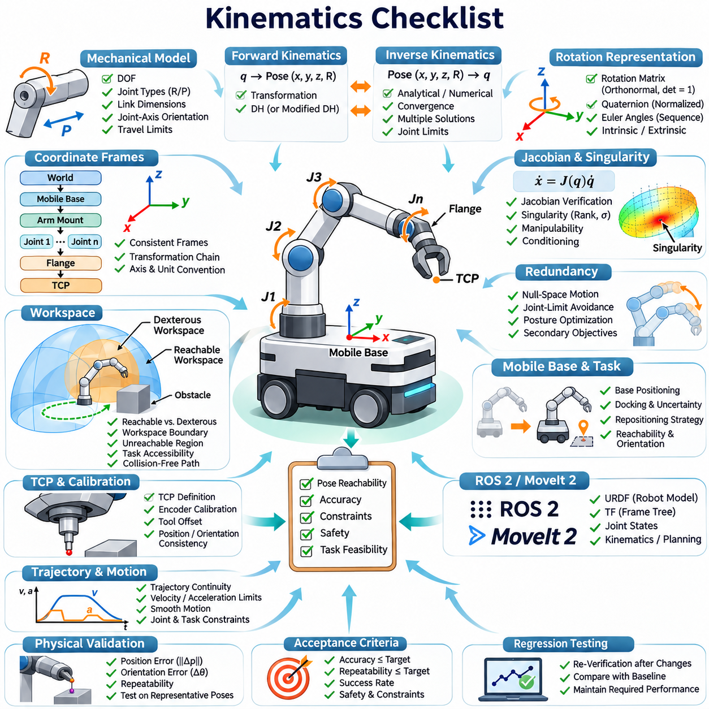
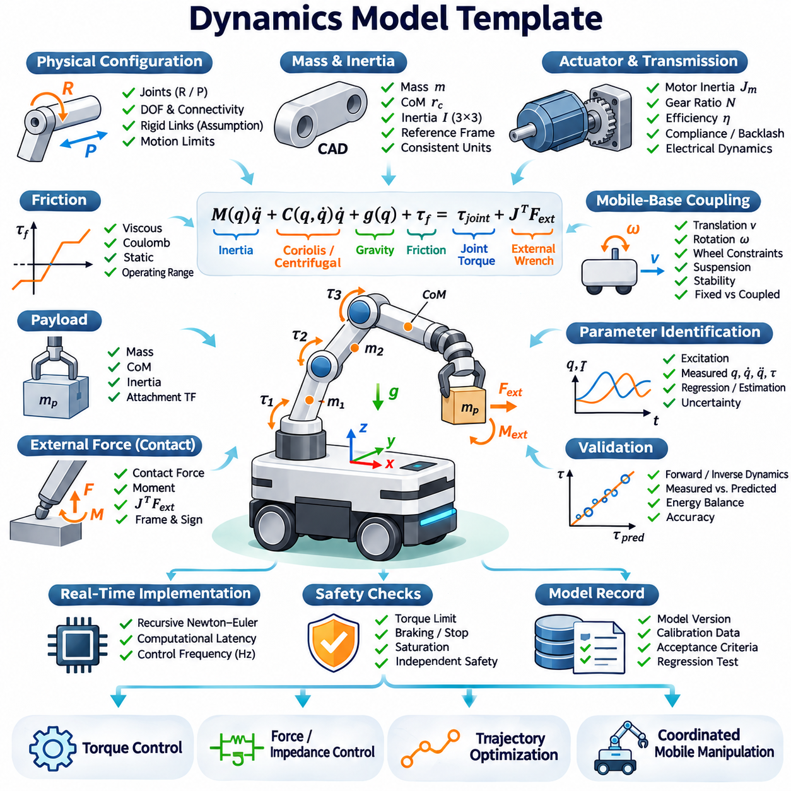
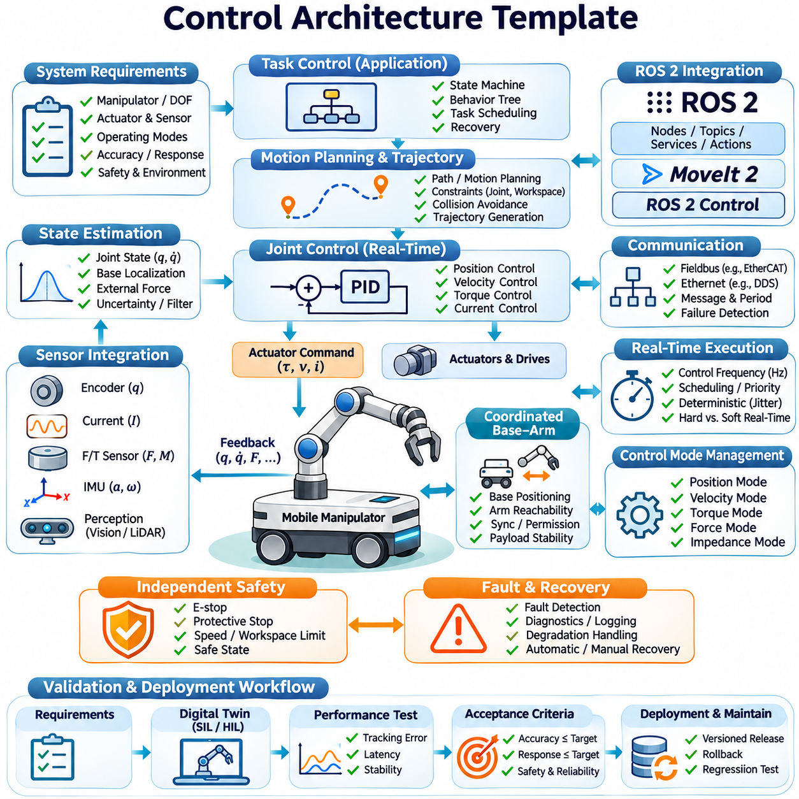
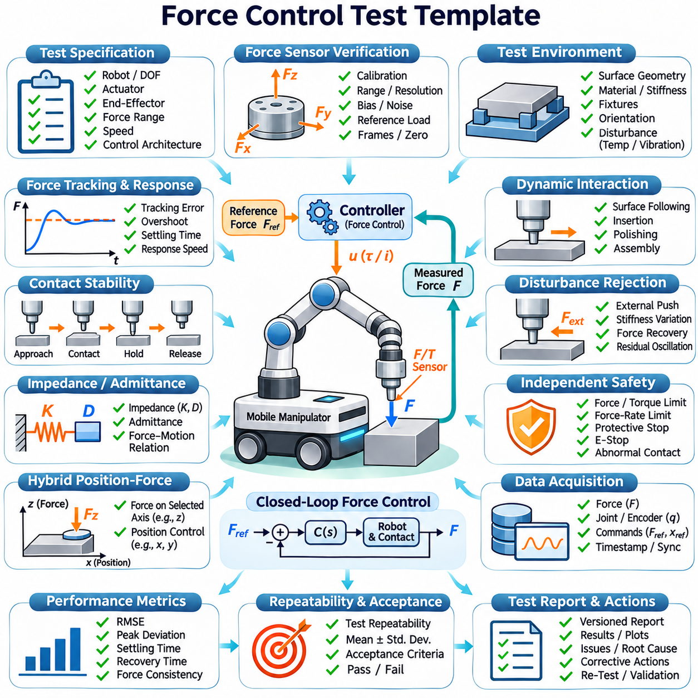
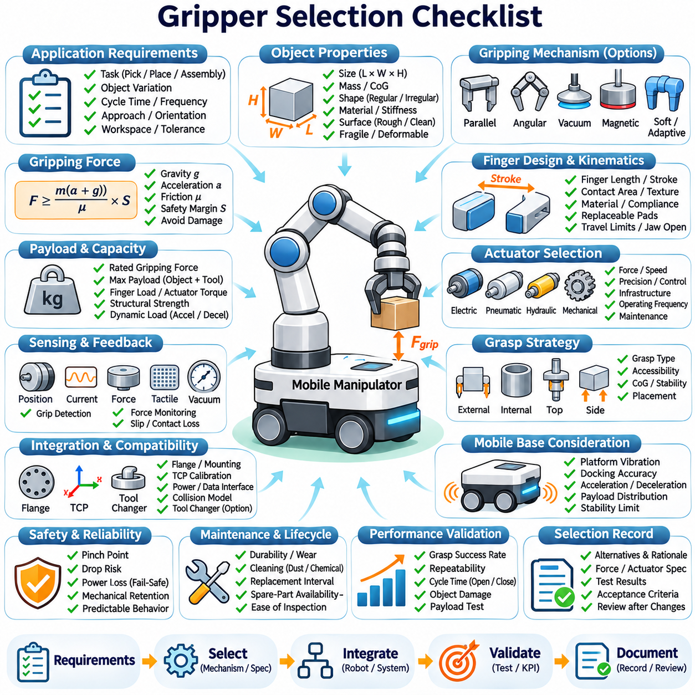
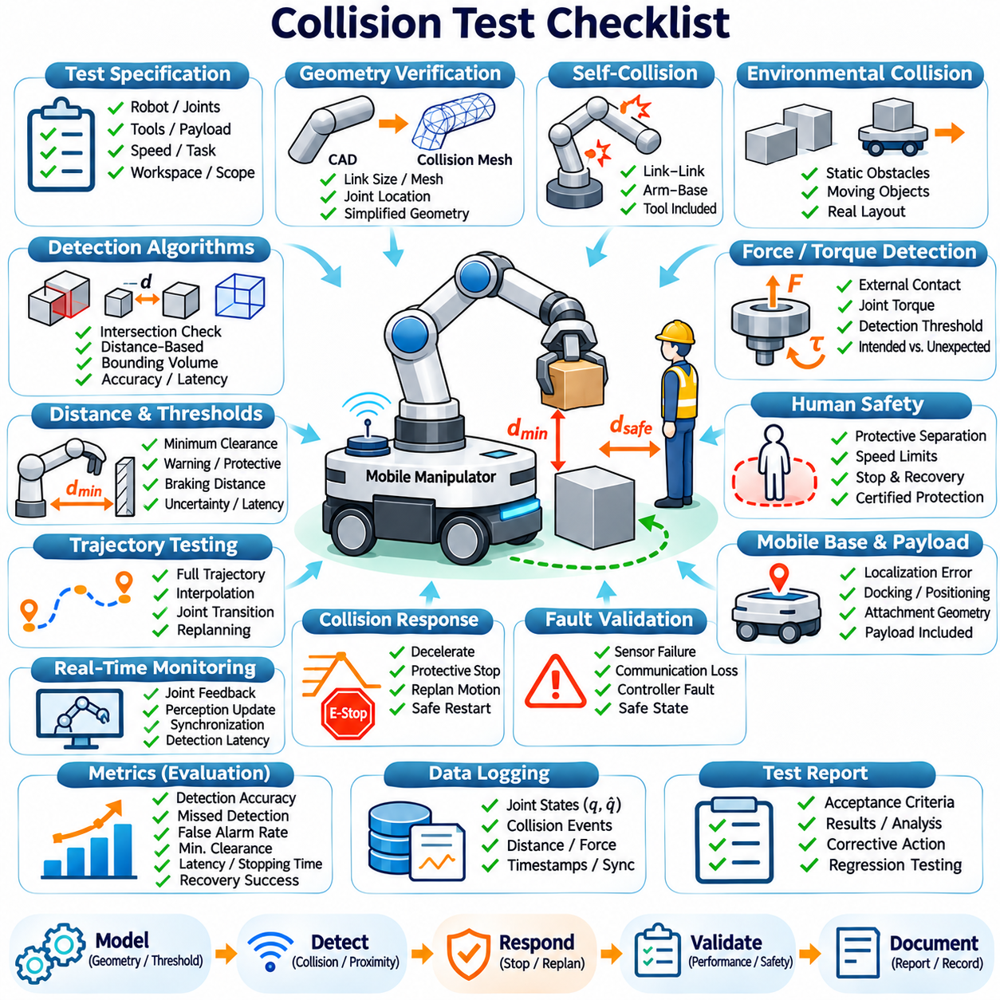
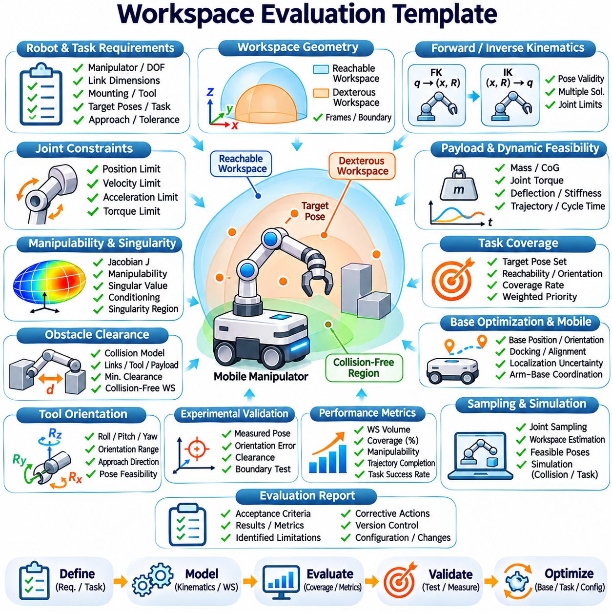

**Volume 02. Manipulator Mechanics and Control**


# Chapter 16. Checklists and Templates

##  

## 01 Kinematics Checklist

{width="7.268055555555556in" height="7.268055555555556in"}

A kinematics checklist provides a systematic method for verifying that a robotic manipulator can achieve its required positions, orientations, and movements within defined mechanical constraints. It connects geometric modeling, coordinate transformations, joint configurations, workspace analysis, and motion feasibility into a unified engineering review. For mobile manipulators, the checklist must also consider the relationship between the robotic arm and its moving platform.

The initial verification examines the manipulator configuration and mechanical structure. Engineers confirm the number of degrees of freedom, joint types, link dimensions, joint-axis orientations, and mechanical travel limits. Revolute and prismatic joints must be represented consistently with the physical mechanism. Link offsets, mounting geometry, and actuator arrangements should match the approved mechanical design and the corresponding digital model.

Coordinate frame verification establishes a consistent geometric reference system throughout the robot. The checklist examines the world frame, mobile base frame, manipulator mounting frame, individual joint frames, flange frame, and tool center point. Every transformation must follow a documented convention, including axis orientation, rotation order, and unit definitions. Incorrect frame relationships can produce substantial positioning errors even when individual joint measurements are accurate.

Forward kinematics validation confirms that the mathematical model correctly converts joint configurations into end-effector positions and orientations. Engineers review transformation matrices, Denavit--Hartenberg parameters, modified DH conventions, or equivalent rigid-body formulations. The calculated poses should be compared against independent geometric calculations, simulation results, and physical measurements across representative joint configurations.

Rotation representation requires particular attention because orientation errors frequently originate from inconsistent mathematical conventions. Rotation matrices must remain orthonormal with a determinant of positive one, while quaternions must satisfy normalization requirements. Euler-angle sequences and intrinsic or extrinsic rotation conventions must be explicitly identified. Conversion tests should confirm that equivalent representations produce consistent physical orientations.

Inverse kinematics verification determines whether the manipulator can generate valid joint configurations for specified end-effector targets. The checklist examines analytical and numerical solution methods, convergence behavior, solution accuracy, and computational efficiency. Multiple valid solutions should be evaluated when available. Each candidate must satisfy joint limits, geometric constraints, and the intended operational configuration before being accepted.

Numerical inverse kinematics methods require additional checks for initialization sensitivity and convergence reliability. Engineers should evaluate solver behavior using different initial joint configurations, target positions, and orientation requirements. Termination thresholds, maximum iterations, and numerical tolerances must be documented. Unreachable targets should produce explicit failure results rather than unstable joint commands or misleading success indications.

Jacobian verification establishes whether the manipulator model correctly relates joint velocities to end-effector linear and angular velocities. Analytical Jacobians should be compared with finite-difference approximations at representative configurations. Frame consistency, angular velocity conventions, and matrix dimensions must be checked. These tests help identify incorrect joint-axis definitions, transformation ordering errors, and implementation defects.

Singularity assessment identifies configurations where the manipulator loses instantaneous motion capability in one or more Cartesian directions. The checklist evaluates Jacobian rank, singular values, manipulability measures, and conditioning across the operational workspace. Engineers should determine whether singularities occur near frequently used task poses. Appropriate avoidance strategies, damping methods, and operational restrictions must then be documented.

Workspace evaluation verifies the geometric region accessible to the end effector under the manipulator\'s joint constraints. Reachable workspace and dexterous workspace should be distinguished because reaching a position does not guarantee the ability to achieve every required orientation. Engineers examine workspace boundaries, internal unreachable regions, and task-specific accessibility. Representative target poses should be tested rather than relying exclusively on maximum reach specifications.

Redundant manipulators require verification of how additional degrees of freedom are managed. Null-space motion, joint-limit avoidance, posture optimization, and secondary objectives must preserve the primary end-effector task within defined tolerances. The checklist should evaluate whether redundancy resolution introduces unexpected joint movement or unstable transitions. Consistency between successive solutions is particularly important during continuous manipulation.

For mobile manipulators, the relationship between mobile base positioning and arm kinematics introduces additional verification requirements. The complete transformation chain must include world localization, mobile base pose, arm mounting geometry, and tool coordinates. Base position and orientation uncertainty should be considered when evaluating end-effector accuracy. Any movement of the platform changes the global relationship between the manipulator and its task environment.

Base positioning accuracy must be evaluated together with arm reachability and task orientation requirements. Engineers should verify that expected docking or localization deviations do not place target poses outside the feasible workspace. The checklist should also examine whether small base orientation errors produce unacceptable tool-position deviations. Repositioning strategies may be required when the manipulator cannot compensate for accumulated geometric uncertainty.

Tool center point calibration ensures that the mathematical end-effector reference corresponds to the actual working point of the installed tool. Grippers, inspection cameras, welding torches, and assembly tools may introduce different offsets and orientation requirements. Engineers must verify the transformation between the robot flange and the functional tool frame. Tool replacement or mechanical adjustment should trigger recalibration and renewed kinematic validation.

Joint encoder calibration and mechanical zero-position verification are essential for maintaining agreement between mathematical models and physical hardware. Encoder offsets, joint direction conventions, transmission ratios, and homing procedures should be checked against reference configurations. Small calibration errors can accumulate through multiple links and produce significant end-effector deviations. Calibration results should be recorded with measurement conditions and acceptance tolerances.

Collision-related geometric verification examines whether valid kinematic solutions remain compatible with the physical structure and surrounding environment. Self-collision constraints, arm-to-base interference, tool geometry, and nearby equipment must be represented accurately. A mathematically reachable pose may still be operationally prohibited. The checklist should therefore distinguish geometric reachability from collision-free feasibility and confirm that both conditions are satisfied.

Trajectory-level verification extends kinematic testing beyond isolated target poses. Engineers evaluate joint continuity, velocity limits, acceleration constraints, and Cartesian path consistency across complete movements. Interpolation between valid endpoints can still encounter singularities, joint-limit violations, or inaccessible intermediate poses. Representative trajectories should therefore be checked through simulation and controlled physical execution before operational deployment.

Software integration verification confirms that kinematic models are interpreted consistently by robot controllers, simulation environments, and motion-planning frameworks. In ROS 2 and MoveIt 2 environments, URDF descriptions, joint states, TF transformations, and planning group definitions require careful review. The checklist should identify discrepancies between model geometry, measured joint feedback, and planned end-effector poses during runtime.

Kinematic accuracy testing should cover repeatability, absolute positioning error, orientation error, and sensitivity to configuration changes. Measurements must use traceable reference procedures and clearly defined coordinate frames. Tests should include central workspace positions, boundary regions, and challenging orientations. Repeated measurements help distinguish systematic model errors from random variation, mechanical backlash, and measurement uncertainty.

Validation documentation should preserve the robot configuration, model revision, calibration parameters, test conditions, expected results, and observed deviations. Each verification item requires an objective acceptance criterion and a recorded outcome. Failed tests should identify the affected subsystem, likely causes, and required corrective actions. Changes to link geometry, joint offsets, software conventions, or mounted tools should initiate appropriate regression testing.

The completed kinematics checklist serves as an engineering baseline for subsequent dynamics modeling, motion planning, control development, and system integration. Its purpose is not simply to confirm that mathematical equations execute successfully, but to demonstrate agreement between the digital model and the physical robot. Reliable kinematic verification reduces integration risk and supports accurate, repeatable, and safe manipulation in industrial environments.

운동학 점검표(Kinematics Checklist)는 로봇 매니퓰레이터(Robotic Manipulator)가 정의된 기계적 제약 조건(Mechanical Constraints) 내에서 요구되는 위치(Position), 자세(Orientation), 운동(Motion)을 정확하게 수행할 수 있는지 체계적으로 검증하는 방법을 제공한다. 이 점검표는 기하학적 모델링(Geometric Modeling), 좌표 변환(Coordinate Transformation), 관절 구성(Joint Configuration), 작업 공간 분석(Workspace Analysis), 운동 실현 가능성(Motion Feasibility)을 통합된 엔지니어링 검토 절차로 연결한다. 모바일 매니퓰레이터(Mobile Manipulator)의 경우 로봇 팔(Robot Arm)과 이동 플랫폼(Mobile Platform) 사이의 관계도 함께 고려해야 한다.

초기 검증(Initial Verification)에서는 매니퓰레이터 구성(Manipulator Configuration)과 기계적 구조(Mechanical Structure)를 검토한다. 엔지니어는 자유도(Degrees of Freedom), 관절 유형(Joint Types), 링크 치수(Link Dimensions), 관절 축 방향(Joint-Axis Orientations), 기계적 이동 한계(Mechanical Travel Limits)를 확인한다. 회전 관절(Revolute Joint)과 직동 관절(Prismatic Joint)은 실제 기계 구조와 일관되게 표현되어야 한다. 링크 오프셋(Link Offset), 장착 형상(Mounting Geometry), 액추에이터 배치(Actuator Arrangement)는 승인된 기계 설계(Mechanical Design) 및 해당 디지털 모델(Digital Model)과 일치해야 한다.

좌표계 검증(Coordinate Frame Verification)은 로봇 전체에서 일관된 기하학적 기준 체계(Geometric Reference System)를 확립한다. 점검표에서는 월드 좌표계(World Frame), 이동 베이스 좌표계(Mobile Base Frame), 매니퓰레이터 장착 좌표계(Manipulator Mounting Frame), 개별 관절 좌표계(Joint Frame), 플랜지 좌표계(Flange Frame), 공구 중심점(Tool Center Point, TCP)을 검토한다. 모든 변환(Transformation)은 축 방향(Axis Orientation), 회전 순서(Rotation Order), 단위 정의(Unit Definition)를 포함하여 문서화된 규약(Convention)을 따라야 한다. 좌표계 관계가 잘못 설정되면 개별 관절 측정값이 정확하더라도 상당한 위치 오차(Positioning Error)가 발생할 수 있다.

순기구학 검증(Forward Kinematics Validation)은 수학적 모델(Mathematical Model)이 관절 구성(Joint Configuration)을 말단 효과기(End Effector)의 위치와 자세로 정확하게 변환하는지 확인한다. 엔지니어는 변환 행렬(Transformation Matrix), 데나비트--하텐버그 파라미터(Denavit--Hartenberg Parameters), 수정 DH 규약(Modified DH Convention) 또는 이에 상응하는 강체 변환 공식(Rigid-Body Formulation)을 검토한다. 계산된 자세(Calculated Pose)는 대표적인 관절 구성에서 독립적인 기하학적 계산(Geometric Calculation), 시뮬레이션 결과(Simulation Results), 실제 측정값(Physical Measurements)과 비교해야 한다.

회전 표현(Rotation Representation)은 수학적 규약의 불일치로 인해 자세 오차(Orientation Error)가 자주 발생하므로 특별한 주의가 필요하다. 회전 행렬(Rotation Matrix)은 직교정규성(Orthonormality)을 유지하고 행렬식(Determinant)이 양의 1이어야 하며, 쿼터니언(Quaternion)은 정규화 조건(Normalization Requirements)을 만족해야 한다. 오일러 각(Euler Angles)의 회전 순서와 내재적 회전(Intrinsic Rotation) 또는 외재적 회전(Extrinsic Rotation) 규약을 명확하게 정의해야 한다. 변환 시험(Conversion Test)을 통해 동등한 회전 표현이 일관된 물리적 자세를 생성하는지 확인해야 한다.

역기구학 검증(Inverse Kinematics Verification)은 지정된 말단 효과기 목표 자세(Target End-Effector Pose)에 대해 매니퓰레이터가 유효한 관절 구성을 생성할 수 있는지 판단한다. 점검표에서는 해석적 방법(Analytical Methods)과 수치적 방법(Numerical Methods), 수렴 특성(Convergence Behavior), 해의 정확도(Solution Accuracy), 계산 효율성(Computational Efficiency)을 검토한다. 여러 유효 해(Valid Solutions)가 존재하는 경우 각각을 평가해야 한다. 모든 후보 해(Candidate Solution)는 승인되기 전에 관절 한계(Joint Limits), 기하학적 제약 조건(Geometric Constraints), 의도된 운용 구성(Operational Configuration)을 만족해야 한다.

수치적 역기구학 방법(Numerical Inverse Kinematics Methods)은 초기값 민감도(Initialization Sensitivity)와 수렴 신뢰성(Convergence Reliability)에 대한 추가 검증이 필요하다. 엔지니어는 다양한 초기 관절 구성(Initial Joint Configurations), 목표 위치(Target Positions), 자세 요구사항(Orientation Requirements)을 사용하여 해석기의 동작을 평가해야 한다. 종료 임계값(Termination Thresholds), 최대 반복 횟수(Maximum Iterations), 수치 허용오차(Numerical Tolerances)를 문서화해야 한다. 도달할 수 없는 목표(Unreachable Target)에 대해서는 불안정한 관절 명령이나 잘못된 성공 판정 대신 명확한 실패 결과(Failure Result)를 반환해야 한다.

자코비안 검증(Jacobian Verification)은 매니퓰레이터 모델이 관절 속도(Joint Velocity)와 말단 효과기의 선속도(Linear Velocity) 및 각속도(Angular Velocity) 사이의 관계를 정확하게 표현하는지 확인한다. 해석적 자코비안(Analytical Jacobian)은 대표적인 관절 구성에서 유한차분 근사(Finite-Difference Approximation)와 비교해야 한다. 좌표계 일관성(Frame Consistency), 각속도 규약(Angular Velocity Convention), 행렬 차원(Matrix Dimensions)을 확인해야 한다. 이러한 시험은 잘못된 관절 축 정의, 변환 순서 오류, 구현 결함(Implementation Defects)을 식별하는 데 도움이 된다.

특이점 평가(Singularity Assessment)는 매니퓰레이터가 하나 이상의 직교 좌표 방향(Cartesian Direction)에서 순간적인 운동 능력(Instantaneous Motion Capability)을 상실하는 구성을 식별한다. 점검표에서는 운용 작업 공간(Operational Workspace) 전체에 걸쳐 자코비안 계수(Jacobian Rank), 특이값(Singular Values), 조작성 지표(Manipulability Measures), 조건 특성(Conditioning)을 평가한다. 엔지니어는 자주 사용하는 작업 자세(Task Pose) 근처에서 특이점이 발생하는지 판단해야 한다. 이후 적절한 특이점 회피 전략(Singularity Avoidance Strategies), 감쇠 기법(Damping Methods), 운용 제한 조건(Operational Restrictions)을 문서화해야 한다.

작업 공간 평가(Workspace Evaluation)는 관절 제약 조건(Joint Constraints)하에서 말단 효과기가 접근할 수 있는 기하학적 영역(Geometric Region)을 검증한다. 특정 위치에 도달할 수 있다고 해서 요구되는 모든 자세를 구현할 수 있는 것은 아니므로 도달 가능 작업 공간(Reachable Workspace)과 자유 자세 작업 공간(Dexterous Workspace)을 구분해야 한다. 엔지니어는 작업 공간 경계(Workspace Boundaries), 내부 도달 불가능 영역(Internal Unreachable Regions), 작업별 접근성(Task-Specific Accessibility)을 검토한다. 최대 도달 거리(Maximum Reach) 사양에만 의존하지 않고 대표적인 목표 자세를 시험해야 한다.

여유 자유도 매니퓰레이터(Redundant Manipulator)는 추가 자유도(Additional Degrees of Freedom)를 관리하는 방식에 대한 검증이 필요하다. 영공간 운동(Null-Space Motion), 관절 한계 회피(Joint-Limit Avoidance), 자세 최적화(Posture Optimization), 보조 목적(Secondary Objectives)은 정의된 허용오차 내에서 주요 말단 효과기 작업(Primary End-Effector Task)을 유지해야 한다. 점검표에서는 여유 자유도 해석(Redundancy Resolution)이 예상하지 못한 관절 움직임이나 불안정한 전환을 유발하는지 평가해야 한다. 연속적인 매니퓰레이션(Continuous Manipulation)에서는 연속 해(Successive Solutions) 사이의 일관성이 특히 중요하다.

모바일 매니퓰레이터에서는 이동 베이스 위치 결정(Mobile Base Positioning)과 로봇 팔 운동학(Arm Kinematics)의 관계로 인해 추가적인 검증 요구사항이 발생한다. 전체 변환 체인(Transformation Chain)에는 월드 위치 추정(World Localization), 이동 베이스 자세(Mobile Base Pose), 로봇 팔 장착 형상(Arm Mounting Geometry), 공구 좌표(Tool Coordinates)가 포함되어야 한다. 말단 효과기 정확도(End-Effector Accuracy)를 평가할 때 베이스 위치 및 자세의 불확실성(Base Pose Uncertainty)을 고려해야 한다. 플랫폼이 이동하면 매니퓰레이터와 작업 환경 사이의 전역적 관계(Global Relationship)가 변경된다.

베이스 위치 결정 정확도(Base Positioning Accuracy)는 로봇 팔 도달 가능성(Arm Reachability) 및 작업 자세 요구사항(Task Orientation Requirements)과 함께 평가해야 한다. 엔지니어는 예상되는 도킹 편차(Docking Deviation) 또는 위치 추정 편차(Localization Deviation)가 목표 자세를 실현 가능한 작업 공간(Feasible Workspace) 밖으로 이동시키지 않는지 확인해야 한다. 작은 베이스 자세 오차(Base Orientation Error)가 허용할 수 없는 공구 위치 편차(Tool Position Deviation)를 발생시키는지도 검토해야 한다. 매니퓰레이터가 누적된 기하학적 불확실성(Geometric Uncertainty)을 보상할 수 없는 경우 재위치 결정 전략(Repositioning Strategy)이 필요할 수 있다.

공구 중심점 보정(Tool Center Point Calibration)은 수학적 말단 효과기 기준점(Mathematical End-Effector Reference)이 실제 장착된 공구의 작업점(Working Point)과 일치하도록 보장한다. 그리퍼(Gripper), 검사 카메라(Inspection Camera), 용접 토치(Welding Torch), 조립 공구(Assembly Tool)는 서로 다른 오프셋(Offset)과 자세 요구사항을 가질 수 있다. 엔지니어는 로봇 플랜지(Robot Flange)와 기능적 공구 좌표계(Functional Tool Frame) 사이의 변환을 검증해야 한다. 공구 교체(Tool Replacement) 또는 기계적 조정(Mechanical Adjustment)이 발생하면 재보정(Recalibration)과 운동학 재검증(Kinematic Revalidation)을 수행해야 한다.

관절 엔코더 보정(Joint Encoder Calibration)과 기계적 영점 검증(Mechanical Zero-Position Verification)은 수학적 모델과 실제 하드웨어 사이의 일치성을 유지하는 데 필수적이다. 엔코더 오프셋(Encoder Offset), 관절 방향 규약(Joint Direction Convention), 감속비(Transmission Ratio), 원점 복귀 절차(Homing Procedure)를 기준 구성(Reference Configuration)과 비교해야 한다. 작은 보정 오차(Calibration Error)도 여러 링크를 거치면서 누적되어 상당한 말단 효과기 편차를 발생시킬 수 있다. 보정 결과는 측정 조건(Measurement Conditions) 및 합격 허용오차(Acceptance Tolerances)와 함께 기록해야 한다.

충돌 관련 기하학적 검증(Collision-Related Geometric Verification)은 유효한 운동학 해(Kinematic Solution)가 실제 기계 구조 및 주변 환경과 양립할 수 있는지 검토한다. 자체 충돌 제약 조건(Self-Collision Constraints), 로봇 팔과 베이스 사이의 간섭(Arm-to-Base Interference), 공구 형상(Tool Geometry), 주변 장비(Nearby Equipment)를 정확하게 표현해야 한다. 수학적으로 도달 가능한 자세라도 실제 운용에서는 금지될 수 있다. 따라서 점검표에서는 기하학적 도달 가능성(Geometric Reachability)과 충돌 없는 실현 가능성(Collision-Free Feasibility)을 구분하고 두 조건이 모두 충족되는지 확인해야 한다.

궤적 수준 검증(Trajectory-Level Verification)은 개별 목표 자세를 넘어 전체 운동 과정으로 운동학 시험을 확장한다. 엔지니어는 완전한 이동 경로에 걸쳐 관절 연속성(Joint Continuity), 속도 제한(Velocity Limits), 가속도 제약 조건(Acceleration Constraints), 직교 좌표 경로 일관성(Cartesian Path Consistency)을 평가한다. 유효한 시작점과 종료점 사이의 보간(Interpolation) 과정에서도 특이점, 관절 한계 위반, 도달 불가능한 중간 자세가 발생할 수 있다. 따라서 대표적인 궤적은 실제 운용에 배포하기 전에 시뮬레이션과 통제된 물리적 실행(Controlled Physical Execution)을 통해 검증해야 한다.

소프트웨어 통합 검증(Software Integration Verification)은 로봇 제어기(Robot Controller), 시뮬레이션 환경(Simulation Environment), 운동 계획 프레임워크(Motion-Planning Framework)가 운동학 모델을 일관되게 해석하는지 확인한다. ROS 2 및 MoveIt 2 환경에서는 URDF 로봇 기술(Robot Description), 관절 상태(Joint States), TF 좌표 변환(TF Transformations), 계획 그룹 정의(Planning Group Definitions)를 면밀하게 검토해야 한다. 점검표에서는 실행 중 모델 형상(Model Geometry), 측정된 관절 피드백(Measured Joint Feedback), 계획된 말단 효과기 자세(Planned End-Effector Pose) 사이의 불일치를 식별해야 한다.

운동학 정확도 시험(Kinematic Accuracy Testing)은 반복정밀도(Repeatability), 절대 위치 오차(Absolute Positioning Error), 자세 오차(Orientation Error), 구성 변화에 대한 민감도(Configuration Sensitivity)를 포함해야 한다. 측정에는 추적 가능한 기준 절차(Traceable Reference Procedures)와 명확하게 정의된 좌표계를 사용해야 한다. 시험에는 작업 공간 중심부(Central Workspace), 경계 영역(Boundary Regions), 구현이 어려운 자세(Challenging Orientations)가 포함되어야 한다. 반복 측정(Repeated Measurements)은 체계적 모델 오차(Systematic Model Error)를 무작위 변동(Random Variation), 기계적 백래시(Mechanical Backlash), 측정 불확실성(Measurement Uncertainty)과 구분하는 데 도움이 된다.

검증 문서(Validation Documentation)에는 로봇 구성(Robot Configuration), 모델 개정 정보(Model Revision), 보정 파라미터(Calibration Parameters), 시험 조건(Test Conditions), 예상 결과(Expected Results), 관측된 편차(Observed Deviations)를 보존해야 한다. 각 검증 항목(Verification Item)에는 객관적인 합격 기준(Objective Acceptance Criterion)과 기록된 결과(Recorded Outcome)가 필요하다. 실패한 시험(Failed Test)은 영향을 받은 하위 시스템(Subsystem), 가능한 원인(Probable Causes), 필요한 시정 조치(Corrective Actions)를 식별해야 한다. 링크 형상, 관절 오프셋, 소프트웨어 규약 또는 장착 공구가 변경되면 적절한 회귀 시험(Regression Testing)을 수행해야 한다.

완성된 운동학 점검표(Kinematics Checklist)는 이후 동역학 모델링(Dynamics Modeling), 운동 계획(Motion Planning), 제어 개발(Control Development), 시스템 통합(System Integration)을 위한 엔지니어링 기준선(Engineering Baseline)으로 활용된다. 그 목적은 단순히 수학적 방정식이 정상적으로 실행되는지 확인하는 것이 아니라 디지털 모델(Digital Model)과 실제 로봇(Physical Robot) 사이의 일치성을 입증하는 데 있다. 신뢰할 수 있는 운동학 검증(Kinematic Verification)은 통합 위험(Integration Risk)을 줄이고 산업 환경에서 정확하고 반복 가능하며 안전한 매니퓰레이션(Manipulation)을 지원한다.

##  

## 02 Dynamics Model Template

{width="7.268055555555556in" height="7.268055555555556in"}

A dynamics model template provides a standardized framework for describing the forces, torques, and mechanical interactions governing robotic manipulator motion. Unlike kinematic models, which describe geometric relationships without considering forces, dynamic models explain how actuator inputs produce motion under inertia, gravity, friction, and external loads. A consistent template supports simulation, controller development, system identification, and engineering validation.

The template begins with a description of the manipulator\'s physical configuration and modeling assumptions. Engineers document the number of joints, link connectivity, actuator types, transmission mechanisms, and operating conditions. Each joint is classified as revolute or prismatic, while mechanical constraints and allowable motion ranges are specified. Simplifying assumptions, including rigid links or negligible structural deformation, must be explicitly recorded.

Mass and inertia properties form the foundation of an accurate dynamic model. For every link, the template records mass, center-of-mass coordinates, inertia tensor, and reference coordinate frame. These parameters should originate from validated CAD models, manufacturer specifications, or experimental measurements. Inertia tensors must satisfy physical consistency requirements, and all values should use a common unit system to prevent modeling errors.

The mathematical formulation describes the relationship between joint motion and generalized forces. A standard rigid-body manipulator model includes an inertia matrix, Coriolis and centrifugal effects, gravitational forces, friction, and external joint torques. The template identifies the generalized coordinates, velocity variables, acceleration variables, and torque conventions. Each mathematical term must correspond to a clearly defined physical phenomenon.

The inertia matrix represents the configuration-dependent resistance of the manipulator to joint acceleration. Engineers verify its dimensions, symmetry, and positive definiteness for physically valid unconstrained coordinates. Changes in arm posture alter the distribution of mass relative to the joint axes, producing variations in required actuator torque. The template should document how inertia properties are calculated and validated across representative configurations.

Coriolis and centrifugal terms describe velocity-dependent interactions between moving links. These effects become increasingly important during coordinated multi-joint motion and high-speed operation. The template specifies the mathematical convention used to represent these terms because different formulations may produce equivalent generalized forces. Numerical tests should verify consistency with the inertia matrix and the selected equations of motion.

Gravity compensation modeling determines the joint torques required to balance gravitational loading at different manipulator configurations. The template records gravitational acceleration, reference frame orientation, payload assumptions, and link mass distributions. Predicted gravity torques should be compared against measured holding torques when practical. This verification is especially important for vertically articulated manipulators carrying variable payloads.

Friction modeling addresses mechanical resistance within joints, transmissions, bearings, and actuators. Common representations include viscous friction, Coulomb friction, and static friction effects. The template identifies which components are included and documents their parameters and operating ranges. Because friction behavior can depend on temperature, speed, and loading conditions, experimental characterization may be necessary for high-accuracy control.

Actuator and transmission dynamics extend the model beyond ideal joint torque generation. Engineers document motor inertia, gear ratios, transmission efficiency, torque constants, and actuator limitations. When relevant, electrical dynamics, gearbox compliance, and backlash are included. The template distinguishes commanded motor torque from actual joint torque, ensuring that control algorithms account for mechanical and electrical conversion effects.

Payload modeling describes how attached tools and manipulated objects influence the robot\'s dynamic behavior. The template records payload mass, center of gravity, inertia properties, and attachment transformation. Changes in payload configuration modify gravitational loading and joint acceleration requirements. Engineers should evaluate representative minimum, nominal, and maximum payload conditions to establish reliable operating limits.

External force modeling represents interactions between the manipulator and its environment. Contact forces, tool reactions, and externally applied moments can be transformed into generalized joint torques using the manipulator Jacobian. The template specifies force measurement frames, sign conventions, and contact assumptions. This information is essential for force control, impedance control, assembly operations, and collision-response analysis.

For mobile manipulators, the dynamics template must consider interactions between the robotic arm and mobile platform. Arm acceleration and payload movement can generate reaction forces and moments transmitted through the mounting structure. Depending on the application, the platform may be treated as stationary or included in a coupled dynamic model. The selected assumption must reflect the intended operating conditions and platform stability requirements.

A coupled mobile manipulation model may include base translation, base rotation, wheel constraints, suspension behavior, and manipulator joint motion. Engineers should distinguish holonomic and nonholonomic platform constraints when constructing the equations of motion. The template documents whether base motion is prescribed, controlled independently, or dynamically coupled with arm motion. This distinction affects simulation fidelity and coordinated control design.

Dynamic parameter identification provides a practical method for refining uncertain model properties. Experimental trajectories are executed while collecting joint positions, velocities, accelerations, and actuator torque estimates. Regression-based identification can estimate combinations of inertial and friction parameters that are observable from the measurements. The template should document excitation trajectories, filtering procedures, estimation methods, and parameter uncertainty.

Simulation validation compares predicted manipulator behavior against numerical reference models and physical experiments. Forward dynamics tests calculate motion from applied torques, while inverse dynamics tests estimate torques required for prescribed trajectories. Engineers examine trajectory agreement, torque prediction error, and numerical stability. Representative tests should cover different postures, speeds, payloads, and external loading conditions.

Energy consistency provides an additional verification method for dynamic equations. In the absence of dissipative forces and external energy inputs, the model should satisfy the expected mechanical energy balance. Kinetic and potential energy calculations can reveal errors in inertia, gravity, or velocity-dependent terms. The template should include energy-based checks alongside direct comparisons of simulated and measured motion.

Real-time implementation requirements determine whether the dynamic model can support practical robot control. Engineers document computation frequency, execution latency, numerical precision, and processor utilization. Recursive Newton--Euler algorithms may be selected for efficient inverse dynamics computation, while other formulations support simulation and optimization. Model complexity must be balanced against timing constraints and the required control accuracy.

Safety-related dynamic verification examines predicted torque limits, acceleration constraints, braking behavior, and mechanical loading. The model should identify conditions where actuator saturation or excessive joint loading may occur. Dynamic predictions can support protective control strategies, but they do not replace independent safety mechanisms. Conservative parameter bounds and uncertainty margins should be considered during safety-related engineering evaluations.

The completed template should include model identification information, software versions, parameter sources, coordinate conventions, validation datasets, and acceptance criteria. Every model revision must remain traceable to the corresponding mechanical configuration and calibration state. Discrepancies between predicted and measured behavior should be documented with corrective actions. Version-controlled records support reproducibility and regression testing throughout development.

A standardized dynamics model template establishes a reliable foundation for torque control, gravity compensation, force interaction, trajectory optimization, and mobile manipulation coordination. Its engineering value depends on the consistency between mathematical assumptions, physical parameters, and measured robot behavior. Thorough documentation and validation transform the dynamic model from a theoretical representation into a practical tool for robust industrial robotic systems.

동역학 모델 템플릿(Dynamics Model Template)은 로봇 매니퓰레이터(Robotic Manipulator)의 운동을 지배하는 힘(Force), 토크(Torque), 기계적 상호작용(Mechanical Interaction)을 기술하기 위한 표준화된 프레임워크(Standardized Framework)를 제공한다. 힘을 고려하지 않고 기하학적 관계를 설명하는 운동학 모델(Kinematic Model)과 달리, 동역학 모델(Dynamic Model)은 관성(Inertia), 중력(Gravity), 마찰(Friction), 외부 하중(External Load)의 영향을 받는 상태에서 액추에이터 입력(Actuator Input)이 어떻게 운동을 발생시키는지 설명한다. 일관된 템플릿은 시뮬레이션(Simulation), 제어기 개발(Controller Development), 시스템 식별(System Identification), 엔지니어링 검증(Engineering Validation)을 지원한다.

템플릿은 매니퓰레이터의 물리적 구성(Physical Configuration)과 모델링 가정(Modeling Assumptions)을 설명하는 것으로 시작한다. 엔지니어는 관절 수(Number of Joints), 링크 연결 구조(Link Connectivity), 액추에이터 유형(Actuator Types), 동력 전달 기구(Transmission Mechanisms), 운용 조건(Operating Conditions)을 문서화한다. 각 관절은 회전 관절(Revolute Joint) 또는 직동 관절(Prismatic Joint)로 분류하며, 기계적 제약 조건(Mechanical Constraints)과 허용 운동 범위(Allowable Motion Ranges)를 명시한다. 강체 링크(Rigid Links) 또는 무시할 수 있는 구조 변형(Negligible Structural Deformation)과 같은 단순화 가정(Simplifying Assumptions)은 명확하게 기록해야 한다.

질량 및 관성 특성(Mass and Inertia Properties)은 정확한 동역학 모델의 기초를 형성한다. 템플릿에는 각 링크(Link)의 질량(Mass), 질량중심 좌표(Center-of-Mass Coordinates), 관성 텐서(Inertia Tensor), 기준 좌표계(Reference Coordinate Frame)를 기록한다. 이러한 파라미터는 검증된 CAD 모델(Validated CAD Models), 제조사 사양(Manufacturer Specifications), 실험 측정값(Experimental Measurements)에서 확보해야 한다. 관성 텐서는 물리적 일관성 요구사항(Physical Consistency Requirements)을 만족해야 하며, 모델링 오류를 방지하기 위해 모든 값에 공통 단위계(Common Unit System)를 적용해야 한다.

수학적 정식화(Mathematical Formulation)는 관절 운동(Joint Motion)과 일반화 힘(Generalized Forces) 사이의 관계를 설명한다. 표준 강체 매니퓰레이터 모델(Standard Rigid-Body Manipulator Model)에는 관성 행렬(Inertia Matrix), 코리올리 및 원심 효과(Coriolis and Centrifugal Effects), 중력(Gravitational Forces), 마찰(Friction), 외부 관절 토크(External Joint Torques)가 포함된다. 템플릿에서는 일반화 좌표(Generalized Coordinates), 속도 변수(Velocity Variables), 가속도 변수(Acceleration Variables), 토크 규약(Torque Conventions)을 정의한다. 각 수학적 항(Mathematical Term)은 명확하게 정의된 물리적 현상(Physical Phenomenon)에 대응해야 한다.

관성 행렬(Inertia Matrix)은 관절 가속도(Joint Acceleration)에 대한 매니퓰레이터의 구성 의존적 저항(Configuration-Dependent Resistance)을 나타낸다. 엔지니어는 물리적으로 유효한 비구속 좌표(Unconstrained Coordinates)에 대해 행렬의 차원(Dimensions), 대칭성(Symmetry), 양의 정부호성(Positive Definiteness)을 검증한다. 로봇 팔 자세(Arm Posture)가 변하면 관절 축(Joint Axes)에 대한 질량 분포(Mass Distribution)가 달라지고, 이에 따라 필요한 액추에이터 토크(Actuator Torque)도 변화한다. 템플릿에는 대표적인 구성(Representative Configurations)에서 관성 특성을 계산하고 검증하는 방법을 문서화해야 한다.

코리올리 및 원심 항(Coriolis and Centrifugal Terms)은 움직이는 링크 사이에서 발생하는 속도 의존적 상호작용(Velocity-Dependent Interactions)을 설명한다. 이러한 효과는 다관절 협조 운동(Coordinated Multi-Joint Motion)과 고속 운전(High-Speed Operation)에서 더욱 중요해진다. 서로 다른 수학적 정식화가 동일한 일반화 힘(Generalized Forces)을 생성할 수 있으므로, 템플릿에서는 해당 항을 표현하는 수학적 규약(Mathematical Convention)을 명시한다. 수치 시험(Numerical Tests)을 통해 관성 행렬 및 선택된 운동 방정식(Equations of Motion)과의 일관성을 검증해야 한다.

중력 보상 모델링(Gravity Compensation Modeling)은 다양한 매니퓰레이터 구성에서 중력 하중(Gravitational Loading)을 평형 상태로 유지하는 데 필요한 관절 토크(Joint Torques)를 결정한다. 템플릿에는 중력 가속도(Gravitational Acceleration), 기준 좌표계 방향(Reference Frame Orientation), 페이로드 가정(Payload Assumptions), 링크 질량 분포(Link Mass Distributions)를 기록한다. 가능한 경우 예측된 중력 토크(Predicted Gravity Torques)를 실제 측정된 자세 유지 토크(Measured Holding Torques)와 비교해야 한다. 이러한 검증은 가변 페이로드(Variable Payloads)를 운반하는 수직 다관절 매니퓰레이터(Vertically Articulated Manipulators)에서 특히 중요하다.

마찰 모델링(Friction Modeling)은 관절(Joints), 동력 전달 장치(Transmissions), 베어링(Bearings), 액추에이터(Actuators) 내부에서 발생하는 기계적 저항(Mechanical Resistance)을 다룬다. 일반적인 표현에는 점성 마찰(Viscous Friction), 쿨롱 마찰(Coulomb Friction), 정지 마찰 효과(Static Friction Effects)가 포함된다. 템플릿에서는 포함된 마찰 요소(Friction Components)를 식별하고 관련 파라미터와 운용 범위(Operating Ranges)를 문서화한다. 마찰 특성은 온도(Temperature), 속도(Speed), 하중 조건(Loading Conditions)에 따라 달라질 수 있으므로 고정밀 제어(High-Accuracy Control)를 위해 실험적 특성 분석(Experimental Characterization)이 필요할 수 있다.

액추에이터 및 동력 전달계 동역학(Actuator and Transmission Dynamics)은 이상적인 관절 토크 생성(Ideal Joint Torque Generation)을 넘어 모델의 범위를 확장한다. 엔지니어는 모터 관성(Motor Inertia), 기어비(Gear Ratios), 전달 효율(Transmission Efficiency), 토크 상수(Torque Constants), 액추에이터 한계(Actuator Limitations)를 문서화한다. 필요한 경우 전기적 동역학(Electrical Dynamics), 기어박스 유연성(Gearbox Compliance), 백래시(Backlash)를 포함한다. 템플릿은 명령된 모터 토크(Commanded Motor Torque)와 실제 관절 토크(Actual Joint Torque)를 구분하여 제어 알고리즘(Control Algorithms)이 기계적 및 전기적 변환 효과(Mechanical and Electrical Conversion Effects)를 고려하도록 한다.

페이로드 모델링(Payload Modeling)은 부착된 공구(Attached Tools)와 조작 대상 물체(Manipulated Objects)가 로봇의 동적 거동(Dynamic Behavior)에 미치는 영향을 설명한다. 템플릿에는 페이로드 질량(Payload Mass), 무게중심(Center of Gravity), 관성 특성(Inertia Properties), 부착 변환(Attachment Transformation)을 기록한다. 페이로드 구성(Payload Configuration)이 변경되면 중력 하중과 관절 가속도 요구사항(Joint Acceleration Requirements)도 달라진다. 엔지니어는 신뢰할 수 있는 운용 한계(Operating Limits)를 설정하기 위해 대표적인 최소, 정격, 최대 페이로드 조건(Minimum, Nominal, and Maximum Payload Conditions)을 평가해야 한다.

외력 모델링(External Force Modeling)은 매니퓰레이터와 주변 환경 사이의 상호작용을 표현한다. 접촉력(Contact Forces), 공구 반력(Tool Reactions), 외부에서 가해지는 모멘트(Externally Applied Moments)는 매니퓰레이터 자코비안(Manipulator Jacobian)을 사용하여 일반화 관절 토크(Generalized Joint Torques)로 변환할 수 있다. 템플릿에서는 힘 측정 좌표계(Force Measurement Frames), 부호 규약(Sign Conventions), 접촉 가정(Contact Assumptions)을 명시한다. 이러한 정보는 힘 제어(Force Control), 임피던스 제어(Impedance Control), 조립 작업(Assembly Operations), 충돌 대응 분석(Collision-Response Analysis)에 필수적이다.

모바일 매니퓰레이터(Mobile Manipulator)의 경우 동역학 템플릿은 로봇 팔(Robotic Arm)과 이동 플랫폼(Mobile Platform) 사이의 상호작용을 고려해야 한다. 로봇 팔 가속도(Arm Acceleration)와 페이로드 이동(Payload Movement)은 장착 구조물(Mounting Structure)을 통해 전달되는 반력(Reaction Forces)과 반력 모멘트(Reaction Moments)를 발생시킬 수 있다. 응용 분야에 따라 플랫폼을 정지 상태(Stationary)로 가정하거나 결합 동역학 모델(Coupled Dynamic Model)에 포함할 수 있다. 선택된 가정은 의도된 운용 조건(Operating Conditions)과 플랫폼 안정성 요구사항(Platform Stability Requirements)을 반영해야 한다.

결합 모바일 매니퓰레이션 모델(Coupled Mobile Manipulation Model)에는 베이스 병진 운동(Base Translation), 베이스 회전(Base Rotation), 바퀴 제약 조건(Wheel Constraints), 서스펜션 거동(Suspension Behavior), 매니퓰레이터 관절 운동(Manipulator Joint Motion)이 포함될 수 있다. 엔지니어는 운동 방정식을 구성할 때 홀로노믹 제약 조건(Holonomic Constraints)과 비홀로노믹 제약 조건(Nonholonomic Constraints)을 구분해야 한다. 템플릿에서는 베이스 운동(Base Motion)이 사전에 지정되는지, 독립적으로 제어되는지, 로봇 팔 운동과 동역학적으로 결합되는지를 문서화한다. 이러한 구분은 시뮬레이션 충실도(Simulation Fidelity)와 협조 제어 설계(Coordinated Control Design)에 영향을 미친다.

동역학 파라미터 식별(Dynamic Parameter Identification)은 불확실한 모델 특성(Model Properties)을 개선하기 위한 실용적인 방법을 제공한다. 실험 궤적(Experimental Trajectories)을 실행하면서 관절 위치(Joint Positions), 속도(Velocities), 가속도(Accelerations), 액추에이터 토크 추정값(Actuator Torque Estimates)을 수집한다. 회귀 기반 식별(Regression-Based Identification)은 측정값에서 관측 가능한 관성 및 마찰 파라미터 조합(Observable Combinations of Inertial and Friction Parameters)을 추정할 수 있다. 템플릿에는 가진 궤적(Excitation Trajectories), 필터링 절차(Filtering Procedures), 추정 방법(Estimation Methods), 파라미터 불확실성(Parameter Uncertainty)을 문서화해야 한다.

시뮬레이션 검증(Simulation Validation)은 예측된 매니퓰레이터 거동(Predicted Manipulator Behavior)을 수치 기준 모델(Numerical Reference Models) 및 실제 실험(Physical Experiments)과 비교한다. 순동역학 시험(Forward Dynamics Tests)은 적용된 토크로부터 운동을 계산하고, 역동역학 시험(Inverse Dynamics Tests)은 지정된 궤적을 수행하는 데 필요한 토크를 추정한다. 엔지니어는 궤적 일치도(Trajectory Agreement), 토크 예측 오차(Torque Prediction Error), 수치 안정성(Numerical Stability)을 검토한다. 대표적인 시험은 다양한 자세(Postures), 속도(Speeds), 페이로드(Payloads), 외부 하중 조건(External Loading Conditions)을 포함해야 한다.

에너지 일관성(Energy Consistency)은 동역학 방정식(Dynamic Equations)을 검증하기 위한 추가적인 방법을 제공한다. 소산력(Dissipative Forces)과 외부 에너지 입력(External Energy Inputs)이 없는 경우 모델은 예상되는 기계적 에너지 균형(Mechanical Energy Balance)을 만족해야 한다. 운동 에너지(Kinetic Energy)와 위치 에너지(Potential Energy)의 계산을 통해 관성, 중력 또는 속도 의존 항(Velocity-Dependent Terms)의 오류를 발견할 수 있다. 템플릿에는 시뮬레이션 및 측정된 운동의 직접 비교와 함께 에너지 기반 검증(Energy-Based Checks)을 포함해야 한다.

실시간 구현 요구사항(Real-Time Implementation Requirements)은 동역학 모델이 실제 로봇 제어를 지원할 수 있는지 결정한다. 엔지니어는 계산 주파수(Computation Frequency), 실행 지연(Execution Latency), 수치 정밀도(Numerical Precision), 프로세서 사용률(Processor Utilization)을 문서화한다. 효율적인 역동역학 계산(Inverse Dynamics Computation)을 위해 재귀 뉴턴--오일러 알고리즘(Recursive Newton--Euler Algorithm)을 선택할 수 있으며, 다른 정식화는 시뮬레이션과 최적화(Optimization)를 지원한다. 모델 복잡도(Model Complexity)는 시간 제약(Timing Constraints) 및 요구되는 제어 정확도(Control Accuracy)와 균형을 이루어야 한다.

안전 관련 동역학 검증(Safety-Related Dynamic Verification)은 예측된 토크 한계(Torque Limits), 가속도 제약 조건(Acceleration Constraints), 제동 거동(Braking Behavior), 기계적 하중(Mechanical Loading)을 검토한다. 모델은 액추에이터 포화(Actuator Saturation) 또는 과도한 관절 하중(Excessive Joint Loading)이 발생할 수 있는 조건을 식별해야 한다. 동역학 예측(Dynamic Predictions)은 보호 제어 전략(Protective Control Strategies)을 지원할 수 있지만 독립적인 안전 메커니즘(Independent Safety Mechanisms)을 대체하지는 않는다. 안전 관련 엔지니어링 평가(Safety-Related Engineering Evaluations)에서는 보수적인 파라미터 경계(Conservative Parameter Bounds)와 불확실성 여유(Uncertainty Margins)를 고려해야 한다.

완성된 템플릿에는 모델 식별 정보(Model Identification Information), 소프트웨어 버전(Software Versions), 파라미터 출처(Parameter Sources), 좌표계 규약(Coordinate Conventions), 검증 데이터셋(Validation Datasets), 합격 기준(Acceptance Criteria)이 포함되어야 한다. 모든 모델 개정(Model Revision)은 해당 기계적 구성(Mechanical Configuration) 및 보정 상태(Calibration State)와 추적 가능하게 연결되어야 한다. 예측된 거동과 측정된 거동 사이의 불일치(Discrepancies)는 시정 조치(Corrective Actions)와 함께 문서화해야 한다. 버전 관리 기록(Version-Controlled Records)은 개발 전 과정에서 재현성(Reproducibility)과 회귀 시험(Regression Testing)을 지원한다.

표준화된 동역학 모델 템플릿(Standardized Dynamics Model Template)은 토크 제어(Torque Control), 중력 보상(Gravity Compensation), 힘 상호작용(Force Interaction), 궤적 최적화(Trajectory Optimization), 모바일 매니퓰레이션 협조 제어(Mobile Manipulation Coordination)를 위한 신뢰할 수 있는 기반을 구축한다. 엔지니어링 가치(Engineering Value)는 수학적 가정(Mathematical Assumptions), 물리적 파라미터(Physical Parameters), 측정된 로봇 거동(Measured Robot Behavior) 사이의 일관성에 달려 있다. 철저한 문서화(Documentation)와 검증(Validation)은 동역학 모델을 이론적 표현(Theoretical Representation)에서 견고한 산업용 로봇 시스템(Robust Industrial Robotic Systems)을 위한 실용적인 도구로 발전시킨다.

##  

## 03 Control Architecture Template

{width="7.268055555555556in" height="7.268055555555556in"}

A control architecture template provides a standardized framework for organizing the hardware, software, communication, and control functions of a robotic manipulator. It defines how high-level task commands are translated into coordinated joint movements while maintaining accuracy, stability, and safety. For mobile manipulators, the architecture must also coordinate robotic arm operation with mobile platform behavior, environmental perception, and system-level supervision.

The template begins by defining system requirements and operational boundaries. Engineers document the manipulator configuration, degrees of freedom, actuator characteristics, sensor interfaces, and expected operating modes. Performance requirements include positioning accuracy, response time, control frequency, and allowable tracking error. Safety constraints, environmental conditions, and interaction requirements must be identified before selecting the control architecture.

A hierarchical control structure separates decision-making functions according to their timing requirements and responsibilities. High-level controllers manage task execution, motion objectives, and operational sequencing. Mid-level controllers generate trajectories and coordinate multiple joints, while low-level controllers regulate position, velocity, current, or torque. Clear separation between these layers improves modularity, maintainability, and fault isolation.

Task-level control translates application objectives into executable robot operations. The template defines how commands such as grasping, assembly, inspection, or material handling are represented and scheduled. Task execution may involve state machines, behavior trees, or workflow managers. Each operation requires explicit entry conditions, completion criteria, timeout handling, and recovery procedures to ensure predictable execution.

Motion planning and trajectory generation form the connection between task-level decisions and joint-level execution. Planning modules determine feasible paths while considering joint limits, workspace boundaries, singularities, and collision constraints. Trajectory generators convert planned paths into time-parameterized references. The template specifies planning interfaces, trajectory representations, update frequencies, and mechanisms for handling planning failures.

Joint-level control defines how actuator commands are generated from desired motion references and measured feedback. Position, velocity, and torque control modes may be implemented independently or through cascaded control loops. The template documents controller gains, feedback variables, sampling periods, and actuator saturation limits. Feedforward compensation and model-based control may be incorporated when improved tracking performance is required.

Real-time control requirements determine the execution environment for time-critical functions. Engineers specify control-loop frequencies, scheduling priorities, communication deadlines, and acceptable timing jitter. Deterministic execution is particularly important for torque regulation, force interaction, and coordinated multi-joint motion. The template should distinguish hard real-time control components from supervisory functions that tolerate variable execution delays.

Sensor integration provides the feedback required for closed-loop control. Joint encoders, motor current sensors, force-torque sensors, inertial measurement units, and external perception devices contribute different measurements. The template identifies sensor ownership, sampling rates, calibration procedures, and filtering methods. Timestamp consistency and coordinate frame alignment must be maintained when combining measurements from multiple sources.

State estimation converts raw sensor measurements into reliable representations of robot motion and operating conditions. Joint positions, velocities, actuator states, and external forces may require filtering or observer-based estimation. For mobile manipulators, base localization and orientation estimates are also necessary. The template specifies estimation algorithms, uncertainty handling, update rates, and behavior when measurements become unavailable or unreliable.

Communication architecture defines how commands, feedback, and diagnostic information move between system components. Industrial fieldbuses, Ethernet networks, and middleware interfaces may connect drives, controllers, sensors, and supervisory computers. The template records communication protocols, message definitions, update periods, and failure detection mechanisms. Critical control traffic should be isolated or prioritized according to system requirements.

ROS 2 integration provides a modular software framework for distributed robotic control. The template identifies nodes, topics, services, actions, lifecycle states, and interface definitions. ROS 2 Control can connect hardware interfaces with joint controllers, while MoveIt 2 supports manipulation planning and execution. Engineers must document responsibility boundaries between middleware coordination and deterministic actuator control.

Mobile manipulator coordination requires explicit management of interactions between the mobile base and robotic arm. The architecture defines whether manipulation occurs while the platform is stationary or during coordinated movement. Base positioning, arm reachability, payload stability, and collision constraints influence execution decisions. The template should specify synchronization mechanisms, motion permissions, and recovery behavior when positioning requirements are not satisfied.

Control mode management governs transitions between position control, velocity control, torque control, force control, and impedance control. Each mode may require different feedback signals, controller parameters, and safety limits. The template defines transition conditions, initialization procedures, and command ownership. Smooth switching mechanisms are necessary to prevent discontinuities, unintended motion, or excessive actuator forces.

Safety control architecture must remain clearly distinguished from ordinary operational control. Emergency stop functions, protective stops, speed limits, workspace restrictions, and collision monitoring require defined responsibilities. Safety-rated functions should use appropriate independent or certified mechanisms where required. The template documents fault detection, safe-state transitions, restart authorization, and interfaces between safety controllers and operational software.

Fault management establishes predictable behavior when hardware, software, or communication components fail. Engineers classify faults according to severity, operational impact, and recovery requirements. Sensor failures, actuator faults, controller timeouts, and communication interruptions require explicit responses. The template specifies diagnostic reporting, event logging, degraded operation policies, and conditions under which automatic recovery is permitted.

Software engineering practices support long-term reliability and maintainability of the control architecture. The template records module ownership, interface contracts, configuration parameters, software dependencies, and version information. Unit testing, integration testing, and automated regression testing should verify critical functionality. Configuration management ensures that deployed controller settings remain consistent with validated system configurations.

Performance validation determines whether the implemented architecture satisfies its original engineering requirements. Engineers measure trajectory tracking error, control latency, timing jitter, response stability, and recovery performance. Tests should include nominal operation, maximum payload conditions, communication disturbances, and representative fault scenarios. Results must be compared against predefined acceptance criteria and documented for future reference.

Simulation and digital twin environments provide opportunities to validate control architecture before physical deployment. Hardware-in-the-loop and software-in-the-loop testing can evaluate controller behavior, communication interfaces, and operational sequencing. Simulation models should represent relevant actuator limitations, sensor delays, and mechanical constraints. Differences between simulated and physical behavior must be identified during commissioning.

Deployment documentation should include architecture revisions, controller configurations, communication mappings, safety settings, calibration references, and validation records. Every change affecting control behavior must be traceable to its engineering justification and test results. The template should define commissioning procedures, rollback mechanisms, and maintenance responsibilities. Consistent documentation supports reproducible deployment across multiple robotic platforms.

A completed control architecture template establishes a common engineering reference for mechanical, electrical, software, and safety teams. It connects task planning, motion generation, feedback control, communication, and system supervision into a coherent operational structure. By defining interfaces, timing constraints, responsibilities, and validation procedures, the architecture supports scalable, reliable, and safe industrial mobile manipulation.

제어 아키텍처 템플릿(Control Architecture Template)은 로봇 매니퓰레이터(Robotic Manipulator)의 하드웨어(Hardware), 소프트웨어(Software), 통신(Communication), 제어 기능(Control Functions)을 체계적으로 구성하기 위한 표준화된 프레임워크(Standardized Framework)를 제공한다. 이 템플릿은 상위 수준 작업 명령(High-Level Task Commands)이 정확도(Accuracy), 안정성(Stability), 안전성(Safety)을 유지하면서 협조된 관절 운동(Coordinated Joint Movements)으로 변환되는 방식을 정의한다. 모바일 매니퓰레이터(Mobile Manipulator)의 경우 로봇 팔(Robotic Arm) 동작과 이동 플랫폼(Mobile Platform)의 거동, 환경 인식(Environmental Perception), 시스템 수준 감독(System-Level Supervision)을 함께 조정해야 한다.

템플릿은 시스템 요구사항(System Requirements)과 운용 경계(Operational Boundaries)를 정의하는 것으로 시작한다. 엔지니어는 매니퓰레이터 구성(Manipulator Configuration), 자유도(Degrees of Freedom), 액추에이터 특성(Actuator Characteristics), 센서 인터페이스(Sensor Interfaces), 예상 운용 모드(Operating Modes)를 문서화한다. 성능 요구사항(Performance Requirements)에는 위치 정확도(Positioning Accuracy), 응답 시간(Response Time), 제어 주파수(Control Frequency), 허용 추종 오차(Allowable Tracking Error)가 포함된다. 제어 아키텍처를 선정하기 전에 안전 제약 조건(Safety Constraints), 환경 조건(Environmental Conditions), 상호작용 요구사항(Interaction Requirements)을 식별해야 한다.

계층형 제어 구조(Hierarchical Control Structure)는 시간 요구사항(Timing Requirements)과 책임(Responsibilities)에 따라 의사결정 기능(Decision-Making Functions)을 분리한다. 상위 제어기(High-Level Controllers)는 작업 실행(Task Execution), 운동 목표(Motion Objectives), 운용 순서(Operational Sequencing)를 관리한다. 중간 수준 제어기(Mid-Level Controllers)는 궤적(Trajectories)을 생성하고 여러 관절의 운동을 조정하며, 하위 제어기(Low-Level Controllers)는 위치(Position), 속도(Velocity), 전류(Current), 토크(Torque)를 조절한다. 이러한 계층 간 명확한 분리는 모듈성(Modularity), 유지보수성(Maintainability), 고장 격리(Fault Isolation)를 향상시킨다.

작업 수준 제어(Task-Level Control)는 응용 목표(Application Objectives)를 실행 가능한 로봇 작업(Executable Robot Operations)으로 변환한다. 템플릿에서는 파지(Grasping), 조립(Assembly), 검사(Inspection), 자재 취급(Material Handling)과 같은 명령을 표현하고 일정에 따라 실행하는 방법을 정의한다. 작업 실행에는 상태 기계(State Machines), 행동 트리(Behavior Trees), 워크플로 관리자(Workflow Managers)를 사용할 수 있다. 각 작업에는 예측 가능한 실행을 보장하기 위해 명확한 진입 조건(Entry Conditions), 완료 기준(Completion Criteria), 시간 초과 처리(Timeout Handling), 복구 절차(Recovery Procedures)가 필요하다.

운동 계획(Motion Planning)과 궤적 생성(Trajectory Generation)은 작업 수준 의사결정(Task-Level Decisions)과 관절 수준 실행(Joint-Level Execution)을 연결한다. 계획 모듈(Planning Modules)은 관절 한계(Joint Limits), 작업 공간 경계(Workspace Boundaries), 특이점(Singularities), 충돌 제약 조건(Collision Constraints)을 고려하여 실행 가능한 경로(Feasible Paths)를 결정한다. 궤적 생성기(Trajectory Generators)는 계획된 경로를 시간 매개변수화된 기준 궤적(Time-Parameterized References)으로 변환한다. 템플릿에는 계획 인터페이스(Planning Interfaces), 궤적 표현 방식(Trajectory Representations), 갱신 주파수(Update Frequencies), 계획 실패 처리 메커니즘(Planning Failure Handling Mechanisms)을 명시한다.

관절 수준 제어(Joint-Level Control)는 목표 운동 기준값(Desired Motion References)과 측정된 피드백(Measured Feedback)을 바탕으로 액추에이터 명령(Actuator Commands)을 생성하는 방법을 정의한다. 위치 제어(Position Control), 속도 제어(Velocity Control), 토크 제어(Torque Control)는 독립적으로 구현하거나 다중 루프 제어(Cascaded Control Loops)를 통해 구성할 수 있다. 템플릿에는 제어기 이득(Controller Gains), 피드백 변수(Feedback Variables), 샘플링 주기(Sampling Periods), 액추에이터 포화 한계(Actuator Saturation Limits)를 문서화한다. 추종 성능(Tracking Performance)을 개선해야 하는 경우 피드포워드 보상(Feedforward Compensation)과 모델 기반 제어(Model-Based Control)를 통합할 수 있다.

실시간 제어 요구사항(Real-Time Control Requirements)은 시간에 민감한 기능(Time-Critical Functions)을 실행하기 위한 환경을 결정한다. 엔지니어는 제어 루프 주파수(Control-Loop Frequencies), 스케줄링 우선순위(Scheduling Priorities), 통신 마감시간(Communication Deadlines), 허용 가능한 시간 지터(Acceptable Timing Jitter)를 명시한다. 결정론적 실행(Deterministic Execution)은 토크 조절(Torque Regulation), 힘 상호작용(Force Interaction), 다관절 협조 운동(Coordinated Multi-Joint Motion)에서 특히 중요하다. 템플릿은 엄격한 실시간 제어 구성요소(Hard Real-Time Control Components)와 가변적인 실행 지연을 허용하는 감독 기능(Supervisory Functions)을 구분해야 한다.

센서 통합(Sensor Integration)은 폐루프 제어(Closed-Loop Control)에 필요한 피드백(Feedback)을 제공한다. 관절 엔코더(Joint Encoders), 모터 전류 센서(Motor Current Sensors), 힘·토크 센서(Force-Torque Sensors), 관성 측정 장치(Inertial Measurement Units), 외부 인식 장치(External Perception Devices)는 서로 다른 측정 정보를 제공한다. 템플릿에서는 센서 관리 책임(Sensor Ownership), 샘플링 속도(Sampling Rates), 보정 절차(Calibration Procedures), 필터링 방법(Filtering Methods)을 식별한다. 여러 센서의 측정값을 결합할 때는 타임스탬프 일관성(Timestamp Consistency)과 좌표계 정렬(Coordinate Frame Alignment)을 유지해야 한다.

상태 추정(State Estimation)은 원시 센서 측정값(Raw Sensor Measurements)을 로봇 운동(Robot Motion)과 운용 상태(Operating Conditions)에 대한 신뢰할 수 있는 표현으로 변환한다. 관절 위치(Joint Positions), 속도(Velocities), 액추에이터 상태(Actuator States), 외력(External Forces)은 필터링(Filtering) 또는 관측기 기반 추정(Observer-Based Estimation)이 필요할 수 있다. 모바일 매니퓰레이터에서는 베이스 위치 추정(Base Localization)과 자세 추정(Orientation Estimation)도 필요하다. 템플릿에는 추정 알고리즘(Estimation Algorithms), 불확실성 처리(Uncertainty Handling), 갱신 주기(Update Rates), 측정값이 제공되지 않거나 신뢰할 수 없는 경우의 동작을 명시한다.

통신 아키텍처(Communication Architecture)는 명령(Commands), 피드백(Feedback), 진단 정보(Diagnostic Information)가 시스템 구성요소 사이에서 전달되는 방식을 정의한다. 산업용 필드버스(Industrial Fieldbuses), 이더넷 네트워크(Ethernet Networks), 미들웨어 인터페이스(Middleware Interfaces)는 드라이브(Drives), 제어기(Controllers), 센서(Sensors), 감독 컴퓨터(Supervisory Computers)를 연결할 수 있다. 템플릿에는 통신 프로토콜(Communication Protocols), 메시지 정의(Message Definitions), 갱신 주기(Update Periods), 장애 감지 메커니즘(Failure Detection Mechanisms)을 기록한다. 중요한 제어 트래픽(Critical Control Traffic)은 시스템 요구사항에 따라 격리하거나 우선순위를 부여해야 한다.

ROS 2 통합(ROS 2 Integration)은 분산 로봇 제어(Distributed Robotic Control)를 위한 모듈형 소프트웨어 프레임워크(Modular Software Framework)를 제공한다. 템플릿에서는 노드(Nodes), 토픽(Topics), 서비스(Services), 액션(Actions), 생명주기 상태(Lifecycle States), 인터페이스 정의(Interface Definitions)를 식별한다. ROS 2 Control은 하드웨어 인터페이스(Hardware Interfaces)를 관절 제어기(Joint Controllers)와 연결할 수 있으며, MoveIt 2는 매니퓰레이션 계획(Manipulation Planning)과 실행(Execution)을 지원한다. 엔지니어는 미들웨어 조정(Middleware Coordination)과 결정론적 액추에이터 제어(Deterministic Actuator Control) 사이의 책임 경계(Responsibility Boundaries)를 문서화해야 한다.

모바일 매니퓰레이터 협조 제어(Mobile Manipulator Coordination)는 이동 베이스(Mobile Base)와 로봇 팔(Robotic Arm) 사이의 상호작용을 명확하게 관리해야 한다. 아키텍처는 플랫폼이 정지한 상태에서 매니퓰레이션을 수행할지, 협조 이동(Coordinated Movement) 중에 수행할지를 정의한다. 베이스 위치 결정(Base Positioning), 로봇 팔 도달 가능성(Arm Reachability), 페이로드 안정성(Payload Stability), 충돌 제약 조건(Collision Constraints)은 실행 결정(Execution Decisions)에 영향을 미친다. 템플릿에는 동기화 메커니즘(Synchronization Mechanisms), 운동 허가 조건(Motion Permissions), 위치 결정 요구사항이 충족되지 않았을 때의 복구 동작(Recovery Behavior)을 명시해야 한다.

제어 모드 관리(Control Mode Management)는 위치 제어(Position Control), 속도 제어(Velocity Control), 토크 제어(Torque Control), 힘 제어(Force Control), 임피던스 제어(Impedance Control) 사이의 전환을 관리한다. 각 모드는 서로 다른 피드백 신호(Feedback Signals), 제어기 파라미터(Controller Parameters), 안전 한계(Safety Limits)를 요구할 수 있다. 템플릿은 전환 조건(Transition Conditions), 초기화 절차(Initialization Procedures), 명령 소유권(Command Ownership)을 정의한다. 불연속적인 변화(Discontinuities), 의도하지 않은 운동(Unintended Motion), 과도한 액추에이터 힘(Excessive Actuator Forces)을 방지하기 위해 부드러운 전환 메커니즘(Smooth Switching Mechanisms)이 필요하다.

안전 제어 아키텍처(Safety Control Architecture)는 일반 운용 제어(Ordinary Operational Control)와 명확하게 구분되어야 한다. 비상 정지 기능(Emergency Stop Functions), 보호 정지(Protective Stops), 속도 제한(Speed Limits), 작업 공간 제한(Workspace Restrictions), 충돌 감시(Collision Monitoring)에는 명확한 책임이 정의되어야 한다. 안전 등급 기능(Safety-Rated Functions)은 필요한 경우 적절한 독립적 메커니즘(Independent Mechanisms) 또는 인증된 메커니즘(Certified Mechanisms)을 사용해야 한다. 템플릿에는 고장 감지(Fault Detection), 안전 상태 전환(Safe-State Transitions), 재시작 승인(Restart Authorization), 안전 제어기(Safety Controllers)와 운용 소프트웨어(Operational Software) 사이의 인터페이스를 문서화한다.

고장 관리(Fault Management)는 하드웨어(Hardware), 소프트웨어(Software), 통신 구성요소(Communication Components)에 장애가 발생했을 때 예측 가능한 동작을 확립한다. 엔지니어는 심각도(Severity), 운용 영향(Operational Impact), 복구 요구사항(Recovery Requirements)에 따라 고장을 분류한다. 센서 장애(Sensor Failures), 액추에이터 고장(Actuator Faults), 제어기 시간 초과(Controller Timeouts), 통신 중단(Communication Interruptions)에는 명확한 대응 절차가 필요하다. 템플릿에는 진단 보고(Diagnostic Reporting), 이벤트 로깅(Event Logging), 성능 저하 운용 정책(Degraded Operation Policies), 자동 복구 허용 조건(Automatic Recovery Conditions)을 명시한다.

소프트웨어 엔지니어링 실무(Software Engineering Practices)는 제어 아키텍처의 장기적인 신뢰성(Reliability)과 유지보수성(Maintainability)을 지원한다. 템플릿에는 모듈 소유권(Module Ownership), 인터페이스 계약(Interface Contracts), 구성 파라미터(Configuration Parameters), 소프트웨어 의존성(Software Dependencies), 버전 정보(Version Information)를 기록한다. 단위 시험(Unit Testing), 통합 시험(Integration Testing), 자동화된 회귀 시험(Automated Regression Testing)을 통해 핵심 기능(Critical Functionality)을 검증해야 한다. 구성 관리(Configuration Management)는 배포된 제어기 설정(Controller Settings)이 검증된 시스템 구성(Validated System Configurations)과 일치하도록 보장한다.

성능 검증(Performance Validation)은 구현된 아키텍처가 최초 엔지니어링 요구사항(Engineering Requirements)을 만족하는지 판단한다. 엔지니어는 궤적 추종 오차(Trajectory Tracking Error), 제어 지연(Control Latency), 시간 지터(Timing Jitter), 응답 안정성(Response Stability), 복구 성능(Recovery Performance)을 측정한다. 시험에는 정상 운용(Nominal Operation), 최대 페이로드 조건(Maximum Payload Conditions), 통신 교란(Communication Disturbances), 대표적인 고장 시나리오(Representative Fault Scenarios)가 포함되어야 한다. 결과는 사전에 정의된 합격 기준(Acceptance Criteria)과 비교하고 향후 참조를 위해 문서화해야 한다.

시뮬레이션(Simulation)과 디지털 트윈 환경(Digital Twin Environments)은 실제 배포(Physical Deployment) 전에 제어 아키텍처를 검증할 기회를 제공한다. 하드웨어 인 더 루프 시험(Hardware-in-the-Loop Testing)과 소프트웨어 인 더 루프 시험(Software-in-the-Loop Testing)은 제어기 동작(Controller Behavior), 통신 인터페이스(Communication Interfaces), 운용 순서(Operational Sequencing)를 평가할 수 있다. 시뮬레이션 모델(Simulation Models)은 관련 액추에이터 한계(Actuator Limitations), 센서 지연(Sensor Delays), 기계적 제약 조건(Mechanical Constraints)을 반영해야 한다. 시뮬레이션과 실제 동작 사이의 차이(Differences)는 시운전(Commissioning) 과정에서 식별해야 한다.

배포 문서(Deployment Documentation)에는 아키텍처 개정 정보(Architecture Revisions), 제어기 구성(Controller Configurations), 통신 매핑(Communication Mappings), 안전 설정(Safety Settings), 보정 참조 정보(Calibration References), 검증 기록(Validation Records)이 포함되어야 한다. 제어 동작에 영향을 미치는 모든 변경 사항은 엔지니어링 근거(Engineering Justification)와 시험 결과(Test Results)를 통해 추적할 수 있어야 한다. 템플릿에는 시운전 절차(Commissioning Procedures), 롤백 메커니즘(Rollback Mechanisms), 유지보수 책임(Maintenance Responsibilities)을 정의해야 한다. 일관된 문서화는 여러 로봇 플랫폼(Robotic Platforms)에 걸쳐 재현 가능한 배포(Reproducible Deployment)를 지원한다.

완성된 제어 아키텍처 템플릿(Control Architecture Template)은 기계(Mechanical), 전기(Electrical), 소프트웨어(Software), 안전(Safety) 팀을 위한 공통 엔지니어링 참조 기준(Common Engineering Reference)을 확립한다. 이 템플릿은 작업 계획(Task Planning), 운동 생성(Motion Generation), 피드백 제어(Feedback Control), 통신(Communication), 시스템 감독(System Supervision)을 일관된 운용 구조(Coherent Operational Structure)로 연결한다. 인터페이스(Interfaces), 시간 제약(Timing Constraints), 책임(Responsibilities), 검증 절차(Validation Procedures)를 명확하게 정의함으로써 확장 가능하고(Scalable), 신뢰할 수 있으며(Reliable), 안전한(Safe) 산업용 모바일 매니퓰레이션(Industrial Mobile Manipulation)을 지원한다.

##  

## 04 Force Control Test Template

{width="7.268055555555556in" height="7.268055555555556in"}

A force control test template provides a systematic framework for evaluating how accurately and reliably a robotic manipulator regulates interaction forces during physical contact with objects or the surrounding environment. The testing process examines force measurement, feedback response, control stability, and contact behavior under representative operating conditions. Its purpose is to establish repeatable evaluation procedures and verify that the implemented force control system satisfies predefined performance and safety requirements.

The test specification begins by defining the robot configuration and experimental objectives. Engineers document the manipulator model, number of joints, actuator characteristics, end-effector configuration, force sensor installation, and controller architecture. The intended contact task, expected force range, operating speed, and environmental conditions must also be identified. These details establish a reproducible baseline for comparing test results across different configurations and experiments.

Force sensor verification establishes the reliability of the measurements used by the feedback controller. The test examines sensor calibration, measurement range, resolution, bias, noise, and directional consistency. Known reference loads should be applied across representative measurement axes to evaluate accuracy. Engineers should also verify sensor mounting stiffness, coordinate transformations, and zero-offset compensation because measurement errors can directly affect force regulation performance.

The test environment must reproduce the physical conditions expected during actual manipulation. Contact surfaces, object materials, fixtures, and environmental constraints should be selected according to the target application. The template records surface geometry, material stiffness, contact orientation, and fixture stability. Environmental variations such as temperature, vibration, and external disturbances should be considered when they may influence sensor measurements or contact dynamics.

Force control performance is evaluated by comparing the commanded reference force with the measured interaction force. The test examines steady-state error, settling time, overshoot, response speed, and force tracking accuracy. Engineers should conduct experiments at multiple reference force levels to identify nonlinear behavior and operating limitations. Both increasing and decreasing force commands should be evaluated to reveal differences caused by friction, compliance, or mechanical hysteresis.

Force response testing examines how the manipulator reacts to changes in contact conditions and reference commands. Step inputs, ramp profiles, and controlled force variations can be used to evaluate transient behavior. The resulting measurements reveal controller responsiveness, damping characteristics, and potential oscillations. Test conditions should remain consistent so that differences in response can be attributed to controller parameters rather than uncontrolled experimental variations.

Contact stability testing determines whether the robot maintains controlled interaction without excessive vibration, force oscillation, or unintended separation. Engineers evaluate the behavior of the manipulator when approaching, establishing, maintaining, and releasing contact. The test should include different contact stiffness conditions and representative surface geometries. Stable force regulation requires appropriate controller gains, sampling frequency, sensor filtering, and mechanical compliance.

Impedance and admittance control tests evaluate the relationship between applied forces and resulting robot motion. For impedance control, the test examines whether the robot produces the intended dynamic relationship between displacement, velocity, and interaction force. For admittance control, external force measurements are evaluated against the generated motion response. Both approaches should be tested under representative stiffness and damping settings to verify predictable interaction behavior.

Hybrid position-force control testing examines whether the manipulator can regulate force along selected directions while maintaining position control along others. The test defines the controlled Cartesian axes, reference positions, target forces, and contact constraints. Engineers evaluate whether the controller maintains the intended separation between position and force objectives. Unwanted coupling, orientation errors, and excessive force along unconstrained directions should be identified.

Dynamic interaction testing evaluates force control during continuous manipulation rather than static contact alone. Representative tasks may include surface following, insertion, pressing, polishing, and controlled assembly. The test measures force consistency while the end effector moves along the prescribed trajectory. Motion speed, surface variation, and changing contact geometry should be considered because they can introduce disturbances and affect interaction stability.

Disturbance rejection testing examines the ability of the controller to maintain the desired force when unexpected external influences occur. Controlled disturbances may include changes in surface position, variations in object stiffness, external pushes, and measurement noise. Engineers record force deviations, recovery time, and residual oscillations. The results help determine whether the controller can maintain reliable interaction under realistic operating uncertainties.

Safety verification is an essential part of force control testing. The test evaluates maximum contact force, force-rate limitations, actuator torque constraints, emergency stopping behavior, and protective responses to abnormal contact conditions. Engineers should verify that excessive force commands are rejected or appropriately limited. Independent safety functions must remain effective even when the force sensor, controller, or communication interface experiences a fault.

Test data acquisition should capture synchronized measurements from the force sensor, joint encoders, actuator commands, controller states, and relevant external sensors. Sampling frequencies must be sufficient to characterize transient force responses and dynamic interactions. The template documents timestamp synchronization, filtering settings, measurement units, and data storage procedures. Complete records enable repeatable analysis and support comparison between simulation predictions and physical experiments.

Performance evaluation converts experimental measurements into objective indicators of force control quality. Typical indicators include steady-state force error, root mean square error, peak force deviation, settling time, overshoot, and disturbance recovery time. Where appropriate, force tracking performance can also be evaluated across multiple axes. Acceptance thresholds should be defined before testing to prevent subjective interpretation of experimental results.

Repeatability testing determines whether similar force control performance can be achieved across repeated experimental runs. Engineers execute identical test sequences under controlled initial conditions and compare the resulting force profiles. Variations may indicate sensor drift, mechanical backlash, temperature effects, controller instability, or inconsistent contact conditions. Repeated measurements provide statistical evidence for evaluating system reliability and identifying configuration-dependent behavior.

The completed test report should preserve the robot configuration, sensor calibration records, controller parameters, environmental conditions, experimental procedures, and measured results. Each test case should include its expected behavior, acceptance criteria, actual outcome, and identified deviations. Failed tests should document probable causes and corrective actions. Version-controlled records allow engineers to compare controller revisions and reproduce previously validated experimental conditions.

A standardized force control test template establishes a consistent foundation for validating robotic interaction capabilities. It connects sensor verification, controller performance, contact stability, dynamic response, and safety evaluation within a repeatable experimental process. Thorough testing helps identify limitations before industrial deployment and provides objective evidence that the manipulator can perform contact-intensive operations accurately, consistently, and safely.

힘 제어 시험 템플릿(Force Control Test Template)은 로봇 매니퓰레이터(Robotic Manipulator)가 물체 또는 주변 환경과 물리적으로 접촉하는 동안 상호작용 힘(Interaction Force)을 얼마나 정확하고 신뢰성 있게 조절하는지 평가하기 위한 체계적인 프레임워크(Systematic Framework)를 제공한다. 시험 과정에서는 힘 측정(Force Measurement), 피드백 응답(Feedback Response), 제어 안정성(Control Stability), 접촉 거동(Contact Behavior)을 대표적인 운용 조건에서 검토한다. 그 목적은 반복 가능한 평가 절차(Repeatable Evaluation Procedures)를 확립하고 구현된 힘 제어 시스템(Force Control System)이 사전에 정의된 성능 및 안전 요구사항을 만족하는지 검증하는 것이다.

시험 사양(Test Specification)은 로봇 구성(Robot Configuration)과 실험 목표(Experimental Objectives)를 정의하는 것에서 시작한다. 엔지니어는 매니퓰레이터 모델(Manipulator Model), 관절 수(Number of Joints), 액추에이터 특성(Actuator Characteristics), 말단 효과기 구성(End-Effector Configuration), 힘 센서 설치 상태(Force Sensor Installation), 제어기 아키텍처(Controller Architecture)를 문서화한다. 의도된 접촉 작업(Contact Task), 예상 힘 범위(Expected Force Range), 운용 속도(Operating Speed), 환경 조건(Environmental Conditions)도 식별해야 한다. 이러한 정보는 서로 다른 구성과 실험에서 시험 결과를 비교하기 위한 재현 가능한 기준선(Reproducible Baseline)을 확립한다.

힘 센서 검증(Force Sensor Verification)은 피드백 제어기(Feedback Controller)에서 사용하는 측정값의 신뢰성을 확립한다. 시험에서는 센서 보정(Sensor Calibration), 측정 범위(Measurement Range), 분해능(Resolution), 바이어스(Bias), 노이즈(Noise), 방향별 일관성(Directional Consistency)을 검토한다. 정확도를 평가하기 위해 대표적인 측정 축(Measurement Axes)에 기준 하중(Reference Loads)을 적용해야 한다. 또한 측정 오류가 힘 조절 성능에 직접적인 영향을 미칠 수 있으므로 센서 장착 강성(Sensor Mounting Stiffness), 좌표 변환(Coordinate Transformations), 영점 오프셋 보상(Zero-Offset Compensation)을 검증해야 한다.

시험 환경(Test Environment)은 실제 매니퓰레이션 작업에서 예상되는 물리적 조건을 재현해야 한다. 접촉 표면(Contact Surfaces), 물체 재료(Object Materials), 고정 장치(Fixtures), 환경적 제약 조건(Environmental Constraints)은 목표 응용 분야(Target Application)에 따라 선정해야 한다. 템플릿에는 표면 형상(Surface Geometry), 재료 강성(Material Stiffness), 접촉 방향(Contact Orientation), 고정 장치 안정성(Fixture Stability)을 기록한다. 온도(Temperature), 진동(Vibration), 외부 교란(External Disturbances)과 같은 환경 변화가 센서 측정이나 접촉 동역학(Contact Dynamics)에 영향을 미칠 수 있다면 이를 고려해야 한다.

힘 제어 성능(Force Control Performance)은 명령된 기준 힘(Commanded Reference Force)과 측정된 상호작용 힘(Measured Interaction Force)을 비교하여 평가한다. 시험에서는 정상 상태 오차(Steady-State Error), 정착 시간(Settling Time), 오버슈트(Overshoot), 응답 속도(Response Speed), 힘 추종 정확도(Force Tracking Accuracy)를 검토한다. 엔지니어는 비선형 거동(Nonlinear Behavior)과 운용 한계(Operating Limitations)를 식별하기 위해 여러 기준 힘 수준(Reference Force Levels)에서 실험을 수행해야 한다. 마찰(Friction), 컴플라이언스(Compliance), 기계적 히스테리시스(Mechanical Hysteresis)에 따른 차이를 확인하기 위해 힘 명령의 증가 및 감소 방향을 모두 평가해야 한다.

힘 응답 시험(Force Response Testing)은 접촉 조건(Contact Conditions)과 기준 명령(Reference Commands)이 변경될 때 매니퓰레이터가 어떻게 반응하는지 검토한다. 과도 응답(Transient Behavior)을 평가하기 위해 계단 입력(Step Input), 램프 프로파일(Ramp Profile), 제어된 힘 변화(Controlled Force Variations)를 사용할 수 있다. 측정 결과는 제어기 응답성(Controller Responsiveness), 감쇠 특성(Damping Characteristics), 잠재적인 진동(Oscillations)을 보여준다. 제어기 파라미터가 아닌 통제되지 않은 실험 조건으로 인해 응답 차이가 발생하지 않도록 시험 조건을 일관되게 유지해야 한다.

접촉 안정성 시험(Contact Stability Testing)은 로봇이 과도한 진동(Excessive Vibration), 힘 진동(Force Oscillation), 의도하지 않은 접촉 이탈(Unintended Separation) 없이 제어된 상호작용을 유지하는지 판단한다. 엔지니어는 매니퓰레이터가 접촉에 접근하고, 접촉을 형성하며, 유지하고, 해제하는 과정의 거동을 평가한다. 시험에는 서로 다른 접촉 강성(Contact Stiffness) 조건과 대표적인 표면 형상(Surface Geometries)이 포함되어야 한다. 안정적인 힘 조절(Force Regulation)을 위해서는 적절한 제어기 이득(Controller Gains), 샘플링 주파수(Sampling Frequency), 센서 필터링(Sensor Filtering), 기계적 컴플라이언스(Mechanical Compliance)가 필요하다.

임피던스 및 어드미턴스 제어 시험(Impedance and Admittance Control Tests)은 적용된 힘과 로봇 운동 사이의 관계를 평가한다. 임피던스 제어(Impedance Control)에서는 로봇이 변위(Displacement), 속도(Velocity), 상호작용 힘(Interaction Force) 사이에 의도된 동적 관계(Dynamic Relationship)를 형성하는지 검토한다. 어드미턴스 제어(Admittance Control)에서는 외력 측정값(External Force Measurements)에 대응하여 생성되는 운동 응답(Motion Response)을 평가한다. 두 방식 모두 예측 가능한 상호작용 거동(Predictable Interaction Behavior)을 검증하기 위해 대표적인 강성(Stiffness) 및 감쇠(Damping) 설정에서 시험해야 한다.

하이브리드 위치·힘 제어 시험(Hybrid Position-Force Control Testing)은 매니퓰레이터가 특정 방향에서는 힘을 조절하면서 다른 방향에서는 위치 제어를 유지할 수 있는지 평가한다. 시험에서는 제어할 직교 좌표축(Cartesian Axes), 기준 위치(Reference Positions), 목표 힘(Target Forces), 접촉 제약 조건(Contact Constraints)을 정의한다. 엔지니어는 제어기가 위치 및 힘 제어 목표 사이의 의도된 분리를 유지하는지 평가한다. 원하지 않는 제어 간섭(Unwanted Coupling), 자세 오차(Orientation Errors), 비구속 방향(Unconstrained Directions)에서 발생하는 과도한 힘을 식별해야 한다.

동적 상호작용 시험(Dynamic Interaction Testing)은 정적인 접촉만이 아니라 연속적인 매니퓰레이션 과정에서 힘 제어를 평가한다. 대표적인 작업에는 표면 추종(Surface Following), 삽입(Insertion), 누르기(Pressing), 연마(Polishing), 제어된 조립(Controlled Assembly)이 포함될 수 있다. 시험에서는 말단 효과기가 지정된 궤적(Prescribed Trajectory)을 따라 이동하는 동안 힘의 일관성(Force Consistency)을 측정한다. 운동 속도(Motion Speed), 표면 변화(Surface Variation), 접촉 형상 변화(Changing Contact Geometry)는 교란을 발생시키고 상호작용 안정성(Interaction Stability)에 영향을 미칠 수 있으므로 고려해야 한다.

외란 제거 시험(Disturbance Rejection Testing)은 예상하지 못한 외부 영향이 발생할 때 제어기가 목표 힘을 유지하는 능력을 평가한다. 제어된 외란(Controlled Disturbances)에는 표면 위치 변화(Changes in Surface Position), 물체 강성 변화(Variations in Object Stiffness), 외부 밀기(External Pushes), 측정 노이즈(Measurement Noise)가 포함될 수 있다. 엔지니어는 힘 편차(Force Deviations), 복구 시간(Recovery Time), 잔류 진동(Residual Oscillations)을 기록한다. 시험 결과는 현실적인 운용 불확실성(Operational Uncertainties)에서도 제어기가 신뢰할 수 있는 상호작용을 유지할 수 있는지 판단하는 데 도움이 된다.

안전 검증(Safety Verification)은 힘 제어 시험에서 필수적인 부분이다. 시험에서는 최대 접촉력(Maximum Contact Force), 힘 변화율 제한(Force-Rate Limitations), 액추에이터 토크 제약(Actuator Torque Constraints), 비상 정지 동작(Emergency Stopping Behavior), 비정상 접촉 조건(Abnormal Contact Conditions)에 대한 보호 응답(Protective Responses)을 평가한다. 엔지니어는 과도한 힘 명령이 거부되거나 적절하게 제한되는지 검증해야 한다. 힘 센서(Force Sensor), 제어기(Controller), 통신 인터페이스(Communication Interface)에 고장이 발생하더라도 독립적인 안전 기능(Independent Safety Functions)은 계속 유효하게 작동해야 한다.

시험 데이터 수집(Test Data Acquisition)에서는 힘 센서(Force Sensor), 관절 엔코더(Joint Encoders), 액추에이터 명령(Actuator Commands), 제어기 상태(Controller States), 관련 외부 센서(External Sensors)의 측정값을 동기화하여 기록해야 한다. 과도한 힘 응답과 동적 상호작용을 분석하기에 충분한 샘플링 주파수(Sampling Frequency)를 확보해야 한다. 템플릿에는 타임스탬프 동기화(Timestamp Synchronization), 필터링 설정(Filtering Settings), 측정 단위(Measurement Units), 데이터 저장 절차(Data Storage Procedures)를 문서화한다. 완전한 기록은 반복 가능한 분석(Repeatable Analysis)을 가능하게 하고 시뮬레이션 예측(Simulation Predictions)과 실제 실험을 비교하는 데 도움이 된다.

성능 평가(Performance Evaluation)는 실험 측정값을 힘 제어 품질(Force Control Quality)에 대한 객관적인 지표(Objective Indicators)로 변환한다. 일반적인 평가 지표에는 정상 상태 힘 오차(Steady-State Force Error), 평균 제곱근 오차(Root Mean Square Error), 최대 힘 편차(Peak Force Deviation), 정착 시간(Settling Time), 오버슈트(Overshoot), 외란 복구 시간(Disturbance Recovery Time)이 포함된다. 필요한 경우 여러 축에 걸친 힘 추종 성능(Force Tracking Performance)도 평가할 수 있다. 실험 결과에 대한 주관적인 해석을 방지하기 위해 시험 전에 합격 임계값(Acceptance Thresholds)을 정의해야 한다.

반복성 시험(Repeatability Testing)은 동일한 힘 제어 성능을 반복적인 실험 과정에서 달성할 수 있는지 판단한다. 엔지니어는 통제된 초기 조건(Controlled Initial Conditions)에서 동일한 시험 시퀀스(Test Sequence)를 실행하고 결과로 얻어진 힘 프로파일(Force Profiles)을 비교한다. 측정값의 변화는 센서 드리프트(Sensor Drift), 기계적 백래시(Mechanical Backlash), 온도 영향(Temperature Effects), 제어기 불안정성(Controller Instability), 일관되지 않은 접촉 조건(Inconsistent Contact Conditions)을 나타낼 수 있다. 반복 측정(Repeated Measurements)은 시스템 신뢰성(System Reliability)을 평가하고 구성에 따른 거동(Configuration-Dependent Behavior)을 식별하기 위한 통계적 근거(Statistical Evidence)를 제공한다.

완성된 시험 보고서(Completed Test Report)에는 로봇 구성(Robot Configuration), 센서 보정 기록(Sensor Calibration Records), 제어기 파라미터(Controller Parameters), 환경 조건(Environmental Conditions), 실험 절차(Experimental Procedures), 측정 결과(Measured Results)를 보존해야 한다. 각 시험 사례(Test Case)에는 예상 거동(Expected Behavior), 합격 기준(Acceptance Criteria), 실제 결과(Actual Outcome), 식별된 편차(Identified Deviations)가 포함되어야 한다. 실패한 시험(Failed Tests)에는 추정 원인(Probable Causes)과 시정 조치(Corrective Actions)를 기록해야 한다. 버전 관리 기록(Version-Controlled Records)을 통해 엔지니어는 제어기 개정 버전(Controller Revisions)을 비교하고 이전에 검증된 실험 조건을 재현할 수 있다.

표준화된 힘 제어 시험 템플릿(Standardized Force Control Test Template)은 로봇 상호작용 능력(Robotic Interaction Capabilities)을 검증하기 위한 일관된 기반을 확립한다. 이 템플릿은 센서 검증(Sensor Verification), 제어기 성능(Controller Performance), 접촉 안정성(Contact Stability), 동적 응답(Dynamic Response), 안전성 평가(Safety Evaluation)를 반복 가능한 실험 절차(Repeatable Experimental Process) 안에서 연결한다. 철저한 시험은 산업 현장에 배포하기 전에 시스템의 한계(System Limitations)를 식별하고, 매니퓰레이터가 접촉 중심 작업(Contact-Intensive Operations)을 정확하고 일관되며 안전하게 수행할 수 있다는 객관적인 근거(Objective Evidence)를 제공한다.

##  

## 05 Gripper Selection Checklist

{width="7.268055555555556in" height="7.268055555555556in"}

A gripper selection checklist provides a systematic framework for identifying and evaluating end-effectors suitable for specific robotic manipulation tasks. The selection process considers object geometry, mass, material properties, surface conditions, gripping mechanisms, and operational requirements. The objective is to ensure that the selected gripper can acquire, hold, transport, and release objects reliably while maintaining required accuracy, productivity, and safety throughout the manipulation process.

The selection process begins with a clear definition of the application requirements. Engineers document the target objects, expected object variations, handling frequency, cycle time, and operating environment. The task may involve picking, placing, assembly, packaging, or material transfer. Required gripping orientations, approach directions, available workspace, and positioning tolerances must also be identified because they directly influence gripper geometry and mechanism selection.

Object characterization establishes the physical conditions that the gripper must accommodate. Relevant properties include object dimensions, mass, center of gravity, shape, material, surface roughness, and structural stiffness. Engineers should examine whether objects are rigid, flexible, deformable, porous, or fragile. Variations in manufacturing tolerances and surface contamination should also be considered because they can significantly affect gripping reliability and contact behavior.

Gripping mechanism selection determines how the gripper establishes and maintains contact with an object. Parallel grippers provide controlled linear finger motion and are suitable for many conventional industrial picking tasks. Angular grippers offer rotational finger movement and may provide advantages in restricted spaces. Vacuum grippers use pressure differences to generate holding forces, while magnetic grippers are appropriate for compatible ferromagnetic materials. Soft and adaptive grippers can accommodate irregular geometries and delicate objects.

The required gripping force must be calculated according to object mass, acceleration, gravity, contact geometry, and friction characteristics. Engineers should determine the minimum force necessary to prevent slipping or unintended movement during the complete handling trajectory. Additional safety margins are required to accommodate uncertainty in object properties and operating conditions. Excessive gripping force must also be avoided because it can deform, damage, or permanently mark sensitive objects.

Finger design and contact geometry influence the stability and repeatability of object handling. The checklist evaluates finger length, opening width, contact area, material, surface texture, and mechanical compliance. Custom finger profiles may be required for irregular objects or specialized assembly operations. Contact surfaces should provide sufficient friction without damaging the object. Replaceable finger pads and adjustable gripping structures can improve adaptability across different product configurations.

Payload and gripping capacity verification ensures that the selected gripper can handle the required object mass within its mechanical limitations. Engineers consider rated gripping force, maximum payload, finger load capacity, actuator torque, and structural strength. The gripper\'s own mass must also be included when calculating the total manipulator payload. Dynamic loading during acceleration, deceleration, and changes in robot orientation should be considered rather than relying exclusively on static holding capacity.

Gripper kinematics determine whether the mechanism can accommodate the required range of object dimensions and gripping configurations. The checklist examines jaw opening, closing distance, finger trajectories, mechanical transmission ratios, and available gripping positions. Engineers should verify that the gripper can approach the object without interference and establish stable contact across expected dimensional variations. Mechanical end stops and joint limits must prevent unintended overtravel or excessive loading.

Actuator selection determines how the gripping mechanism generates and controls its motion. Pneumatic, electric, hydraulic, and mechanically driven solutions offer different advantages in terms of force, speed, precision, controllability, and maintenance. Electric grippers provide programmable position and force control, while pneumatic grippers often offer simple and rapid operation. The selection should reflect available infrastructure, energy requirements, control interfaces, and expected operating frequency.

Sensing and feedback capabilities are essential for verifying successful gripping operations. The checklist considers jaw position sensors, motor current monitoring, force sensors, tactile sensors, and vacuum pressure sensors where applicable. These measurements help determine whether an object has been acquired, whether sufficient gripping force is maintained, and whether unexpected slipping or contact loss has occurred. Sensor integration should support reliable detection without introducing unnecessary complexity.

Gripping strategy evaluation determines how the gripper interacts with the target object throughout the task. Engineers distinguish between external gripping, internal gripping, top gripping, side gripping, and vacuum-based surface attachment. The selected strategy must consider object accessibility, surrounding obstacles, center of gravity, and required placement orientation. Stable grasp configurations should minimize the possibility of object rotation, displacement, or unintended release during transportation.

End-effector compatibility verification ensures that the gripper can be properly integrated with the robotic manipulator. Engineers examine flange dimensions, mounting interfaces, mechanical alignment, electrical connections, pneumatic connections, and communication protocols. The tool center point must be calibrated after installation, and the gripper geometry must be represented correctly in the robot\'s kinematic and collision models. Automatic tool changers may be considered when applications require multiple gripping tools.

For mobile manipulators, gripper selection must also consider the dynamic behavior of the mobile platform. Platform vibration, docking accuracy, base movement, and payload distribution can influence grasp stability. Engineers should evaluate whether the gripper maintains object retention during expected acceleration and deceleration conditions. The combined mass of the manipulator, gripper, and object must remain within the mobile platform\'s payload and stability limits.

Safety and reliability evaluation examines potential hazards associated with gripping, releasing, and transporting objects. The checklist considers finger pinch points, excessive contact pressure, dropped-object risks, actuator failures, and loss of pneumatic or electrical power. Fail-safe gripping mechanisms or mechanical retention features may be necessary when dropping an object could create a hazard. The selected gripper should support appropriate protective measures and predictable behavior during abnormal operating conditions.

Maintenance and lifecycle considerations influence the long-term suitability of the selected gripper. Engineers evaluate component durability, wear resistance, replacement intervals, cleaning requirements, spare-part availability, and ease of inspection. Industrial environments may introduce dust, moisture, chemicals, or temperature variations that affect gripper performance. Standardized mounting interfaces and replaceable contact components can reduce maintenance complexity and improve equipment availability.

Performance validation confirms that the selected gripper satisfies the intended application requirements under representative operating conditions. Tests should evaluate gripping success rate, holding stability, positioning repeatability, opening and closing time, maximum payload, and object damage. Representative object variations and repeated handling cycles should be included. Acceptance criteria must be established before testing so that different gripper configurations can be compared objectively.

The completed selection record should document the application requirements, object characteristics, selected gripping mechanism, force calculations, actuator specifications, interface requirements, safety considerations, and experimental results. Alternative gripper configurations and their selection rationale should also be recorded. Any changes to object properties, payload requirements, or operating conditions should trigger a review of the original selection decision.

A standardized gripper selection checklist establishes a consistent engineering process for choosing end-effectors across different robotic applications. It connects object characterization, gripping mechanics, actuator capabilities, sensing, system integration, and operational safety into a unified evaluation procedure. Careful selection and experimental validation improve grasp reliability, reduce object damage, and support efficient and repeatable robotic manipulation in industrial environments.

그리퍼 선정 점검표(Gripper Selection Checklist)는 특정 로봇 매니퓰레이션 작업(Robotic Manipulation Tasks)에 적합한 말단 효과기(End-Effector)를 식별하고 평가하기 위한 체계적인 프레임워크(Systematic Framework)를 제공한다. 선정 과정에서는 물체 형상(Object Geometry), 질량(Mass), 재료 특성(Material Properties), 표면 상태(Surface Conditions), 파지 메커니즘(Gripping Mechanisms), 운용 요구사항(Operational Requirements)을 고려한다. 그 목적은 선정된 그리퍼가 매니퓰레이션 과정 전반에서 요구되는 정확도(Accuracy), 생산성(Productivity), 안전성(Safety)을 유지하면서 물체를 안정적으로 파지하고, 유지하며, 운반하고, 놓을 수 있도록 하는 것이다.

선정 과정은 응용 분야의 요구사항(Application Requirements)을 명확하게 정의하는 것에서 시작한다. 엔지니어는 대상 물체(Target Objects), 예상되는 물체 편차(Object Variations), 취급 빈도(Handling Frequency), 사이클 시간(Cycle Time), 운용 환경(Operating Environment)을 문서화한다. 작업에는 픽킹(Picking), 배치(Placing), 조립(Assembly), 포장(Packaging), 자재 이송(Material Transfer)이 포함될 수 있다. 요구되는 파지 방향(Gripping Orientations), 접근 방향(Approach Directions), 사용 가능한 작업 공간(Available Workspace), 위치 허용오차(Positioning Tolerances)도 식별해야 한다. 이러한 요소는 그리퍼의 형상과 메커니즘 선정에 직접적인 영향을 미친다.

물체 특성 분석(Object Characterization)은 그리퍼가 대응해야 하는 물리적 조건을 확립한다. 관련 특성에는 물체 치수(Object Dimensions), 질량(Mass), 무게중심(Center of Gravity), 형상(Shape), 재료(Material), 표면 거칠기(Surface Roughness), 구조적 강성(Structural Stiffness)이 포함된다. 엔지니어는 물체가 강체(Rigid), 유연체(Flexible), 변형 가능 물체(Deformable), 다공성 물체(Porous), 취약 물체(Fragile) 중 어느 유형에 해당하는지 검토해야 한다. 제조 공차(Manufacturing Tolerances)와 표면 오염(Surface Contamination)에 따른 편차도 고려해야 한다. 이러한 요소는 파지 신뢰성(Gripping Reliability)과 접촉 거동(Contact Behavior)에 상당한 영향을 미칠 수 있다.

파지 메커니즘 선정(Gripping Mechanism Selection)은 그리퍼가 물체와 접촉하고 접촉 상태를 유지하는 방식을 결정한다. 평행 그리퍼(Parallel Grippers)는 제어된 선형 핑거 운동(Linear Finger Motion)을 제공하며 일반적인 산업용 픽킹 작업에 적합하다. 앵귤러 그리퍼(Angular Grippers)는 핑거의 회전 운동(Rotational Finger Movement)을 제공하며 공간이 제한된 환경에서 장점을 가질 수 있다. 진공 그리퍼(Vacuum Grippers)는 압력 차이(Pressure Difference)를 이용하여 파지력을 생성하며, 자기 그리퍼(Magnetic Grippers)는 적합한 강자성 재료(Ferromagnetic Materials)에 사용된다. 소프트 그리퍼(Soft Grippers)와 적응형 그리퍼(Adaptive Grippers)는 불규칙한 형상과 섬세한 물체에 대응할 수 있다.

필요한 파지력(Gripping Force)은 물체 질량(Object Mass), 가속도(Acceleration), 중력(Gravity), 접촉 형상(Contact Geometry), 마찰 특성(Friction Characteristics)을 고려하여 계산해야 한다. 엔지니어는 전체 취급 궤적(Handling Trajectory)에서 미끄러짐(Slipping)이나 의도하지 않은 움직임(Unintended Movement)을 방지하는 데 필요한 최소 힘(Minimum Force)을 결정해야 한다. 물체 특성과 운용 조건의 불확실성(Uncertainty)에 대응하기 위해 추가적인 안전 여유(Safety Margin)가 필요하다. 또한 민감한 물체가 변형되거나 손상되거나 영구적인 자국이 남는 것을 방지하기 위해 과도한 파지력(Excessive Gripping Force)을 피해야 한다.

핑거 설계(Finger Design)와 접촉 형상(Contact Geometry)은 물체 취급의 안정성과 반복정밀도(Repeatability)에 영향을 미친다. 점검표에서는 핑거 길이(Finger Length), 개방 폭(Opening Width), 접촉 면적(Contact Area), 재료(Material), 표면 질감(Surface Texture), 기계적 컴플라이언스(Mechanical Compliance)를 평가한다. 불규칙한 물체나 특수 조립 작업에는 맞춤형 핑거 형상(Custom Finger Profiles)이 필요할 수 있다. 접촉 표면(Contact Surfaces)은 물체를 손상시키지 않으면서 충분한 마찰력을 제공해야 한다. 교체 가능한 핑거 패드(Replaceable Finger Pads)와 조절식 파지 구조(Adjustable Gripping Structures)는 다양한 제품 구성에 대한 적응성을 향상시킬 수 있다.

페이로드 및 파지 용량 검증(Payload and Gripping Capacity Verification)은 선정된 그리퍼가 기계적 한계(Mechanical Limitations) 내에서 요구되는 물체 질량을 취급할 수 있는지 확인한다. 엔지니어는 정격 파지력(Rated Gripping Force), 최대 페이로드(Maximum Payload), 핑거 하중 용량(Finger Load Capacity), 액추에이터 토크(Actuator Torque), 구조적 강도(Structural Strength)를 고려한다. 로봇의 전체 페이로드를 계산할 때는 그리퍼 자체 질량도 포함해야 한다. 정적 유지 용량(Static Holding Capacity)에만 의존하지 않고 가속(Acceleration), 감속(Deceleration), 로봇 자세 변화(Change in Robot Orientation) 중 발생하는 동적 하중(Dynamic Loading)도 고려해야 한다.

그리퍼 운동학(Gripper Kinematics)은 해당 메커니즘이 요구되는 물체 치수와 파지 구성(Gripping Configurations)을 수용할 수 있는지 결정한다. 점검표에서는 죠 개방 폭(Jaw Opening), 폐쇄 거리(Closing Distance), 핑거 궤적(Finger Trajectories), 기계적 전달비(Mechanical Transmission Ratios), 사용 가능한 파지 위치(Available Gripping Positions)를 검토한다. 엔지니어는 예상되는 치수 편차(Dimensional Variations)에서도 그리퍼가 간섭 없이 물체에 접근하고 안정적인 접촉을 형성할 수 있는지 검증해야 한다. 기계적 스토퍼(Mechanical End Stops)와 관절 한계(Joint Limits)는 의도하지 않은 과도 이동(Overtravel)이나 과도한 하중(Excessive Loading)을 방지해야 한다.

액추에이터 선정(Actuator Selection)은 그리핑 메커니즘(Gripping Mechanism)이 운동을 생성하고 제어하는 방식을 결정한다. 공압식(Pneumatic), 전기식(Electric), 유압식(Hydraulic), 기계식 구동 방식(Mechanically Driven Solutions)은 힘(Force), 속도(Speed), 정밀도(Precision), 제어성(Controllability), 유지보수(Maintenance) 측면에서 서로 다른 장점을 제공한다. 전기식 그리퍼(Electric Grippers)는 프로그래밍 가능한 위치 및 힘 제어(Position and Force Control)를 제공하며, 공압식 그리퍼(Pneumatic Grippers)는 일반적으로 단순하고 빠른 작동이 가능하다. 선정 시에는 사용 가능한 설비 인프라(Infrastructure), 에너지 요구사항(Energy Requirements), 제어 인터페이스(Control Interfaces), 예상 운용 빈도(Operating Frequency)를 고려해야 한다.

센싱 및 피드백 기능(Sensing and Feedback Capabilities)은 성공적인 파지 작업을 검증하는 데 필수적이다. 점검표에서는 적용 가능한 경우 죠 위치 센서(Jaw Position Sensors), 모터 전류 모니터링(Motor Current Monitoring), 힘 센서(Force Sensors), 촉각 센서(Tactile Sensors), 진공 압력 센서(Vacuum Pressure Sensors)를 검토한다. 이러한 측정값은 물체가 성공적으로 파지되었는지, 충분한 파지력이 유지되는지, 예상하지 못한 미끄러짐(Slipping)이나 접촉 손실(Contact Loss)이 발생했는지 판단하는 데 도움이 된다. 센서 통합(Sensor Integration)은 불필요한 복잡성을 유발하지 않으면서 신뢰할 수 있는 감지를 지원해야 한다.

파지 전략 평가(Gripping Strategy Evaluation)는 그리퍼가 작업 전반에 걸쳐 대상 물체와 상호작용하는 방식을 결정한다. 엔지니어는 외부 파지(External Gripping), 내부 파지(Internal Gripping), 상부 파지(Top Gripping), 측면 파지(Side Gripping), 진공 기반 표면 부착(Vacuum-Based Surface Attachment)을 구분한다. 선정된 전략은 물체 접근성(Object Accessibility), 주변 장애물(Surrounding Obstacles), 무게중심(Center of Gravity), 요구되는 배치 방향(Placement Orientation)을 고려해야 한다. 안정적인 파지 구성(Stable Grasp Configurations)은 운반 중 물체의 회전(Rotation), 위치 이탈(Displacement), 의도하지 않은 해제(Unintended Release) 가능성을 최소화해야 한다.

말단 효과기 호환성 검증(End-Effector Compatibility Verification)은 그리퍼가 로봇 매니퓰레이터(Robotic Manipulator)에 적절하게 통합될 수 있는지 확인한다. 엔지니어는 플랜지 치수(Flange Dimensions), 장착 인터페이스(Mounting Interfaces), 기계적 정렬(Mechanical Alignment), 전기 연결(Electrical Connections), 공압 연결(Pneumatic Connections), 통신 프로토콜(Communication Protocols)을 검토한다. 설치 후에는 공구 중심점(Tool Center Point, TCP)을 보정해야 하며, 그리퍼 형상(Gripper Geometry)은 로봇의 운동학 모델(Kinematic Model)과 충돌 모델(Collision Model)에 정확하게 반영되어야 한다. 여러 파지 공구가 필요한 응용 분야에서는 자동 공구 교환 장치(Automatic Tool Changers)를 고려할 수 있다.

모바일 매니퓰레이터(Mobile Manipulator)의 경우 그리퍼 선정 시 이동 플랫폼(Mobile Platform)의 동적 거동(Dynamic Behavior)도 고려해야 한다. 플랫폼 진동(Platform Vibration), 도킹 정확도(Docking Accuracy), 베이스 운동(Base Movement), 페이로드 분포(Payload Distribution)는 파지 안정성(Grasp Stability)에 영향을 미칠 수 있다. 엔지니어는 예상되는 가속 및 감속 조건에서 그리퍼가 물체의 유지 상태(Object Retention)를 지속할 수 있는지 평가해야 한다. 매니퓰레이터, 그리퍼, 물체를 합한 전체 질량은 이동 플랫폼의 페이로드 및 안정성 한계(Payload and Stability Limits) 내에 있어야 한다.

안전성 및 신뢰성 평가(Safety and Reliability Evaluation)는 물체의 파지, 해제, 운반 과정에서 발생할 수 있는 잠재적 위험을 검토한다. 점검표에서는 핑거 끼임 지점(Finger Pinch Points), 과도한 접촉 압력(Excessive Contact Pressure), 물체 낙하 위험(Dropped-Object Risks), 액추에이터 고장(Actuator Failures), 공압 또는 전력 손실(Loss of Pneumatic or Electrical Power)을 고려한다. 물체 낙하가 위험을 초래할 수 있는 경우에는 고장 안전 파지 메커니즘(Fail-Safe Gripping Mechanisms)이나 기계적 유지 구조(Mechanical Retention Features)가 필요할 수 있다. 선정된 그리퍼는 적절한 보호 조치(Protective Measures)와 비정상 운용 조건(Abnormal Operating Conditions)에서 예측 가능한 동작을 지원해야 한다.

유지보수 및 수명주기 고려사항(Maintenance and Lifecycle Considerations)은 선정된 그리퍼의 장기적인 적합성에 영향을 미친다. 엔지니어는 부품 내구성(Component Durability), 마모 저항(Wear Resistance), 교체 주기(Replacement Intervals), 청소 요구사항(Cleaning Requirements), 예비 부품 공급 가능성(Spare-Part Availability), 점검 편의성(Ease of Inspection)을 평가한다. 산업 환경에서는 먼지(Dust), 습기(Moisture), 화학물질(Chemicals), 온도 변화(Temperature Variations)가 그리퍼 성능에 영향을 미칠 수 있다. 표준화된 장착 인터페이스(Standardized Mounting Interfaces)와 교체 가능한 접촉 부품(Replaceable Contact Components)은 유지보수 복잡성을 줄이고 장비 가동률(Equipment Availability)을 향상시킬 수 있다.

성능 검증(Performance Validation)은 선정된 그리퍼가 대표적인 운용 조건에서 의도된 응용 분야의 요구사항을 만족하는지 확인한다. 시험에서는 파지 성공률(Gripping Success Rate), 유지 안정성(Holding Stability), 위치 반복정밀도(Positioning Repeatability), 개폐 시간(Opening and Closing Time), 최대 페이로드(Maximum Payload), 물체 손상(Object Damage)을 평가해야 한다. 대표적인 물체 편차(Representative Object Variations)와 반복 취급 사이클(Repeated Handling Cycles)을 포함해야 한다. 서로 다른 그리퍼 구성을 객관적으로 비교할 수 있도록 시험 전에 합격 기준(Acceptance Criteria)을 설정해야 한다.

완성된 선정 기록(Completed Selection Record)에는 응용 분야 요구사항(Application Requirements), 물체 특성(Object Characteristics), 선정된 파지 메커니즘(Selected Gripping Mechanism), 힘 계산(Force Calculations), 액추에이터 사양(Actuator Specifications), 인터페이스 요구사항(Interface Requirements), 안전 고려사항(Safety Considerations), 실험 결과(Experimental Results)를 문서화해야 한다. 대안적인 그리퍼 구성(Alternative Gripper Configurations)과 각각의 선정 근거(Selection Rationale)도 기록해야 한다. 물체 특성(Object Properties), 페이로드 요구사항(Payload Requirements), 운용 조건(Operating Conditions)이 변경되면 기존 선정 결정(Selection Decision)을 재검토해야 한다.

표준화된 그리퍼 선정 점검표(Standardized Gripper Selection Checklist)는 다양한 로봇 응용 분야(Robotic Applications)에서 말단 효과기(End-Effector)를 선정하기 위한 일관된 엔지니어링 절차(Engineering Process)를 확립한다. 이 점검표는 물체 특성 분석(Object Characterization), 파지 역학(Gripping Mechanics), 액추에이터 성능(Actuator Capabilities), 센싱(Sensing), 시스템 통합(System Integration), 운용 안전성(Operational Safety)을 통합된 평가 절차(Unified Evaluation Procedure)로 연결한다. 신중한 선정과 실험적 검증(Experimental Validation)은 파지 신뢰성(Grasp Reliability)을 향상시키고 물체 손상(Object Damage)을 줄이며 산업 환경에서 효율적이고 반복 가능한 로봇 매니퓰레이션(Robotic Manipulation)을 지원한다.

##  

## 06 Collision Test Checklist

{width="7.268055555555556in" height="7.268055555555556in"}

A collision test checklist provides a systematic framework for verifying whether a robotic manipulator can operate without unintended contact with itself, surrounding equipment, objects, or people. The testing process evaluates geometric collision models, motion trajectories, detection algorithms, reaction mechanisms, and safety responses under representative operating conditions. Its primary objective is to identify collision risks before deployment and confirm that the robot can detect, prevent, and respond appropriately to potentially hazardous contact situations.

The test specification begins by defining the robot configuration and collision testing objectives. Engineers document the manipulator structure, number of joints, link geometry, end-effector configuration, payload characteristics, and operating environment. The test scope should include self-collision, environmental collision, tool collision, and interactions with external objects. Expected operating speeds, workspace boundaries, and representative manipulation tasks must also be identified.

Collision geometry verification examines whether the digital representation accurately reflects the physical robot. Engineers compare link dimensions, joint locations, collision meshes, primitive geometries, and end-effector models against mechanical design data. Simplified collision geometries may be used to improve computational efficiency, but they must preserve relevant physical boundaries. Incorrect geometry can cause missed collisions or unnecessary motion restrictions during planning and execution.

Self-collision testing determines whether different parts of the manipulator can unintentionally intersect during movement. The test examines collisions between adjacent links, non-adjacent links, the robot arm, the base, and attached tools. Engineers should verify that legitimate mechanical connections are excluded from collision detection while potentially dangerous configurations remain monitored. Representative joint configurations should cover normal operation, workspace boundaries, and unusual arm postures.

Environmental collision testing evaluates interactions between the robot and surrounding objects. The test environment should represent relevant fixtures, workbenches, machinery, storage structures, walls, and other obstacles. Engineers verify that environmental geometry is correctly represented in the collision model and that obstacle positions correspond to actual operating conditions. Both stationary obstacles and objects that may move during operation should be considered.

Collision detection algorithm testing evaluates the ability of the system to identify geometric intersections and unsafe proximity conditions. Geometric collision checking, distance-based methods, and bounding-volume approaches may be evaluated according to the implemented architecture. Engineers examine detection accuracy, computational latency, numerical robustness, and behavior near geometric boundaries. Test cases should include actual intersections, near-contact conditions, and configurations with sufficient clearance.

Distance measurement verification establishes whether the calculated separation between robot components and obstacles is sufficiently accurate. The test compares estimated distances with known reference measurements across representative configurations. Engineers should examine minimum separation distance, signed distance conventions, geometric approximation errors, and sensitivity to coordinate transformations. Reliable distance information is important for maintaining safety margins and generating collision-free trajectories.

Collision threshold testing determines whether the system correctly distinguishes safe separation from potentially hazardous proximity. Engineers define warning distances, protective thresholds, and minimum acceptable clearances according to the application requirements. The test evaluates whether these thresholds remain effective at different operating speeds and under localization uncertainty. Safety margins should account for robot dimensions, braking distance, perception error, and communication latency.

Trajectory collision testing verifies that planned robot movements remain collision-free throughout execution. Checking only the initial and final configurations is insufficient because intermediate positions may introduce unexpected intersections. Engineers evaluate the complete trajectory, including interpolation points, joint transitions, and end-effector movements. The test should also examine whether changes in obstacle positions require trajectory modification or replanning.

Real-time collision monitoring testing evaluates the ability to detect dangerous conditions while the robot is operating. Engineers measure detection frequency, processing latency, response time, and consistency between the collision model and current robot states. Joint feedback, external perception, and environmental updates should be synchronized appropriately. The system must respond within defined timing limits to prevent delayed detection from developing into an unsafe physical interaction.

Collision response testing examines how the robot behaves after a collision or an unsafe proximity condition is detected. Possible responses include trajectory modification, controlled deceleration, protective stopping, emergency stopping, and motion replanning. Engineers verify that the selected response is appropriate to the severity and nature of the detected condition. Recovery procedures should prevent automatic resumption of motion when the environment or robot state remains unsafe.

Force-based and torque-based collision detection should be evaluated when these methods are implemented. Force sensors and joint torque measurements can identify unexpected external interactions that may not be represented accurately by geometric models. The test examines detection sensitivity, false positive rates, response thresholds, and the influence of dynamic model errors. Normal contact forces during intended manipulation must be distinguished from unexpected collision forces.

Human safety collision testing evaluates the robot\'s behavior when people enter or move within its operating workspace. The test examines human detection, protective separation distances, speed limitations, stopping responses, and recovery behavior. Sensor coverage and detection reliability should be verified under representative environmental conditions. Human-robot interaction testing must follow applicable safety requirements, and ordinary collision detection should not be treated as a replacement for certified protective systems.

Mobile manipulator collision testing introduces additional requirements because both the mobile base and robotic arm can create collision hazards. Engineers evaluate interactions between the base, arm, payload, surrounding structures, and moving obstacles. Base localization errors, docking deviations, platform motion, and arm movement must be considered together. The combined collision model should represent the complete robot configuration rather than treating the mobile platform and manipulator as independent systems.

Payload and end-effector collision testing verifies that attached objects and tools are correctly included in collision monitoring. The effective robot geometry changes when a gripper holds an object or when a different tool is installed. Engineers should verify tool mounting transformations, payload dimensions, attachment states, and collision geometry updates. Failure to account for these changes can produce collision risks even when the original robot model is accurate.

Test data acquisition should capture synchronized robot joint states, planned trajectories, detected collision events, minimum distance measurements, sensor observations, and controller responses. Sampling frequencies must be sufficient to characterize collision detection and reaction behavior. The template should document timestamp synchronization, coordinate frames, sensor configurations, software versions, and environmental conditions. Complete records support repeatable analysis and facilitate investigation of unexpected collision events.

Performance evaluation converts collision test results into measurable indicators of system effectiveness. Relevant metrics include collision detection accuracy, missed detection rate, false alarm rate, minimum clearance, detection latency, stopping time, and recovery success rate. Engineers should evaluate these indicators across different robot configurations, movement speeds, and obstacle arrangements. Acceptance criteria must be defined before testing to provide objective evidence of collision management performance.

Safety validation examines whether collision monitoring and response mechanisms remain effective under abnormal operating conditions. Test scenarios may include sensor failure, communication interruption, inaccurate localization, unexpected payload changes, and controller malfunction. Engineers verify that the system enters an appropriate safe state when reliable collision information is unavailable. Independent safety functions should remain effective even when ordinary motion planning or collision detection software fails.

The completed collision test report should document robot configuration, collision geometry, test scenarios, detection algorithms, safety thresholds, measured results, and identified limitations. Each test case should include expected behavior, acceptance criteria, actual observations, and corrective actions where necessary. Failed tests must be investigated before the affected configuration is approved for deployment. Version-controlled records support regression testing whenever mechanical structures, sensors, algorithms, or control parameters change.

A standardized collision test checklist establishes a consistent engineering process for validating collision detection and response capabilities. It connects geometric verification, proximity monitoring, trajectory evaluation, real-time detection, protective responses, and safety validation within a unified testing framework. Thorough collision testing reduces operational risks, improves motion planning reliability, and provides objective evidence that robotic manipulators can operate safely and predictably in complex industrial environments.

충돌 시험 점검표(Collision Test Checklist)는 로봇 매니퓰레이터(Robotic Manipulator)가 자체 구조물, 주변 장비, 물체 또는 사람과 의도하지 않은 접촉 없이 작동할 수 있는지 검증하기 위한 체계적인 프레임워크(Systematic Framework)를 제공한다. 시험 과정에서는 대표적인 운용 조건에서 기하학적 충돌 모델(Geometric Collision Models), 운동 궤적(Motion Trajectories), 감지 알고리즘(Detection Algorithms), 대응 메커니즘(Reaction Mechanisms), 안전 응답(Safety Responses)을 평가한다. 주요 목적은 배포 전에 충돌 위험(Collision Risks)을 식별하고 로봇이 잠재적으로 위험한 접촉 상황을 감지하고 예방하며 적절하게 대응할 수 있는지 확인하는 것이다.

시험 사양(Test Specification)은 로봇 구성(Robot Configuration)과 충돌 시험 목표(Collision Testing Objectives)를 정의하는 것으로 시작한다. 엔지니어는 매니퓰레이터 구조(Manipulator Structure), 관절 수(Number of Joints), 링크 형상(Link Geometry), 말단 효과기 구성(End-Effector Configuration), 페이로드 특성(Payload Characteristics), 운용 환경(Operating Environment)을 문서화한다. 시험 범위(Test Scope)에는 자체 충돌(Self-Collision), 환경 충돌(Environmental Collision), 공구 충돌(Tool Collision), 외부 물체와의 상호작용(Interactions with External Objects)이 포함되어야 한다. 예상 운용 속도(Operating Speeds), 작업 공간 경계(Workspace Boundaries), 대표적인 매니퓰레이션 작업(Manipulation Tasks)도 식별해야 한다.

충돌 형상 검증(Collision Geometry Verification)은 디지털 표현(Digital Representation)이 실제 로봇의 물리적 구조를 정확하게 반영하는지 검토한다. 엔지니어는 링크 치수(Link Dimensions), 관절 위치(Joint Locations), 충돌 메시(Collision Meshes), 기본 기하학적 형상(Primitive Geometries), 말단 효과기 모델(End-Effector Models)을 기계 설계 데이터(Mechanical Design Data)와 비교한다. 계산 효율성(Computational Efficiency)을 향상시키기 위해 단순화된 충돌 형상(Simplified Collision Geometries)을 사용할 수 있지만, 관련된 물리적 경계(Physical Boundaries)는 유지해야 한다. 잘못된 형상은 충돌 누락(Missed Collisions)이나 계획 및 실행 과정에서 불필요한 운동 제한(Motion Restrictions)을 유발할 수 있다.

자체 충돌 시험(Self-Collision Testing)은 매니퓰레이터의 서로 다른 부분이 이동 중 의도하지 않게 교차하거나 충돌할 가능성이 있는지 판단한다. 시험에서는 인접 링크(Adjacent Links), 비인접 링크(Non-Adjacent Links), 로봇 팔(Robot Arm), 베이스(Base), 부착된 공구(Attached Tools) 사이의 충돌을 검토한다. 엔지니어는 정상적인 기계적 연결(Legitimate Mechanical Connections)은 충돌 감지에서 제외하면서 잠재적으로 위험한 구성(Potentially Dangerous Configurations)은 지속적으로 감시되는지 검증해야 한다. 대표적인 관절 구성(Joint Configurations)은 정상 운용(Normal Operation), 작업 공간 경계(Workspace Boundaries), 비정상적인 로봇 팔 자세(Unusual Arm Postures)를 포함해야 한다.

환경 충돌 시험(Environmental Collision Testing)은 로봇과 주변 물체 사이의 상호작용을 평가한다. 시험 환경(Test Environment)은 관련 고정 장치(Fixtures), 작업대(Workbenches), 기계 장비(Machinery), 보관 구조물(Storage Structures), 벽(Walls), 기타 장애물(Obstacles)을 반영해야 한다. 엔지니어는 환경 형상(Environmental Geometry)이 충돌 모델(Collision Model)에 정확하게 표현되어 있고 장애물 위치(Obstacle Positions)가 실제 운용 조건과 일치하는지 검증한다. 정적 장애물(Stationary Obstacles)뿐만 아니라 운용 중 이동할 수 있는 물체(Moving Objects)도 고려해야 한다.

충돌 감지 알고리즘 시험(Collision Detection Algorithm Testing)은 시스템이 기하학적 교차(Geometric Intersections)와 위험한 근접 상태(Unsafe Proximity Conditions)를 식별하는 능력을 평가한다. 구현된 아키텍처에 따라 기하학적 충돌 검사(Geometric Collision Checking), 거리 기반 방법(Distance-Based Methods), 경계 체적 접근법(Bounding-Volume Approaches)을 평가할 수 있다. 엔지니어는 감지 정확도(Detection Accuracy), 계산 지연(Computational Latency), 수치적 견고성(Numerical Robustness), 기하학적 경계 부근에서의 동작을 검토한다. 시험 사례(Test Cases)에는 실제 교차(Actual Intersections), 근접 접촉 조건(Near-Contact Conditions), 충분한 이격 거리를 가진 구성(Configurations with Sufficient Clearance)이 포함되어야 한다.

거리 측정 검증(Distance Measurement Verification)은 로봇 구성요소와 장애물 사이의 계산된 이격 거리(Calculated Separation Distance)가 충분히 정확한지 확인한다. 시험에서는 대표적인 구성에서 추정 거리(Estimated Distances)를 알려진 기준 측정값(Reference Measurements)과 비교한다. 엔지니어는 최소 이격 거리(Minimum Separation Distance), 부호 있는 거리 규약(Signed Distance Conventions), 기하학적 근사 오차(Geometric Approximation Errors), 좌표 변환에 대한 민감도(Sensitivity to Coordinate Transformations)를 검토해야 한다. 신뢰할 수 있는 거리 정보(Distance Information)는 안전 여유(Safety Margins)를 유지하고 충돌 없는 궤적(Collision-Free Trajectories)을 생성하는 데 중요하다.

충돌 임계값 시험(Collision Threshold Testing)은 시스템이 안전한 이격 상태(Safe Separation)와 잠재적으로 위험한 근접 상태(Potentially Hazardous Proximity)를 정확하게 구분하는지 판단한다. 엔지니어는 응용 분야 요구사항(Application Requirements)에 따라 경고 거리(Warning Distances), 보호 임계값(Protective Thresholds), 최소 허용 이격 거리(Minimum Acceptable Clearances)를 정의한다. 시험에서는 서로 다른 운용 속도(Operating Speeds)와 위치 추정 불확실성(Localization Uncertainty) 조건에서도 이러한 임계값이 효과적으로 작동하는지 평가한다. 안전 여유(Safety Margins)는 로봇 치수(Robot Dimensions), 제동 거리(Braking Distance), 인식 오차(Perception Error), 통신 지연(Communication Latency)을 고려해야 한다.

궤적 충돌 시험(Trajectory Collision Testing)은 계획된 로봇 운동이 전체 실행 과정에서 충돌 없이 유지되는지 검증한다. 중간 위치(Intermediate Positions)에서 예상하지 못한 교차가 발생할 수 있으므로 시작 구성(Initial Configuration)과 최종 구성(Final Configuration)만 검사하는 것으로는 충분하지 않다. 엔지니어는 보간 지점(Interpolation Points), 관절 전환(Joint Transitions), 말단 효과기 운동(End-Effector Movements)을 포함한 전체 궤적(Complete Trajectory)을 평가한다. 또한 장애물 위치가 변경될 때 궤적 수정(Trajectory Modification)이나 재계획(Replanning)이 필요한지도 검토해야 한다.

실시간 충돌 감시 시험(Real-Time Collision Monitoring Testing)은 로봇이 작동하는 동안 위험한 상태를 감지하는 능력을 평가한다. 엔지니어는 감지 주파수(Detection Frequency), 처리 지연(Processing Latency), 응답 시간(Response Time), 충돌 모델과 현재 로봇 상태(Current Robot States) 사이의 일관성을 측정한다. 관절 피드백(Joint Feedback), 외부 인식(External Perception), 환경 갱신(Environmental Updates)은 적절하게 동기화되어야 한다. 시스템은 감지 지연(Delayed Detection)이 위험한 물리적 상호작용(Unsafe Physical Interaction)으로 발전하지 않도록 정의된 시간 한계(Timing Limits) 내에서 대응해야 한다.

충돌 대응 시험(Collision Response Testing)은 충돌 또는 위험한 근접 상태가 감지된 후 로봇이 어떻게 동작하는지 검토한다. 가능한 대응에는 궤적 수정(Trajectory Modification), 제어된 감속(Controlled Deceleration), 보호 정지(Protective Stopping), 비상 정지(Emergency Stopping), 운동 재계획(Motion Replanning)이 포함된다. 엔지니어는 선택된 대응이 감지된 상황의 심각도(Severity)와 특성(Nature)에 적합한지 검증한다. 환경이나 로봇 상태가 여전히 안전하지 않은 경우 복구 절차(Recovery Procedures)는 운동이 자동으로 재개되지 않도록 해야 한다.

힘 기반 및 토크 기반 충돌 감지(Force-Based and Torque-Based Collision Detection)는 해당 방법이 구현된 경우 평가해야 한다. 힘 센서(Force Sensors)와 관절 토크 측정값(Joint Torque Measurements)은 기하학적 모델(Geometric Models)에 정확하게 표현되지 않은 예상치 못한 외부 상호작용(Unexpected External Interactions)을 식별할 수 있다. 시험에서는 감지 민감도(Detection Sensitivity), 오탐률(False Positive Rates), 응답 임계값(Response Thresholds), 동역학 모델 오차(Dynamic Model Errors)의 영향을 검토한다. 의도된 매니퓰레이션 과정에서 발생하는 정상 접촉력(Normal Contact Forces)은 예상하지 못한 충돌력(Unexpected Collision Forces)과 구분해야 한다.

인간 안전 충돌 시험(Human Safety Collision Testing)은 사람이 로봇의 운용 작업 공간(Operating Workspace)에 진입하거나 내부에서 이동할 때 로봇의 동작을 평가한다. 시험에서는 사람 감지(Human Detection), 보호 이격 거리(Protective Separation Distances), 속도 제한(Speed Limitations), 정지 응답(Stopping Responses), 복구 동작(Recovery Behavior)을 검토한다. 센서 감지 범위(Sensor Coverage)와 감지 신뢰성(Detection Reliability)은 대표적인 환경 조건에서 검증해야 한다. 인간-로봇 상호작용 시험(Human-Robot Interaction Testing)은 적용 가능한 안전 요구사항(Safety Requirements)을 따라야 하며, 일반적인 충돌 감지 기능을 인증된 보호 시스템(Certified Protective Systems)의 대체 수단으로 간주해서는 안 된다.

모바일 매니퓰레이터 충돌 시험(Mobile Manipulator Collision Testing)은 이동 베이스(Mobile Base)와 로봇 팔(Robotic Arm)이 모두 충돌 위험을 발생시킬 수 있으므로 추가적인 요구사항이 필요하다. 엔지니어는 베이스, 로봇 팔, 페이로드(Payload), 주변 구조물(Surrounding Structures), 이동 장애물(Moving Obstacles) 사이의 상호작용을 평가한다. 베이스 위치 추정 오차(Base Localization Errors), 도킹 편차(Docking Deviations), 플랫폼 운동(Platform Motion), 로봇 팔 운동(Arm Movement)을 함께 고려해야 한다. 통합 충돌 모델(Combined Collision Model)은 이동 플랫폼과 매니퓰레이터를 독립적인 시스템으로 취급하지 않고 전체 로봇 구성(Complete Robot Configuration)을 표현해야 한다.

페이로드 및 말단 효과기 충돌 시험(Payload and End-Effector Collision Testing)은 부착된 물체와 공구가 충돌 감시(Collision Monitoring)에 정확하게 포함되는지 검증한다. 그리퍼(Gripper)가 물체를 파지하거나 다른 공구가 설치되면 로봇의 유효 형상(Effective Robot Geometry)이 변경된다. 엔지니어는 공구 장착 변환(Tool Mounting Transformations), 페이로드 치수(Payload Dimensions), 부착 상태(Attachment States), 충돌 형상 갱신(Collision Geometry Updates)을 검증해야 한다. 이러한 변경 사항을 반영하지 않으면 기존 로봇 모델이 정확하더라도 충돌 위험(Collision Risks)이 발생할 수 있다.

시험 데이터 수집(Test Data Acquisition)에서는 동기화된 로봇 관절 상태(Robot Joint States), 계획된 궤적(Planned Trajectories), 감지된 충돌 이벤트(Detected Collision Events), 최소 거리 측정값(Minimum Distance Measurements), 센서 관측값(Sensor Observations), 제어기 응답(Controller Responses)을 기록해야 한다. 샘플링 주파수(Sampling Frequencies)는 충돌 감지 및 대응 거동(Collision Detection and Reaction Behavior)을 분석하기에 충분해야 한다. 템플릿에는 타임스탬프 동기화(Timestamp Synchronization), 좌표계(Coordinate Frames), 센서 구성(Sensor Configurations), 소프트웨어 버전(Software Versions), 환경 조건(Environmental Conditions)을 문서화해야 한다. 완전한 기록은 반복 가능한 분석(Repeatable Analysis)을 지원하고 예상하지 못한 충돌 이벤트의 원인 조사를 용이하게 한다.

성능 평가(Performance Evaluation)는 충돌 시험 결과를 시스템 효과성(System Effectiveness)에 대한 측정 가능한 지표(Measurable Indicators)로 변환한다. 관련 지표에는 충돌 감지 정확도(Collision Detection Accuracy), 미검출률(Missed Detection Rate), 오경보율(False Alarm Rate), 최소 이격 거리(Minimum Clearance), 감지 지연(Detection Latency), 정지 시간(Stopping Time), 복구 성공률(Recovery Success Rate)이 포함된다. 엔지니어는 서로 다른 로봇 구성(Robot Configurations), 이동 속도(Movement Speeds), 장애물 배치(Obstacle Arrangements)에서 이러한 지표를 평가해야 한다. 충돌 관리 성능(Collision Management Performance)에 대한 객관적인 근거를 제공하기 위해 시험 전에 합격 기준(Acceptance Criteria)을 정의해야 한다.

안전 검증(Safety Validation)은 비정상 운용 조건(Abnormal Operating Conditions)에서도 충돌 감시 및 대응 메커니즘(Collision Monitoring and Response Mechanisms)이 효과적으로 유지되는지 검토한다. 시험 시나리오(Test Scenarios)에는 센서 고장(Sensor Failure), 통신 중단(Communication Interruption), 부정확한 위치 추정(Inaccurate Localization), 예상하지 못한 페이로드 변화(Unexpected Payload Changes), 제어기 오작동(Controller Malfunction)이 포함될 수 있다. 엔지니어는 신뢰할 수 있는 충돌 정보(Reliable Collision Information)를 사용할 수 없을 때 시스템이 적절한 안전 상태(Safe State)로 전환되는지 검증한다. 일반적인 운동 계획(Motion Planning) 또는 충돌 감지 소프트웨어(Collision Detection Software)에 장애가 발생하더라도 독립적인 안전 기능(Independent Safety Functions)은 계속 유효하게 작동해야 한다.

완성된 충돌 시험 보고서(Collision Test Report)에는 로봇 구성(Robot Configuration), 충돌 형상(Collision Geometry), 시험 시나리오(Test Scenarios), 감지 알고리즘(Detection Algorithms), 안전 임계값(Safety Thresholds), 측정 결과(Measured Results), 식별된 한계(Identified Limitations)를 문서화해야 한다. 각 시험 사례(Test Case)에는 예상 동작(Expected Behavior), 합격 기준(Acceptance Criteria), 실제 관측 결과(Actual Observations), 필요한 경우 시정 조치(Corrective Actions)가 포함되어야 한다. 실패한 시험(Failed Tests)은 해당 구성이 배포 승인을 받기 전에 원인을 조사해야 한다. 버전 관리 기록(Version-Controlled Records)은 기계 구조(Mechanical Structures), 센서(Sensors), 알고리즘(Algorithms), 제어 파라미터(Control Parameters)가 변경될 때 회귀 시험(Regression Testing)을 지원한다.

표준화된 충돌 시험 점검표(Standardized Collision Test Checklist)는 충돌 감지 및 대응 능력(Collision Detection and Response Capabilities)을 검증하기 위한 일관된 엔지니어링 절차(Engineering Process)를 확립한다. 이 점검표는 기하학적 검증(Geometric Verification), 근접 감시(Proximity Monitoring), 궤적 평가(Trajectory Evaluation), 실시간 감지(Real-Time Detection), 보호 응답(Protective Responses), 안전 검증(Safety Validation)을 통합된 시험 프레임워크(Unified Testing Framework)로 연결한다. 철저한 충돌 시험은 운용 위험(Operational Risks)을 줄이고 운동 계획 신뢰성(Motion Planning Reliability)을 향상시키며, 로봇 매니퓰레이터가 복잡한 산업 환경에서 안전하고 예측 가능하게 작동할 수 있다는 객관적인 근거(Objective Evidence)를 제공한다.

##  

## 07 Workspace Evaluation Template

{width="7.268055555555556in" height="7.268055555555556in"}

A workspace evaluation template provides a systematic framework for determining whether a robotic manipulator can reach and perform required tasks within its operating environment. The evaluation considers geometric reachability, joint limitations, end-effector orientation, obstacles, manipulability, and operational constraints. Its primary objective is to establish measurable workspace characteristics and verify that the robot can execute intended manipulation tasks safely, accurately, and consistently.

The evaluation begins by defining the robot configuration and application requirements. Engineers document the manipulator model, number of joints, link dimensions, joint limits, mounting arrangement, and end-effector geometry. Target tasks, required positions, approach directions, and orientation constraints must also be identified. These specifications establish a reproducible baseline for evaluating workspace coverage and comparing alternative robot configurations.

Workspace geometry analysis determines the spatial region that the manipulator can theoretically reach. Engineers distinguish between reachable workspace, where the end effector can attain a position with at least one orientation, and dexterous workspace, where a specified range of orientations is achievable. Joint limits and mechanical constraints must be included in the analysis. Workspace boundaries should be represented in a consistent coordinate frame to support reliable interpretation.

Forward kinematics provides the mathematical foundation for mapping joint configurations into end-effector positions and orientations. Engineers calculate representative poses across the allowable joint ranges and identify the resulting spatial distribution. Analytical methods, numerical sampling, and simulation may be used according to manipulator complexity. The evaluation should verify coordinate transformations and mechanical parameters before accepting computed workspace boundaries.

Inverse kinematics testing determines whether required target poses can be achieved by valid joint configurations. Engineers evaluate solution existence, joint-limit compliance, multiple solution branches, and sensitivity to target pose variations. A position may be reachable while its required orientation remains infeasible. The template should distinguish position reachability from complete pose feasibility and record targets for which no acceptable inverse kinematics solution exists.

Joint constraint evaluation examines how mechanical limits restrict usable workspace. Relevant constraints include joint position limits, velocity limits, acceleration limits, torque limits, and allowable joint combinations. Engineers should identify configurations near mechanical stops and regions where motion becomes restricted. Workspace calculations must reflect the actual controller limits rather than relying exclusively on theoretical mechanical capabilities.

Manipulability analysis evaluates the robot\'s ability to generate motion in different Cartesian directions at each configuration. Jacobian-based indicators can reveal regions with favorable motion capability and configurations approaching kinematic singularities. Engineers should examine directional sensitivity and the condition of the Jacobian matrix. High positional reachability does not necessarily imply sufficient dexterity or controllability for precision manipulation.

Singularity evaluation identifies configurations where the manipulator loses motion capability in one or more Cartesian directions. Engineers analyze Jacobian rank, singular values, and numerical conditioning across representative workspace regions. Near-singular configurations may require excessive joint velocities to produce modest end-effector motion. The template should document singularity thresholds and identify regions requiring motion restrictions or alternative configurations.

Obstacle-aware workspace evaluation determines which theoretically reachable regions remain usable in the actual environment. Engineers incorporate surrounding machinery, fixtures, walls, workpieces, and other obstacles into collision models. Collision checking must consider the complete manipulator structure, attached tools, and carried objects. The resulting collision-free workspace may be substantially smaller than the geometric workspace predicted by kinematics alone.

End-effector orientation evaluation verifies that the robot can achieve the tool orientations required by the application. Tasks such as insertion, welding, inspection, and surface processing may impose strict orientation constraints. Engineers examine allowable roll, pitch, and yaw ranges at representative target positions. The evaluation should identify locations where positional access is possible but tool alignment or approach direction prevents successful task execution.

Payload-dependent workspace evaluation examines how carried mass affects usable reach and manipulation capability. Engineers consider payload weight, center of gravity, tool mass, joint torque requirements, and structural deflection. Configurations near maximum extension may experience increased loading or reduced precision. The evaluation should distinguish geometrically reachable regions from those that remain operationally feasible under the specified payload.

Dynamic workspace evaluation considers whether target poses can be reached within required motion and timing constraints. Joint velocity, acceleration, torque capacity, trajectory curvature, and cycle time influence practical workspace usability. Engineers should evaluate representative trajectories rather than isolated target poses alone. A location may be geometrically accessible but unsuitable for operations requiring rapid movement, smooth motion, or continuous processing.

Task-oriented workspace evaluation measures coverage according to actual manipulation requirements rather than geometric volume alone. Engineers define target pose sets, task priorities, required orientations, and acceptable performance thresholds. Coverage may be expressed as the proportion of required targets that satisfy reachability, collision clearance, manipulability, and payload constraints. Weighted evaluation can emphasize critical operations or frequently accessed regions.

Base position optimization evaluates how robot mounting location and orientation influence workspace coverage. Engineers compare candidate base positions against task target distributions and environmental constraints. Optimization objectives may include maximizing reachable targets, improving manipulability, reducing joint travel, and avoiding collisions. The selected base configuration should provide adequate coverage while preserving installation access, maintenance clearance, and operational safety.

Mobile manipulator workspace evaluation extends the analysis by incorporating the movement and positioning accuracy of the mobile platform. Engineers evaluate combined base and arm configurations, docking locations, localization uncertainty, and obstacle clearance. The reachable workspace changes with platform position and orientation. The evaluation should determine whether expected docking errors can be compensated by manipulator motion without violating joint, collision, or task constraints.

Workspace sampling and simulation provide practical methods for estimating reachable regions in complex robotic systems. Engineers generate representative joint configurations, calculate end-effector poses, and classify results according to feasibility criteria. Sampling resolution influences the accuracy of estimated boundaries and coverage metrics. Simulation results should be validated against physical measurements because calibration errors and mechanical tolerances can alter actual workspace characteristics.

Performance evaluation converts workspace analysis into objective indicators for engineering decisions. Relevant metrics include reachable workspace volume, dexterous workspace coverage, target pose success rate, minimum obstacle clearance, manipulability distribution, and singularity proximity. Engineers should also evaluate payload feasibility and trajectory completion rates. Acceptance thresholds must be established before testing to ensure consistent comparison between robot configurations.

Experimental validation confirms that the predicted workspace corresponds to the capabilities of the physical manipulator. Engineers execute representative target poses and trajectories while recording joint states, end-effector positions, orientation errors, and collision clearances. Tests should include workspace boundaries, difficult orientations, and high-load configurations. Deviations between simulation and measurement should be investigated before accepting the workspace model.

The completed workspace evaluation report should document robot geometry, joint constraints, coordinate frames, target pose definitions, simulation methods, collision models, and measured results. Each evaluation scenario should include expected coverage, acceptance criteria, observed limitations, and corrective recommendations. Version-controlled records support comparison after changes to robot hardware, tooling, mounting positions, or control software.

A standardized workspace evaluation template establishes a consistent foundation for assessing robotic manipulation capability. It integrates geometric reachability, inverse kinematics, manipulability, collision constraints, payload effects, and task requirements into a unified evaluation process. Thorough workspace assessment supports robot selection, base placement, task planning, and system optimization while reducing integration risks and improving operational reliability.

작업 공간 평가 템플릿(Workspace Evaluation Template)은 로봇 매니퓰레이터(Robotic Manipulator)가 운용 환경(Operating Environment) 내에서 요구되는 작업에 도달하고 이를 수행할 수 있는지 판단하기 위한 체계적인 프레임워크(Systematic Framework)를 제공한다. 평가에서는 기하학적 도달 가능성(Geometric Reachability), 관절 제한(Joint Limitations), 말단 효과기 방향(End-Effector Orientation), 장애물(Obstacles), 조작성(Manipulability), 운용 제약 조건(Operational Constraints)을 고려한다. 주요 목적은 측정 가능한 작업 공간 특성(Measurable Workspace Characteristics)을 확립하고 로봇이 의도된 매니퓰레이션 작업(Manipulation Tasks)을 안전하고 정확하며 일관되게 수행할 수 있는지 검증하는 것이다.

평가는 로봇 구성(Robot Configuration)과 응용 분야 요구사항(Application Requirements)을 정의하는 것으로 시작한다. 엔지니어는 매니퓰레이터 모델(Manipulator Model), 관절 수(Number of Joints), 링크 치수(Link Dimensions), 관절 한계(Joint Limits), 장착 구성(Mounting Arrangement), 말단 효과기 형상(End-Effector Geometry)을 문서화한다. 목표 작업(Target Tasks), 요구 위치(Required Positions), 접근 방향(Approach Directions), 자세 제약 조건(Orientation Constraints)도 식별해야 한다. 이러한 사양은 작업 공간 커버리지(Workspace Coverage)를 평가하고 대안적인 로봇 구성(Alternative Robot Configurations)을 비교하기 위한 재현 가능한 기준선(Reproducible Baseline)을 확립한다.

작업 공간 형상 분석(Workspace Geometry Analysis)은 매니퓰레이터가 이론적으로 도달할 수 있는 공간 영역(Spatial Region)을 결정한다. 엔지니어는 말단 효과기가 적어도 하나의 방향으로 특정 위치에 도달할 수 있는 도달 가능 작업 공간(Reachable Workspace)과 지정된 방향 범위를 구현할 수 있는 숙련 작업 공간(Dexterous Workspace)을 구분한다. 분석에는 관절 한계(Joint Limits)와 기계적 제약 조건(Mechanical Constraints)을 포함해야 한다. 작업 공간 경계(Workspace Boundaries)는 신뢰할 수 있는 해석을 지원하도록 일관된 좌표계(Coordinate Frame)에서 표현해야 한다.

순기구학(Forward Kinematics)은 관절 구성(Joint Configurations)을 말단 효과기 위치(End-Effector Positions)와 방향(Orientations)으로 변환하기 위한 수학적 기반(Mathematical Foundation)을 제공한다. 엔지니어는 허용된 관절 범위(Allowable Joint Ranges)에서 대표적인 자세(Representative Poses)를 계산하고 그 결과로 나타나는 공간 분포(Spatial Distribution)를 식별한다. 매니퓰레이터의 복잡도(Manipulator Complexity)에 따라 해석적 방법(Analytical Methods), 수치적 샘플링(Numerical Sampling), 시뮬레이션(Simulation)을 사용할 수 있다. 계산된 작업 공간 경계(Computed Workspace Boundaries)를 수용하기 전에 좌표 변환(Coordinate Transformations)과 기계적 파라미터(Mechanical Parameters)를 검증해야 한다.

역기구학 시험(Inverse Kinematics Testing)은 요구되는 목표 자세(Target Poses)를 유효한 관절 구성(Valid Joint Configurations)으로 구현할 수 있는지 판단한다. 엔지니어는 해의 존재 여부(Solution Existence), 관절 한계 준수(Joint-Limit Compliance), 다중 해 분기(Multiple Solution Branches), 목표 자세 변화에 대한 민감도(Sensitivity to Target Pose Variations)를 평가한다. 특정 위치에는 도달할 수 있더라도 요구되는 방향(Required Orientation)은 구현하지 못할 수 있다. 템플릿에서는 위치 도달 가능성(Position Reachability)과 완전한 자세 실현 가능성(Complete Pose Feasibility)을 구분하고, 허용 가능한 역기구학 해(Inverse Kinematics Solution)가 존재하지 않는 목표를 기록해야 한다.

관절 제약 조건 평가(Joint Constraint Evaluation)는 기계적 한계(Mechanical Limits)가 사용 가능한 작업 공간(Usable Workspace)을 어떻게 제한하는지 검토한다. 관련 제약 조건에는 관절 위치 한계(Joint Position Limits), 속도 한계(Velocity Limits), 가속도 한계(Acceleration Limits), 토크 한계(Torque Limits), 허용 가능한 관절 조합(Allowable Joint Combinations)이 포함된다. 엔지니어는 기계적 정지 위치(Mechanical Stops)에 가까운 구성과 운동이 제한되는 영역을 식별해야 한다. 작업 공간 계산(Workspace Calculations)은 이론적인 기계적 성능에만 의존하지 않고 실제 제어기 한계(Actual Controller Limits)를 반영해야 한다.

조작성 분석(Manipulability Analysis)은 각 관절 구성에서 로봇이 서로 다른 직교 좌표 방향(Cartesian Directions)으로 운동을 생성하는 능력을 평가한다. 자코비안 기반 지표(Jacobian-Based Indicators)는 운동 성능이 양호한 영역과 운동학적 특이점(Kinematic Singularities)에 접근하는 구성을 식별하는 데 도움이 된다. 엔지니어는 방향별 민감도(Directional Sensitivity)와 자코비안 행렬(Jacobian Matrix)의 조건 상태(Condition)를 검토해야 한다. 높은 위치 도달 가능성(Positional Reachability)이 정밀 매니퓰레이션(Precision Manipulation)에 필요한 충분한 숙련도(Dexterity)나 제어 가능성(Controllability)을 반드시 의미하는 것은 아니다.

특이점 평가(Singularity Evaluation)는 매니퓰레이터가 하나 이상의 직교 좌표 방향(Cartesian Directions)에서 운동 능력(Motion Capability)을 상실하는 구성을 식별한다. 엔지니어는 대표적인 작업 공간 영역에서 자코비안 계수(Jacobian Rank), 특이값(Singular Values), 수치적 조건 상태(Numerical Conditioning)를 분석한다. 특이점 근처 구성(Near-Singular Configurations)에서는 작은 말단 효과기 운동(End-Effector Motion)을 생성하기 위해 과도한 관절 속도(Excessive Joint Velocities)가 필요할 수 있다. 템플릿에는 특이점 임계값(Singularity Thresholds)을 문서화하고 운동 제한(Motion Restrictions)이나 대안적인 구성(Alternative Configurations)이 필요한 영역을 식별해야 한다.

장애물 고려 작업 공간 평가(Obstacle-Aware Workspace Evaluation)는 이론적으로 도달 가능한 영역 중 실제 환경에서 사용 가능한 영역을 결정한다. 엔지니어는 주변 기계 장비(Surrounding Machinery), 고정 장치(Fixtures), 벽(Walls), 작업 대상물(Workpieces), 기타 장애물(Obstacles)을 충돌 모델(Collision Models)에 반영한다. 충돌 검사(Collision Checking)에서는 매니퓰레이터 전체 구조(Complete Manipulator Structure), 부착된 공구(Attached Tools), 운반 중인 물체(Carried Objects)를 고려해야 한다. 그 결과로 얻어지는 충돌 없는 작업 공간(Collision-Free Workspace)은 운동학만으로 예측한 기하학적 작업 공간(Geometric Workspace)보다 상당히 작을 수 있다.

말단 효과기 방향 평가(End-Effector Orientation Evaluation)는 로봇이 응용 분야에서 요구되는 공구 방향(Tool Orientations)을 구현할 수 있는지 검증한다. 삽입(Insertion), 용접(Welding), 검사(Inspection), 표면 가공(Surface Processing)과 같은 작업에는 엄격한 방향 제약 조건(Orientation Constraints)이 적용될 수 있다. 엔지니어는 대표적인 목표 위치(Target Positions)에서 허용 가능한 롤(Roll), 피치(Pitch), 요(Yaw) 범위를 검토한다. 평가에서는 위치 접근(Positional Access)은 가능하지만 공구 정렬(Tool Alignment)이나 접근 방향(Approach Direction) 때문에 작업을 성공적으로 수행할 수 없는 위치를 식별해야 한다.

페이로드 의존 작업 공간 평가(Payload-Dependent Workspace Evaluation)는 운반 질량(Carried Mass)이 사용 가능한 도달 범위(Usable Reach)와 매니퓰레이션 능력(Manipulation Capability)에 미치는 영향을 검토한다. 엔지니어는 페이로드 무게(Payload Weight), 무게중심(Center of Gravity), 공구 질량(Tool Mass), 관절 토크 요구량(Joint Torque Requirements), 구조적 처짐(Structural Deflection)을 고려한다. 최대 신장(Maximum Extension)에 가까운 구성에서는 하중이 증가하거나 정밀도가 감소할 수 있다. 평가에서는 기하학적으로 도달 가능한 영역(Geometrically Reachable Regions)과 지정된 페이로드 조건에서 운용상 실현 가능한 영역(Operationally Feasible Regions)을 구분해야 한다.

동적 작업 공간 평가(Dynamic Workspace Evaluation)는 요구되는 운동 및 시간 제약 조건(Motion and Timing Constraints) 내에서 목표 자세(Target Poses)에 도달할 수 있는지 고려한다. 관절 속도(Joint Velocity), 가속도(Acceleration), 토크 용량(Torque Capacity), 궤적 곡률(Trajectory Curvature), 사이클 시간(Cycle Time)은 실제 작업 공간 활용성(Practical Workspace Usability)에 영향을 미친다. 엔지니어는 개별 목표 자세뿐만 아니라 대표적인 궤적(Representative Trajectories)도 평가해야 한다. 특정 위치가 기하학적으로 접근 가능하더라도 빠른 이동(Rapid Movement), 부드러운 운동(Smooth Motion), 연속 공정(Continuous Processing)이 필요한 작업에는 적합하지 않을 수 있다.

작업 지향 작업 공간 평가(Task-Oriented Workspace Evaluation)는 기하학적 체적(Geometric Volume)만이 아니라 실제 매니퓰레이션 요구사항(Manipulation Requirements)을 기준으로 커버리지(Coverage)를 측정한다. 엔지니어는 목표 자세 집합(Target Pose Sets), 작업 우선순위(Task Priorities), 요구 방향(Required Orientations), 허용 가능한 성능 임계값(Acceptable Performance Thresholds)을 정의한다. 커버리지는 도달 가능성(Reachability), 충돌 이격 거리(Collision Clearance), 조작성(Manipulability), 페이로드 제약 조건(Payload Constraints)을 만족하는 목표의 비율로 표현할 수 있다. 가중 평가(Weighted Evaluation)를 통해 핵심 작업(Critical Operations)이나 자주 접근하는 영역(Frequently Accessed Regions)에 더 높은 중요도를 부여할 수 있다.

베이스 위치 최적화(Base Position Optimization)는 로봇 장착 위치(Mounting Location)와 방향(Orientation)이 작업 공간 커버리지(Workspace Coverage)에 미치는 영향을 평가한다. 엔지니어는 작업 목표 분포(Task Target Distributions)와 환경 제약 조건(Environmental Constraints)을 기준으로 후보 베이스 위치(Candidate Base Positions)를 비교한다. 최적화 목표(Optimization Objectives)에는 도달 가능한 목표 수 최대화(Maximizing Reachable Targets), 조작성 향상(Improving Manipulability), 관절 이동량 감소(Reducing Joint Travel), 충돌 회피(Avoiding Collisions)가 포함될 수 있다. 선정된 베이스 구성(Base Configuration)은 설치 접근성(Installation Access), 유지보수 이격 공간(Maintenance Clearance), 운용 안전성(Operational Safety)을 확보하면서 충분한 커버리지를 제공해야 한다.

모바일 매니퓰레이터 작업 공간 평가(Mobile Manipulator Workspace Evaluation)는 이동 플랫폼(Mobile Platform)의 이동 능력과 위치 결정 정확도(Positioning Accuracy)를 포함하여 분석 범위를 확장한다. 엔지니어는 베이스와 로봇 팔의 통합 구성(Combined Base and Arm Configurations), 도킹 위치(Docking Locations), 위치 추정 불확실성(Localization Uncertainty), 장애물 이격 거리(Obstacle Clearance)를 평가한다. 도달 가능한 작업 공간(Reachable Workspace)은 플랫폼의 위치(Position)와 방향(Orientation)에 따라 변화한다. 평가에서는 예상되는 도킹 오차(Docking Errors)를 관절, 충돌, 작업 제약 조건을 위반하지 않으면서 매니퓰레이터 운동(Manipulator Motion)으로 보상할 수 있는지 판단해야 한다.

작업 공간 샘플링 및 시뮬레이션(Workspace Sampling and Simulation)은 복잡한 로봇 시스템에서 도달 가능한 영역(Reachable Regions)을 추정하기 위한 실용적인 방법을 제공한다. 엔지니어는 대표적인 관절 구성(Joint Configurations)을 생성하고 말단 효과기 자세(End-Effector Poses)를 계산한 후 실현 가능성 기준(Feasibility Criteria)에 따라 결과를 분류한다. 샘플링 해상도(Sampling Resolution)는 추정된 경계(Estimated Boundaries)와 커버리지 지표(Coverage Metrics)의 정확도에 영향을 미친다. 보정 오차(Calibration Errors)와 기계적 공차(Mechanical Tolerances)가 실제 작업 공간 특성을 변화시킬 수 있으므로 시뮬레이션 결과(Simulation Results)는 물리적 측정값(Physical Measurements)과 비교하여 검증해야 한다.

성능 평가(Performance Evaluation)는 작업 공간 분석(Workspace Analysis)을 엔지니어링 의사결정(Engineering Decisions)을 위한 객관적인 지표(Objective Indicators)로 변환한다. 관련 지표에는 도달 가능 작업 공간 체적(Reachable Workspace Volume), 숙련 작업 공간 커버리지(Dexterous Workspace Coverage), 목표 자세 성공률(Target Pose Success Rate), 최소 장애물 이격 거리(Minimum Obstacle Clearance), 조작성 분포(Manipulability Distribution), 특이점 근접도(Singularity Proximity)가 포함된다. 엔지니어는 페이로드 실현 가능성(Payload Feasibility)과 궤적 완료율(Trajectory Completion Rates)도 평가해야 한다. 로봇 구성 간 일관된 비교를 보장하기 위해 시험 전에 합격 임계값(Acceptance Thresholds)을 설정해야 한다.

실험적 검증(Experimental Validation)은 예측된 작업 공간(Predicted Workspace)이 실제 매니퓰레이터(Physical Manipulator)의 성능과 일치하는지 확인한다. 엔지니어는 대표적인 목표 자세(Target Poses)와 궤적(Trajectories)을 실행하면서 관절 상태(Joint States), 말단 효과기 위치(End-Effector Positions), 방향 오차(Orientation Errors), 충돌 이격 거리(Collision Clearances)를 기록한다. 시험에는 작업 공간 경계(Workspace Boundaries), 구현하기 어려운 방향(Difficult Orientations), 고하중 구성(High-Load Configurations)이 포함되어야 한다. 작업 공간 모델(Workspace Model)을 수용하기 전에 시뮬레이션과 실제 측정값 사이의 편차(Deviations)를 조사해야 한다.

완성된 작업 공간 평가 보고서(Workspace Evaluation Report)에는 로봇 형상(Robot Geometry), 관절 제약 조건(Joint Constraints), 좌표계(Coordinate Frames), 목표 자세 정의(Target Pose Definitions), 시뮬레이션 방법(Simulation Methods), 충돌 모델(Collision Models), 측정 결과(Measured Results)를 문서화해야 한다. 각 평가 시나리오(Evaluation Scenario)에는 예상 커버리지(Expected Coverage), 합격 기준(Acceptance Criteria), 관측된 한계(Observed Limitations), 시정 권고사항(Corrective Recommendations)이 포함되어야 한다. 버전 관리 기록(Version-Controlled Records)은 로봇 하드웨어(Robot Hardware), 공구 구성(Tooling), 장착 위치(Mounting Positions), 제어 소프트웨어(Control Software)가 변경된 이후의 비교 평가를 지원한다.

표준화된 작업 공간 평가 템플릿(Standardized Workspace Evaluation Template)은 로봇 매니퓰레이션 능력(Robotic Manipulation Capability)을 평가하기 위한 일관된 기반을 확립한다. 이 템플릿은 기하학적 도달 가능성(Geometric Reachability), 역기구학(Inverse Kinematics), 조작성(Manipulability), 충돌 제약 조건(Collision Constraints), 페이로드 영향(Payload Effects), 작업 요구사항(Task Requirements)을 통합된 평가 절차(Unified Evaluation Process)로 결합한다. 철저한 작업 공간 평가(Workspace Assessment)는 로봇 선정(Robot Selection), 베이스 배치(Base Placement), 작업 계획(Task Planning), 시스템 최적화(System Optimization)를 지원하면서 통합 위험(Integration Risks)을 줄이고 운용 신뢰성(Operational Reliability)을 향상시킨다.
