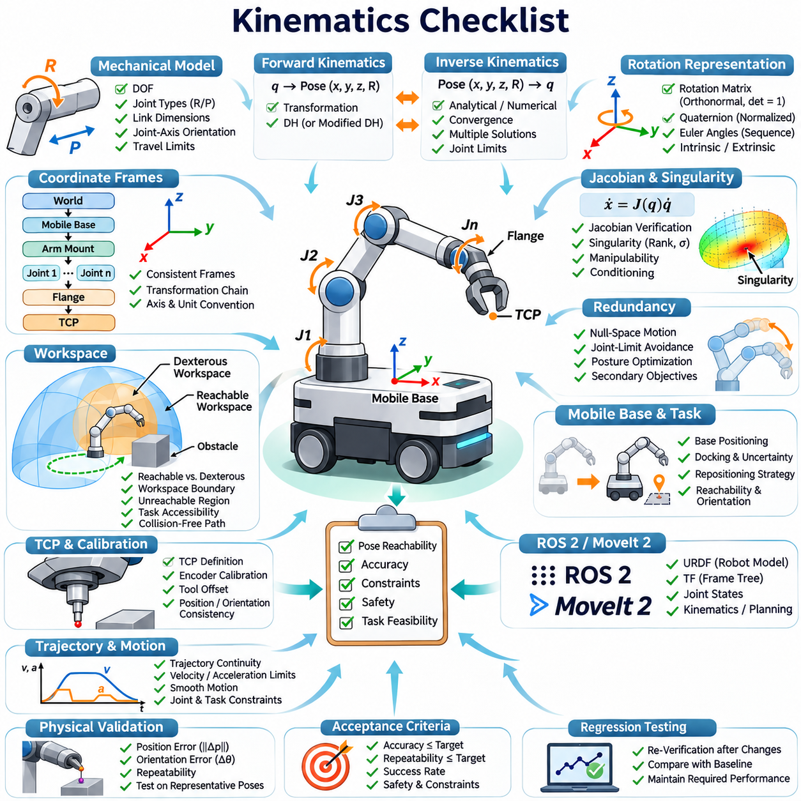
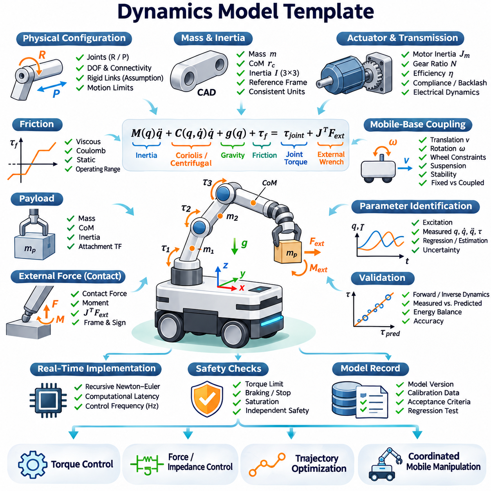
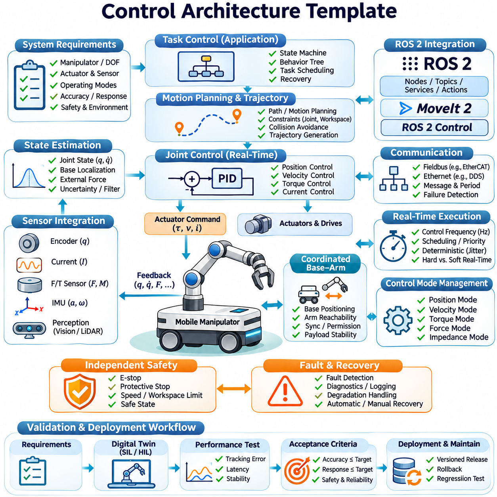
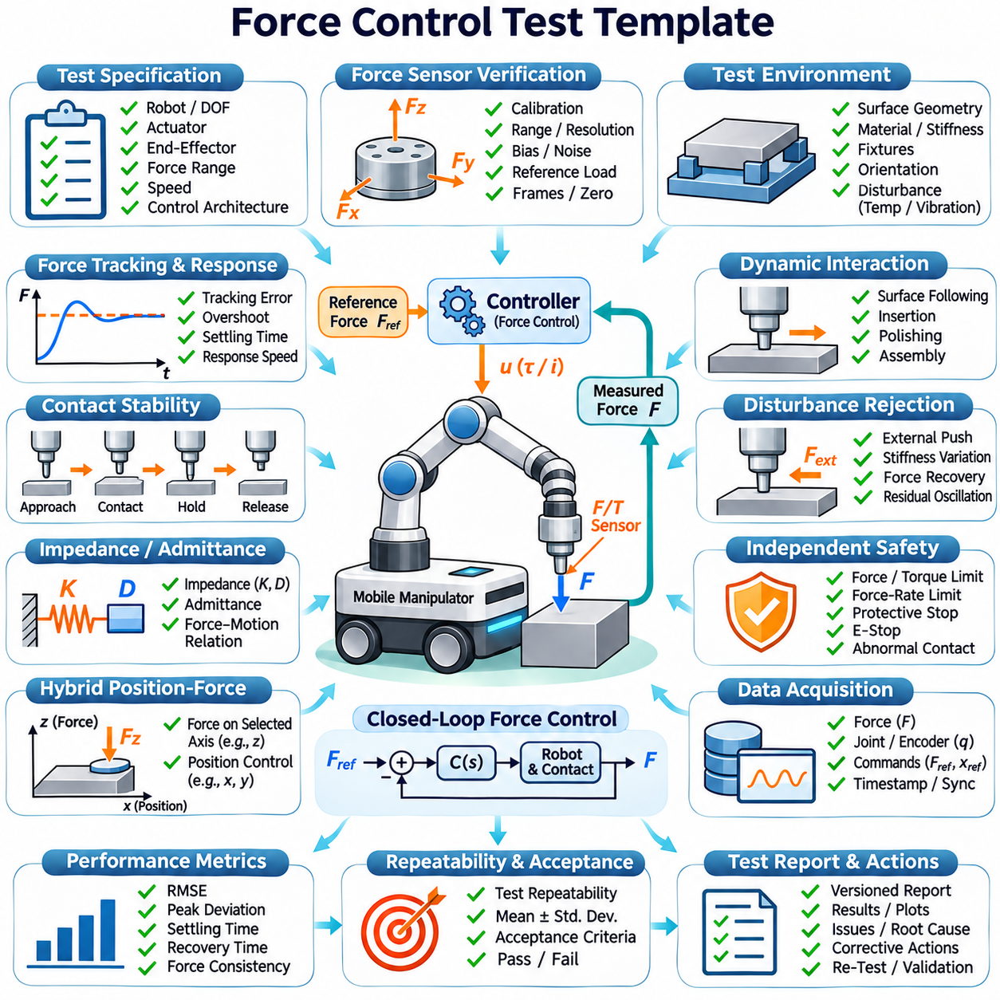
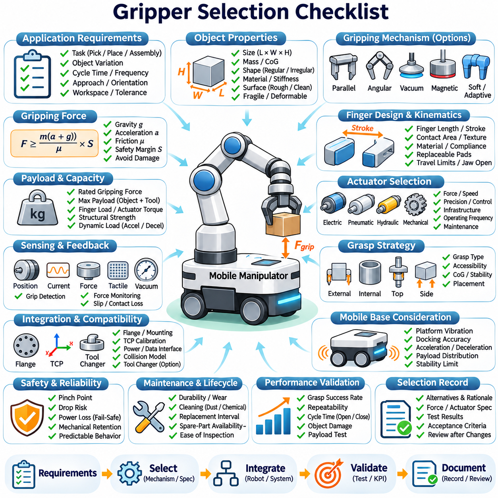
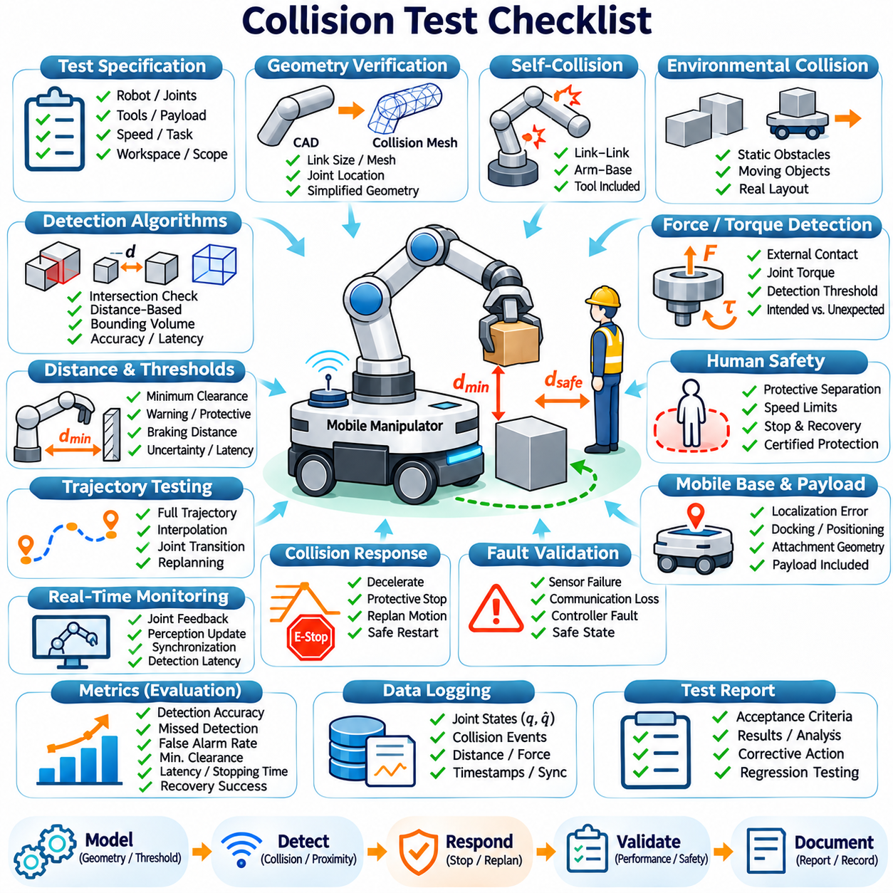
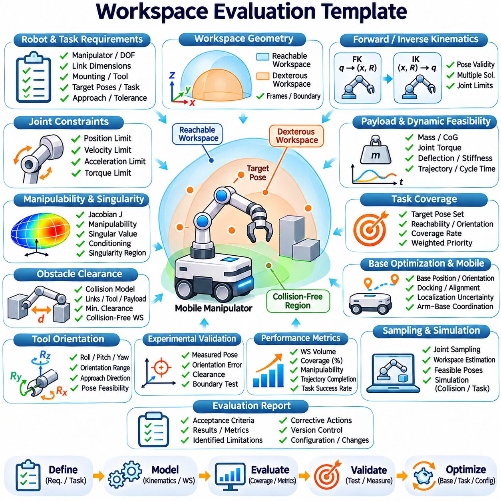

**Volume 02. Manipulator Mechanics and Control**

# Chapter 16. Checklists and Templates

## 01 Kinematics Checklist

{width="7.268055555555556in" height="7.268055555555556in"}

A kinematics checklist provides a systematic method for verifying that a robotic manipulator can achieve its required positions, orientations, and movements within defined mechanical constraints. It connects geometric modeling, coordinate transformations, joint configurations, workspace analysis, and motion feasibility into a unified engineering review. For mobile manipulators, the checklist must also consider the relationship between the robotic arm and its moving platform.

The initial verification examines the manipulator configuration and mechanical structure. Engineers confirm the number of degrees of freedom, joint types, link dimensions, joint-axis orientations, and mechanical travel limits. Revolute and prismatic joints must be represented consistently with the physical mechanism. Link offsets, mounting geometry, and actuator arrangements should match the approved mechanical design and the corresponding digital model.

Coordinate frame verification establishes a consistent geometric reference system throughout the robot. The checklist examines the world frame, mobile base frame, manipulator mounting frame, individual joint frames, flange frame, and tool center point. Every transformation must follow a documented convention, including axis orientation, rotation order, and unit definitions. Incorrect frame relationships can produce substantial positioning errors even when individual joint measurements are accurate.

Forward kinematics validation confirms that the mathematical model correctly converts joint configurations into end-effector positions and orientations. Engineers review transformation matrices, Denavit--Hartenberg parameters, modified DH conventions, or equivalent rigid-body formulations. The calculated poses should be compared against independent geometric calculations, simulation results, and physical measurements across representative joint configurations.

Rotation representation requires particular attention because orientation errors frequently originate from inconsistent mathematical conventions. Rotation matrices must remain orthonormal with a determinant of positive one, while quaternions must satisfy normalization requirements. Euler-angle sequences and intrinsic or extrinsic rotation conventions must be explicitly identified. Conversion tests should confirm that equivalent representations produce consistent physical orientations.

Inverse kinematics verification determines whether the manipulator can generate valid joint configurations for specified end-effector targets. The checklist examines analytical and numerical solution methods, convergence behavior, solution accuracy, and computational efficiency. Multiple valid solutions should be evaluated when available. Each candidate must satisfy joint limits, geometric constraints, and the intended operational configuration before being accepted.

Numerical inverse kinematics methods require additional checks for initialization sensitivity and convergence reliability. Engineers should evaluate solver behavior using different initial joint configurations, target positions, and orientation requirements. Termination thresholds, maximum iterations, and numerical tolerances must be documented. Unreachable targets should produce explicit failure results rather than unstable joint commands or misleading success indications.

Jacobian verification establishes whether the manipulator model correctly relates joint velocities to end-effector linear and angular velocities. Analytical Jacobians should be compared with finite-difference approximations at representative configurations. Frame consistency, angular velocity conventions, and matrix dimensions must be checked. These tests help identify incorrect joint-axis definitions, transformation ordering errors, and implementation defects.

Singularity assessment identifies configurations where the manipulator loses instantaneous motion capability in one or more Cartesian directions. The checklist evaluates Jacobian rank, singular values, manipulability measures, and conditioning across the operational workspace. Engineers should determine whether singularities occur near frequently used task poses. Appropriate avoidance strategies, damping methods, and operational restrictions must then be documented.

Workspace evaluation verifies the geometric region accessible to the end effector under the manipulator\'s joint constraints. Reachable workspace and dexterous workspace should be distinguished because reaching a position does not guarantee the ability to achieve every required orientation. Engineers examine workspace boundaries, internal unreachable regions, and task-specific accessibility. Representative target poses should be tested rather than relying exclusively on maximum reach specifications.

Redundant manipulators require verification of how additional degrees of freedom are managed. Null-space motion, joint-limit avoidance, posture optimization, and secondary objectives must preserve the primary end-effector task within defined tolerances. The checklist should evaluate whether redundancy resolution introduces unexpected joint movement or unstable transitions. Consistency between successive solutions is particularly important during continuous manipulation.

For mobile manipulators, the relationship between mobile base positioning and arm kinematics introduces additional verification requirements. The complete transformation chain must include world localization, mobile base pose, arm mounting geometry, and tool coordinates. Base position and orientation uncertainty should be considered when evaluating end-effector accuracy. Any movement of the platform changes the global relationship between the manipulator and its task environment.

Base positioning accuracy must be evaluated together with arm reachability and task orientation requirements. Engineers should verify that expected docking or localization deviations do not place target poses outside the feasible workspace. The checklist should also examine whether small base orientation errors produce unacceptable tool-position deviations. Repositioning strategies may be required when the manipulator cannot compensate for accumulated geometric uncertainty.

Tool center point calibration ensures that the mathematical end-effector reference corresponds to the actual working point of the installed tool. Grippers, inspection cameras, welding torches, and assembly tools may introduce different offsets and orientation requirements. Engineers must verify the transformation between the robot flange and the functional tool frame. Tool replacement or mechanical adjustment should trigger recalibration and renewed kinematic validation.

Joint encoder calibration and mechanical zero-position verification are essential for maintaining agreement between mathematical models and physical hardware. Encoder offsets, joint direction conventions, transmission ratios, and homing procedures should be checked against reference configurations. Small calibration errors can accumulate through multiple links and produce significant end-effector deviations. Calibration results should be recorded with measurement conditions and acceptance tolerances.

Collision-related geometric verification examines whether valid kinematic solutions remain compatible with the physical structure and surrounding environment. Self-collision constraints, arm-to-base interference, tool geometry, and nearby equipment must be represented accurately. A mathematically reachable pose may still be operationally prohibited. The checklist should therefore distinguish geometric reachability from collision-free feasibility and confirm that both conditions are satisfied.

Trajectory-level verification extends kinematic testing beyond isolated target poses. Engineers evaluate joint continuity, velocity limits, acceleration constraints, and Cartesian path consistency across complete movements. Interpolation between valid endpoints can still encounter singularities, joint-limit violations, or inaccessible intermediate poses. Representative trajectories should therefore be checked through simulation and controlled physical execution before operational deployment.

Software integration verification confirms that kinematic models are interpreted consistently by robot controllers, simulation environments, and motion-planning frameworks. In ROS 2 and MoveIt 2 environments, URDF descriptions, joint states, TF transformations, and planning group definitions require careful review. The checklist should identify discrepancies between model geometry, measured joint feedback, and planned end-effector poses during runtime.

Kinematic accuracy testing should cover repeatability, absolute positioning error, orientation error, and sensitivity to configuration changes. Measurements must use traceable reference procedures and clearly defined coordinate frames. Tests should include central workspace positions, boundary regions, and challenging orientations. Repeated measurements help distinguish systematic model errors from random variation, mechanical backlash, and measurement uncertainty.

Validation documentation should preserve the robot configuration, model revision, calibration parameters, test conditions, expected results, and observed deviations. Each verification item requires an objective acceptance criterion and a recorded outcome. Failed tests should identify the affected subsystem, likely causes, and required corrective actions. Changes to link geometry, joint offsets, software conventions, or mounted tools should initiate appropriate regression testing.

The completed kinematics checklist serves as an engineering baseline for subsequent dynamics modeling, motion planning, control development, and system integration. Its purpose is not simply to confirm that mathematical equations execute successfully, but to demonstrate agreement between the digital model and the physical robot. Reliable kinematic verification reduces integration risk and supports accurate, repeatable, and safe manipulation in industrial environments.

## 02 Dynamics Model Template

{width="7.268055555555556in" height="7.268055555555556in"}

A dynamics model template provides a standardized framework for describing the forces, torques, and mechanical interactions governing robotic manipulator motion. Unlike kinematic models, which describe geometric relationships without considering forces, dynamic models explain how actuator inputs produce motion under inertia, gravity, friction, and external loads. A consistent template supports simulation, controller development, system identification, and engineering validation.

The template begins with a description of the manipulator\'s physical configuration and modeling assumptions. Engineers document the number of joints, link connectivity, actuator types, transmission mechanisms, and operating conditions. Each joint is classified as revolute or prismatic, while mechanical constraints and allowable motion ranges are specified. Simplifying assumptions, including rigid links or negligible structural deformation, must be explicitly recorded.

Mass and inertia properties form the foundation of an accurate dynamic model. For every link, the template records mass, center-of-mass coordinates, inertia tensor, and reference coordinate frame. These parameters should originate from validated CAD models, manufacturer specifications, or experimental measurements. Inertia tensors must satisfy physical consistency requirements, and all values should use a common unit system to prevent modeling errors.

The mathematical formulation describes the relationship between joint motion and generalized forces. A standard rigid-body manipulator model includes an inertia matrix, Coriolis and centrifugal effects, gravitational forces, friction, and external joint torques. The template identifies the generalized coordinates, velocity variables, acceleration variables, and torque conventions. Each mathematical term must correspond to a clearly defined physical phenomenon.

The inertia matrix represents the configuration-dependent resistance of the manipulator to joint acceleration. Engineers verify its dimensions, symmetry, and positive definiteness for physically valid unconstrained coordinates. Changes in arm posture alter the distribution of mass relative to the joint axes, producing variations in required actuator torque. The template should document how inertia properties are calculated and validated across representative configurations.

Coriolis and centrifugal terms describe velocity-dependent interactions between moving links. These effects become increasingly important during coordinated multi-joint motion and high-speed operation. The template specifies the mathematical convention used to represent these terms because different formulations may produce equivalent generalized forces. Numerical tests should verify consistency with the inertia matrix and the selected equations of motion.

Gravity compensation modeling determines the joint torques required to balance gravitational loading at different manipulator configurations. The template records gravitational acceleration, reference frame orientation, payload assumptions, and link mass distributions. Predicted gravity torques should be compared against measured holding torques when practical. This verification is especially important for vertically articulated manipulators carrying variable payloads.

Friction modeling addresses mechanical resistance within joints, transmissions, bearings, and actuators. Common representations include viscous friction, Coulomb friction, and static friction effects. The template identifies which components are included and documents their parameters and operating ranges. Because friction behavior can depend on temperature, speed, and loading conditions, experimental characterization may be necessary for high-accuracy control.

Actuator and transmission dynamics extend the model beyond ideal joint torque generation. Engineers document motor inertia, gear ratios, transmission efficiency, torque constants, and actuator limitations. When relevant, electrical dynamics, gearbox compliance, and backlash are included. The template distinguishes commanded motor torque from actual joint torque, ensuring that control algorithms account for mechanical and electrical conversion effects.

Payload modeling describes how attached tools and manipulated objects influence the robot\'s dynamic behavior. The template records payload mass, center of gravity, inertia properties, and attachment transformation. Changes in payload configuration modify gravitational loading and joint acceleration requirements. Engineers should evaluate representative minimum, nominal, and maximum payload conditions to establish reliable operating limits.

External force modeling represents interactions between the manipulator and its environment. Contact forces, tool reactions, and externally applied moments can be transformed into generalized joint torques using the manipulator Jacobian. The template specifies force measurement frames, sign conventions, and contact assumptions. This information is essential for force control, impedance control, assembly operations, and collision-response analysis.

For mobile manipulators, the dynamics template must consider interactions between the robotic arm and mobile platform. Arm acceleration and payload movement can generate reaction forces and moments transmitted through the mounting structure. Depending on the application, the platform may be treated as stationary or included in a coupled dynamic model. The selected assumption must reflect the intended operating conditions and platform stability requirements.

A coupled mobile manipulation model may include base translation, base rotation, wheel constraints, suspension behavior, and manipulator joint motion. Engineers should distinguish holonomic and nonholonomic platform constraints when constructing the equations of motion. The template documents whether base motion is prescribed, controlled independently, or dynamically coupled with arm motion. This distinction affects simulation fidelity and coordinated control design.

Dynamic parameter identification provides a practical method for refining uncertain model properties. Experimental trajectories are executed while collecting joint positions, velocities, accelerations, and actuator torque estimates. Regression-based identification can estimate combinations of inertial and friction parameters that are observable from the measurements. The template should document excitation trajectories, filtering procedures, estimation methods, and parameter uncertainty.

Simulation validation compares predicted manipulator behavior against numerical reference models and physical experiments. Forward dynamics tests calculate motion from applied torques, while inverse dynamics tests estimate torques required for prescribed trajectories. Engineers examine trajectory agreement, torque prediction error, and numerical stability. Representative tests should cover different postures, speeds, payloads, and external loading conditions.

Energy consistency provides an additional verification method for dynamic equations. In the absence of dissipative forces and external energy inputs, the model should satisfy the expected mechanical energy balance. Kinetic and potential energy calculations can reveal errors in inertia, gravity, or velocity-dependent terms. The template should include energy-based checks alongside direct comparisons of simulated and measured motion.

Real-time implementation requirements determine whether the dynamic model can support practical robot control. Engineers document computation frequency, execution latency, numerical precision, and processor utilization. Recursive Newton--Euler algorithms may be selected for efficient inverse dynamics computation, while other formulations support simulation and optimization. Model complexity must be balanced against timing constraints and the required control accuracy.

Safety-related dynamic verification examines predicted torque limits, acceleration constraints, braking behavior, and mechanical loading. The model should identify conditions where actuator saturation or excessive joint loading may occur. Dynamic predictions can support protective control strategies, but they do not replace independent safety mechanisms. Conservative parameter bounds and uncertainty margins should be considered during safety-related engineering evaluations.

The completed template should include model identification information, software versions, parameter sources, coordinate conventions, validation datasets, and acceptance criteria. Every model revision must remain traceable to the corresponding mechanical configuration and calibration state. Discrepancies between predicted and measured behavior should be documented with corrective actions. Version-controlled records support reproducibility and regression testing throughout development.

A standardized dynamics model template establishes a reliable foundation for torque control, gravity compensation, force interaction, trajectory optimization, and mobile manipulation coordination. Its engineering value depends on the consistency between mathematical assumptions, physical parameters, and measured robot behavior. Thorough documentation and validation transform the dynamic model from a theoretical representation into a practical tool for robust industrial robotic systems.

## 03 Control Architecture Template

{width="7.268055555555556in" height="7.268055555555556in"}

A control architecture template provides a standardized framework for organizing the hardware, software, communication, and control functions of a robotic manipulator. It defines how high-level task commands are translated into coordinated joint movements while maintaining accuracy, stability, and safety. For mobile manipulators, the architecture must also coordinate robotic arm operation with mobile platform behavior, environmental perception, and system-level supervision.

The template begins by defining system requirements and operational boundaries. Engineers document the manipulator configuration, degrees of freedom, actuator characteristics, sensor interfaces, and expected operating modes. Performance requirements include positioning accuracy, response time, control frequency, and allowable tracking error. Safety constraints, environmental conditions, and interaction requirements must be identified before selecting the control architecture.

A hierarchical control structure separates decision-making functions according to their timing requirements and responsibilities. High-level controllers manage task execution, motion objectives, and operational sequencing. Mid-level controllers generate trajectories and coordinate multiple joints, while low-level controllers regulate position, velocity, current, or torque. Clear separation between these layers improves modularity, maintainability, and fault isolation.

Task-level control translates application objectives into executable robot operations. The template defines how commands such as grasping, assembly, inspection, or material handling are represented and scheduled. Task execution may involve state machines, behavior trees, or workflow managers. Each operation requires explicit entry conditions, completion criteria, timeout handling, and recovery procedures to ensure predictable execution.

Motion planning and trajectory generation form the connection between task-level decisions and joint-level execution. Planning modules determine feasible paths while considering joint limits, workspace boundaries, singularities, and collision constraints. Trajectory generators convert planned paths into time-parameterized references. The template specifies planning interfaces, trajectory representations, update frequencies, and mechanisms for handling planning failures.

Joint-level control defines how actuator commands are generated from desired motion references and measured feedback. Position, velocity, and torque control modes may be implemented independently or through cascaded control loops. The template documents controller gains, feedback variables, sampling periods, and actuator saturation limits. Feedforward compensation and model-based control may be incorporated when improved tracking performance is required.

Real-time control requirements determine the execution environment for time-critical functions. Engineers specify control-loop frequencies, scheduling priorities, communication deadlines, and acceptable timing jitter. Deterministic execution is particularly important for torque regulation, force interaction, and coordinated multi-joint motion. The template should distinguish hard real-time control components from supervisory functions that tolerate variable execution delays.

Sensor integration provides the feedback required for closed-loop control. Joint encoders, motor current sensors, force-torque sensors, inertial measurement units, and external perception devices contribute different measurements. The template identifies sensor ownership, sampling rates, calibration procedures, and filtering methods. Timestamp consistency and coordinate frame alignment must be maintained when combining measurements from multiple sources.

State estimation converts raw sensor measurements into reliable representations of robot motion and operating conditions. Joint positions, velocities, actuator states, and external forces may require filtering or observer-based estimation. For mobile manipulators, base localization and orientation estimates are also necessary. The template specifies estimation algorithms, uncertainty handling, update rates, and behavior when measurements become unavailable or unreliable.

Communication architecture defines how commands, feedback, and diagnostic information move between system components. Industrial fieldbuses, Ethernet networks, and middleware interfaces may connect drives, controllers, sensors, and supervisory computers. The template records communication protocols, message definitions, update periods, and failure detection mechanisms. Critical control traffic should be isolated or prioritized according to system requirements.

ROS 2 integration provides a modular software framework for distributed robotic control. The template identifies nodes, topics, services, actions, lifecycle states, and interface definitions. ROS 2 Control can connect hardware interfaces with joint controllers, while MoveIt 2 supports manipulation planning and execution. Engineers must document responsibility boundaries between middleware coordination and deterministic actuator control.

Mobile manipulator coordination requires explicit management of interactions between the mobile base and robotic arm. The architecture defines whether manipulation occurs while the platform is stationary or during coordinated movement. Base positioning, arm reachability, payload stability, and collision constraints influence execution decisions. The template should specify synchronization mechanisms, motion permissions, and recovery behavior when positioning requirements are not satisfied.

Control mode management governs transitions between position control, velocity control, torque control, force control, and impedance control. Each mode may require different feedback signals, controller parameters, and safety limits. The template defines transition conditions, initialization procedures, and command ownership. Smooth switching mechanisms are necessary to prevent discontinuities, unintended motion, or excessive actuator forces.

Safety control architecture must remain clearly distinguished from ordinary operational control. Emergency stop functions, protective stops, speed limits, workspace restrictions, and collision monitoring require defined responsibilities. Safety-rated functions should use appropriate independent or certified mechanisms where required. The template documents fault detection, safe-state transitions, restart authorization, and interfaces between safety controllers and operational software.

Fault management establishes predictable behavior when hardware, software, or communication components fail. Engineers classify faults according to severity, operational impact, and recovery requirements. Sensor failures, actuator faults, controller timeouts, and communication interruptions require explicit responses. The template specifies diagnostic reporting, event logging, degraded operation policies, and conditions under which automatic recovery is permitted.

Software engineering practices support long-term reliability and maintainability of the control architecture. The template records module ownership, interface contracts, configuration parameters, software dependencies, and version information. Unit testing, integration testing, and automated regression testing should verify critical functionality. Configuration management ensures that deployed controller settings remain consistent with validated system configurations.

Performance validation determines whether the implemented architecture satisfies its original engineering requirements. Engineers measure trajectory tracking error, control latency, timing jitter, response stability, and recovery performance. Tests should include nominal operation, maximum payload conditions, communication disturbances, and representative fault scenarios. Results must be compared against predefined acceptance criteria and documented for future reference.

Simulation and digital twin environments provide opportunities to validate control architecture before physical deployment. Hardware-in-the-loop and software-in-the-loop testing can evaluate controller behavior, communication interfaces, and operational sequencing. Simulation models should represent relevant actuator limitations, sensor delays, and mechanical constraints. Differences between simulated and physical behavior must be identified during commissioning.

Deployment documentation should include architecture revisions, controller configurations, communication mappings, safety settings, calibration references, and validation records. Every change affecting control behavior must be traceable to its engineering justification and test results. The template should define commissioning procedures, rollback mechanisms, and maintenance responsibilities. Consistent documentation supports reproducible deployment across multiple robotic platforms.

A completed control architecture template establishes a common engineering reference for mechanical, electrical, software, and safety teams. It connects task planning, motion generation, feedback control, communication, and system supervision into a coherent operational structure. By defining interfaces, timing constraints, responsibilities, and validation procedures, the architecture supports scalable, reliable, and safe industrial mobile manipulation.

## 04 Force Control Test Template

{width="7.268055555555556in" height="7.268055555555556in"}

A force control test template provides a systematic framework for evaluating how accurately and reliably a robotic manipulator regulates interaction forces during physical contact with objects or the surrounding environment. The testing process examines force measurement, feedback response, control stability, and contact behavior under representative operating conditions. Its purpose is to establish repeatable evaluation procedures and verify that the implemented force control system satisfies predefined performance and safety requirements.

The test specification begins by defining the robot configuration and experimental objectives. Engineers document the manipulator model, number of joints, actuator characteristics, end-effector configuration, force sensor installation, and controller architecture. The intended contact task, expected force range, operating speed, and environmental conditions must also be identified. These details establish a reproducible baseline for comparing test results across different configurations and experiments.

Force sensor verification establishes the reliability of the measurements used by the feedback controller. The test examines sensor calibration, measurement range, resolution, bias, noise, and directional consistency. Known reference loads should be applied across representative measurement axes to evaluate accuracy. Engineers should also verify sensor mounting stiffness, coordinate transformations, and zero-offset compensation because measurement errors can directly affect force regulation performance.

The test environment must reproduce the physical conditions expected during actual manipulation. Contact surfaces, object materials, fixtures, and environmental constraints should be selected according to the target application. The template records surface geometry, material stiffness, contact orientation, and fixture stability. Environmental variations such as temperature, vibration, and external disturbances should be considered when they may influence sensor measurements or contact dynamics.

Force control performance is evaluated by comparing the commanded reference force with the measured interaction force. The test examines steady-state error, settling time, overshoot, response speed, and force tracking accuracy. Engineers should conduct experiments at multiple reference force levels to identify nonlinear behavior and operating limitations. Both increasing and decreasing force commands should be evaluated to reveal differences caused by friction, compliance, or mechanical hysteresis.

Force response testing examines how the manipulator reacts to changes in contact conditions and reference commands. Step inputs, ramp profiles, and controlled force variations can be used to evaluate transient behavior. The resulting measurements reveal controller responsiveness, damping characteristics, and potential oscillations. Test conditions should remain consistent so that differences in response can be attributed to controller parameters rather than uncontrolled experimental variations.

Contact stability testing determines whether the robot maintains controlled interaction without excessive vibration, force oscillation, or unintended separation. Engineers evaluate the behavior of the manipulator when approaching, establishing, maintaining, and releasing contact. The test should include different contact stiffness conditions and representative surface geometries. Stable force regulation requires appropriate controller gains, sampling frequency, sensor filtering, and mechanical compliance.

Impedance and admittance control tests evaluate the relationship between applied forces and resulting robot motion. For impedance control, the test examines whether the robot produces the intended dynamic relationship between displacement, velocity, and interaction force. For admittance control, external force measurements are evaluated against the generated motion response. Both approaches should be tested under representative stiffness and damping settings to verify predictable interaction behavior.

Hybrid position-force control testing examines whether the manipulator can regulate force along selected directions while maintaining position control along others. The test defines the controlled Cartesian axes, reference positions, target forces, and contact constraints. Engineers evaluate whether the controller maintains the intended separation between position and force objectives. Unwanted coupling, orientation errors, and excessive force along unconstrained directions should be identified.

Dynamic interaction testing evaluates force control during continuous manipulation rather than static contact alone. Representative tasks may include surface following, insertion, pressing, polishing, and controlled assembly. The test measures force consistency while the end effector moves along the prescribed trajectory. Motion speed, surface variation, and changing contact geometry should be considered because they can introduce disturbances and affect interaction stability.

Disturbance rejection testing examines the ability of the controller to maintain the desired force when unexpected external influences occur. Controlled disturbances may include changes in surface position, variations in object stiffness, external pushes, and measurement noise. Engineers record force deviations, recovery time, and residual oscillations. The results help determine whether the controller can maintain reliable interaction under realistic operating uncertainties.

Safety verification is an essential part of force control testing. The test evaluates maximum contact force, force-rate limitations, actuator torque constraints, emergency stopping behavior, and protective responses to abnormal contact conditions. Engineers should verify that excessive force commands are rejected or appropriately limited. Independent safety functions must remain effective even when the force sensor, controller, or communication interface experiences a fault.

Test data acquisition should capture synchronized measurements from the force sensor, joint encoders, actuator commands, controller states, and relevant external sensors. Sampling frequencies must be sufficient to characterize transient force responses and dynamic interactions. The template documents timestamp synchronization, filtering settings, measurement units, and data storage procedures. Complete records enable repeatable analysis and support comparison between simulation predictions and physical experiments.

Performance evaluation converts experimental measurements into objective indicators of force control quality. Typical indicators include steady-state force error, root mean square error, peak force deviation, settling time, overshoot, and disturbance recovery time. Where appropriate, force tracking performance can also be evaluated across multiple axes. Acceptance thresholds should be defined before testing to prevent subjective interpretation of experimental results.

Repeatability testing determines whether similar force control performance can be achieved across repeated experimental runs. Engineers execute identical test sequences under controlled initial conditions and compare the resulting force profiles. Variations may indicate sensor drift, mechanical backlash, temperature effects, controller instability, or inconsistent contact conditions. Repeated measurements provide statistical evidence for evaluating system reliability and identifying configuration-dependent behavior.

The completed test report should preserve the robot configuration, sensor calibration records, controller parameters, environmental conditions, experimental procedures, and measured results. Each test case should include its expected behavior, acceptance criteria, actual outcome, and identified deviations. Failed tests should document probable causes and corrective actions. Version-controlled records allow engineers to compare controller revisions and reproduce previously validated experimental conditions.

A standardized force control test template establishes a consistent foundation for validating robotic interaction capabilities. It connects sensor verification, controller performance, contact stability, dynamic response, and safety evaluation within a repeatable experimental process. Thorough testing helps identify limitations before industrial deployment and provides objective evidence that the manipulator can perform contact-intensive operations accurately, consistently, and safely.

## 05 Gripper Selection Checklist

{width="7.268055555555556in" height="7.268055555555556in"}

A gripper selection checklist provides a systematic framework for identifying and evaluating end-effectors suitable for specific robotic manipulation tasks. The selection process considers object geometry, mass, material properties, surface conditions, gripping mechanisms, and operational requirements. The objective is to ensure that the selected gripper can acquire, hold, transport, and release objects reliably while maintaining required accuracy, productivity, and safety throughout the manipulation process.

The selection process begins with a clear definition of the application requirements. Engineers document the target objects, expected object variations, handling frequency, cycle time, and operating environment. The task may involve picking, placing, assembly, packaging, or material transfer. Required gripping orientations, approach directions, available workspace, and positioning tolerances must also be identified because they directly influence gripper geometry and mechanism selection.

Object characterization establishes the physical conditions that the gripper must accommodate. Relevant properties include object dimensions, mass, center of gravity, shape, material, surface roughness, and structural stiffness. Engineers should examine whether objects are rigid, flexible, deformable, porous, or fragile. Variations in manufacturing tolerances and surface contamination should also be considered because they can significantly affect gripping reliability and contact behavior.

Gripping mechanism selection determines how the gripper establishes and maintains contact with an object. Parallel grippers provide controlled linear finger motion and are suitable for many conventional industrial picking tasks. Angular grippers offer rotational finger movement and may provide advantages in restricted spaces. Vacuum grippers use pressure differences to generate holding forces, while magnetic grippers are appropriate for compatible ferromagnetic materials. Soft and adaptive grippers can accommodate irregular geometries and delicate objects.

The required gripping force must be calculated according to object mass, acceleration, gravity, contact geometry, and friction characteristics. Engineers should determine the minimum force necessary to prevent slipping or unintended movement during the complete handling trajectory. Additional safety margins are required to accommodate uncertainty in object properties and operating conditions. Excessive gripping force must also be avoided because it can deform, damage, or permanently mark sensitive objects.

Finger design and contact geometry influence the stability and repeatability of object handling. The checklist evaluates finger length, opening width, contact area, material, surface texture, and mechanical compliance. Custom finger profiles may be required for irregular objects or specialized assembly operations. Contact surfaces should provide sufficient friction without damaging the object. Replaceable finger pads and adjustable gripping structures can improve adaptability across different product configurations.

Payload and gripping capacity verification ensures that the selected gripper can handle the required object mass within its mechanical limitations. Engineers consider rated gripping force, maximum payload, finger load capacity, actuator torque, and structural strength. The gripper\'s own mass must also be included when calculating the total manipulator payload. Dynamic loading during acceleration, deceleration, and changes in robot orientation should be considered rather than relying exclusively on static holding capacity.

Gripper kinematics determine whether the mechanism can accommodate the required range of object dimensions and gripping configurations. The checklist examines jaw opening, closing distance, finger trajectories, mechanical transmission ratios, and available gripping positions. Engineers should verify that the gripper can approach the object without interference and establish stable contact across expected dimensional variations. Mechanical end stops and joint limits must prevent unintended overtravel or excessive loading.

Actuator selection determines how the gripping mechanism generates and controls its motion. Pneumatic, electric, hydraulic, and mechanically driven solutions offer different advantages in terms of force, speed, precision, controllability, and maintenance. Electric grippers provide programmable position and force control, while pneumatic grippers often offer simple and rapid operation. The selection should reflect available infrastructure, energy requirements, control interfaces, and expected operating frequency.

Sensing and feedback capabilities are essential for verifying successful gripping operations. The checklist considers jaw position sensors, motor current monitoring, force sensors, tactile sensors, and vacuum pressure sensors where applicable. These measurements help determine whether an object has been acquired, whether sufficient gripping force is maintained, and whether unexpected slipping or contact loss has occurred. Sensor integration should support reliable detection without introducing unnecessary complexity.

Gripping strategy evaluation determines how the gripper interacts with the target object throughout the task. Engineers distinguish between external gripping, internal gripping, top gripping, side gripping, and vacuum-based surface attachment. The selected strategy must consider object accessibility, surrounding obstacles, center of gravity, and required placement orientation. Stable grasp configurations should minimize the possibility of object rotation, displacement, or unintended release during transportation.

End-effector compatibility verification ensures that the gripper can be properly integrated with the robotic manipulator. Engineers examine flange dimensions, mounting interfaces, mechanical alignment, electrical connections, pneumatic connections, and communication protocols. The tool center point must be calibrated after installation, and the gripper geometry must be represented correctly in the robot\'s kinematic and collision models. Automatic tool changers may be considered when applications require multiple gripping tools.

For mobile manipulators, gripper selection must also consider the dynamic behavior of the mobile platform. Platform vibration, docking accuracy, base movement, and payload distribution can influence grasp stability. Engineers should evaluate whether the gripper maintains object retention during expected acceleration and deceleration conditions. The combined mass of the manipulator, gripper, and object must remain within the mobile platform\'s payload and stability limits.

Safety and reliability evaluation examines potential hazards associated with gripping, releasing, and transporting objects. The checklist considers finger pinch points, excessive contact pressure, dropped-object risks, actuator failures, and loss of pneumatic or electrical power. Fail-safe gripping mechanisms or mechanical retention features may be necessary when dropping an object could create a hazard. The selected gripper should support appropriate protective measures and predictable behavior during abnormal operating conditions.

Maintenance and lifecycle considerations influence the long-term suitability of the selected gripper. Engineers evaluate component durability, wear resistance, replacement intervals, cleaning requirements, spare-part availability, and ease of inspection. Industrial environments may introduce dust, moisture, chemicals, or temperature variations that affect gripper performance. Standardized mounting interfaces and replaceable contact components can reduce maintenance complexity and improve equipment availability.

Performance validation confirms that the selected gripper satisfies the intended application requirements under representative operating conditions. Tests should evaluate gripping success rate, holding stability, positioning repeatability, opening and closing time, maximum payload, and object damage. Representative object variations and repeated handling cycles should be included. Acceptance criteria must be established before testing so that different gripper configurations can be compared objectively.

The completed selection record should document the application requirements, object characteristics, selected gripping mechanism, force calculations, actuator specifications, interface requirements, safety considerations, and experimental results. Alternative gripper configurations and their selection rationale should also be recorded. Any changes to object properties, payload requirements, or operating conditions should trigger a review of the original selection decision.

A standardized gripper selection checklist establishes a consistent engineering process for choosing end-effectors across different robotic applications. It connects object characterization, gripping mechanics, actuator capabilities, sensing, system integration, and operational safety into a unified evaluation procedure. Careful selection and experimental validation improve grasp reliability, reduce object damage, and support efficient and repeatable robotic manipulation in industrial environments.

## 06 Collision Test Checklist

{width="7.268055555555556in" height="7.268055555555556in"}

A collision test checklist provides a systematic framework for verifying whether a robotic manipulator can operate without unintended contact with itself, surrounding equipment, objects, or people. The testing process evaluates geometric collision models, motion trajectories, detection algorithms, reaction mechanisms, and safety responses under representative operating conditions. Its primary objective is to identify collision risks before deployment and confirm that the robot can detect, prevent, and respond appropriately to potentially hazardous contact situations.

The test specification begins by defining the robot configuration and collision testing objectives. Engineers document the manipulator structure, number of joints, link geometry, end-effector configuration, payload characteristics, and operating environment. The test scope should include self-collision, environmental collision, tool collision, and interactions with external objects. Expected operating speeds, workspace boundaries, and representative manipulation tasks must also be identified.

Collision geometry verification examines whether the digital representation accurately reflects the physical robot. Engineers compare link dimensions, joint locations, collision meshes, primitive geometries, and end-effector models against mechanical design data. Simplified collision geometries may be used to improve computational efficiency, but they must preserve relevant physical boundaries. Incorrect geometry can cause missed collisions or unnecessary motion restrictions during planning and execution.

Self-collision testing determines whether different parts of the manipulator can unintentionally intersect during movement. The test examines collisions between adjacent links, non-adjacent links, the robot arm, the base, and attached tools. Engineers should verify that legitimate mechanical connections are excluded from collision detection while potentially dangerous configurations remain monitored. Representative joint configurations should cover normal operation, workspace boundaries, and unusual arm postures.

Environmental collision testing evaluates interactions between the robot and surrounding objects. The test environment should represent relevant fixtures, workbenches, machinery, storage structures, walls, and other obstacles. Engineers verify that environmental geometry is correctly represented in the collision model and that obstacle positions correspond to actual operating conditions. Both stationary obstacles and objects that may move during operation should be considered.

Collision detection algorithm testing evaluates the ability of the system to identify geometric intersections and unsafe proximity conditions. Geometric collision checking, distance-based methods, and bounding-volume approaches may be evaluated according to the implemented architecture. Engineers examine detection accuracy, computational latency, numerical robustness, and behavior near geometric boundaries. Test cases should include actual intersections, near-contact conditions, and configurations with sufficient clearance.

Distance measurement verification establishes whether the calculated separation between robot components and obstacles is sufficiently accurate. The test compares estimated distances with known reference measurements across representative configurations. Engineers should examine minimum separation distance, signed distance conventions, geometric approximation errors, and sensitivity to coordinate transformations. Reliable distance information is important for maintaining safety margins and generating collision-free trajectories.

Collision threshold testing determines whether the system correctly distinguishes safe separation from potentially hazardous proximity. Engineers define warning distances, protective thresholds, and minimum acceptable clearances according to the application requirements. The test evaluates whether these thresholds remain effective at different operating speeds and under localization uncertainty. Safety margins should account for robot dimensions, braking distance, perception error, and communication latency.

Trajectory collision testing verifies that planned robot movements remain collision-free throughout execution. Checking only the initial and final configurations is insufficient because intermediate positions may introduce unexpected intersections. Engineers evaluate the complete trajectory, including interpolation points, joint transitions, and end-effector movements. The test should also examine whether changes in obstacle positions require trajectory modification or replanning.

Real-time collision monitoring testing evaluates the ability to detect dangerous conditions while the robot is operating. Engineers measure detection frequency, processing latency, response time, and consistency between the collision model and current robot states. Joint feedback, external perception, and environmental updates should be synchronized appropriately. The system must respond within defined timing limits to prevent delayed detection from developing into an unsafe physical interaction.

Collision response testing examines how the robot behaves after a collision or an unsafe proximity condition is detected. Possible responses include trajectory modification, controlled deceleration, protective stopping, emergency stopping, and motion replanning. Engineers verify that the selected response is appropriate to the severity and nature of the detected condition. Recovery procedures should prevent automatic resumption of motion when the environment or robot state remains unsafe.

Force-based and torque-based collision detection should be evaluated when these methods are implemented. Force sensors and joint torque measurements can identify unexpected external interactions that may not be represented accurately by geometric models. The test examines detection sensitivity, false positive rates, response thresholds, and the influence of dynamic model errors. Normal contact forces during intended manipulation must be distinguished from unexpected collision forces.

Human safety collision testing evaluates the robot\'s behavior when people enter or move within its operating workspace. The test examines human detection, protective separation distances, speed limitations, stopping responses, and recovery behavior. Sensor coverage and detection reliability should be verified under representative environmental conditions. Human-robot interaction testing must follow applicable safety requirements, and ordinary collision detection should not be treated as a replacement for certified protective systems.

Mobile manipulator collision testing introduces additional requirements because both the mobile base and robotic arm can create collision hazards. Engineers evaluate interactions between the base, arm, payload, surrounding structures, and moving obstacles. Base localization errors, docking deviations, platform motion, and arm movement must be considered together. The combined collision model should represent the complete robot configuration rather than treating the mobile platform and manipulator as independent systems.

Payload and end-effector collision testing verifies that attached objects and tools are correctly included in collision monitoring. The effective robot geometry changes when a gripper holds an object or when a different tool is installed. Engineers should verify tool mounting transformations, payload dimensions, attachment states, and collision geometry updates. Failure to account for these changes can produce collision risks even when the original robot model is accurate.

Test data acquisition should capture synchronized robot joint states, planned trajectories, detected collision events, minimum distance measurements, sensor observations, and controller responses. Sampling frequencies must be sufficient to characterize collision detection and reaction behavior. The template should document timestamp synchronization, coordinate frames, sensor configurations, software versions, and environmental conditions. Complete records support repeatable analysis and facilitate investigation of unexpected collision events.

Performance evaluation converts collision test results into measurable indicators of system effectiveness. Relevant metrics include collision detection accuracy, missed detection rate, false alarm rate, minimum clearance, detection latency, stopping time, and recovery success rate. Engineers should evaluate these indicators across different robot configurations, movement speeds, and obstacle arrangements. Acceptance criteria must be defined before testing to provide objective evidence of collision management performance.

Safety validation examines whether collision monitoring and response mechanisms remain effective under abnormal operating conditions. Test scenarios may include sensor failure, communication interruption, inaccurate localization, unexpected payload changes, and controller malfunction. Engineers verify that the system enters an appropriate safe state when reliable collision information is unavailable. Independent safety functions should remain effective even when ordinary motion planning or collision detection software fails.

The completed collision test report should document robot configuration, collision geometry, test scenarios, detection algorithms, safety thresholds, measured results, and identified limitations. Each test case should include expected behavior, acceptance criteria, actual observations, and corrective actions where necessary. Failed tests must be investigated before the affected configuration is approved for deployment. Version-controlled records support regression testing whenever mechanical structures, sensors, algorithms, or control parameters change.

A standardized collision test checklist establishes a consistent engineering process for validating collision detection and response capabilities. It connects geometric verification, proximity monitoring, trajectory evaluation, real-time detection, protective responses, and safety validation within a unified testing framework. Thorough collision testing reduces operational risks, improves motion planning reliability, and provides objective evidence that robotic manipulators can operate safely and predictably in complex industrial environments.

## 07 Workspace Evaluation Template

{width="7.268055555555556in" height="7.268055555555556in"}

A workspace evaluation template provides a systematic framework for determining whether a robotic manipulator can reach and perform required tasks within its operating environment. The evaluation considers geometric reachability, joint limitations, end-effector orientation, obstacles, manipulability, and operational constraints. Its primary objective is to establish measurable workspace characteristics and verify that the robot can execute intended manipulation tasks safely, accurately, and consistently.

The evaluation begins by defining the robot configuration and application requirements. Engineers document the manipulator model, number of joints, link dimensions, joint limits, mounting arrangement, and end-effector geometry. Target tasks, required positions, approach directions, and orientation constraints must also be identified. These specifications establish a reproducible baseline for evaluating workspace coverage and comparing alternative robot configurations.

Workspace geometry analysis determines the spatial region that the manipulator can theoretically reach. Engineers distinguish between reachable workspace, where the end effector can attain a position with at least one orientation, and dexterous workspace, where a specified range of orientations is achievable. Joint limits and mechanical constraints must be included in the analysis. Workspace boundaries should be represented in a consistent coordinate frame to support reliable interpretation.

Forward kinematics provides the mathematical foundation for mapping joint configurations into end-effector positions and orientations. Engineers calculate representative poses across the allowable joint ranges and identify the resulting spatial distribution. Analytical methods, numerical sampling, and simulation may be used according to manipulator complexity. The evaluation should verify coordinate transformations and mechanical parameters before accepting computed workspace boundaries.

Inverse kinematics testing determines whether required target poses can be achieved by valid joint configurations. Engineers evaluate solution existence, joint-limit compliance, multiple solution branches, and sensitivity to target pose variations. A position may be reachable while its required orientation remains infeasible. The template should distinguish position reachability from complete pose feasibility and record targets for which no acceptable inverse kinematics solution exists.

Joint constraint evaluation examines how mechanical limits restrict usable workspace. Relevant constraints include joint position limits, velocity limits, acceleration limits, torque limits, and allowable joint combinations. Engineers should identify configurations near mechanical stops and regions where motion becomes restricted. Workspace calculations must reflect the actual controller limits rather than relying exclusively on theoretical mechanical capabilities.

Manipulability analysis evaluates the robot\'s ability to generate motion in different Cartesian directions at each configuration. Jacobian-based indicators can reveal regions with favorable motion capability and configurations approaching kinematic singularities. Engineers should examine directional sensitivity and the condition of the Jacobian matrix. High positional reachability does not necessarily imply sufficient dexterity or controllability for precision manipulation.

Singularity evaluation identifies configurations where the manipulator loses motion capability in one or more Cartesian directions. Engineers analyze Jacobian rank, singular values, and numerical conditioning across representative workspace regions. Near-singular configurations may require excessive joint velocities to produce modest end-effector motion. The template should document singularity thresholds and identify regions requiring motion restrictions or alternative configurations.

Obstacle-aware workspace evaluation determines which theoretically reachable regions remain usable in the actual environment. Engineers incorporate surrounding machinery, fixtures, walls, workpieces, and other obstacles into collision models. Collision checking must consider the complete manipulator structure, attached tools, and carried objects. The resulting collision-free workspace may be substantially smaller than the geometric workspace predicted by kinematics alone.

End-effector orientation evaluation verifies that the robot can achieve the tool orientations required by the application. Tasks such as insertion, welding, inspection, and surface processing may impose strict orientation constraints. Engineers examine allowable roll, pitch, and yaw ranges at representative target positions. The evaluation should identify locations where positional access is possible but tool alignment or approach direction prevents successful task execution.

Payload-dependent workspace evaluation examines how carried mass affects usable reach and manipulation capability. Engineers consider payload weight, center of gravity, tool mass, joint torque requirements, and structural deflection. Configurations near maximum extension may experience increased loading or reduced precision. The evaluation should distinguish geometrically reachable regions from those that remain operationally feasible under the specified payload.

Dynamic workspace evaluation considers whether target poses can be reached within required motion and timing constraints. Joint velocity, acceleration, torque capacity, trajectory curvature, and cycle time influence practical workspace usability. Engineers should evaluate representative trajectories rather than isolated target poses alone. A location may be geometrically accessible but unsuitable for operations requiring rapid movement, smooth motion, or continuous processing.

Task-oriented workspace evaluation measures coverage according to actual manipulation requirements rather than geometric volume alone. Engineers define target pose sets, task priorities, required orientations, and acceptable performance thresholds. Coverage may be expressed as the proportion of required targets that satisfy reachability, collision clearance, manipulability, and payload constraints. Weighted evaluation can emphasize critical operations or frequently accessed regions.

Base position optimization evaluates how robot mounting location and orientation influence workspace coverage. Engineers compare candidate base positions against task target distributions and environmental constraints. Optimization objectives may include maximizing reachable targets, improving manipulability, reducing joint travel, and avoiding collisions. The selected base configuration should provide adequate coverage while preserving installation access, maintenance clearance, and operational safety.

Mobile manipulator workspace evaluation extends the analysis by incorporating the movement and positioning accuracy of the mobile platform. Engineers evaluate combined base and arm configurations, docking locations, localization uncertainty, and obstacle clearance. The reachable workspace changes with platform position and orientation. The evaluation should determine whether expected docking errors can be compensated by manipulator motion without violating joint, collision, or task constraints.

Workspace sampling and simulation provide practical methods for estimating reachable regions in complex robotic systems. Engineers generate representative joint configurations, calculate end-effector poses, and classify results according to feasibility criteria. Sampling resolution influences the accuracy of estimated boundaries and coverage metrics. Simulation results should be validated against physical measurements because calibration errors and mechanical tolerances can alter actual workspace characteristics.

Performance evaluation converts workspace analysis into objective indicators for engineering decisions. Relevant metrics include reachable workspace volume, dexterous workspace coverage, target pose success rate, minimum obstacle clearance, manipulability distribution, and singularity proximity. Engineers should also evaluate payload feasibility and trajectory completion rates. Acceptance thresholds must be established before testing to ensure consistent comparison between robot configurations.

Experimental validation confirms that the predicted workspace corresponds to the capabilities of the physical manipulator. Engineers execute representative target poses and trajectories while recording joint states, end-effector positions, orientation errors, and collision clearances. Tests should include workspace boundaries, difficult orientations, and high-load configurations. Deviations between simulation and measurement should be investigated before accepting the workspace model.

The completed workspace evaluation report should document robot geometry, joint constraints, coordinate frames, target pose definitions, simulation methods, collision models, and measured results. Each evaluation scenario should include expected coverage, acceptance criteria, observed limitations, and corrective recommendations. Version-controlled records support comparison after changes to robot hardware, tooling, mounting positions, or control software.

A standardized workspace evaluation template establishes a consistent foundation for assessing robotic manipulation capability. It integrates geometric reachability, inverse kinematics, manipulability, collision constraints, payload effects, and task requirements into a unified evaluation process. Thorough workspace assessment supports robot selection, base placement, task planning, and system optimization while reducing integration risks and improving operational reliability.
